# EduWorld

**Game phiêu lưu 3D multiplayer (RPG-lite) học tập cho học sinh lớp 1–9, kèm Admin Portal cho nhà trường và đội vận hành.**

Learn – Play – Practice – Explore – Compete – Connect. *Game trước trong trải nghiệm, giáo dục trong mục đích, thế giới multiplayer xã hội trong tương tác.*

> **Trạng thái (2026-11-17):** Phase 0 — Discovery & Architecture đã xong, Bước 0 (chốt contract cho M-C0/M-C1) đã xong. Repo hiện chứa architecture baseline: 91 ADR, 93 feature spec theo Spec-Driven Development, contract OpenAPI/AsyncAPI/event schema. Chưa có code triển khai; việc tiếp theo là F001 (khung repo, Docker Compose, GitHub Actions) thuộc mốc M-C0.

## Mục lục

1. [Sản phẩm](#1-sản-phẩm)
2. [Nguyên tắc cốt lõi](#2-nguyên-tắc-cốt-lõi)
3. [Công nghệ](#3-công-nghệ)
4. [Kiến trúc tổng quan](#4-kiến-trúc-tổng-quan)
5. [Các luồng chính](#5-các-luồng-chính)
6. [Đa tenant, phân quyền và an toàn](#6-đa-tenant-phân-quyền-và-an-toàn)
7. [Triển khai và vận hành](#7-triển-khai-và-vận-hành)
8. [Cấu trúc repository](#8-cấu-trúc-repository)
9. [Quy trình phát triển: Spec-Driven Development](#9-quy-trình-phát-triển-spec-driven-development)
10. [Lộ trình](#10-lộ-trình)
11. [Bắt đầu đọc](#11-bắt-đầu-đọc)

## 1. Sản phẩm

EduWorld là thế giới phiêu lưu 3D "Quần đảo Tri Thức" (Godot 4.x) với 8 vùng đất và mạch truyện 7 chương. Học sinh tạo nhân vật, khám phá, nhận nhiệm vụ từ NPC, đánh boss, sưu tầm, chơi cùng bạn trong party/club và thi đấu kiến thức. Việc học (quiz, bài tập tương tác, video, audio nghe hiểu, mô phỏng, mini-game) lồng trong nhiệm vụ và thử thách; mọi bài đều do server tự chấm. Học sinh tự học với gợi ý từng bước và gợi ý ôn tập tự động theo mức thành thạo (mastery) từng mục tiêu học tập.

| Người dùng | Dùng gì | Làm gì |
|---|---|---|
| Học sinh lớp 1–9 | Game client (Windows, Android, iOS, Web) | Chơi, học, làm bài được giao, chơi cùng bạn, thi đấu, chat có kiểm duyệt |
| Nhà trường: School Admin, Academic Manager, Tenant Admin | Admin Portal — workspace School & LMS | Quản lý lớp/học sinh, giao bài và đề, xem School Learning Dashboard, nhận thông báo an toàn |
| Đội nội dung (trường hoặc platform) | Admin Portal — Learning Content Studio | Soạn câu hỏi, bài học, activity; duyệt; phát hành theo version |
| Đội game và live-ops | Admin Portal — Game Operations Console, Game Live Operations | Cấu hình quest, boss, vật phẩm, thi đấu, sự kiện; theo dõi vận hành |
| Platform Safety Team | Admin Portal — Game Live Operations | Xử lý case kiểm duyệt của mọi trường |
| System Admin | Admin Portal — Platform Administration | Tenant, người dùng và phân quyền, bật/tắt menu, cấu hình hệ thống |

Không có vai trò giáo viên trong hệ thống ([ADR-0072](docs/adr/ADR-0072-bo-vai-tro-giao-vien-hoc-sinh-tu-hoc-kiem-duyet-tap-trung.md)): học sinh tự học, nhà trường giao bài và theo dõi, kiểm duyệt tập trung ở Platform Safety Team. Tài khoản học sinh do nhà trường cấp, đồng bộ từ hệ thống quản lý học sinh (SIS).

## 2. Nguyên tắc cốt lõi

1. **Game-first, education-purpose:** trải nghiệm là game thật (cốt truyện, khám phá, nhân vật, boss); Learning Engine là lõi về mục đích; kết quả học tập không phụ thuộc gameplay.
2. **Server-authoritative:** client không bao giờ quyết định điểm, kết quả, phần thưởng hay mastery; đáp án không bao giờ xuống client ([ADR-0016](docs/adr/ADR-0016-server-authoritative-scoring-answer-key-khong-bao-gio-roi-se.md)).
3. **Data-driven và có version:** quest, mini-game, hội thoại NPC, phần thưởng, câu hỏi là dữ liệu soạn trên portal; nội dung đã phát hành không sửa, mọi lượt chơi ghim version lúc bắt đầu.
4. **An toàn cho trẻ em mặc định:** mọi tin nhắn qua kiểm duyệt phía server, bước lọc thông tin cá nhân và dấu hiệu grooming luôn chạy, giờ giới nghiêm cấp platform, tối thiểu hóa dữ liệu ([ADR-0078](docs/adr/ADR-0078-mac-dinh-an-toan-cho-tre-nho.md)).
5. **Cô lập theo tenant:** mọi dữ liệu nghiệp vụ gắn `tenant_id`, lọc ở ứng dụng và ở PostgreSQL RLS; chỉ soft-delete.
6. **Modular monolith có ranh giới cưỡng chế:** một Go module, các module domain có database riêng, ranh giới mã do compiler và linter chặn ([ADR-0074](docs/adr/ADR-0074-modular-monolith-co-ranh-gioi-cuong-che.md)).
7. **Contract-first, spec-driven:** mọi tính năng đi từ feature spec và contract trong `specs/` trước khi viết code ([ADR-0082](docs/adr/ADR-0082-spec-driven-development-va-noi-dung-deferred.md)).

## 3. Công nghệ

| Thành phần | Công nghệ | Quyết định |
|---|---|---|
| Game client | Godot 4.x (3D), GDScript static typing; Windows, Android, iOS, Web | ADR-0013, ADR-0014 |
| Backend | Go modular monolith: module `identity`, `learning`, `game`, `competition`, `chat`, `realtime`; 3 binary `core-api`, `realtime`, `worker` | ADR-0074 |
| Kiến trúc trong module | Clean Architecture + CQRS tách read/write context, không mediator | ADR-0038, ADR-0087 |
| ORM / migration | ent (code-first, interceptor lọc tenant và soft-delete) + Atlas versioned migrations | ADR-0039, ADR-0089 |
| Gọi giữa module | Facade có kiểu sinh từ spec internal (OpenAPI), gọi trong tiến trình qua `pkg/modcall`; phản ứng phụ qua event | ADR-0074, ADR-0040 |
| Admin Portal | Một React SPA (TypeScript, Vite) với 5 workspace; Ant Design 5 + Ant Design Pro | ADR-0022, ADR-0027, ADR-0047 |
| Công thức Toán/Lý/Hóa | MathJax 4 (hiển thị, mhchem) + MathLive (nhập trên portal); game chỉ hiển thị SVG đã render | ADR-0055 |
| Design system | Design tokens trong `design/` (Style Dictionary) → Theme Godot cho game và theme Ant Design cho portal | ADR-0047 |
| Identity | Keycloak; game và portal đăng nhập bằng form riêng qua backend; MFA (TOTP) cho nhân sự platform | ADR-0068, ADR-0086, ADR-0091 |
| API Gateway | Apache APISIX: `/api/v1/*` → `core-api`, `/realtime/v1` → `realtime`; gateway nội bộ cho workspace platform | ADR-0009, ADR-0074 |
| Database | PostgreSQL một cụm, mỗi module một database (5 database), `tenant_id` + RLS, chỉ soft-delete, mọi chuỗi có giới hạn độ dài | ADR-0005, ADR-0028, ADR-0037, ADR-0041, ADR-0089 |
| Messaging | NATS JetStream: domain event qua transactional outbox, đường ghi chat, lệnh realtime request/reply | ADR-0035, ADR-0042 |
| Cache / realtime | Valkey: cache, presence, fan-out Pub/Sub, trạng thái phòng chơi | ADR-0004, ADR-0035 |
| Object storage | S3-compatible + CDN; floci cho local/CI; staging/production dùng S3 managed tại Việt Nam hoặc Garage/SeaweedFS ≥ 3 node | ADR-0044, ADR-0075 |
| Realtime transport | WebSocket `/realtime/v1` | ADR-0011 |
| Observability | OpenTelemetry, Prometheus, Grafana, Loki, Tempo | ADR-0023 |
| Chạy container | Docker Compose (local) · Docker Swarm (staging/production) | ADR-0024 |
| CI/CD | GitHub Actions, image trên ghcr.io | ADR-0088 |

## 4. Kiến trúc tổng quan

### 4.1. Bối cảnh hệ thống

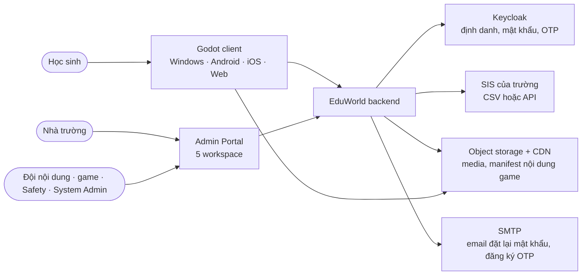

### 4.2. Container và luồng dữ liệu

Mọi request từ client đi qua APISIX. Backend gồm 3 binary build từ cùng một Go module; `worker` chạy thành 3 dịch vụ Swarm theo profile để một loại tải không chặn loại khác.

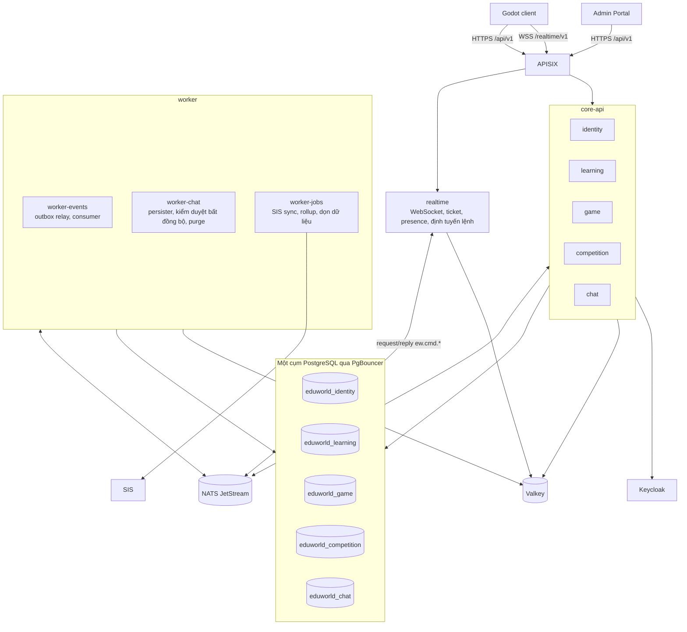

| Binary | Chứa gì | Không làm gì |
|---|---|---|
| `core-api` | REST public của mọi module; handler NATS cho lệnh từ realtime, gồm room host battle/co-op/boss (`pkg/roomhost`) | — |
| `realtime` | Kết thúc WebSocket, xác thực ticket, presence, định tuyến lệnh qua NATS, đẩy sự kiện xuống client | Không chứa logic nghiệp vụ, không có database |
| `worker` | `worker-events`: relay outbox, consumer event · `worker-chat`: lưu chat, kiểm duyệt bất đồng bộ, purge chat gameplay · `worker-jobs`: job định kỳ có khóa leader | Không phục vụ request của người dùng |

### 4.3. Module và ranh giới

| Module | Phạm vi | Database |
|---|---|---|
| `identity` | Tenant, trường/lớp, người dùng, phân quyền, đăng nhập game và portal, đồng bộ SIS, audit, cài đặt, feature flag, vòng đời tài khoản | `eduworld_identity` |
| `learning` | Chương trình học, nội dung và phát hành, ngân hàng câu hỏi, activity và attempt, đề thi, mastery, analytics, LMS, School Learning Dashboard, nghiên cứu hiệu quả | `eduworld_learning` |
| `game` | Hồ sơ game, thế giới, quest, mini-game, XP/level, kinh tế, vật phẩm, challenge/boss, game session, Game Operations | `eduworld_game` |
| `competition` | Party, matchmaking, battle, ranking, leaderboard, giải đấu | `eduworld_competition` |
| `chat` | Bạn bè, club, chat mọi channel, kiểm duyệt, thông báo, sticker/GIF | `eduworld_chat` |
| `realtime` | WebSocket gateway | Không có |

Quy tắc ranh giới (AGENTS.md R13, R29):

- Mỗi module nằm trong `modules/<module>/`. Module khác chỉ được import `modules/<module>/api` (facade sinh từ `specs/openapi/modules/<module>.internal.v1.yaml`), và chỉ khi có tên trong `x-allowed-callers` của operation. Phần còn lại nằm trong `internal/`, Go compiler tự chặn import.
- Không module nào đọc/ghi database của module khác; role DB của mỗi module chỉ `CONNECT` được database của mình.
- Gọi đồng bộ (facade) chỉ khi cần kết quả ngay, ví dụ game tạo attempt ở learning. Phản ứng phụ (XP, quest, projection, mở channel chat) đi qua event.
- Khi cần tách một module thành service riêng, cùng spec internal sinh HTTP client/server; chỉ đổi adapter ([ADR-0074](docs/adr/ADR-0074-modular-monolith-co-ranh-gioi-cuong-che.md) mục 7).

### 4.4. Bên trong một module: Clean Architecture + CQRS

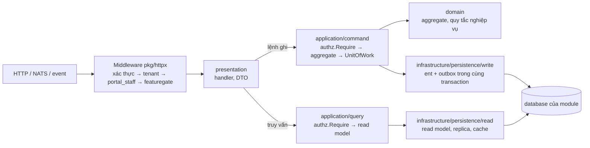

- **Write context:** nạp aggregate, gọi phương thức domain, lưu bằng ent và ghi outbox trong cùng transaction (`UnitOfWork`), trả ID/version.
- **Read context:** chỉ đọc read model/projection, không ghi, không phát event.
- Không có mediator hay bus chung: presentation gọi handler qua interface có kiểu ([ADR-0087](docs/adr/ADR-0087-cqrs-tach-read-write-khong-mediator.md)).
- Mọi truy vấn đi qua interceptor ent tự thêm `tenant_id IN (scope) AND deleted_at IS NULL` ([ADR-0089](docs/adr/ADR-0089-chot-tang-du-lieu-rls-mixin-outbox.md)).

Chi tiết: [SYSTEM_ARCHITECTURE](docs/06-architecture/SYSTEM_ARCHITECTURE.md) · [BACKEND_DESIGN](docs/07-backend/BACKEND_DESIGN.md).

## 5. Các luồng chính

### 5.1. Học sinh đăng nhập game và vào thế giới

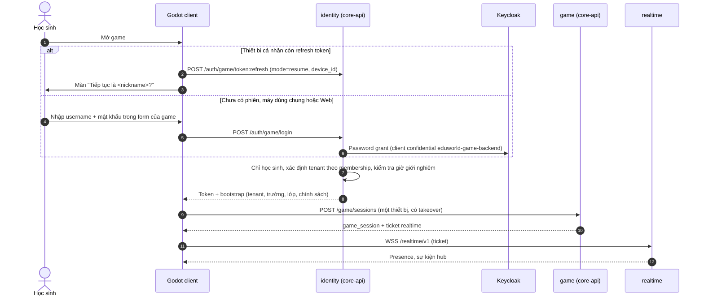

- Không có bước chọn trường: backend xác định tenant theo membership; mọi request sau gửi `X-Tenant-Id` và được kiểm tra lại.
- Mỗi học sinh chỉ một game session đang chạy; đăng nhập thiết bị khác thì phiên cũ nhận `session.session.replaced` rồi bị đóng (4409).
- Đến giờ giới nghiêm, server gửi `session.session.ended` rồi đóng kết nối với mã 4410; game giữ đăng nhập và hiện màn giờ giới nghiêm. Thu hồi quyền (khóa, đổi mật khẩu) đóng với mã 4403 và game đăng xuất.

Chi tiết: [KEYCLOAK_SSO](docs/09-identity/KEYCLOAK_SSO.md) · [GAME_NETWORKING](docs/08-game-client/GAME_NETWORKING.md) · [REALTIME_ARCHITECTURE](docs/06-architecture/REALTIME_ARCHITECTURE.md).

### 5.2. Quest học tập: làm bài, chấm điểm, nhận thưởng

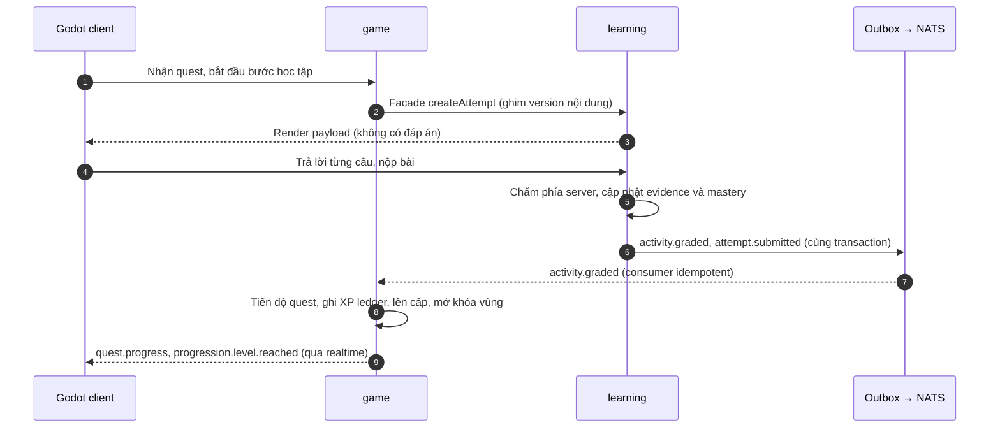

- Điểm, XP, phần thưởng và mastery đều do server quyết định; mọi thao tác ghi quan trọng dùng `Idempotency-Key` (UUIDv7).
- Hoàn thành mọi hoạt động bắt buộc của bài học sinh ra `lesson.completed`, game cộng XP từ event này.

### 5.3. Nhà trường giao bài và theo dõi

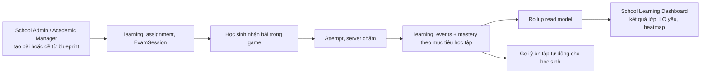

Chi tiết: [SCHOOL_LMS](docs/04-admin-portal/SCHOOL_LMS.md) · [LEARNING_ANALYTICS](docs/02-learning/LEARNING_ANALYTICS.md) · [EXAM_ENGINE](docs/02-learning/EXAM_ENGINE.md).

### 5.4. Soạn, duyệt và phát hành nội dung

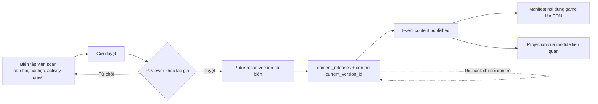

- Không sửa nội dung đã publish; sửa = tạo version mới. Lượt chơi cũ vẫn đọc version đã ghim.
- Câu hỏi đề thi, đáp án và media private không bao giờ lên CDN công khai.

Chi tiết: [CONTENT_MODEL](docs/02-learning/CONTENT_MODEL.md) · [QUESTION_BANK](docs/02-learning/QUESTION_BANK.md).

### 5.5. Chat realtime có kiểm duyệt

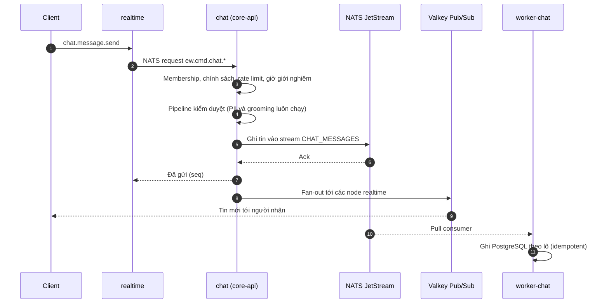

- Không phát tin nào chưa được JetStream ack; realtime không ghi chat vào PostgreSQL, chỉ `chat-persister` làm việc đó.
- Chat `party`/`match`/`team` luôn có khi chơi cùng nhau; nhà trường có thể chọn preset "chỉ quick message + emote".
- Chat gameplay được xóa vật lý sau thời hạn retention bằng job riêng, sau khi sao chép bằng chứng của case kiểm duyệt (ngoại lệ duy nhất của chính sách soft-delete).

Chi tiết: [CHAT_SYSTEM](docs/03-social-multiplayer/CHAT_SYSTEM.md) · [MODERATION](docs/03-social-multiplayer/MODERATION.md) · [CHILD_SAFETY](docs/10-security/CHILD_SAFETY.md).

### 5.6. Domain event qua transactional outbox

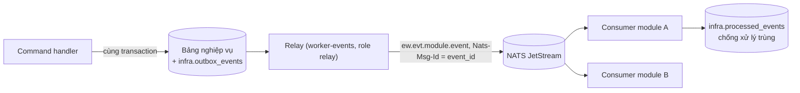

- Mỗi event có đúng một module phát và một feature sở hữu schema (`specs/events/payloads/<module>/`); script `check-cross-features.mjs` kiểm tra điều này.
- Envelope chứa `tenant_id` để consumer dựng phạm vi tenant; payload không chứa PII.

Chi tiết: [EVENT_DESIGN](docs/07-backend/EVENT_DESIGN.md).

### 5.7. Nhân sự đăng nhập Admin Portal và menu theo quyền

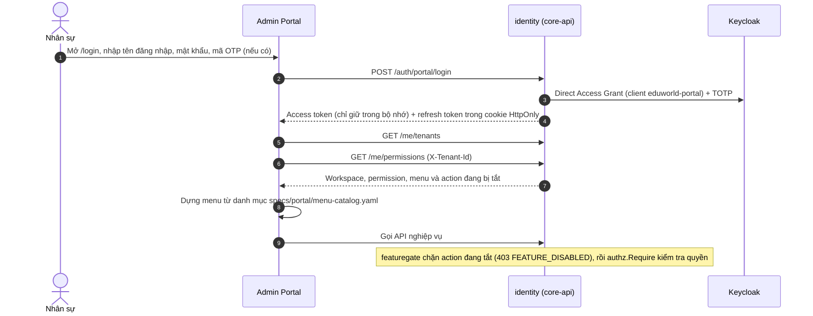

- Lỗi đăng nhập luôn là thông điệp chung, không cho biết tài khoản nào cần OTP. Tài khoản mới đổi mật khẩu tạm trên màn của portal; đăng ký ứng dụng xác thực qua link email.
- Danh mục 80 menu / 232 action là contract; System Admin bật/tắt theo platform hoặc từng tenant, backend chặn thật ở API ([ADR-0090](docs/adr/ADR-0090-danh-muc-menu-action-portal-bat-tat-trong-db.md), [ADR-0091](docs/adr/ADR-0091-dang-nhap-portal-bang-form-rieng-qua-backend.md)).

## 6. Đa tenant, phân quyền và an toàn

| Lớp | Cơ chế |
|---|---|
| Tenant | Trường độc lập, đơn vị nhiều trường, hoặc tenant chung `common`. Mỗi phiên làm việc trong đúng một tenant, xác định bằng `X-Tenant-Id` + kiểm tra membership; không suy ra tenant từ username/email |
| Lọc dữ liệu | ent interceptor thêm `tenant_id` và `deleted_at IS NULL` cho mọi truy vấn; PostgreSQL RLS lọc tenant ở tầng DB; truy cập liên tenant chỉ qua `tenancy.Bypass` với danh sách lý do đóng, có audit và metric |
| Phân quyền | Permission trong code, Role và UserRole trong DB; mỗi use case gọi `authz.Require` tường minh. Role của trường không bao giờ có quyền `game.*`, `platform.*` |
| Workspace platform | Chỉ qua gateway nội bộ, bắt buộc MFA và role platform |
| Game | Chỉ học sinh vào game; mỗi học sinh một thiết bị đang chơi; Windows mặc định coi là máy dùng chung |
| Xóa dữ liệu | Chỉ soft-delete; nghĩa vụ xóa = ẩn danh hóa |
| Chat | Mọi tin qua pipeline kiểm duyệt; bước PII/grooming luôn chạy; tắt bước khác phải có hạn và hai người duyệt |
| Không tin client | Điểm, thời gian, phần thưởng do server tính; đáp án không xuống client |

Chi tiết: [MULTITENANCY](docs/06-architecture/MULTITENANCY.md) · [SECURITY_ARCHITECTURE](docs/10-security/SECURITY_ARCHITECTURE.md) · [ADMIN_PORTAL](docs/04-admin-portal/ADMIN_PORTAL.md).

## 7. Triển khai và vận hành

| Môi trường | Cách chạy |
|---|---|
| Local | Docker Compose: 3 binary, PostgreSQL (5 database), Valkey, NATS, Keycloak, APISIX, floci, observability; `make dev` (dự kiến ~8 GB RAM cho Docker) |
| CI | GitHub Actions theo lane, chạy theo đường dẫn thay đổi: `go.yml` (ma trận theo module + kiểm tra kiến trúc), `specs.yml`, `docs.yml`, `security.yml`, `release.yml` (SBOM, ký image) |
| Staging / production | Docker Swarm: `core-api` ≥ 2, `realtime` ≥ 2, `worker-events`, `worker-chat`, `worker-jobs`; PostgreSQL một cụm (Patroni) + PgBouncer; image trên ghcr.io; một tag `backend/vX.Y.Z` cho cả 3 binary |
| Quan sát | Trace xuyên APISIX → binary → module → NATS; metric theo binary và module; log có `trace_id` |

Lưu ý vận hành: dùng chung một cụm PostgreSQL nghĩa là khi cụm chuyển sang node dự phòng, cả 5 module cùng gián đoạn ghi trong thời gian ngắn.

Chi tiết: [DEPLOYMENT](docs/11-operations/DEPLOYMENT.md) · [LOCAL_DEVELOPMENT](docs/11-operations/LOCAL_DEVELOPMENT.md) · [MONITORING](docs/11-operations/MONITORING.md) · [BACKUP_RECOVERY](docs/11-operations/BACKUP_RECOVERY.md).

## 8. Cấu trúc repository

```text
go.mod        một Go module cho toàn backend (ADR-0074)
cmd/          composition root: core-api, realtime, worker (--profile=events|chat|jobs), migrate
modules/      identity, learning, game, competition, chat, realtime
              mỗi module: module.go, api/ (facade), internal/{domain,application,infrastructure,presentation}, ent/schema, migrations/
pkg/          platform kit: httpx, authz, tenancy, entx (UnitOfWork), outbox, natsx, modcall, roomhost, observability, testkit
godot/        Godot 4.x project
web/          apps/portal (Admin Portal 5 workspace), packages/ops-ui
design/       design tokens (game-tokens, admin-tokens, shared-tokens), icon, font
specs/        contract: openapi/ (gộp + theo module, public và internal), asyncapi/, events/, schemas/, portal/menu-catalog.yaml
              feature spec SDD: specs/<NNN>-<slug>/
.specify/     constitution + template Spec Kit
.claude/      lệnh /speckit.* cho AI agent
.github/      workflows CI/CD
deploy/       docker-compose, APISIX, Keycloak realm, NATS, PostgreSQL init, observability
scripts/      kiểm tra specs/docs, sinh spec theo module, seed, backup
docs/         tài liệu theo domain (00-overview … 12-project), adr/
```

`cmd/`, `modules/`, `pkg/`, `godot/`, `web/`, `deploy/`, `.github/` được tạo từ F001 trở đi.

## 9. Quy trình phát triển: Spec-Driven Development

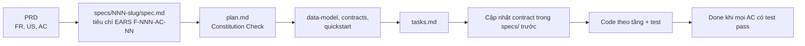

- Mỗi tính năng có thư mục `specs/<NNN>-<slug>/` theo GitHub Spec Kit; danh mục, thứ tự và trạng thái ở [CODE_PLAN](docs/12-project/CODE_PLAN_CMS_LMS_FIRST.md).
- AI agent dùng các lệnh `/speckit.specify`, `/speckit.clarify`, `/speckit.plan`, `/speckit.tasks`, `/speckit.analyze`, `/speckit.implement`.
- Nguyên tắc bất biến: [AGENTS.md](AGENTS.md) (R1–R34) và [constitution](.specify/memory/constitution.md). Muốn đổi một quyết định thì viết ADR mới.

Kiểm tra chạy được ngay (Node.js, trong thư mục gốc):

| Lệnh | Kiểm tra |
|---|---|
| `node scripts/specs/check-features.mjs` | Cấu trúc feature spec, mọi FR của Release được phủ |
| `node scripts/specs/check-cross-features.mjs` | Mỗi event một chủ sở hữu, không bảng nào được hai feature cùng tạo |
| `node scripts/specs/check-portal-catalog.mjs` | Danh mục menu/action khớp `x-portal-action` trong OpenAPI |
| `node scripts/specs/check-problem-codes.mjs` | Mã lỗi khớp giữa API_DESIGN, OpenAPI và AsyncAPI |
| `node scripts/specs/check-maxlength.mjs` | Mọi chuỗi trong contract có `maxLength` |
| `node scripts/specs/validate-schemas.mjs` | JSON Schema và event schema hợp lệ, ví dụ khớp schema |
| `node scripts/openapi/split-public.mjs --check` | Spec theo module khớp spec gộp |
| `node scripts/docs/check-links.mjs` · `check-mermaid.mjs` | Link nội bộ và sơ đồ Mermaid |
| `node scripts/docs/build-rtm.mjs --check` | Ma trận truy vết FR → tài liệu → test |

Cài phụ thuộc một lần: `npm ci --prefix scripts`.

## 10. Lộ trình

Phát hành theo ba giai đoạn **Pilot → Mở rộng → Hoàn thiện (Release 1.0)**, đủ 4 nền tảng từ pilot ([ADR-0073](docs/adr/ADR-0073-phat-hanh-theo-pilot-uu-tien-giao-duc.md)). CMS/LMS làm trước gameplay.

| Mốc | Giai đoạn | Kết quả nghiệm thu |
|---|---|---|
| M0 Architecture Baseline | Pilot | Tài liệu, ADR, contract đủ để triển khai *(đã xong)* |
| M-C0 Foundation | Pilot | Monorepo, platform kit, gateway, design tokens; trace xuyên hệ thống |
| M-C1 Đăng nhập | Pilot | Nhân sự đăng nhập portal, học sinh đăng nhập game và vào Main Hub 3D |
| M-C2 Content Loop | Pilot | Soạn → duyệt → publish → học sinh làm trong game → server chấm |
| M-C3 School Loop | Pilot | Nhà trường giao bài/đề, xem kết quả và LO yếu; học sinh nhận gợi ý ôn tập |
| **M-P1 Pilot Start** | Pilot | Lát cắt gameplay pilot, mặc định an toàn, 4 nền tảng, production quy mô pilot |
| **M-P2 Pilot Exit** | Pilot | Báo cáo hiệu quả học tập ≥ 8 tuần đạt cổng ([ADR-0080](docs/adr/ADR-0080-do-hieu-qua-hoc-tap-la-exit-criterion-pilot.md)) |
| M2 – M4b | Mở rộng | Đủ gameplay, Game Ops, party co-op, thi đấu 1v1/Team Battle, ranking |
| M5 Safe Social | Hoàn thiện | Đủ 8 loại channel + DM, club, season/event, kiểm duyệt đầy đủ |
| M6 Release 1.0 | Hoàn thiện | Phạm vi đầy đủ trên 4 nền tảng ở 10.000 CCU |

Pilot dự kiến sẵn sàng khoảng tuần 30–36 tính từ 2026-11-16 [Proposed]. Chi tiết: [ROADMAP](docs/12-project/ROADMAP.md) · [CODE_PLAN](docs/12-project/CODE_PLAN_CMS_LMS_FIRST.md).

## 11. Bắt đầu đọc

| Mục đích | Tài liệu |
|---|---|
| Hiểu sản phẩm | [PRODUCT_VISION](docs/00-overview/PRODUCT_VISION.md) · [PRODUCT_REQUIREMENTS](docs/00-overview/PRODUCT_REQUIREMENTS.md) · [USER_PERSONAS](docs/00-overview/USER_PERSONAS.md) |
| Hiểu game | [GAME_DESIGN](docs/01-game-design/GAME_DESIGN.md) · [WORLD_DESIGN](docs/01-game-design/WORLD_DESIGN.md) · [PROGRESSION_SYSTEM](docs/01-game-design/PROGRESSION_SYSTEM.md) · [QUEST_SYSTEM](docs/01-game-design/QUEST_SYSTEM.md) |
| Hiểu học tập | [LEARNING_EXPERIENCE](docs/02-learning/LEARNING_EXPERIENCE.md) · [ACTIVITY_ENGINE](docs/02-learning/ACTIVITY_ENGINE.md) · [LEARNING_EFFICACY_PLAN](docs/02-learning/LEARNING_EFFICACY_PLAN.md) |
| Hiểu kiến trúc | [SYSTEM_ARCHITECTURE](docs/06-architecture/SYSTEM_ARCHITECTURE.md) · [BACKEND_DESIGN](docs/07-backend/BACKEND_DESIGN.md) · [DATABASE_DESIGN](docs/07-backend/DATABASE_DESIGN.md) · [DOMAIN_MODEL](docs/06-architecture/DOMAIN_MODEL.md) |
| Quyết định kiến trúc | [Chỉ mục ADR](docs/adr/README.md) (mục "Quyết định hiện hành theo chủ đề") |
| Tham số mặc định | [CONFIG_DEFAULTS](docs/00-overview/CONFIG_DEFAULTS.md) |
| Câu hỏi chưa chốt | [OPEN_QUESTIONS](docs/12-project/OPEN_QUESTIONS.md) |
| Kế hoạch và kiểm thử | [CODE_PLAN](docs/12-project/CODE_PLAN_CMS_LMS_FIRST.md) · [ROADMAP](docs/12-project/ROADMAP.md) · [TEST_STRATEGY](docs/12-project/TEST_STRATEGY.md) |
| Đặc tả máy đọc | [specs/README.md](specs/README.md) |
| Toàn bộ mục lục tài liệu | [docs/README.md](docs/README.md) |
| Quy tắc cho developer và AI agent | [AGENTS.md](AGENTS.md) · [CONTRIBUTING.md](CONTRIBUTING.md) |
| Prompt gốc | [VIBE_CODING_PROMPT.md](VIBE_CODING_PROMPT.md) |
