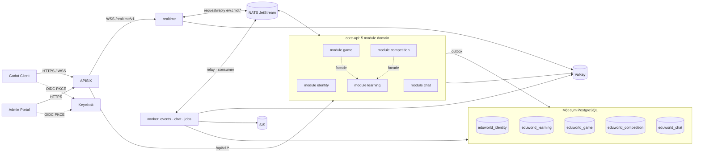

# EduWorld

**Game phiêu lưu 3D multiplayer (RPG-lite) học tập cho học sinh lớp 1–9.**
Learn – Play – Practice – Explore – Compete – Connect. *Game trước trong trải nghiệm, giáo dục trong mục đích, thế giới multiplayer xã hội trong tương tác.*

> Trạng thái dự án: **Phase 0 — Discovery & Architecture** (chưa có code triển khai). Bộ tài liệu và đặc tả trong repo này là architecture baseline để bắt đầu Phase 1.

## Tổng quan

EduWorld là thế giới phiêu lưu 3D "Quần đảo Tri Thức" (Godot 4.x) với 8 vùng đất và mạch truyện 7 chương. Học sinh tạo nhân vật, khám phá, nhận nhiệm vụ từ NPC, đánh boss, sưu tầm, chơi cùng bạn trong party/club và thi đấu kiến thức; việc học (quiz, bài tập tương tác, video, audio nghe hiểu, mô phỏng, mini-game — đều do server tự chấm) lồng trong nhiệm vụ và thử thách. Học sinh tự học với gợi ý từng bước và gợi ý ôn tập tự động theo mastery. Học sinh đăng nhập bằng tài khoản nhà trường cấp (Keycloak SSO, dữ liệu từ SIS). Nhà trường (quản trị trường, quản lý chuyên môn) giao bài và theo dõi kết quả; đội nội dung, đội vận hành game và Platform Safety Team làm việc trên Admin Portal 5 workspace (ADR-0072).

Nguyên tắc cốt lõi:

1. **Game-first, education-purpose**: trải nghiệm là game thật (cốt truyện, khám phá, nhân vật, boss); Learning Engine là lõi về mục đích, kết quả học tập không phụ thuộc gameplay.
2. **Server-authoritative**: client không bao giờ quyết định điểm, kết quả, phần thưởng hay mastery.
3. **Data-driven**: quest, mini-game, NPC dialogue, reward là dữ liệu phiên bản hóa từ CMS.
4. **Child safety by default**: kiểm duyệt chat tập trung ở Platform Safety Team, tối thiểu hóa dữ liệu, cô lập theo tenant.
5. **Modular monolith có ranh giới cưỡng chế**: một Go module, năm module domain + module `realtime`, ba binary (`core-api`, `realtime`, `worker` theo profile); mỗi module domain một database, ranh giới mã cưỡng chế bằng compiler + linter, Clean Architecture + CQRS bên trong (ADR-0074, ADR-0038).

## Công nghệ

| Thành phần | Công nghệ | Quyết định |
|---|---|---|
| Game client | Godot 4.x (3D), GDScript static typing | ADR-0013, ADR-0014 |
| Backend | Go **modular monolith**: module `identity`, `learning`, `game`, `competition`, `chat`, `realtime` trong `modules/<module>/`; ba binary `cmd/core-api`, `cmd/realtime`, `cmd/worker` (profile `worker-events`, `worker-chat`, `worker-jobs`) | ADR-0074 |
| Kiến trúc trong module | Clean Architecture + CQRS tách read/write, không mediator (command qua aggregate + `UnitOfWork` + outbox, query đọc read model) | ADR-0038, ADR-0087 |
| ORM / migration | ent (code-first, global filter tenant + soft-delete) + Atlas versioned migrations | ADR-0039 |
| Gọi giữa module | Facade có kiểu sinh từ OpenAPI internal (oapi-codegen, `modules/<module>/api`), gọi trong tiến trình qua `pkg/modcall` (span, deadline, `TenantScope`, Principal gốc, `Idempotency-Key`); không HTTP nội bộ, không token `svc-*`; phản ứng phụ qua event | ADR-0074, ADR-0040 |
| Admin Portal (CMS/LMS/Admin) | **Một** React SPA `web/apps/portal` (TypeScript + Vite) với 5 workspace, client `eduworld-portal`; giao diện **Admin/Ops UI**: Ant Design 5 + Ant Design Pro, theme EduWorld (không theo phong cách game) | ADR-0022, ADR-0027, ADR-0047 |
| Công thức Toán/Lý/Hóa | **MathJax 4** (hiển thị, mhchem) + **MathLive** (nhập, chỉ trên Admin Portal); portal render sẵn SVG trên trình duyệt khi lưu/publish, server sanitize; game chỉ hiển thị SVG | ADR-0055 |
| Design system | Design tokens trong `design/` (Style Dictionary) → Theme Godot + token 3D cho game; theme Ant Design cho CMS; dùng chung logo, màu thương hiệu, mã màu nghiệp vụ | ADR-0047 |
| Identity & SSO | Keycloak (OIDC, PKCE, Organizations, brokering; client `svc-identity` chỉ để gọi Admin API) | ADR-0006 → ADR-0008, ADR-0026 |
| API Gateway | Apache APISIX (upstream `core-api` cho REST, `realtime` cho WebSocket) | ADR-0009, ADR-0074 |
| Database | PostgreSQL một cụm, **mỗi module một database** (5 database), `tenant_id` + RLS, soft-delete, mọi chuỗi có giới hạn độ dài | ADR-0005, ADR-0028, ADR-0037, ADR-0041, ADR-0074 |
| Object storage / media | S3-compatible + CDN; **[floci](https://github.com/floci-io/floci) ở mọi môi trường** (local, CI, staging, production) | ADR-0044, ADR-0071 |
| Cache / Realtime infra | Valkey (cache, presence, queue, Pub/Sub fan-out) | ADR-0004, ADR-0035 |
| Messaging bền vững | NATS JetStream: domain event qua outbox (`EVT_*`), chat (`CHAT_MESSAGES`), lệnh realtime request/reply | ADR-0035, ADR-0042 |
| Realtime transport | WebSocket (`/realtime/v1`) qua binary `realtime` | ADR-0011, ADR-0074 |
| Observability | OpenTelemetry (trace xuyên binary, module và NATS), Prometheus, Grafana, Loki, Tempo | ADR-0023 |
| Chạy container | Docker Compose (local/dev) · Docker Swarm (staging/production), chưa dùng Kubernetes | ADR-0024 |

## Kiến trúc tóm tắt



Chi tiết: [docs/06-architecture/SYSTEM_ARCHITECTURE.md](docs/06-architecture/SYSTEM_ARCHITECTURE.md).

## Cấu trúc repository

```text
go.mod      một Go module cho toàn backend (ADR-0074)
cmd/        composition root của 3 binary: core-api, realtime, worker (--profile=events|chat|jobs) + job migrate (Phase 1)
modules/    6 module (identity, learning, game, competition, chat, realtime); mỗi module: module.go, api/ (facade), internal/{domain,application,infrastructure,presentation}, ent/schema, migrations
pkg/        platform kit Go dùng chung (config, logging, otel, httpx, entx/UnitOfWork, outbox, natsx, modcall, auth, testkit)
godot/      Godot 4.x project (Phase 1)
web/        Admin Portal: apps/portal (5 workspace), packages/ops-ui (Phase 1 khung + Storybook, Phase 3 đầy đủ)
design/     design tokens (game-tokens, admin-tokens, shared-tokens), icon, font
specs/      contract (OpenAPI public + internal, AsyncAPI, JSON Schema, event schema) + feature spec SDD specs/<NNN>-<slug>/
.specify/   constitution + template Spec Kit (ADR-0082); lệnh /speckit.* ở .claude/commands/
deploy/     docker-compose, APISIX, Keycloak realm, NATS, PostgreSQL init, observability (Phase 1)
scripts/    tooling: specs (tách spec, maxLength, schema), docs (check Mermaid/link, move/redirect/split-adr), backup, seed
docs/       tài liệu (00-overview, 01-game-design, 02-learning, 03-social-multiplayer, 04-admin-portal, 05-ux, 06-architecture … 12-project, adr/)
```

## Bắt đầu đọc

| Mục đích | Tài liệu |
|---|---|
| Hiểu sản phẩm | [PRODUCT_VISION](docs/00-overview/PRODUCT_VISION.md) · [PRODUCT_REQUIREMENTS](docs/00-overview/PRODUCT_REQUIREMENTS.md) · [USER_PERSONAS](docs/00-overview/USER_PERSONAS.md) |
| Hiểu game | [GAME_DESIGN](docs/01-game-design/GAME_DESIGN.md) · [WORLD_DESIGN](docs/01-game-design/WORLD_DESIGN.md) · [PROGRESSION_SYSTEM](docs/01-game-design/PROGRESSION_SYSTEM.md) · [QUEST_SYSTEM](docs/01-game-design/QUEST_SYSTEM.md) |
| Hiểu học tập | [LEARNING_EXPERIENCE](docs/02-learning/LEARNING_EXPERIENCE.md) · [ACTIVITY_ENGINE](docs/02-learning/ACTIVITY_ENGINE.md) |
| Hiểu kiến trúc | [SYSTEM_ARCHITECTURE](docs/06-architecture/SYSTEM_ARCHITECTURE.md) (§5 luồng chơi end-to-end) · [ADR](docs/adr/README.md) · [DOMAIN_MODEL](docs/06-architecture/DOMAIN_MODEL.md) |
| Tham số mặc định | [CONFIG_DEFAULTS](docs/00-overview/CONFIG_DEFAULTS.md) |
| Câu hỏi chưa chốt | [OPEN_QUESTIONS](docs/12-project/OPEN_QUESTIONS.md) |
| Kế hoạch | [CODE_PLAN](docs/12-project/CODE_PLAN_CMS_LMS_FIRST.md) (danh mục feature SDD, CMS/LMS trước) · [ROADMAP](docs/12-project/ROADMAP.md) (phase + milestone) · [TEST_STRATEGY](docs/12-project/TEST_STRATEGY.md) |
| Toàn bộ mục lục | [docs/README.md](docs/README.md) |
| Đặc tả máy đọc | [specs/README.md](specs/README.md) |
| Quy tắc cho AI agent / dev | [AGENTS.md](AGENTS.md) · [CONTRIBUTING.md](CONTRIBUTING.md) |
| Prompt gốc | [VIBE_CODING_PROMPT.md](VIBE_CODING_PROMPT.md) |

## Chạy local

Chưa áp dụng ở Phase 0. Kế hoạch môi trường local (Docker Compose với 3 binary backend, PostgreSQL một cụm 5 database, Valkey, NATS JetStream, Keycloak, APISIX, observability) có trong [docs/11-operations/LOCAL_DEVELOPMENT.md](docs/11-operations/LOCAL_DEVELOPMENT.md).

## Roadmap

Mục tiêu là **Release 1.0 hoàn chỉnh**: toàn bộ chức năng của Master Prompt + Party Addendum trên Windows, Android, iOS và Web, không dừng ở MVP. Các phase là bước phát triển tăng dần (~40 sprint lịch [Proposed]), chi tiết ở [ROADMAP](docs/12-project/ROADMAP.md).

| Phase | Nội dung | Deliverable |
|---|---|---|
| 0 | Discovery & Architecture | Bộ tài liệu + ADR + specs *(đang thực hiện)* |
| 1 | Foundation | Platform kit + khung modular monolith (6 module, 3 binary); học sinh đăng nhập SSO và vào thế giới 3D (Windows, Android) |
| 2 | Core Educational Gameplay | Tạo avatar, 8 vùng đất + chương mở đầu, quest học tập, XP/level, mở khóa vùng, kinh tế Xu |
| 3 | Exam & Learning Management | Admin Portal, LMS, đề thi, video, School Learning Dashboard, analytics (mốc M3 School Loop) |
| 4 | Multiplayer & Competition | Party, co-op quest, boss nhóm, đấu 1v1/đội, xếp hạng, giải đấu, chat trong trận |
| 5 | Social & Chat | Bạn bè, club, đủ 8 loại channel, moderation đầy đủ |
| 6 | Production Readiness & **Release 1.0** | Hoàn thiện iOS + Web, hiệu năng, bảo mật, chaos test liên module và profile worker, vận hành, UAT, phát hành 4 nền tảng |
