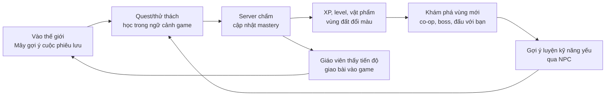

# Product Vision — EduWorld

> Trạng thái: Draft · Phiên bản: 0.2 · Owner: Product Manager + Game Director · Cập nhật: 2026-11-15
> Liên quan: [GAME_DESIGN](../01-game-design/GAME_DESIGN.md) · [WORLD_DESIGN](../01-game-design/WORLD_DESIGN.md) · [LEARNING_EXPERIENCE](../02-learning/LEARNING_EXPERIENCE.md) · [PRODUCT_REQUIREMENTS](PRODUCT_REQUIREMENTS.md) · [USER_PERSONAS](USER_PERSONAS.md) · [CONFIG_DEFAULTS](CONFIG_DEFAULTS.md) · [ROADMAP](../12-project/ROADMAP.md) · [SYSTEM_ARCHITECTURE](../06-architecture/SYSTEM_ARCHITECTURE.md)

## 1. Mục đích và phạm vi

Tài liệu nêu EduWorld là gì, cho ai, khác gì và thế nào là thành công. Chi tiết gameplay ở [GAME_DESIGN](../01-game-design/GAME_DESIGN.md); yêu cầu gốc ở [PRODUCT_REQUIREMENTS](PRODUCT_REQUIREMENTS.md).

## 2. Tuyên bố tầm nhìn

> **Một thế giới phiêu lưu 3D nơi học sinh lớp 1–9 muốn quay lại mỗi ngày: khám phá, phát triển nhân vật, chơi cùng bạn, chinh phục thử thách và tiến bộ thật sự trong học tập, trong một môi trường an toàn mà nhà trường tin tưởng và quản lý được.**

Bản sắc sản phẩm **[Confirmed]**: *EduWorld là **game trước** trong trải nghiệm, **nền tảng giáo dục** trong mục đích, và **thế giới multiplayer xã hội** trong tương tác.*

Nguyên tắc: *Học sinh đến vì game, ở lại vì trải nghiệm, tiến bộ nhờ học tập và có động lực nhờ thi đấu.*

## 3. Định vị

| Khía cạnh | EduWorld là | EduWorld không phải |
|---|---|---|
| Thể loại | **Phiêu lưu 3D multiplayer RPG-lite** có cốt truyện, học tập lồng trong nhiệm vụ và thử thách [Proposed] | Ứng dụng làm bài trắc nghiệm có giao diện game; chuỗi quiz liên tiếp |
| Thế giới | 8 vùng đất "Quần đảo Tri Thức", mạch truyện 7 chương "Thắp lại Tia Sáng" ([WORLD_DESIGN](../01-game-design/WORLD_DESIGN.md)) | Menu chức năng kiểu phần mềm trường học |
| Học tập | Learning Engine lõi, đa định dạng (quiz, tương tác, video, audio, tự luận, mô phỏng, mini-game), theo chương trình, phiên bản hóa ([ACTIVITY_ENGINE](../02-learning/ACTIVITY_ENGINE.md)) | Câu hỏi hardcode trong scene; game quyết định điểm |
| Kết quả | Server-authoritative, truy vết được ([ADR-0016](../adr/ADR-0016-server-authoritative-scoring-answer-key-khong-bao-gio-roi-se.md)) | Điểm/phần thưởng do client tự báo |
| Tiến trình | Tách 5 loại số liệu: Learning Score, Mastery, Game Rating, XP, Competition Points ([PROGRESSION_SYSTEM](../01-game-design/PROGRESSION_SYSTEM.md)) | Một điểm tổng; level game được coi là năng lực học tập |
| Xã hội | Bạn bè, party, club, chat đầy đủ tính năng có kiểm duyệt ([SOCIAL_SYSTEM](../03-social-multiplayer/SOCIAL_SYSTEM.md), [CHAT_SYSTEM](../03-social-multiplayer/CHAT_SYSTEM.md)) | Mạng xã hội mở cho trẻ em |
| Khách hàng | Nhà trường / đơn vị giáo dục (B2B), multi-tenant [Proposed — OQ-14] | Ứng dụng bán vật phẩm cho trẻ em |
| Tài khoản | Do nhà trường cấp qua SIS + Keycloak SSO [Confirmed] | Học sinh tự đăng ký |

**Đối tượng [Confirmed]:** học sinh lớp 1–9, giáo viên, quản lý nhà trường, biên tập nội dung, game designer/live-ops, moderator, quản trị hệ thống. Nhiều tenant (trường độc lập, đơn vị nhiều trường, tenant chung) — [ADR-0005](../adr/ADR-0005-mo-hinh-multi-tenancy-shared-database-tenant-id-rls.md). Chi tiết: [USER_PERSONAS](USER_PERSONAS.md).

## 4. Trụ cột trải nghiệm: Learn – Play – Practice – Explore – Compete – Connect

| Trụ cột | Người chơi làm gì | Nơi trong thế giới | Tài liệu |
|---|---|---|---|
| **Play** | Theo mạch truyện, nhận quest từ NPC, phát triển nhân vật, sưu tầm, tùy biến avatar | Thị trấn Trung Tâm, mọi vùng | [GAME_DESIGN](../01-game-design/GAME_DESIGN.md), [QUEST_SYSTEM](../01-game-design/QUEST_SYSTEM.md), [CHARACTER_SYSTEM](../01-game-design/CHARACTER_SYSTEM.md) |
| **Learn** | Học trong ngữ cảnh nhiệm vụ: giúp NPC, giải câu đố, xem video, thí nghiệm mô phỏng | Các vùng môn học | [LEARNING_EXPERIENCE](../02-learning/LEARNING_EXPERIENCE.md) |
| **Practice** | Luyện theo kỹ năng yếu, làm lại câu sai, luyện đề, thi thử | Thư viện Gió, Tháp Thử Thách | [ACTIVITY_ENGINE](../02-learning/ACTIVITY_ENGINE.md), [EXAM_ENGINE](../02-learning/EXAM_ENGINE.md) |
| **Explore** | Mở khóa vùng, tìm discovery point, vật sưu tầm, hoàn thành bản đồ | Đại dương Khám Phá, mọi vùng | [WORLD_DESIGN](../01-game-design/WORLD_DESIGN.md) |
| **Compete** | Challenge, boss, đấu kiến thức 1v1/đội, giải đấu, mùa giải | Núi Thử Thách, Đấu trường Nhà Vô Địch | [CHALLENGE_BOSS_SYSTEM](../01-game-design/CHALLENGE_BOSS_SYSTEM.md), [COMPETITION_SYSTEM](../01-game-design/COMPETITION_SYSTEM.md) |
| **Connect** | Bạn bè, party, club, co-op quest/boss, chat an toàn, emote | Vườn Bạn Bè, mọi instance | [SOCIAL_SYSTEM](../03-social-multiplayer/SOCIAL_SYSTEM.md), [PARTY_SYSTEM](../03-social-multiplayer/PARTY_SYSTEM.md) |

Các trụ cột nối bằng vòng lặp chính (chi tiết: [GAME_DESIGN](../01-game-design/GAME_DESIGN.md)):

## 5. Nguyên tắc sản phẩm

Năm mục tiêu [Confirmed — Master Prompt gốc]:

1. **Education first (về mục đích)** — giá trị cốt lõi là học, luyện tập, tiến bộ. Kết quả học tập không phụ thuộc gameplay; phần thưởng game không thay đổi điểm hay mastery.
2. **Game experience (về trải nghiệm)** — thế giới 3D stylized có gameplay thật: cốt truyện, khám phá, nhân vật, sưu tầm, boss; học tập lồng tự nhiên, không thành chuỗi quiz ([LEARNING_EXPERIENCE §2.1](../02-learning/LEARNING_EXPERIENCE.md)).
3. **Competition** — thi đấu công bằng, server-authoritative, ghép theo khối lớp trước rating.
4. **Social connection** — chơi cùng bạn, hợp tác, giao tiếp an toàn.
5. **School integration** — nhà trường quản lý học sinh, chương trình, bài tập, kết quả qua SIS, Keycloak, Admin Portal.

Ràng buộc bổ sung:

- **Safety by design** — chat như nhau cho mọi lớp, mọi tin qua kiểm duyệt (bật mặc định) ([ADR-0020](../adr/ADR-0020-chat-thong-nhat-cho-moi-lop-moi-tin-nhan-phai-qua-kiem-tra-h.md), [ADR-0030](../adr/ADR-0030-chinh-sach-tu-nhay-cam-trong-chat-danh-muc-quan-ly-duoc-va-c.md)); không dark pattern, không phạt streak, nhắc nghỉ ([CHILD_SAFETY](../10-security/CHILD_SAFETY.md)) [Confirmed].
- **No pay-to-win / no pay-to-learn** — không tiền thật, không loot box, Shop chỉ đồ trang trí bằng Xu kiếm trong game ([INVENTORY_ECONOMY](../01-game-design/INVENTORY_ECONOMY.md)) [Confirmed nguyên tắc · Proposed chi tiết, OQ-14].
- **Data minimization** — chỉ thu thập dữ liệu cần cho mục đích đã công bố [Confirmed].

## 6. Giá trị cho từng nhóm người dùng

| Nhóm | Vấn đề hiện tại | Giá trị EduWorld mang lại |
|---|---|---|
| Học sinh lớp 1–5 | Bài tập nhàm chán, ít phản hồi | Phiêu lưu cùng Mây, nhiệm vụ ngắn, phản hồi qua NPC, nhân vật và vật sưu tầm của riêng mình |
| Học sinh lớp 6–9 | Áp lực ôn thi, thiếu động lực tự luyện | Boss/challenge theo kỹ năng, Tháp Thử Thách luyện đề có phân tích lỗi, đấu kiến thức và club với bạn |
| Giáo viên | Khó theo dõi từng học sinh, chấm bài tốn thời gian | Giao bài hiện thành nhiệm vụ trong game, chấm tự động + hàng chờ chấm rubric, dashboard mastery |
| Quản lý trường/đơn vị | Dữ liệu phân tán, lo ngại an toàn online | SIS, báo cáo theo lớp/khối/môn, kiểm soát chat và giờ truy cập theo tenant |
| Biên tập nội dung, game designer | Khó tái sử dụng nội dung, khó vận hành game | Admin Portal 5 workspace: Learning Content Studio, Game Operations Console, Live Ops; version/publish/rollback |

## 7. Mục tiêu đo lường (KPI đề xuất)

Mọi chỉ số là **[Proposed]**, chốt ngưỡng sau pilot. **Không** tối đa hóa thời gian chơi (trái nguyên tắc chống gây nghiện). Định nghĩa chỉ số game, sức khỏe chơi và hiệu năng thực tế (`active_days_per_week`, `chapter0_completion`, `social_play_rate`, `session_duration_p50`, `sessions_over_second_reminder`, `crash_free_sessions`…) ở [GAME_ANALYTICS §4](../11-operations/GAME_ANALYTICS.md#4-định-nghĩa-chỉ-số); chỉ số học tập ở [LEARNING_ANALYTICS](../02-learning/LEARNING_ANALYTICS.md); chỉ số kỹ thuật ở [MONITORING](../11-operations/MONITORING.md).

| Nhóm | KPI | Mục tiêu pilot |
|---|---|---|
| Game | Học sinh quay lại ≥ 3 ngày/tuần (`active_days_per_week`); `retention_d7` theo dõi kèm | ≥ 50% |
| Game | Hoàn thành chương 0 (tutorial) | ≥ 90% |
| Game | Tham gia co-op/party ít nhất 1 lần/tuần | ≥ 40% |
| Học tập | Activity completion rate | ≥ 75% |
| Học tập | Mastery gain sau 8 tuần (% LO lên ≥ 1 mức) | ≥ 30% LO được luyện |
| Học tập | Học tập tự nguyện (% attempt không do giáo viên giao) | ≥ 50% |
| Sức khỏe | Median phiên; % phiên > 90 phút | 20–40 phút; < 5% |
| Giáo viên | Teacher weekly active | ≥ 70% |
| Thi đấu | Match completion; matchmaking wait p90 | ≥ 90%; ≤ 45 s |
| An toàn | Report được xử lý theo SLA ([MODERATION](../03-social-multiplayer/MODERATION.md)); PII lọt filter | 100% đúng SLA; 0 trường hợp nghiêm trọng |
| Kỹ thuật | Crash-free sessions; availability | ≥ 99%; NFR-AVAIL-001 |

## 8. Phạm vi Release 1.0 (game hoàn chỉnh)

**[Confirmed — stakeholder 2026-11-15]** Release 1.0 = hoàn thành Phase 6 ([ROADMAP](../12-project/ROADMAP.md)) với **toàn bộ** chức năng của Master Prompt + Party Addendum, trên Windows, Android, iOS, Web ([ADR-0013](../adr/ADR-0013-nen-tang-client-release-1-0-gom-windows-android-ios-web.md), OQ-04). Bảng phạm vi chi tiết theo domain là mục 1 của [PRODUCT_REQUIREMENTS](PRODUCT_REQUIREMENTS.md); trải nghiệm người chơi có được sau từng phase ở [ROADMAP](../12-project/ROADMAP.md).

Không làm trong Release 1.0: voice chat ([ADR-0051](../adr/ADR-0051-pham-vi-voice-chat.md), [ADR-0070](../adr/ADR-0070-release-1-khong-voice-chat-khong-xoa-vat-ly-khong-purge-analytics.md)). Chỉ làm khi có quyết định: parent portal (OQ-13), thi chính thức có proctoring (OQ-18), AI hỗ trợ chấm ([ADR-0053](../adr/ADR-0053-cham-diem-co-ho-tro-ai-ai-assisted-grading.md)), full LRS endpoint, push notification ngoài game.

## 9. Non-goals

- Không MMO persistent world liên tục cho toàn hệ thống ([ADR-0012](../adr/ADR-0012-the-gioi-game-hybrid-hub-instance-private-instance-match-roo.md)).
- Không cho học sinh tự đăng ký tài khoản [Confirmed].
- Không giao tiếp tự do không kiểm soát; không liên lạc giữa học sinh khác tenant ngoài sự kiện do platform tổ chức ([ADR-0054](../adr/ADR-0054-tuong-tac-xa-hoi-lien-truong-cross-school-social-interaction.md)).
- Không bán lợi thế, không loot box, không cơ chế đánh bạc, không quảng cáo, không bán dữ liệu [Confirmed + Proposed].
- Không dùng Game Rating hay level để đánh giá năng lực học tập ([ADR-0018](../adr/ADR-0018-glicko-2-cho-game-rating-tach-biet-learning-mastery.md)) [Confirmed].
- Không nhập công thức trong game (game chỉ hiển thị, [ADR-0055](../adr/ADR-0055-cong-thuc-toan-vat-ly-hoa-hoc-mathjax-4-hien-thi-mathlive-nh.md)).
- Không nhận DTO riêng của SIS: EduWorld định nghĩa contract ([ADR-0021](../adr/ADR-0021-sis-integration-theo-contract-do-eduworld-so-huu.md)) [Confirmed].
- Không tuyên bố năng lực tải khi chưa có benchmark [Confirmed].

## 10. Rủi ro tầm nhìn chính

Chi tiết ở [RISKS](../12-project/RISKS.md):

1. **Game lấn át học tập** (farm XP) → cap và giảm dần XP ([PROGRESSION_SYSTEM](../01-game-design/PROGRESSION_SYSTEM.md)), mastery tách khỏi XP, thế giới đổi màu theo mastery.
2. **Học tập lấn át game** (thành chuỗi quiz, học sinh bỏ chơi) → quy tắc lồng học tập vào gameplay, khối học tập ngắn, cốt truyện và khám phá ([GAME_DESIGN](../01-game-design/GAME_DESIGN.md)).
3. **Thiếu nội dung chất lượng** → Learning Content Studio + seed nội dung pilot sớm (OQ-08).
4. **Niềm tin về an toàn** → kiểm duyệt bật mặc định từ Phase 4 (khi có chat trong trận), moderation đầy đủ, đánh giá pháp lý (OQ-12) trước production.
