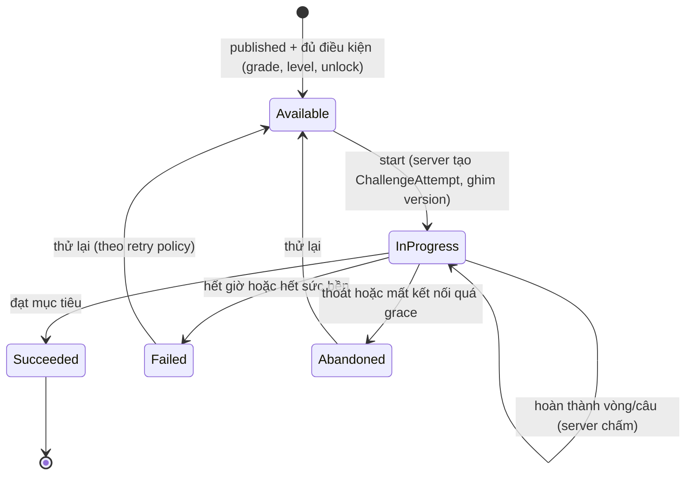
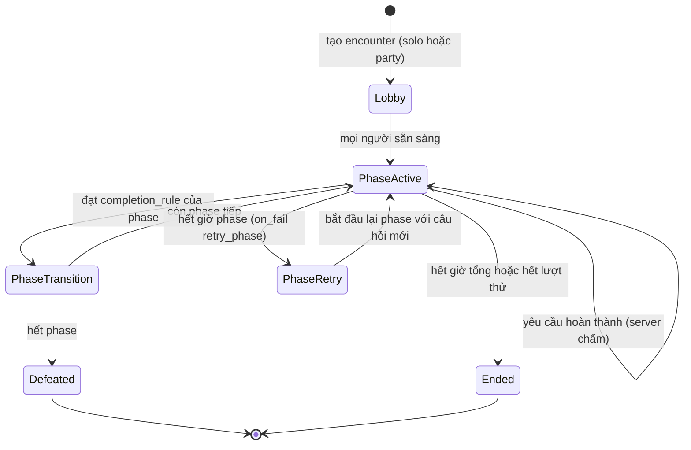

# Challenge & Boss System

> Trạng thái: Draft · Phiên bản: 0.2 · Owner: Game Systems Designer + EdTech Specialist · Cập nhật: 2026-11-15
> Liên quan: [PROGRESSION_SYSTEM](PROGRESSION_SYSTEM.md) · [INVENTORY_ECONOMY](INVENTORY_ECONOMY.md) · [QUEST_SYSTEM](QUEST_SYSTEM.md) · [PARTY_SYSTEM](../03-social-multiplayer/PARTY_SYSTEM.md) · [COMPETITION_SYSTEM](COMPETITION_SYSTEM.md) · [REALTIME_ARCHITECTURE](../06-architecture/REALTIME_ARCHITECTURE.md) · [ANTI_CHEAT](../10-security/ANTI_CHEAT.md) · [ADR-0016, ADR-0043, ADR-0048, ADR-0049](../adr/README.md)

## 1. Mục đích và phạm vi

**Challenge Engine** là bộ máy dùng lại để tạo thử thách có luật chơi (thời gian, độ chính xác, sống sót, giải đố, đánh boss…) trên nền **hoạt động học tập thật** từ Learning Engine. **Boss Battle** là một loại challenge nhiều phase, chơi một mình hoặc theo party.

| Stakeholder | Quan tâm |
|---|---|
| Học sinh | Thử thách hấp dẫn, độ khó vừa sức, sai không bị chê bai |
| Game Designer | Cấu hình loại, độ khó, phase, phần thưởng trong Game Studio |
| EdTech | Mỗi thử thách gắn LO, kết quả học tập ghi riêng từng học sinh |
| Nhà trường (`school_admin`, `academic_manager`) | Chọn thử thách đã publish để giao cho lớp qua LMS (không sửa luật chơi, ADR-0027) |

**Phân biệt với competition:** challenge/boss là **PvE** (người chơi đấu với nội dung) thuộc module `game`; trận **PvP** xếp hạng (1v1, Team Battle, giải đấu) thuộc module `competition` ([COMPETITION_SYSTEM](COMPETITION_SYSTEM.md)). `challenge-templates` trong module `competition` là mẫu **thi đấu lớp/trường** do `school_admin` dùng để tạo thử thách lớp và giải trường (ADR-0072), khác `challenges` ở tài liệu này.

## 2. Challenge Engine

### 2.1. Loại challenge

| `challenge_type` | Luật chính | Kết thúc khi |
|---|---|---|
| `time` | Hoàn thành N hoạt động/câu trong thời gian giới hạn | Hết giờ hoặc xong mục tiêu |
| `perfect` | Đạt độ chính xác mục tiêu (ví dụ 100% hoặc ≥ 90%) | Xong số câu; trượt ngưỡng thì kết thúc vòng, được thử lại |
| `survival` | Có "sức bền" (ví dụ 3 trái tim); mỗi câu sai mất 1, câu đúng liên tiếp hồi | Hết sức bền hoặc qua đủ vòng |
| `puzzle` | Giải câu đố nhiều bước (activity loại puzzle/interactive) | Giải xong hoặc hết giờ |
| `knowledge` | Bộ câu hỏi theo LO, độ khó tăng dần | Xong bộ câu |
| `boss` | Boss nhiều phase (§3) | Boss bị hạ hoặc hết giờ |
| `coop` | Mục tiêu chung cho party, mỗi người có phần riêng | Đạt mục tiêu chung hoặc hết giờ |
| `party` | Như `coop` nhưng tính điểm nhóm để mở phần thưởng nhóm | Như trên |
| `weekly` | Challenge xoay vòng theo tuần (`period_key`) | Hết tuần |
| `seasonal` | Gắn mùa/sự kiện, có thời gian mở/đóng | Hết mùa |
| `tournament` | Vòng PvE dùng trong sự kiện/giải; xếp hạng (nếu có) do module competition | Theo cấu hình giải |

### 2.2. Độ khó

Năm mức: `easy`, `normal`, `hard`, `expert`, `legendary`.

Độ khó **không** là một con số cố định trong client; server chọn tham số theo `difficulty_profile`:

| Yếu tố | Ảnh hưởng |
|---|---|
| Grade | Mỗi mức độ khó ánh xạ sang dải độ khó câu hỏi (1–5) **trong phạm vi khối lớp** của học sinh; không lấy nội dung khối khác |
| Subject, LO | Bộ câu hỏi/selection rule lọc theo LO |
| Activity type | Loại activity được dùng (ADR-0048) |
| Hiệu suất học sinh | Có thể tự điều chỉnh: mastery của LO thấp → gợi ý mức dễ hơn; không tự hạ cấp khi đang chơi [Confirmed] |
| Game mode | Solo/party: party có mục tiêu tổng lớn hơn nhưng phần mỗi người không đổi |

Tham số theo mức [Confirmed]:

| Mức | Dải độ khó câu | Thời gian/câu | Sức bền (survival) | Hệ số thưởng |
|---|---|---|---|---|
| Easy | 1–2 | 40 s | 5 | ×1,0 |
| Normal | 2–3 | 30 s | 4 | ×1,3 |
| Hard | 3–4 | 25 s | 3 | ×1,6 |
| Expert | 4–5 | 20 s | 3 | ×2,0 |
| Legendary | 5 + câu tổng hợp nhiều LO | 20 s | 2 | ×2,5 |

Lớp 1–3: thời gian/câu × 1,5 và chỉ mở `easy`–`hard` theo mặc định [Confirmed] (UX theo độ tuổi, không phải chính sách chat).

### 2.3. Vòng đời

- `ChallengeAttempt` ghim `challenge_version` và các `activity_version` (ADR-0043).
- Mỗi câu/hoạt động trong challenge tạo **Attempt học tập cá nhân** ở module learning (mode `challenge` [Confirmed], ADR-0048) qua facade `attempts` của module learning (gọi trong tiến trình, ADR-0074). Chấm điểm luôn ở module learning (ADR-0016).
- Thời gian dùng giờ server (`started_at`, `deadline_at`).

### 2.4. Thử lại và giới hạn

| Thuộc tính | Mặc định [Confirmed] |
|---|---|
| `max_attempts_per_day` | 5 (weekly/seasonal: theo kỳ) |
| `retry_policy` | Câu hỏi mới mỗi lần thử (`new_questions`) |
| `cooldown_seconds` sau `failed` | 0 cho easy/normal, 60 cho hard trở lên |
| Phần thưởng lần đầu | `first_clear_rewards` chỉ một lần; lần sau theo giảm dần của reward rule |

## 3. Boss Battle

### 3.1. Khái niệm

Boss là nhân vật/thử thách lớn của một vùng và thường là đỉnh của một chương truyện ([WORLD_DESIGN](WORLD_DESIGN.md) §2.2), ví dụ "Rồng Phân Số" ở Vương quốc Số, "Bóng Ma Chính Tả" ở Rừng Ngôn Ngữ. Boss có **thanh tiến độ** (gọi là "năng lượng" thay cho "máu" để tránh cảm giác bạo lực) và nhiều **phase**.

### 3.2. Mô hình phase

| Thuộc tính phase | Mô tả |
|---|---|
| `phase_id`, `order` | |
| `energy_share` | Phần năng lượng boss bị giảm khi phase hoàn thành (tổng các phase = 100%) |
| `requirements[]` | Danh sách yêu cầu, mỗi yêu cầu tham chiếu `activity_ref` (ADR-0048): giải câu hỏi, mini-game, hành động tương tác trong scene, puzzle nhóm |
| `completion_rule` | `all`, `any_n`, `collective_count` (party) |
| `time_limit_seconds` | Giới hạn của phase (giờ server) |
| `on_fail` | `retry_phase` (mặc định) hoặc `end_encounter` |
| `presentation` | Hoạt ảnh, câu thoại boss, hiệu ứng (dữ liệu cho client) |

### 3.3. Trạng thái encounter

### 3.4. Đóng góp cá nhân và nhóm

- Mỗi yêu cầu học tập do **từng học sinh** tự làm, tạo attempt riêng. Phase party dùng `collective_count`: tiến độ phase = tổng đóng góp, nhưng mỗi người phải đạt `min_contribution` mới được tính là tham gia (chống "ăn theo", giống QUEST_SYSTEM §6).
- `boss_encounter_contributions`: `student_id`, `phase_id`, `correct_count`, `activities_completed`, `contribution_pct`.
- Phần thưởng: `defeat_rewards` cho mọi người đạt `min_contribution`; không có "MVP" công khai xếp hạng trong nhóm [Confirmed].
- **Kết quả học tập không chia sẻ**: mỗi học sinh có learning record riêng, boss bị hạ không làm thay đổi điểm/mastery của người chưa tự làm đúng.

### 3.5. Không gây áp lực tiêu cực

- Trả lời sai: boss "phản đòn" bằng hiệu ứng vui (không mất tiến độ đã đạt), hiển thị giải thích hoặc gợi ý; không hiện chữ "Thất bại" đỏ toàn màn hình, không hiển thị ai trong nhóm sai.
- Hết giờ phase: thử lại phase với câu hỏi mới, giữ tiến độ phase trước.
- Hết lượt: kết thúc với tóm tắt "Bạn đã đi được tới phase 2/3" + gợi ý ôn LO yếu.

### 3.6. Độ khó theo khối

Boss có `grade_levels[]`; mỗi khối có bộ yêu cầu riêng (cùng boss, khác nội dung). Party có thành viên khác khối: mỗi người nhận câu hỏi theo khối của mình; party chỉ được vào boss mà mọi thành viên đều thuộc `grade_levels` [Confirmed].

## 4. Multiplayer boss: chạy ở đâu

**Quyết định [Confirmed]:** encounter (solo và party) chạy **server-authoritative trong module `game`**, dùng chung thư viện room host (`src/backend/pkg/roomhost`) với module `competition`.

Lý do:
- Boss là nội dung PvE gắn quest, progression và phần thưởng (dữ liệu đều ở module game); không có rating nên không cần module competition.
- Tránh để module competition phụ thuộc cấu hình game (quest, reward).
- Dùng lại cơ chế room host (owner node, checkpoint, reconnect grace) đã đặc tả ở [REALTIME_ARCHITECTURE](../06-architecture/REALTIME_ARCHITECTURE.md): lệnh WS `boss.*` đi qua `realtime` → NATS request `ew.cmd.game.boss.*`; trạng thái phát qua Valkey Pub/Sub `ew:rt:room:<encounter_id>`.

Party vào boss **chỉ** qua Party Lobby: leader chọn hoạt động `boss` ([PARTY_SYSTEM](../03-social-multiplayer/PARTY_SYSTEM.md)), module competition kiểm tra điều kiện qua `checkPartyActivityEligibility` rồi gọi `startPartyActivity` của module game, module game tạo encounter cho các thành viên đủ điều kiện và trả `encounter_id`; lệnh WS `boss.*` định tuyến tới module game ([REALTIME_ARCHITECTURE §4.1](../06-architecture/REALTIME_ARCHITECTURE.md#41-dịch-lệnh-ws--nats)); chat `party` tiếp tục dùng trong encounter.

Mất kết nối: grace 120 s như quest co-op; encounter tiếp tục nếu số người còn lại ≥ `party_size.min`; người quay lại (kể cả từ thiết bị khác, ADR-0031) nhận lại trạng thái từ checkpoint.

## 5. Anti-cheat

| Rủi ro | Biện pháp |
|---|---|
| Client tự báo hạ boss/hoàn thành challenge | Chỉ server đổi trạng thái, dựa trên kết quả chấm của module learning |
| Trả lời quá nhanh/đoán | Ngưỡng thời gian tối thiểu mỗi câu (ANTI_CHEAT); không tính đóng góp, gắn `integrity_signals` |
| Lặp challenge dễ để farm | `max_attempts_per_day`, reward giảm dần, cap XP/ngày ([PROGRESSION_SYSTEM](PROGRESSION_SYSTEM.md) §3.2) |
| Một người làm hộ cả party | `min_contribution` mỗi người, attempt gắn đúng `student_id` của phiên |
| Gửi lặp kết quả | Idempotency-Key cho mọi lệnh ghi; phần thưởng idempotent theo `(encounter_id, student_id)` |

## 6. Dữ liệu (module game, `eduworld_game`)

| Bảng | Loại | Cột chính |
|---|---|---|
| `challenges`, `challenge_versions` | G, con trỏ `current_version_id` | `challenge_type`, `difficulty`, `grade_levels int[]`, `subject_id`, `objective_ids uuid[]`, `config jsonb` (schema `challenge.schema.json`), `rewards jsonb`, `availability jsonb` |
| `challenge_attempts` | T | `challenge_attempt_id`, `tenant_id`, `student_id`, `challenge_version_id`, `party_id`, `status`, `score`, `lives_left`, `started_at`, `deadline_at`, `ended_at`, `learning_attempt_ids uuid[]` |
| `boss_definitions`, `boss_versions` | G | `boss_code`, `area_id`, `grade_levels`, `phases jsonb` (schema `boss.schema.json`), `rewards jsonb` |
| `boss_encounters` | T | `encounter_id`, `tenant_id`, `boss_version_id`, `party_id`, `mode` (solo/party), `status`, `current_phase`, `energy_remaining`, `checkpoint jsonb`, `started_at`, `ended_at` |
| `boss_encounter_members` | T | `encounter_id`, `student_id`, `joined_at`, `left_at` |
| `boss_encounter_contributions` | T | §3.4 — UNIQUE `(encounter_id, student_id, phase_id)` |

Chi tiết: [DATABASE_DESIGN §2.8a](../07-backend/DATABASE_DESIGN.md).

## 7. API đề xuất

| Method | Path | Mô tả | Idem |
|---|---|---|---|
| GET | `/game/challenges?type=&area_id=&difficulty=` | Challenge khả dụng cho học sinh (đã lọc grade/unlock) | T |
| GET | `/game/challenges/{challenge_id}` | Chi tiết + lượt thử còn lại hôm nay | T |
| POST | `/game/challenges/{challenge_id}:start` | Bắt đầu (body: `difficulty`, `party_id?`) → `ChallengeAttempt` + hoạt động đầu tiên | B |
| POST | `/game/challenge-attempts/{challenge_attempt_id}/activities:next` | Lấy hoạt động tiếp (attempt học tập mới) | B |
| POST | `/game/challenge-attempts/{challenge_attempt_id}:abandon` | Bỏ | B |
| GET | `/game/challenge-attempts/{challenge_attempt_id}` | Trạng thái, điểm, sức bền | T |
| GET | `/game/bosses?area_id=` | Boss khả dụng | T |
| POST | `/game/bosses/{boss_id}/encounters` | Tạo encounter **solo**. Encounter party **không** tạo bằng endpoint này: leader chọn `boss` trong Party Lobby, module competition gọi `startPartyActivity` (internal, `Idempotency-Key = party_activity_id`) của module game ([PARTY_SYSTEM §6](../03-social-multiplayer/PARTY_SYSTEM.md#6-party-session)) | B |
| GET | `/game/boss-encounters/{encounter_id}` | Trạng thái (dự phòng khi mất WS) | T |
| POST | `/game/boss-encounters/{encounter_id}:leave` | Rời encounter | B |

Câu trả lời trong challenge/boss nộp qua API attempt hiện có (`POST /learning/activity-attempts/{attempt_id}/responses`, ADR-0059) hoặc lệnh WS `boss.answer.submit` (gateway chuyển tới module game, module game gọi module learning chấm).

WS (đề xuất cho AsyncAPI): lệnh `boss.encounter.ready`, `boss.answer.submit`; sự kiện `boss.encounter.updated`, `boss.phase.started`, `boss.phase.completed`, `boss.encounter.ended`, `challenge.attempt.updated`.

Cấu hình (Game Studio): `/api/v1/game-admin/challenges`, `/api/v1/game-admin/bosses`.

## 8. Event

| Event | Producer | Consumers | Payload chính |
|---|---|---|---|
| `challenge.started` | module game | LA | `challenge_attempt_id`, `challenge_version_id`, `difficulty` |
| `challenge.completed` | module game | reward (XP), achievement, LA | `status` (succeeded/failed/abandoned), `score`, `difficulty`, `objective_ids[]` |
| `boss.encounter_started` | module game | RT, LA | `encounter_id`, `boss_version_id`, `member_ids[]` |
| `boss.phase_completed` | module game | RT | `encounter_id`, `phase_id` |
| `boss.encounter_completed` | module game | reward, achievement, LA | `encounter_id`, `result` (defeated/ended), `contributions[]` (`student_id`, `eligible`) |

## 9. Lỗi

| HTTP | `code` | Khi nào |
|---|---|---|
| 403 | `CHALLENGE_NOT_ELIGIBLE` | Sai khối, chưa mở khóa, ngoài thời gian |
| 409 | `CHALLENGE_ATTEMPT_LIMIT` | Hết lượt thử trong ngày/kỳ hoặc đang cooldown |
| 409 | `BOSS_ENCOUNTER_FULL` | Encounter đã đủ người hoặc đã bắt đầu |
| 409 | `BOSS_PHASE_CLOSED` | Nộp cho phase đã kết thúc |

## 10. Acceptance criteria

| ID | Tiêu chí |
|---|---|
| AC-CHL-001 | Challenge `time` kết thúc đúng theo giờ server; client đổi đồng hồ không ảnh hưởng |
| AC-CHL-002 | Học sinh lớp 3 chọn `hard` chỉ nhận câu hỏi khối 3 độ khó 3–4 |
| AC-CHL-003 | Mỗi câu trong challenge tạo attempt học tập riêng; learning record ghi đúng học sinh |
| AC-CHL-004 | Party 4 người hạ boss: chỉ người đạt `min_contribution` nhận thưởng; learning record mỗi người riêng |
| AC-CHL-005 | Hết giờ phase → thử lại phase với câu hỏi mới, giữ tiến độ phase trước; không hiển thị ai sai |
| AC-CHL-006 | Gửi lặp kết quả/hạ boss → phần thưởng một lần |
| AC-CHL-007 | Một thành viên mất kết nối, quay lại từ thiết bị khác trong 120 s → nhận lại trạng thái encounter |
| AC-CHL-008 | Vượt `max_attempts_per_day` → `CHALLENGE_ATTEMPT_LIMIT`, thông báo thân thiện |

Test case: TC-CHL-001…008 trong [TEST_STRATEGY](../12-project/TEST_STRATEGY.md).
