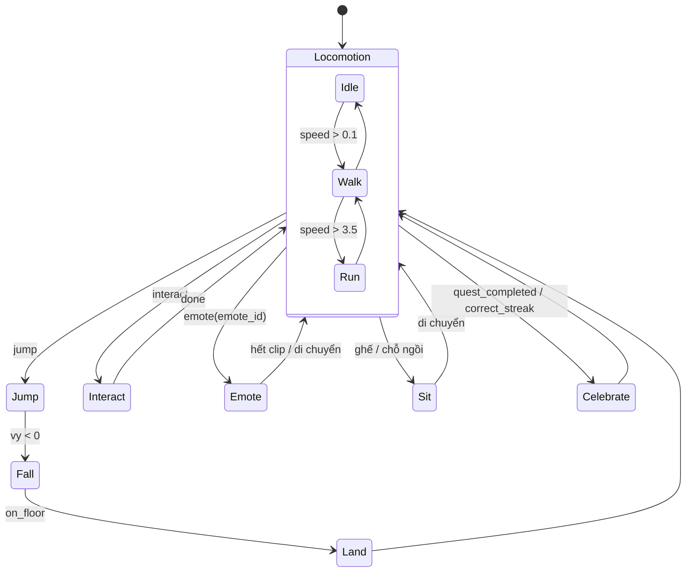
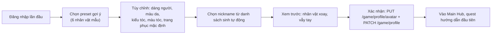
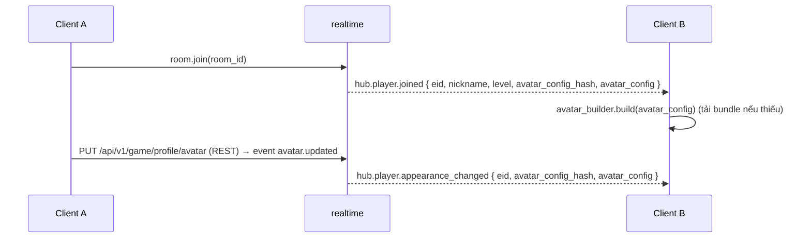

# Character System

> Trạng thái: Draft · Phiên bản: 0.3 · Owner: Game Director + Senior Godot Developer · Cập nhật: 2026-11-15
> Liên quan: [DOMAIN_MODEL §5](../06-architecture/DOMAIN_MODEL.md) · [WORLD_RENDERING](../08-game-client/WORLD_RENDERING.md) · [WORLD_DESIGN](WORLD_DESIGN.md) · [GAME_NETWORKING](../08-game-client/GAME_NETWORKING.md) · [CHILD_SAFETY](../10-security/CHILD_SAFETY.md) · [INVENTORY_ECONOMY](INVENTORY_ECONOMY.md) · [PROGRESSION_SYSTEM](PROGRESSION_SYSTEM.md)

## 1. Mục đích và phạm vi

Tài liệu là nguồn duy nhất cho nhân vật người chơi: tạo nhân vật, customization (cách mặc vật phẩm lên nhân vật), nickname, emote, controller, camera, animation, đồng bộ ngoại hình trong multiplayer. Item catalog, slot, kho đồ, Shop: [INVENTORY_ECONOMY](INVENTORY_ECONOMY.md). Level/XP: [PROGRESSION_SYSTEM](PROGRESSION_SYSTEM.md).

| Thành phần | Mục tiêu | Nhãn |
|---|---|---|
| Character Controller | Di chuyển third-person thân thiện, điều khiển được bằng bàn phím/chuột, gamepad, cảm ứng | [Confirmed] (§13.3) |
| Camera Controller | Camera theo sau, không gây chóng mặt cho trẻ nhỏ | [Confirmed] |
| Animation State Machine | Idle/walk/run/jump/interact/emote/sit/celebrate | [Confirmed] |
| Customization | Body, skin tone, hair, outfit, accessories, emotes (§3.3) | [Confirmed] |
| Inventory | Hiển thị vật phẩm sở hữu, trang bị | [Confirmed] |
| Character level | Hiển thị level/XP **do server tính** | [Confirmed] |

Không có vũ khí, sát thương, máu, chiến đấu (§3.1 — không bạo lực).

## 2. Character Controller

`player_controller.gd` trên `CharacterBody3D`:

| Tham số | Giá trị mặc định | Nhãn |
|---|---|---|
| Tốc độ đi / chạy | 3.0 / 5.5 m/s | [Proposed] |
| Nhảy | cao 1.0 m, không double jump | [Proposed] |
| Gia tốc / ma sát | 20 / 25 m/s² (dừng gọn, dễ điều khiển) | [Proposed] |
| Dốc tối đa | 40° | [Proposed] |
| Step height | 0.3 m | [Proposed] |

- Input map trừu tượng (`move_forward`, `move_left`, `jump`, `interact`, `emote_wheel`, `open_quest`, `open_chat`) — hỗ trợ bàn phím, gamepad, và **virtual joystick + nút cảm ứng** trên Android (lớp UI `TouchControls` chỉ hiện trên thiết bị cảm ứng).
- Chế độ **click/tap-to-move** cho lớp 1–3 [Proposed]: chạm vào mặt đất → `NavigationAgent3D` dẫn đường.
- Controller **không** gửi vị trí trực tiếp; `remote_player_sync.gd` lấy mẫu trạng thái và gửi qua `RealtimeClient` theo nhịp ở [GAME_NETWORKING](../08-game-client/GAME_NETWORKING.md) §5. Server kiểm tra tốc độ/biên (ADR-0011); nếu server trả `position_correction`, controller nội suy về vị trí đúng trong 200 ms.
- Khi mở UI toàn màn (exercise, exam, chat nhập liệu) controller tắt input di chuyển.

## 3. Camera Controller

`camera_rig.gd`: `SpringArm3D` + `Camera3D`.

| Tham số | Giá trị | Ghi chú |
|---|---|---|
| Khoảng cách | 4–8 m, mặc định 6 | Cuộn chuột / pinch |
| Góc pitch | −10° … −55° | Không cho nhìn từ dưới lên |
| Xoay | chuột phải kéo / vuốt một ngón vùng trống / stick phải | |
| Auto-follow | Từ từ quay về sau lưng khi di chuyển (bật mặc định cho lớp 1–5) | Giảm thao tác |
| Va chạm | SpringArm tránh tường, có collision mask riêng `camera_block` | |
| Giảm chuyển động | Tắt camera shake, giảm FOV kick khi bật setting | Accessibility |
| Chế độ hội thoại | Khi nói chuyện NPC: camera chuyển góc 2 shot, tween 0.4 s | |

## 4. Animation State Machine

`AnimationTree` dùng `AnimationNodeStateMachine` + BlendSpace1D cho locomotion.



- Clip dùng chung một skeleton humanoid (retarget từ `AnimationLibrary` `kid_base`). Tất cả body type share skeleton để cosmetic tương thích.
- `anim_driver.gd` nhận **trạng thái logic** (speed, on_floor, action) chứ không đọc input — cùng driver dùng cho `Player` và `RemotePlayer` (remote nhận trạng thái từ snapshot).
- Emote/celebrate là one-shot; emote không có clip nào gợi ý chế giễu/xúc phạm (review an toàn nội dung).

## 5. Customization

### 5.0. Tạo avatar lần đầu

Khi `GameProfile.avatar_config` chưa có (lần đầu vào game sau đăng nhập), client mở màn **Tạo nhân vật** trước khi vào Main Hub:



| Quy tắc | Chi tiết |
|---|---|
| Preset | 6 preset [Proposed] đa dạng, trung tính, phù hợp lứa tuổi; học sinh có thể bỏ qua tùy chỉnh và dùng preset |
| Dáng người (`body_type`) | 3–4 dáng trẻ em stylized, không phân biệt giới tính bắt buộc; không có tùy chọn cơ thể người lớn |
| Màu da, màu tóc | Bảng màu cố định, miễn phí cho mọi học sinh |
| Trang phục ban đầu | Bộ mặc định miễn phí; trang phục khác mở khóa qua phần thưởng hoặc Shop Xu ([INVENTORY_ECONOMY](INVENTORY_ECONOMY.md)) |
| Không cho phép | Ảnh thật, tải ảnh lên, nhập tên tự do, chi tiết gợi cảm/bạo lực, biểu tượng chính trị/tôn giáo |
| Lớp 1–3 | Ít bước hơn (preset + màu tóc + xác nhận), nút lớn, có giọng đọc hướng dẫn |
| Đổi lại | Vào Tủ đồ bất cứ lúc nào; đổi `body_type`/màu da miễn phí |

Server đánh dấu `game_profiles.avatar_created_at`; event `avatar.created` (dùng cho achievement "Lần đầu xuất hiện" và funnel analytics).

### 5.1. Data model (khớp DOMAIN_MODEL §5)

`GameProfile.avatar_config` (JSON lưu server, kiểm tra quyền sở hữu khi lưu):

```json
{
  "schema_version": 1,
  "body_type": "kid_a",
  "skin_tone": "tone_04",
  "hair":      { "item_id": "hair_ponytail_01", "color": "hair_col_03" },
  "outfit":    { "item_id": "outfit_explorer_01" },
  "accessories": [ { "slot": "head", "item_id": "acc_cap_star" }, { "slot": "back", "item_id": "acc_backpack_owl" } ],
  "emote_slots": ["emote_wave", "emote_clap", "emote_dance", "emote_celebrate", "emote_thank", "emote_apologize"]
}
```

| Trường | Ràng buộc server |
|---|---|
| `body_type`, `skin_tone`, màu tóc | Thuộc danh mục miễn phí (mọi học sinh) |
| `hair.item_id`, `outfit.item_id`, `accessories[].item_id`, `emote_slots[]` | Phải có `InventoryItem(student_id, item_id)` hoặc là item mặc định |
| `accessories[].slot` | `head`, `face`, `back`, `hand` — tối đa 1 item/slot (danh sách slot chuẩn: [INVENTORY_ECONOMY](INVENTORY_ECONOMY.md) §2) |
| `emote_slots` | Tối đa 6 (wheel 6 ô) [Proposed] |
| `pet` | 1 pet trang trí đi theo nhân vật (không chỉ số), item `kind = pet` |
| `title`, `frame`, `badge_showcase[]` | Danh hiệu, khung avatar, tối đa 3 huy hiệu trưng bày trên thẻ hồ sơ |

**Equipment slot**: theo danh sách chuẩn ở [INVENTORY_ECONOMY](INVENTORY_ECONOMY.md) §2. Server từ chối item sai slot (`422 EQUIP_SLOT_INVALID`).

**Avatar preset của học sinh:** lưu tối đa 3 bộ phối đồ (`avatar_presets`) để đổi nhanh [Proposed].

**Ngoại hình theo tiến trình:** một số trang phục/khung/danh hiệu chỉ mở ở level hoặc thành tựu nhất định ([PROGRESSION_SYSTEM](PROGRESSION_SYSTEM.md) §4.4), hiển thị cho người khác như dấu hiệu tiến bộ trong game, không lộ thông tin học tập.

API: `GET /api/v1/game/profile` · `PUT /api/v1/game/profile/avatar` (body = `avatar_config`, server trả 422 `ITEM_NOT_OWNED` nếu vi phạm).

**Thông tin trường/lớp trên hồ sơ người chơi (ADR-0060, ADR-0061):** thẻ hồ sơ hiển thị nickname, avatar, level, danh hiệu, huy hiệu trưng bày cho mọi người theo policy. Thông tin tổ chức (trường — tên song ngữ, tỉnh/thành, lớp, khối) lấy từ dữ liệu SIS đã đồng bộ khi đăng nhập và chỉ hiển thị:

| Người xem | Thấy |
|---|---|
| Chính học sinh | Trường, tỉnh/thành, lớp, khối (mục "Hồ sơ của em" trong [Cài đặt](../05-ux/STUDENT_GAME_UX_SOCIAL.md)) |
| Bạn cùng lớp, giáo viên của lớp | Lớp (và trường) theo policy trường; không có tên thật nếu trường không bật |
| Người khác (kể cả cùng trường khác lớp, liên trường) | Không thấy trường/lớp/tỉnh — chỉ nickname và thông tin game (R16, ADR-0054) |

Học sinh không sửa được trường/lớp trong game (dữ liệu do SIS sở hữu); thông tin sai thì báo giáo viên để sửa ở SIS. Học sinh tenant chung thấy "EduWorld chung · Khối n".

### 5.2. Item definitions & hiển thị

- `ItemDefinition` và loại vật phẩm: [INVENTORY_ECONOMY](INVENTORY_ECONOMY.md) §2.2. Item là nội dung game có version (ADR-0043); `InventoryItem` hiển thị theo version hiện hành trong content manifest. Thay đổi hình ảnh item không thu hồi item đã cấp.
- Client có `resources/items/<item_id>.tres` (`ItemVisual`: mesh/scene, material override, icon) — **chỉ mô tả hiển thị**. Item mới đến qua cosmetic bundle PCK ([WORLD_RENDERING](../08-game-client/WORLD_RENDERING.md) §8.2).
- Nếu client chưa có visual của item (bundle chưa tải) → hiển thị item mặc định thay thế, tải bundle nền.
- Màu độ hiếm (viền, hào quang item, khung icon) lấy từ mã màu nghiệp vụ dùng chung `rarity.*` (`design/shared-tokens/`, ADR-0047) để CMS và game hiển thị cùng màu. Material nhân vật/item dùng preset toon/outline sinh từ `design/game-tokens/art3d.json`.
- Mỗi version item/nhân vật/bộ trang phục được publish sẽ có **thumbnail và turntable render headless** ([WORLD_RENDERING](../08-game-client/WORLD_RENDERING.md) §8.3) để Game Studio và CMS hiển thị; icon item trong game có thể dùng cùng ảnh render (cỡ nhỏ).
- `avatar_builder.gd` lắp avatar: gắn mesh vào `BoneAttachment3D` theo slot, đổi material theo skin tone/màu tóc qua palette — dùng chung cho Player, RemotePlayer, CustomizationStudio, thẻ profile.
- **Hiệu năng (máy tầm trung, ADR-0057):** avatar ghép từ nhiều phần phải nằm trong ngân sách nhân vật (tam giác LOD0/1/2, một atlas texture, số xương, số material) và số nhân vật render đầy đủ theo preset do [PERFORMANCE_BUDGET](../08-game-client/PERFORMANCE_BUDGET.md) §5, §8 sở hữu. `avatar_builder.gd` gộp mesh các slot thành một mesh skinned và bake palette vào một material khi avatar không đổi trong phiên; RemotePlayer ngoài giới hạn hiển thị đầy đủ dùng LOD thấp, xa hơn dùng impostor billboard; nhân vật dùng object pool khi vào/ra tầm nhìn. Item mới không đạt ngân sách bị chặn ở CI import.

### 5.3. Nickname

- Lần đầu vào game, học sinh chọn nickname từ **danh sách sinh tự động** (tính từ + con vật + số, vd. "Cú Mèo Chăm Chỉ 27") [Proposed]; không nhập tự do để tránh lộ tên thật/ngôn từ xấu.
- Đổi nickname: theo policy trường, giới hạn số lần/tháng; giáo viên/quản trị có thể reset.
- Tên thật không bao giờ hiển thị trên đầu nhân vật trong khu công cộng ([CHILD_SAFETY](../10-security/CHILD_SAFETY.md)).

### 5.4. Nguồn mở khóa

Cosmetic mở khóa qua `RewardGrant` (hoàn thành bài tập, quest, sự kiện, thành tựu, thi đấu) hoặc mua bằng Xu trong Shop ([INVENTORY_ECONOMY](INVENTORY_ECONOMY.md) §5). **Không có mua bằng tiền thật** [Proposed] (OQ-14). Không có item ảnh hưởng tới kết quả học tập hay lợi thế thi đấu.

## 6. Inventory UI

| Màn hình | Nội dung |
|---|---|
| Tủ đồ (Wardrobe) | Lưới theo tab `kind`, lọc "mới", preview trên `CustomizationStudio` (nhân vật xoay được) |
| Chi tiết item | Tên, độ hiếm, **nguồn nhận** ("Hoàn thành nhiệm vụ Phép nhân kỳ diệu") — khuyến khích học, không hiển thị giá |
| Emote wheel | Chọn 6 emote đã trang bị |
| Bộ sưu tập | Collection và tiến độ ([INVENTORY_ECONOMY](INVENTORY_ECONOMY.md) §6) |

API: `GET /api/v1/game/inventory?kind=&cursor=` · `GET /api/v1/game/inventory/catalog` (định nghĩa item mà học sinh thấy được). Inventory là read model từ server; client không tự cộng item. Giao diện Tủ đồ dùng component và Theme của game design system (ADR-0047). Lớp 1–3 dùng giao diện ít tab hơn (gộp outfit/hair/accessory thành "Trang phục").

## 7. Emotes

- Kích hoạt: phím `emote_wheel` / nút cảm ứng → chọn emote → gửi lệnh `hub.player.emote` qua realtime (server rate limit 1 emote/2 s, kiểm tra emote đã trang bị) → server broadcast `hub.player.emoted` tới người trong interest area → `RemotePlayer` phát clip. (Tên message theo quy ước REALTIME_ARCHITECTURE §4; định nghĩa chuẩn ở AsyncAPI.)
- Emote là cách giao tiếp an toàn mặc định cho mọi lứa tuổi (kết hợp Quick Message — xem CHAT_SYSTEM).
- **Bộ emote 3D mặc định miễn phí** [Confirmed theo Master Prompt mới §13.5]: `emote_wave` (vẫy tay), `emote_clap` (vỗ tay), `emote_dance` (nhảy), `emote_celebrate` (ăn mừng), `emote_thank` (cảm ơn), `emote_apologize` (xin lỗi). Emote thêm mở khóa qua phần thưởng/Shop.
- Emote dùng được trong hub, trận đấu, party lobby và boss encounter (phát trên nhân vật, cùng rate limit). Trong khung chat dùng emoji/sticker theo [CHAT_SYSTEM](../03-social-multiplayer/CHAT_SYSTEM.md); không thêm loại tin nhắn mới.
- Không có emote mang tính chế giễu, khiêu khích hay bạo lực; danh sách emote là nội dung platform có duyệt (ADR-0027, ADR-0043).

## 8. Đồng bộ appearance trong multiplayer



- Snapshot vị trí 10 Hz (`hub.snapshot.updated`, entity `{eid, p, r, a}`) **không** chứa appearance; appearance gửi khi join và khi thay đổi (kèm `avatar_config_hash` để client cache theo hash).
- `eid` là định danh entity ẩn danh theo room (không phải `student_id`) [Proposed] — giảm lộ ID ra người chơi khác; xem [REALTIME_ARCHITECTURE §6](../06-architecture/REALTIME_ARCHITECTURE.md).
- Thông tin hiển thị cho người khác: nickname, avatar, level, badge đang đeo. Không hiển thị trường/lớp với người chơi khác trường (CHILD_SAFETY).

## 9. Kiểm thử

| Test | Loại |
|---|---|
| Controller: tốc độ tối đa, dốc, step, không xuyên tường ở 30 FPS và 60 FPS | Scene test GdUnit4 |
| `avatar_builder` với mọi tổ hợp slot hợp lệ; item thiếu visual → fallback | Unit |
| AnimationTree chuyển trạng thái đúng theo input logic | Scene test |
| 40 RemotePlayer với avatar khác nhau đạt ngân sách cảnh Hub đông ([PERFORMANCE_BUDGET](../08-game-client/PERFORMANCE_BUDGET.md) §7, AC-PERF-001/002) | Benchmark CI + thiết bị lab |
| Server từ chối item không sở hữu (422) | API test backend |
