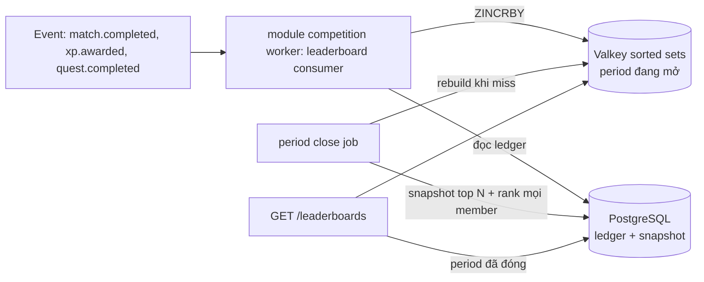
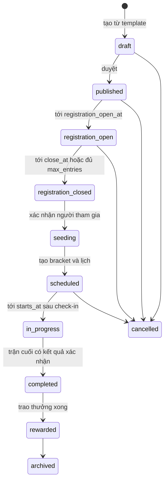

# Competition System — Thi đấu, Ranking, Leaderboard, Tournament

> Trạng thái: Draft · Phiên bản: 0.2 · Owner: Game Director + Multiplayer Engineer · Cập nhật: 2026-11-15
> Liên quan: [GAME_DESIGN](GAME_DESIGN.md) · [MATCHMAKING](../03-social-multiplayer/MATCHMAKING.md) · [MULTIPLAYER_GAMEPLAY](../03-social-multiplayer/MULTIPLAYER_GAMEPLAY.md) · [PARTY_SYSTEM](../03-social-multiplayer/PARTY_SYSTEM.md) · [CHALLENGE_BOSS_SYSTEM](CHALLENGE_BOSS_SYSTEM.md) · [PROGRESSION_SYSTEM](PROGRESSION_SYSTEM.md) · [ANTI_CHEAT](../10-security/ANTI_CHEAT.md) · [CHILD_SAFETY](../10-security/CHILD_SAFETY.md) · [ADR-0011](../adr/ADR-0011-realtime-transport-websocket-qua-go-realtime-server.md) · [ADR-0016](../adr/ADR-0016-server-authoritative-scoring-answer-key-khong-bao-gio-roi-se.md) · [ADR-0018](../adr/ADR-0018-glicko-2-cho-game-rating-tach-biet-learning-mastery.md) · [ADR-0027](../adr/ADR-0027-cms-tach-vung-tenant-chi-thao-tac-learning-management-cau-hi.md) · [ADR-0054](../adr/ADR-0054-tuong-tac-xa-hoi-lien-truong-cross-school-social-interaction.md)

**Mục lục:** 1. Mục đích và phạm vi · 2. Các mode thi đấu · 3. Luật chơi từng mode · 4. Chấm điểm phía server · 5. Công bằng theo khối lớp · 6. Năm loại số liệu · 7. Game Rating (Glicko-2) · 8. Season, tier, Competition Points · 9. Leaderboard · 10. Tournament · 11. Phần thưởng · 12. Giảm áp lực tiêu cực · 13. Cấu hình · 14. Dữ liệu, API, event · 15. Acceptance criteria

## 1. Mục đích và phạm vi

Thi đấu là **động lực luyện tập và chơi cùng nhau** — không phải công cụ đánh giá năng lực học tập [Confirmed]. Tài liệu này là nguồn duy nhất cho: mode thi đấu PvP, luật chơi, chấm điểm trận, rating, season, Competition Points, leaderboard và tournament.

| Ngoài phạm vi | Tài liệu |
|---|---|
| Ghép trận (queue, ticket, ready check) | [MATCHMAKING](../03-social-multiplayer/MATCHMAKING.md) |
| Room, reconnect, grace theo mode | [MULTIPLAYER_GAMEPLAY](../03-social-multiplayer/MULTIPLAYER_GAMEPLAY.md) |
| Challenge/boss PvE | [CHALLENGE_BOSS_SYSTEM](CHALLENGE_BOSS_SYSTEM.md) |
| XP và level | [PROGRESSION_SYSTEM](PROGRESSION_SYSTEM.md) |
| Chat trong trận | [CHAT_SYSTEM](../03-social-multiplayer/CHAT_SYSTEM.md) |

Kiến trúc: state machine trận trong **module competition** (room host), câu hỏi và chấm điểm ở **module learning** (facade `question-plans`, gọi trong tiến trình `core-api`), kết nối WebSocket qua binary **realtime** (ADR-0011, ADR-0074).

## 2. Các mode thi đấu [Confirmed — Master Prompt §5.3]

| Mode | `match.mode` | Người chơi | Thời lượng | Khối khả dụng | Rating |
|---|---|---|---|---|---|
| 1v1 Knowledge Battle | `battle_1v1` | 2 | 3–5 phút | Tất cả | Glicko-2 |
| Team Battle | `team_battle` | 2v2 – 4v4 | 5–7 phút | Lớp 4 trở lên | Glicko-2 (cá nhân, tính theo kết quả đội) |
| Co-op Challenge | `coop_challenge` | 2–4 (party) | 5–10 phút | Tất cả | Không |
| Timed Quiz | `timed_quiz` | 1–40 (cùng instance/lớp) | 2–5 phút | Tất cả | Không (rating `timed_quiz` chỉ dùng nội bộ, không hiển thị) |
| Subject / Class / School Tournament | `tournament` | 8–64 hoặc cả lớp/trường | Nhiều ngày hoặc một buổi | Theo giải | Không đổi rating, dùng rating để seed |
| Seasonal Competition | Season | Tất cả | 8 tuần | Tất cả | Season rating |

Thi đấu luôn **tùy chọn**: không quest học tập bắt buộc nào yêu cầu thắng trận.

## 3. Luật chơi từng mode

### 3.1. 1v1 Knowledge Battle [Confirmed]

| Mục | Luật |
|---|---|
| Ghép trận | Theo [MATCHMAKING](../03-social-multiplayer/MATCHMAKING.md): hard constraint khối lớp trước, rồi rating |
| Cấu trúc | 7 câu; mỗi câu 20 s (lớp 1–3: 30 s); câu cuối x2 điểm |
| Nguồn câu | `question_plan` do server tạo khi trận bắt đầu (subject × grade × topic tùy chọn × độ khó theo trung bình mastery hai bên), ghim version (ADR-0043); không dùng câu đã gặp với một trong hai người trong 7 ngày |
| Trả lời | Mỗi người 1 lượt/câu; đáp án lộ cho cả hai sau khi cả hai trả lời hoặc hết giờ |
| Điểm/câu | Đúng: 100; sai/không trả lời: 0. **Lớp 6–9** cộng thêm bonus tốc độ tối đa 50 (tuyến tính theo thời gian còn lại, đo bằng thời gian server nhận). **Lớp 1–5 không có bonus tốc độ**: trận của trẻ nhỏ thưởng suy nghĩ đúng, không thưởng bấm nhanh [Confirmed — Technical Architect 2026-11-15] (`speed_bonus_min_grade` = 6) |
| Thắng | Tổng điểm cao hơn; bằng điểm sau câu tie-break → hòa |
| Disconnect | Grace và kết quả khi hết grace theo [MULTIPLAYER_GAMEPLAY §9.2](../03-social-multiplayer/MULTIPLAYER_GAMEPLAY.md#92-grace-theo-chế-độ-tài-liệu-này-sở-hữu-giá-trị) (1v1: thua do `abandon`, tính rating, đối thủ thắng); cả hai rời → trận hủy, không tính rating |
| Chat | **Luôn có** (ADR-0020 mục 6): channel `match` từ lobby đến hết trận; panel tự thu nhỏ khi câu hỏi hiển thị; mute/chặn/báo cáo ngay trên tin |

### 3.2. Team Battle [Confirmed]

| Mục | Luật |
|---|---|
| Đội | Từ party (Competition Team) hoặc ghép ngẫu nhiên; đội ghép cùng khối |
| Cấu trúc | 10 câu; mỗi câu một thành viên trả lời "lượt chính" (xoay vòng), thành viên khác trả lời "lượt hỗ trợ" nhận 30% điểm |
| Mục đích | Mọi thành viên đều tham gia, tránh một bạn giỏi gánh cả đội |
| Thắng | Tổng điểm đội |
| Chat | **Luôn có**: tab "Đội" (channel `team`) và tab "Cả trận" (channel `match`); không tắt được bằng cài đặt trường/lớp |

### 3.3. Co-op Challenge

Party cùng chống "thử thách thời gian" (ví dụ dập tắt 10 ngọn lửa bằng câu trả lời đúng trước khi hết 5 phút). Không có đối thủ; mục tiêu tập thể; xếp hạng theo "kỷ lục lớp", không xếp hạng cá nhân. Mỗi thành viên có attempt riêng [Confirmed — Addendum §4].

### 3.4. Timed Quiz

Thử thách lớp do nhà trường tạo từ template qua LMS (chỉ `school_admin`, ADR-0072) hoặc sự kiện tổ chức trong một instance/lớp: tất cả trả lời cùng bộ câu; kết quả hiển thị top 5 + vị trí của chính mình (lớp 1–3 chỉ hiển thị mục tiêu lớp, §9.4). Điểm theo §3.1, lớp 1–5 không có bonus tốc độ.

### 3.5. Tournament

Xem §10.

### 3.6. Seasonal Competition

Season 8 tuần (§8): Competition Points tích lũy từ trận và giải; season track miễn phí; soft reset rating đầu mùa.

## 4. Chấm điểm phía server

| Quy tắc | Chi tiết |
|---|---|
| Câu hỏi gửi xuống | Render payload, không có đáp án; đáp án gửi sau khi câu đóng (ADR-0016) |
| Thời gian | Bonus tốc độ (chỉ khối ≥ `speed_bonus_min_grade`, §3.1) đo bằng `server_received_at − question_opened_at`; giờ client chỉ tham khảo |
| Ngưỡng bất thường | Trả lời < 400 ms sau khi câu mở (lớp 6–9; < 600 ms lớp 1–5) liên tục ≥ 3 câu → gắn cờ review, không tính bonus tốc độ [Confirmed] |
| Ghi kết quả | `MatchResult` ghi một lần (unique `match_id`); rating/points cập nhật qua event `match.completed` |
| Learning record | Mỗi câu trả lời trong trận tạo attempt mode `competition` (trọng số mastery 0.4, ADR-0017) |
| Idempotency | Gửi lại câu trả lời cùng `question_instance_id` → giữ lần đầu |

Chi tiết chống gian lận: [ANTI_CHEAT](../10-security/ANTI_CHEAT.md).

## 5. Công bằng theo khối lớp

1. **Hard constraint trước rating** [Confirmed — Master Prompt §5.2]: không bao giờ ghép lớp 1 với lớp 9 dù rating tương đương.
2. Ghép cùng `grade_level` cho lớp 1–5; lớp 6–9 cho phép ±1 khối nếu chờ > 30 s, câu hỏi thuộc khối thấp hơn của hai bên [Confirmed].
3. Party có thành viên khác khối: chỉ chơi Co-op Challenge/Timed Quiz với câu hỏi của khối thấp nhất; không vào ranked [Confirmed].
4. Liên trường: theo [ADR-0054](../adr/ADR-0054-tuong-tac-xa-hoi-lien-truong-cross-school-social-interaction.md) — mặc định cùng trường; khác trường trong tenant đơn vị khi tenant bật `cross_school_social_enabled`; khác tenant chỉ trong giải/sự kiện do platform tổ chức. Người chơi chỉ thấy nickname, không thấy tên trường (hiển thị "Trường bạn"/"Trường khác").

## 6. Năm loại số liệu [Confirmed]

| Số liệu | Lưu ở | Cập nhật bởi | Hiển thị trong thi đấu | Dùng cho | Không bao giờ dùng cho |
|---|---|---|---|---|---|
| Learning Score | module learning `attempts.score` | Chấm bài | Không | Kết quả bài/đề | Ghép trận |
| Learning Mastery | module learning `objective_masteries` | MasteryModel (ADR-0017) | Không (chỉ để chọn độ khó `question_plan`) | Năng lực theo LO | Ranking |
| **Game Rating** | module competition `ratings` | Glicko-2 sau trận ranked | Chỉ dạng **tier** | Ghép trận, seed giải, bảng rating | Báo cáo học tập |
| Game XP | module game `xp_ledger` | Reward rule ([PROGRESSION_SYSTEM](PROGRESSION_SYSTEM.md)) | Có (XP sau trận, có cap) | Level | Ghép trận |
| **Competition Points** | module competition `competition_point_ledger` | Kết quả trận/giải | Có | Leaderboard mùa/giải, season track | Đánh giá học tập |

School Learning Dashboard ([SCHOOL_LMS](../04-admin-portal/SCHOOL_LMS.md)) **không** hiển thị Game Rating như chỉ số năng lực; chỉ hiển thị số trận tham gia và learning evidence từ trận (qua mastery) [Confirmed].

## 7. Game Rating — Glicko-2 (ADR-0018)

### 7.1. Phạm vi rating

Một bản ghi `Rating` cho mỗi `(student_id, mode, subject_id, season_id)`, `mode ∈ {battle_1v1, team_battle, timed_quiz}` [Confirmed]. Tournament dùng rating `battle_1v1` (hoặc `team_battle`) để seed. Topic không có rating riêng (dữ liệu quá thưa).

### 7.2. Tham số [Confirmed]

| Tham số | Giá trị | Ghi chú |
|---|---|---|
| Rating khởi tạo `r0` | 1500 | Thang Glicko |
| RD khởi tạo | 350 | |
| Volatility khởi tạo `σ0` | 0.06 | |
| τ | 0.5 | |
| Rating period | Từng trận (mỗi trận là một period có 1 đối thủ) | Ghi `rating_version` |
| RD tối thiểu / tối đa | 50 / 350 | |
| RD tăng khi không chơi | Mỗi tuần không chơi: bước "no games" của Glicko-2, batch hằng tuần trong worker | |
| Convergence ε | 1e-6 | Thuật toán Illinois |

### 7.3. Công thức (thang Glicko-2)

Chuyển thang: `μ = (r − 1500) / 173.7178`, `φ = RD / 173.7178`. Với đối thủ j (μj, φj), kết quả `s ∈ {1, 0.5, 0}`:

```
g(φj)   = 1 / sqrt(1 + 3 φj² / π²)
E       = 1 / (1 + exp(−g(φj) (μ − μj)))
v       = [ g(φj)² · E · (1 − E) ]⁻¹
Δ       = v · g(φj) · (s − E)
σ'      = nghiệm của f(x) = e^x(Δ² − φ² − v − e^x) / (2(φ² + v + e^x)²) − (x − ln σ²)/τ² = 0   (Illinois)
φ*      = sqrt(φ² + σ'²)
φ'      = 1 / sqrt(1/φ*² + 1/v)
μ'      = μ + φ'² · g(φj) · (s − E)
r' = 173.7178 μ' + 1500 ;  RD' = 173.7178 φ'
```

- Team battle: mỗi thành viên cập nhật như đấu với "đối thủ ảo" có `μ`, `φ` trung bình của đội đối phương; `s` là kết quả đội [Confirmed].
- Kết quả: thắng 1, hòa 0.5, thua 0; `abandon`/`forfeit`: người bỏ 0, người còn lại 1. Trận hủy (`server_failure`), unranked, bot, friend challenge: **không cập nhật**.
- Hiện thực: hàm thuần `glicko2.Update(player, opponents, results)` trong module competition, unit test với vector chuẩn của Glickman (r=1500, RD=200 vs 3 đối thủ → r'≈1464.06, RD'≈151.52). Consumer `match.completed` cập nhật rating cùng `rating_changes (match_id, student_id, before, after)` trong một transaction; unique `(match_id, student_id)` chống tính trùng [Confirmed]. Event `rating.updated`.

### 7.4. Provisional

`games_played < 10` hoặc `RD > 110` → provisional [Confirmed]: hiển thị "Đang xếp hạng (x/10)", không có tier, không vào bảng rating. Matchmaking vẫn dùng μ, RD cao làm window hiệu dụng rộng hơn.

## 8. Season, tier, Competition Points

### 8.1. Season [Confirmed]

| Mục | Mặc định |
|---|---|
| Độ dài | 8 tuần, gắn chủ đề học kỳ (ví dụ "Mùa Phép Nhân") |
| Soft reset rating | `r_new = 1500 + 0.5 · (r_old − 1500)`; `RD_new = max(RD_old, 150)`; volatility giữ nguyên |
| Competition Points | Reset về 0 mỗi season |
| Lịch sử | Rating cuối mùa + tier cao nhất lưu `season_results` (không xóa) [Confirmed: lưu lịch sử] |
| Season track | Miễn phí, không premium track; cách tính điểm mùa, cấp và phần thưởng do [EVENT_SEASON_SYSTEM §7](EVENT_SEASON_SYSTEM.md#7-season-và-season-track) sở hữu (module game); module competition phát `season.started`/`season.ended` |
| Thưởng cuối mùa | Cosmetic theo **tier cao nhất đạt được**, không theo thứ hạng tuyệt đối |
| Giải trong mùa | Tournament lớp/trường trong 2 tuần cuối mùa |
| Vật phẩm mùa | Có thể quay lại ở mùa sau (không FOMO) |

### 8.2. Tier hiển thị

Học sinh **mọi khối** chỉ thấy tier, **không** thấy số rating thô (giảm áp lực, khó hiểu với trẻ) [Confirmed]:

| Tier | Khoảng rating (sau provisional) | Tên hiển thị |
|---|---|---|
| T1 | < 1300 | Mầm Non Tri Thức |
| T2 | 1300–1449 | Hạt Giống |
| T3 | 1450–1599 | Chồi Non |
| T4 | 1600–1749 | Cây Xanh |
| T5 | 1750–1899 | Đại Thụ |
| T6 | ≥ 1900 | Rừng Trí Tuệ |

Tier chỉ giảm khi rating thấp hơn ngưỡng 50 điểm (hysteresis). Tên và ngưỡng tier là cấu hình (Ranking Rules), không hardcode.

### 8.3. Competition Points [Confirmed]

Thưởng **tham gia và nỗ lực**, không chỉ thắng:

| Sự kiện | Points |
|---|---|
| Hoàn thành trận ranked (không abandon) | +10 |
| Thắng | +15 |
| Hòa | +7 |
| Trả lời đúng (mỗi câu, tối đa 10 câu/trận) | +1 |
| Thắng đối thủ tier cao hơn | +5 |
| Abandon | −5 (không âm dưới 0) |
| Cap | 300 points/ngày; sau 20 trận/ngày points = 0 |

Thua không bị trừ điểm. Ghi `competition_point_ledger` append-only, unique `(source_type, source_id, student_id)`. Tournament points theo luật giải (§10.8).

## 9. Leaderboard

### 9.1. Mô hình: Metric × Scope × Period (+ filter)

Bảng xếp hạng yêu cầu [Confirmed]: Global, School, Class, Grade, Subject, Topic, Game Mode, Friends, Team, Daily, Weekly, Monthly, Season. `LeaderboardDefinition` cấu hình trong Game Operations Console (platform-only, ADR-0027); tenant chỉ xem trong phạm vi của mình.

| Trục | Giá trị | Nhãn |
|---|---|---|
| Metric | `competition_points`, `effort_points` (§9.2), `class_goal` (tiến độ tập thể của lớp, không có thứ hạng cá nhân), `xp` (chỉ scope `friends`; không dùng cho `class`/`school`/`grade`), `quest_completed`, `rating` (lớp 6–9, không provisional, hiển thị tier + thứ hạng, không số rating), `team_points` | [Confirmed] |
| Scope | `global` (chỉ nickname), `tenant`, `school`, `class`, `grade`, `friends`, `team` | [Confirmed] |
| Period | `daily`, `weekly` (thứ Hai 00:00 ICT), `monthly`, `season`, `all_time` (chỉ XP/quest) | [Confirmed] / `all_time` [Confirmed] |
| Filter | `subject_id`, `topic_id`, `mode` | [Confirmed] |

**Không** có leaderboard theo Learning Score hoặc Mastery [Confirmed]; nhà trường (`school_admin`/`academic_manager`) xem tiến độ học tập của lớp trong School Learning Dashboard, không công khai cho học sinh.

**Bảng của lớp không xếp theo XP** [Confirmed]: XP chủ yếu đến từ câu đúng ([PROGRESSION_SYSTEM §3](PROGRESSION_SYSTEM.md)), nên bảng XP trong phạm vi lớp/trường vô tình công khai thứ hạng năng lực giữa các bạn. Bảng scope `class` chỉ dùng **nỗ lực** (`effort_points`) hoặc **mục tiêu tập thể** (`class_goal`). **Tiến bộ** cá nhân (so với chính em tuần trước) chỉ hiển thị cho riêng học sinh đó, không xếp hạng.

### 9.2. Danh mục bảng mặc định [Confirmed]

| Bảng | Metric | Scope | Period | Lớp |
|---|---|---|---|---|
| Mục tiêu lớp | `class_goal` (tổng `effort_points` của lớp so với mục tiêu tuần) | class | weekly | 1–9 (lớp 1–3 chỉ có bảng này, §9.4) |
| Lớp em tuần này | `effort_points` | class | weekly | 4–9 |
| Nhiệm vụ của lớp | `quest_completed` (hiển thị tổng của lớp) | class | weekly | 1–9 |
| Đấu trường trường | `competition_points` | school + grade | weekly, season | 4–9 |
| Đấu trường môn | `competition_points` + `subject_id` | school + grade | season | 4–9 |
| Bạn bè | `competition_points`, `effort_points`, `xp` | friends | weekly | 4–9 |
| Đội | `team_points` | school | season | 6–9 |
| Toàn hệ thống | `competition_points` | global + grade | season | 6–9, khi platform bật |
| Xếp hạng rating | `rating` | school + grade, mode, subject | season | 6–9 |
| Giải đấu | theo tournament | tournament | — | theo giải |

Bảng ngoài trường (tenant đơn vị/global) chỉ bật khi platform cho phép **và** policy trường cho phép học sinh xuất hiện ngoài trường (`allow_cross_school_listing`, mặc định `false`) [Confirmed].

`school_admin` có thể **tắt** từng bảng scope `class`/`school` cho trường mình (policy trường `disabled_leaderboard_definitions`); chỉ tắt được, không đổi metric hay tham số (cấu hình vẫn platform-only, §13) [Confirmed — Technical Architect 2026-11-15].

**`effort_points`** [Confirmed — Technical Architect 2026-11-15] — điểm nỗ lực, không phụ thuộc đúng/sai, tính từ learning event (đã loại attempt gắn cờ `rapid_guess`, [LEARNING_ANALYTICS](../02-learning/LEARNING_ANALYTICS.md)):

| Sự kiện | Điểm |
|---|---|
| Hoàn thành một hoạt động học tập (nộp bài, không abandon) | +1, tối đa 10 hoạt động/ngày |
| Hoàn thành hoạt động ôn tập do hệ thống gợi ý hoặc nhà trường giao | +2 (thay cho +1) |
| Ngày có ít nhất một hoạt động học tập | +3 |
| Cap | 25 điểm/ngày |

Bảng điểm là một phần của Ranking Rules (§13), có `rule_version`.

### 9.3. Kiến trúc dữ liệu



- **Nguồn sự thật**: ledger trong PostgreSQL (`competition_point_ledger`; XP và quest qua projection từ event của module game) (ADR-0004, ADR-0037).
- Valkey sorted set cho period đang mở, key theo [VALKEY_DESIGN](../07-backend/VALKEY_DESIGN.md) (`ew:lb:<tenant_id>:<leaderboard_id>:<scope_id>:<period_key>`), member = `student_id`, TTL = hết period + 7 ngày. Bằng điểm → ai đạt trước xếp trên.
- `ZINCRBY` không idempotent: consumer kiểm tra `processed_events` trước khi cộng (ADR-0042); job rebuild định kỳ (mỗi giờ, so checksum) sửa lệch [Confirmed].
- Friends: tính lúc đọc bằng `ZMSCORE` trên bảng school của từng bạn (≤ 200 bạn).
- Đóng period: worker ghi `leaderboard_snapshots` (top 100 + rank của mọi member scope class/school), partition theo tháng; key Valkey mất → dựng lại từ ledger, API trả `stale=true` trong lúc dựng.

### 9.4. Privacy và an toàn trẻ em

| Quy tắc | Nhãn |
|---|---|
| Hiển thị nickname + avatar + (tùy scope) tên lớp; **không** tên thật, mã học sinh, tên trường ở scope liên trường | [Confirmed] |
| `school_admin`/`academic_manager` xem bảng lớp trong portal có thể bật tên thật cho chính mình (theo quyền xem danh sách học sinh của trường) | [Confirmed] |
| **Lớp 1–3**: không có thứ hạng cá nhân; thay bằng "mục tiêu lớp" (thanh tiến độ tập thể) và "Bạn nổi bật tuần này" ngẫu nhiên trong những người đạt ngưỡng | [Confirmed] |
| **Lớp 4–5**: top 10 + vị trí của mình; người ngoài top 10 thấy "Em đang ở nhóm X%"; không hiển thị người xếp cuối | [Confirmed] |
| **Lớp 6–9**: top 50 + `around_me` (±3) | [Confirmed] |
| Học sinh có thể ẩn tên khỏi bảng ngoài lớp (opt-out), vẫn được tính điểm | [Confirmed] |
| Học sinh bị sanction gian lận bị loại khỏi period hiện tại | [Confirmed] |
| Không thông báo đẩy kiểu "bạn bị vượt qua" | [Confirmed] |

### 9.5. Reset và thưởng theo kỳ

Period key theo `Asia/Ho_Chi_Minh`. Job đóng period (Valkey lock singleton) chạy sau mốc 5 phút, snapshot, rồi trao thưởng theo **ngưỡng** (ví dụ đạt 200 points) thay vì chỉ top 1 [Confirmed]. Event `leaderboard.period_closed`, idempotent theo `(leaderboard_id, scope_id, period_key)`.

## 10. Tournament

### 10.1. Yêu cầu nguồn [Confirmed]

Định dạng: Single Elimination, Double Elimination, Round Robin, Team, School, Class Tournament. Chức năng: tạo giải, đăng ký, chia bảng, tạo bracket, lên lịch, xác nhận người tham gia, quản lý trận, xác nhận kết quả, trao thưởng, lưu lịch sử. Bracket là dữ liệu bền vững trong PostgreSQL (ADR-0004).

### 10.2. Mô hình

| Entity | Thuộc tính chính |
|---|---|
| `tournament` | `tournament_id`, `tenant_id`, `owner_scope` (`class`/`school`/`tenant`/`platform`), `owner_id`, `name`, `format` (`single_elim`, `double_elim`, `round_robin`, `groups_then_single_elim`), `participant_type` (`individual`/`team`), `team_size`, `mode`, `subject_id`, `topic_ids[]`, `grade_levels[]`, `question_policy`, `registration_open_at/close_at`, `check_in_window`, `starts_at`, `max_entries`, `seeding_policy`, `reward_rule_refs`, `status`, `rule_version` |
| `tournament_entry` | `entry_id`, `tournament_id`, `student_id` hoặc `team_ref`, `seed`, `status` (`registered`/`confirmed`/`checked_in`/`withdrawn`/`disqualified`/`eliminated`/`champion`), `group_id?` |
| `tournament_group` | Bảng đấu cho round robin/vòng bảng |
| `bracket_node` | `node_id`, `bracket` (`winners`/`losers`/`grand_final`/`group`), `round`, `position`, `entry_a_id`, `entry_b_id`, `match_id?`, `scheduled_at`, `winner_entry_id`, `next_win_node_id`, `next_lose_node_id`, `status` |
| `tournament_result` | Thứ hạng cuối, points, thưởng đã trao |

**Giải luôn tạo từ template (ADR-0027).** Luật chơi, phần thưởng và ràng buộc nằm trong tournament/challenge template do platform soạn (`/api/v1/game-admin/tournament-templates`, `challenge-templates`) và được **gán cho tenant** (ADR-0029). Vận hành tenant tạo giải bằng `POST /api/v1/lms/challenges` (endpoint của **module competition**, dù có tiền tố `/lms`): School Admin tạo Class Tournament và School Tournament cho trường mình (ADR-0072) — chỉ điền `allowed_params` (tên, lớp/khối, lịch, question set); template chưa gán → `403 RESOURCE_NOT_ASSIGNED`. Tenant Admin không tạo giải (ma trận quyền ở [ADMIN_PORTAL](../04-admin-portal/ADMIN_PORTAL.md)). System Admin tạo giải cho tenant đích hoặc giải platform [Confirmed].

### 10.3. Vòng đời



### 10.4. Đăng ký và xác nhận [Confirmed trừ khi ghi khác]

| Bước | Quy tắc |
|---|---|
| Đăng ký | Học sinh/đội thỏa `grade_levels`, scope, không bị sanction `restrict_competition`; team: mọi thành viên đủ điều kiện, cùng trường |
| Đăng ký hộ | School Admin đăng ký cả lớp (Class Tournament) |
| Xác nhận người tham gia | Người tổ chức duyệt danh sách hoặc auto-confirm [Confirmed] |
| Check-in | Mở 15 phút trước `starts_at`; không check-in → `withdrawn`, bracket điều chỉnh (bye) trước khi khóa |
| Tối thiểu | Single elim ≥ 4, double elim ≥ 4, round robin ≥ 3 |

### 10.5. Seeding và bracket

| `seeding_policy` | Cách tính |
|---|---|
| `rating` (mặc định ranked) | Theo μ Glicko-2 mode/subject của season hiện tại; provisional xếp sau |
| `random` (mặc định Class Tournament lớp 1–5) | Xáo trộn có seed lưu để audit |
| `manual` | Người tổ chức sắp xếp |
| `separate_class` | Như `rating` nhưng tránh hai người cùng lớp gặp ở vòng 1 |

- **Single elimination**: số slot = lũy thừa của 2 ≥ N; bye cho seed cao; vị trí bracket chuẩn để seed 1 và 2 chỉ gặp ở chung kết.
- **Double elimination**: người thua rơi xuống losers bracket theo bảng ánh xạ chuẩn; "bracket reset" ở chung kết mặc định **tắt** để giới hạn thời lượng [Confirmed].
- **Round robin**: circle method; N lẻ thêm "bye"; xếp hạng bảng: thắng 3 / hòa 1 / thua 0 → hiệu số câu đúng → đối đầu → tổng thời gian trả lời đúng.
- **Groups then single elim**: chia bảng 4–6 theo seed (snake), top 2 mỗi bảng vào knockout [Confirmed].
- Bracket sinh trong một transaction; hàm thuần, unit test cho N = 2..64.

### 10.6. Lịch thi đấu

- Round liên tiếp cách nhau 5 phút trong cùng buổi (Class Tournament) hoặc theo ngày (School/tenant) [Confirmed]; tôn trọng khung giờ truy cập của trường và giờ giới nghiêm platform ([CHILD_SAFETY §4](../10-security/CHILD_SAFETY.md#4-thời-gian-chơi-và-sức-khỏe-oq-17), OQ-17) [Confirmed — owner 2026-11-20].
- Tới giờ và đủ hai entry: worker tạo trận qua proposal/ready check của [MATCHMAKING](../03-social-multiplayer/MATCHMAKING.md) (không qua queue), `match.tournament_node_id` liên kết node.
- Thông báo trận sắp đấu 10 phút và 1 phút trước giờ (event `tournament.match_scheduled`).

### 10.7. No-show, disconnect, forfeit, kết quả [Confirmed]

| Tình huống | Xử lý |
|---|---|
| Không vào ready check 3 phút sau giờ trận | Forfeit; đối thủ thắng |
| Cả hai không vào | Single elim: cả hai bị loại, node sau nhận bye; round robin: cả hai thua |
| Disconnect trong trận | Grace 60 s, tối đa 2 lần/trận rồi forfeit |
| Team thiếu người | Thi đấu nếu còn ≥ `team_size − 1`; dưới mức đó forfeit |
| Server failure | Trận hủy, lên lịch lại sau 2 phút (tối đa 2 lần), sau đó người tổ chức quyết |

Chat trận giải như trận thường: channel `match` (+ `team`) luôn bật, người tổ chức không tắt được; purge theo ADR-0033; log trận dùng cho khiếu nại **không** chứa nội dung chat.

Xác nhận kết quả:
1. Kết quả trận do server tính → `match_result` ghi một lần [Confirmed].
2. Consumer `match.completed` cập nhật `bracket_node.winner_entry_id`, đẩy entry sang node kế (idempotent theo `match_id`).
3. Cửa sổ khiếu nại 10 phút: người tổ chức xem log trận, có thể `override` (ví dụ phát hiện gian lận) với audit và lý do bắt buộc; chỉ trước khi node kế bắt đầu [Confirmed].
4. Hết cửa sổ → `bracket_node.status = confirmed`; chung kết xác nhận → giải `completed`, sinh `tournament_result`.

### 10.8. Trao thưởng và lịch sử

- `reward_rule_refs`: cosmetic/badge/title theo hạng (vô địch, á quân, top 4, tham gia đầy đủ); **không** ảnh hưởng điểm học tập [Confirmed].
- Tournament points vào `competition_point_ledger` với `source_type = tournament` [Confirmed]; thưởng tham gia cho mọi người hoàn thành ≥ 1 trận.
- Trao thưởng idempotent theo `(tournament_id, entry_id, rule_id)`; event `tournament.rewarded`.
- Bracket, kết quả, thứ hạng lưu lâu dài (retention theo DATA_PRIVACY). Godot hiển thị bracket dạng cây; lớp 1–5 dùng hiển thị "con đường" đơn giản [Confirmed]. Chỉ hiển thị nickname; tên thật chỉ trong portal cho người tổ chức.

## 11. Phần thưởng thi đấu [Confirmed]

| Kết quả | Thưởng |
|---|---|
| Hoàn thành trận (thắng/thua) | XP `competition.participation` (catalog ở [PROGRESSION_SYSTEM](PROGRESSION_SYSTEM.md)); tối đa 10 trận/ngày tính XP |
| Thắng/hòa/thua | Competition Points theo §8.3 |
| Fair play | Badge "Tinh thần thể thao" khi gửi emote chúc mừng sau trận |
| Tournament | Cosmetic theo vòng đạt được; danh hiệu theo mùa |
| Co-op | Thưởng tập thể như nhau cho mọi thành viên hoàn thành phần của mình |

Không có phần thưởng thi đấu ảnh hưởng điểm học tập [Confirmed].

## 12. Giảm áp lực tiêu cực

| Rủi ro | Biện pháp |
|---|---|
| Thua liên tục | Sau 3 trận thua liên tiếp: gợi ý luyện chủ đề, ghép đối thủ trong window rating thấp hơn, thông điệp động viên |
| So sánh công khai | Chỉ top N + vị trí của mình; tier thay số rating; lớp 1–3 không có thứ hạng cá nhân |
| Toxic sau trận | Chat trận theo ChatPolicy chung (ADR-0020, ADR-0030); channel đóng khi hết trận; quick message "Trận hay quá!"; Báo cáo/Chặn ngay trên màn kết quả |
| Bỏ trận vì sợ thua | Thua không trừ Competition Points; rating thay đổi nhỏ khi `games_played` thấp |
| Học sinh không thích thi đấu | Thi đấu luôn tùy chọn |
| Áp lực thời gian với lớp 1–3 | Thời gian dài hơn, không hiển thị đếm ngược số giây |
| Rank decay ép chơi | Không có rank decay theo thời gian vắng mặt [Confirmed] |

## 13. Cấu hình (platform-only, ADR-0027)

Matchmaking configuration, Ranking Rules (tham số Glicko, ngưỡng provisional, tier, soft reset factor, point table, cap), leaderboard definitions, tournament/challenge templates, season và competition reward (`config_type = competition_reward`) là dữ liệu cấu hình phiên bản hóa trong Game Operations Console (`/api/v1/game-admin/{ranking-rules|leaderboard-definitions|tournament-templates|challenge-templates|seasons}`, quyền `competition.config.reward.write` cho `competition_reward`, `eduworld-portal` + MFA qua gateway nội bộ). Mỗi `rating_changes` và point ledger lưu `rule_version`. Vận hành tenant không đổi được tham số. Giá trị [Confirmed] trong tài liệu là mặc định khởi tạo.

## 14. Dữ liệu, API, event

### 14.1. Dữ liệu (module competition, `eduworld_competition`)

`matches`, `match_participants`, `match_results` (unique `match_id`), `ratings`, `rating_changes` (unique `(match_id, student_id)`), `seasons`, `season_results`, `competition_point_ledger`, `ranking_rule_versions`, `leaderboard_definitions`, `leaderboard_snapshots`, `tournaments`, `tournament_entries`, `tournament_groups`, `bracket_nodes`, `tournament_results`. DDL: [DATABASE_DESIGN](../07-backend/DATABASE_DESIGN.md).

### 14.2. API

| Endpoint | Ai |
|---|---|
| `GET /api/v1/competition/ratings/me?season_id=` | Học sinh — tier, provisional, `games_played` (không trả số rating thô) |
| `GET /api/v1/competition/seasons`, `/{season_id}` | Học sinh, staff |
| `GET /api/v1/competition/matches?student=me`, `/matches/{match_id}` | Lịch sử trận, câu hỏi + giải thích sau trận |
| `GET /api/v1/leaderboards` | Bảng học sinh được xem (đã lọc khối/policy) |
| `GET /api/v1/leaderboards/{leaderboard_id}?scope_id=&period=&limit=&cursor=` | Top N + `me` + `around_me` |
| `GET /api/v1/leaderboards/{leaderboard_id}/history?scope_id=` | Period đã đóng |
| `POST /api/v1/lms/challenges` (template `class_tournament`/`school_tournament`) | module competition; School Admin (trường mình)/System Admin (tenant đích) — không có `POST /competition/tournaments` |
| `GET /api/v1/competition/tournaments?scope=&status=` | Học sinh (trong phạm vi), staff |
| `POST /api/v1/competition/tournaments/{id}:publish` / `:cancel` | Người tổ chức |
| `POST /api/v1/competition/tournaments/{id}/entries` (`Idempotency-Key`), `DELETE .../entries/{entry_id}`, `POST .../entries:confirm`, `POST .../entries/{entry_id}:check-in` | Học sinh/leader/người tổ chức (School Admin) |
| `POST /api/v1/competition/tournaments/{id}:generate-bracket`, `GET .../bracket`, `POST .../nodes/{node_id}:confirm` / `:override` | Người tổ chức (audit) |

Phân quyền leaderboard: học sinh chỉ đọc scope chứa mình; School Admin/Academic Manager đọc các lớp trong trường mình. Scope ngoài phạm vi → 404 ([MULTITENANCY](../06-architecture/MULTITENANCY.md)).

### 14.3. Event

`match.completed`, `rating.updated`, `competition_points.awarded`, `leaderboard.period_closed`, `tournament.match_scheduled`, `tournament.rewarded` — envelope và consumer: [EVENT_DESIGN](../07-backend/EVENT_DESIGN.md).

## 15. Acceptance criteria

| ID | Tiêu chí |
|---|---|
| AC-RNK-001 | Unit test Glicko-2 khớp ví dụ chuẩn của Glickman (sai số < 0.01) |
| AC-RNK-002 | `match.completed` xử lý 2 lần → rating chỉ cập nhật 1 lần |
| AC-RNK-003 | Trận unranked/bot/hủy không thay đổi rating và points |
| AC-RNK-004 | Soft reset cuối mùa đúng công thức; lịch sử mùa cũ còn truy vấn được |
| AC-RNK-005 | API School Learning Dashboard (`GET /lms/dashboards/school`) không trả Game Rating |
| AC-RNK-006 | Points vượt cap ngày không được cộng |
| AC-LDB-001 | Học sinh trường A không đọc được leaderboard class/school của trường B (404) |
| AC-LDB-002 | Xóa toàn bộ key Valkey → leaderboard được dựng lại đúng từ ledger |
| AC-LDB-003 | Period tuần đóng lúc 00:00 thứ Hai ICT; snapshot có rank của mọi học sinh trong lớp |
| AC-LDB-004 | Học sinh lớp 2 không nhận được bảng thứ hạng cá nhân |
| AC-LDB-005 | Response leaderboard không chứa tên thật hay `student_code` |
| AC-LDB-006 | `match.completed` lặp lại không cộng điểm leaderboard hai lần |
| AC-LDB-007 | Không có leaderboard definition scope `class`/`school`/`grade` nào dùng metric `xp`; attempt gắn cờ `rapid_guess` không cộng `effort_points` |
| AC-CMP-103 | Trận 1v1/Timed Quiz lớp 1–5: điểm mỗi câu đúng luôn bằng 100, không có bonus tốc độ |
| AC-TRN-001 | Bracket single elim N = 5 → 8 slot, 3 bye cho seed 1–3; seed 1 và 2 ở hai nửa bracket |
| AC-TRN-002 | Double elim: người thua winners round 1 vào đúng vị trí losers bracket |
| AC-TRN-003 | Round robin N = 5: mỗi entry đấu 4 trận, không trùng cặp |
| AC-TRN-004 | Kết quả trận xử lý lặp → winner chỉ được đẩy lên một lần |
| AC-TRN-005 | No-show quá 3 phút → forfeit tự động, đối thủ đi tiếp |
| AC-TRN-006 | Học sinh trường khác không đăng ký được School Tournament của trường A |
| AC-TRN-007 | Override kết quả ghi audit với actor và lý do; không override sau khi node kế đã bắt đầu |
| AC-TRN-008 | Trao thưởng chạy 2 lần → mỗi entry nhận thưởng đúng 1 lần |
| AC-CMP-101 | Không có cặp đấu ranked nào chênh quá 1 khối; lớp 1–5 luôn cùng khối |
| AC-CMP-102 | Học sinh mọi khối không nhận được số rating thô qua API học sinh; chỉ tier |

Test case: [TEST_STRATEGY](../12-project/TEST_STRATEGY.md) (TC-CMP, TC-MM).
