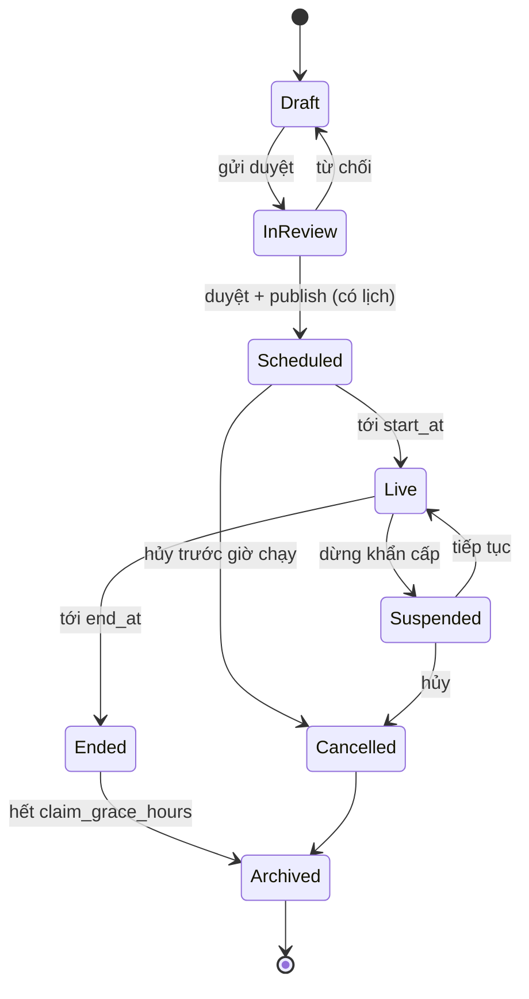

# Event & Season System — Sự kiện, Community Goal, Season Track (Live-ops)

> Trạng thái: Draft · Phiên bản: 0.1 · Owner: Game Director + Live-ops Lead · Cập nhật: 2026-11-15
> Liên quan: [GAME_DESIGN](GAME_DESIGN.md) · [QUEST_SYSTEM](QUEST_SYSTEM.md) · [CHALLENGE_BOSS_SYSTEM](CHALLENGE_BOSS_SYSTEM.md) · [INVENTORY_ECONOMY](INVENTORY_ECONOMY.md) · [PROGRESSION_SYSTEM](PROGRESSION_SYSTEM.md) · [COMPETITION_SYSTEM](COMPETITION_SYSTEM.md) · [WORLD_DESIGN](WORLD_DESIGN.md) · [ADMIN_PORTAL §3.14](../04-admin-portal/ADMIN_PORTAL.md) · [CHILD_SAFETY](../10-security/CHILD_SAFETY.md) · [GAME_ANALYTICS](../11-operations/GAME_ANALYTICS.md) · [ADR-0043](../adr/ADR-0043-phat-hanh-noi-dung-draft-publish-con-tro-phien-ban-giu-phien.md) · [ADR-0049](../adr/ADR-0049-so-cai-phan-thuong-va-tien-te-trong-game-reward-currency-led.md) · [ADR-0056](../adr/ADR-0056-game-song-ngu-viet-anh.md) · [ADR-0057](../adr/ADR-0057-chay-tren-may-tam-trung-hang-thiet-bi-va-ngan-sach-hieu-nang.md)

**Mục lục:** 1. Mục đích và phạm vi · 2. Nguyên tắc · 3. Loại sự kiện · 4. Mô hình dữ liệu sự kiện · 5. Vòng đời sự kiện · 6. Community goal · 7. Season và season track · 8. Daily/weekly · 9. Quy tắc lành mạnh · 10. Sự kiện của trường (tenant) · 11. Song ngữ · 12. Hiệu năng · 13. Dữ liệu · 14. API · 15. Event NATS · 16. Chỉ số · 17. Lỗi · 18. Acceptance criteria

## 1. Mục đích và phạm vi

Tài liệu này là **nguồn duy nhất** cho: loại sự kiện live-ops, mô hình `EventDefinition`/`EventVersion`, vòng đời chạy sự kiện (lên lịch, đang diễn ra, dừng khẩn cấp, kết thúc), community goal, **season track** (đường phần thưởng mùa miễn phí, điểm mùa) và các quy tắc lành mạnh của live-ops. Đáp ứng Master Prompt tái cấu trúc §12 (Daily, Weekly and Seasonal Events) và §16.1 (Event Management, Season Management).

| Thuộc phạm vi | Không thuộc (link tới nơi sở hữu) |
|---|---|
| Sự kiện lễ hội, cuối tuần, của trường, chiến dịch học tập, boss đặc biệt, quest giới hạn thời gian | Luật quest/bước quest → [QUEST_SYSTEM](QUEST_SYSTEM.md) |
| Community goal (mục tiêu chung toàn trường/tenant) | Luật challenge/boss → [CHALLENGE_BOSS_SYSTEM](CHALLENGE_BOSS_SYSTEM.md) |
| Season track, điểm mùa, phần thưởng mùa | **Lịch mùa** (ngày bắt đầu/kết thúc), soft reset rating, Competition Points → [COMPETITION_SYSTEM §8](COMPETITION_SYSTEM.md#8-season-tier-competition-points) |
| Event Builder (đặc tả nghiệp vụ) | Màn hình Event Builder → [ADMIN_PORTAL §3.14](../04-admin-portal/ADMIN_PORTAL.md) |
| Quy tắc lành mạnh của live-ops | Nhắc nghỉ, giờ truy cập → [CHILD_SAFETY §4](../10-security/CHILD_SAFETY.md#4-thời-gian-chơi-và-sức-khỏe-oq-17) |

**Module sở hữu:** module `game` (DB `eduworld_game`). Lịch mùa do module `competition` sở hữu; module game nhận projection `ref.seasons` qua event `season.started`/`season.ended`.

## 2. Nguyên tắc

| # | Nguyên tắc | Nhãn |
|---|---|---|
| E-1 | Sự kiện làm thế giới **sống động** (trang trí, nhạc, NPC lễ hội, quest mới), không phải cơ chế ép đăng nhập | [Confirmed — Master Prompt §12] |
| E-2 | **Không phạt mất chuỗi**, không đếm ngược gây áp lực, không thưởng đăng nhập liên tục | [Confirmed] |
| E-3 | Phần thưởng sự kiện đạt được với nhịp chơi vừa phải (khoảng 3 phiên/tuần); vật phẩm sự kiện **quay lại** ở lần tổ chức sau (không FOMO) | [Confirmed] |
| E-4 | Sự kiện **không khóa** nội dung học tập theo khối; hoạt động học tập trong sự kiện vẫn là attempt học tập cá nhân bình thường | [Confirmed] |
| E-5 | Không có pass/season track trả phí, không phần thưởng ngẫu nhiên trả phí | [Confirmed — ADR-0049] |
| E-6 | Mọi phần thưởng do server cấp, idempotent, đi qua sổ cái (ADR-0049) | [Confirmed] |
| E-7 | Nội dung sự kiện song ngữ (ADR-0056) và nằm trong ngân sách hiệu năng máy tầm trung (ADR-0057) | [Confirmed] |

## 3. Loại sự kiện

`event_kind` [Confirmed]:

| `event_kind` | Ví dụ | Thời lượng gợi ý | Thành phần thường dùng | Ai tạo |
|---|---|---|---|---|
| `world_festival` | "Lễ hội Trăng Rằm" (Trung thu), "Chợ Tết Tia Sáng", Ngày Nhà giáo 20/11 | ≥ 7 ngày | Trang trí vùng, NPC lễ hội, quest `special_event`, collection sự kiện, shop vật phẩm lễ hội, community goal | Platform |
| `weekend` | "Cuối tuần Khám phá Đại dương" | Thứ Bảy 00:00 – Chủ nhật 23:59 ICT | Quest khám phá, nhân đôi điểm mùa (không nhân đôi XP vượt cap) | Platform |
| `school` | "Tuần lễ Toán học trường Kim Đồng" | 1–4 tuần | Community goal trường, challenge lớp, huy hiệu trường | Tenant từ template (§10) |
| `community_goal` | "Cả trường giải 10.000 phép tính để thắp đèn lồng" | 1–3 tuần | Mục tiêu chung, mốc mở trang trí | Platform hoặc tenant |
| `learning_campaign` | "Ôn tập học kỳ I", "Tháng đọc sách" | 2–4 tuần | Quest học tập theo LO, challenge ôn tập, gợi ý cá nhân hóa | Platform hoặc tenant |
| `special_boss` | "Rồng Phân Số trở lại" | 3–7 ngày | Boss đặc biệt solo/party ([CHALLENGE_BOSS_SYSTEM](CHALLENGE_BOSS_SYSTEM.md)) | Platform |
| `limited_quest` | Chuỗi quest truyện ngắn theo chủ đề | 1–2 tuần | Quest `seasonal`/`special_event` | Platform |

Một sự kiện có thể kết hợp nhiều thành phần (ví dụ lễ hội có cả community goal và boss đặc biệt).

## 4. Mô hình dữ liệu sự kiện

`EventDefinition` (danh tính) + `EventVersion` (nội dung bất biến khi đã publish, ADR-0043) + `EventRun` (một lần chạy theo lịch). Schema: [`specs/schemas/event.schema.json`](../../specs/schemas/event.schema.json).

| Nhóm | Trường | Ghi chú |
|---|---|---|
| Định danh | `event_id`, `code`, `version`, `status` (workflow nội dung), `owner_scope` (`platform`/`tenant`), `tenant_id`, `template_ref` | Sự kiện tenant luôn tạo từ template (§10) |
| Mô tả | `event_kind`, `name`, `description`, `short_tagline` (i18n `vi`/`en`), `theme_code`, `banner_asset_id` | Song ngữ (§11) |
| Lịch | `start_at`, `end_at` (lưu UTC, hiển thị và cấu hình theo `Asia/Ho_Chi_Minh`), `weekday_windows` (tùy chọn, ví dụ chỉ cuối tuần), `claim_grace_hours` | Lịch nằm trong version; đổi lịch khi đang chạy theo §5.3 |
| Đối tượng | `audience.scope` (`platform`/`tenant`/`school`/`class`), `tenant_ids[]`, `school_ids[]`, `class_ids[]`, `grade_levels[]`, `subject_ids[]` | Học sinh ngoài đối tượng không thấy sự kiện |
| Điều kiện tham gia | `eligibility` (ví dụ đã xong chương 0) | Không dùng để khóa học tập; không dùng level cao làm điều kiện cho sự kiện học tập |
| Thành phần | `quest_ids[]`, `challenge_ids[]`, `boss_ids[]`, `community_goal`, `shop_item_ids[]`, `collection_id`, `decoration` (`environment_preset_id`, `bundle_id`, `areas[]`) | Tham chiếu nội dung đã publish |
| Điểm sự kiện | `event_points` (`enabled`, `sources[]`, `daily_cap`) | Tùy chọn; dùng cho mốc thưởng sự kiện |
| Phần thưởng | `participation_rewards[]`, `milestone_rewards[]` (theo điểm sự kiện), phần thưởng community goal | Chỉ cosmetic/Xu/badge/title/collection item |

**Tham gia (`EventParticipation`):** tạo khi học sinh hoàn thành hoạt động đầu tiên thuộc sự kiện (hoặc bấm "Tham gia" ở Event Center). Ghi `event_run_id`, `student_id`, `tenant_id`, `joined_at`, `event_points`, `milestones_claimed[]`.

## 5. Vòng đời sự kiện

### 5.1. Hai lớp trạng thái

- **Workflow nội dung** của `EventVersion` giống mọi nội dung có version: `draft → in_review → approved → published → archived` (ADR-0043, [ADMIN_PORTAL §3.11](../04-admin-portal/ADMIN_PORTAL.md)).
- **Vòng đời chạy** của `EventRun` (tạo khi publish một version có lịch):

### 5.2. Quy tắc từng trạng thái

| Trạng thái | Học sinh thấy | Hành vi hệ thống |
|---|---|---|
| `Scheduled` | "Sắp diễn ra" trong Event Center (tối đa 7 ngày trước) | Scheduler (worker module game, khóa singleton) chuẩn bị snapshot/bundle trang trí lên CDN trước 24 giờ |
| `Live` | Quest/challenge/boss/shop của sự kiện; trang trí vùng; tiến độ community goal | Phát `event.started`; content manifest các tenant liên quan thêm thành phần sự kiện |
| `Suspended` (dừng khẩn cấp) | Ẩn thành phần sự kiện; thông báo nhẹ "Sự kiện tạm dừng" | Lượt chơi đang dở **vẫn kết thúc bình thường** theo version đã ghim (ADR-0043); không cấp thưởng mới từ sự kiện; audit + lý do bắt buộc |
| `Ended` | Không nhận quest/hoạt động sự kiện mới; quest đã nhận vẫn hoàn thành được và **nhận thưởng đã đạt** trong `claim_grace_hours` | Phần thưởng mốc chưa nhận được **tự cấp** khi chuyển sang `Archived` (không mất) |
| `Cancelled` | Sự kiện biến mất; phần thưởng đã đạt trước khi hủy được giữ/tự cấp | Phát `event.cancelled` |
| `Archived` | Lịch sử tham gia, huy hiệu | Dữ liệu giữ theo soft-delete (ADR-0028) |

### 5.3. Sửa sự kiện đang chạy

- Sửa chữ, trang trí: publish version mới, áp dụng ngay cho lượt chơi mới.
- Sửa luật, phần thưởng, lịch kết thúc: version mới có hiệu lực từ **04:00 ICT hôm sau** [Confirmed]; tiến độ, điểm sự kiện và mốc đã đạt **không bao giờ bị giảm**.
- Rút ngắn `end_at` khi đang chạy chỉ qua dừng khẩn cấp/hủy (có audit).

## 6. Community goal

| Thuộc tính | Mô tả | Nhãn |
|---|---|---|
| `metric` | `correct_answers` (theo môn/LO), `activities_completed`, `quests_completed`, `discoveries_found`, `boss_phases_cleared`, `coop_sessions` | [Confirmed] |
| `scope` | `school` (mặc định), `tenant`, `platform` (khi platform tổ chức; mỗi tenant xem tiến độ chung + đóng góp tenant mình) | [Confirmed] |
| `target` | Ngưỡng tổng; mốc 25/50/75/100% | [Confirmed] |
| Nguồn đóng góp | **Chỉ domain event server đã kiểm chứng** (`activity.graded` qua attempt hợp lệ, `quest.completed`, `world.discovery_found`…); client không gửi số đóng góp | [Confirmed — server-authoritative] |
| Chống gian lận | Khử trùng theo `source_event_id`; trần đóng góp mỗi học sinh mỗi ngày; bỏ đóng góp từ tài khoản đang bị cờ gian lận ([ANTI_CHEAT](../10-security/ANTI_CHEAT.md)); câu trả lời đúng chỉ tính khi attempt không bị đánh dấu `suspicious_speed` | [Confirmed] |
| Tổng hợp | Đếm nhanh bằng Valkey (`ew:game:cgoal:<goal_id>:<scope_id>`), ghi bền vững bảng đóng góp append-only; tổng chính thức tính lại từ PostgreSQL định kỳ, mất Valkey thì dựng lại | [Confirmed] |
| Hiển thị | Thanh tiến độ lớn trong hub (ví dụ cây đèn lồng sáng dần); mốc đạt được đổi trang trí thế giới cho cả trường; **không xếp hạng cá nhân**; trường có thể xem đóng góp theo lớp (lớp 4–9) | [Confirmed] |
| Phần thưởng | Mọi học sinh trong phạm vi có **≥ 1 đóng góp** nhận phần thưởng mốc khi mốc đạt; không phụ thuộc lượng đóng góp cá nhân | [Confirmed] |

## 7. Season và season track

### 7.1. Phân chia trách nhiệm

| Phần | Sở hữu |
|---|---|
| Lịch mùa 8 tuần, chủ đề học kỳ, soft reset rating, Competition Points, thưởng cuối mùa theo tier | [COMPETITION_SYSTEM §8](COMPETITION_SYSTEM.md#8-season-tier-competition-points) |
| **Season track** (đường phần thưởng mùa), **điểm mùa**, chủ đề trang trí mùa trong thế giới | Tài liệu này |

Season track (mốc M3) đọc lịch mùa của module competition qua projection `ref.seasons` (event `season.*`); trước khi lịch mùa có ở M4b, module game dùng **lịch mùa fixture** do platform cấu hình (cùng cấu trúc, thay bằng dữ liệu thật khi module competition phát `season.*`) [Confirmed — Technical Architect 2026-11-16].

### 7.2. Season track miễn phí

- **Một track duy nhất, miễn phí cho mọi học sinh** [Confirmed: không có premium track].
- **Điểm mùa** tích từ hoạt động đa dạng, có trần mỗi ngày để thưởng sự đều đặn chứ không thưởng "cày":

| Nguồn điểm mùa (`source_code`) | Điểm | Ghi chú |
|---|---|---|
| `daily_quest.completed` | 20 / quest | |
| `weekly_quest.completed` | 50 / quest | |
| `learning_activity.completed` | 5 / hoạt động | Tính theo hoàn thành, không theo điểm số |
| `event_activity.completed` | 10 / hoạt động | Hoạt động thuộc sự kiện đang chạy |
| `coop.completed` | 10 / phiên | Quest/boss co-op |
| `match.completed` | 5 / trận | Không phụ thuộc thắng/thua |

  Trần **100 điểm mùa/ngày** [Confirmed]; nguồn có giá trị bị giảm dần XP vẫn cho điểm mùa theo bảng trên (điểm mùa không thay XP).
- **Cấp track:** 30 cấp × 100 điểm [Confirmed]. Chơi khoảng 4 ngày/tuần trong 8 tuần đạt cấp cuối; 3 ngày/tuần đạt khoảng cấp 24. Không có "mua cấp".
- **Phần thưởng mỗi cấp:** Xu, vật phẩm trang trí theo chủ đề mùa, sticker, khung avatar; cấp 10/20/30 là mốc có danh hiệu/huy hiệu mùa. Không có phần thưởng ảnh hưởng học tập hay sức mạnh thi đấu.
- **Nhận thưởng:** học sinh bấm nhận ở màn Season Track (nghi thức vui); **khi hết mùa, thưởng chưa nhận được tự cấp** [Confirmed].
- **Hết mùa:** điểm mùa về 0; lịch sử cấp đạt được lưu `season_track_progress` (không xóa); vật phẩm mùa có thể quay lại ở mùa sau qua shop/sự kiện (E-3).

## 8. Daily, weekly

Số lượng, giờ reset và cách chọn daily/weekly quest do [QUEST_SYSTEM §2.4](QUEST_SYSTEM.md#24-daily-và-weekly-quest) sở hữu. Sự kiện có thể **thêm** quest sự kiện mỗi ngày, tối đa `event_extra_daily_quests_max` (§ tham số), loại `special_event` hoặc `seasonal` tham chiếu `event_id`.

## 9. Quy tắc lành mạnh

| Quy tắc | Cách thực thi |
|---|---|
| Không phạt mất chuỗi; bỏ lỡ ngày không mất gì | Không có cơ chế streak trong sự kiện; điểm sự kiện tích lũy |
| Không ép online | Lễ hội ≥ 7 ngày; mốc thưởng đạt được với ~3 phiên/tuần; không phần thưởng "chỉ trong khung giờ X" trừ sự kiện cuối tuần |
| Không đếm ngược gây áp lực | Hiển thị "Còn 3 ngày" bằng màu trung tính, không nhấp nháy, không thông báo dồn dập; không push ngoài game (PRD FR-NTF-003) |
| Không khóa học tập | Vùng học tập theo khối luôn mở; sự kiện chỉ thêm nội dung |
| Tôn trọng giờ truy cập và nhắc nghỉ | Áp dụng nguyên [CHILD_SAFETY §4](../10-security/CHILD_SAFETY.md#4-thời-gian-chơi-và-sức-khỏe-oq-17); sự kiện không ghi đè giờ truy cập do trường cấu hình |
| Bảng xếp hạng sự kiện (nếu bật) | Theo quy tắc hiển thị theo khối của [COMPETITION_SYSTEM §9.4](COMPETITION_SYSTEM.md#94-privacy-và-an-toàn-trẻ-em); community goal không có xếp hạng cá nhân |

## 10. Sự kiện của trường (tenant)

- Platform tạo **template sự kiện** (`event-templates`) với `allowed_params` và gán cho tenant (ADR-0029).
- School Admin/Tenant Admin tạo sự kiện trường ở workspace C (School & Learning Management) chỉ bằng cách điền tham số cho phép: tên (song ngữ: `vi` bắt buộc, `en` tùy chọn), mô tả, ngày bắt đầu/kết thúc (≤ `school_event_max_duration_days`), đối tượng (lớp/khối trong tenant), mục tiêu community goal, chọn quest/challenge **trong danh sách template cho phép**, chọn phần thưởng **trong bộ phần thưởng template cho phép** (thường là huy hiệu trường). Tham số ngoài danh sách → `422`.
- Văn bản do tenant nhập đi qua kiểm tra từ nhạy cảm (ADR-0030) trước khi lưu [Confirmed].
- Tenant không đổi được luật chơi, cách tính điểm, phần thưởng ngoài template (ADR-0027).
- Tối đa `school_events_concurrent_per_tenant` sự kiện đang chạy mỗi tenant.

## 11. Song ngữ (ADR-0056)

- Sự kiện platform: `name`, `description`, `short_tagline`, tên phần thưởng/vật phẩm, hội thoại NPC lễ hội bắt buộc đủ `vi` và `en`; portal chặn publish khi thiếu (`TRANSLATION_INCOMPLETE`).
- Sự kiện tenant: `vi` bắt buộc, `en` tùy chọn (thiếu thì hiển thị `vi`).
- Lịch hiển thị theo ngôn ngữ học sinh chọn (định dạng ngày Việt/Anh), giờ luôn theo ICT.

## 12. Hiệu năng (ADR-0057)

- Trang trí sự kiện dùng **environment preset** và **gói PCK riêng** (`bundle_id`), tải trước trong màn tải khi vào vùng; không thêm shader mới.
- Ngân sách: gói trang trí ≤ `event_decoration_bundle_max_mb` trên mobile; tổng tam giác/draw call của vùng khi có trang trí vẫn trong ngân sách [PERFORMANCE_BUDGET](../08-game-client/PERFORMANCE_BUDGET.md); preset **Thấp** dùng biến thể trang trí rút gọn.
- Mỗi vùng tối đa **một** bộ trang trí sự kiện hoạt động cùng lúc [Confirmed].
- Community goal hiển thị bằng một đối tượng 3D đơn giản + UI; cập nhật tiến độ tối đa mỗi `community_goal_progress_flush_seconds`, không đẩy realtime theo từng đóng góp.

## 13. Dữ liệu (module game, `eduworld_game`)

| Bảng | Loại | Mô tả |
|---|---|---|
| `events`, `event_versions` | G (platform) / T (tenant) | Định nghĩa + version (payload theo `event.schema.json`), con trỏ `current_version_id` |
| `event_templates`, `event_template_versions` | G | Template cho tenant, `allowed_params` |
| `event_runs` | G/T | Một lần chạy: `event_version_id`, `status` (`scheduled/live/suspended/ended/cancelled/archived`), `starts_at`, `ends_at`, `suspended_reason` (`varchar(1000)`) |
| `event_participation` | T | `(event_run_id, student_id)` unique; `event_points`, `joined_at` |
| `event_point_ledger` | T, append-only | Bút toán điểm sự kiện, idempotent theo `source_event_id` |
| `community_goals` | G/T | Định nghĩa goal theo run, `metric`, `scope`, `target`, mốc |
| `community_goal_contributions` | T, append-only, partition theo ngày | `goal_id`, `scope_id`, `student_id`, `class_id`, `amount`, `source_event_id` (unique) |
| `community_goal_progress` | T | Tổng theo `(goal_id, scope_id)`, `milestones_reached[]` |
| `season_tracks`, `season_track_versions` | G | Track theo `season_id` (payload theo `season-track.schema.json`) |
| `season_point_ledger` | T, append-only | Bút toán điểm mùa, `source_code`, `capped` |
| `season_track_progress` | T | `(season_id, student_id)` unique; `points`, `tier`, `claimed_tiers[]` |
| `ref.seasons` | projection | Lịch mùa từ module competition |

Quy ước cột (varchar(n), `tenant_id`, `deleted_at`, ledger chỉ INSERT): [DATABASE_DESIGN §2.8c](../07-backend/DATABASE_DESIGN.md). Phần thưởng cấp qua `RewardGrant` + sổ cái của [INVENTORY_ECONOMY](INVENTORY_ECONOMY.md) (ADR-0049).

## 14. API (đề xuất)

**Người chơi (module game):**

| Method | Path | Mô tả |
|---|---|---|
| GET | `/api/v1/game/events?status=live,upcoming` | Sự kiện đang chạy/sắp diễn ra trong phạm vi học sinh |
| GET | `/api/v1/game/events/{event_id}` | Chi tiết run hiện tại: thành phần, lịch, phần thưởng, tiến độ của mình |
| POST | `/api/v1/game/events/{event_id}:join` | Tham gia (idempotent; tự động khi hoàn thành hoạt động đầu tiên) |
| POST | `/api/v1/game/events/{event_id}/milestones/{milestone_id}:claim` | Nhận thưởng mốc (`Idempotency-Key`) |
| GET | `/api/v1/game/community-goals/{goal_id}` | Tiến độ theo phạm vi, mốc, đóng góp theo lớp (khi được phép) |
| GET | `/api/v1/game/season-track` | Track mùa hiện tại: cấp, điểm, trần còn lại hôm nay, phần thưởng, đã nhận |
| POST | `/api/v1/game/season-track/tiers/{tier}:claim` | Nhận thưởng cấp (`Idempotency-Key`) |
| GET | `/api/v1/game/season-track/history` | Các mùa trước |

**Tenant (workspace C, route ngoại lệ tới module game):** `GET /api/v1/lms/event-templates`, `GET/POST /api/v1/lms/school-events`, `GET/PATCH /api/v1/lms/school-events/{event_id}`, `POST /api/v1/lms/school-events/{event_id}:cancel`.

**Game Studio (`/api/v1/game-admin/{config_type}`, gateway nội bộ + MFA):** `events` (thay `world-events`), `event-templates`, `season-tracks` (module game); `seasons` giữ ở module competition. Vận hành: `POST /api/v1/game-admin/events/{event_id}/runs/{run_id}:suspend` / `:resume` / `:cancel` (lý do bắt buộc), `GET .../runs/{run_id}/stats`.

## 15. Event NATS

| Event | Consumers | Payload chính |
|---|---|---|
| `event.scheduled`, `event.started`, `event.suspended`, `event.resumed`, `event.ended`, `event.cancelled` | content manifest, RT (Event Center), NTF trong game, analytics | `event_id`, `event_run_id`, `event_version_id`, `audience`, `reason?` |
| `event.participation_started` | analytics, achievement | `event_run_id`, `student_id` |
| `event.milestone_claimed` | reward, analytics | `event_run_id`, `milestone_id`, `student_id` |
| `community_goal.milestone_reached`, `community_goal.completed` | reward (cấp thưởng cho người có đóng góp), RT, WLD (đổi trang trí) | `goal_id`, `scope_id`, `milestone_pct` |
| `season_track.tier_reached`, `season_track.reward_claimed` | reward, RT, analytics | `season_id`, `student_id`, `tier` |
| `season.started` / `season.ended` | module game (projection, mở/đóng track, tự cấp thưởng chưa nhận) | Do module competition phát |

Catalog chuẩn: [EVENT_DESIGN §4.5](../07-backend/EVENT_DESIGN.md).

## 16. Chỉ số

Tỷ lệ tham gia sự kiện, tỷ lệ đạt mốc, nhịp tiến độ community goal, phân bố cấp season track, tỷ lệ nhận thưởng: định nghĩa tại [GAME_ANALYTICS](../11-operations/GAME_ANALYTICS.md). Chỉ số sức khỏe (phiên dài, chơi khuya trong thời gian sự kiện) phải được theo dõi cùng.

## 17. Lỗi

| Mã | HTTP | Khi |
|---|---|---|
| `EVENT_NOT_AVAILABLE` | 404 | Sự kiện không thuộc phạm vi học sinh hoặc không ở trạng thái `live`/`ended` |
| `EVENT_ENDED` | 409 | Bắt đầu hoạt động sự kiện sau `end_at` |
| `EVENT_MILESTONE_NOT_REACHED` | 409 | Nhận thưởng mốc chưa đạt |
| `SEASON_TIER_NOT_REACHED` | 409 | Nhận thưởng cấp chưa đạt |
| `EVENT_TEMPLATE_PARAM_NOT_ALLOWED` | 422 | Tenant điền tham số ngoài `allowed_params` |
| `TRANSLATION_INCOMPLETE` | 422 | Publish sự kiện platform thiếu bản `en` |

## 18. Acceptance criteria

| ID | Tiêu chí |
|---|---|
| AC-EVT-001 | Học sinh ngoài `audience` (khác khối/trường/tenant) không thấy sự kiện qua API, Event Center hay content manifest |
| AC-EVT-002 | Scheduler chuyển `Scheduled → Live` và `Live → Ended` trong vòng 1 phút quanh `start_at`/`end_at`; chạy lặp lại không tạo trạng thái trùng |
| AC-EVT-003 | Dừng khẩn cấp ẩn thành phần sự kiện ngay; lượt chơi đang dở kết thúc theo version đã ghim; không cấp thưởng sự kiện mới; có audit và lý do |
| AC-EVT-004 | Đổi luật/phần thưởng khi đang chạy không làm giảm điểm, tiến độ, mốc đã đạt của học sinh nào |
| AC-EVT-005 | Community goal chỉ cộng từ event server đã kiểm chứng; cùng `source_event_id` không cộng hai lần; vượt trần ngày của học sinh không được cộng; mất Valkey dựng lại đúng tổng từ PostgreSQL |
| AC-EVT-006 | Mốc community goal đạt → mọi học sinh có ≥ 1 đóng góp nhận thưởng đúng một lần; trang trí thế giới đổi cho cả phạm vi |
| AC-EVT-007 | Điểm mùa không vượt 100/ngày; nhận thưởng cấp idempotent; hết mùa thưởng chưa nhận được tự cấp; không tồn tại track trả phí |
| AC-EVT-008 | Tenant tạo sự kiện trường chỉ với `allowed_params`; tham số khác → `422 EVENT_TEMPLATE_PARAM_NOT_ALLOWED`; tên chứa từ nhạy cảm bị chặn |
| AC-EVT-009 | Bỏ lỡ ngày không làm mất điểm/thưởng; không có thông báo push ngoài game; vùng học tập theo khối vẫn mở trong mọi sự kiện |
| AC-EVT-010 | Publish sự kiện platform thiếu bản `en` bị chặn `TRANSLATION_INCOMPLETE`; học sinh đổi ngôn ngữ thấy đúng bản dịch |
| AC-EVT-011 | Trên thiết bị tầm trung (ADR-0057), vùng có trang trí sự kiện vẫn đạt FPS mục tiêu; preset Thấp dùng biến thể rút gọn |
| AC-EVT-012 | Sự kiện kết thúc: thưởng mốc đã đạt nhận được trong `claim_grace_hours`; chưa nhận thì tự cấp khi lưu trữ |

Test case: [TEST_STRATEGY §6.1](../12-project/TEST_STRATEGY.md) (TC-EVT-001…012).

### Tham số mặc định do tài liệu này sở hữu [Confirmed]

| Tham số | Giá trị |
|---|---|
| `event_claim_grace_hours` | 72 giờ |
| `event_festival_min_duration_days` | 7 ngày |
| `event_extra_daily_quests_max` | 2 quest/ngày |
| `event_points_daily_cap` | 200 điểm sự kiện/ngày (khi sự kiện bật điểm) |
| `event_upcoming_visible_days` | 7 ngày trước `start_at` |
| `event_rule_change_effective` | 04:00 ICT hôm sau |
| `community_goal_contribution_daily_cap` | 50 đơn vị/học sinh/ngày |
| `community_goal_progress_flush_seconds` | 30 giây |
| `season_track_tiers` | 30 cấp |
| `season_track_points_per_tier` | 100 điểm |
| `season_points_daily_cap` | 100 điểm/ngày |
| `season_point_sources` | Bảng §7.2 |
| `season_unclaimed_rewards` | Tự cấp khi hết mùa |
| `school_event_max_duration_days` | 28 ngày |
| `school_events_concurrent_per_tenant` | 3 |
| `event_decoration_bundle_max_mb` | 20 MB (mobile) |
