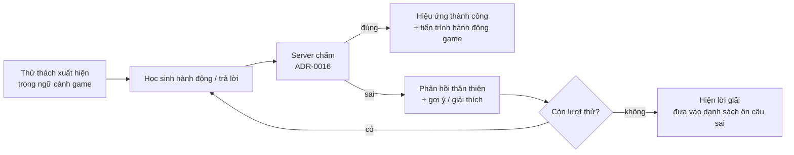
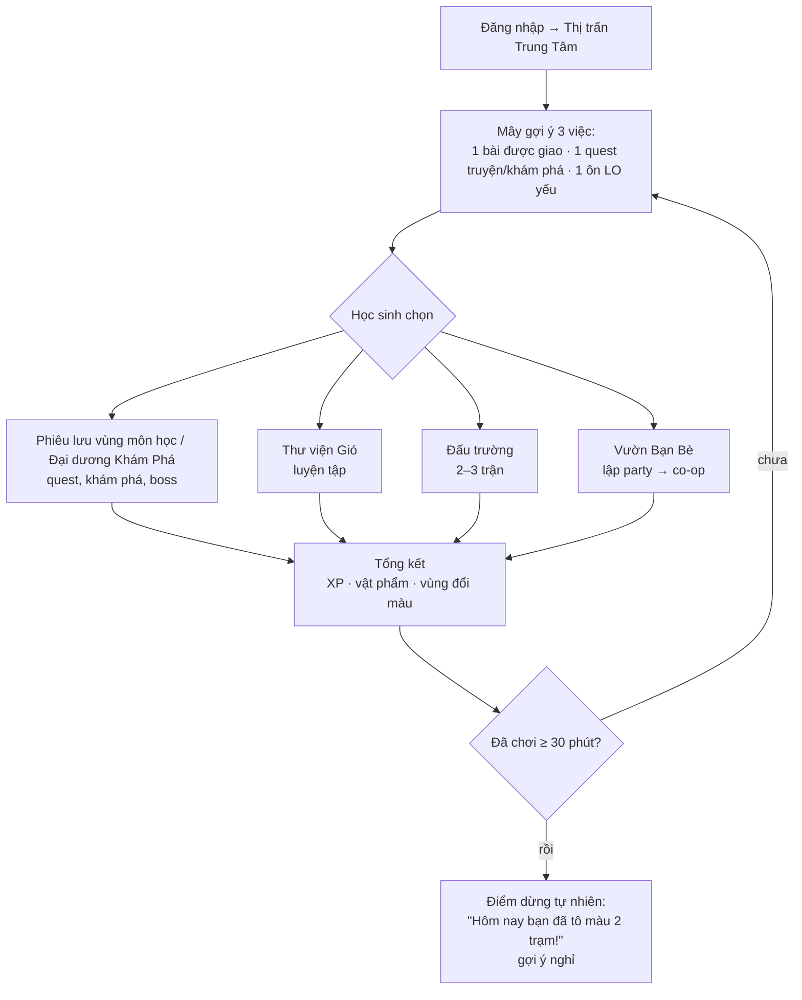
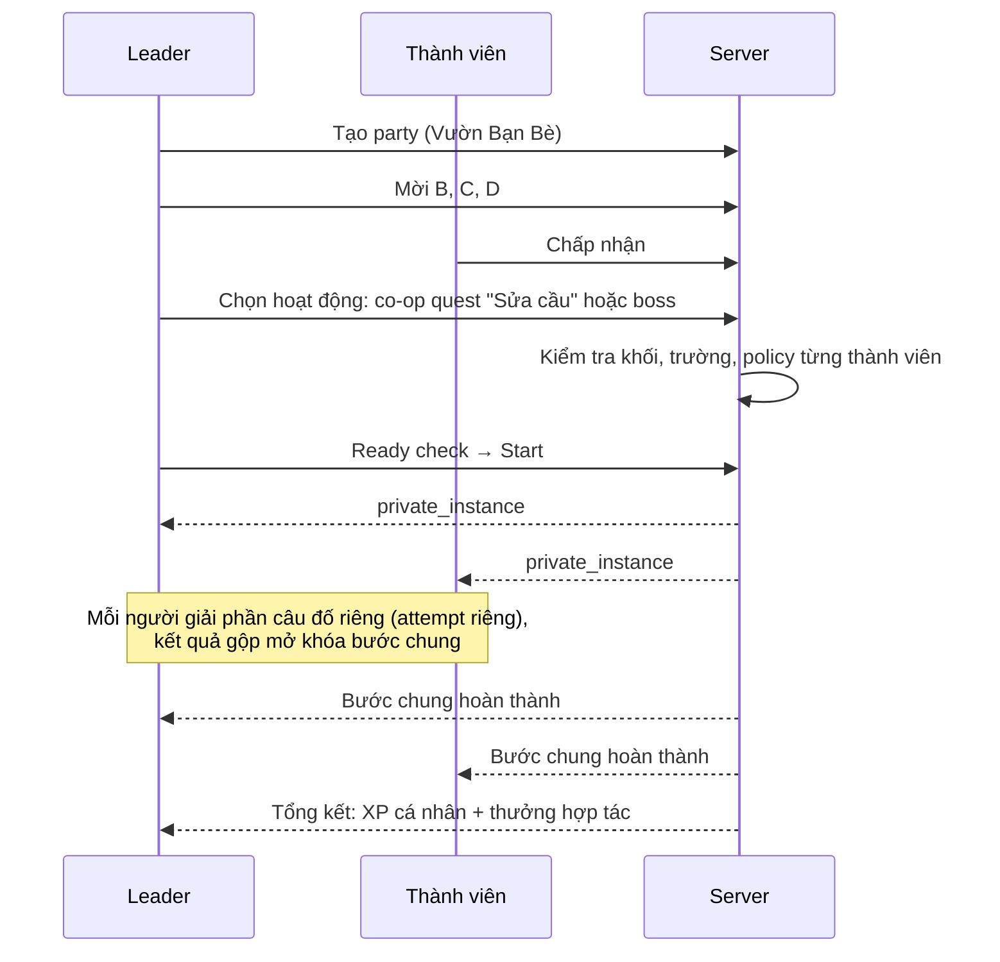
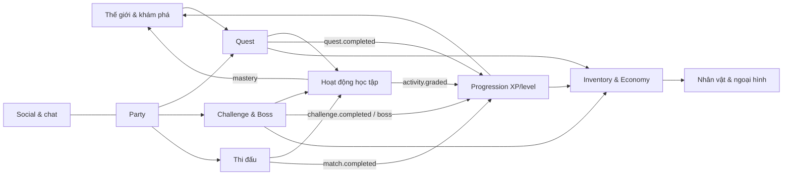

# Game Design Document (GDD) — EduWorld

> Trạng thái: Draft · Phiên bản: 0.2 · Owner: Game Director · Cập nhật: 2026-11-15
> Liên quan: [LEARNING_MECHANICS](LEARNING_MECHANICS.md) · [WORLD_DESIGN](WORLD_DESIGN.md) · [CHARACTER_SYSTEM](CHARACTER_SYSTEM.md) · [PROGRESSION_SYSTEM](PROGRESSION_SYSTEM.md) · [QUEST_SYSTEM](QUEST_SYSTEM.md) · [CHALLENGE_BOSS_SYSTEM](CHALLENGE_BOSS_SYSTEM.md) · [INVENTORY_ECONOMY](INVENTORY_ECONOMY.md) · [COMPETITION_SYSTEM](COMPETITION_SYSTEM.md) · [LEARNING_EXPERIENCE](../02-learning/LEARNING_EXPERIENCE.md) · [CHILD_SAFETY](../10-security/CHILD_SAFETY.md) · OQ-14, OQ-17

**Mục lục:** 1. Mục đích và phạm vi · 2. Bản sắc sản phẩm · 3. Core fantasy · 4. Design pillars · 5. Động lực người chơi · 6. Học tập lồng trong gameplay · 7. Các tầng loop · 8. Loop theo khối lớp · 9. Loop co-op · 10. Ví dụ phiên chơi · 11. Bản đồ hệ thống game · 12. Nguyên tắc gamification · 13. Chống gây nghiện và dark pattern · 14. Data-driven content · 15. Không thuộc Release 1.0 · 16. Chỉ số thành công · 17. Acceptance criteria

## 1. Mục đích và phạm vi

GDD là **điểm vào** của toàn bộ thiết kế game: bản sắc, fantasy, pillars, động lực, các tầng loop và bản đồ hệ thống. Mỗi hệ thống có một tài liệu sở hữu chi tiết (§11); GDD chỉ nêu nguyên tắc và liên kết, không lặp lại tham số.

| Stakeholder | Dùng GDD để |
|---|---|
| Game Director, Game Designer | Giữ định hướng, đánh giá tính năng mới |
| EdTech Specialist | Kiểm tra học tập lồng tự nhiên, không thành chuỗi quiz |
| Dev (Godot, Go), QA | Hiểu bức tranh tổng, tìm tài liệu chi tiết |
| Product, nhà trường | Hiểu giá trị và giới hạn an toàn |

## 2. Bản sắc sản phẩm

**EduWorld là game trước trong trải nghiệm, nền tảng giáo dục trong mục đích, và thế giới multiplayer xã hội trong tương tác** [Confirmed — Master Prompt re-architecture §34]. Định hướng: **Learn – Play – Practice – Explore – Compete – Connect** [Confirmed].

| Mục | Giá trị |
|---|---|
| Thể loại | Phiêu lưu 3D multiplayer, RPG-lite (phát triển nhân vật, sưu tầm), học tập lồng trong nhiệm vụ, thử thách và thi đấu |
| Góc nhìn | Third-person, camera follow xoay được; "camera cố định" cho lớp 1–3 [Proposed] |
| Phiên chơi mục tiêu | 15–30 phút [Proposed] |
| Nền tảng | Windows, Android, iOS, Web (ADR-0013) |
| Người chơi trong một khu | ≤ 40 / hub instance (ADR-0012) |
| Kinh doanh | Không mua bằng tiền thật, không loot box (OQ-14) [Proposed] |

## 3. Core fantasy

Học sinh là **Nhà Thám Hiểm** của **Quần đảo Tri Thức** — thế giới đã mất màu vì các Tia Sáng bị phân tán. Cùng Mây và bạn bè, học sinh đi khắp các vùng, giúp cư dân bằng kiến thức, hạ boss "mất năng lượng", sưu tầm thú đồng hành và vật phẩm, và nhìn vùng đất được tô màu lại khi mình giỏi lên. Chi tiết bối cảnh, chương truyện, vùng đất: [WORLD_DESIGN](WORLD_DESIGN.md).

- Không bạo lực, không vũ khí [Confirmed]. Sai không bị phạt nặng: có gợi ý và thử lại, không mất vật phẩm, không mất tiến trình.
- Thế giới phản ánh **mastery**, không phản ánh thời gian chơi.

## 4. Design pillars

| # | Pillar | Ý nghĩa thiết kế | Kiểm tra |
|---|---|---|---|
| P1 | **Thế giới đáng khám phá** | Vùng đất có câu chuyện, bí mật, vật sưu tầm, boss; mở rộng theo mùa | Mỗi vùng có ≥ 1 chương truyện, ≥ 5 điểm khám phá, ≥ 1 boss [Proposed] |
| P2 | **Học là hành động của nhân vật** | Câu hỏi/hoạt động là cách mở cổng, sửa cầu, pha thuốc, hạ boss — không phải popup cản đường | Mỗi quest học tập có ≥ 1 LO; ≥ 60% thời gian quest là tương tác học tập [Proposed]; §6 |
| P3 | **Tiến bộ nhìn thấy được** | Level, ngoại hình, vùng đất đổi màu theo mastery, bộ sưu tập | Sau mỗi phiên học sinh trả lời được "mình giỏi lên ở đâu" |
| P4 | **Cùng nhau tốt hơn một mình** | Party, co-op quest, boss nhóm, team battle, mục tiêu lớp | Mỗi vùng chính có hoạt động co-op |
| P5 | **Công bằng và an toàn** | Server-authoritative (ADR-0016); ghép theo khối; chat theo policy, mọi tin qua kiểm tra (ADR-0020, ADR-0030) | Không có cách mua/farm lợi thế học tập |
| P6 | **Tôn trọng thời gian của trẻ** | Phiên ngắn, điểm dừng tự nhiên, nhắc nghỉ, không FOMO | Không phần thưởng nào mất đi nếu bỏ lỡ một ngày |

## 5. Động lực người chơi

| Động lực | Hệ thống phục vụ | Tài liệu |
|---|---|---|
| Khám phá | Vùng đất, chương truyện, điểm khám phá, secret quest, bản đồ thế giới | [WORLD_DESIGN](WORLD_DESIGN.md) |
| Phát triển nhân vật | XP, level, danh hiệu, ngoại hình mở khóa theo tiến trình | [PROGRESSION_SYSTEM](PROGRESSION_SYSTEM.md), [CHARACTER_SYSTEM](CHARACTER_SYSTEM.md) |
| Sưu tầm | Pet, knowledge card, cosmetic, huy hiệu, vật sưu tầm bản đồ | [INVENTORY_ECONOMY](INVENTORY_ECONOMY.md) |
| Chinh phục | Challenge 5 mức độ khó, boss nhiều phase | [CHALLENGE_BOSS_SYSTEM](CHALLENGE_BOSS_SYSTEM.md) |
| Chơi cùng bạn | Party, co-op, chat, emote | [PARTY_SYSTEM](../03-social-multiplayer/PARTY_SYSTEM.md), [SOCIAL_SYSTEM](../03-social-multiplayer/SOCIAL_SYSTEM.md) |
| Thi đấu | 1v1, team, giải đấu, mùa | [COMPETITION_SYSTEM](COMPETITION_SYSTEM.md) |
| Thấy mình giỏi lên | Mastery hiển thị trong thế giới, báo cáo tuần thân thiện | [LEARNING_EXPERIENCE](../02-learning/LEARNING_EXPERIENCE.md) |

## 6. Học tập lồng trong gameplay

Quy tắc bắt buộc để EduWorld không thành "chuỗi quiz có giao diện game":

| # | Quy tắc | Nhãn |
|---|---|---|
| L-1 | Hoạt động học tập luôn có **ngữ cảnh game** (NPC cần giúp, boss, cửa cần mở) và **kết quả game** (cầu được sửa, vùng đổi màu, boss mất năng lượng) | [Proposed] |
| L-2 | Một khối học tập liên tục có số câu tối đa theo grade band (giá trị do [LEARNING_EXPERIENCE](../02-learning/LEARNING_EXPERIENCE.md) sở hữu), rồi xen tương tác thế giới (di chuyển, hội thoại, thu thập) | [Proposed] |
| L-3 | Đa dạng định dạng server tự chấm: quiz, bài tập tương tác, mini-game, video/audio có câu hỏi chèn, mô phỏng ([ACTIVITY_ENGINE](../02-learning/ACTIVITY_ENGINE.md); hoạt động cần chấm tay nằm ngoài Release theo ADR-0072); một quest không chỉ dùng một dạng câu hỏi | [Proposed] |
| L-4 | Kết quả học tập luôn cá nhân, server chấm; phần thưởng game không ảnh hưởng điểm/mastery | [Confirmed] |
| L-5 | Nội dung học tập không bao giờ bị khóa sau level, tiền tệ hay thi đấu | [Confirmed] |
| L-6 | Sai → phản hồi thân thiện, gợi ý, thử lại với câu mới; không làm xấu hổ, không hiển thị ai trong nhóm sai | [Proposed] |
| L-7 | **Hành động chính = khái niệm học.** Ở mọi nơi có thể, thao tác cốt lõi của người chơi chính là khái niệm đang học (di chuyển trên trục số, cân phương trình để sửa cầu, ghép âm tiết để mở cửa), không phải câu hỏi bật lên rồi mới được chơi tiếp. Catalog cơ chế theo môn, cách gắn vào quest/mini-game/mô phỏng và tiêu chí review: [LEARNING_MECHANICS](LEARNING_MECHANICS.md) | [Proposed] |
| L-8 | Co-op cần **phụ thuộc lẫn nhau** thật (mỗi bạn giữ một phần dữ kiện), không chỉ là quiz cá nhân chạy song song: bước `interdependent` ([QUEST_SYSTEM §3.2](QUEST_SYSTEM.md#32-gán-bước-trong-party-và-bước-interdependent-proposed)) | [Proposed] |

## 7. Các tầng loop

| Tầng | Chu kỳ | Mục tiêu người chơi | Mục tiêu học tập |
|---|---|---|---|
| Micro loop | 10–60 giây | Giải câu đố/hành động trong thế giới | Luyện một kỹ năng, phản hồi tức thì |
| Core loop (phiên) | 15–30 phút | Hoàn thành 1–2 quest/thử thách, khám phá, nhận phần thưởng | Tiến bộ 1–3 LO |
| Daily loop | Ngày | Daily quest, bài nhà trường giao, gợi ý ôn tập của Mây | Luyện tập đều đặn ngắn |
| Weekly loop | Tuần | Weekly quest, mục tiêu tuần, thử thách lớp | Ôn chủ đề tuần, lấp LO yếu |
| Season loop | 8 tuần | Season track, giải đấu, bộ sưu tập mùa | Ôn tập theo chương/học kỳ |

### 7.1. Micro loop

Phản hồi: hiệu ứng client ≤ 100 ms sau khi nhận kết quả; round-trip chấm ≤ 400 ms p95 (NFR-PERF-002). Trong lúc chờ server, client hiện animation "đang suy nghĩ" — không tự đoán đúng/sai.

### 7.2. Core loop — một phiên 15–30 phút

Mỗi hoạt động kết thúc bằng **màn tổng kết** = điểm dừng tự nhiên; không auto-chain sang hoạt động tiếp [Proposed].

### 7.3. Daily, weekly, season

| Tầng | Thành phần | Quy tắc | Sở hữu |
|---|---|---|---|
| Daily | 3 daily quest (1 học tập, 1 khám phá/quest, 1 xã hội hoặc thi đấu tùy chọn); bài được giao ưu tiên đầu; ôn câu sai ≤ 10 câu/ngày (lặp lại cách quãng 1–3–7 ngày) | Reset 04:00 ICT; không làm không bị phạt; deadline thân thiện, không đếm ngược đỏ | [QUEST_SYSTEM](QUEST_SYSTEM.md), [LEARNING_EXPERIENCE](../02-learning/LEARNING_EXPERIENCE.md) |
| Weekly | Mục tiêu tuần "học 4/7 ngày" (thưởng cosmetic); 3 weekly quest theo chủ đề tuần; thử thách lớp (cùng làm lớn Cây Tia Sáng); báo cáo tuần "em giỏi lên ở…" | Tích lũy trong tuần thay cho streak | [QUEST_SYSTEM](QUEST_SYSTEM.md) |
| Season & sự kiện | Mùa gắn chủ đề học kỳ với season track miễn phí; lễ hội, sự kiện trường, community goal xen giữa mùa | Không FOMO, không phạt mất chuỗi | Lịch mùa, rating: [COMPETITION_SYSTEM](COMPETITION_SYSTEM.md) §8 · Season track, sự kiện: [EVENT_SEASON_SYSTEM](EVENT_SEASON_SYSTEM.md) |

## 8. Loop theo khối lớp

| Grade band | Phiên mục tiêu | Đặc điểm loop | Thi đấu | Xã hội (chat như nhau mọi lớp — ADR-0020) |
|---|---|---|---|---|
| `g1_3` | 10–20 phút | Hoạt động ngắn 3–5 câu; Mây dẫn từng bước; di chuyển bằng bảng hình | Timed Quiz/1v1 tối giản, chỉ tier, không thứ hạng cá nhân | Emote, quick message, text đã kiểm tra; UI ưu tiên quick message/emote vì trẻ chưa gõ nhanh |
| `g4_5` | 15–25 phút | Quest 2–3 bước; tự chọn từ 3 gợi ý | 1v1, team, tier + điểm mùa | Quy tắc chung |
| `g6_7` | 20–30 phút | Quest nhiều bước, khám phá tự do, tự đặt mục tiêu tuần | Đầy đủ mode, bảng trường | Quy tắc chung |
| `g8_9` | 20–30 phút | Thêm luyện đề, Mock Exam, phân tích lỗi sai | Đầy đủ + giải trường | Quy tắc chung |

Khác biệt theo khối chỉ ở UX, nội dung học tập và ghép trận, không ở quyền chat (ADR-0020).

## 9. Loop co-op với party

Quy tắc [Confirmed — Addendum §4]: tiến trình quest chia sẻ theo `shared_progress_policy`; **mỗi học sinh có attempt và kết quả học tập riêng**; không ai làm hộ điểm của người khác; mỗi người phải đạt `min_contribution` mới nhận thưởng. Thiết kế puzzle co-op [Proposed]: chia vai (mỗi người giữ một mảnh dữ kiện), bước chung chỉ mở khi mọi người hoàn thành phần mình. Chi tiết: [QUEST_SYSTEM](QUEST_SYSTEM.md) §6, [PARTY_SYSTEM](../03-social-multiplayer/PARTY_SYSTEM.md).

## 10. Ví dụ phiên chơi

### 10.1. Minh, lớp 3, 18 phút trên tablet ở nhà

| Phút | Diễn biến | Hệ thống |
|---|---|---|
| 0:00 | Mở game → đăng nhập một chạm (refresh token còn hạn) → Quảng trường Tia Sáng | Auth, game session |
| 0:30 | Mây: "Cô giáo giao 1 bài Phép nhân bảng 6. Đi thôi!" — mũi tên dẫn đường | LMS assignment |
| 1:00 | Chạm cổng gió (bảng hình) → Vương quốc Số, trạm "Bảng nhân 6" | Area transition |
| 1:30–7:00 | Mini-game "Hái quả" ở vườn của Ông Số: 8 câu nhân. Sai 6×7 → gợi ý "6×7 = 6×6 + 6" → thử lại đúng | Mini-game, attempt `assignment` |
| 7:00 | Tổng kết: 7/8 đúng lần đầu, +40 XP, trạm đổi màu nhạt (`developing`) | XP, mastery |
| 8:00 | Daily quest "Giúp Bác Thợ Cầu": đo cầu bằng phép cộng, tìm được một điểm khám phá giếng cổ | Quest, khám phá |
| 14:00 | Nhận mũ lá; vào tủ đồ mặc thử | Reward, customization |
| 16:00 | Gặp bạn cùng lớp ở Quảng trường, vẫy tay + quick message "Chơi vui nhé!" | Emote, quick message |
| 18:00 | Mây: "Hôm nay Minh làm rất tốt! Hẹn gặp lại nhé" — điểm dừng tự nhiên | Session summary |

### 10.2. Lan, lớp 8, 30 phút trên máy tính

| Phút | Diễn biến | Hệ thống |
|---|---|---|
| 0:00 | Đăng nhập bằng form trong game (username/password) → Thị trấn Trung Tâm | `POST /auth/game/login` (ADR-0068) |
| 1:00 | Bảng nhiệm vụ: Mock Exam Toán chương "Hằng đẳng thức" mở đến Chủ nhật | Exam session |
| 2:00–17:00 | Tháp Thử Thách (Núi Thử Thách): Timed Exam 15 câu/15 phút, khung chat ẩn | Exam Engine, giờ server |
| 17:00 | Nộp bài → 11/15. Gương Phản Chiếu: 3 câu sai cùng LO "Bình phương của một hiệu" → gợi ý 5 câu luyện | Phân tích, gợi ý |
| 18:00–22:00 | Thư viện Gió: luyện 5 câu gợi ý, đúng 4 | Practice, `retry_wrong` |
| 22:00 | Party với 2 bạn → Đấu trường, Team Battle Khoa học | Party, matchmaking cùng khối |
| 28:00 | Thắng trận, +Competition Points, lên tier "Cây Xanh" | Glicko-2, leaderboard |
| 29:00 | Chat party (luôn có): "gg mai đấu tiếp" (qua kiểm tra) → thoát | ADR-0020 mục 6 |

## 11. Bản đồ hệ thống game

| Hệ thống | Mô tả ngắn | Tài liệu sở hữu | Module |
|---|---|---|---|
| Thế giới & khám phá | Vùng đất, chương truyện, NPC, cổng, mở khóa vùng, khám phá, instance | [WORLD_DESIGN](WORLD_DESIGN.md), kỹ thuật: [WORLD_RENDERING](../08-game-client/WORLD_RENDERING.md) | module game |
| Nhân vật | Avatar, tạo nhân vật, customization, emote, controller, camera | [CHARACTER_SYSTEM](CHARACTER_SYSTEM.md) | module game + Godot |
| Progression | XP, level, đường cong XP, danh hiệu, phần thưởng lên cấp | [PROGRESSION_SYSTEM](PROGRESSION_SYSTEM.md) | module game |
| Quest | 12 loại quest, bước, shared progress, daily/weekly | [QUEST_SYSTEM](QUEST_SYSTEM.md) | module game |
| Challenge & Boss | 11 loại challenge, 5 mức độ khó, boss nhiều phase | [CHALLENGE_BOSS_SYSTEM](CHALLENGE_BOSS_SYSTEM.md) | module game |
| Inventory & Economy | Item, trang bị, Xu + sổ cái, Shop, collection, achievement | [INVENTORY_ECONOMY](INVENTORY_ECONOMY.md) | module game |
| Mini-game | Plugin trong Godot, câu hỏi từ Learning Engine | [MINIGAME_ENGINE](../08-game-client/MINIGAME_ENGINE.md) | Godot + module learning |
| Hoạt động học tập | Activity Registry, chấm điểm, mastery | [ACTIVITY_ENGINE](../02-learning/ACTIVITY_ENGINE.md), [LEARNING_EXPERIENCE](../02-learning/LEARNING_EXPERIENCE.md) | module learning |
| Thi đấu | Mode PvP, rating, lịch mùa, leaderboard, tournament | [COMPETITION_SYSTEM](COMPETITION_SYSTEM.md) | module competition |
| Sự kiện & mùa (live-ops) | Lễ hội, sự kiện trường, community goal, season track miễn phí | [EVENT_SEASON_SYSTEM](EVENT_SEASON_SYSTEM.md) | module game |
| Multiplayer gameplay | Room, presence, reconnect, đồng bộ | [MULTIPLAYER_GAMEPLAY](../03-social-multiplayer/MULTIPLAYER_GAMEPLAY.md), [MATCHMAKING](../03-social-multiplayer/MATCHMAKING.md) | module competition, realtime |
| Party | Nhóm chơi tạm thời, lobby, co-op | [PARTY_SYSTEM](../03-social-multiplayer/PARTY_SYSTEM.md) | module competition |
| Social & chat | Bạn bè, guild/club, chat, kiểm duyệt | [SOCIAL_SYSTEM](../03-social-multiplayer/SOCIAL_SYSTEM.md), [CHAT_SYSTEM](../03-social-multiplayer/CHAT_SYSTEM.md), [MODERATION](../03-social-multiplayer/MODERATION.md) | module chat |
| Giao diện & art | Theme Godot, token 3D, font, density theo khối | [DESIGN_SYSTEM](../05-ux/DESIGN_SYSTEM.md) | — |

## 12. Nguyên tắc gamification

Số liệu cụ thể nằm ở tài liệu sở hữu; GDD chỉ giữ nguyên tắc:

| Nguyên tắc | Nhãn | Chi tiết |
|---|---|---|
| Thưởng nỗ lực học tập và hoàn thành có ý nghĩa, không thưởng thời gian online hay số lần bấm | [Confirmed] | [PROGRESSION_SYSTEM](PROGRESSION_SYSTEM.md) §3 |
| XP theo số câu đúng **lần đầu**; trả lời đoán nhanh dưới ngưỡng không được XP | [Proposed] | PROGRESSION §3 |
| Cap XP/ngày và giảm dần khi lặp lại cùng nội dung | [Proposed] | PROGRESSION §3.2 |
| Level chỉ mở cosmetic/khu trang trí/hoạt động phụ, không mở nội dung học tập bắt buộc | [Confirmed] | PROGRESSION §4.4 |
| Achievement học tập dựa trên mastery/hoàn thành; achievement xã hội dựa trên hành vi tích cực | [Proposed] | [INVENTORY_ECONOMY](INVENTORY_ECONOMY.md) §7 |
| Collection có nguồn nhận xác định, công khai; không ngẫu nhiên trả phí | [Confirmed] | INVENTORY_ECONOMY §6 |
| Không streak bị reset gây áp lực; dùng mục tiêu tích lũy trong tuần | [Proposed] | §7.3 |
| Reward game không ảnh hưởng Learning Score, mastery hay kết quả đánh giá chính thức; không trả tiền để học tốt hơn | [Confirmed] | ADR-0018, ADR-0049 |

## 13. Chống gây nghiện và dark pattern

| Không làm | Thay bằng |
|---|---|
| Streak mất khi bỏ một ngày | Mục tiêu tuần (4/7 ngày), có ngày nghỉ không mất gì |
| Loot box, gacha, phần thưởng ngẫu nhiên có giá trị | Phần thưởng xác định, nhìn thấy trước |
| Đếm ngược tạo FOMO | Sự kiện lặp lại; vật phẩm sự kiện quay lại mùa sau |
| Thông báo đẩy kéo trẻ vào game | Thông báo trong game (bài nhà trường giao, gợi ý ôn tập); không push marketing |
| Thưởng phiên dài | Cap XP/ngày ([PROGRESSION_SYSTEM §3.2](PROGRESSION_SYSTEM.md)); nhắc nghỉ theo ngưỡng của [CHILD_SAFETY](../10-security/CHILD_SAFETY.md) (OQ-17) |
| Xếp hạng công khai thứ hạng thấp | Top N + vị trí của mình; tier thay số; lớp 1–3 không thứ hạng cá nhân |
| So sánh điểm học tập công khai | Leaderboard chỉ dùng Competition Points, điểm nỗ lực, quest; bảng của lớp không xếp theo XP ([COMPETITION_SYSTEM §9](COMPETITION_SYSTEM.md#9-leaderboard)) |
| Thưởng làm nhanh hơn suy nghĩ | Không XP cho tốc độ/chuỗi đúng; lớp 1–5 không có bonus tốc độ trong trận ([PROGRESSION_SYSTEM §3](PROGRESSION_SYSTEM.md), [COMPETITION_SYSTEM §3.1](COMPETITION_SYSTEM.md#31-1v1-knowledge-battle-proposed)) |

Chi tiết an toàn: [CHILD_SAFETY](../10-security/CHILD_SAFETY.md).

## 14. Data-driven content

Mọi nội dung thay đổi được mà không build lại client [Confirmed]: quest, NPC dialogue, mini-game config, challenge, boss, đường cong XP, item, shop, reward rule, world event, quick message, level package. Client chứa: core scripts, UI template, prefab NPC/vật thể tương tác, renderer cho từng loại hoạt động. Nội dung tải theo content manifest và version (ADR-0015, ADR-0043), cache cục bộ.

## 15. Không thuộc Release 1.0

Release 1.0 là game hoàn chỉnh theo Master Prompt [Confirmed — stakeholder 2026-11-15]. Chỉ làm khi có quyết định:

- Voice chat: không làm trong Release 1.0 (ADR-0051, ADR-0070).
- Housing/đảo cá nhân; trading vật phẩm giữa người chơi (tắt mặc định, INVENTORY_ECONOMY §6.4) [Proposed].
- UGC (học sinh tự tạo màn chơi) [Proposed].
- Parent portal (OQ-13) [TBD].

## 16. Chỉ số thành công

KPI và mục tiêu pilot chỉ định nghĩa ở **[PRODUCT_VISION §7](../00-overview/PRODUCT_VISION.md#7-mục-tiêu-đo-lường-kpi-đề-xuất)** (R33); định nghĩa chỉ số game và sức khỏe chơi ở [GAME_ANALYTICS §4](../11-operations/GAME_ANALYTICS.md#4-định-nghĩa-chỉ-số). GDD không đặt thêm ngưỡng riêng.

Thời gian chơi **không** là thước đo chính của thành công giáo dục [Confirmed — Master Prompt re-architecture §23].

## 17. Acceptance criteria

| ID | Tiêu chí |
|---|---|
| AC-GDD-001 | Mọi quest học tập có ngữ cảnh game và ≥ 1 LO; không có quest chỉ gồm chuỗi câu hỏi liên tục > 8 câu (lớp 1–3: > 5) mà không có tương tác thế giới |
| AC-GDD-002 | Mỗi vùng chính có ≥ 1 hoạt động co-op, ≥ 1 boss, ≥ 5 điểm khám phá |
| AC-GDD-003 | Không có tính năng nào mua bằng tiền thật, loot box, hay streak bị reset |
| AC-GDD-004 | Nội dung học tập theo khối không bị khóa bởi level, tiền tệ, chương truyện hay thi đấu |
| AC-GDD-005 | Phần thưởng game không làm thay đổi Learning Score hay mastery (kiểm tra bằng test sự kiện) |

Test case: [TEST_STRATEGY](../12-project/TEST_STRATEGY.md).
