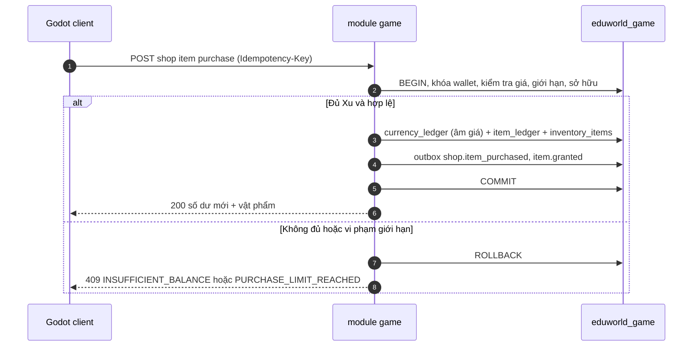

# Inventory, Economy, Achievement & Collection

> Trạng thái: Draft · Phiên bản: 0.2 · Owner: Game Systems Designer + Product Manager · Cập nhật: 2026-11-15
> Liên quan: [PROGRESSION_SYSTEM](PROGRESSION_SYSTEM.md) · [CHALLENGE_BOSS_SYSTEM](CHALLENGE_BOSS_SYSTEM.md) · [CHARACTER_SYSTEM](CHARACTER_SYSTEM.md) · [GAME_DESIGN](GAME_DESIGN.md) · [CHILD_SAFETY](../10-security/CHILD_SAFETY.md) · [ANTI_CHEAT](../10-security/ANTI_CHEAT.md) · [ADR-0028, ADR-0043, ADR-0049](../adr/README.md) · OQ-14

## 1. Mục đích và phạm vi

Tài liệu là nguồn duy nhất cho: item catalog và danh sách slot trang bị, kho đồ, tiền tệ trong game, cửa hàng, danh mục phần thưởng, cấp thưởng, bộ sưu tập và thành tựu. Cách nhân vật mặc/hiển thị vật phẩm: [CHARACTER_SYSTEM](CHARACTER_SYSTEM.md); XP: [PROGRESSION_SYSTEM](PROGRESSION_SYSTEM.md). Mục tiêu: phần thưởng hấp dẫn, **kiểm toán được**, **không** tạo cơ chế cờ bạc hay áp lực chi tiêu cho trẻ.

Module sở hữu: **module `game`** (DB `eduworld_game`). Sticker/GIF chat thuộc module `chat` nhưng có thể được mở khóa bằng phần thưởng (ADR-0034).

Nguyên tắc bắt buộc:
- **Không** mua bằng tiền thật, **không** loot box, **không** phần thưởng ngẫu nhiên trả phí [Confirmed: không pay-to-learn; Proposed: không tiền thật trong Release 1.0, OQ-14].
- Vật phẩm chỉ là **trang trí/biểu cảm**, không tăng điểm, không mở nội dung học tập bắt buộc, không tạo lợi thế thi đấu [Confirmed].
- Mọi cấp/trừ vật phẩm và tiền tệ do server thực hiện, idempotent, ghi sổ cái (ADR-0049).

## 2. Item catalog

### 2.1. Loại vật phẩm

| `kind` | Mô tả | Trang bị vào slot |
|---|---|---|
| `outfit` | Bộ trang phục | `outfit` |
| `hair` | Kiểu tóc | `hair` |
| `accessory` | Mũ, kính, ba lô, cánh trang trí, vật cầm tay trang trí | `head`, `face`, `back`, `hand` |
| `emote` | Biểu cảm 3D (vẫy tay, vỗ tay, nhảy, ăn mừng, cảm ơn, xin lỗi…) | `emote_1`…`emote_6` |
| `pet` | Thú đồng hành trang trí, đi theo nhân vật, không có chỉ số | `pet` |
| `title` | Danh hiệu hiển thị cạnh nickname (ngoài danh hiệu level) | `title` |
| `badge` | Huy hiệu (từ achievement) hiển thị trên hồ sơ | `badge_showcase_1`…`3` |
| `frame` | Khung avatar | `frame` |
| `decoration` | Đồ trang trí cho góc cá nhân/khu nhà (nếu có) | — |
| `knowledge_card` | Thẻ kiến thức sưu tầm (tóm tắt ngắn một LO) | — |
| `consumable_cosmetic` | Hiệu ứng tạm thời (pháo hoa khi lên cấp…) | — [Confirmed, không bắt buộc] |

Không có vật phẩm tiêu hao tăng sức mạnh, tăng XP hay bỏ qua bài học.

**Danh sách slot trang bị chuẩn** (CHARACTER_SYSTEM dùng lại, không định nghĩa riêng): `hair`, `outfit`, `head`, `face`, `back`, `hand`, `pet`, `title`, `frame`, `badge_showcase_1..3`, `emote_1..6`. Mỗi slot tối đa 1 item. Màu da, dáng người, màu tóc là tùy chọn miễn phí, không phải item.

### 2.2. Thuộc tính `ItemDefinition`

`item_id` (**mã** `varchar(64)` dạng người đọc, vd. `hair_ponytail_01` — không phải UUID; dùng thống nhất ở DB, OpenAPI, event và `avatar_config`), `kind`, `name` (vi/en), `description`, `rarity` (`common`, `uncommon`, `rare`, `epic`, `legendary` — màu độ hiếm là mã màu nghiệp vụ dùng chung, ADR-0047), `grade_restriction` (tùy chọn, ví dụ phong cách phù hợp lứa tuổi), `asset_refs` (model/icon/thumbnail, ADR-0044), `equip_slot`, `stackable`, `max_stack`, `tradable` (luôn `false` trong Release 1.0), `sources[]` (nguồn có thể nhận), `status`/`version` (ADR-0043).

Vật phẩm là nội dung platform (Game Studio, ADR-0027); có thể gán cho tenant theo sự kiện trường (ADR-0029).

## 3. Inventory và trang bị

| Khái niệm | Quy tắc |
|---|---|
| `InventoryItem` | `(student_id, item_id)` duy nhất với vật phẩm không xếp chồng; vật phẩm xếp chồng có `quantity` |
| Equipment | `avatar_config` lưu slot → `item_id`; server kiểm tra học sinh sở hữu item và slot hợp lệ (`ITEM_NOT_OWNED`, `EQUIP_SLOT_INVALID`) |
| Item history | Mọi thay đổi sở hữu ghi `item_ledger` (nhận, dùng, thu hồi do điều chỉnh) |
| Ownership | Không chuyển nhượng giữa học sinh trong Release 1.0 |
| Thu hồi | Chỉ qua quy trình điều chỉnh có lý do + người duyệt (bút toán bù), không xóa dòng |

## 4. Tiền tệ trong game

### 4.1. Loại tiền

| Tiền | Kiếm từ | Dùng cho | Nhãn |
|---|---|---|---|
| **Xu** | Quest, challenge, boss, achievement, lên cấp, sự kiện (theo reward rule) | Mua cosmetic trong Shop | [Confirmed] ADR-0049 |
| "Ngọc" hoặc tiền thứ hai | — | — | [TBD] OQ-14; không tạo khi chưa có quyết định |

Xu **không** mua được bằng tiền thật và **không** đổi ra tiền thật.

### 4.2. Wallet và sổ cái

- `wallets(student_id, currency_code, balance, version)`: số dư là cache, cập nhật cùng transaction với `currency_ledger`.
- `currency_ledger`: `entry_id`, `tenant_id`, `student_id`, `currency_code`, `delta`, `balance_after`, `reason_code` (`reward`, `shop_purchase`, `adjustment`, `refund`), `source_type`, `source_id`, `idempotency_key` (UNIQUE), `created_at`, `created_by` (hệ thống hoặc người duyệt điều chỉnh).
- Không có số dư âm (CHECK `balance >= 0`); mua hàng khóa dòng wallet hoặc dùng `version`.
- Đối soát hằng đêm: `wallets.balance` = tổng `currency_ledger.delta`; lệch → alert, không tự sửa.

### 4.3. Giới hạn kiếm Xu

Tài liệu này **sở hữu** cap Xu: **300 Xu/ngày** [Confirmed] (`currencies.daily_cap`), áp cùng cơ chế giảm dần khi lặp nội dung như XP ([PROGRESSION_SYSTEM](PROGRESSION_SYSTEM.md) §3.2); phát hiện lạm dụng ở [ANTI_CHEAT](../10-security/ANTI_CHEAT.md) §7. Mục tiêu: một món cosmetic phổ biến cần vài ngày chơi bình thường, không cần chơi dài.

## 5. Shop và danh mục phần thưởng

### 5.1. Shop

| Thuộc tính `ShopItem` | Mô tả |
|---|---|
| `shop_item_id`, `item_id` | Vật phẩm bán |
| `price` | Số Xu (số nguyên > 0) |
| `available_from`, `available_to` | Thời gian bán; mặt hàng **giới hạn thời gian** chỉ bán khi sự kiện/mùa liên kết đang chạy (`event_id`/`season_id`), và **quay lại** ở lần tổ chức sau (không FOMO, [GAME_DESIGN](GAME_DESIGN.md) §13, [EVENT_SEASON_SYSTEM](EVENT_SEASON_SYSTEM.md) E-3) |
| `purchase_limit` | Giới hạn mua mỗi học sinh (mặc định 1 với vật phẩm không xếp chồng) |
| `grade_levels` | Tùy chọn |
| `tenant_assignment` | Mặc định mọi tenant; có thể chỉ gán một số tenant (ADR-0029) |

Quy tắc: giá hiển thị trước, vật phẩm xác định (không hộp bí ẩn), xác nhận trước khi mua, hoàn Xu khi giao dịch lỗi. Mua hàng: `POST /game/shop/items/{shop_item_id}:purchase` với `Idempotency-Key`.

### 5.2. Reward catalog và cấp thưởng

- `RewardRule` (đã có, [reward-rule.schema.json](../../specs/schemas/reward-rule.schema.json)) mở rộng loại grant: `xp`, `currency`, `item`, `badge`, `title`, `collection_item`.
- `RewardGrant` idempotent theo `(trigger_event_id, rule_version_id, student_id)`; mỗi grant sinh các bút toán ở `xp_ledger`, `currency_ledger`, `item_ledger` trong **một** transaction.
- Phần thưởng nhận lại vật phẩm đã có (không xếp chồng) → đổi thành Xu theo bảng quy đổi trùng lặp (§6.3).

## 6. Collection

### 6.1. Loại bộ sưu tập

| Loại | Ví dụ | Cách nhận |
|---|---|---|
| Pet | Thú đồng hành của từng khu | Hoàn thành chuỗi quest khu vực, boss |
| Knowledge Card | "Bảng cửu chương 7", "Vòng đời của ếch" | Đạt mastery `proficient` của LO tương ứng (đọc từ module learning qua event `learning_objective.progressed`) |
| Cosmetic | Bộ trang phục theo chủ đề | Quest, shop, sự kiện |
| Badge | Huy hiệu thành tựu | Achievement |
| Exploration | Vật sưu tầm trong bản đồ | Discovery ([WORLD_DESIGN](WORLD_DESIGN.md) §8) |
| Event | Vật phẩm sự kiện (đèn lồng Trung thu, áo Tết…) | Quest/mốc/community goal của sự kiện ([EVENT_SEASON_SYSTEM](EVENT_SEASON_SYSTEM.md)); có thể nhận lại ở lần tổ chức sau |

`Collection`: `collection_id`, `code`, `type`, `items[]`, `completion_rewards[]`, `visible` (ẩn đến khi nhận món đầu tiên hoặc luôn hiện). `CollectionProgress`: `student_id`, `collection_id`, `owned_count`, `completed_at`.

### 6.2. Nguyên tắc

- Nguồn nhận **xác định và công khai** (xem được "Cách nhận"), không ngẫu nhiên trả phí.
- Knowledge Card gắn mastery: nhận khi đạt, **không** bị thu hồi khi mastery giảm do decay (tránh cảm giác bị phạt).

### 6.3. Trùng lặp

Nhận lại món đã có (không xếp chồng): quy đổi Xu theo độ hiếm [Confirmed: common 5, uncommon 10, rare 25, epic 50, legendary 100], ghi rõ trong thông báo.

### 6.4. Trao đổi (trading)

**TẮT** trong Release 1.0 [Confirmed theo Master Prompt mới §10.2]. Chỉ xem xét bật khi đã đánh giá an toàn trẻ em, gian lận, chính sách nhà trường, và có ADR mới. Thiết kế giữ `tradable = false` cho mọi item.

## 7. Achievement

| Thuộc tính `Achievement` | Mô tả |
|---|---|
| `achievement_id`, `code`, `version`, `status` | Nội dung platform, version hóa (ADR-0043) |
| `category` | `first_time`, `progress`, `learning`, `exploration`, `social`, `team`, `competition`, `seasonal`, `event`, `hidden` — `event`/`seasonal` dùng trigger `event.participation_started`, `event.milestone_claimed`, `community_goal.completed`, `season_track.tier_reached` ([EVENT_SEASON_SYSTEM](EVENT_SEASON_SYSTEM.md) §15) |
| `trigger` | Event kích hoạt (ví dụ `quest.completed`, `learning_objective.mastered`, `boss.encounter_completed`, `world.discovery_found`, `party.activity_completed`, `match.completed`) |
| `conditions` | Bộ lọc + ngưỡng (ví dụ `count >= 10` quest khu Toán; `distinct_days >= 4` trong tuần) |
| `progress_metric` | Cách tính tiến độ hiển thị (đếm, tổng, tập hợp) |
| `visibility` | `visible`, `hidden_until_unlocked` |
| `rewards[]` | Badge, title, Xu, item, XP |
| `tiers[]` | Tùy chọn: đồng/bạc/vàng theo ngưỡng |

Quy tắc:
- Achievement học tập dựa trên **mastery/hoàn thành**, không dựa trên thời gian chơi hay số lần đăng nhập [Confirmed, [GAME_DESIGN](GAME_DESIGN.md) §12].
- Achievement xã hội chỉ dựa trên hành vi tích cực (giúp bạn trong co-op), không dựa trên số tin nhắn.
- Đánh giá bởi consumer `achievement-evaluator` trong module game, idempotent theo `(student_id, achievement_id, tier)`.
- Đổi điều kiện bằng version mới: tiến độ đã đạt không bị giảm; học sinh đã mở khóa giữ nguyên.

## 8. Dữ liệu (module game, `eduworld_game`)

| Bảng | Loại | Cột chính |
|---|---|---|
| `item_definitions`, `item_definition_versions` | G | §2.2 |
| `inventory_items` | T | `student_id`, `item_id`, `quantity`, `acquired_at`, `source_grant_id` |
| `item_ledger` | T, P (tháng) | `entry_id`, `student_id`, `item_id`, `delta`, `reason_code`, `source_type`, `source_id`, `idempotency_key` UNIQUE |
| `currencies` | G | `currency_code` (`xu`), `name`, `daily_cap`, `status` |
| `wallets` | T | PK `(student_id, currency_code)`, `balance` CHECK ≥ 0, `version` |
| `currency_ledger` | T, P (tháng) | §4.2 |
| `shop_items`, `shop_item_versions` | G | §5.1 |
| `shop_purchases` | T | `purchase_id`, `student_id`, `shop_item_version_id`, `price`, `ledger_entry_id`, `created_at` |
| `collections`, `collection_versions`, `collection_items` | G | §6.1 |
| `collection_progress` | T | PK `(student_id, collection_id)` |
| `achievements`, `achievement_versions` | G | §7 |
| `student_achievements` | T | PK `(student_id, achievement_id, tier)`, `progress`, `unlocked_at` |

Chi tiết: [DATABASE_DESIGN §2.8a](../07-backend/DATABASE_DESIGN.md).

## 9. API đề xuất

| Method | Path | Mô tả | Idem |
|---|---|---|---|
| GET | `/game/inventory?kind=` | Kho đồ (đã có, mở rộng lọc) | T |
| GET | `/game/inventory/history?cursor=` | Lịch sử nhận/dùng vật phẩm | T |
| PUT | `/game/profile/avatar` | Trang bị theo slot (đã có) | T |
| GET | `/game/wallet` | Số dư Xu, cap còn lại hôm nay | T |
| GET | `/game/wallet/ledger?cursor=` | Lịch sử Xu | T |
| GET | `/game/shop/items?kind=` | Hàng đang bán cho học sinh | T |
| POST | `/game/shop/items/{shop_item_id}:purchase` | Mua | B |
| GET | `/game/collections` | Bộ sưu tập + tiến độ | T |
| GET | `/game/collections/{collection_id}` | Chi tiết, cách nhận từng món | T |
| GET | `/game/achievements` | Thành tựu + tiến độ (đã có) | T |

Cấu hình (`/api/v1/game-admin/{config_type}`): `items`, `currencies`, `shop-items`, `collections`, `achievements`, `reward-rules`. Điều chỉnh số dư/vật phẩm (bút toán bù): `POST /api/v1/admin/economy/adjustments` (System Admin, lý do bắt buộc, four-eyes [Confirmed]).

## 10. Event

| Event | Producer | Payload chính |
|---|---|---|
| `currency.credited` / `currency.debited` | module game | `currency_code`, `delta`, `balance_after`, `reason_code`, `source_id` |
| `shop.item_purchased` | module game | `shop_item_version_id`, `item_id`, `price` |
| `item.granted` | module game | `item_id`, `quantity`, `grant_id` (đã có) |
| `collection.item_added` / `collection.completed` | module game | `collection_id`, `item_id` |
| `achievement.progressed` / `achievement.unlocked` | module game | `achievement_id`, `tier`, `progress` |
| `economy.adjusted` | module game | `entry_ids[]`, `reason`, `approved_by` |

## 11. Lỗi

| HTTP | `code` | Khi nào |
|---|---|---|
| 409 | `INSUFFICIENT_BALANCE` | Không đủ Xu |
| 409 | `PURCHASE_LIMIT_REACHED` | Vượt giới hạn mua |
| 409 | `SHOP_ITEM_UNAVAILABLE` | Hết thời gian bán, không gán cho tenant, không đúng khối |
| 409 | `ITEM_ALREADY_OWNED` | Mua vật phẩm không xếp chồng đã có |
| 422 | `ITEM_NOT_OWNED` | Trang bị vật phẩm không sở hữu (đã có) |
| 422 | `EQUIP_SLOT_INVALID` | Vật phẩm không hợp với slot |
| 403 | `TRADE_DISABLED` | Mọi yêu cầu trao đổi (dự phòng) |

## 12. Acceptance criteria

| ID | Tiêu chí |
|---|---|
| AC-ECO-001 | Mua vật phẩm hai lần cùng `Idempotency-Key` → trừ Xu một lần |
| AC-ECO-002 | Không đủ Xu → `INSUFFICIENT_BALANCE`, số dư không đổi, không có bút toán |
| AC-ECO-003 | Tổng `currency_ledger` luôn bằng `wallets.balance` (job đối soát) |
| AC-ECO-004 | Không có endpoint/vật phẩm nào mua bằng tiền thật hoặc phần thưởng ngẫu nhiên trả phí |
| AC-ECO-005 | Nhận lại vật phẩm đã có → quy đổi Xu đúng bảng, có thông báo |
| AC-ECO-006 | Achievement ẩn không hiển thị điều kiện đến khi mở khóa; mở khóa một lần dù event lặp |
| AC-ECO-007 | Knowledge Card cấp khi LO đạt `proficient`; không bị thu hồi khi mastery decay |
| AC-ECO-008 | Trang bị item không sở hữu → `ITEM_NOT_OWNED`; client không thể tự thêm item vào inventory |

Test case: TC-ECO-001…008 trong [TEST_STRATEGY](../12-project/TEST_STRATEGY.md).
