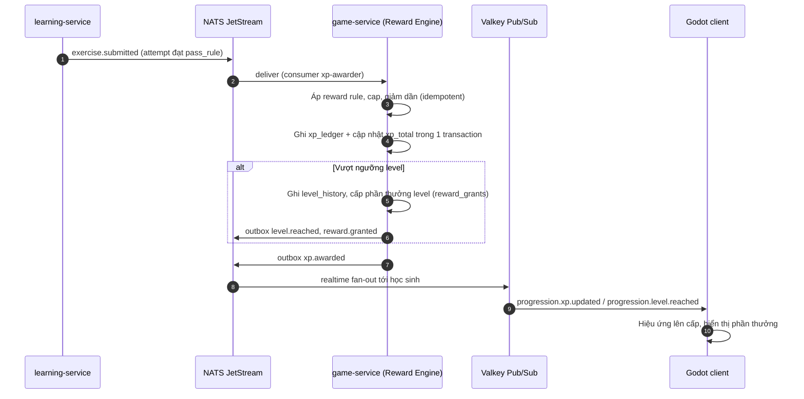

# Progression System — XP, Level, phần thưởng lên cấp

> Trạng thái: Draft · Phiên bản: 0.2 · Owner: Game Director + Game Systems Designer · Cập nhật: 2026-11-15
> Liên quan: [GAME_DESIGN](GAME_DESIGN.md) · [CHALLENGE_BOSS_SYSTEM](CHALLENGE_BOSS_SYSTEM.md) · [INVENTORY_ECONOMY](INVENTORY_ECONOMY.md) · [QUEST_SYSTEM](QUEST_SYSTEM.md) · [ANTI_CHEAT](../10-security/ANTI_CHEAT.md) · [LEARNING_ANALYTICS](../02-learning/LEARNING_ANALYTICS.md) · [WORLD_DESIGN](WORLD_DESIGN.md) · [COMPETITION_SYSTEM](COMPETITION_SYSTEM.md) · [ADR-0018, ADR-0043, ADR-0049](../adr/README.md)

## 1. Mục đích và phạm vi

Tài liệu là nguồn duy nhất cho **tiến trình nhân vật** của học sinh: XP (catalog nguồn, cap, giảm dần khi lặp, sổ cái), level, đường cong XP, danh hiệu, phần thưởng lên cấp, lịch sử. Đây là động lực để học sinh quay lại và thấy nhân vật mình lớn lên.

**Ngoài phạm vi:** điểm và mức thành thạo học tập ([LEARNING_ANALYTICS](../02-learning/LEARNING_ANALYTICS.md)), rating thi đấu ([COMPETITION_SYSTEM](COMPETITION_SYSTEM.md)), mở khóa vùng/khám phá/hoàn thành bản đồ ([WORLD_DESIGN](WORLD_DESIGN.md) §7–8), vật phẩm/tiền tệ/achievement/collection ([INVENTORY_ECONOMY](INVENTORY_ECONOMY.md)), challenge/boss ([CHALLENGE_BOSS_SYSTEM](CHALLENGE_BOSS_SYSTEM.md)).

| Stakeholder | Quan tâm |
|---|---|
| Học sinh | Thấy mình tiến bộ, có mục tiêu gần (lên cấp) và xa (mở khu mới) |
| Game Designer / Live-ops | Cấu hình đường cong XP, danh hiệu, phần thưởng mà không build lại client |
| Giáo viên / Nhà trường | Game level **không** bị hiểu nhầm là năng lực học tập |
| Backend | Mọi thay đổi XP/level server-authoritative, idempotent, kiểm toán được |

Service sở hữu: **`game-service`** (ADR-0036). Database `eduworld_game`.

## 2. Ba miền tiến trình tách biệt [Confirmed]

| Miền | Số liệu | Nguồn sự thật | Dùng cho | Không được dùng cho |
|---|---|---|---|---|
| **Game progression** | XP, Game Level, danh hiệu, khám phá, achievement, collection, cosmetic | `game-service`: `xp_ledger`, `level_history`, `exploration_progress` (WORLD_DESIGN) | Động lực chơi, mở khóa cosmetic/khu vực/hoạt động phụ | Đánh giá học tập, báo cáo giáo viên như năng lực |
| **Learning progression** | Learning Score, Mastery theo LO, kết quả bài, kỹ năng yếu | `learning-service` (ADR-0017) | Giáo viên, học sinh, gợi ý ôn tập | Tính XP trực tiếp theo điểm |
| **Competition progression** | Game Rating (Glicko-2), Competition Points, thứ hạng mùa | `competition-service` (ADR-0018) | Ghép trận, bảng xếp hạng | Đánh giá học tập |

Quy tắc:
- **Không gộp** ba miền thành một điểm. UI hiển thị ở ba khu vực khác nhau (hồ sơ game, sổ học tập, bảng thi đấu).
- Game level **không** là bằng chứng thành thạo kiến thức [Confirmed]. Báo cáo cho giáo viên không hiển thị game level cạnh điểm học tập.
- Hoạt động học tập **có thể** sinh XP (động lực), nhưng XP không đi ngược vào mastery hay điểm.

## 3. XP

### 3.1. Catalog nguồn XP

Mỗi lần cộng XP gắn một `source_code` trong catalog cấu hình (Game Studio). Số XP cụ thể nằm trong reward rule ([reward-rule.schema.json](../../specs/schemas/reward-rule.schema.json)), không hardcode trong client.

| `source_code` | Sự kiện kích hoạt | XP gợi ý [Proposed] | Ghi chú |
|---|---|---|---|
| `quest.main_completed` | `quest.completed` (main) | 150 | Một lần cho mỗi quest |
| `quest.side_completed` | `quest.completed` (side, learning, exploration) | 60–100 | |
| `quest.daily_completed` / `quest.weekly_completed` | `quest.completed` (daily/weekly) | 40 / 120 | Theo `period_key` |
| `activity.completed` | `exercise.submitted` (đạt `pass_rule`) | 5–30 theo độ dài | Tỷ lệ với số câu đúng **lần đầu**; câu trả lời đoán nhanh dưới ngưỡng thời gian tối thiểu không tính |
| `lesson.completed` | `lesson.completed` | 20 | |
| `exploration.discovery` | `world.discovery_found` | 10 | Mỗi điểm khám phá một lần ([WORLD_DESIGN](WORLD_DESIGN.md) §8) |
| `exploration.area_completed` | `world.area_completed` | 100 | |
| `challenge.completed` | `challenge.completed` | 20–200 theo độ khó | [CHALLENGE_BOSS_SYSTEM](CHALLENGE_BOSS_SYSTEM.md) |
| `boss.defeated` | `boss.encounter_completed` | 100–300 | Chia theo đóng góp tối thiểu |
| `coop.contribution` | `party.activity_completed` | 30 | Đủ `min_contribution` |
| `achievement.unlocked` | `achievement.unlocked` | 0–100 | Cấu hình theo achievement |
| `event.participation` | event của live-ops | cấu hình | Phase sau (Event & Season) |
| `competition.participation` | `match.completed` | 10–25 | Tham gia, không phụ thuộc thắng thua nhiều; tối đa 10 trận/ngày tính XP |

Không có XP cho: đăng nhập hằng ngày đơn thuần, thời gian online, số lần bấm, trả lời đoán nhanh dưới ngưỡng thời gian tối thiểu, bài kiểm tra chính thức (chỉ XP "hoàn thành" cố định, LEARNING_EXPERIENCE).

### 3.2. Cap, giảm dần và chống lạm dụng

Tài liệu này **sở hữu** các quy tắc XP dưới đây; [ANTI_CHEAT](../10-security/ANTI_CHEAT.md) chỉ mô tả cách phát hiện và xử lý gian lận:
- Giảm dần khi lặp cùng nội dung, trong cửa sổ 7 ngày theo content version: lần 1 = 100%, lần 2 = 50%, lần 3 = 25%, từ lần 4 = 0% [Proposed].
- Cap tổng **1.000 XP/ngày** và cap theo nhóm nguồn (`xp_daily_caps`) [Proposed].
- Câu sai không cho XP; câu đúng sau khi đã xem giải thích của chính câu đó: 0 XP.
- Nội dung có độ khó thấp hơn khối hiện tại của học sinh ≥ 2 khối: XP × 0,25 [Proposed].
- Cap Xu/ngày và cách Xu áp cùng cơ chế giảm dần: [INVENTORY_ECONOMY](INVENTORY_ECONOMY.md) (nơi sở hữu).
- XP do **server** tính khi nhận domain event; client không gửi số XP. Mỗi lần cộng idempotent theo `(student_id, source_type, source_id, rule_id)` (ADR-0049).
- Cảnh báo (không tự phạt) khi phát hiện mẫu bất thường: tỷ lệ đúng đột biến, thời gian trả lời quá ngắn, nhiều tài khoản cùng thiết bị → `integrity_signals` cho moderator xem.

### 3.3. Sổ cái XP (ADR-0049)

| Trường | Kiểu | Ghi chú |
|---|---|---|
| `xp_entry_id` | uuid | UUIDv7 |
| `tenant_id`, `student_id` | uuid | |
| `amount` | integer | Dương khi cộng; bút toán bù âm chỉ do quy trình điều chỉnh có duyệt |
| `source_type`, `source_code` | varchar(64) | `quest`, `activity`, `challenge`… / mã catalog |
| `source_id` | uuid | Id thực thể gốc (quest_progress, attempt, encounter…) |
| `rule_id`, `rule_version` | uuid, int | Reward rule đã áp |
| `capped` | boolean | Bị cắt bởi cap |
| `idempotency_key` | varchar(64) | UNIQUE |
| `created_at` | timestamptz | Giờ server |

Tổng XP = tổng ledger; `game_profiles.xp_total` và `level` là cache cập nhật trong cùng transaction, job đối soát hằng đêm so sánh với tổng ledger.

## 4. Level và đường cong XP

### 4.1. Progression Curve (cấu hình, có version)

`ProgressionCurve` là nội dung platform (Game Studio, ADR-0027), version hóa và publish như mọi nội dung (ADR-0043). Schema: [progression-curve.schema.json](../../specs/schemas/progression-curve.schema.json).

Hai cách khai báo:
1. **Công thức** `xp_to_next(L) = round(base × L^exponent + linear × L)`, tham số `base`, `exponent`, `linear`, `max_level`.
2. **Bảng** `levels[]` ghi rõ `xp_required` cho từng level (ghi đè công thức khi cần cân chỉnh tay).

Mặc định [Proposed]: `base = 100`, `exponent = 1.35`, `linear = 20`, `max_level = 60`.

| Level | XP cần để lên level tiếp | XP tích lũy (xấp xỉ) |
|---|---|---|
| 1 → 2 | 120 | 120 |
| 5 → 6 | 978 | 2.624 |
| 10 → 11 | 2.439 | 11.767 |
| 20 → 21 | 6.107 | 55.649 |
| 30 → 31 | 10.465 | 140.204 |

Mục tiêu cân bằng [Proposed]: học sinh chơi đều 20–30 phút/ngày (khoảng 300–400 XP/ngày, dưới cap 1.000) lên level 10 sau khoảng 4 tuần và level 20 sau khoảng một học kỳ; level 30+ dành cho người chơi lâu năm. Không cần chơi dài để theo kịp. Số liệu phải được hiệu chỉnh bằng dữ liệu pilot.

### 4.2. Đổi đường cong khi đang vận hành

- Publish version mới của curve **không làm giảm level** của ai. Level hiện tại giữ nguyên; XP còn thiếu tính theo curve mới từ level hiện tại (`level_floor_protection = true`).
- Khi curve mới khiến một học sinh đủ XP lên nhiều cấp, server phát lần lượt từng `level.reached` (có gộp thông báo ở client).
- `game_profiles` lưu `curve_version` đang áp dụng.

### 4.3. Danh hiệu cấp độ

`LevelTitle` cấu hình theo khoảng level [Proposed]:

| Khoảng level | Danh hiệu (vi) | Mã |
|---|---|---|
| 1–9 | Tân binh | `beginner` |
| 10–19 | Nhà thám hiểm | `explorer` |
| 20–34 | Người phiêu lưu | `adventurer` |
| 35–49 | Nhà vô địch | `champion` |
| 50–60 | Bậc thầy | `master` |

Danh hiệu hiển thị cạnh nickname, chỉ có ý nghĩa trong game.

### 4.4. Phần thưởng lên cấp

`ProgressionLevel` (thuộc curve version; tên khác `LevelDefinition` là gói level/zone) khai báo `rewards[]`: cosmetic, emote, pet, danh hiệu, khung avatar, Xu, mở khóa hoạt động phụ (vật phẩm và tiền tệ theo [INVENTORY_ECONOMY](INVENTORY_ECONOMY.md)). **Không** mở khóa nội dung học tập bắt buộc theo level [Confirmed].

Cấp phần thưởng qua Reward Engine, idempotent theo `(student_id, level, curve_id)`; lên lại level đó (sau điều chỉnh) không nhận lại thưởng.

### 4.5. Level-up

### 4.6. Progress bar và lịch sử

- HUD hiển thị level, danh hiệu, thanh tiến độ `xp_in_level / xp_to_next`, XP còn lại có thể nhận hôm nay (cap).
- `level_history`: `student_id`, `from_level`, `to_level`, `curve_version`, `reached_at`, `trigger_xp_entry_id`.
- Màn "Hành trình của tôi": 20 giao dịch XP gần nhất (nguồn thân thiện, không lộ id kỹ thuật), mốc level, phần thưởng đã nhận.

## 5. Quan hệ với tiến trình thế giới

Mở khóa vùng, điểm khám phá, vật sưu tầm, secret quest, hoàn thành bản đồ và chương truyện thuộc [WORLD_DESIGN](WORLD_DESIGN.md) §7–8. Progression chỉ cung cấp: điều kiện `min_level` (dùng cho khu trang trí, không cho khu học tập) và XP cho khám phá theo catalog §3.1.

## 6. Dữ liệu (game-service, `eduworld_game`)

| Bảng | Loại | Cột chính |
|---|---|---|
| `progression_curves`, `progression_curve_versions` | G, có con trỏ `current_version_id` | `formula jsonb`, `max_level`, `level_overrides jsonb`, `titles jsonb` |
| `progression_levels` | G | `curve_version_id`, `level`, `xp_required`, `title_code`, `rewards jsonb` |
| `xp_ledger` | T, P (tháng) | §3.3 |
| `xp_daily_caps` | T | `student_id`, `date`, `bucket`, `granted` |
| `level_history` | T | §4.6 |

Chi tiết DDL: [DATABASE_DESIGN §2.8a](../07-backend/DATABASE_DESIGN.md).

## 7. API đề xuất

Học sinh (`/api/v1/game`, game-service):

| Method | Path | Mô tả | Idem |
|---|---|---|---|
| GET | `/game/progression` | Level, danh hiệu, XP trong level, XP cần, cap còn lại hôm nay, curve version | T |
| GET | `/game/progression/xp-history?cursor=` | Lịch sử giao dịch XP (thân thiện) | T |
| GET | `/game/progression/levels` | Bảng level + phần thưởng sắp tới (theo curve hiện hành) | T |

Cấu hình (`/api/v1/game-admin/{config_type}`, platform-only): `progression-curves`, `levels`. API khám phá/mở vùng: [WORLD_DESIGN](WORLD_DESIGN.md) §12.

## 8. Event

| Event | Producer | Payload chính |
|---|---|---|
| `xp.awarded` | game-service | `amount`, `source_code`, `source_id`, `rule_id`, `capped` |
| `level.reached` | game-service | `from_level`, `to_level`, `curve_version`, `title_code` |

## 9. Lỗi

Không có mã lỗi riêng: XP/level chỉ đọc qua API, mọi thay đổi do server xử lý từ event. Lỗi khám phá/mở vùng: [WORLD_DESIGN](WORLD_DESIGN.md) §12.

## 10. Acceptance criteria

| ID | Tiêu chí |
|---|---|
| AC-GAM-004 | Hoàn thành quest → XP cộng đúng rule, thanh tiến độ cập nhật trong ≤ 2 s; replay event không cộng trùng |
| AC-GAM-005 | Đủ XP → `level.reached`, phần thưởng level cấp đúng một lần, hiển thị hiệu ứng lên cấp |
| AC-GAM-006 | Publish curve mới không làm giảm level của học sinh nào |
| AC-GAM-007 | Báo cáo giáo viên không hiển thị game level như chỉ số học tập |

AC-GAM-008…010 (mở vùng, khám phá) ở [WORLD_DESIGN](WORLD_DESIGN.md) §14. Test case: TC-GAM-004…010 trong [TEST_STRATEGY](../12-project/TEST_STRATEGY.md).
