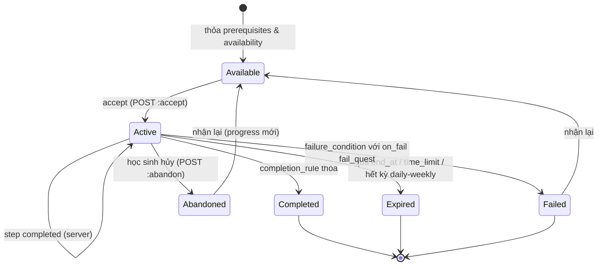
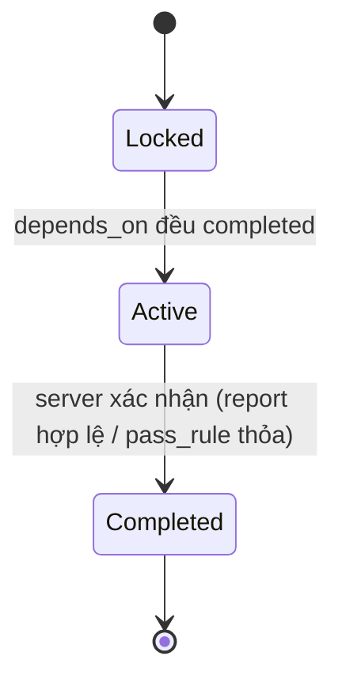
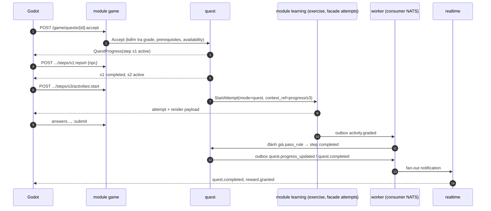

# Quest System

> Trạng thái: Draft · Phiên bản: 0.4 · Owner: Game Director + Backend Architect · Cập nhật: 2026-11-21 (ADR-0095: bỏ lớp, theo khối) · 2026-11-15
> Liên quan: [LEARNING_MECHANICS](LEARNING_MECHANICS.md) · [DOMAIN_MODEL §5](../06-architecture/DOMAIN_MODEL.md) · [ADR-0015, ADR-0016](../adr/README.md) · [MINIGAME_ENGINE](../08-game-client/MINIGAME_ENGINE.md) · [quest.schema.json](../../specs/schemas/quest.schema.json) · [Ví dụ quest Toán lớp 3](../../specs/examples/quest.math-g3-multiplication.json) · [PARTY_SYSTEM](../03-social-multiplayer/PARTY_SYSTEM.md) · [PROGRESSION_SYSTEM](PROGRESSION_SYSTEM.md) · [CHALLENGE_BOSS_SYSTEM](CHALLENGE_BOSS_SYSTEM.md) · [INVENTORY_ECONOMY](INVENTORY_ECONOMY.md) · [WORLD_DESIGN](WORLD_DESIGN.md) · [GAME_DESIGN](GAME_DESIGN.md)

## 1. Mục đích và phạm vi

Tài liệu là nguồn duy nhất cho quest: data model, 12 loại quest, bước, điều kiện bắt đầu/hoàn thành/thất bại, lặp lại, daily/weekly, party và shared progress, phần thưởng dự kiến, API. Chương truyện và vùng đất: [WORLD_DESIGN](WORLD_DESIGN.md); XP: [PROGRESSION_SYSTEM](PROGRESSION_SYSTEM.md); vật phẩm: [INVENTORY_ECONOMY](INVENTORY_ECONOMY.md).

Quest là cầu nối giữa **thế giới game** và **Learning Engine** [Confirmed] (§3.4): học sinh giúp NPC, khám phá, thu thập — và để hoàn thành phải làm hoạt động học tập phù hợp khối mình. Nguyên tắc:

| # | Nguyên tắc | Nhãn |
|---|---|---|
| Q-1 | Quest là **dữ liệu phiên bản hóa** soạn trong CMS (ADR-0015), không hardcode trong scene | [Confirmed] |
| Q-2 | Tiến độ quest do **server** quyết định; client chỉ báo sự kiện tương tác và hiển thị | [Confirmed] (ADR-0016) |
| Q-3 | Bước học tập luôn tạo **Attempt riêng của từng học sinh** — kể cả trong party | [Confirmed] (Addendum §4) |
| Q-4 | Quest liên kết `grade_levels`, `subject_id`, `topic_ids`, `objective_ids` | [Confirmed] |
| Q-5 | Không trừng phạt nặng khi sai: bước học tập cho phép thử lại với câu hỏi mới; quest không "thất bại" vì trả lời sai | [Confirmed] |
| Q-6 | Phần thưởng đi qua Reward Engine (cap, diminishing returns) — quest chỉ khai báo ý định thưởng | [Confirmed] |
| Q-7 | Ưu tiên bước mà **hành động chính chính là khái niệm học** (cơ chế học tập nội tại, [LEARNING_MECHANICS](LEARNING_MECHANICS.md)); bước khung (`talk_npc`/`go_to`/`collect`) chỉ dẫn dắt | [Confirmed] |

## 2. Data model

Entity: `QuestDefinition` (định danh) → `QuestVersion` (nội dung bất biến khi published) → `QuestProgress` (theo học sinh). Schema chuẩn: [specs/schemas/quest.schema.json](../../specs/schemas/quest.schema.json).

### 2.1. QuestVersion — ánh xạ yêu cầu §3.4

| Yêu cầu §3.4 | Trường | Ghi chú |
|---|---|---|
| ID | `quest_id`, `quest_version_id`, `code` | `code` dạng người đọc: `math.g3.market_multiplication` |
| Tên, Mô tả | `name`, `description` (`localized_text`, **bắt buộc đủ `vi` và `en`** — ADR-0056) | |
| Loại nhiệm vụ | `quest_type` | 12 loại (schema v2): `main`, `side`, `daily`, `weekly`, `learning`, `exploration`, `social`, `party`, `challenge`, `seasonal`, `special_event`, `boss` — xem §2.3. Ánh xạ từ v1: `educational`→`learning`, `cooperative`→`party`, `competition`→`challenge` |
| Khối áp dụng | `grade_levels[]` | 1–9 |
| Môn học, Chủ đề | `subject_id`, `topic_ids[]` | Tham chiếu curriculum |
| Learning Objective | `objective_ids[]` | Bắt buộc ≥1 cho `learning`, `daily`, `weekly`, `challenge`, `party`, `boss` |
| Narrative, NPC | `narrative`, `giver_npc_id`, `area_id`, `story_chapter_code` | Lời dẫn truyện, NPC giao quest, khu vực, chương truyện (main quest) |
| Level requirement | `prerequisites.min_level` | Không dùng cho quest học tập bắt buộc ([WORLD_DESIGN](WORLD_DESIGN.md) §7) |
| Learning requirement | `learning_requirements[]` | `objective_id` + `min_mastery_level`; đọc projection mastery |
| Repeatability, cooldown | `repeatability` | `once` / `per_period` / `repeatable` + `cooldown_hours`, `max_completions`, `repeat_reward_policy` |
| Failure conditions | `failure_conditions[]` | `time_limit_exceeded`, `availability_ended`, `party_disbanded`, `challenge_failed`, `boss_ended`; `on_fail` = `reset_step` (mặc định) hoặc `fail_quest` |
| Điều kiện bắt đầu | `prerequisites`, `start_trigger` | Level, quest trước, khu đã mở, vai trò |
| Các bước | `steps[]` | §3 |
| Điều kiện hoàn thành | `completion_rule` | `all_required_steps` (mặc định) hoặc `any_n_of` |
| Phần thưởng | `rewards[]` | XP / item / badge — qua Reward Engine |
| Thời gian | `availability` | `start_at`, `end_at`, `recurrence`, `time_limit_minutes` |
| Phiên bản nội dung | `version`, `status`, `curriculum_version_id` | Workflow Draft → Review → Approved → Published → Archived |
| (Party) | `party_mode`, `party_size`, `shared_progress_policy`, `steps[].assignee`, `steps[].roles[]` | §3.2, §6 |
| (Phạm vi) | `owner_scope`, `tenant_id` | platform (cấu hình game do platform sở hữu, tenant chỉ dùng khi được gán — ADR-0027, ADR-0029) |

### 2.2. QuestProgress

| Trường | Mô tả |
|---|---|
| `quest_progress_id` | UUIDv7 |
| `tenant_id`, `student_id`, `school_id` | Tenant-scoped (ADR-0005) |
| `quest_version_id` | Version đã nhận — không đổi giữa chừng dù quest có version mới |
| `status` | `active`, `completed`, `expired`, `abandoned` |
| `step_states` | `{ step_id: { status: locked|active|completed, progress: {...}, attempt_ids: [...] } }` |
| `party_id` | Nếu nhận trong party với `shared_progress_policy ≠ individual` |
| `period_key` | Cho daily/weekly: `2026-11-15`, `2026-W46` — unique `(student_id, quest_id, period_key)` |
| `started_at`, `completed_at`, `expires_at` | Thời gian server |

Bất biến: một học sinh có tối đa **một** `QuestProgress` `active` cho mỗi `quest_id`; số quest active đồng thời ≤ 10 [Confirmed].

### 2.3. Mười hai loại quest

| `quest_type` | Mục đích | Đặc điểm | Learning objective |
|---|---|---|---|
| `main` | Mạch truyện chính "Thắp lại Tia Sáng" ([WORLD_DESIGN](WORLD_DESIGN.md) §2.2), mở khu/chương mới | `story_chapter_code`, `repeatability.mode = once`, thường `chain` | Có khi chứa bước học tập |
| `side` | Nhiệm vụ phụ ở từng khu | Ngắn, có thể lặp theo cooldown | Tùy chọn |
| `daily` | Nhiệm vụ trong ngày | `per_period` + `recurrence = daily`, không streak bị mất | Bắt buộc |
| `weekly` | Nhiệm vụ trong tuần | `per_period` + `recurrence = weekly`, tích lũy trong tuần | Bắt buộc |
| `learning` | Học/luyện một LO cụ thể | Bước `activity`/`minigame` là chính | Bắt buộc |
| `exploration` | Khám phá bản đồ ([WORLD_DESIGN](WORLD_DESIGN.md) §8) | Bước `go_to`, `discover`, `collect` | Không bắt buộc |
| `social` | Hoạt động tích cực với bạn bè (chơi cùng, giúp bạn trong co-op) | Đếm hành vi tích cực, không đếm số tin nhắn | Không bắt buộc |
| `party` | Làm cùng nhóm | `party_mode` ≠ `solo`, `shared_progress_policy` | Bắt buộc |
| `challenge` | Hoàn thành challenge ([CHALLENGE_BOSS_SYSTEM](CHALLENGE_BOSS_SYSTEM.md)) | Bước `challenge`, có thể đặt độ khó tối thiểu | Bắt buộc |
| `seasonal` | Gắn mùa | `availability.start_at/end_at` theo mùa (lịch mùa: [COMPETITION_SYSTEM §8](COMPETITION_SYSTEM.md#8-season-tier-competition-points)); quay lại mùa sau | Tùy chọn |
| `special_event` | Gắn sự kiện live-ops | `start_trigger.kind = event`, tham chiếu `event_id`; hiển thị và cấp thưởng chỉ khi `EventRun` ở trạng thái `live` ([EVENT_SEASON_SYSTEM](EVENT_SEASON_SYSTEM.md) §5); số quest sự kiện thêm mỗi ngày theo `event_extra_daily_quests_max` | Tùy chọn |
| `boss` | Hạ boss của khu | Bước `boss`, solo hoặc party | Bắt buộc |

### 2.4. Daily và weekly quest

Tài liệu này sở hữu các tham số sau [Confirmed]:

| Tham số | Giá trị |
|---|---|
| Số daily quest mỗi ngày | 3 (1 học tập, 1 khám phá/quest, 1 xã hội hoặc thi đấu — tùy chọn) |
| Số weekly quest mỗi tuần | 3, theo chủ đề tuần (mặc định theo lịch chương trình; nhà trường — `school_admin`/`academic_manager` — có thể chọn chủ đề tuần cho khối của trường qua LMS — không có lớp, ADR-0095) |
| Giờ reset daily | 04:00 ICT |
| Giờ reset weekly | Thứ Hai 04:00 ICT |
| Bỏ lỡ | Không phạt, không streak bị mất; mục tiêu tuần tính "4/7 ngày" |
| Chọn quest | Server chọn theo khối, môn được bật và LO yếu (`auto_daily`/`auto_weekly`, §4) |

### 2.5. Lặp lại, cooldown và thất bại

- `once`: hoàn thành một lần; nhận lại bị chặn (`QUEST_ALREADY_COMPLETED`).
- `per_period`: một lần mỗi kỳ (`period_key`).
- `repeatable`: nhận lại sau `cooldown_hours`, tối đa `max_completions`; phần thưởng lần lặp theo giảm dần của reward rule hoặc không thưởng.
- Thất bại: mặc định **không làm mất tiến độ** (`reset_step` chỉ đặt lại bước liên quan). `fail_quest` chỉ dùng cho quest có giới hạn thời gian rõ ràng; quest thất bại có thể nhận lại ngay (trừ khi hết `availability`). Thông báo thất bại thân thiện, không phạt XP/Xu.
- Nhận quest khi đang cooldown → `409 QUEST_COOLDOWN` kèm thời điểm nhận lại.

## 3. Step types

| `type` | Ý nghĩa | Client báo | Server xác minh |
|---|---|---|---|
| `talk_npc` | Nói chuyện với NPC (dialogue có thể chứa action `complete_step`) | `step.report` khi tới node đích | NPC tồn tại trong area hiện tại của phiên; rate limit; không mang giá trị học tập |
| `go_to` | Đến một vị trí/vật thể (`area_id` + `interactable_id`) | `step.report` khi chạm trigger | Học sinh đang ở instance của `area_id` (realtime presence); khoảng cách hợp lý theo vị trí server đã nhận |
| `collect` | Thu thập N vật thể quest | `step.report` mỗi vật | Mỗi `interactable_id` chỉ tính 1 lần, cùng area |
| `activity` | Làm hoạt động học tập: `content_ref.item_type` ∈ `question_set`, `lesson`, `assessment`, `activity` (activity tương tác, video, audio, mô phỏng — [ACTIVITY_ENGINE](../02-learning/ACTIVITY_ENGINE.md)) | `activities:start` → attempt | Attempt do `exercise` chấm; hoàn thành khi thỏa `pass_rule` |
| `minigame` | Chơi mini-game (câu hỏi từ Learning Engine) | `activities:start` → attempt | Như `activity`; xem [MINIGAME_ENGINE](../08-game-client/MINIGAME_ENGINE.md) |
| `party_activity` | Hoạt động tập thể (co-op puzzle, đếm chung) | qua room co-op | Mỗi thành viên có attempt riêng; tiến độ tập thể = tổng hợp theo `collective_target` |
| `interdependent` | Câu đố **phụ thuộc lẫn nhau**: mỗi thành viên giữ một phần dữ kiện theo `role`, chỉ giải được khi ghép dữ kiện của cả nhóm [Confirmed] | qua room co-op (§3.2) | Server chỉ gửi dữ kiện của role cho người giữ role đó; mỗi thành viên trả lời câu hỏi cuối trong attempt riêng |
| `discover` | Tìm N điểm khám phá/vật sưu tầm trong area | `:discover` ([WORLD_DESIGN](WORLD_DESIGN.md) §8) | Như `collect`, đồng thời ghi `exploration_progress` |
| `challenge` | Hoàn thành một challenge (tùy chọn độ khó tối thiểu) | `/game/challenges/{id}:start` | Hoàn thành khi `challenge.completed` với `status = succeeded` và độ khó ≥ `challenge_min_difficulty` |
| `boss` | Hạ một boss | `/game/bosses/{id}/encounters` | Hoàn thành khi `boss.encounter_completed` `defeated` và học sinh đạt `min_contribution` |

Bước `talk_npc`/`go_to`/`collect` **không cấp mastery/điểm**; chúng chỉ là khung trải nghiệm. Giá trị học tập luôn nằm ở `activity`/`minigame`/`party_activity`/`interdependent`. Khi muốn hành động di chuyển/thu thập mang khái niệm học (ví dụ nhặt vật phẩm theo nhóm để biểu diễn phép nhân), dùng bước `minigame` với cơ chế tương ứng trong [LEARNING_MECHANICS](LEARNING_MECHANICS.md) thay vì thêm điều kiện học tập vào `collect`.

`depends_on[]` tạo DAG giữa các bước (mặc định tuần tự theo `order`). `optional: true` cho bước phụ (thưởng thêm, không bắt buộc hoàn thành).

### 3.1. `pass_rule` cho bước học tập

```json
{ "min_correct_ratio": 0.7, "min_questions": 8, "retry_policy": "new_questions", "max_attempts_per_day": 5 }
```

- Không đạt → bước vẫn `active`, học sinh được gợi ý ôn (link lesson của LO yếu) và thử lại với bộ câu mới (`retry_policy: new_questions`).
- `max_attempts_per_day` chống farm; vượt → thông báo "Hãy quay lại ngày mai" (thân thiện).

### 3.2. Gán bước trong party và bước `interdependent` [Confirmed]

**`assignee`** (mọi bước, chỉ có nghĩa khi quest chơi theo party): `each_member` (mặc định cho bước học tập — mỗi người tự làm), `any_member` (một người làm tính cho cả nhóm, chỉ cho bước khung, theo `shared_progress_policy` §6), `role:<role>` (chỉ người giữ role đó làm).

**Bước `interdependent`** biến co-op từ "quiz cá nhân chạy song song" thành hợp tác thật: không ai giải được một mình vì mỗi người chỉ thấy một phần dữ kiện.

Mô tả ở mức schema (bổ sung vào `$defs.step` của [quest.schema.json](../../specs/schemas/quest.schema.json); mọi chuỗi có `maxLength` theo ADR-0041):

| Trường | Kiểu | Ý nghĩa |
|---|---|---|
| `type` | `"interdependent"` | |
| `roles[]` | mảng 2–4 phần tử (`interdependent_roles`, [Confirmed — Technical Architect 2026-11-15]) | Mỗi phần tử: `role` (string, `pattern ^[a-z][a-z0-9_]{1,31}$`), `title` (`localized_text`, ví dụ "Người đo", "Người đọc bản đồ"), `clue_content_ref` (`content_ref` tới dữ kiện riêng của role — learning material/thẻ dữ kiện đã publish), `icon_key` (string ≤ 64) |
| `content_ref` | `content_ref` | Câu hỏi/question set **cuối** cần ghép dữ kiện; đáp án ở module learning như mọi câu hỏi (ADR-0016) |
| `role_assignment` | enum `auto` (mặc định, server chia đều theo thứ tự vào phòng) \| `leader_assigns` | Cách gán role khi bắt đầu bước |
| `allow_multi_role` | boolean, mặc định `true` | Khi số thành viên online ít hơn số role, một người giữ nhiều role (party nhỏ vẫn chơi được) |
| `share_mode` | enum `clue_card` (mặc định) \| `clue_card_and_chat` | `clue_card`: thành viên bấm "Chia sẻ dữ kiện" để hiện thẻ dữ kiện (nội dung CMS) lên bảng chung của nhóm; không cần gõ chữ nên dùng được cho mọi khối. `clue_card_and_chat`: thêm trao đổi qua channel `party` (cùng ChatPolicy và pipeline kiểm duyệt như mọi tin, ADR-0020) |
| `pass_rule` | như §3.1 | Áp cho attempt của **từng** thành viên ở câu hỏi cuối |
| `completion` | enum `all_members` (mặc định) \| `min_members` (+ `min_members_count`) | Khi nào bước hoàn thành cho party |

Quy tắc:
- Server chỉ gửi dữ kiện đã render của role cho người giữ role đó; thẻ chỉ hiện với người khác khi chủ thẻ chia sẻ. Dữ kiện không chứa đáp án; client không tự ghép dữ kiện.
- Câu hỏi cuối tạo **attempt riêng cho từng thành viên** (Q-3): học sinh vẫn phải tự trả lời; mastery chỉ ghi từ câu trả lời của chính học sinh đó. Không copy kết quả giữa các thành viên.
- Thành viên disconnect: role của người đó chuyển cho người còn lại nếu `allow_multi_role = true`; thẻ đã chia sẻ vẫn còn trên bảng chung.
- Mỗi thành viên phải đạt `pass_rule` của mình mới nhận thưởng bước (chống "ăn theo", tương tự `min_contribution`).
- Quest `party_optional` chơi solo: bước `interdependent` chạy với `allow_multi_role` — người chơi giữ mọi role, thấy mọi thẻ.

## 4. Start triggers

| `start_trigger.kind` | Mô tả |
|---|---|
| `npc` | Nhận từ NPC (dialogue action `give_quest`) |
| `quest_board` | Bảng nhiệm vụ ở hub |
| `auto_daily` / `auto_weekly` | Server cấp khi bắt đầu kỳ (lần đăng nhập đầu tiên trong kỳ), chọn theo grade/subject và LO yếu [Confirmed] |
| `assignment` | Nhà trường giao qua LMS (`school_admin`/`academic_manager`, `Assignment.content_ref` trỏ quest); hiển thị ở tab "Nhà trường giao" trong game |
| `event` | Sự kiện live-ops đang chạy (`event_id`; [EVENT_SEASON_SYSTEM](EVENT_SEASON_SYSTEM.md)); sự kiện bị tạm dừng/kết thúc thì quest ẩn khỏi danh sách nhận mới; quest đã nhận vẫn hoàn thành được theo version đã ghim đến hết `claim_grace_hours` sau khi sự kiện kết thúc |
| `chain` | Tự mở khi hoàn thành quest trước (`prerequisites.completed_quest_ids`) |
| `discovery` | Mở khi tìm thấy điểm khám phá ẩn (secret quest) |
| `level_reached` | Mở khi đạt level (quest phụ trang trí, không dùng cho học tập bắt buộc) |

Server lọc danh sách quest khả dụng bằng: grade của học sinh ∈ `grade_levels`, `owner_scope` thấy được, `availability`, `prerequisites`, policy trường (môn được bật).

## 5. State machine



Bước:



## 6. Party & shared progress

`party_mode`: `solo` | `party_optional` | `party_required`. `party_size`: `{min, max}`.

Tài liệu này là **nguồn duy nhất** của enum `shared_progress_policy` (khớp [quest.schema.json](../../specs/schemas/quest.schema.json) và `completion_rule` của boss); [PARTY_SYSTEM §7.1](../03-social-multiplayer/PARTY_SYSTEM.md#71-shared-quest-progress) chỉ tham chiếu. Ba giá trị [Confirmed]:

| `shared_progress_policy` | Bước `talk_npc`/`go_to`/`collect` | Bước học tập | Dùng cho |
|---|---|---|---|
| `individual` (mặc định) | Mỗi người tự làm | Mỗi người tự làm | Quest thường |
| `shared_steps` | Một thành viên hoàn thành → tính cho cả party (cùng instance) | **Mỗi người tự làm, tự đạt `pass_rule`** | Khám phá cùng nhau |
| `collective_count` | Như `shared_steps` | Mỗi người có attempt riêng; tiến độ bước = tổng `metric` của party (vd. 20 câu đúng chung), mỗi người phải đóng góp tối thiểu `min_contribution` | Cooperative Quest |

Bước `interdependent` (§3.2) dùng được với mọi policy. Tên trong bản nháp cũ của PARTY_SYSTEM ánh xạ: `none` → `individual`, `shared_steps_individual_learning` → `shared_steps`, `team_goal` → `collective_count`.

Quy tắc [Confirmed] (Addendum §4, §6):
- Kết quả học tập, attempt, mastery **luôn cá nhân**; party chỉ chia sẻ **tiến độ quest** theo policy.
- Thành viên rời party giữa chừng: giữ `QuestProgress` cá nhân với tiến độ đã có; các bước shared đã hoàn thành vẫn giữ [Confirmed].
- Thành viên disconnect: party tiếp tục nếu `party_mode ≠ party_required` hoặc số người còn lại ≥ `party_size.min`; người quay lại trong 120 s được nối lại (xem PARTY_SYSTEM).
- Server kiểm tra mọi thành viên thỏa `grade_levels` và policy trước khi bắt đầu (Addendum §5 bước 3).
- `min_contribution` chống "ăn theo": mỗi thành viên phải tự hoàn thành tối thiểu phần học tập của mình mới nhận thưởng.

Hiện thực F103 [Confirmed] (owner "chốt hết" 2026-11-24):
- Quest party bắt đầu chỉ từ Party Lobby (`startPartyActivity`): mỗi thành viên dùng `QuestProgress` đang active của quest (gắn `party_id`) hoặc bắt đầu mới ghim version hiện hành; có **phiên quest chung** (`game.party_quest_sessions`) giữ bước chung, tổng `collective_target`, phân vai và thẻ đã chia sẻ (không nội dung thẻ).
- Bước khung chia sẻ khi policy ≠ `individual` và `assignee` là `any_member` hoặc vắng (mặc định của bước khung trong policy chia sẻ); `each_member` không chia sẻ. "Cùng instance" được hiểu là thành viên còn trong phiên quest chung.
- `collective_target`: `metric` lấy từ attempt riêng của từng người (`correct_answers` = số câu đúng, `completed_items` = số câu), mỗi attempt tính một lần; bước hoàn thành cho người có đóng góp ≥ `min_contribution` khi tổng đạt `count`, người đóng góp sau đó hoàn thành bằng attempt kế tiếp của chính mình. Không có phiên quest chung (party đã kết thúc) thì áp `pass_rule` của từng người.
- `party.disbanded`: áp `failure_conditions` kind `party_disbanded` đã khai báo (`reset_step` mặc định hoặc `fail_quest`); không khai báo thì tiến độ giữ nguyên. Phiên đóng một lần, phát `quest.party_completed` (`failed` khi `fail_quest`, ngược lại `abandoned`). Thành viên mất kết nối quá `coop_quest_reconnect_grace` (game session không còn heartbeat) rời phiên như rời party.
- Bước `interdependent`: phân vai khi bước chuyển `active` lần đầu với một thành viên của phiên; `auto` chia role i cho thành viên i theo thứ tự vào phòng (thiếu người + `allow_multi_role` thì vòng lại); `leader_assigns` chờ leader gọi `assignQuestStepRoles` (leader cũng có thể đổi vai ở chế độ `auto`). Câu hỏi cuối mở bằng `startQuestActivity` như bước học tập; `completion = all_members` hoàn thành cho mọi người khi mọi thành viên còn lại đạt `pass_rule`, `min_members` khi đủ `min_members_count` người đạt (người chưa đạt không được tính). Thẻ dữ kiện lấy qua `getLearningMaterialRenders` (chỉ block `rich_text`/`media`, cache `ew:game:clue:*`).

## 7. Phần thưởng

`rewards[]` khai báo phần thưởng dự kiến (`xp`, `item`, `badge`), kèm `reward_rule_id` tùy chọn. Khi `quest.completed`, Reward Engine của module game áp [reward-rule](../../specs/schemas/reward-rule.schema.json): cap ngày/tuần, diminishing returns cho daily lặp, idempotency theo `(quest_progress_id, rule_id)`. Client chỉ hiển thị `RewardGrant` server trả qua notification `reward.granted`.

## 8. API flow

| Thao tác | Endpoint | Ghi chú |
|---|---|---|
| Danh sách quest | `GET /api/v1/game/quests?status=available\|active\|completed&area_id=&cursor=` | Trả tóm tắt + `quest_version_id`; trạng thái/hiển thị (§4, `quest.Decide`/`CanRepeat`) tính trong SQL trên progress của học sinh, trang keyset `(status_rank, code, quest_id)` ([API_DESIGN §5](../07-backend/API_DESIGN.md#5-pagination-filtering-sorting)) |
| Định nghĩa quest | `GET /api/v1/game/quests/{quest_id}/versions/{version}` | Bản delivery: **bỏ** mọi thông tin chấm; cache theo version |
| Nhận quest | `POST /api/v1/game/quests/{quest_id}:accept` (`Idempotency-Key`, body `{ party_id? }`) | Trả `QuestProgress` |
| Báo bước tương tác | `POST /api/v1/game/quests/{quest_id}/steps/{step_id}:report` (`Idempotency-Key`, body `{ interactable_id, area_id, game_session_id }`) | Cho `talk_npc`/`go_to`/`collect` |
| Bắt đầu bước học tập | `POST /api/v1/game/quests/{quest_id}/steps/{step_id}/activities:start` | Trả `attempt_id` + render payload (exercise) |
| Trả lời / nộp | `POST /api/v1/learning/activity-attempts/{attempt_id}/responses`, `POST /api/v1/learning/activity-attempts/{attempt_id}:submit` | Chấm phía server |
| Hủy quest | `POST /api/v1/game/quests/{quest_id}:abandon` | |
| Tiến độ | `GET /api/v1/game/quests/{quest_id}/progress` | Đồng bộ lại sau reconnect |

Realtime notification: `quest.progress_updated`, `quest.completed`, `reward.granted` (định nghĩa trong AsyncAPI).



## 9. Ví dụ hoàn chỉnh — Toán lớp 3

File: [specs/examples/quest.math-g3-multiplication.json](../../specs/examples/quest.math-g3-multiplication.json) — "Phiên chợ của bác Gấu Nâu":

1. `talk_npc` — Bác Gấu Nâu nhờ giúp xếp hàng hóa.
2. `go_to` — Đến sạp trái cây ở Vương quốc Số (`learning_zone.math`).
3. `minigame` — Ghép phép nhân với kết quả (matching, bảng nhân 6–9) — config [minigame.math-g3-matching.json](../../specs/examples/minigame.math-g3-matching.json).
4. `activity` — Giải 8 bài toán có lời văn về phép nhân (question set, `min_correct_ratio` 0.75).
5. `collect` (optional) — Nhặt 3 giỏ táo rơi.
6. `talk_npc` — Báo lại bác Gấu Nâu.

Phần thưởng dự kiến: 120 XP, outfit "Tạp dề chợ phiên", badge "Bậc thầy bảng nhân" (lần hoàn thành đầu).

## 10. CMS & kiểm định

- **Platform-only (ADR-0027):** quest được soạn trong **Game Operations Console** (workspace A của Admin Portal, API `/api/v1/game-admin/quests`, chỉ gateway nội bộ, `eduworld-portal`, role `game_designer`/`liveops`/`system_admin`). Vận hành tenant không sửa quest; nhà trường (`school_admin`/`academic_manager`) chỉ **chọn** quest đã publish và được gán cho tenant (ADR-0029) để giao bài qua `POST /api/v1/lms/assignments`.
- Biên tập quest trong Game Studio bằng form + preview đồ thị bước; validate theo JSON Schema và kiểm tra tham chiếu (`npc_id`, `interactable_id`, `area_id` tồn tại trong manifest area; question set published; LO thuộc grade).
- Reviewer học thuật kiểm tra sự phù hợp khối/LO; reviewer game kiểm tra trải nghiệm.
- **Song ngữ (ADR-0056):** mọi văn bản người chơi thấy trong quest (`name`, `description`, `narrative`, `steps[].title`, `steps[].hint`, dòng hội thoại NPC của quest, thông điệp hoàn thành/thất bại) là `localized_text` bắt buộc đủ `vi` và `en`; thiếu bản nào thì không publish được (`422 TRANSLATION_INCOMPLETE`). Hoạt động học tập mà quest tham chiếu tuân theo `content_language` của activity (bản dịch tùy chọn — [CONTENT_MODEL §8](../02-learning/CONTENT_MODEL.md#8-ngôn-ngữ-nội-dung-và-bản-dịch-adr-0056)). Biên tập hai cột vi/en: [ADMIN_PORTAL §1.5](../04-admin-portal/ADMIN_PORTAL.md#15-biên-tập-song-ngữ-adr-0056).
- **Phát hành (ADR-0043):** Draft/Publish/hẹn giờ, lịch sử version, diff, preview, rollback (đổi con trỏ, lý do bắt buộc) qua `/api/v1/game-admin/quests/{id}/versions`, `.../versions/{v}:publish`, `/quests/{id}:rollback`, `:unpublish`, `/releases`. Publish dựng snapshot bất biến (Valkey `ew:game:cv:quest:<id>:<v>` + CDN) và cập nhật content manifest của các tenant được gán.
- Publish/rollback quest **không** ảnh hưởng progress đang chạy: `quest_progress.quest_version_id` ghim lúc nhận quest và giữ đến khi hoàn thành/bỏ; học sinh nhận quest mới (hoặc nhận lại sau khi bỏ) nhận version theo con trỏ.

## 11. Kiểm thử bắt buộc

| ID | Kịch bản |
|---|---|
| AC-QST-001 | Học sinh lớp 4 không thấy/không nhận được quest chỉ dành cho lớp 3 (API 403/ẩn) |
| AC-QST-002 | Báo `go_to` khi không ở area đó → 422 `STEP_PRECONDITION_FAILED` |
| AC-QST-003 | Gửi lặp `:report` cùng `Idempotency-Key` → một lần ghi nhận |
| AC-QST-004 | Client không thể đánh dấu bước học tập hoàn thành nếu attempt không đạt `pass_rule` |
| AC-QST-005 | Party `shared_steps`: A hoàn thành `go_to` → B, C cùng instance được tính; bước `activity` của B vẫn chưa xong tới khi B tự đạt |
| AC-QST-006 | Quest daily hết kỳ → `expired`; quest mới kỳ sau có `period_key` mới |
| AC-QST-007 | Publish version 4 trong khi học sinh làm version 3 → progress giữ version 3 |
| AC-QST-008 | Rollback quest từ v4 về v3 khi học sinh A đang làm v4 → A giữ v4 đến khi xong; học sinh B nhận quest sau rollback nhận v3 |
| AC-QST-009 | Reward quest không cấp hai lần khi event `quest.completed` bị giao lặp |
| AC-QST-010 | Quest `once` đã hoàn thành không nhận lại được; `repeatable` nhận lại sau cooldown, trước đó trả `QUEST_COOLDOWN` |
| AC-QST-011 | Quest có `learning_requirements` chỉ khả dụng khi LO đạt mức yêu cầu; quest học tập bắt buộc không bị khóa bởi level |
| AC-QST-012 | Bước `boss` trong party: chỉ thành viên đạt `min_contribution` được tính hoàn thành bước; learning record từng người riêng |
| AC-QST-013 | `failure_conditions` `reset_step`: hết giờ bước chỉ đặt lại bước đó, giữ tiến độ các bước khác |
| AC-QST-014 | Bước `interdependent` 3 role: mỗi thành viên chỉ nhận dữ kiện của role mình (response gửi thành viên khác không chứa thẻ chưa chia sẻ); câu hỏi cuối tạo 3 attempt riêng; thành viên không đạt `pass_rule` không nhận thưởng bước |
| AC-QST-015 | Bước `interdependent` khi một thành viên disconnect: role chuyển cho người còn lại (`allow_multi_role`), bước vẫn hoàn thành được |
