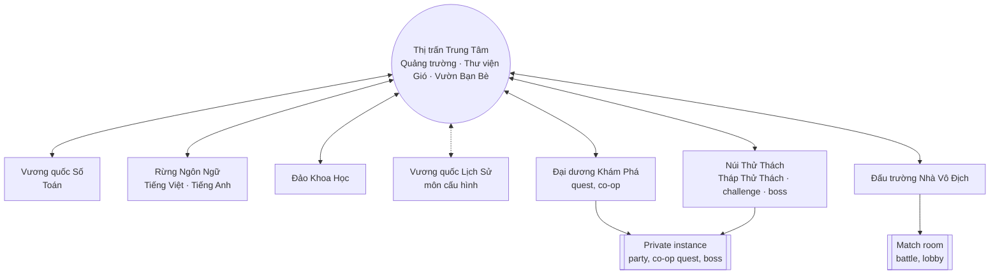

# World Design — Thế giới, vùng đất, khám phá

> Trạng thái: Draft · Phiên bản: 0.3 · Owner: Game Director · Cập nhật: 2026-11-25 (ADR-0103: art direction "Chibi anime cartoon 3D", Cây Tia Sáng 5 cấp — F068) · 2026-11-21 (ADR-0095: bỏ lớp, theo khối) · 2026-11-15
> Liên quan: [GAME_DESIGN](GAME_DESIGN.md) · [QUEST_SYSTEM](QUEST_SYSTEM.md) · [PROGRESSION_SYSTEM](PROGRESSION_SYSTEM.md) · [INVENTORY_ECONOMY](INVENTORY_ECONOMY.md) · [WORLD_RENDERING](../08-game-client/WORLD_RENDERING.md) · [MULTIPLAYER_GAMEPLAY](../03-social-multiplayer/MULTIPLAYER_GAMEPLAY.md) · [DESIGN_SYSTEM](../05-ux/DESIGN_SYSTEM.md) · [ADR-0012](../adr/ADR-0012-the-gioi-game-hybrid-hub-instance-private-instance-match-roo.md) · [ADR-0013](../adr/ADR-0013-nen-tang-client-release-1-0-gom-windows-android-ios-web.md) · OQ-05, OQ-16

**Mục lục:** 1. Mục đích và phạm vi · 2. Thế giới và cốt truyện · 3. Bản đồ vùng đất · 4. Chi tiết từng vùng · 5. Cấu trúc kỹ thuật–nội dung của thế giới · 6. Di chuyển, cổng, spawn · 7. Mở khóa và gating · 8. Khám phá và hoàn thành bản đồ · 9. Capacity và instance · 10. World event · 11. Art direction · 12. Dữ liệu, API, event, lỗi · 13. Mở rộng · 14. Acceptance criteria

## 1. Mục đích và phạm vi

Tài liệu là nguồn duy nhất cho **thiết kế thế giới**: bối cảnh, cốt truyện, vùng đất, NPC chính, cách di chuyển, điều kiện mở vùng, khám phá, sức chứa và sự kiện thế giới. Kỹ thuật dựng scene, streaming, LOD, bundle, ngân sách hiệu năng: [WORLD_RENDERING](../08-game-client/WORLD_RENDERING.md). XP/level: [PROGRESSION_SYSTEM](PROGRESSION_SYSTEM.md).

Thế giới phải khiến học sinh **muốn đi khám phá**: mỗi vùng có câu chuyện, nhân vật, bí mật, vật sưu tầm; việc học là cách giải quyết vấn đề trong thế giới, không phải menu chọn bài.

## 2. Thế giới và cốt truyện

### 2.1. Bối cảnh (nguyên bản) [Confirmed — người duyệt 2026-11-15, ADR-0056]

**EduWorld — Quần đảo Tri Thức** (*EduWorld — The Knowledge Archipelago*): chuỗi vùng đất nổi đã "mất màu" vì các **Tia Sáng** (*Knowledge Sparks*) bị phân tán. Người chơi là **Nhà Thám Hiểm** (*Explorer*) trẻ, cùng hướng dẫn viên **Mây** đi khắp các vùng, giúp cư dân giải quyết vấn đề bằng kiến thức. Mỗi khi học sinh nắm vững một mục tiêu học tập, một phần vùng đất được tô màu lại.

- Không có kẻ thù bạo lực, không vũ khí [Confirmed — Master Prompt §3.1]. "Đối thủ" là câu đố, vấn đề của NPC, boss "mất năng lượng" (không phải "máu", [CHALLENGE_BOSS_SYSTEM](CHALLENGE_BOSS_SYSTEM.md)).
- Thế giới phản ánh **mastery**, không phản ánh thời gian chơi: vùng đổi màu theo `objective_mastery` [Confirmed].

### 2.2. Mạch truyện chính [Confirmed — người duyệt 2026-11-15, ADR-0056]

Mạch truyện "**Thắp lại Tia Sáng**" (*Rekindle the Sparks*) gồm các **chương** (`story_chapter`), mỗi chương gắn một vùng, kể bằng chuỗi `main` quest ([QUEST_SYSTEM](QUEST_SYSTEM.md)). Tên chương và boss là `i18nText` song ngữ (bảng tên chuẩn ở §2.4):

| Chương (vi · en) | Vùng | Nội dung | Boss (vi · en) | Mở khi |
|---|---|---|---|---|
| 0. Lời mời · *The Invitation* | Thị trấn Trung Tâm | Gặp Mây, tạo nhân vật, học cách di chuyển, nhận quest đầu | — | Lần đầu vào game |
| 1. Vương quốc Số · *The Number Kingdom* | Vương quốc Số | Giúp cư dân sửa cầu, chia hàng | Rồng Phân Số · *Fraction Dragon* | Sau chương 0 |
| 2. Rừng Ngôn Ngữ · *The Language Forest* | Rừng Ngôn Ngữ | Tìm lại chữ bị lạc, đọc thư cổ | Bóng Ma Chính Tả · *Spelling Phantom* | Sau chương 0 |
| 3. Đảo Khoa Học · *Science Island* | Đảo Khoa Học | Phòng thí nghiệm, vòng đời sinh vật, thời tiết | Người Khổng Lồ Bão Tố · *Storm Giant* | Sau chương 0 |
| 4. Vương quốc Lịch Sử · *The History Kingdom* | Vương quốc Lịch Sử | Thư viện cổ, bản đồ cổ (môn Lịch sử & Địa lý, khi trường bật) | Người Gác Đồng Hồ Cát · *Hourglass Keeper* | Sau chương 0, môn được bật |
| 5. Đại dương Khám Phá · *The Discovery Ocean* | Đại dương Khám Phá | Hành trình liên môn, bí mật, vật sưu tầm hiếm | Bạch Tuộc Câu Đố · *Riddle Octopus* | Hoàn thành ≥ 1 chương môn học |
| 6. Núi Thử Thách · *Challenge Mountain* | Núi Thử Thách | Challenge, boss tổng hợp, Tháp Thử Thách (ôn thi) | Tinh Thể Tri Thức · *Crystal of Knowledge* | Hoàn thành ≥ 2 chương môn học |

Tên boss chương 3–6 bổ sung khi chốt song ngữ; nội dung chi tiết boss: [CHALLENGE_BOSS_SYSTEM](CHALLENGE_BOSS_SYSTEM.md).

- Các chương môn học (1–4) mở **song song** sau chương 0 — học sinh không bị khóa môn học sau một chuỗi truyện [Confirmed: không khóa học tập].
- Nội dung câu hỏi trong mỗi chương theo khối lớp của học sinh; cùng cốt truyện, khác nội dung theo khối.
- Mỗi chương có kết thúc rõ (cutscene ngắn + vùng đất đổi màu hoàn toàn) — điểm dừng tự nhiên.

### 2.3. NPC chính [Confirmed — người duyệt 2026-11-15, ADR-0056]

| NPC (vi · en) | `npc_id` | Vai trò | Vùng |
|---|---|---|---|
| **Mây** · *Cloudy* | `npc.cloudy` | Hướng dẫn, tutorial, gợi ý hoạt động tiếp theo, nhắc nghỉ | Mọi nơi (đi theo người chơi khi cần) |
| **Bưu tá Nhím** · *Postie the Hedgehog* | `npc.postie` | Thông báo, bài nhà trường giao | Thị trấn Trung Tâm |
| **Thợ may Bông** · *Cotton the Tailor* | `npc.cotton` | Tủ đồ, Shop Xu | Thị trấn Trung Tâm |
| **Thủ thư Gió** · *Breeze the Librarian* | `npc.breeze` | Gợi ý luyện tập theo LO yếu | Thư viện Gió (Thị trấn Trung Tâm) |
| **Chú Ong Kết Nối** · *Buzzy the Connector* | `npc.buzzy` | Hướng dẫn kết bạn an toàn, lập party | Vườn Bạn Bè (Thị trấn Trung Tâm) |
| **Ông Số** · *Mr. Numbers* | `npc.mr_numbers` | Giao quest Toán | Vương quốc Số |
| **Bà Chữ** · *Mrs. Letters* | `npc.mrs_letters` | Giao quest Tiếng Việt | Rừng Ngôn Ngữ |
| **Robo Ben** · *Robo Ben* | `npc.robo_ben` | Giao quest Tiếng Anh | Rừng Ngôn Ngữ |
| **Tiến sĩ Lá** · *Dr. Leaf* | `npc.dr_leaf` | Giao quest Khoa học | Đảo Khoa Học |
| **Cụ Sử** · *Grandpa Chronicle* | `npc.grandpa_chronicle` | Giao quest Lịch sử & Địa lý | Vương quốc Lịch Sử |
| **Giám khảo Đá** · *Judge Stone* | `npc.judge_stone` | Quy chế ôn thi, thời gian | Tháp Thử Thách (Núi Thử Thách) |
| **Trọng tài Sấm** · *Referee Thunder* | `npc.referee_thunder` | Ghép trận | Đấu trường Nhà Vô Địch |
| **Bà Lịch** · *Madam Calendar* | `npc.madam_calendar` | Lịch giải đấu, sự kiện | Đấu trường Nhà Vô Địch |

`npc_id` ổn định; tên hiển thị là `i18nText` trong dữ liệu NPC. NPC dialogue là dữ liệu CMS (`npc-dialogue.schema.json`), phiên bản hóa (ADR-0043). NPC chỉ chạy cục bộ trên client; hành động nghiệp vụ (giao quest) đi qua server.

### 2.4. Tên song ngữ và quy tắc hiển thị [Confirmed — ADR-0056]

Mọi tên riêng của thế giới là `i18nText` `{vi, en}` bắt buộc đủ hai ngôn ngữ trước khi publish ([CONTENT_MODEL §8](../02-learning/CONTENT_MODEL.md#8-ngôn-ngữ-nội-dung-và-bản-dịch-adr-0056)). Bảng tên địa danh phụ:

| Tên `vi-VN` | Tên `en-US` | Thuộc |
|---|---|---|
| Quảng trường Tia Sáng | Spark Square | Thị trấn Trung Tâm (`main_hub`) |
| Thư viện Gió | Breeze Library | Thị trấn Trung Tâm (`practice_zone`) |
| Vườn Bạn Bè | Friendship Garden | Thị trấn Trung Tâm (`social_zone`) |
| Tháp Thử Thách | Trial Tower | Núi Thử Thách (`exam_zone`) |
| Cổng gió | Wind Gate | Dịch chuyển giữa vùng (§6) |
| Tia Sáng | Knowledge Spark | Vật phẩm cốt truyện |

Quy tắc hiển thị:
- **Ngôn ngữ đơn (mặc định):** hiển thị theo ngôn ngữ người chơi chọn; `area_id`/`npc_id`/`chapter_id` không đổi theo ngôn ngữ.
- **Hiển thị song song** (Cài đặt → "Hiện tên song ngữ", mặc định **bật** khi đang ở Rừng Ngôn Ngữ khu Tiếng Anh, tắt ở nơi khác [Confirmed]): tên riêng và từ vựng chủ chốt hiển thị dạng `Vương quốc Số · Math Kingdom` (ngôn ngữ đang chọn đứng trước, ngôn ngữ còn lại chữ nhỏ, nghiêng). Không áp dụng cho câu hội thoại dài và đề bài.
- **Lồng tiếng/voice-over** NPC (nếu có) theo ngôn ngữ đã chọn; chưa có bản ghi thì hiển thị phụ đề, không đọc ngôn ngữ khác.
- Thiếu bản dịch ở client (dữ liệu cũ): rơi về `vi`, ghi telemetry `i18n.missing_key` (không hiển thị khóa thô cho học sinh).

## 3. Bản đồ vùng đất

Bộ tên vùng **[Confirmed — người duyệt 2026-11-15, ADR-0056]**, dựa trên gợi ý của Master Prompt re-architecture §5.1 và bao trọn 7 khu chức năng A–G bắt buộc của Master Prompt gốc §3.2 [Confirmed]. Tên tiếng Anh là tên hiển thị chính thức khi người chơi chọn `en-US`:

| Vùng — tên `vi-VN` | Tên `en-US` | Khu chức năng A–G chứa trong vùng | `area_id` kỹ thuật |
|---|---|---|---|
| **Thị trấn Trung Tâm** | EduWorld Central | A. Main Hub (Quảng trường Tia Sáng), C. Practice Zone (Thư viện Gió), F. Social Zone (Vườn Bạn Bè) | `main_hub`, `practice_zone`, `social_zone` |
| **Vương quốc Số** | Math Kingdom | B. Learning Zone — Toán | `learning_zone.math` |
| **Rừng Ngôn Ngữ** | Language Forest | B. Learning Zone — Tiếng Việt, Tiếng Anh (hai khu rừng) | `learning_zone.vietnamese`, `learning_zone.english` |
| **Đảo Khoa Học** | Science Island | B. Learning Zone — Khoa học | `learning_zone.science` |
| **Vương quốc Lịch Sử** | History Kingdom | B. Learning Zone — Lịch sử & Địa lý (môn cấu hình) | `learning_zone.history` |
| **Đại dương Khám Phá** | Discovery Ocean | G. Quest Zone (khám phá, nhiều bước, co-op) | `quest_zone.discovery_ocean` |
| **Núi Thử Thách** | Challenge Mountain | D. Exam Zone (Tháp Thử Thách), challenge/boss tổng hợp | `exam_zone`, `challenge_mountain` |
| **Đấu trường Nhà Vô Địch** | Champion Arena | E. Competition Arena | `arena` |

`area_id` kỹ thuật giữ ổn định (đã dùng ở DOMAIN_MODEL, WORLD_RENDERING, API); tên hiển thị và vị trí trên bản đồ là dữ liệu cấu hình, đổi không cần build lại client.

## 4. Chi tiết từng vùng

### 4.1. Thị trấn Trung Tâm (A, C, F)

| Mục | Nội dung |
|---|---|
| Mục đích | Điểm vào thế giới, định hướng, gặp bạn, luyện tập tự chọn, tùy biến nhân vật |
| Điểm nhấn | **Quảng trường Tia Sáng**: bảng nhiệm vụ, bảng tin trường, cổng gió đi các vùng, Cây Tia Sáng lớn lên theo tổng mastery của **khối trong trường** (hợp tác, không xếp hạng cá nhân, không tên — ADR-0095). **Thư viện Gió** (Practice Zone): bàn học cá nhân, góc học cùng nhau, luyện theo chủ đề/mức/LO, ôn câu sai. **Vườn Bạn Bè** (Social Zone): danh sách bạn, lập party, emote, mini-game vui chơi nhẹ, góc club |
| Hoạt động | Nhận daily/weekly quest, bài được giao, tủ đồ, Shop Xu, bảng xếp hạng (cá nhân trường/khối; khối 1–3 xem mục tiêu tập thể `grade_goal`), lập party |
| An toàn | Mọi tương tác xã hội theo ADR-0020/ADR-0054 và [CHILD_SAFETY](../10-security/CHILD_SAFETY.md) |
| Hình ảnh ([F094](../../specs/094-art-pass-4-remaining-zones/spec.md)) [Proposed — set piece; owner duyệt qua ảnh] | **Thư viện Gió**: thư viện gió tường vàng mái ngói có chong chóng gió, trạm luyện tập (bảng đá, bục sách), góc học cùng nhau (bàn tròn, ô che), dãy bàn học cá nhân, vòm sách trên lối chính. **Vườn Bạn Bè**: nhà tổ ong của Chú Ong Kết Nối, chậu hạt giống hoa hướng dương, vòm hoa trái tim, sân chơi (xích đu, bập bênh), chỗ picnic, góc club (ba mái che có cờ). Mọi vùng có biển chỉ đường biểu tượng hình gần điểm spawn (cổng gió về Thị trấn = ngôi nhà) và vòng sáng quanh điểm tương tác |

### 4.2. Các vùng môn học (B)

| Mục | Nội dung |
|---|---|
| Mục đích | Học bài mới theo chương trình và phiêu lưu theo chương truyện của môn |
| Cấu trúc | Mỗi vùng có các **trạm** theo Topic của khối học sinh; trạm hiển thị trạng thái mastery bằng màu (xám → nhạt → đầy màu) và biểu tượng (không chỉ dùng màu) |
| Hoạt động | Bài học (video, hình, tương tác, mô phỏng — [ACTIVITY_ENGINE](../02-learning/ACTIVITY_ENGINE.md)), mini-game gắn LO, learning/main/side quest, boss của vùng, điểm khám phá, vật sưu tầm |
| Data-driven | Danh sách trạm sinh từ curriculum version + môn được trường bật; môn mới dùng prefab vùng chung + cấu hình |
| Hình ảnh (art pass 3, [F093](../../specs/093-art-pass-3-subject-zones/spec.md)) | Prefab vùng chung: quảng trường tròn quanh NPC môn học, lối chính spawn → vật sưu tầm → cổng gió về Thị trấn (biểu tượng ngôi nhà), lối ngang tới hai điểm khám phá, landmark sau cổng gió. Set piece [Proposed]: **Vương quốc Số** — lâu đài ngói men xanh, cầu Số trên suối, giếng làng, cổng Bàn Tính, sạp trái cây, cọn nước; **Rừng Ngôn Ngữ** — khu Tiếng Việt: Khuê Văn Các, bia đá trên lưng rùa, Cây Chữ lá thu, bút lông và cuộn giấy, giếng Thiên Quang; khu Tiếng Anh: tháp đồng hồ, xưởng robot của Robo Ben, Hang Vọng, cổng Bánh Răng, cây bằng lăng; **Đảo Khoa Học** — đảo giữa biển, nhà kính, trạm thời tiết, hồ thủy triều, cổng Hóa Thạch, hàng chậu vòng đời cây; **Vương quốc Lịch Sử** — cổng thành lầu Ngũ Phụng, trống đồng Đông Sơn, đình bản đồ cổ, cổng Đồng Xu, chùa Một Cột, đồng hồ cát. Không chữ hay nội dung học tập trong scene |

### 4.3. Đại dương Khám Phá (G)

Vùng phiêu lưu: các đảo nhỏ, hang động, xác tàu cổ (hình ảnh F094 [Proposed]: đảo cát giữa biển, hải đăng sọc đỏ trắng, xác tàu gỗ có rương — không đại bác, hang san hô, vòm vỏ sò, tượng Bạch Tuộc Câu Đố hiền, thuyền thúng); quest khám phá nhiều bước, liên môn, secret quest, vật sưu tầm hiếm. Quest co-op mở `private_instance` cho party. NPC theo chủ đề cấu hình qua `npc_dialogue` (ví dụ Bác Thợ Cầu cần tính độ dài để sửa cầu; Cô Bé Hoa cần ghép từ thành câu).

### 4.4. Núi Thử Thách (D + challenge)

| Mục | Nội dung |
|---|---|
| Tháp Thử Thách (Exam Zone) | Practice Test, Mock Exam, Chapter/Semester/Subject Test, Custom Assessment, Timed Exam ([EXAM_ENGINE](../02-learning/EXAM_ENGINE.md)). Vào phòng thi: UI tối giản, ẩn người chơi khác, khung chat ẩn trong khi làm bài (tin nhắn xem lại sau khi nộp). Sau khi nộp: phòng "Gương Phản Chiếu" phân tích câu sai + gợi ý ôn |
| Sườn núi | Challenge các loại và boss tổng hợp nhiều LO ([CHALLENGE_BOSS_SYSTEM](CHALLENGE_BOSS_SYSTEM.md)) |
| Hình ảnh ([F094](../../specs/094-art-pass-4-remaining-zones/spec.md)) [Proposed — set piece] | **Núi Thử Thách**: đỉnh núi đá có Tinh Thể Tri Thức lơ lửng trong vòng sáng, núi tuyết xa, đài ngắm cảnh có ống nhòm, cụm tinh thể, vòng thử thách bằng đá có trụ tinh thể, thông, ụ đá xếp. **Tháp Thử Thách**: yên tĩnh, tập trung — tháp bốn tầng mái ngói men xanh dịu, bảng kỳ thi (mặt đồng hồ, lịch trống), hồ Gương Phản Chiếu, vườn sỏi cào, đình học; không màu đỏ/cam rực |
| Instance | Sảnh: `hub_instance`; phòng thi: màn hình đơn người (không realtime); boss party: `private_instance` |

### 4.5. Đấu trường Nhà Vô Địch (E)

Sảnh có bảng xếp hạng 3D (chỉ nickname), xếp hàng 1v1/Team Battle/Timed Quiz/Co-op Challenge, đăng ký tournament, lịch sử trận. Trận diễn ra trong `battle` room riêng (sân khấu trả lời câu hỏi). Hình ảnh sảnh ([F094](../../specs/094-art-pass-4-remaining-zones/spec.md), [Proposed — set piece]): lễ hội, thân thiện, không vũ khí — sân vận động tròn mái bạt sọc màu có ngôi sao, bốn cổng xếp hàng có biểu tượng hình (1v1, đội, tính giờ, co-op), bảng lịch giải đấu, bục vinh danh 1-2-3 với bảng ô trống (không tên trong scene), tượng cúp, quầy lễ hội, bóng bay, dây cờ. Luật thi đấu: [COMPETITION_SYSTEM](COMPETITION_SYSTEM.md).

## 5. Cấu trúc thế giới

| Cấp | Khái niệm | Ví dụ |
|---|---|---|
| World | Toàn bộ Quần đảo Tri Thức | — |
| Region (vùng) | Nhóm khu theo bảng §3 | Thị trấn Trung Tâm |
| Area (`WorldArea`) | Một scene tải trọn gói, có `area_id`, `scene_ref`, `capacity`, `access_policy`, `unlock_rule` | `practice_zone` |
| Instance (room) | Bản sao của area chứa một nhóm người chơi giới hạn | `hub_instance` #12 của `main_hub` |
| Điểm neo trong area | Spawn point, interactable (NPC, cổng, vật quest, điểm khám phá, vật sưu tầm) có ID ổn định | `main_hub.default`, `discovery.math.old_well` |

Level designer đặt điểm neo trong scene; nhà thiết kế nội dung gắn quest/khám phá trong CMS qua ID, không sửa scene ([WORLD_RENDERING](../08-game-client/WORLD_RENDERING.md) §5).

## 6. Di chuyển, cổng, spawn

| Quy tắc | Chi tiết | Nhãn |
|---|---|---|
| Spawn | Lần đầu: Quảng trường Tia Sáng (sau tạo nhân vật, [CHARACTER_SYSTEM](CHARACTER_SYSTEM.md)); lần sau: `game_profile.last_area` nếu là khu công khai, ngược lại về Quảng trường | [Confirmed] |
| Cổng gió (teleport) | Mỗi vùng có cổng về Thị trấn; cổng giữa các vùng mở khi đã mở cả hai vùng | [Confirmed] |
| Bản đồ thế giới | Màn hình World Map: vùng đã mở/chưa mở (kèm điều kiện), % khám phá từng vùng, fast travel tới cổng đã kích hoạt | [Confirmed] |
| Về nhà nhanh | Nút "Về Quảng trường" trên HUD, ≤ 1 thao tác từ mọi khu | [Confirmed] |
| Theo độ tuổi | Lớp 1–3: dịch chuyển bằng bảng chọn hình (không bắt đi bộ xa), tap-to-move; lớp 6–9: đi bộ khám phá tự do | [Confirmed] |
| Thời gian chuyển khu | Theo [PERFORMANCE_BUDGET](../08-game-client/PERFORMANCE_BUDGET.md) §11 (hạng Tầm trung) | [Confirmed] ADR-0057 |

## 7. Mở khóa và gating

### 7.1. Nguyên tắc

| Quy tắc | Nhãn |
|---|---|
| **Vùng/khu học tập theo khối và môn của học sinh luôn mở** — không khóa học tập sau level, tiền tệ hay chuỗi truyện | [Confirmed — Master Prompt re-architecture §9] |
| Không có cơ chế trả tiền để mở vùng | [Confirmed] |
| Học sinh chỉ thấy trạm/quest phù hợp `grade_level` (có thể mở nội dung khối dưới để ôn) | [Confirmed] |
| Môn/vùng có thể bị trường tắt (`school.settings`) | [Confirmed] |
| Tháp Thử Thách chính thức chỉ mở trong cửa sổ `exam_session` | [Confirmed — Master Prompt §4.5] |
| Mở khóa do server quyết định; client chỉ ẩn cổng khi chưa mở | [Confirmed — ADR-0016] |

### 7.2. Điều kiện mở khóa (`WorldArea.unlock_rule`)

Cấu hình AND/OR các điều kiện, dùng cho vùng phiêu lưu, khu phụ, khu trang trí:

| Điều kiện | Ví dụ | Ghi chú |
|---|---|---|
| `quest_completed` | Hoàn thành main quest chương 0 | Thường dùng nhất |
| `chapters_completed` | ≥ 2 chương môn học (Núi Thử Thách) | |
| `objective_progress` | ≥ 3 LO của chủ đề đạt `developing` | Đọc projection mastery (`ref.mastery_summary`) |
| `min_level` | Level ≥ 10 cho khu trang trí | Không dùng cho khu học tập |
| `achievement_unlocked` | Có huy hiệu "Nhà khám phá biển" | |
| `event_participation` | Đã tham gia một sự kiện (khu trang trí lễ hội) | [EVENT_SEASON_SYSTEM](EVENT_SEASON_SYSTEM.md); không dùng cho khu học tập |

Vào area chưa mở → `403 AREA_LOCKED` kèm điều kiện còn thiếu (thông điệp thân thiện). Mở khóa phát event `world.area_unlocked`, client hiển thị hiệu ứng.

## 8. Khám phá và hoàn thành bản đồ

| Thành phần | Mô tả | Xác minh server |
|---|---|---|
| **Discovery point** | Địa điểm ẩn/đặc biệt (`interactable` loại `discovery`) | Báo `:discover` kèm `area_id` + `interactable_id`; server kiểm tra người chơi đang ở instance của area và ID hợp lệ trong level version đã ghim |
| **World collectible** | Vật thu thập (vỏ sò, trang sách cổ…) thuộc collection ([INVENTORY_ECONOMY](INVENTORY_ECONOMY.md) §6) | Như trên, mỗi vật một lần/học sinh |
| **Secret quest** | Quest ẩn mở khi tìm đủ discovery point (`start_trigger.kind = discovery`) | [QUEST_SYSTEM](QUEST_SYSTEM.md) |
| **Map completion** | % = (discovery + collectible + quest khu vực hoàn thành) / tổng cấu hình của area | `exploration_progress` |
| **Story chapter** | Chuỗi main quest theo vùng | `story_chapters` cấu hình, tiến độ suy từ quest |
| **Thành tựu khu vực** | Ví dụ "Khám phá 100% Vương quốc Số" | [INVENTORY_ECONOMY](INVENTORY_ECONOMY.md) §7 |

XP cho khám phá (`exploration.discovery`, `exploration.area_completed`) theo catalog ở [PROGRESSION_SYSTEM](PROGRESSION_SYSTEM.md) §3.1. Giới hạn báo khám phá: 30 lần/phút/học sinh [Confirmed]. Khi room host của hub (F091) biết vị trí học sinh trong cùng area, server còn kiểm khoảng cách tới điểm neo: bán kính `interact_radius_m` của điểm (mặc định `interact_radius_default` = 3 m) cộng dung sai lấy mẫu `interact_distance_tolerance` = 1,5 m [Confirmed — F071].

## 9. Capacity và instance (ADR-0012)

| Loại | `room_type` | Sức chứa | Ghép người | Vòng đời |
|---|---|---|---|---|
| Khu công khai | `hub_instance` | 40 [Confirmed] | Cùng trường + grade band (mặc định không trộn trường); ưu tiên bạn bè và party cùng instance | Tạo khi cần, đóng khi rỗng 5 phút |
| Party/co-op/boss | `private_instance` | = số thành viên party (≤ 8) | Chỉ thành viên party | Theo party activity |
| Trận đấu | `battle` | 2 (1v1) – 8 (4v4) | Matchmaking | Theo trận |
| Phòng chờ | `lobby` | Theo mode | Matchmaking/party | Đến khi trận bắt đầu |

Trộn liên trường chỉ theo [ADR-0054](../adr/ADR-0054-tuong-tac-xa-hoi-lien-truong-cross-school-social-interaction.md). Reconnect/grace theo [MULTIPLAYER_GAMEPLAY](../03-social-multiplayer/MULTIPLAYER_GAMEPLAY.md).

## 10. World event

Sự kiện thế giới là sự kiện live-ops loại `world_festival` (lễ hội Trung thu, Tết…), `learning_campaign` ("Tuần lễ Khoa học"), `community_goal` (thử thách toàn trường). Về mặt thế giới, sự kiện đổi **environment preset** và nạp **gói trang trí** cho các vùng được chọn (mỗi vùng tối đa một bộ trang trí cùng lúc), thêm NPC lễ hội và quest/challenge sự kiện; mốc community goal có thể đổi trang trí cho cả trường. Loại sự kiện, vòng đời, phần thưởng, community goal, season track và Event Builder: [EVENT_SEASON_SYSTEM](EVENT_SEASON_SYSTEM.md) (nguồn duy nhất).

## 11. Art direction

| Khía cạnh | Hướng | Nhãn |
|---|---|---|
| Phong cách | **Chibi anime cartoon 3D** ([ADR-0103](../adr/ADR-0103-art-direction-chibi-anime-cartoon-3d-thay-stylized-low-poly.md), thay stylized low-poly của Master Prompt §3.1/OQ-16): hình khối thế giới và đạo cụ tròn, mềm, vát cạnh, đổ bóng mượt, màu tươi không chói (Stylized 3D Cartoon); nhân vật tỉ lệ chibi (3D Chibi); cel shading phân dải rõ + viền mực, mắt to có điểm sáng, tóc lọn, má hồng (Stylized Anime 3D); chuyển động thở/đi/chạy nhún/nhảy/vẫy/ăn mừng có squash & stretch và biểu cảm mặt (3D Animated Cartoon). Không tỉ lệ anime người thật (chân dài, cao). Ánh sáng ấm, không bạo lực | [Confirmed — owner 2026-11-25] |
| Nhân vật | Tỉ lệ chibi (đầu khoảng 1/2–1/3 chiều cao), biểu cảm rõ, không vũ khí; tỉ lệ, khuôn mặt, biểu cảm, rig và clip: [CHARACTER_SYSTEM §4.1](CHARACTER_SYSTEM.md#41-rig-kid_base-clip-và-biểu-cảm) | [Confirmed — ADR-0103] |
| Văn hóa | Cảm hứng Việt Nam (mái ngói, cây đa, ruộng bậc thang, thuyền thúng) trộn kỳ ảo; tránh khuôn mẫu | [Confirmed] |
| Màu theo môn/vùng | Toán xanh dương, Tiếng Việt cam, Tiếng Anh tím, Khoa học xanh lá, Lịch sử nâu đỏ; là **mã màu nghiệp vụ dùng chung** (`design/shared-tokens/`) để game và portal cùng màu (ADR-0047) | [Confirmed] |
| Mastery visualization | Đất xám → có màu → nở hoa/cây lớn theo `beginning/developing/proficient/mastered`. **Cây Tia Sáng** của Quảng trường có 5 cấp hình: 0 cây non xám (`not_started`), 1 cây non xanh (`beginning`), 2 cây đa đang lớn có vài tia sáng (`developing`), 3 cây đa đầy đủ rễ phụ và quả tia sáng (`proficient`), 4 cây đa nở hoa, nhiều tia sáng (`mastered`); cấp = trung bình các mức `MasteryLevel` làm tròn; chưa có dữ liệu → cấp 3 [Proposed — Câu hỏi mở F068-1: chưa có API tổng mastery của khối trong trường]. Chỉ hiển thị (client `SparkTreeModel`), không luật phía server | [Confirmed] · cấp mặc định [Proposed] |
| Trợ năng | Không chỉ dùng màu (thêm biểu tượng); chế độ tương phản cao | [Confirmed] |
| Ngân sách hiệu năng | Theo [PERFORMANCE_BUDGET](../08-game-client/PERFORMANCE_BUDGET.md) (nơi sở hữu, máy tầm trung — ADR-0057); áp dụng trong pipeline dựng ở [WORLD_RENDERING](../08-game-client/WORLD_RENDERING.md) §6 | — |
| Nguồn asset | Chỉ license MIT, CC0 hoặc public domain; asset tự làm phát hành MIT; cấm share-alike, non-commercial, GPL, pack trả phí — [ADR-0102](../adr/ADR-0102-nguon-asset-do-hoa-theo-license-mit-hoac-de-dai-hon.md) (thay phần nguồn asset của OQ-16; phong cách thay bởi ADR-0103, license không đổi). Lượt đầu: Main Hub + nhân vật chibi tự làm bằng code ([F067](../../specs/067-art-pass-hub-chibi/spec.md)); art pass 2 theo hướng Chibi anime cartoon 3D: [F068](../../specs/068-art-pass-2-chibi-anime/spec.md); năm vùng môn học: [F093](../../specs/093-art-pass-3-subject-zones/spec.md); sáu vùng còn lại: [F094](../../specs/094-art-pass-4-remaining-zones/spec.md) | [Confirmed — owner 2026-11-24] |
| Design system | Màu, font, UI, toon/outline, ánh sáng, VFX từ game design system ([DESIGN_SYSTEM](../05-ux/DESIGN_SYSTEM.md) §5) | [Confirmed — ADR-0047] |

## 12. Dữ liệu, API, event, lỗi

**Dữ liệu (module game, `eduworld_game`):**

| Bảng | Cột chính |
|---|---|
| `world_areas`, `world_area_versions` | `area_id`, `region_code`, `display_name`, `scene_ref`, `capacity`, `access_policy`, `unlock_rule jsonb` |
| `story_chapters` | `chapter_code`, `region_code`, `main_quest_ids[]`, `order` |
| `world_area_unlocks` | `student_id`, `area_id`, `unlocked_at`, `rule_version` — UNIQUE `(student_id, area_id)` |
| `exploration_progress` | `student_id`, `area_id`, `discoveries varchar(64)[]`, `collectibles varchar(64)[]`, `completion_pct`, `updated_at` |

DDL: [DATABASE_DESIGN](../07-backend/DATABASE_DESIGN.md) §2.8a.

**API (module game):**

| Method | Path | Mô tả |
|---|---|---|
| GET | `/api/v1/game/world/manifest` | Danh sách area, version, bundle (content manifest) |
| GET | `/api/v1/game/world/areas` | Area học sinh thấy, trạng thái mở khóa |
| POST | `/api/v1/game/world/areas/{area_id}:enter` | Xin vào area, nhận instance + spawn (`403 AREA_LOCKED` nếu chưa mở) |
| GET | `/api/v1/game/world/exploration` | Tiến độ khám phá từng area, chương truyện, điều kiện mở vùng tiếp |
| POST | `/api/v1/game/world/areas/{area_id}/discoveries/{interactable_id}:discover` | Báo tìm thấy điểm khám phá/vật sưu tầm (`Idempotency-Key`) |

Cấu hình (platform-only): `/api/v1/game-admin/{world-areas|story-chapters|events|event-templates}`.

**Event:** `world.area_unlocked`, `world.discovery_found`, `world.area_completed`, `story.chapter_completed` (producer module game).

**Lỗi:** `403 AREA_LOCKED`, `409 DISCOVERY_ALREADY_FOUND`, `409 STEP_PRECONDITION_FAILED` (không ở đúng area/instance; HTTP status theo [API_DESIGN §4.1](../07-backend/API_DESIGN.md)), `429 RATE_LIMITED` (`discovery_report_rate`).

## 13. Mở rộng

- Thêm môn = cấu hình subject + gán prefab vùng chung; vùng đặc thù dùng level package mới trên CDN (không build lại client nếu chỉ là scene/asset).
- Thêm vùng = scene mới (bundle) + bản ghi `world_area` + cổng ở Thị trấn + chương truyện tùy chọn.

## 14. Acceptance criteria

| ID | Tiêu chí |
|---|---|
| AC-GAM-008 | Đạt điều kiện mở vùng → `world.area_unlocked`, vào được area; chưa đạt → `AREA_LOCKED` kèm điều kiện |
| AC-GAM-009 | Vùng/khu học tập theo khối/môn luôn vào được, không phụ thuộc level/tiền tệ/chương truyện |
| AC-GAM-010 | Báo khám phá khi không ở area đó bị từ chối; mỗi điểm khám phá chỉ tính một lần |
| AC-WLD-001 | Mọi khu chức năng A–G của Master Prompt gốc §3.2 có vị trí trong bản đồ vùng §3 |
| AC-WLD-002 | Chuyển vùng qua cổng gió hoàn tất trong thời gian của [PERFORMANCE_BUDGET](../08-game-client/PERFORMANCE_BUDGET.md) §11 trên thiết bị hạng Tầm trung (AC-PERF-005) |
| AC-WLD-003 | Mặc định hub instance không chứa học sinh của trường khác |
| AC-WLD-004 | World Map hiển thị đúng % khám phá từng vùng theo `exploration_progress` |

Test case: [TEST_STRATEGY](../12-project/TEST_STRATEGY.md) (TC-GAM-008…010).
