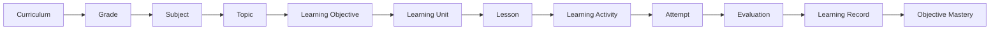
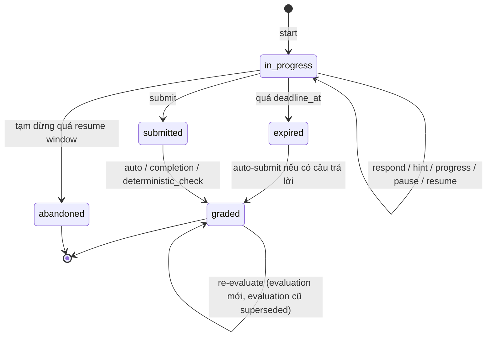
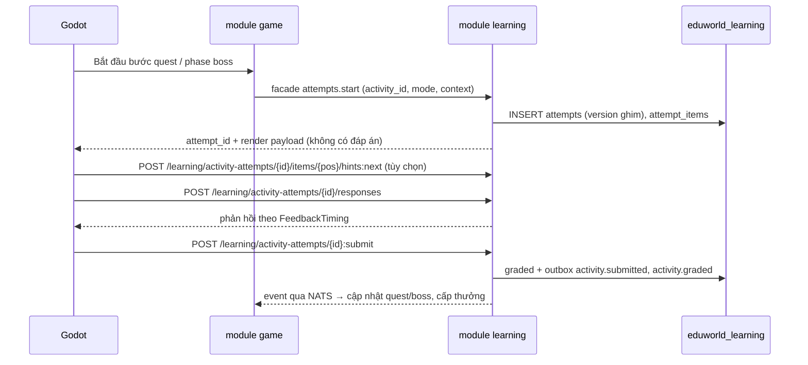

# Activity & Attempt Engine

> Trạng thái: Draft · Phiên bản: 0.4 · Owner: Backend Architect + EdTech Specialist · Cập nhật: 2026-11-16
> Liên quan: [ADR-0048](../adr/ADR-0048-learning-activity-registry-mo-rong-loai-hoat-dong-hoc-tap-kh.md) · [ADR-0072](../adr/ADR-0072-bo-vai-tro-giao-vien-hoc-sinh-tu-hoc-kiem-duyet-tap-trung.md) · [ADR-0016](../adr/ADR-0016-server-authoritative-scoring-answer-key-khong-bao-gio-roi-se.md) · [ADR-0043](../adr/ADR-0043-phat-hanh-noi-dung-draft-publish-con-tro-phien-ban-giu-phien.md) · [LEARNING_EXPERIENCE](LEARNING_EXPERIENCE.md) · [CONTENT_MODEL](CONTENT_MODEL.md) · [QUESTION_BANK](QUESTION_BANK.md) · [EXAM_ENGINE](EXAM_ENGINE.md) · [LEARNING_ANALYTICS](LEARNING_ANALYTICS.md) · [QUEST_SYSTEM](../01-game-design/QUEST_SYSTEM.md) · [CHALLENGE_BOSS_SYSTEM](../01-game-design/CHALLENGE_BOSS_SYSTEM.md) · [MINIGAME_ENGINE](../08-game-client/MINIGAME_ENGINE.md) · [SCHOOL_LMS](../04-admin-portal/SCHOOL_LMS.md) · [EVENT_DESIGN](../07-backend/EVENT_DESIGN.md)

> Tài liệu này **gộp Exercise Engine cũ** (vòng đời attempt, mode, resume, phản hồi, lưu dữ liệu) với Activity Registry (ADR-0048). Đây là nơi **duy nhất** mô tả: vòng đời attempt, chiến lược chấm chung, chính sách phản hồi (`FeedbackTiming`, `ResultRelease`), gợi ý trong attempt, cờ `rapid_guess` và resume. Các tài liệu theo loại (video, audio, mô phỏng) chỉ mô tả phần riêng của loại đó.

## 1. Mục đích và phạm vi

Trong EduWorld, học sinh không "vào màn làm bài". Họ gặp hoạt động học tập **bên trong trò chơi**: NPC giao nhiệm vụ, một bước quest, một đòn đánh boss, một mini-game, một thử thách ở Arena. Học sinh tự học; hệ thống tự chấm, tự phản hồi và tự gợi ý ôn tập; nhà trường giao bài và xem kết quả ([ADR-0072](../adr/ADR-0072-bo-vai-tro-giao-vien-hoc-sinh-tu-hoc-kiem-duyet-tap-trung.md)). Activity Engine là lõi phía module `learning` đứng sau mọi tình huống đó:

- **Registry** cho mọi loại hoạt động (quiz, bài tập tương tác, video, audio, mô phỏng, mini-game), cắm qua một interface chung.
- **Attempt engine**: bắt đầu, trả lời, xin gợi ý, tạm dừng, resume, nộp, chấm, phát bằng chứng học tập.

Quest, challenge/boss, assignment, exam, competition và analytics chỉ làm việc với interface này, không biết chi tiết từng loại.

| Trong phạm vi | Ngoài phạm vi (xem tài liệu khác) |
|---|---|
| Learning Activity, ActivityVersion, Attempt, Evaluation | Ngân hàng câu hỏi, answer key, chấm từng dạng câu ([QUESTION_BANK](QUESTION_BANK.md)) |
| Interface plugin, danh mục `activity_type` | Đề kiểm tra, ma trận đề, cửa sổ thi ([EXAM_ENGINE](EXAM_ENGINE.md)) |
| Vòng đời attempt, mode, resume, phản hồi, gợi ý, chấm chung | Version, publish, pinning ([CONTENT_MODEL](CONTENT_MODEL.md)) |
| Renderer registry (Godot), editor registry (portal) | Màn hình editor ([ADMIN_PORTAL](../04-admin-portal/ADMIN_PORTAL.md)) |
| Domain event của attempt | Mastery và báo cáo ([LEARNING_ANALYTICS](LEARNING_ANALYTICS.md)) |

**Stakeholder:** EdTech Specialist, Game Director (hoạt động gắn gameplay), Backend, Godot, portal, nhà trường (`school_admin`/`academic_manager` giao bài, xem kết quả), QA.

## 2. Chuỗi học tập



- [Confirmed] Các thực thể khác biệt về khái niệm, không gộp.
- **Learning Activity**: đơn vị học làm được (một quiz, một video có câu hỏi, một mô phỏng…). Lesson gồm nhiều activity; quest step, challenge, boss phase tham chiếu activity.
- **Attempt**: một lượt học sinh làm một activity version (version **ghim lúc start**, [CONTENT_MODEL §5.2](CONTENT_MODEL.md#52-version-pinning--học-sinh-đang-chơi-giữ-version-cũ)).
- **Evaluation**: kết quả chấm của attempt do hệ thống tạo. Có thể nhiều evaluation khi hệ thống chấm lại (re-evaluate) vì nội dung có lỗi; chỉ một evaluation **có hiệu lực**.
- **Learning Record**: bằng chứng học tập bất biến (learning event + đóng góp mastery).

## 3. Danh mục `activity_type`

Release chỉ gồm các loại **server tự chấm được** ([ADR-0072](../adr/ADR-0072-bo-vai-tro-giao-vien-hoc-sinh-tu-hoc-kiem-duyet-tap-trung.md) mục 3):

| `activity_type` | Mô tả | Chiến lược chấm mặc định | Tài liệu | Nhãn |
|---|---|---|---|---|
| `quiz` | Single/multiple choice, true/false, câu hỏi dựa trên hình, quiz tính giờ | `auto` | [QUESTION_BANK](QUESTION_BANK.md) | [Confirmed] |
| `interactive_exercise` | Điền khuyết, trả lời ngắn (tập đáp án đóng), kéo thả, nối, sắp xếp, nhập số, puzzle, tính toán tương tác | `auto` / `accepted_answers` / `rule` / `numeric_tolerance` | [QUESTION_BANK](QUESTION_BANK.md) | [Confirmed] |
| `video_lesson` | Video, chapter, phụ đề, câu hỏi chèn tự chấm, nhánh | `completion` + `auto` cho câu chèn | [VIDEO_LEARNING](VIDEO_LEARNING.md) | [Confirmed] |
| `audio_lesson` | Bài nghe, nghe hiểu, nghe chép (câu hỏi tự chấm) | `completion` + `auto` | [AUDIO_LANGUAGE_LEARNING](AUDIO_LANGUAGE_LEARNING.md) | [Confirmed] |
| `simulation` | Mô phỏng khoa học, vật lý, hình học 3D, phòng thí nghiệm ảo | `deterministic_check` + `auto` | [SIMULATION_ENGINE](SIMULATION_ENGINE.md) | [Confirmed] |
| `minigame` | Mini-game giáo dục dùng câu hỏi từ Question Bank | `auto` | [MINIGAME_ENGINE](../08-game-client/MINIGAME_ENGINE.md) | [Confirmed] |

**Ngoài version này (ADR-0072, ADR-0082):** `written_response`, `speaking` và `project` cần người chấm nên không có plugin, renderer hay editor và không được publish.

Mỗi loại có JSON Schema riêng trong `specs/schemas/activities/` (kế thừa [`activity-base.schema.json`](../../specs/schemas/activities/activity-base.schema.json)).

## 4. Learning Activity Definition

| Trường | Kiểu | Ghi chú |
|---|---|---|
| `activity_id` | UUIDv7 | Định danh ổn định qua các version |
| `activity_version_id`, `version` | UUIDv7, int | Bất biến sau publish |
| `activity_type` | enum §3 | Quyết định plugin xử lý |
| `content_language` | `vi` hoặc `en` | Ngôn ngữ gốc, bắt buộc; bản dịch tùy chọn ([CONTENT_MODEL §8](CONTENT_MODEL.md#8-ngôn-ngữ-nội-dung-và-bản-dịch-adr-0056)) |
| `title`, `description` | i18n, ≤ 255 / ≤ 1.000 ký tự | |
| `owner_scope`, `tenant_id` | `platform` (tenant_id null) hoặc `tenant` | ADR-0005/0029 |
| `grade_levels` | int[1..9] | |
| `subject_id`, `topic_id`, `objective_ids[]` | UUID | Ít nhất một LO [Confirmed] |
| `difficulty` | 1–5 | Ánh xạ sang Easy…Legendary ở [CHALLENGE_BOSS_SYSTEM](../01-game-design/CHALLENGE_BOSS_SYSTEM.md) |
| `instructions` | i18n, ≤ 2.000 | Kèm audio đọc hướng dẫn; bắt buộc với nhóm `g1_3` ([CONTENT_MODEL §8.1](CONTENT_MODEL.md#81-audio-đọc-đề-và-hướng-dẫn-cho-nhóm-g1_3-confirmed)) |
| `content`, `interaction` | object theo schema loại | Nội dung và cách tương tác |
| `evaluation` | object | Chiến lược chấm (§7), `max_score`, `pass_threshold` |
| `feedback_timing` | `FeedbackTiming` | `immediate`, `after_submit`, `after_close`, `never` — mặc định theo mode (§8.1) |
| `time_limit_seconds` | int? | Thời gian do server tính |
| `scoring`, `completion_rule` | object | "Hoàn thành" ≠ "đạt" |
| `reward_rule_id?` | UUID | Chỉ là gợi ý; module game quyết định cấp thưởng (ADR-0049) |
| `media_refs[]` | asset_id | ADR-0044 |
| `status`, `published_at`, `author_id`, `reviewer_id` | | Workflow ở [CONTENT_MODEL](CONTENT_MODEL.md) |

## 5. Interface plugin (Go)

```go
package activity

// Plugin là hợp đồng mỗi activity_type phải triển khai (ADR-0048).
type Plugin interface {
    Type() Type
    ConfigSchema() []byte
    ValidateConfig(ctx context.Context, v Version) error // khi lưu Draft và khi publish

    // Dữ liệu gửi client: KHÔNG có đáp án, phản hồi theo phương án, tham số kiểm chứng.
    BuildRenderPayload(ctx context.Context, v Version, a Attempt) (RenderPayload, error)
    Respond(ctx context.Context, v Version, a Attempt, r Response) (ResponseResult, error)
    Progress(ctx context.Context, v Version, a Attempt, e ProgressEvent) (ProgressState, error)
    Evaluate(ctx context.Context, v Version, a Attempt) (Evaluation, error) // luôn tự động, đồng bộ
    CompletionRule(v Version) CompletionRule
    EmitEvidence(ctx context.Context, v Version, a Attempt, ev Evaluation) ([]Evidence, error)
}

// Registry nạp lúc khởi động; thiếu plugin cho type đã có nội dung published → `core-api` báo module learning không ready.
type Registry interface {
    Register(p Plugin)
    Get(t Type) (Plugin, bool)
}
```

1. Plugin không truy cập DB của module khác; ghi qua repository của engine.
2. Mọi tính toán điểm, thời gian, hoàn thành chạy server-side (ADR-0016). Client chỉ gửi phản hồi thô và sự kiện tiến độ; `score`/`is_correct` từ client bị bỏ qua.
3. Write context ([ADR-0038](../adr/ADR-0038-cqrs-clean-architecture-trong-moi-service.md), [ADR-0087](../adr/ADR-0087-cqrs-tach-read-write-khong-mediator.md)): command handler `StartAttempt`, `SubmitResponse`, `RequestNextHint`, `ReportProgress`, `PauseAttempt`, `SubmitAttempt`, `CreateRegradeRequest`, mỗi handler gọi `authz.Require` ở đầu use case. Read context: query handler đọc read model, không gọi plugin chấm, không ghi DB.
4. Mỗi plugin chạy bộ test hợp đồng chung: render payload không lộ đáp án và phản hồi theo phương án, chấm idempotent, evidence đúng schema.

## 6. Attempt

### 6.1. Mode — hoạt động được gọi từ đâu trong game

`AttemptMode`: `practice, assignment, quest, minigame, challenge, exam, competition, retry_wrong, diagnostic`.

| `mode` | Ngữ cảnh trong game/lớp học | Ai khởi tạo | Đặc điểm |
|---|---|---|---|
| `quest` | Một bước quest NPC giao ([QUEST_SYSTEM](../01-game-design/QUEST_SYSTEM.md)) | Quest | `context_ref = {quest_progress_id, step_id}`; hoàn thành theo `completion_rule` của step |
| `challenge` | Challenge, boss phase ([CHALLENGE_BOSS_SYSTEM](../01-game-design/CHALLENGE_BOSS_SYSTEM.md)) | module game gọi internal API | `context_ref = {challenge_attempt_id | encounter_id, phase}` |
| `minigame` | Mini-game trong khu học tập | Mini-game | Như practice, thêm timer/cấu hình mini-game |
| `practice` | Tự luyện ở Practice Zone (chủ đề, lớp, mức độ, kỹ năng, luyện trộn chủ đề) | Học sinh | Phản hồi ngay, có gợi ý, không giới hạn lượt |
| `retry_wrong` | "Ôn câu sai" (gợi ý của NPC/hệ thống) | Học sinh | Ưu tiên **câu anh em** của câu đã sai (cùng LO, cùng loại, cùng độ khó, khác `question_id`); hết câu anh em mới dùng lại cùng `question_id` ([QUESTION_BANK §6](QUESTION_BANK.md#6-chọn-câu-ngẫu-nhiên-theo-điều-kiện)) |
| `assignment` | Bài nhà trường giao ([SCHOOL_LMS](../04-admin-portal/SCHOOL_LMS.md)) | `school_admin`/`academic_manager` tạo bài giao; học sinh bắt đầu | `open_at/due_at`, `max_attempts`, `feedback_timing`, `result_release` |
| `diagnostic` | Bài chẩn đoán ngắn đầu năm học hoặc đầu chủ đề | Hệ thống gợi ý ([LEARNING_ANALYTICS §6](LEARNING_ANALYTICS.md#6-recommendation-rules)) hoặc nhà trường giao | Không gợi ý, không phản hồi từng câu; kết quả đặt mastery ban đầu (`M0`) cho LO chưa có evidence ([LEARNING_ANALYTICS §3.5](LEARNING_ANALYTICS.md#35-bài-chẩn-đoán-đặt-m0-ban-đầu-confirmed)); không XP theo điểm |
| `competition` | Câu hỏi trong trận 1v1/đội | module competition | Ghi evidence trọng số thấp |
| `exam` | Đề kiểm tra | `exam` | [EXAM_ENGINE](EXAM_ENGINE.md) |

### 6.2. Vòng đời

`AttemptStatus`: `in_progress, submitted, graded, expired, abandoned`.



| Trạng thái | Ý nghĩa |
|---|---|
| `in_progress` | Đang làm, nhận phản hồi. **Tạm dừng** không phải trạng thái riêng: attempt có `paused_at` khi không hoạt động > `idle_timeout` (5 phút [Confirmed]) hoặc client gọi `:pause`; thời gian pause không tính vào duration |
| `submitted` | Đã nộp, không nhận thêm phản hồi |
| `graded` | Có evaluation hiệu lực; event phát đi. Re-evaluate giữ trạng thái `graded`, chỉ thay evaluation hiệu lực (§7.3) |
| `expired` | Hết `deadline_at`; worker auto-submit |
| `abandoned` | Bỏ dở hoặc tạm dừng quá resume window (`attempt_resume_window`); giữ dữ liệu phân tích, phát `activity.abandoned`, không phát `activity.submitted`; mọi lệnh sau đó nhận `410 ATTEMPT_EXPIRED` |

Mọi chiến lược chấm đều tự động nên `submitted → graded` diễn ra trong cùng transaction; hai trạng thái vẫn tách để tương thích exam (chấm trong worker sau khi nộp, [EXAM_ENGINE §8](EXAM_ENGINE.md#8-chấm--công-bố-kết-quả)).

### 6.3. Resume

| Mode | Resume | Resume window | Ghi chú |
|---|---|---|---|
| quest, challenge | ✔ | theo quest/challenge (mặc định 24 giờ) | Boss/co-op: reconnect trong trận do module game xử lý |
| practice, retry_wrong, diagnostic | ✔ | 24 giờ | Tối đa 1 attempt `in_progress` cho mỗi `source_version_id`; start lại → trả attempt cũ |
| assignment | ✔ | đến `due_at` | |
| minigame | ✔ (trừ `timed_challenge` và cấu hình `limits.resumable = false`) | `attempt_resume_window` | F073: lượt resumable tiếp tục trên version ghim; lượt không resumable đóng khi hết `deadline_at` |
| competition | ✘ | — | Reconnect trong trận do module competition xử lý |
| exam | ✔, deadline không dừng | đến `deadline_at` | [EXAM_ENGINE](EXAM_ENGINE.md) |

Resume trả về item (render payload + `presentation`), phản hồi đã lưu, phản hồi đã nhận (theo §8), số gợi ý đã mở từng item và thời gian còn lại, **trên đúng version đã ghim**. Đổi thiết bị giữa chừng (ADR-0031): tiếp tục trên thiết bị mới, một attempt chỉ active trên một thiết bị.

### 6.4. Dữ liệu lưu trữ [Confirmed]

| Yêu cầu | Lưu ở |
|---|---|
| Attempt | `assessment.attempts`; ngữ cảnh khởi tạo ở `context_type` + `context_id` với `context_type` ∈ {`free_play`, `lesson`, `learning_path`, `recommendation`, `question_set`, `selection`, `assignment`, `quest_step`, `minigame_session`, `exam_session`, `match`, `challenge_attempt`, `boss_encounter` (mode `challenge`, [Confirmed])} — hợp các giá trị của request start trong OpenAPI (`ActivityAttemptStart`, `AdHocAttemptStart`, internal `AttemptCreateRequest`) |
| Phản hồi | `assessment.attempt_answers` (append-only); phản hồi không phải câu hỏi (video progress, simulation run) ở bảng riêng của từng loại |
| Đúng/sai, điểm | `attempt_answers.is_correct/score`, `attempt_items.final_*`, `attempts.score/max_score`, `evaluations` |
| Gợi ý, thời gian trả lời, đoán bừa [Confirmed] | `attempt_items.hints_revealed` (số cấp đã mở), `attempt_answers.hints_used` (số gợi ý đã mở **trước** lần trả lời đó), `attempt_answers.response_ms`, `attempt_answers.rapid_guess` (§11.1) |
| Gợi ý ôn tập đã dẫn tới attempt [Confirmed] | `attempts.recommendation_id` (tùy chọn, §9) |
| Thời lượng | `attempts.duration_ms` = `submitted_at − started_at − paused_ms` (server); `client_elapsed_ms` chỉ tham khảo |
| Thời điểm nộp | `attempts.submitted_at` (server) |
| Content version | `attempts.source_version_id`, `attempt_items.question_version_id` (ghim lúc start) |
| Learning Objective | `attempt_items.objective_ids` (snapshot) |
| Tín hiệu toàn vẹn | `assessment.integrity_signals` (`signal_type`, `score`, `evidence`), bảng tạo cùng attempt API; các loại hoạt động sau (video, mô phỏng) chỉ thêm `signal_type` — không tự động phạt ([ANTI_CHEAT](../10-security/ANTI_CHEAT.md)) |
| Ngôn ngữ đã hiển thị | `attempts.display_language` (`vi`/`en`, ghi lúc start theo ngôn ngữ học sinh chọn và bản dịch có sẵn; không đổi trong attempt kể cả khi học sinh đổi ngôn ngữ giữa chừng — ADR-0056) |

DDL đầy đủ: [DATABASE_DESIGN](../07-backend/DATABASE_DESIGN.md).

## 7. Evaluation

### 7.1. Chiến lược chấm

Mọi chiến lược đều do server tự chấm (ADR-0016, ADR-0072):

| `strategy` | Dùng cho | Mô tả |
|---|---|---|
| `auto` | Quiz, đa số bài tương tác | Đối chiếu answer key ([QUESTION_BANK](QUESTION_BANK.md)) |
| `exact` / `accepted_answers` | Trả lời ngắn, điền khuyết | So khớp sau chuẩn hóa; danh sách đáp án chấp nhận, biến thể không dấu nếu cho phép ([QUESTION_BANK §4](QUESTION_BANK.md#4-chuẩn-hóa-văn-bản-tiếng-việt-match--normalized)) |
| `rule` | Bài tương tác phức tạp | Luật khai báo do validator Go đăng ký |
| `numeric_tolerance` | Nhập số | Sai số tuyệt đối/tương đối, đơn vị |
| `completion` | Video, audio | Đạt khi thỏa `completion_rule` |
| `deterministic_check` | Mô phỏng | Checker Go tính lại từ tham số + chuỗi hành động ([SIMULATION_ENGINE](SIMULATION_ENGINE.md)) |

Một activity có thể kết hợp chiến lược theo phần (ví dụ video: `completion` + `auto` cho câu chèn). Chiến lược `rubric`, chấm tay và gợi ý chấm của AI ngoài version này ([ADR-0082](../adr/ADR-0082-spec-driven-development-va-noi-dung-deferred.md)).

### 7.2. Tính điểm

- Điểm câu = kết quả chấm × `max_score` của item. Điểm item cuối = lần trả lời **có tính điểm** cuối cùng trước submit (`is_scored=true`). Câu không trả lời = 0.
- `score = Σ final_score`; `max_score = Σ item.max_score`. Thang 10 hiển thị cho bài giao: `round(score/max_score × 10, 1)` [Confirmed]; luôn lưu giá trị gốc.
- Gợi ý và cờ `rapid_guess` **không** làm thay đổi điểm của attempt; chúng chỉ ảnh hưởng trọng số evidence mastery ([LEARNING_ANALYTICS §3.1](LEARNING_ANALYTICS.md#31-định-nghĩa)).
- Điểm học tập **không** bị ảnh hưởng bởi XP, vật phẩm hay rating (ADR-0018).

### 7.3. Thực thể Evaluation

| Trường | Ghi chú |
|---|---|
| `evaluation_id`, `attempt_id`, `tenant_id` | |
| `source` | `system` (chấm lần đầu), `re_evaluation` (hệ thống chấm lại sau khi nội dung được sửa) |
| `status` | `final`, `superseded` |
| `score`, `max_score`, `passed` | |
| `feedback` | ≤ 4.000 ký tự; tóm tắt do hệ thống sinh (LO cần ôn, phản hồi theo phương án đã chọn) |
| `regrade_request_id?`, `triggered_by?` | `RegradeRequest` đã sinh evaluation này và người kích hoạt (`content_admin`/`academic_manager`) |
| `effective` | Chỉ một evaluation `final` có hiệu lực mỗi attempt |

**Re-evaluate** khi phát hiện nội dung sai (đáp án sai, câu lỗi): nội dung được sửa bằng version mới (ADR-0015), rồi `content_admin` hoặc `academic_manager` tạo một **`RegradeRequest`** (yêu cầu re-evaluate do hệ thống chạy) cho các attempt bị ảnh hưởng với `action ∈ {accept_all, use_new_key, drop_item}` (`use_new_key` kèm `corrected_version_id` đã publish của cùng item) và `scope ∈ {question_version, activity_version, exam_session}` (`exam_session`: [EXAM_ENGINE §9](EXAM_ENGINE.md#9-chấm-lại-regrade)). Yêu cầu của `content_admin` trên nội dung platform có `tenant_id` NULL và job chạy qua mọi tenant bị ảnh hưởng bằng `tenancy.Bypass(ctx, "re_evaluation")` có audit từng tenant; yêu cầu của `academic_manager` mang `tenant_id` và chỉ chạm attempt trong tenant và môn thuộc scope. Trạng thái yêu cầu: `queued → running → completed | failed`. Hệ thống tạo evaluation mới, evaluation cũ `superseded`; Learning Record điều chỉnh bằng event `attempt.re_evaluated`, không sửa record cũ. Mọi lần re-evaluate có audit. Không có chấm lại thủ công (ADR-0072). Với đề kiểm tra: [EXAM_ENGINE §9](EXAM_ENGINE.md#9-chấm-lại-regrade).

## 8. Phản hồi trong game

Phản hồi là một phần của gameplay, không phải "chấm bài khô khan" ([LEARNING_EXPERIENCE](LEARNING_EXPERIENCE.md)).

### 8.1. `FeedbackTiming` và `ResultRelease`

| Khái niệm | Giá trị | Áp dụng cho |
|---|---|---|
| `FeedbackTiming` — khi nào học sinh thấy đúng/sai, giải thích và phản hồi theo phương án **của từng câu** | `immediate` (ngay sau mỗi câu), `after_submit` (sau khi nộp), `after_close` (sau khi bài giao/đề đóng), `never` | Mọi activity, bài giao, đề |
| `ResultRelease` — khi nào công bố **kết quả và đáp án** của bài giao/đề | `immediate` (ngay khi chấm xong), `after_close` (khi bài giao/đề đóng), `manual` (`school_admin`/`academic_manager` bấm công bố) | Bài giao ([SCHOOL_LMS](../04-admin-portal/SCHOOL_LMS.md)), đề ([EXAM_ENGINE §8](EXAM_ENGINE.md#8-chấm--công-bố-kết-quả)) |

Ràng buộc: phản hồi từng câu không bao giờ hiện trước thời điểm công bố kết quả (với `ResultRelease = after_close` thì `FeedbackTiming` chỉ được `after_close` hoặc `never`; với `manual` thì phản hồi hiện khi công bố). `exam` và `diagnostic` không bao giờ dùng `immediate`.

| Mode | `FeedbackTiming` mặc định | Sau mỗi câu/phần | Sau khi nộp |
|---|---|---|---|
| quest | `immediate` | Đúng/sai + giải thích ngắn qua thoại NPC; gợi ý khi cần | Tổng kết + phần thưởng (module game) |
| challenge (boss) | `immediate` | Đúng → boss mất "máu"/tiến độ; sai → gợi ý, không phạt làm xấu hổ | Kết quả phase/trận + phần thưởng |
| practice, minigame, retry_wrong | `immediate` | Đúng/sai + giải thích + phản hồi theo phương án + gợi ý | Tổng kết + LO cần ôn |
| assignment | Theo bài giao (mặc định `immediate`) | Theo `feedback_timing` | Theo `result_release` |
| diagnostic | `after_submit` | Không | Tóm tắt "em đã biết / em sẽ học" theo LO, không chấm điểm thang 10 |
| competition | `immediate` sau khi câu khóa | Đúng/sai | Kết quả trận |
| exam | Theo đề (`after_submit`/`after_close`/`never`) | Không | Theo [EXAM_ENGINE](EXAM_ENGINE.md) |

Mini-game có thêm thuộc tính hiển thị `feedback_display: end_of_round | end_of_game` — chỉ là cách trình bày khi `FeedbackTiming = immediate` ([MINIGAME_ENGINE](../08-game-client/MINIGAME_ENGINE.md)).

- Thử lại câu sai trong practice/quest/challenge: lần thử lại có `is_scored=false`; lần đầu tính điểm và evidence. Số lượt thử theo khối lớp do [LEARNING_EXPERIENCE §4.2](LEARNING_EXPERIENCE.md#42-số-lượt-thử-confirmed) quy định; cách trình bày phản hồi (NPC, hiệu ứng, gợi ý nhiều cấp) ở [LEARNING_EXPERIENCE §4](LEARNING_EXPERIENCE.md#4-phản-hồi-đúngsai-thân-thiện).
- `feedback_timing` trong activity definition (§4) ghi đè mặc định của mode trong phạm vi ràng buộc trên.

### 8.2. Phản hồi theo phương án nhiễu [Confirmed]

Khi `FeedbackTiming` cho phép, kết quả chấm một câu (`ActivityResponseResult`) có trường `feedback`: phản hồi riêng cho phương án học sinh đã chọn (`options[].feedback` của câu hỏi, [QUESTION_BANK §2](QUESTION_BANK.md#2-cấu-trúc-một-question-version)), ví dụ "Em đang cộng thay vì nhân". `options[].feedback` thuộc phần đáp án: **không bao giờ** có trong render payload, chỉ trả trong kết quả chấm và trong màn xem lại theo `ResultRelease`.

### 8.3. Gợi ý trong attempt [Confirmed]

- Học sinh xin gợi ý cấp tiếp theo của một item bằng `POST /api/v1/learning/activity-attempts/{attempt_id}/items/{position}/hints:next`; server trả `{level, total_levels, hint}` lấy từ `hints[]` của version đã ghim ([QUESTION_BANK §2](QUESTION_BANK.md#2-cấu-trúc-một-question-version)). Gợi ý mở tuần tự, không nhảy cấp.
- Chỉ cho phép khi `FeedbackTiming = immediate` và mode ∉ {`exam`, `diagnostic`, `competition`}; ngược lại `HINTS_NOT_ALLOWED`. Hết cấp → `HINTS_EXHAUSTED`.
- Server ghi `attempt_items.hints_revealed`; lần trả lời có tính điểm ghi `hints_used` = số cấp đã mở trước lần trả lời đó. Gợi ý mở sau lần trả lời có tính điểm (khi thử lại) không ảnh hưởng evidence của lần đó.
- Gợi ý không trừ điểm attempt và không trừ XP; mastery giảm trọng số evidence theo `w_hint` ([LEARNING_ANALYTICS §3.1](LEARNING_ANALYTICS.md#31-định-nghĩa)).
- Cách trình bày (gợi ý tự bật sau lượt sai, NPC đọc gợi ý): [LEARNING_EXPERIENCE §5](LEARNING_EXPERIENCE.md#5-scaffolding).

## 9. API

**Một họ API duy nhất** `/api/v1/learning/activity-attempts` cho mọi `activity_type` và mọi `mode` trừ `exam` (đề kiểm tra dùng `/api/v1/exams/*`, [EXAM_ENGINE](EXAM_ENGINE.md)) ([ADR-0059](../adr/ADR-0059-hop-nhat-api-attempt-va-chua-lam-ai-giong-noi.md)). Họ `/api/v1/exercises/attempts` cũ đã bỏ. Path và schema chuẩn nằm trong [API_DESIGN](../07-backend/API_DESIGN.md) và OpenAPI; operationId trong bảng là tên đề xuất, spec là nguồn chốt.

| Method | Path | operationId (đề xuất) | Mô tả | Idempotency |
|---|---|---|---|---|
| POST | `/api/v1/learning/activities/{activity_id}/attempts` | `startActivityAttempt` | Start từ một activity đã publish (ghim version, trả render payload không có đáp án) | `Idempotency-Key` bắt buộc |
| POST | `/api/v1/learning/activity-attempts` | `startAdHocAttempt` | Start không gắn activity cố định: `source.kind` = `question_set` \| `selection` (luyện tập theo chủ đề/LO/độ khó, luyện trộn chủ đề) \| `retry_wrong` (ôn câu sai) \| `diagnostic` (bài chẩn đoán) | `Idempotency-Key` bắt buộc |
| GET | `/api/v1/learning/activity-attempts?mode=&status=&cursor=` | `listMyActivityAttempts` | Lịch sử của tôi | — |
| GET | `/api/v1/learning/activity-attempts/{attempt_id}` | `getActivityAttempt` | Trạng thái + resume | — |
| POST | `/api/v1/learning/activity-attempts/{attempt_id}/responses` | `submitActivityResponse` | Gửi phản hồi một item (câu hỏi, cue video, bước mô phỏng): `{ item_ref, response, client_elapsed_ms }` → `ActivityResponseResult` theo §8 | `Idempotency-Key` |
| POST | `/api/v1/learning/activity-attempts/{attempt_id}/items/{position}/hints:next` | `revealNextHint` | Mở gợi ý cấp tiếp theo của item (§8.3) | `Idempotency-Key` |
| POST | `/api/v1/learning/activity-attempts/{attempt_id}/progress` | `reportActivityProgress` | Sự kiện tiến độ (video, mô phỏng, bài học) | — |
| POST | `/api/v1/learning/activity-attempts/{attempt_id}:pause` | `pauseActivityAttempt` | Tạm dừng (theo resume policy §6.3) | — |
| POST | `/api/v1/learning/activity-attempts/{attempt_id}:submit` | `submitActivityAttempt` | Nộp | `Idempotency-Key` bắt buộc |
| GET | `/api/v1/learning/activity-attempts/{attempt_id}/review` | `getActivityAttemptReview` | Xem lại sau khi nộp theo `FeedbackTiming`/`ResultRelease` | — |
| POST | `/api/v1/cms/learning/regrade-requests` | `createRegradeRequest` | Tạo `RegradeRequest`: re-evaluate các attempt bị ảnh hưởng bởi một version câu hỏi/activity lỗi (`content_admin`, `academic_manager`; §7.3) | `Idempotency-Key` bắt buộc |

Endpoint riêng theo loại (cùng tiền tố, chi tiết ở tài liệu từng loại): `/simulation-runs` ([SIMULATION_ENGINE](SIMULATION_ENGINE.md)).

**Ánh xạ `mode` khi start.** Body start mang `mode` và ngữ cảnh `context_type` + `context_id` (schema chuẩn trong OpenAPI, §6.4); cột cuối là `context_type` và đối tượng mà `context_id` trỏ tới:

| `mode` | Gọi từ | Start qua | Ngữ cảnh |
|---|---|---|---|
| `practice` | Thư viện Gió, khu luyện tập | `startActivityAttempt` hoặc `startAdHocAttempt` (`selection`/`question_set`) | `free_play`, `lesson`, `learning_path`, `recommendation` (tùy chọn) |
| `assignment` | Bài nhà trường giao (Bưu tá Nhím, tab "Nhà trường giao" trong quest journal) | `startActivityAttempt` | `assignment` → `assignment_id` |
| `quest` | Bước quest | facade `attempts` (spec internal) gọi từ module game | `quest_step` → `quest_progress_id` (+ `step_id`) |
| `minigame` | Mini-game | `startActivityAttempt` (activity `minigame` bọc cấu hình, bài nhà trường giao) hoặc facade `createAttempt` từ module game (`startMiniGame`, `ActivityRef.content_type = minigame_config` + version ghim; bước quest dùng mode `quest`) — mọi đường hội tụ vào plugin `minigame` (F073, [MINIGAME_ENGINE §6.1](../08-game-client/MINIGAME_ENGINE.md#61-triển-khai-f073)) | `minigame_session` → `play_id` (lượt chơi `game.minigame_plays`) |
| `challenge` | Challenge / phase boss | internal từ module game | `challenge_attempt_id` hoặc `boss_encounter_id` + `phase` |
| `exam` | Tháp Thử Thách / đề kiểm tra | API riêng của đề kiểm tra `/api/v1/exams/...` ([EXAM_ENGINE](EXAM_ENGINE.md): cửa sổ thời gian, autosave, chấm trì hoãn); cùng entity Attempt | `exam_session` → `exam_session_id` |
| `competition` | Trận 1v1/đội | internal từ module competition (question plan) | `match` → `match_id` |
| `retry_wrong` | Ôn câu sai | `startAdHocAttempt` (`retry_wrong`) | — |
| `diagnostic` | Gợi ý "Làm bài khởi động" của Mây, hoặc bài nhà trường giao | `startAdHocAttempt` (`diagnostic`) hoặc `startActivityAttempt` | `subject_id` + (`grade_level` hoặc `topic_id`) |

Module game và module competition gọi start cho quest/challenge/trận qua facade `attempts` của module learning, trong tiến trình (ADR-0074); client sau đó dùng chung các endpoint `/learning/activity-attempts/{attempt_id}/...`.

Mọi cách start nhận thêm `context.recommendation_id` (UUID, **tùy chọn**) khi học sinh bắt đầu từ một gợi ý ([LEARNING_ANALYTICS §6](LEARNING_ANALYTICS.md#6-recommendation-rules)); server kiểm tra gợi ý thuộc đúng học sinh đó rồi lưu vào `attempts.recommendation_id` và đưa vào event. Module game dùng trường này để miễn giảm XP cho ôn LO tiên quyết ([PROGRESSION_SYSTEM](../01-game-design/PROGRESSION_SYSTEM.md)); giá trị không hợp lệ bị bỏ qua (không lỗi).



Lỗi: `ATTEMPT_NOT_FOUND`, `ATTEMPT_NOT_IN_PROGRESS`, `ATTEMPT_ALREADY_SUBMITTED`, `ATTEMPT_EXPIRED` (`410`, trả lời sau hạn hoặc attempt đã `abandoned`), `ATTEMPT_DEADLINE_PASSED` (`422`, nộp sau hạn), `VALIDATION_FAILED` (`422`, gồm vị trí item không tồn tại), `INVALID_RESPONSE`, `ANSWER_LIMIT_REACHED`, `HINTS_NOT_ALLOWED`, `HINTS_EXHAUSTED`, `ASSIGNMENT_NOT_OPEN`, `ASSIGNMENT_MAX_ATTEMPTS`, `QUESTION_POOL_INSUFFICIENT`, `ACTIVITY_TYPE_NOT_SUPPORTED`, `ACTIVITY_CONFIG_INVALID`, `CONTENT_NOT_PUBLISHED` (`409`, activity chưa publish hoặc đã gỡ), `EVALUATION_NOT_EDITABLE`, `PERMISSION_DENIED` (`403`, gồm thao tác ngoài phạm vi UserRole).

## 10. Domain events

| Event | Khi | Payload chính |
|---|---|---|
| `activity.started` | Start | attempt_id, mode, activity_type, source_version_id, context_type, context_id, `recommendation_id?` |
| `question.answered` | Mỗi câu có tính điểm | attempt_id, mode, question_version_id, question_type, objective_ids, is_correct, score, elapsed, `hints_used` (integer), `response_ms`, `rapid_guess` (boolean) |
| `activity.submitted` | Nộp (chủ động hoặc tự nộp khi hết giờ) | attempt_id, activity_type, mode, context_type, context_id, status, score, max_score, item_count, hints_used, rapid_guess_count, duration_ms, submit_reason, objective_ids, `recommendation_id?` |
| `activity.graded` | Có evaluation hiệu lực | attempt_id, evaluation_id, activity_type, mode, score, max_score, `passed?`, result_release, objective_ids |
| `attempt.re_evaluated` | Re-evaluate | attempt_id, evaluation_id, superseded_evaluation_id, regrade_request_id |
| `activity.abandoned` | Abandoned | attempt_id, student_id, mode, reason (`expired`/`user`/`superseded`) |

Không phát song song `exercise.submitted` cho attempt mới.

Consumer: learning_record (mastery, từ `activity.graded`), module game (quest step, boss, XP theo rule và cap), LMS (trạng thái bài giao). Tên và payload chuẩn: [EVENT_DESIGN](../07-backend/EVENT_DESIGN.md).

## 11. Toàn vẹn và chống gian lận

- Không nộp trùng: chuyển trạng thái có điều kiện `WHERE status='in_progress'` + `Idempotency-Key`.
- Phản hồi đến sau `deadline_at` + `deadline_grace` (2 giây, ân hạn mạng) → `410 ATTEMPT_EXPIRED`; nộp sau hạn → `422 ATTEMPT_DEADLINE_PASSED`. Đề kiểm tra dùng ân hạn đồng bộ offline riêng ([EXAM_ENGINE §6](EXAM_ENGINE.md#6-làm-bài--deadline-server)).
- Đúng 100% với < 1,5 giây/câu trên ≥ 10 câu → cờ `suspicious_speed` gửi [ANTI_CHEAT](../10-security/ANTI_CHEAT.md), không tự phạt.
- Chống farm XP do module game xử lý (cap, giảm dần), không xử lý ở đây.

### 11.1. Cờ `rapid_guess` — trả lời quá nhanh để kịp đọc đề [Confirmed]

`suspicious_speed` phát hiện gian lận; `rapid_guess` phát hiện **đoán bừa** (đúng hay sai đều có thể), để không làm sai lệch mastery.

- `response_ms = min(client_elapsed_ms, server_interval_ms)`, trong đó `server_interval_ms` là khoảng thời gian server đo từ khi giao item (hoặc lần phản hồi trước) đến khi nhận phản hồi, trừ thời gian pause. Client không thể làm câu trả lời "chậm" hơn khoảng server đo được.
- Lần trả lời có tính điểm được gắn `rapid_guess = true` khi `response_ms` < ngưỡng tối thiểu của item: `min_response_ms` khai báo trên câu hỏi ([QUESTION_BANK §2](QUESTION_BANK.md#2-cấu-trúc-một-question-version)), không khai báo thì dùng ngưỡng mặc định theo loại câu ở [LEARNING_ANALYTICS §3.1](LEARNING_ANALYTICS.md#31-định-nghĩa) (tài liệu sở hữu tham số).
- Hệ quả: điểm attempt giữ nguyên; evidence **bị loại khỏi mastery** ([LEARNING_ANALYTICS §3.1](LEARNING_ANALYTICS.md#31-định-nghĩa)); báo cáo nhà trường hiển thị tỉ lệ "làm quá nhanh" ([LEARNING_ANALYTICS §4](LEARNING_ANALYTICS.md#4-progress-metrics)); không phạt, không hiện cảnh báo gây xấu hổ cho học sinh. Mini-game và competition có nhịp nhanh theo thiết kế nên chỉ dùng ngưỡng cấu hình của mini-game/trận, không dùng ngưỡng mặc định theo loại câu.

## 12. Renderer và editor registry

| Thành phần | Đăng ký theo | Thiếu loại thì |
|---|---|---|
| Godot `ActivityRendererRegistry` | `activity_type` → `res://scenes/learning/activity_renderers/<type>/` | Hiện "Hoạt động cần phiên bản game mới", gửi telemetry, không crash |
| Editor registry (Learning Content Studio) | `activity_type` → editor + form sinh từ JSON Schema | Không cho tạo loại đó |
| Activity Registry (server) | `activity_type` → plugin Go | Không cho publish loại đó |

Content manifest mang `min_client_version` theo activity_type.

**Thêm loại mới:** đặc tả loại (EdTech + Game Director) → kiểm tra loại chấm tự động được (nếu cần người chấm thì phải có ADR mới, ADR-0072) → schema `specs/schemas/activities/<type>.schema.json` (mọi chuỗi có `maxLength`) → plugin Go + test hợp đồng → renderer Godot + editor portal → cập nhật §3 và LEARNING_ANALYTICS nếu có evidence mới. **Không** sửa quest, assignment, exam, challenge.

## 13. Quyền

| Hành động | Permission |
|---|---|
| Tạo/sửa activity (tenant hoặc platform theo scope) | `learning_content.activity.write` |
| Duyệt / publish | `learning_content.activity.review` / `learning_content.publish` |
| Re-evaluate attempt khi nội dung lỗi | `learning_content.re_evaluate` (`content_admin`; `academic_manager` trong tenant và môn được giao phạm vi) |

Catalog đầy đủ: [ADMIN_PORTAL §2](../04-admin-portal/ADMIN_PORTAL.md).

## 14. Yêu cầu và nghiệm thu

Mã FR, nhãn và phase do [PRODUCT_REQUIREMENTS](../00-overview/PRODUCT_REQUIREMENTS.md) cấp (ADR-0082); bảng dưới chỉ chỉ ra phần chi tiết trong tài liệu này. Tiêu chí nghiệm thu chi tiết của domain dùng mã `AC-ACT-*`; AC của PRD (AC-EXR-001…008) áp dụng nguyên văn.

| Yêu cầu (mã PRD) | Chi tiết trong tài liệu này |
|---|---|
| FR-CNT-013 | Activity Registry với interface plugin chung (§3, §5); quest/challenge/assignment/exam chỉ tham chiếu `activity_id` + version (§4) |
| FR-EXR-001 | Mode của attempt: cá nhân, theo quest, chủ đề, lớp, nhà trường giao, tự luyện, làm lại câu sai sinh từ lịch sử (`retry_wrong`), chẩn đoán (§6.1) |
| FR-EXR-002 | Dữ liệu lưu của attempt (§6.4) |
| FR-EXR-003 | Phản hồi theo mode, lồng vào gameplay (§8, §8.1) |
| FR-EXR-004 | Resume theo chính sách (§6.3) |
| FR-EXR-005 | Nộp bài idempotent (§9) |
| FR-EXR-006 | Thời lượng tính theo server, `client_elapsed_ms` chỉ tham khảo (§6.4) |
| FR-EXR-007 | Một họ API attempt cho mọi loại hoạt động (§9) |
| FR-EXR-008 | Evaluation là thực thể riêng, đúng một evaluation có hiệu lực, re-evaluate do hệ thống (§7) |
| FR-EXR-012 | Gợi ý nhiều cấp theo item (`hints:next`), ghi `hints_used` vào evidence (§8.3) |
| FR-EXR-013 | `retry_wrong` ưu tiên câu anh em (§6.1) |
| FR-EXR-015 | `min_client_version` theo `activity_type` trong content manifest (§12) |
| FR-EXR-016 | Trạng thái `expired` và auto-submit theo `deadline_at` (§6.2) |
| FR-PRG-006 | Cờ `rapid_guess` theo ngưỡng thời gian từng item, loại khỏi mastery (§11.1) |
| FR-PRG-007 | Mode `diagnostic` (§6.1) |
| FR-QB-013 | Phản hồi theo phương án nhiễu chỉ trả sau khi chấm (§8.2, [QUESTION_BANK](QUESTION_BANK.md)) |

| AC | Kịch bản |
|---|---|
| AC-ACT-011 | Practice 10 câu → nộp → 1 attempt `graded`, 10 item, ≥ 10 answer, event `activity.submitted` và `activity.graded` trong outbox |
| AC-ACT-012 | `:submit` hai lần cùng `Idempotency-Key` → cùng response; khác key → `409 ATTEMPT_ALREADY_SUBMITTED`; điểm không đổi (chi tiết AC-EXR-003) |
| AC-ACT-013 | Gửi `score` trong body → bị bỏ qua (chi tiết AC-EXR-002) |
| AC-ACT-014 | Thoát giữa practice, mở lại trong 24 giờ → resume đúng câu và câu trả lời đã lưu (chi tiết AC-EXR-006) |
| AC-ACT-015 | Học sinh tenant A không đọc được attempt của tenant B (`404`) |
| AC-ACT-001 | Thêm plugin loại mới (tự chấm) không cần sửa quest/assignment; quest tham chiếu activity loại mới chạy đúng |
| AC-ACT-002 | Render payload của mọi plugin không chứa answer key, `options[].feedback`, `misconception_tag` (test hợp đồng tự động) |
| AC-ACT-003 | `content_admin` re-evaluate sau khi sửa đáp án sai → evaluation cũ `superseded`, mastery điều chỉnh qua `attempt.re_evaluated`, attempt cũ không bị sửa, có audit; `school_admin` gọi → `403` |
| AC-ACT-004 | Client không có renderer `simulation` → thông báo cần cập nhật, không crash, có telemetry |
| AC-ACT-005 | Publish version mới khi học sinh đang làm version cũ → học sinh hoàn thành trên version cũ |
| AC-ACT-006 | Học sinh trả lời đúng trong phase boss → boss giảm tiến độ (module game nhận event), learning record ghi cho đúng học sinh đó |
| AC-ACT-007 | Practice: gọi `hints:next` hai lần rồi trả lời đúng → `question.answered.hints_used = 2`; gọi lần thứ `total_levels + 1` → `HINTS_EXHAUSTED`; trong `exam`/`diagnostic` → `HINTS_NOT_ALLOWED` |
| AC-ACT-008 | Chọn phương án sai có `feedback` → `ActivityResponseResult.feedback` trả đúng phản hồi của phương án đó; bài giao `feedback_timing = after_close` → không trả trước khi đóng |
| AC-ACT-009 | Trả lời `single_choice` sau 800 ms → `rapid_guess = true`, điểm attempt giữ nguyên, mastery không đổi |
| AC-ACT-010 | `retry_wrong` cho câu đã sai có ≥ 1 câu anh em published → attempt nhận câu anh em (khác `question_id`), không nhận lại câu cũ |

Test: TC-ACT-*, TC-LRN-* trong [TEST_STRATEGY](../12-project/TEST_STRATEGY.md).
