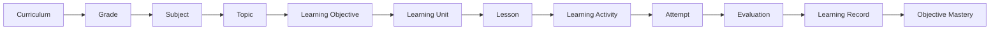
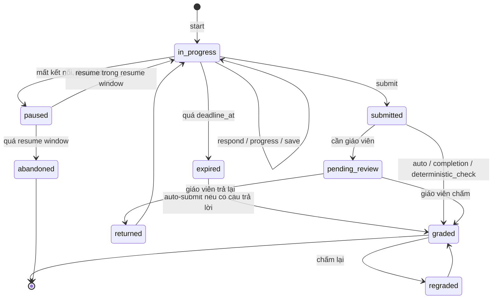
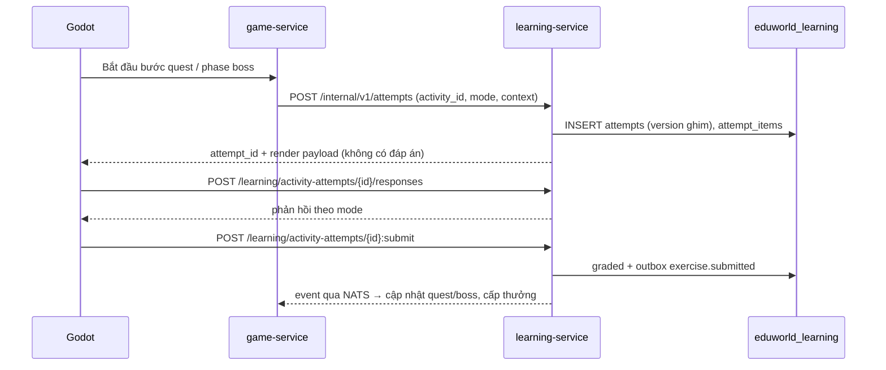

# Activity & Attempt Engine

> Trạng thái: Draft · Phiên bản: 0.2 · Owner: Backend Architect + EdTech Specialist · Cập nhật: 2026-11-15
> Liên quan: [ADR-0048](../adr/ADR-0048-learning-activity-registry-mo-rong-loai-hoat-dong-hoc-tap-kh.md) · [ADR-0016](../adr/ADR-0016-server-authoritative-scoring-answer-key-khong-bao-gio-roi-se.md) · [ADR-0043](../adr/ADR-0043-phat-hanh-noi-dung-draft-publish-con-tro-phien-ban-giu-phien.md) · [ADR-0053](../adr/ADR-0053-cham-diem-co-ho-tro-ai-ai-assisted-grading.md) · [LEARNING_EXPERIENCE](LEARNING_EXPERIENCE.md) · [CONTENT_MODEL](CONTENT_MODEL.md) · [QUESTION_BANK](QUESTION_BANK.md) · [EXAM_ENGINE](EXAM_ENGINE.md) · [LEARNING_ANALYTICS](LEARNING_ANALYTICS.md) · [QUEST_SYSTEM](../01-game-design/QUEST_SYSTEM.md) · [CHALLENGE_BOSS_SYSTEM](../01-game-design/CHALLENGE_BOSS_SYSTEM.md) · [MINIGAME_ENGINE](../08-game-client/MINIGAME_ENGINE.md) · [SCHOOL_LMS](../04-admin-portal/SCHOOL_LMS.md) · [EVENT_DESIGN](../07-backend/EVENT_DESIGN.md)

> Tài liệu này **gộp Exercise Engine cũ** (vòng đời attempt, mode, resume, phản hồi, lưu dữ liệu) với Activity Registry (ADR-0048). Đây là nơi **duy nhất** mô tả: vòng đời attempt, chiến lược chấm chung, chính sách phản hồi và resume. Các tài liệu theo loại (video, audio, tự luận, mô phỏng) chỉ mô tả phần riêng của loại đó.

## 1. Mục đích và phạm vi

Trong EduWorld, học sinh không "vào màn làm bài". Họ gặp hoạt động học tập **bên trong trò chơi**: NPC giao nhiệm vụ, một bước quest, một đòn đánh boss, một mini-game, một thử thách ở Arena. Activity Engine là lõi phía `learning-service` đứng sau mọi tình huống đó:

- **Registry** cho mọi loại hoạt động (quiz, bài tập tương tác, tự luận, video, audio, nói, mô phỏng, mini-game, dự án), cắm qua một interface chung.
- **Attempt engine**: bắt đầu, trả lời, tạm dừng, resume, nộp, chấm, phát bằng chứng học tập.

Quest, challenge/boss, assignment, exam, competition và analytics chỉ làm việc với interface này, không biết chi tiết từng loại.

| Trong phạm vi | Ngoài phạm vi (xem tài liệu khác) |
|---|---|
| Learning Activity, ActivityVersion, Attempt, Evaluation | Ngân hàng câu hỏi, answer key, chấm từng dạng câu ([QUESTION_BANK](QUESTION_BANK.md)) |
| Interface plugin, danh mục `activity_type` | Đề kiểm tra, ma trận đề, cửa sổ thi ([EXAM_ENGINE](EXAM_ENGINE.md)) |
| Vòng đời attempt, mode, resume, phản hồi, chấm chung | Version, publish, pinning ([CONTENT_MODEL](CONTENT_MODEL.md)) |
| Renderer registry (Godot), editor registry (portal) | Màn hình editor ([ADMIN_PORTAL](../04-admin-portal/ADMIN_PORTAL.md)) |
| Domain event của attempt | Mastery và báo cáo ([LEARNING_ANALYTICS](LEARNING_ANALYTICS.md)) |

**Stakeholder:** EdTech Specialist, Game Director (hoạt động gắn gameplay), Backend, Godot, portal, giáo viên (chấm tay), QA.

## 2. Chuỗi học tập



- [Confirmed] Các thực thể khác biệt về khái niệm, không gộp.
- **Learning Activity**: đơn vị học làm được (một quiz, một video có câu hỏi, một bài tự luận…). Lesson gồm nhiều activity; quest step, challenge, boss phase tham chiếu activity.
- **Attempt**: một lượt học sinh làm một activity version (version **ghim lúc start**, [CONTENT_MODEL §5.2](CONTENT_MODEL.md#52-version-pinning--học-sinh-đang-chơi-giữ-version-cũ)).
- **Evaluation**: kết quả chấm của attempt (có thể nhiều: tự động, giáo viên chấm lại, gợi ý AI chưa duyệt). Chỉ một evaluation **có hiệu lực**.
- **Learning Record**: bằng chứng học tập bất biến (learning event + đóng góp mastery).

## 3. Danh mục `activity_type`

| `activity_type` | Mô tả | Chiến lược chấm mặc định | Tài liệu | Nhãn |
|---|---|---|---|---|
| `quiz` | Single/multiple choice, true/false, chọn ảnh, quiz tính giờ | `auto` | [QUESTION_BANK](QUESTION_BANK.md) | [Confirmed] |
| `interactive_exercise` | Điền khuyết, kéo thả, nối, sắp xếp, nhập số, sắp xếp từ, puzzle, tính toán tương tác | `auto` / `rule` / `numeric_tolerance` | [QUESTION_BANK](QUESTION_BANK.md) | [Confirmed] |
| `written_response` | Trả lời ngắn, trả lời dài, tự luận, lời giải toán (văn bản + đáp số) | `accepted_answers` (ngắn) / `rubric` + `teacher_review` (dài) | [WRITTEN_RESPONSE_RUBRIC](WRITTEN_RESPONSE_RUBRIC.md) | [Confirmed] |
| `video_lesson` | Video, chapter, phụ đề, câu hỏi chèn, nhánh | `completion` + `auto` cho câu chèn | [VIDEO_LEARNING](VIDEO_LEARNING.md) | [Confirmed] |
| `audio_lesson` | Bài nghe, nghe hiểu | `completion` + `auto` | [AUDIO_LANGUAGE_LEARNING](AUDIO_LANGUAGE_LEARNING.md) | [Confirmed] |
| `speaking` | Nói, đọc to, phát âm có ghi âm | `teacher_review`; điểm phát âm tự động chỉ là gợi ý | [AUDIO_LANGUAGE_LEARNING](AUDIO_LANGUAGE_LEARNING.md) | [Proposed] |
| `simulation` | Mô phỏng khoa học, vật lý, hình học 3D, phòng thí nghiệm ảo | `deterministic_check` + `auto` | [SIMULATION_ENGINE](SIMULATION_ENGINE.md) | [Proposed] |
| `minigame` | Mini-game giáo dục (11 loại) dùng câu hỏi từ Question Bank | `auto` | [MINIGAME_ENGINE](../08-game-client/MINIGAME_ENGINE.md) | [Confirmed] |
| `project` | Bài nhiều bước, nhóm, nộp sản phẩm | `rubric` + `teacher_review` | [WRITTEN_RESPONSE_RUBRIC §8](WRITTEN_RESPONSE_RUBRIC.md#8-project-based-learning) | [Proposed] |

Mỗi loại có JSON Schema riêng trong `specs/schemas/activities/` (kế thừa [`activity-base.schema.json`](../../specs/schemas/activities/activity-base.schema.json)).

## 4. Learning Activity Definition

| Trường | Kiểu | Ghi chú |
|---|---|---|
| `activity_id` | UUIDv7 | Định danh ổn định qua các version |
| `activity_version_id`, `version` | UUIDv7, int | Bất biến sau publish |
| `activity_type` | enum §3 | Quyết định plugin xử lý |
| `content_language` | `vi` hoặc `en` | Ngôn ngữ gốc, bắt buộc; bản dịch tùy chọn ([CONTENT_MODEL §8](CONTENT_MODEL.md#8-ngôn-ngữ-nội-dung-và-bản-dịch-adr-0056)) |
| `title`, `description` | i18n, ≤ 255 / ≤ 1.000 ký tự | |
| `owner_scope`, `tenant_id` | `platform` (tenant_id null) hoặc `tenant` | ADR-0005/0029 |
| `grade_levels` | int[1..9] | |
| `subject_id`, `topic_id`, `objective_ids[]` | UUID | Ít nhất một LO [Confirmed] |
| `difficulty` | 1–5 | Ánh xạ sang Easy…Legendary ở [CHALLENGE_BOSS_SYSTEM](../01-game-design/CHALLENGE_BOSS_SYSTEM.md) |
| `instructions` | i18n, ≤ 2.000 | Có thể kèm audio đọc hướng dẫn cho lớp nhỏ |
| `content`, `interaction` | object theo schema loại | Nội dung và cách tương tác |
| `evaluation` | object | Chiến lược chấm (§7), `max_score`, `pass_threshold`, `rubric_id?`, `requires_teacher_review` |
| `feedback` | object | `immediate`, `after_submit`, `after_review`, `never` — mặc định theo mode (§9) |
| `time_limit_seconds` | int? | Thời gian do server tính |
| `scoring`, `completion_rule` | object | "Hoàn thành" ≠ "đạt" |
| `reward_rule_id?` | UUID | Chỉ là gợi ý; game-service quyết định cấp thưởng (ADR-0049) |
| `media_refs[]` | asset_id | ADR-0044 |
| `status`, `published_at`, `author_id`, `reviewer_id` | | Workflow ở [CONTENT_MODEL](CONTENT_MODEL.md) |

## 5. Interface plugin (Go)

```go
package activity

// Plugin là hợp đồng mỗi activity_type phải triển khai (ADR-0048).
type Plugin interface {
    Type() Type
    ConfigSchema() []byte
    ValidateConfig(ctx context.Context, v Version) error // khi lưu Draft và khi publish

    // Dữ liệu gửi client: KHÔNG có đáp án / rubric nội bộ / tham số kiểm chứng.
    BuildRenderPayload(ctx context.Context, v Version, a Attempt) (RenderPayload, error)
    Respond(ctx context.Context, v Version, a Attempt, r Response) (ResponseResult, error)
    Progress(ctx context.Context, v Version, a Attempt, e ProgressEvent) (ProgressState, error)
    Evaluate(ctx context.Context, v Version, a Attempt) (Evaluation, error) // có thể Pending
    CompletionRule(v Version) CompletionRule
    EmitEvidence(ctx context.Context, v Version, a Attempt, ev Evaluation) ([]Evidence, error)
}

// Registry nạp lúc khởi động; thiếu plugin cho type đã có nội dung published → service không ready.
type Registry interface {
    Register(p Plugin)
    Get(t Type) (Plugin, bool)
}
```

1. Plugin không truy cập DB của module khác; ghi qua repository của engine.
2. Mọi tính toán điểm, thời gian, hoàn thành chạy server-side (ADR-0016). Client chỉ gửi phản hồi thô và sự kiện tiến độ; `score`/`is_correct` từ client bị bỏ qua.
3. Command handler (ADR-0038): `StartAttempt`, `SubmitResponse`, `ReportProgress`, `PauseAttempt`, `SubmitAttempt`, `ReviewAttempt`. Query handler đọc read model, không gọi plugin chấm.
4. Mỗi plugin chạy bộ test hợp đồng chung: render payload không lộ đáp án, chấm idempotent, evidence đúng schema.

## 6. Attempt

### 6.1. Mode — hoạt động được gọi từ đâu trong game

| `mode` | Ngữ cảnh trong game/lớp học | Ai khởi tạo | Đặc điểm |
|---|---|---|---|
| `quest` | Một bước quest NPC giao ([QUEST_SYSTEM](../01-game-design/QUEST_SYSTEM.md)) | Quest | `context_ref = {quest_progress_id, step_id}`; hoàn thành theo `completion_rule` của step |
| `challenge` | Challenge, boss phase ([CHALLENGE_BOSS_SYSTEM](../01-game-design/CHALLENGE_BOSS_SYSTEM.md)) | game-service gọi internal API | `context_ref = {challenge_attempt_id | encounter_id, phase}` |
| `minigame` | Mini-game trong khu học tập | Mini-game | Như practice, thêm timer/cấu hình mini-game |
| `practice` | Tự luyện ở Practice Zone (chủ đề, lớp, mức độ, kỹ năng) | Học sinh | Phản hồi ngay, không giới hạn lượt |
| `retry_wrong` | "Ôn câu sai" (gợi ý của NPC/hệ thống) | Học sinh | Lấy version mới nhất của cùng `question_id`, ưu tiên LO yếu |
| `assignment` | Bài giáo viên giao ([SCHOOL_LMS](../04-admin-portal/SCHOOL_LMS.md)) | Giáo viên | `open_at/due_at`, `max_attempts`, `result_visibility` |
| `competition` | Câu hỏi trong trận 1v1/đội | competition-service | Ghi evidence trọng số thấp |
| `exam` | Đề kiểm tra | `exam` | [EXAM_ENGINE](EXAM_ENGINE.md) |

### 6.2. Vòng đời



| Trạng thái | Ý nghĩa |
|---|---|
| `in_progress` | Đang làm, nhận phản hồi |
| `paused` | Không hoạt động > `idle_timeout` (5 phút [Proposed]) hoặc client gọi `:pause`; thời gian pause không tính vào duration |
| `submitted` | Đã nộp, không nhận thêm phản hồi |
| `pending_review` / `returned` | Chờ giáo viên chấm / bị trả lại làm tiếp |
| `graded`, `regraded` | Có evaluation hiệu lực; event phát đi |
| `expired` | Hết `deadline_at`; worker auto-submit |
| `abandoned` | Bỏ dở; giữ dữ liệu phân tích, không phát `exercise.submitted` |

Với loại chấm tự động, `submitted → graded` diễn ra trong cùng transaction; hai trạng thái vẫn tách để tương thích chấm tay và exam.

### 6.3. Resume

| Mode | Resume | Resume window | Ghi chú |
|---|---|---|---|
| quest, challenge | ✔ | theo quest/challenge (mặc định 24 giờ) | Boss/co-op: reconnect trong trận do game-service xử lý |
| practice, retry_wrong | ✔ | 24 giờ | Tối đa 1 attempt `in_progress` cho mỗi `source_version_id`; start lại → trả attempt cũ |
| assignment | ✔ | đến `due_at` | |
| minigame | ✘ | — | Thoát = abandoned |
| competition | ✘ | — | Reconnect trong trận do competition-service xử lý |
| exam | ✔, deadline không dừng | đến `deadline_at` | [EXAM_ENGINE](EXAM_ENGINE.md) |

Resume trả về item (render payload + `presentation`), phản hồi đã lưu, phản hồi đã nhận (theo §9) và thời gian còn lại, **trên đúng version đã ghim**. Đổi thiết bị giữa chừng (ADR-0031): tiếp tục trên thiết bị mới, một attempt chỉ active trên một thiết bị.

### 6.4. Dữ liệu lưu trữ [Confirmed]

| Yêu cầu | Lưu ở |
|---|---|
| Attempt | `assessment.attempts` |
| Phản hồi | `assessment.attempt_answers` (append-only); phản hồi không phải câu hỏi (video progress, ghi âm, bài viết, simulation run) ở bảng riêng của từng loại |
| Đúng/sai, điểm | `attempt_answers.is_correct/score`, `attempt_items.final_*`, `attempts.score/max_score`, `evaluations` |
| Thời lượng | `attempts.duration_ms` = `submitted_at − started_at − paused_ms` (server); `client_elapsed_ms` chỉ tham khảo |
| Thời điểm nộp | `attempts.submitted_at` (server) |
| Content version | `attempts.source_version_id`, `attempt_items.question_version_id` (ghim lúc start) |
| Learning Objective | `attempt_items.objective_ids` (snapshot) |
| Ngôn ngữ đã hiển thị | `attempts.display_language` (`vi`/`en`, ghi lúc start theo ngôn ngữ học sinh chọn và bản dịch có sẵn; không đổi trong attempt kể cả khi học sinh đổi ngôn ngữ giữa chừng — ADR-0056) |

DDL đầy đủ: [DATABASE_DESIGN](../07-backend/DATABASE_DESIGN.md).

## 7. Evaluation

### 7.1. Chiến lược chấm

| `strategy` | Dùng cho | Mô tả |
|---|---|---|
| `auto` | Quiz, đa số bài tương tác | Đối chiếu answer key ([QUESTION_BANK](QUESTION_BANK.md)) |
| `exact` / `accepted_answers` | Trả lời ngắn | So khớp sau chuẩn hóa; danh sách đáp án chấp nhận, biến thể không dấu nếu cho phép |
| `rule` | Bài tương tác phức tạp | Luật khai báo do validator Go đăng ký |
| `numeric_tolerance` | Nhập số | Sai số tuyệt đối/tương đối, đơn vị |
| `rubric` | Tự luận, dự án, nói | Điểm theo tiêu chí ([WRITTEN_RESPONSE_RUBRIC](WRITTEN_RESPONSE_RUBRIC.md)) |
| `teacher_review` | Loại cần người chấm | Attempt ở `pending_review` tới khi giáo viên chấm |
| `completion` | Video, audio | Đạt khi thỏa `completion_rule` |
| `deterministic_check` | Mô phỏng | Checker Go tính lại từ tham số + chuỗi hành động ([SIMULATION_ENGINE](SIMULATION_ENGINE.md)) |
| `ai_suggestion` | Tự luận, nói (tương lai) | Chỉ gợi ý, giáo viên duyệt (ADR-0053); tắt mặc định |

Một activity có thể kết hợp chiến lược theo phần (ví dụ video: `completion` + `auto` cho câu chèn).

### 7.2. Tính điểm

- Điểm câu = kết quả chấm × `max_score` của item. Điểm item cuối = lần trả lời **có tính điểm** cuối cùng trước submit (`is_scored=true`). Câu không trả lời = 0.
- `score = Σ final_score`; `max_score = Σ item.max_score`. Thang 10 hiển thị cho bài giao: `round(score/max_score × 10, 1)` [Proposed]; luôn lưu giá trị gốc.
- Điểm học tập **không** bị ảnh hưởng bởi XP, vật phẩm hay rating (ADR-0018).

### 7.3. Thực thể Evaluation

| Trường | Ghi chú |
|---|---|
| `evaluation_id`, `attempt_id`, `tenant_id` | |
| `source` | `system`, `teacher`, `ai_suggestion` |
| `status` | `pending`, `final`, `superseded` |
| `score`, `max_score`, `passed`, `criteria_scores` | |
| `feedback` | ≤ 4.000 ký tự |
| `evaluator_id` / `model_ref` | Giáo viên, `system`, hoặc mô hình AI (ADR-0053) |
| `effective` | Chỉ một evaluation `final` có hiệu lực mỗi attempt |

Chấm lại tạo evaluation mới, evaluation cũ `superseded`; Learning Record điều chỉnh bằng event `attempt.re_evaluated`, không sửa record cũ. Gợi ý AI không bao giờ có hiệu lực khi chưa có giáo viên duyệt.

## 8. Phản hồi trong game

Phản hồi là một phần của gameplay, không phải "chấm bài khô khan" ([LEARNING_EXPERIENCE](LEARNING_EXPERIENCE.md)):

| Mode | Sau mỗi câu/phần | Sau khi nộp |
|---|---|---|
| quest | Đúng/sai + giải thích ngắn qua thoại NPC | Tổng kết + phần thưởng (game-service) |
| challenge (boss) | Đúng → boss mất "máu"/tiến độ; sai → gợi ý, không phạt làm xấu hổ | Kết quả phase/trận + phần thưởng |
| practice, minigame, retry_wrong | Đúng/sai + giải thích + gợi ý | Tổng kết + LO cần ôn |
| assignment | Theo `result_visibility`: `immediate` / `after_submit` / `after_due` / `manual_release` | Tương ứng |
| competition | Đúng/sai sau khi câu khóa | Kết quả trận |
| exam | Không có | Theo [EXAM_ENGINE](EXAM_ENGINE.md) |

- Thử lại câu sai trong practice/quest/challenge: lần thử lại có `is_scored=false`; lần đầu tính điểm và evidence. Số lượt thử theo khối lớp do [LEARNING_EXPERIENCE §4.2](LEARNING_EXPERIENCE.md#42-số-lượt-thử-proposed) quy định; cách trình bày phản hồi (NPC, hiệu ứng, gợi ý nhiều cấp) ở [LEARNING_EXPERIENCE §4](LEARNING_EXPERIENCE.md#4-phản-hồi-đúngsai-thân-thiện).
- `feedback` trong activity definition (§4) ghi đè mặc định của mode trong phạm vi cho phép, nhưng không bao giờ hiện đáp án/giải thích trước khi nộp với `exam` hoặc `assignment` có `after_due`.


## 9. API

**Một họ API duy nhất** `/api/v1/learning/activity-attempts` cho mọi `activity_type` và mọi `mode` trừ `exam` (đề kiểm tra dùng `/api/v1/exams/*`, [EXAM_ENGINE](EXAM_ENGINE.md)) ([ADR-0059](../adr/ADR-0059-hop-nhat-api-attempt-va-chua-lam-ai-giong-noi.md)). Họ `/api/v1/exercises/attempts` cũ đã bỏ. Path và schema chuẩn nằm trong [API_DESIGN](../07-backend/API_DESIGN.md) và OpenAPI; operationId trong bảng là tên đề xuất, spec là nguồn chốt.

| Method | Path | operationId (đề xuất) | Mô tả | Idempotency |
|---|---|---|---|---|
| POST | `/api/v1/learning/activities/{activity_id}/attempts` | `startActivityAttempt` | Start từ một activity đã publish (ghim version, trả render payload không có đáp án) | `Idempotency-Key` bắt buộc |
| POST | `/api/v1/learning/activity-attempts` | `startAdHocAttempt` | Start không gắn activity cố định: `source.kind` = `question_set` \| `selection` (luyện tập theo chủ đề/LO/độ khó) \| `retry_wrong` (ôn câu sai) | `Idempotency-Key` bắt buộc |
| GET | `/api/v1/learning/activity-attempts?mode=&status=&cursor=` | `listMyActivityAttempts` | Lịch sử của tôi | — |
| GET | `/api/v1/learning/activity-attempts/{attempt_id}` | `getActivityAttempt` | Trạng thái + resume | — |
| POST | `/api/v1/learning/activity-attempts/{attempt_id}/responses` | `submitActivityResponse` | Gửi phản hồi một item (câu hỏi, cue video, bước mô phỏng): `{ item_ref, response, client_elapsed_ms }` → phản hồi theo §8 | `Idempotency-Key` |
| POST | `/api/v1/learning/activity-attempts/{attempt_id}/progress` | `reportActivityProgress` | Sự kiện tiến độ (video, mô phỏng, bài học) | — |
| POST | `/api/v1/learning/activity-attempts/{attempt_id}:pause` | `pauseActivityAttempt` | Tạm dừng (theo resume policy §6.3) | — |
| POST | `/api/v1/learning/activity-attempts/{attempt_id}:submit` | `submitActivityAttempt` | Nộp | `Idempotency-Key` bắt buộc |
| GET | `/api/v1/learning/activity-attempts/{attempt_id}/review` | `getActivityAttemptReview` | Xem lại sau khi nộp theo chính sách hiển thị kết quả | — |

Endpoint riêng theo loại (cùng tiền tố, chi tiết ở tài liệu từng loại): `/written-response` ([WRITTEN_RESPONSE_RUBRIC](WRITTEN_RESPONSE_RUBRIC.md)), `/recordings` ([AUDIO_LANGUAGE_LEARNING](AUDIO_LANGUAGE_LEARNING.md)), `/submissions` (dự án), `/simulation-runs` ([SIMULATION_ENGINE](SIMULATION_ENGINE.md)).

**Ánh xạ `mode` khi start** (body `context`):

| `mode` | Gọi từ | Start qua | `context` bắt buộc |
|---|---|---|---|
| `practice` | Thư viện Gió, khu luyện tập | `startActivityAttempt` hoặc `startAdHocAttempt` (`selection`/`question_set`) | — |
| `assignment` | Bài giáo viên giao (Bưu tá Nhím, quest journal) | `startActivityAttempt` | `assignment_id` |
| `quest` | Bước quest | internal `POST /internal/v1/attempts` từ game-service | `quest_progress_id`, `step_id` |
| `minigame` | Mini-game | `startActivityAttempt` | `minigame_config_version_id` |
| `challenge` | Challenge / phase boss | internal từ game-service | `challenge_attempt_id` hoặc `boss_encounter_id` + `phase` |
| `exam` | Tháp Thử Thách / đề kiểm tra | API riêng của đề kiểm tra `/api/v1/exams/...` ([EXAM_ENGINE](EXAM_ENGINE.md): cửa sổ thời gian, autosave, chấm trì hoãn); cùng entity Attempt | `exam_session_id` |
| `competition` | Trận 1v1/đội | internal từ competition-service (question plan) | `match_id` |
| `retry_wrong` | Ôn câu sai | `startAdHocAttempt` (`retry_wrong`) | — |

Game-service và competition-service gọi start cho quest/challenge/trận qua internal API `POST /internal/v1/attempts` (ADR-0040); client sau đó dùng chung các endpoint `/learning/activity-attempts/{attempt_id}/...`.



Lỗi: `ATTEMPT_NOT_FOUND`, `ATTEMPT_NOT_IN_PROGRESS`, `ATTEMPT_ALREADY_SUBMITTED`, `ATTEMPT_EXPIRED`, `ATTEMPT_PENDING_REVIEW`, `ITEM_POSITION_INVALID`, `INVALID_RESPONSE`, `ANSWER_LIMIT_REACHED`, `ASSIGNMENT_NOT_OPEN`, `ASSIGNMENT_MAX_ATTEMPTS`, `QUESTION_POOL_INSUFFICIENT`, `ACTIVITY_TYPE_NOT_SUPPORTED`, `ACTIVITY_CONFIG_INVALID`, `ACTIVITY_NOT_PUBLISHED`, `EVALUATION_NOT_EDITABLE`, `FORBIDDEN_SCOPE`.

## 10. Domain events

| Event | Khi | Payload chính |
|---|---|---|
| `exercise.started` | Start | attempt_id, mode, activity_type, source_version_id, context_ref |
| `question.answered` | Mỗi câu có tính điểm | attempt_id, question_version_id, objective_ids, is_correct, score, elapsed |
| `exercise.submitted` | Graded | attempt_id, mode, score, max_score, duration_ms, objective summary |
| `attempt.review_requested` / `attempt.re_evaluated` | Chờ chấm / chấm lại | attempt_id, evaluation_id |
| `exercise.abandoned` | Abandoned | attempt_id |

Consumer: learning_record (mastery), game-service (quest step, boss, XP theo rule và cap), LMS (trạng thái bài giao). Tên chuẩn: [EVENT_DESIGN](../07-backend/EVENT_DESIGN.md).

## 11. Toàn vẹn và chống gian lận

- Không nộp trùng: chuyển trạng thái có điều kiện `WHERE status='in_progress'` + `Idempotency-Key`.
- Phản hồi đến sau `deadline_at` + 2 giây ân hạn mạng → `ATTEMPT_EXPIRED`.
- Đúng 100% với < 1,5 giây/câu trên ≥ 10 câu → cờ `suspicious_speed` gửi [ANTI_CHEAT](../10-security/ANTI_CHEAT.md), không tự phạt.
- Chống farm XP do game-service xử lý (cap, giảm dần), không xử lý ở đây.

## 12. Renderer và editor registry

| Thành phần | Đăng ký theo | Thiếu loại thì |
|---|---|---|
| Godot `ActivityRendererRegistry` | `activity_type` → `res://scenes/learning/activity_renderers/<type>/` | Hiện "Hoạt động cần phiên bản game mới", gửi telemetry, không crash |
| Editor registry (Learning Content Studio) | `activity_type` → editor + form sinh từ JSON Schema | Không cho tạo loại đó |
| Activity Registry (server) | `activity_type` → plugin Go | Không cho publish loại đó |

Content manifest mang `min_client_version` theo activity_type.

**Thêm loại mới:** đặc tả loại (EdTech + Game Director) → schema `specs/schemas/activities/<type>.schema.json` (mọi chuỗi có `maxLength`) → plugin Go + test hợp đồng → renderer Godot + editor portal → cập nhật §3 và LEARNING_ANALYTICS nếu có evidence mới. **Không** sửa quest, assignment, exam, challenge.

## 13. Quyền

| Hành động | Permission |
|---|---|
| Tạo/sửa activity (tenant hoặc platform theo scope) | `learning_content.activity.write` |
| Duyệt / publish | `learning_content.activity.review` / `learning_content.publish` |
| Chấm tay, chấm lại | `lms.review.grade` (giáo viên được phân công lớp/môn) |
| Bật gợi ý AI cho tenant | System Admin (ADR-0053) |

Catalog đầy đủ: [ADMIN_PORTAL §2](../04-admin-portal/ADMIN_PORTAL.md).

## 14. Yêu cầu và nghiệm thu

| ID | Yêu cầu | Nhãn |
|---|---|---|
| FR-ACT-001 | Mọi loại hoạt động đi qua Activity Registry với interface chung | [Proposed] ADR-0048 |
| FR-ACT-002 | Evaluation là thực thể riêng; đúng một evaluation có hiệu lực | [Proposed] |
| FR-ACT-003 | Quest/challenge/assignment/exam chỉ tham chiếu `activity_id` + version | [Proposed] |
| FR-ACT-004 | Client cũ không nhận activity_type chưa hỗ trợ | [Proposed] |
| FR-EXR-001 | Làm bài cá nhân / theo quest / chủ đề / lớp / giáo viên giao / tự luyện / làm lại câu sai | [Confirmed] |
| FR-EXR-002 | Lưu attempt, phản hồi, đúng/sai, điểm, thời lượng, thời điểm nộp, content version, LO | [Confirmed] |
| FR-EXR-003 | Resume theo chính sách | [Confirmed] |
| FR-EXR-004 | Phản hồi theo mode, lồng vào gameplay | [Proposed] |
| FR-EXR-005 | Ôn câu sai sinh từ lịch sử | [Confirmed] |
| FR-EXR-006 | Nộp bài idempotent | [Confirmed] |
| FR-EXR-007 | Auto-expire/auto-submit theo deadline | [Proposed] |

| AC | Kịch bản |
|---|---|
| AC-EXR-001 | Practice 10 câu → nộp → 1 attempt `graded`, 10 item, ≥ 10 answer, event `exercise.submitted` trong outbox |
| AC-EXR-002 | `:submit` hai lần cùng `Idempotency-Key` → cùng response; khác key → `409 ATTEMPT_ALREADY_SUBMITTED`; điểm không đổi |
| AC-EXR-003 | Gửi `score` trong body → bị bỏ qua |
| AC-EXR-004 | Thoát giữa practice, mở lại trong 24 giờ → resume đúng câu và câu trả lời đã lưu |
| AC-EXR-005 | Học sinh tenant A không đọc được attempt của tenant B (`404`) |
| AC-ACT-001 | Thêm plugin `speaking` không cần sửa quest/assignment; quest tham chiếu activity speaking chạy đúng |
| AC-ACT-002 | Render payload của mọi plugin không chứa answer key/rubric nội bộ (test hợp đồng tự động) |
| AC-ACT-003 | Giáo viên chấm lại tự luận → evaluation cũ `superseded`, mastery điều chỉnh qua event, attempt cũ không bị sửa |
| AC-ACT-004 | Client không có renderer `simulation` → thông báo cần cập nhật, không crash, có telemetry |
| AC-ACT-005 | Publish version mới khi học sinh đang làm version cũ → học sinh hoàn thành trên version cũ |
| AC-ACT-006 | Học sinh trả lời đúng trong phase boss → boss giảm tiến độ (game-service nhận event), learning record ghi cho đúng học sinh đó |

Test: TC-ACT-*, TC-LRN-* trong [TEST_STRATEGY](../12-project/TEST_STRATEGY.md).
