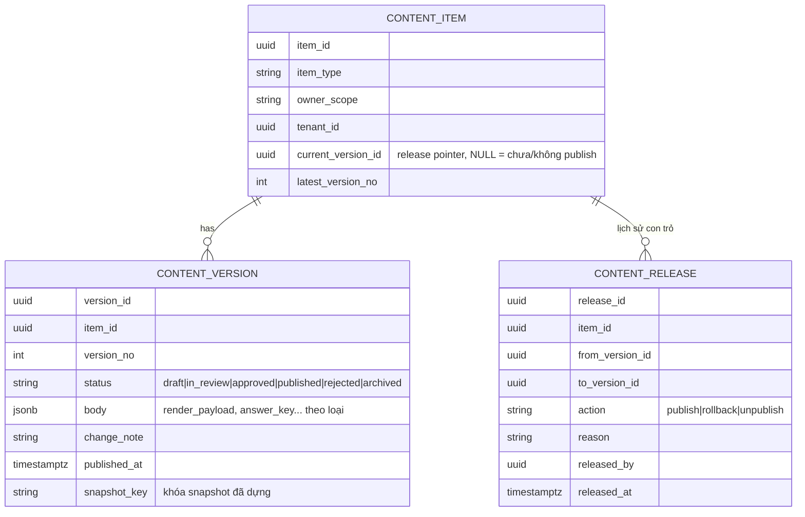
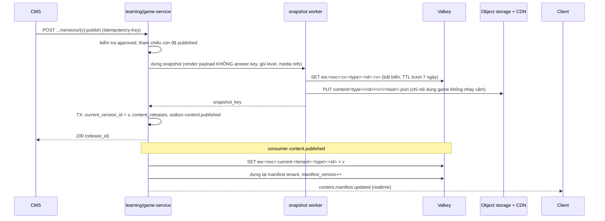
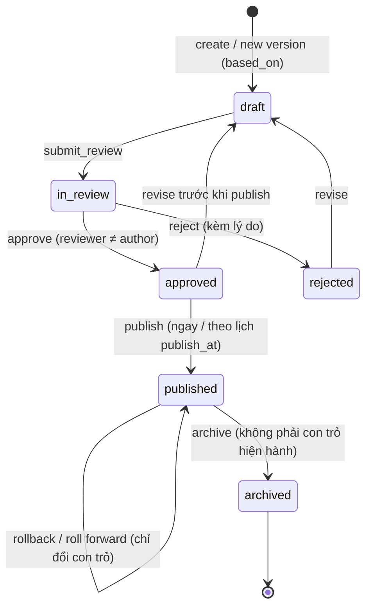
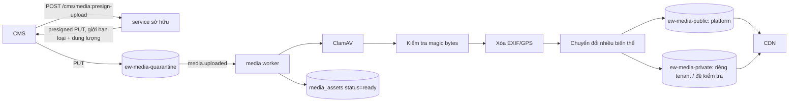

# Content Model

> Trạng thái: Draft · Phiên bản: 0.2 · Owner: Backend Architect + EdTech Specialist · Cập nhật: 2026-11-15
> Liên quan: [CURRICULUM_MODEL](CURRICULUM_MODEL.md) · [QUESTION_BANK](QUESTION_BANK.md) · [ADMIN_PORTAL](../04-admin-portal/ADMIN_PORTAL.md) · [ADR-0015](../adr/ADR-0015-content-versioning-bat-bien-sau-publish.md) · [ADR-0016](../adr/ADR-0016-server-authoritative-scoring-answer-key-khong-bao-gio-roi-se.md) · [ADR-0043](../adr/ADR-0043-phat-hanh-noi-dung-draft-publish-con-tro-phien-ban-giu-phien.md) · [ADR-0044](../adr/ADR-0044-luu-tru-hinh-anh-va-media-object-storage-s3-compatible-cdn.md)

## 1. Phạm vi

`learning-service` (database `eduworld_learning`) sở hữu mọi nội dung học tập phiên bản hóa. Nội dung game (QuestDefinition, MiniGameConfig, NPCDialogue, level package) dùng **cùng mô hình version/release/pinning** nhưng thuộc `game-service` — xem [QUEST_SYSTEM](../01-game-design/QUEST_SYSTEM.md), [MINIGAME_ENGINE](../08-game-client/MINIGAME_ENGINE.md).

## 2. Các loại nội dung

| Loại | Entity | Mô tả | Dùng ở |
|---|---|---|---|
| Lesson | `lesson` | Bài học gồm các khối nội dung + activity | Learning Zone, LMS |
| Learning Material | `learning_material` | Tài liệu đọc/xem: rich text, PDF, slide | Lesson |
| Video / Image / Audio | `media_asset` | Media dùng chung | mọi nơi |
| Interactive Content | `interactive_content` | Mô phỏng, H5P-like widget, scene Godot nhỏ (`godot_scene_ref`) | Lesson, Science Simulation |
| Question | `question` | Câu hỏi đơn ([QUESTION_BANK](QUESTION_BANK.md)) | Exercise, Exam, Mini-game, Battle |
| Exercise | `question_set` (purpose=`exercise`) | Bài tập gồm nhiều câu | Practice Zone, Assignment |
| Question Set | `question_set` | Tập câu tĩnh hoặc theo rule chọn | mọi nơi |
| Assessment | `assessment_blueprint` | Ma trận đề | Exam Zone |
| Learning Activity | `learning_activity` | Đơn vị học làm được, có `activity_type` (quiz, interactive_exercise, written_response, video_lesson, audio_lesson, speaking, simulation, minigame, project), xử lý qua [Activity Registry](ACTIVITY_ENGINE.md) (ADR-0048) | Lesson, Quest step, Assignment, Challenge |
| Rubric | `rubric` | Tiêu chí chấm tự luận/nói/dự án, có version ([WRITTEN_RESPONSE_RUBRIC](WRITTEN_RESPONSE_RUBRIC.md)) | Activity, review queue |
| Game Activity | `minigame_config` | Cấu hình mini-game (schema `game`) | Quest, Learning Zone |

## 3. Metadata bắt buộc [Confirmed — Master Prompt §4.2]

Mọi *version* của nội dung đều có các field chung (`content_meta`):

| Field | Kiểu | Bắt buộc | Mô tả |
|---|---|---|---|
| `grade_levels` | int[] (1–9) | ✔ | khối áp dụng |
| `subject_id` | uuid | ✔ | |
| `topic_id` | uuid | ✔ (trừ media) | |
| `objective_ids` | uuid[] | ✔ với question/question_set/activity | LO đánh giá/giảng dạy |
| `difficulty` | int 1–5 | ✔ với question | 1 rất dễ → 5 rất khó |
| `version` | int | ✔ | tăng dần trong một `*_id` |
| `status` | `content_status` | ✔ | |
| `author_id` | uuid | ✔ | |
| `reviewer_id` | uuid | khi ≥ approved | |
| `published_at` | timestamptz | khi published | |
| `owner_scope` / `tenant_id` | enum (`platform`/`tenant`) / uuid (NULL khi platform) | ✔ | §4 |
| `deleted_at`, `deleted_by` | timestamptz / uuid | | Soft-delete (ADR-0028) — chỉ cho draft/rejected; nội dung đã publish dùng `archived` |
| `cloned_from_id`, `cloned_from_tenant_id`, `cloned_at`, `cloned_by` | uuid / timestamptz | | Nguồn gốc khi System Admin clone giữa tenant (ADR-0029) |
| `content_language` | enum `vi` \| `en` | ✔ | Ngôn ngữ gốc của nội dung (ADR-0056); mặc định `vi`, môn Tiếng Anh là `en`. Xem §8 |
| `tags` | string[] | | tự do, có chuẩn hóa |
| `license` | enum | ✔ với media | `owned`, `licensed`, `cc_by`, `cc_by_sa`, `public_domain` |
| `estimated_duration_sec` | int | | |
| `curriculum_version_id` | uuid | ✔ | version mà `objective_ids` thuộc về |

## 4. Phạm vi sở hữu (`owner_scope`) — ADR-0005, ADR-0029

| owner_scope | `tenant_id` | Ai tạo | Ai thấy/dùng | Ai duyệt |
|---|---|---|---|---|
| `platform` | NULL | Content Admin / System Admin | Chỉ các tenant **được gán** (`platform.tenant_resource_assignments`), chỉ đọc | Content Reviewer platform |
| `tenant` | tenant sở hữu | Tenant Admin / Academic Manager / Teacher / School Admin của tenant (theo permission) | Chỉ tenant đó (với tenant `unit`: mọi trường trong đơn vị, có thể lọc theo trường) | Reviewer của tenant (tổ trưởng) — OQ-07 |

Tenant muốn sửa nội dung platform → System Admin clone sang tenant (bản sao `draft`, `owner_scope = tenant`). Mô hình cũ `organization`/`school` được thay bằng tenant (tenant `unit` thay "tổ chức").

- Nội dung cấp dưới **có thể** tham chiếu nội dung cấp trên (question set trường dùng câu hỏi platform), **không** ngược lại.
- Repository luôn lọc: `deleted_at IS NULL AND (tenant_id = principal.tenant OR (owner_scope='platform' AND <có assignment active cho principal.tenant>))` (chi tiết [MULTITENANCY §4.2](../06-architecture/MULTITENANCY.md)).

## 5. Version, Release pointer và Draft/Publish (ADR-0015, ADR-0043)

Mọi nội dung có version (lesson, learning material, question, question set, assessment blueprint, learning path ở learning-service; quest, mini-game config, NPC dialogue, level package, reward rule, item ở game-service; sticker/GIF pack ở chat-service) dùng **cùng một mô hình hai lớp**:



Quy tắc:

1. **Version** là bản nội dung. **Draft** sửa tự do (optimistic concurrency theo field `version` của ent, ADR-0039). Khi đã `published` thì **bất biến**: hook ent + trigger DB chặn UPDATE cột nội dung.
2. Sửa nội dung đã publish = tạo Draft mới từ version đó (`POST .../versions` với `based_on_version`). Chỉ **một** Draft/In-review mở cho mỗi item tại một thời điểm [Proposed].
3. **Release pointer** `content_items.current_version_id` quyết định version học sinh nhận khi **bắt đầu** một lượt chơi/học mới. Mỗi lần đổi con trỏ ghi một dòng `content_releases` + audit + outbox event.
4. **Publish**: version `approved` → `published`, con trỏ trỏ sang version đó (ngay hoặc hẹn giờ `publish_at`). Version published trước đó **vẫn giữ** trạng thái `published` (xem và rollback được), chỉ không còn là con trỏ.
5. **Rollback**: trỏ con trỏ về một version `published` cũ hơn (hoặc mới hơn = roll forward). **Không** sao chép, **không** tạo version mới. Bắt buộc `reason`, permission `content.release.rollback`, audit (thay quy tắc "clone rồi publish" cũ của ADR-0015).
6. **Unpublish**: con trỏ về `NULL` → học sinh không bắt đầu lượt mới với nội dung này; lượt đang chơi vẫn tiếp tục với version đã ghim.
7. **Archive** (`published → archived`): ẩn khỏi lựa chọn mới, không thể rollback tới; chỉ khi version không phải con trỏ hiện hành.
8. Mọi attempt, learning event, quest progress, level session, match tham chiếu `version_id`, không phải `item_id`.
9. Sửa lỗi làm sai đáp án sau khi đã có attempt → xem [EXAM_ENGINE §9 Regrade](EXAM_ENGINE.md#9-chấm-lại-regrade).
10. Xóa: Draft/Rejected soft-delete (ADR-0028); version đã publish không bao giờ xóa.

### 5.1. Xem lịch sử và so sánh version

CMS hiển thị danh sách version (số, trạng thái, tác giả, người duyệt, người publish, `change_note`, thời gian), dòng thời gian `content_releases` (ai publish/rollback version nào, lý do), xem nội dung từng version ở chế độ **chỉ đọc**, **so sánh hai version** (diff theo field/khối) và **preview trong game** (Godot Web export dùng snapshot của version đó, không tạo game session thật). Chi tiết màn hình: [ADMIN_PORTAL §3.11](../04-admin-portal/ADMIN_PORTAL.md#311-phát-hành-nội-dung-draftpublish-lịch-sử-rollback-adr-0043).

### 5.2. Version pinning — học sinh đang chơi giữ version cũ

Khi học sinh **bắt đầu** một đơn vị chơi/học, server đọc con trỏ hiện tại và **ghim** version vào đơn vị đó:

| Đơn vị | Nơi ghi version | Thời điểm ghim | Hết ghim khi |
|---|---|---|---|
| Màn/level | `game.level_sessions.content_versions` (jsonb: item → version) | `POST /game/levels/{level_id}:start` | Hoàn thành/rời màn |
| Quest | `game.quest_progress.quest_version_id` | Nhận quest | Hoàn thành/bỏ quest (quest nhiều ngày giữ đến khi xong) [Proposed] |
| Mini-game | `assessment.attempts.source_version_id` (mode `minigame`) | Bắt đầu mini-game | Nộp/hết giờ |
| Bài học | `learning.lesson_sessions.lesson_version_id` | Mở bài | Hoàn thành/đóng |
| Attempt bài tập | `attempts.source_version_id` + `attempt_items.question_version_id` | Bắt đầu attempt | Submit/expire |
| Đề kiểm tra | `exam_sessions.blueprint_version_id` + `exam_papers` | Giáo viên tạo exam session | Đóng exam session ([EXAM_ENGINE](EXAM_ENGINE.md)) |
| Bài giao | `lms.assignments.pinned_version_id` (mặc định) hoặc `follow_latest = true` | Lúc giao | Hết hạn bài giao ([SCHOOL_LMS](../04-admin-portal/SCHOOL_LMS.md)) |
| Trận đấu | `competition.matches.question_plan_version` | Trận bắt đầu | Trận kết thúc |

Trong đơn vị đã ghim, mọi lần tải nội dung dùng version đã ghi, kể cả khi đã có bản mới, đã rollback hoặc đã unpublish. Lượt tiếp theo nhận version mới nhất theo con trỏ.

### 5.3. Content manifest cho game

- Mỗi tenant có một **content manifest**: danh sách `item_type, item_id → version_id, snapshot_url/hash` của mọi nội dung game và học tập mà tenant được dùng (sở hữu hoặc được gán, ADR-0029), kèm `manifest_version` tăng dần.
- Client tải `GET /api/v1/game/content-manifest` (ETag, `If-None-Match` → `304`) **khi khởi động** và **khi vào màn mới**. Trong một màn, client không đổi nội dung.
- Khi publish/rollback, server phát `content.manifest.updated` qua realtime; client chỉ ghi nhận, áp dụng ở màn sau.

### 5.4. Đẩy cache khi publish (ADR-0043 mục 6)



- Snapshot bất biến → không bao giờ cần invalidate; chỉ con trỏ và manifest đổi. Cache miss → đọc DB, nạp lại.
- **Không đưa lên CDN:** render payload câu hỏi của đề kiểm tra, mọi `answer_key`/`scoring_rule`, nội dung bài giao chưa mở. Những thứ này chỉ phục vụ qua API có kiểm quyền và cache phía server.
- Nội dung riêng tenant trên CDN dùng signed URL ngắn hạn (ADR-0044).
- Mục tiêu từ khi bấm Publish đến khi học sinh mới nhận được: ≤ 30 giây [Proposed].

## 6. Workflow trạng thái



| Thao tác | Điều kiện | Event |
|---|---|---|
| `submit_review` | validate schema đầy đủ, mọi media `ready` | `content.review_requested` |
| `approve` | reviewer có quyền ở scope; **reviewer ≠ author** | `content.approved` |
| `reject` | bắt buộc `reason` | `content.rejected` |
| `publish` | đã approved; mọi tham chiếu con đã published; snapshot dựng xong | `content.published` |
| `rollback` | version đích `published`, cùng item, ≠ con trỏ hiện tại; `reason` bắt buộc | `content.rolled_back` |
| `unpublish` | `reason` bắt buộc | `content.unpublished` |
| `archive` | không phải con trỏ hiện hành | `content.archived` |
| (sau mọi thao tác đổi con trỏ) | manifest tenant dựng lại | `content.manifest_updated` |

Cấu hình tenant nhỏ có thể bật `self_approve_allowed` (giáo viên tự duyệt câu hỏi riêng, có audit) [Proposed, OQ-07].

## 7. Media asset pipeline (ADR-0044)

File media **không** lưu trong PostgreSQL. File ở **object storage S3-compatible** (floci ở mọi môi trường, ADR-0044, ADR-0071), phát qua **CDN**; DB chỉ lưu metadata `media_assets` trong database của service sở hữu nội dung (learning-service cho nội dung học tập, game-service cho nội dung game, chat-service cho sticker/GIF).



| Loại | Đầu vào | Đầu ra | Giới hạn [Proposed] |
|---|---|---|---|
| Ảnh | PNG, JPG, WebP, SVG (sanitize) | WebP + PNG, 3 kích thước 256 / 1024 / 2048 px | ≤ 10 MB |
| Âm thanh | MP3, WAV, OGG | **Ogg Vorbis** (Godot) + MP3 (web) | ≤ 20 MB, ≤ 10 phút |
| Video | MP4 (H.264), WebM | **Ogg Theora `.ogv`** (Godot 4 chỉ phát Theora) + HLS 360p/720p + MP4 (CMS/web) | ≤ 300 MB, ≤ 20 phút |
| Mô hình 3D / scene | `.glb`, `.pck` | lưu nguyên + checksum, theo pipeline [WORLD_RENDERING](../08-game-client/WORLD_RENDERING.md) | ≤ 50 MB, chỉ content admin platform |

- **Khóa content-addressed:** `media/<sha256>/<variant>.<ext>` → bất biến, CDN và client cache vĩnh viễn (`Cache-Control: immutable`).
- **Bất biến theo version:** thay ảnh = upload asset mới; version nội dung cũ vẫn trỏ asset cũ, nên học sinh đang chơi version cũ thấy đúng media cũ. Asset còn được version nào tham chiếu thì không bị xóa (soft-delete, ADR-0028).
- Trạng thái: `quarantined → processing → ready | rejected`. Version không được `submit_review` nếu media chưa `ready`.
- Media nội dung riêng tenant và media của đề kiểm tra nằm ở `ew-media-private`, phát bằng **signed URL** 5–15 phút. Media nội dung platform ở `ew-media-public`.
- Một version tham chiếu tối đa 50 asset [Proposed]. Media không chứa dữ liệu học sinh (học sinh không upload).

Metadata `media_assets`: `asset_id`, `tenant_id`/`owner_scope`, `kind`, `original_filename` varchar(255), `mime_type` varchar(127), `size_bytes`, `width`, `height`, `duration_ms`, `sha256` varchar(64), `variants` jsonb (≤ 16 KB), `alt_text` varchar(500), `license` varchar(64), `status`, cột chuẩn ADR-0039.

## 8. Ngôn ngữ nội dung và bản dịch (ADR-0056)

Game song ngữ `vi-VN` (mặc định) và `en-US` [Confirmed — ADR-0056]. Tài liệu này sở hữu **quy tắc ngôn ngữ của dữ liệu nội dung**; chuỗi UI của client: [GODOT_ARCHITECTURE §10.1](../08-game-client/GODOT_ARCHITECTURE.md#101-quốc-tế-hóa-i18n); biên tập: [ADMIN_PORTAL §1.5](../04-admin-portal/ADMIN_PORTAL.md#15-biên-tập-song-ngữ-adr-0056).

**Hai kiểu văn bản trong dữ liệu**

| Kiểu | Dùng cho | Quy tắc | Schema |
|---|---|---|---|
| **Văn bản game** (`localized_text`) | Tên/mô tả vùng, khu, NPC, hội thoại NPC, quest, challenge, boss, achievement, danh hiệu, item, sự kiện, chương truyện | `{ "vi": "...", "en": "..." }` **bắt buộc đủ cả hai** trước khi publish [Confirmed] | `quest`, `boss`, `challenge`, `achievement`, `minigame-config`, `npc-dialogue`, `progression-curve` (`$defs/localized_text`) |
| **Văn bản học tập** (`i18nText`, `i18nShort/Medium/Long`) | Đề bài, đáp án, giải thích, bài học, hướng dẫn hoạt động, rubric, phụ đề | Bắt buộc bản theo `content_language`; bản dịch còn lại **tùy chọn** [Proposed] | `question`, `activities/*` |

Khóa ngôn ngữ trong dữ liệu luôn là `vi`/`en` (không dùng `vi-VN`/`en-US` trong JSON nội dung); locale đầy đủ chỉ dùng ở client/HTTP (`Accept-Language: vi-VN`).

**`content_language` (bắt buộc ở mọi version nội dung học tập)**

- Môn Tiếng Anh: `en`; đề và đáp án bằng tiếng Anh, hướng dẫn có thể kèm bản `vi` cho lớp nhỏ.
- Các môn khác: `vi`; bản `en` chỉ cần khi trường song ngữ dùng [Proposed].
- Câu hỏi tham số hóa, công thức (§9.1), media dùng chung giữa hai bản; alt text và `speech_text` theo từng ngôn ngữ.

**Kiểm tra đủ bản dịch trước khi publish**

| Loại nội dung | Bắt buộc | Nếu thiếu |
|---|---|---|
| Nội dung game (bảng trên, dòng 1) | `vi` + `en` | Chặn publish `422 TRANSLATION_INCOMPLETE` (liệt kê field thiếu) |
| Nội dung học tập | Bản `content_language` | Chặn publish; bản còn lại thiếu chỉ cảnh báo, gắn `translation_status = partial` |
| Bản dịch đã có nhưng cũ hơn bản gốc (sửa bản gốc sau khi dịch) | — | Đánh dấu `translation_status = outdated`, cảnh báo khi publish; vẫn publish được với nội dung học tập |

`translation_status` (`complete` \| `partial` \| `outdated`) được tính khi lưu, lưu cùng version để portal lọc nội dung cần dịch.

**Phục vụ và fallback**

- API nhận `Accept-Language`; với snapshot nội dung game và content manifest (cache dài, §5.3–5.4) **trả cả hai ngôn ngữ** để client đổi ngôn ngữ không phải tải lại; với API học tập trả bản theo ngôn ngữ yêu cầu, thiếu thì bản `content_language`.
- Client hiển thị nhãn "Chưa có bản tiếng Anh" / "No Vietnamese version yet" khi rơi về ngôn ngữ gốc (chỉ nội dung học tập; nội dung game không thể thiếu vì đã chặn publish).
- Attempt ghi `display_language` (ngôn ngữ thực tế đã hiển thị) — [ACTIVITY_ENGINE](ACTIVITY_ENGINE.md).
- Âm thanh đọc đề (TTS/ghi âm) cho lớp 1–2 là `media_ref` gắn với `stem.audio_ref`, mỗi ngôn ngữ một bản nếu có.
- Chuẩn hóa Unicode NFC khi lưu mọi text tiếng Việt.

## 9. Định dạng rich content

Dùng cấu trúc khối JSON (không lưu HTML tự do) để Godot và web cùng render được:

```json
{
  "blocks": [
    { "type": "paragraph", "text": "Bạn Lan có {{a}} quả táo..." },
    { "type": "math", "latex": "\\frac{3}{4}" },
    { "type": "image", "media_ref": "01J...", "alt": "Rổ táo" },
    { "type": "audio", "media_ref": "01J..." }
  ]
}
```

Khối hỗ trợ: `paragraph` (inline bold/italic/underline, công thức inline `\( ... \)`), `heading`, `list`, `math` (công thức block), `image`, `audio`, `video`, `table`, `callout`. Biến `{{x}}` chỉ dùng cho câu hỏi tham số hóa (QUESTION_BANK §6.3).

### 9.1. Công thức Toán, Lý, Hóa (ADR-0055)

| Khía cạnh | Quy định |
|---|---|
| Định dạng lưu | **LaTeX** (mỗi công thức ≤ 2.000 ký tự), hóa học **mhchem** (`\ce{}`, `\pu{}`); inline `\( ... \)`, block `\[ ... \]` hoặc khối `math` |
| Soạn (chỉ Admin Portal) | **MathLive** `<math-field>` trong Lesson/Question/Activity Builder, đáp án, giải thích, rubric, nhận xét khi chấm; preview bằng **MathJax 4** |
| Render SVG | Khi lưu/publish, **portal render trên trình duyệt** bằng MathJax 4 mỗi công thức thành **SVG + speech text**, gửi kèm nội dung. Không có worker render chạy thường trực |
| Kiểm tra phía server | learning-service kiểm tra LaTeX theo allowlist, **sanitize SVG** (chỉ phần tử/thuộc tính an toàn, ≤ 256 KB [Proposed]), LaTeX ≤ 2.000 ký tự và độ sâu lồng ≤ 20, lưu `math/<sha256>.svg` trên object storage/CDN (ADR-0044). Thiếu SVG, SVG không hợp lệ, LaTeX ngoài allowlist → `422 MATH_RENDER_FAILED` |
| Import hàng loạt | Qua màn Import của portal (render trên trình duyệt) hoặc công cụ dòng lệnh dùng cùng MathJax 4 chạy trong CI/vận hành [Proposed] |
| Hiển thị game | Render payload thay LaTeX bằng khối `{ "math_ref": "math/<sha256>.svg", "speech_text": "...", "latex": "..." }`; Godot hiển thị SVG inline ([GODOT_ARCHITECTURE](../08-game-client/GODOT_ARCHITECTURE.md)). **Game chỉ hiển thị, không nhập công thức** |
| Trả lời của học sinh | Không gõ biểu thức; dùng chọn đáp án, đúng/sai, nhập số, điền số/từ, ghép, sắp xếp, kéo thả ([QUESTION_BANK §3.6.1](QUESTION_BANK.md#361-câu-hỏi-có-công-thức-adr-0055)) |
| Trợ năng | Portal: đọc công thức của MathJax 4; game: `speech_text` cho TTS/mô tả thay thế |
| Phiên bản | Ghim MathJax 4.x và MathLive trong `package.json` của portal; nâng cấp phải qua visual regression bộ công thức mẫu Toán/Lý/Hóa. SVG đã publish không render lại (bất biến theo version, ADR-0043) |

## 10. Yêu cầu chức năng

| ID | Yêu cầu | Nhãn |
|---|---|---|
| FR-CNT-001 | Quản lý các loại nội dung §2 với metadata §3 | [Confirmed] |
| FR-CNT-002 | Workflow Draft → Review → Approved → Published → Archived | [Confirmed] |
| FR-CNT-003 | Version bất biến sau publish; attempt tham chiếu version | [Confirmed] |
| FR-CNT-004 | owner_scope platform/tenant + gán/clone (ADR-0029) | [Confirmed] |
| FR-CNT-005 | Media lưu object storage + CDN, pipeline quét malware, strip EXIF, transcode (ADR-0044) | [Confirmed] |
| FR-CNT-006 | Publish theo lịch (`publish_at`) | [Proposed] |
| FR-CNT-009 | Release pointer: publish, rollback về version cũ (có lý do), unpublish; lịch sử release | [Confirmed] |
| FR-CNT-010 | Xem nội dung từng version đã publish, diff hai version, preview trong game | [Confirmed] |
| FR-CNT-011 | Version pinning: lượt chơi/học đang diễn ra giữ version cũ, lượt mới nhận bản mới | [Confirmed] |
| FR-CNT-012 | Publish đẩy snapshot bất biến lên Valkey/CDN; content manifest theo tenant (ETag) | [Confirmed] |
| FR-CNT-007 | Tìm kiếm nội dung theo metadata + full-text tiếng Việt (unaccent) | [Proposed] |
| FR-CNT-008 | Báo cáo "nội dung đang được dùng ở đâu" trước khi archive | [Proposed] |
| FR-CNT-018 | Nội dung game song ngữ `vi` + `en` bắt buộc; nội dung học tập có `content_language` + bản dịch tùy chọn; chặn publish khi thiếu bản bắt buộc (`TRANSLATION_INCOMPLETE`); `translation_status` | [Confirmed — ADR-0056] |

## 11. Kiểm thử bắt buộc

- Không thể UPDATE version `published` (test trigger DB + use case).
- Reviewer = author bị từ chối approve.
- Học sinh/giáo viên trường B không đọc được nội dung `school`-scope của trường A (API + RLS).
- Attempt cũ vẫn render đúng version sau khi version mới được publish.
- Học sinh đang trong màn/quest giữ version cũ khi có publish mới hoặc rollback; vào màn mới nhận version theo con trỏ.
- Rollback chỉ đổi con trỏ, không tạo version, ghi `content_releases` + audit; rollback tới version `archived`/khác item bị từ chối (`ROLLBACK_TARGET_INVALID`).
- Publish hai lần cùng `Idempotency-Key` chỉ tạo một release; publish Draft đã bị sửa đồng thời → `CONTENT_VERSION_CONFLICT`.
- Snapshot câu hỏi đề kiểm tra và answer key không xuất hiện trên CDN.
- Manifest trả `304` khi không đổi; đổi sau publish trong ≤ 30 giây.
- Media: file sai magic bytes/quá dung lượng bị từ chối; EXIF bị xóa; version cũ vẫn hiển thị media cũ sau khi thay ảnh.
