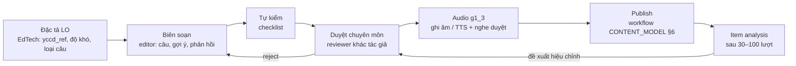

# Kế hoạch sản xuất nội dung học tập

> Trạng thái: Draft · Phiên bản: 0.1 · Owner: EdTech Specialist + Product Owner · Cập nhật: 2026-11-15
> Liên quan: [CURRICULUM_MODEL](CURRICULUM_MODEL.md) · [CONTENT_MODEL](CONTENT_MODEL.md) · [QUESTION_BANK](QUESTION_BANK.md) · [EDU_FIT_REVIEW](../12-project/EDU_FIT_REVIEW.md) (PED-02, K2) · [OQ-08](../12-project/OPEN_QUESTIONS.md) · [RISKS](../12-project/RISKS.md) (RISK-06) · [ROADMAP](../12-project/ROADMAP.md)

Mọi con số trong tài liệu là **[Confirmed]** — ước tính để lập kế hoạch, phải được EdTech Specialist hiệu chỉnh bằng dữ liệu thật sau 4 tuần sản xuất đầu tiên. Phạm vi môn/khối theo **OQ-08** (owner chốt 2026-11-20: phương án pilot tối thiểu §2, khối lượng theo §3.4) [Confirmed].

## 1. Mục đích và phạm vi

Engine học tập của EduWorld cần nhiều nội dung: selection rule cần pool ≥ 3 × số câu, tránh lặp câu 7 ngày, ôn câu sai cần câu anh em, đề kiểm tra cần câu `exam_only` và nhiều biến thể, lớp 1–3 cần lồng tiếng. Tài liệu này lượng hóa khối lượng nội dung, ưu tiên cách sản xuất có năng suất cao (câu tham số hóa), định nghĩa quy trình biên soạn–duyệt–publish và đề xuất quy mô đội.

| Trong phạm vi | Ngoài phạm vi |
|---|---|
| Câu hỏi, gợi ý, phản hồi theo phương án, ví dụ mẫu, audio đọc đề | Nội dung game (quest, NPC, map) — [QUEST_SYSTEM](../01-game-design/QUEST_SYSTEM.md) |
| Mô hình năng suất, quy mô đội, quy trình | Sản xuất video bài giảng (ước tính riêng khi có phạm vi) |
| Import Word/MathType, AI sinh nháp (đề xuất) | Bản quyền sách giáo khoa (OQ-08, RISK-06) |

## 2. Phạm vi theo OQ-08 [Confirmed]

| Phương án | Môn × khối | Ghi chú |
|---|---|---|
| Pilot tối thiểu (khuyến nghị) | Toán + Tiếng Việt, lớp 1–5 | Khớp phạm vi pilot gợi ý ở [EDU_FIT_REVIEW §6](../12-project/EDU_FIT_REVIEW.md) và seed hiện có ([CURRICULUM_MODEL §7](CURRICULUM_MODEL.md#7-seed-ví-dụ--gdpt-2018-toán-lớp-15-confirmed-oq-08)) |
| Mở rộng 1 | + Tiếng Anh lớp 3–5 | Cần audio `en` cho mọi câu nghe |
| Release đầy đủ | 4 môn × 9 khối | Chỉ sau khi đạt throughput ổn định |

OQ-08 đã chốt (owner 2026-11-20): pilot dùng phương án **Pilot tối thiểu** (Toán + Tiếng Việt lớp 1–5); khối lượng nội dung pilot là mô hình §3.4 (≈ 550 LO × 30 câu tương đương, ≥ 40% câu luyện tập Toán dạng template, lồng tiếng giọng người cho `g1_3`); "Mở rộng 1" và "Release đầy đủ" theo giai đoạn của ADR-0073. Throughput không đạt thì cắt khối trước khi giảm chất lượng (§9). Số LO mỗi khối EdTech đếm lại theo chương trình và hiệu chỉnh sau 4 tuần sản xuất đầu tiên, không mở lại phạm vi.

## 3. Mô hình năng suất

### 3.1. Công thức

```text
Câu cần có     = Σ (môn, khối) [ số LO × câu/LO ]
Giờ công       = Σ loại câu [ số câu × (giờ soạn + giờ duyệt) ] + giờ audio + giờ dịch
FTE            = Giờ công / giờ sản xuất hiệu dụng của một người trong kỳ
```

### 3.2. Số câu mỗi LO (đơn vị "câu tương đương")

| Mục đích | Câu/LO | Căn cứ |
|---|---|---|
| Luyện tập, quest, mini-game | 18 | Pool ≥ 3 × 5 câu mỗi lượt, cộng dư cho tránh lặp 7 ngày ([QUESTION_BANK §6](QUESTION_BANK.md#6-chọn-câu-ngẫu-nhiên-theo-điều-kiện)) |
| Câu anh em cho ôn câu sai | (đã gồm trong 18, cần ≥ 2 câu cùng loại/độ khó mỗi mức) | [QUESTION_BANK §6](QUESTION_BANK.md#6-chọn-câu-ngẫu-nhiên-theo-điều-kiện) |
| Đề kiểm tra (`exam_only`) | 8 | 4 biến thể × 2 câu/LO |
| Bài chẩn đoán | 4 | 2–3 câu/LO, dư cho 2 dạng |
| **Tổng** | **30** | |

Một **template tham số hóa** ([QUESTION_BANK §5](QUESTION_BANK.md#5-câu-hỏi-tham-số-hóa-confirmed)) sinh nhiều biến thể; quy ước tính bằng **10 câu tương đương** cho luyện tập (không dùng cho `exam_only` và bài đo hiệu quả).

### 3.3. Chi phí đơn vị

| Công việc | Thời gian | Ghi chú |
|---|---|---|
| Soạn câu thường (đề, đáp án, 2 cấp gợi ý, giải thích, phản hồi phương án nhiễu) | 12 phút | |
| Soạn template tham số hóa (kể cả ràng buộc, kiểm thử biến thể) | 30 phút | |
| Duyệt chuyên môn (reviewer ≠ author) | 5 phút/câu hoặc template | |
| Audio `g1_3`: ghi âm giọng người, cắt, gắn | 3 phút/clip | Trung bình 1,5 clip/câu (đề + hướng dẫn/gợi ý) |
| Audio `g1_3` bằng TTS: sinh + nghe duyệt | 1 phút/clip | Khi engine TTS được chọn ([CONTENT_MODEL §8.1](CONTENT_MODEL.md#81-audio-đọc-đề-và-hướng-dẫn-cho-nhóm-g1_3-confirmed)) |
| Dịch `en` (tùy chọn, ADR-0056) | 5 phút/câu | Chỉ khi trường song ngữ cần |
| Ví dụ mẫu (`worked_example`) | 30 phút/LO | 1 ví dụ/LO |

### 3.4. Ví dụ: pilot Toán + Tiếng Việt lớp 1–5

| Hạng mục | Giả định | Kết quả |
|---|---|---|
| Số LO | Toán 50 LO/khối, Tiếng Việt 60 LO/khối (cần EdTech đếm theo chương trình) | 550 LO |
| Câu tương đương | 550 × 30 | 16.500 |
| Tỉ lệ tham số hóa (phần luyện tập) | 40% câu luyện tập của Toán (250 × 18), 10% của Tiếng Việt (300 × 18) | ≈ 234 template thay ≈ 2.340 câu tương đương |
| Câu thường còn lại | 16.500 − 2.340 | ≈ 14.160 câu |
| Giờ soạn | 14.160 × 12 phút + 234 × 30 phút | ≈ 2.950 giờ |
| Giờ duyệt | 14.394 × 5 phút | ≈ 1.200 giờ |
| Audio lớp 1–3 (60% nội dung) | ≈ 8.640 mục × 1,5 clip × 3 phút (giọng người) | ≈ 650 giờ (TTS: ≈ 215 giờ) |
| Ví dụ mẫu | 550 × 30 phút | ≈ 275 giờ |
| **Tổng** | | **≈ 5.100 giờ** (≈ 4.650 giờ nếu dùng TTS) |

Với ~130 giờ sản xuất hiệu dụng/người/tháng, pilot cần khoảng **39 người-tháng**, tức ~6–7 người trong 6 tháng. Đội hiện tại chỉ có 1 EdTech Specialist ([ROADMAP](../12-project/ROADMAP.md)) nên đây là rủi ro sống còn (RISK-06): phải chốt OQ-08 theo phạm vi nhỏ, tăng tham số hóa và tăng nhân sự.

## 4. Ưu tiên câu tham số hóa

- **Nên tham số hóa:** phép tính, so sánh số, đo lường, đổi đơn vị, bài toán có lời văn với số thay đổi, chu vi/diện tích; `numeric`, `single_choice` có phương án nhiễu sinh theo lỗi sai điển hình (ví dụ `a + b` khi đề là `a × b`, kèm `options[].feedback` tương ứng).
- **Không nên tham số hóa:** chính tả, từ vựng, đọc hiểu, câu phụ thuộc hình vẽ cố định, câu `exam_only` của đề chính thức và bài đo hiệu quả (cần kiểm soát độ khó chính xác).
- **Yêu cầu chất lượng template:** ràng buộc tránh giá trị suy biến (chia cho 0, kết quả âm với lớp nhỏ), xem trước ≥ 20 biến thể ngẫu nhiên trong portal trước khi duyệt, độ khó các biến thể tương đương.
- Mục tiêu: ≥ 40% câu luyện tập Toán ở dạng template [Confirmed].

## 5. Quy trình biên soạn – duyệt – publish



| Bước | Ai | Đầu ra / kiểm tra |
|---|---|---|
| Đặc tả LO | EdTech Specialist | LO có `yccd_ref`, ma trận loại câu × độ khó cần sản xuất, ví dụ mẫu |
| Biên soạn | `content_editor`/`tenant_content_editor` | Câu hỏi đủ trường bắt buộc, ≥ 2 cấp gợi ý (lớp 1–5), phản hồi cho phương án nhiễu chính |
| Tự kiểm | Tác giả | Checklist: đúng chương trình, một đáp án đúng, phương án nhiễu hợp lý, không sao chép sách giáo khoa khi chưa có giấy phép, ngôn ngữ phù hợp lứa tuổi, không định kiến |
| Duyệt | `content_reviewer`/`tenant_content_reviewer` (≠ tác giả) | Approve/reject có lý do |
| Audio | Người lồng tiếng / người duyệt TTS | Đủ audio bắt buộc, phát âm chuẩn |
| Publish | `content_admin` hoặc người có quyền publish | Theo [CONTENT_MODEL §6](CONTENT_MODEL.md#6-workflow-trạng-thái) |
| Sau publish | EdTech | Item analysis, hiệu chỉnh độ khó ([QUESTION_BANK §9.1](QUESTION_BANK.md#91-hiệu-chỉnh-độ-khó-bán-tự-động-confirmed)), viết thêm phản hồi cho phương án nhiễu được chọn nhiều |

**Chỉ số theo dõi hằng tuần:** câu publish/tuần theo môn × khối, tỉ lệ reject ở bước duyệt (mục tiêu < 20%), thời gian từ soạn đến publish, số LO chưa đủ pool (`pool < 3 × count`), số câu thiếu audio.

## 6. Quy mô đội đề xuất (pilot tối thiểu)

| Vai trò | Số người | Ghi chú |
|---|---|---|
| EdTech Specialist (lead) | 1 | Đặc tả LO, chuẩn chất lượng, item analysis |
| Biên tập viên nội dung Toán | 2 | Ưu tiên tham số hóa |
| Biên tập viên nội dung Tiếng Việt | 2 | |
| Người duyệt chuyên môn | 1–2 (có thể bán thời gian: cộng tác viên có chuyên môn sư phạm môn học) | Reviewer ≠ author |
| Lồng tiếng / biên tập audio | 0,5–1 | Giảm khi dùng TTS |
| QA nội dung | 0,5 | Kiểm thử trên game, phát hiện lỗi hiển thị |

## 7. AI sinh nháp có người duyệt — không dùng trong version này

[Confirmed — owner 2026-11-20, OQ-08] Version này **không** dùng mô hình ngôn ngữ để sinh nháp câu hỏi, gợi ý hay phản hồi phương án nhiễu; năng suất dựa vào câu tham số hóa (§4) và import (§8). Dùng AI sinh nháp sau này cần ADR riêng, với các ràng buộc tối thiểu:

- Không gửi dữ liệu học sinh; chỉ gửi đặc tả LO và ví dụ nội dung của EduWorld.
- Mọi nháp đi qua đúng quy trình §5, người duyệt chịu trách nhiệm như nội dung tự soạn; không auto-publish.
- Ghi nguồn gốc `provenance = ai_assisted` trên version để thống kê chất lượng và tỉ lệ reject riêng.
- Đánh giá bản quyền, nơi xử lý dữ liệu, chi phí; đo chất lượng bằng item analysis so với câu tự soạn.

## 8. Import Word/MathType [Confirmed]

Nhiều người soạn có sẵn câu hỏi trong Word với công thức MathType/Equation. Đề xuất công cụ import vào portal (bổ sung cho import Excel/CSV/QTI-lite, FR-QB-011):

| Bước | Mô tả |
|---|---|
| 1. Mẫu tài liệu | Mẫu `.docx` quy ước: "Câu n.", phương án "A./B./C./D.", đáp án đánh dấu (in đậm hoặc dòng `Đáp án:`), các dòng `Gợi ý 1:`, `Giải thích:`, metadata `LO:`, `Độ khó:` |
| 2. Phân tích | Đọc `.docx` (Office Open XML), tách câu theo mẫu; ảnh nhúng đưa vào media pipeline ([CONTENT_MODEL §7](CONTENT_MODEL.md#7-media-asset-pipeline-adr-0044)) |
| 3. Công thức | Equation Word (OMML) → MathML → LaTeX; đối tượng MathType cũ (OLE) dùng MathML nhúng nếu có, không có thì đánh dấu "cần soạn lại công thức"; LaTeX sau chuyển đổi đi qua allowlist và render SVG như mọi công thức ([CONTENT_MODEL §9.1](CONTENT_MODEL.md#91-công-thức-toán-lý-hóa-adr-0055)) |
| 4. Kết quả | Chỉ tạo **Draft**, kèm báo cáo từng câu (thành công/cảnh báo/lỗi); không bao giờ tự publish; người soạn sửa trong editor rồi gửi duyệt |
| 5. An toàn | File tải lên quét virus như media; bỏ macro, liên kết ngoài; giới hạn dung lượng |

Công cụ chuyển đổi: **Pandoc** (CLI, đọc `.docx` gồm công thức OMML ra LaTeX) chạy như tiến trình ngoài trong image `eduworld/media-tools` cùng ffmpeg/libvips, không link vào binary Go [Confirmed — owner 2026-11-20]. Đối tượng MathType OLE không có MathML nhúng vẫn đánh dấu "cần soạn lại công thức". Trước khi mở cho người soạn, spike đo tỉ lệ chuyển đổi đúng trên bộ mẫu thật của Toán/Lý/Hóa làm tiêu chí nghiệm thu.

**Hiện thực — F028** [Confirmed — owner 2026-11-27, lệnh "chốt hết", phương án an toàn; chi tiết [specs/028-docx-math-import](../../specs/028-docx-math-import/spec.md), spike ở research.md]:

- **Image:** `eduworld/media-tools` = stage `media-tools` của `deploy/docker/worker.Dockerfile` (Alpine 3.22.8 ghim digest: ffmpeg + `pandoc-cli~3.6.4` — Pandoc 3.6.4, đổi phiên bản phải cập nhật golden AST của F028; CI lane Go dựng stage này để chạy test import Word, [DEPLOYMENT §10.2](../11-operations/DEPLOYMENT.md)); image `worker` dựng trên stage đó, job `import-jobs` (profile `jobs`) chạy `pandoc --sandbox -f docx -t json` qua stdin/stdout, môi trường rỗng, timeout `docx_convert_timeout`, heap `docx_convert_memory`. Ảnh nhúng đọc từ zip bằng Go, Pandoc không ghi file, không truy cập mạng.
- **Mẫu tài liệu:** khối đầu `Môn:` (mã môn), `Khối:` (một hoặc nhiều khối), `Chương trình:` (mã curriculum), `Phiên bản chương trình:` (tùy chọn), `Chủ đề:` (mã topic), `Ngôn ngữ:` (`vi`/`en`); mỗi câu bắt đầu "Câu n." hoặc "Câu n:"; phương án `A.`…`H.`; đáp án = **chữ cái in đậm** hoặc dòng `Đáp án: B` / `Đáp án: A, C` (khác nhau → lỗi); một đáp án → `single_choice`, nhiều → `multiple_choice` (≥ 3 phương án); `Gợi ý k:` (≤ 5), `Giải thích:`, `LO:`, `Độ khó:` (1–5), `Chủ đề:` trong câu ghi đè khối đầu; đoạn không nhãn nối vào phần đang viết. Loại câu khác soạn trong editor.
- **Công thức:** LaTeX của Pandoc chỉ qua allowlist chung của §9.1 CONTENT_MODEL (ADR-0055 §7) — không có allowlist riêng; inline thành `\( … \)` trong đoạn, công thức một dòng thành khối `math`. Spike: 22/22 cấu trúc (phân số, căn, lũy thừa/chỉ số, ma trận, hệ phương trình, tổng/tích phân/giới hạn, vector, ký hiệu quan hệ) đúng và render được bằng MathJax 4.
- **Từ chối/cảnh báo:** MathType OLE → câu lỗi `FORMULA_NEEDS_REWRITE`; ảnh không có alt text hoặc không phải PNG/JPEG/WebP → câu lỗi; bảng → câu lỗi; liên kết ngoài (giữ chữ), chú thích, danh sách tự đánh số, chỉ số định dạng chữ → cảnh báo; macro → **từ chối cả file**; file vượt `csv_import_max`, `docx_zip_entries_max`, `docx_uncompressed_max`, `docx_import_max_questions` → job `failed`.
- **Hai giai đoạn:** job `lessons_docx` chỉ phân tích, lưu báo cáo từng câu (`content.import_items`: `ready`/`warning`/`error`), không tạo câu hỏi (cờ `dry_run` không đổi hành vi); portal render SVG công thức bằng MathJax 4 (ADR-0055 §4) rồi gọi `createDraftFromImportItem` từng câu (Idempotency-Key mỗi câu): server ghép SVG vào nội dung đã phân tích, đưa ảnh nhúng vào media pipeline (§7 CONTENT_MODEL, giấy phép của file Word), chạy validator của `createQuestion`, tạo **version 1 Draft** (`created`) hoặc ghi lý do (`draft_failed`, tạo lại được).
- **Tiêu chí bộ mẫu thật:** ≥ 95% công thức OMML chuyển đúng ngữ nghĩa và render được, 0 câu nhập sai đáp án, đo trên ≥ 30 file thật Toán/Lý/Hóa lớp 6–9 (ngoài repo) theo quickstart §2.6 của F028 trước khi mở cho người soạn.

| Tham số | Giá trị | Ghi chú |
|---|---|---|
| `docx_import_max_questions` | 200 câu/file | Vượt → job `failed` `TOO_MANY_QUESTIONS` |
| `docx_convert_timeout` | 60 giây | Một lần chạy Pandoc; quá → `CONVERSION_TIMEOUT` |
| `docx_convert_memory` | 512 MB | Heap Pandoc (`+RTS -M`) |
| `docx_uncompressed_max` / `docx_zip_entries_max` | 50 MB / 1.000 phần | Chống zip bomb; vượt → `DOCX_TOO_COMPLEX` |

## 9. Rủi ro

| Rủi ro | Giảm thiểu |
|---|---|
| Không đủ nội dung cho pilot (RISK-06) | Chốt OQ-08 phạm vi nhỏ; tham số hóa; theo dõi throughput hằng tuần; cắt phạm vi khối trước khi giảm chất lượng |
| Chất lượng không đồng đều | Checklist §5, reviewer ≠ author, item analysis sau publish |
| Vi phạm bản quyền sách giáo khoa | Không sao chép nguyên văn khi chưa có giấy phép (CURRICULUM_MODEL §6); trường `license`/nguồn |
| Thiếu audio làm chặn publish lớp 1–3 | Lập kế hoạch audio song song từ đầu; chọn TTS sớm |

## 10. Acceptance criteria

Yêu cầu (mã PRD): FR-QB-011 (import, gồm Word/MathType), FR-QB-008 (template tham số hóa), FR-CUR-004 (seed), FR-CNT-017 (công thức).

| AC | Kịch bản |
|---|---|
| AC-CPP-001 | Báo cáo throughput hằng tuần hiển thị số câu publish theo môn × khối và số LO chưa đủ pool |
| AC-CPP-002 | Import `.docx` mẫu 50 câu có công thức OMML → 50 Draft, công thức chuyển sang LaTeX hợp lệ và render SVG; câu lỗi có báo cáo, không tạo version published |
| AC-CPP-003 | Template tham số hóa không được duyệt khi chưa xem trước ≥ 20 biến thể |
| AC-CPP-004 | Sau 4 tuần sản xuất, bảng chi phí đơn vị §3.3 được cập nhật bằng số liệu thật |
