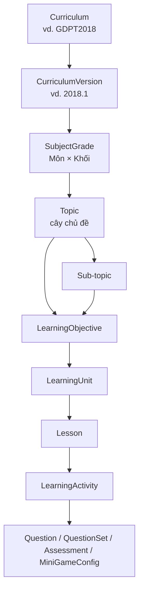

# Curriculum Model

> Trạng thái: Draft · Phiên bản: 0.1 · Owner: EdTech Specialist + Backend Architect · Cập nhật: 2026-11-15
> Liên quan: [DOMAIN_MODEL §3](../06-architecture/DOMAIN_MODEL.md#3-curriculum--content) · [CONTENT_MODEL](CONTENT_MODEL.md) · [QUESTION_BANK](QUESTION_BANK.md) · [ADR-0015](../adr/ADR-0015-content-versioning-bat-bien-sau-publish.md) · [OQ-08](../12-project/OPEN_QUESTIONS.md)

## 1. Mục đích

Curriculum là **khung tham chiếu** mà mọi nội dung học tập, câu hỏi, quest, mini-game và số liệu mastery đều gắn vào. Module `curriculum` (schema `curriculum`) chỉ quản lý cấu trúc; nội dung cụ thể (bài giảng, câu hỏi) thuộc module `content`.

Nguyên tắc:

- **[Confirmed]** Không hardcode một chương trình học duy nhất; hỗ trợ nhiều chương trình và phiên bản (Master Prompt §4.1).
- **[Confirmed]** CMS quản lý được nội dung và cấu trúc chương trình.
- **[Proposed]** Learning Objective (LO) là đơn vị nguyên tử để đo mastery, gợi ý ôn tập và ghép nội dung game.
- **[Proposed]** Cấu trúc chương trình được phiên bản hóa theo **CurriculumVersion**; một version đã `published` thì bất biến (ADR-0015).

## 2. Cấu trúc phân cấp

| Cấp | Entity | Thuộc module | Phiên bản hóa | Ghi chú |
|---|---|---|---|---|
| 1 | `curriculum` | curriculum | qua `curriculum_version` | vd. `GDPT2018`, `CAMBRIDGE_PRIMARY` |
| 2 | `curriculum_version` | curriculum | có | `version`, `status`, `effective_from`, `effective_to` |
| 3 | `subject` | curriculum | không (danh mục) | `math`, `vietnamese`, `english`, `science`, `nature_society`, `history_geography`, `informatics`, `technology`... |
| 3 | `grade_level` | — | — | enum 1–9, không phải bảng |
| 3 | `subject_grade` | curriculum | thuộc version | cặp môn × khối trong một version; `periods_per_year` |
| 4 | `topic` | curriculum | thuộc version | cây, `parent_topic_id`, `sort_order` |
| 5 | `learning_objective` | curriculum | thuộc version | `code`, `description`, `bloom_level`, `topic_id` |
| 6 | `learning_unit` | content | có | nhóm bài theo LO |
| 7 | `lesson` | content | có | |
| 8 | `learning_activity` | content | có | tham chiếu `content_ref` |
| 9 | `question` / `question_set` / `assessment_blueprint` | content | có | xem [QUESTION_BANK](QUESTION_BANK.md) |

Ranh giới: các cấp 1–5 thuộc `curriculum`; 6–9 thuộc `content`. Content tham chiếu `learning_objective_id` của **một** curriculum version cụ thể.

## 3. Chi tiết entity

### 3.1. Curriculum & CurriculumVersion

| Field | Kiểu | Bắt buộc | Mô tả |
|---|---|---|---|
| `curriculum_id` | uuid | ✔ | |
| `code` | string | ✔ | duy nhất toàn platform, `UPPER_SNAKE` |
| `name` | i18n text | ✔ | "Chương trình GDPT 2018" |
| `owner_scope` | enum | ✔ | `platform` / `organization` / `school` |
| `owner_id` | uuid | khi scope ≠ platform | |
| `curriculum_version_id` | uuid | ✔ | |
| `version` | string | ✔ | semver rút gọn `MAJOR.MINOR` |
| `status` | `content_status` | ✔ | draft → in_review → approved → published → archived |
| `effective_from` / `effective_to` | date | | áp dụng theo năm học |
| `supersedes_version_id` | uuid | | version trước |

### 3.2. Topic

`topic_id`, `curriculum_version_id`, `subject_id`, `grade_level`, `parent_topic_id?`, `code`, `name`, `sort_order`, `textbook_refs[]` (xem §6).

### 3.3. LearningObjective

| Field | Mô tả |
|---|---|
| `learning_objective_id` | uuid |
| `code` | mã chuẩn (§4), duy nhất trong một curriculum version |
| `description` | i18n, viết theo dạng "Học sinh có thể ..." |
| `topic_id` | chủ đề chứa LO |
| `bloom_level` | `remember`, `understand`, `apply`, `analyze`, `evaluate`, `create` |
| `prerequisite_ids[]` | LO tiên quyết (đồ thị DAG, dùng cho gợi ý ôn tập) |
| `stable_key` | khóa ổn định qua các version (§5) |
| `mastery_params_ref` | tham chiếu cấu hình mastery riêng (tùy chọn, ADR-0017) |

## 4. Mã Learning Objective chuẩn [Proposed]

Định dạng: `<SUBJECT>.G<grade>.<STRAND>.<SKILL>[.<n>]`

| Thành phần | Quy tắc | Ví dụ |
|---|---|---|
| `SUBJECT` | mã môn viết hoa | `MATH`, `VIET`, `ENG`, `SCI` |
| `G<grade>` | khối 1–9 | `G3` |
| `STRAND` | mạch kiến thức (≤ 6 ký tự) | `NUM` (Số & phép tính), `GEO` (Hình học & đo lường), `STAT` (Thống kê & xác suất) |
| `SKILL` | kỹ năng, `UPPER_SNAKE` | `MUL_TABLE` |
| `.<n>` | chỉ số chi tiết khi tách nhỏ | `.1`, `.2` |

Ví dụ: `MATH.G3.NUM.MUL_TABLE.2` — "Thuộc bảng nhân 6, 7, 8, 9".

Quy tắc:

1. Mã **không** chứa tên bộ sách (bộ sách là mapping, §6).
2. Mã giữ nguyên qua các CurriculumVersion nếu ngữ nghĩa không đổi (`stable_key` = mã).
3. Đổi ngữ nghĩa → mã mới + quan hệ `replaces` trong bảng mapping version (§5).

## 5. Đa chương trình & di chuyển phiên bản

- Một trường chọn **curriculum version mặc định** cho mỗi năm học (`school.settings.curriculum_version_id`) [Proposed].
- Có thể tồn tại song song nhiều version (vd. khối 1–5 dùng 2018.1, khối 6–9 dùng 2018.2).
- Khi publish CurriculumVersion mới, CMS tạo bảng `lo_version_mappings(from_lo_id, to_lo_id, relation)` với `relation ∈ {same, split, merge, replaces, removed}`.
- Mastery: khi học sinh chuyển sang version mới, mastery được **chiếu** qua mapping `same` (giữ nguyên), `split` (copy giá trị, giảm `evidence_count` một nửa), `merge` (trung bình có trọng số theo evidence), `removed` (giữ lịch sử, không hiển thị). Learning events gốc không bị sửa.
- Attempt/learning event luôn lưu `learning_objective_id` của version tại thời điểm làm bài → truy xuất lịch sử chính xác.

## 6. Mapping bộ sách giáo khoa [Proposed, TBD — OQ-08]

Chương trình GDPT 2018 có nhiều bộ sách (vd. "Kết nối tri thức với cuộc sống", "Chân trời sáng tạo", "Cánh Diều"). Bộ sách khác nhau về **thứ tự và cách chia bài**, không về yêu cầu cần đạt. Do đó:

| Entity | Field | Mô tả |
|---|---|---|
| `textbook_series` | `code`, `name`, `publisher` | bộ sách |
| `textbook` | `series_id`, `subject_id`, `grade_level`, `volume` | tập sách |
| `textbook_section` | `textbook_id`, `chapter`, `lesson_no`, `title`, `page_range` | bài trong sách |
| `textbook_section_objectives` | `section_id`, `learning_objective_id` | n–n |

Dùng cho: giáo viên lọc nội dung "theo bài 12 sách Cánh Diều"; lịch học (LMS) sắp xếp theo tiến độ sách. Nội dung câu hỏi **không** sao chép nguyên văn sách giáo khoa khi chưa có giấy phép (RISK bản quyền, OQ-08).

## 7. Seed ví dụ — GDPT 2018 Toán lớp 1–5 [Proposed, OQ-08]

Dữ liệu seed cho môi trường dev và pilot. Đây là **ví dụ cấu trúc**, cần EdTech Specialist rà soát theo văn bản chương trình chính thức trước khi dùng trong production.

| Khối | Mạch | Topic | LO code | Mô tả LO |
|---|---|---|---|---|
| 1 | NUM | Các số đến 10 | `MATH.G1.NUM.COUNT_10` | Đếm, đọc, viết các số trong phạm vi 10 |
| 1 | NUM | Các số đến 10 | `MATH.G1.NUM.COMPARE_10` | So sánh các số trong phạm vi 10 |
| 1 | NUM | Phép cộng, trừ trong phạm vi 10 | `MATH.G1.NUM.ADD_SUB_10` | Thực hiện cộng, trừ trong phạm vi 10 |
| 1 | GEO | Hình phẳng | `MATH.G1.GEO.SHAPES_2D` | Nhận biết hình vuông, tròn, tam giác, chữ nhật |
| 2 | NUM | Phép cộng, trừ có nhớ trong phạm vi 100 | `MATH.G2.NUM.ADD_SUB_100_CARRY` | Cộng, trừ có nhớ trong phạm vi 100 |
| 2 | NUM | Bảng nhân 2, 5 | `MATH.G2.NUM.MUL_TABLE.1` | Thuộc bảng nhân 2, 5 |
| 2 | GEO | Đo độ dài | `MATH.G2.GEO.LENGTH_CM_DM` | Đo và đổi đơn vị cm, dm |
| 3 | NUM | Bảng nhân, chia 6–9 | `MATH.G3.NUM.MUL_TABLE.2` | Thuộc bảng nhân 6, 7, 8, 9 |
| 3 | NUM | Phép chia có dư | `MATH.G3.NUM.DIV_REMAINDER` | Thực hiện phép chia có dư |
| 3 | GEO | Chu vi | `MATH.G3.GEO.PERIMETER` | Tính chu vi hình chữ nhật, hình vuông |
| 4 | NUM | Số có nhiều chữ số | `MATH.G4.NUM.LARGE_NUMBERS` | Đọc, viết, so sánh số đến lớp triệu |
| 4 | NUM | Phân số | `MATH.G4.NUM.FRACTION_BASIC` | Nhận biết, rút gọn, so sánh phân số |
| 4 | STAT | Biểu đồ cột | `MATH.G4.STAT.BAR_CHART` | Đọc, mô tả số liệu trên biểu đồ cột |
| 5 | NUM | Số thập phân | `MATH.G5.NUM.DECIMAL_OPS` | Cộng, trừ, nhân, chia số thập phân |
| 5 | NUM | Tỉ số phần trăm | `MATH.G5.NUM.PERCENT` | Giải bài toán tỉ số phần trăm |
| 5 | GEO | Diện tích, thể tích | `MATH.G5.GEO.AREA_VOLUME` | Tính diện tích hình thang, thể tích hình hộp chữ nhật |

Định dạng file seed: `backend/migrations/curriculum/seed/gdpt2018_math_g1_5.yaml` — dạng cây `curriculum → version → subject_grade → topics[] → objectives[]`. Seed chạy qua use case CMS import (không SQL thủ công) để đi qua validation và audit.

## 8. Yêu cầu chức năng

| ID | Yêu cầu | Nhãn |
|---|---|---|
| FR-CUR-001 | Tạo/sửa Curriculum, CurriculumVersion, Subject, Topic, LO qua CMS | [Confirmed] |
| FR-CUR-002 | Hỗ trợ nhiều curriculum và nhiều version song song | [Confirmed] |
| FR-CUR-003 | Workflow duyệt cho CurriculumVersion (draft → published) | [Proposed] |
| FR-CUR-004 | Import/export curriculum dạng YAML/CSV có validate | [Proposed] |
| FR-CUR-005 | Mapping LO giữa hai version và chiếu mastery | [Proposed] |
| FR-CUR-006 | Mapping bộ sách → LO | [Proposed] |
| FR-CUR-007 | Đồ thị LO tiên quyết, phát hiện chu trình khi lưu | [Proposed] |
| FR-CUR-008 | Trường chọn curriculum version mặc định theo năm học | [Proposed] |

## 9. API (tóm tắt)

| Method | Path | Mô tả | Quyền |
|---|---|---|---|
| GET | `/api/v1/learning/curricula` | Danh sách curriculum khả dụng cho principal | mọi role đã đăng nhập |
| GET | `/api/v1/learning/curricula/{id}/versions/{vid}/tree?subject=&grade=` | Cây topic + LO (read model, cache) | mọi role |
| GET | `/api/v1/learning/objectives/{lo_id}` | Chi tiết LO | mọi role |
| POST/PATCH | `/api/v1/cms/curricula/...` | Soạn thảo cấu trúc | `content_admin`, `academic_manager` |
| POST | `/api/v1/cms/curricula/{id}/versions/{vid}:submit-review` / `:publish` | Workflow | xem [ADMIN_PORTAL](../04-admin-portal/ADMIN_PORTAL.md) |
| POST | `/api/v1/cms/curricula/import` | Import YAML (Idempotency-Key) | `content_admin` |

Godot chỉ đọc cây curriculum dạng rút gọn (topic, LO code, tên hiển thị) để render khu học tập; không đọc metadata biên tập.

## 10. Kiểm thử

- Unit: validate mã LO, phát hiện chu trình prerequisite, chiếu mastery qua mapping.
- Integration: publish version mới không làm thay đổi attempt cũ (truy vấn lịch sử trả về LO version cũ).
- Tenant: curriculum `owner_scope=school` của trường A không hiển thị cho trường B.
