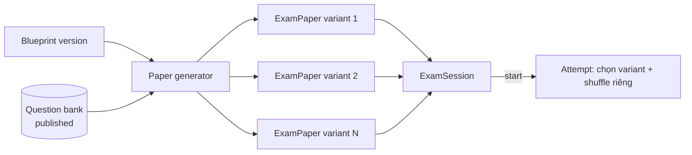

# Exam & Practice Engine

> Trạng thái: Draft · Phiên bản: 0.1 · Owner: Senior Golang Developer + EdTech Specialist · Cập nhật: 2026-11-15
> Liên quan: [QUESTION_BANK](QUESTION_BANK.md) · [ACTIVITY_ENGINE](ACTIVITY_ENGINE.md) · [LEARNING_ANALYTICS](LEARNING_ANALYTICS.md) · [ANTI_CHEAT](../10-security/ANTI_CHEAT.md) · [OQ-18](../12-project/OPEN_QUESTIONS.md) · Schema: [`assessment-blueprint.schema.json`](../../specs/schemas/assessment-blueprint.schema.json)

## 1. Phạm vi & định vị

Module `exam` (schema `assessment`) tổ chức **bài kiểm tra có cấu trúc đề, giới hạn thời gian và chính sách công bố kết quả**. Dùng chung `attempt`/`attempt_item`/`attempt_answer` và grader của question_bank.

**[Proposed, OQ-18]** EduWorld hỗ trợ luyện đề, thi thử, kiểm tra do giáo viên giao. **Không** tổ chức kỳ thi có giá trị pháp lý trong Release 1.0 khi chưa có quyết định ở OQ-18; không có proctoring (camera/khóa màn hình). Cờ `is_official` chỉ có nghĩa "kết quả được giáo viên ghi nhận" trong LMS.

## 2. Loại đề [Confirmed — Master Prompt §4.5]

| `exam_type` | Mô tả | Ai tạo | `is_official` mặc định | Lượt làm |
|---|---|---|---|---|
| `practice_test` | Luyện đề tự do | Học sinh chọn từ thư viện đề | false | không giới hạn |
| `mock` | Thi thử mô phỏng kỳ thi | Platform / trường | false | theo cấu hình (mặc định 3) |
| `chapter` | Kiểm tra theo chương | Giáo viên | true | 1 (có thể cho làm lại) |
| `semester` | Kiểm tra học kỳ | Giáo viên / trường | true | 1 |
| `subject` | Kiểm tra theo môn | Giáo viên | true | 1 |
| `custom` | Đề tùy chỉnh | Giáo viên | tùy chọn | tùy chọn |
| `timed` | Thuộc tính, không phải loại: mọi loại có `duration_sec` | — | — | — |

Phân biệt rõ:

| Thuộc tính | Luyện tập (`practice_test`, `mock`) | Kiểm tra (`chapter`, `semester`, `subject`, `custom` official) |
|---|---|---|
| Phản hồi trong khi làm | Không (giống thi) | Không |
| Xem kết quả | Ngay sau nộp | Theo `result_release` |
| Ghi vào sổ điểm LMS | Không | Có |
| Trọng số mastery (ADR-0017) | 0.7 (practice) | 1.0 (exam) |
| XP | Có (cap) | Không thưởng XP theo điểm [Proposed] — chỉ XP tham gia cố định, tránh áp lực |
| Leaderboard | Không | Không |

## 3. Assessment Blueprint

Blueprint (versioned, ADR-0015) mô tả ma trận đề, ví dụ "Kiểm tra giữa kỳ I Toán 3":

```json
{
  "title": "Kiểm tra giữa kỳ I - Toán 3",
  "subject_id": "…", "grade_levels": [3],
  "duration_sec": 2400,
  "sections": [
    {
      "id": "sec_1", "title": "Phần I. Trắc nghiệm", "shuffle_items": true,
      "rules": [
        { "objective_ids": ["<MATH.G3.NUM.MUL_TABLE.2>"], "difficulty": { "min": 1, "max": 2 }, "types": ["single_choice"], "count": 4, "points_each": 0.5 },
        { "objective_ids": ["<MATH.G3.NUM.DIV_REMAINDER>"], "difficulty": { "min": 2, "max": 3 }, "types": ["single_choice", "true_false"], "count": 4, "points_each": 0.5 }
      ]
    },
    {
      "id": "sec_2", "title": "Phần II. Tự luận ngắn", "shuffle_items": false,
      "rules": [
        { "objective_ids": ["<MATH.G3.GEO.PERIMETER>"], "difficulty": { "min": 2, "max": 4 }, "types": ["numeric"], "count": 3, "points_each": 2 }
      ]
    }
  ],
  "total_points": 10,
  "variants": { "count": 4, "strategy": "independent_draw" },
  "shuffle_options": true,
  "navigation": "free",
  "result_release": { "mode": "after_window_close", "show_correct_answers": true, "show_explanations": true },
  "attempt_policy": { "max_attempts": 1, "score_policy": "last" }
}
```

Validation khi submit review: tổng điểm khớp `total_points`; pool mỗi rule ≥ `count × variants.count` (nếu `independent_draw`), ngược lại cảnh báo; không trùng câu giữa các rule.

## 4. Sinh đề



| Chiến lược `variants.strategy` | Mô tả |
|---|---|
| `fixed` | 1 đề cố định, chỉ shuffle thứ tự |
| `independent_draw` | N đề, mỗi đề rút ngẫu nhiên độc lập theo rule |
| `per_student` | Rút riêng cho từng học sinh khi start (seed = hash(exam_session, student)) — dùng cho practice_test |

- Render payload và media của câu hỏi đề **không** đưa lên CDN công khai; phục vụ qua API có kiểm quyền, media ở bucket private với signed URL ngắn hạn (ADR-0043, ADR-0044).
- `ExamPaper` (bất biến) = danh sách `question_version_id` theo section + điểm từng câu; sinh **khi publish ExamSession** (fixed/independent_draw) để giáo viên xem trước và khóa đề.
- Mỗi attempt: chọn variant theo `hash(student_id, exam_session_id) mod N`, rồi shuffle item (nếu section cho phép) và option theo seed attempt.
- Câu đánh dấu `exam_only` được ưu tiên cho exam official.

## 5. ExamSession & cửa sổ thời gian

| Field | Mô tả |
|---|---|
| `exam_session_id` | |
| `blueprint_version_id` | **Ghim lúc tạo ExamSession** (ADR-0043): mọi học sinh cùng một version; publish/rollback blueprint hoặc câu hỏi trong giờ thi không ảnh hưởng. ExamPaper khóa `question_version_id` cụ thể |
| `exam_type`, `is_official` | |
| `target` | lớp / nhóm / danh sách học sinh (qua LMS Assignment) |
| `window_start`, `window_end` | khoảng được phép bắt đầu |
| `duration_sec` | thời gian làm bài cho mỗi học sinh |
| `late_start_policy` | `full_duration` / `until_window_end` (mặc định: `deadline = min(start + duration, window_end)`) |
| `accommodations[]` | gia hạn thời gian cho học sinh cụ thể (vd. +25%) — giáo viên cấu hình |
| `status` | `scheduled → open → closed → results_released` |

Worker chuyển trạng thái theo thời gian; event `exam.opened`, `exam.closed`, `exam.results_released`.

## 6. Làm bài & deadline server

- `POST /api/v1/exams/sessions/{id}/attempts` → tạo attempt `mode=exam`, `started_at = now()` (server), `deadline_at` tính theo §5. Gọi lại khi đã có attempt `in_progress` → trả attempt cũ (resume).
- Client hiển thị đồng hồ dựa trên `deadline_at` + `server_time` trả về trong mọi response (bù lệch đồng hồ).
- Lưu câu trả lời: `PUT /api/v1/exams/attempts/{id}/answers/{position}` (ghi đè, chấm **trì hoãn** đến khi nộp; server vẫn lưu lịch sử append-only).
- Không trả `is_correct`/explanation trong khi làm.
- Mất kết nối: thời gian **vẫn chạy**; client lưu đệm câu trả lời local (mã hóa nhẹ, chỉ tạm) và đồng bộ khi kết nối lại nếu `answered_at_client` < `deadline_at` và server nhận trước `deadline_at + grace` (grace 30 giây cho đồng bộ offline [Proposed]).

## 7. Nộp bài

### 7.1. Nộp chủ động — idempotent

`POST /api/v1/exams/attempts/{id}:submit` với `Idempotency-Key` bắt buộc.

```sql
UPDATE assessment.attempts
SET status = 'submitted', submitted_at = now()
WHERE attempt_id = $1 AND status = 'in_progress'
RETURNING ...;
-- 0 row: nếu status ∈ (submitted, graded) → trả kết quả hiện có (cùng key) hoặc 409 EXAM_ALREADY_SUBMITTED (khác key)
```

### 7.2. Tự động nộp khi hết giờ

- Worker job `exam.autosubmit` chạy mỗi 15 giây: chọn attempt `in_progress AND deadline_at + grace < now()` (`FOR UPDATE SKIP LOCKED`), chuyển `expired → submitted` (`submit_reason='auto_timeout'`), đưa vào hàng chấm.
- Đồng thời, request answer đến sau deadline + grace bị từ chối `EXAM_TIME_OVER`.
- Window đóng: mọi attempt còn mở bị auto-submit; học sinh chưa bắt đầu → `absent` (bản ghi `exam_participation`).

## 8. Chấm & công bố kết quả

- Chấm trong worker (`exam.grade`) sau submit: gọi `question_bank.Grade` từng item, ghi `final_score`, `attempts.score`, `status='graded'`. Toàn bộ câu hỏi exam là dạng chấm tự động (QUESTION_BANK §3) — câu tự luận mở chấm tay không thuộc Release 1.0 (QUESTION_BANK §3).
- `result_release.mode`:
  - `immediate` — ngay sau khi graded (mặc định cho practice_test/mock).
  - `after_window_close` — khi session `closed` (mặc định cho official, tránh lộ đề cho bạn chưa làm).
  - `manual` — giáo viên bấm công bố.
- `show_correct_answers`, `show_explanations` cấu hình riêng.
- Event: `exam.submitted` (khi submit), `exam.graded` (khi có điểm — consumer learning_record dùng event này), `exam.results_released`.

## 9. Chấm lại (regrade)

Khi phát hiện câu hỏi sai đáp án:

1. Content tạo version mới cho câu hỏi (ADR-0015); **không** sửa version cũ.
2. Academic Manager/giáo viên tạo `regrade_request(exam_session_id, question_version_id, action)` với `action ∈ {accept_all, use_new_key, drop_item}`.
3. Worker chấm lại các attempt bị ảnh hưởng, ghi `attempt_score_revisions` (điểm cũ, điểm mới, lý do, người duyệt) — điểm gốc giữ nguyên trong lịch sử.
4. Phát `exam.regraded`; learning_record cập nhật evidence (event bù trừ, không xóa event cũ).

## 10. Phân tích câu sai & đề xuất ôn tập

Sau khi kết quả được công bố, API `GET /api/v1/exams/attempts/{id}/analysis` trả về:

| Phần | Nội dung |
|---|---|
| Tổng quan | điểm, thang 10, thời gian, xếp loại (Giỏi/Khá/Đạt/Chưa đạt theo ngưỡng cấu hình) — **không** xếp hạng với bạn |
| Theo section | điểm / tối đa |
| Theo LO | số câu đúng/tổng theo từng LO, mastery hiện tại |
| Câu sai | câu, lựa chọn của học sinh, đáp án đúng, explanation (theo `result_release`) |
| Mẫu lỗi | phân loại lỗi phổ biến nếu option sai có `misconception_tag` (vd. "nhầm nhân với cộng") [Proposed] |
| Đề xuất ôn tập | 1–3 LO yếu nhất → link Practice (SelectionRule `prefer_weak_objectives`), lesson tương ứng, quest liên quan |

Quy tắc đề xuất (chi tiết [LEARNING_ANALYTICS §6](LEARNING_ANALYTICS.md#6-recommendation-rules)): LO có tỉ lệ đúng trong đề < 60% **và** mastery < `proficient`; ưu tiên LO tiên quyết của LO sai nếu LO tiên quyết cũng yếu.

## 11. API tóm tắt

| Method | Path | Ai |
|---|---|---|
| GET | `/api/v1/exams/library?subject=&grade=&type=` | Học sinh (đề practice/mock khả dụng) |
| GET | `/api/v1/exams/sessions?status=` | Học sinh (đề được giao), giáo viên |
| POST | `/api/v1/exams/sessions` | Giáo viên (thường qua LMS Assignment) |
| GET | `/api/v1/exams/sessions/{id}/papers` | Giáo viên xem trước đề |
| POST | `/api/v1/exams/sessions/{id}/attempts` | Học sinh bắt đầu |
| PUT | `/api/v1/exams/attempts/{id}/answers/{position}` | Học sinh |
| POST | `/api/v1/exams/attempts/{id}:submit` | Học sinh (Idempotency-Key) |
| GET | `/api/v1/exams/attempts/{id}/result` | Học sinh (theo release), giáo viên |
| GET | `/api/v1/exams/attempts/{id}/analysis` | Học sinh, giáo viên |
| POST | `/api/v1/exams/sessions/{id}:release-results` | Giáo viên |
| POST | `/api/v1/exams/sessions/{id}/regrades` | Giáo viên / Academic Manager |
| GET | `/api/v1/exams/sessions/{id}/report` | Giáo viên: phổ điểm, item analysis lớp |

Mã lỗi: `EXAM_NOT_OPEN`, `EXAM_WINDOW_CLOSED`, `EXAM_TIME_OVER`, `EXAM_ALREADY_SUBMITTED`, `EXAM_MAX_ATTEMPTS`, `EXAM_RESULTS_NOT_RELEASED`, `EXAM_NOT_ASSIGNED`.

## 12. Toàn vẹn & chống gian lận

| Rủi ro | Biện pháp |
|---|---|
| Sửa điểm từ client | Client không gửi điểm; chấm trong worker |
| Nộp trùng | Optimistic state transition + Idempotency-Key |
| Kéo dài thời gian | Deadline server, từ chối answer sau grace |
| Lộ đề cho bạn chưa làm | Nhiều variant, shuffle, `after_window_close` |
| Nhờ người khác làm | Không phát hiện được hoàn toàn bằng kỹ thuật (không proctoring, OQ-18); ghi `client_platform`, `game_session_id`, IP hash để giáo viên đối chiếu khi cần |
| Tốc độ bất thường | Cờ `suspicious_speed` (ANTI_CHEAT) |
| Mở nhiều thiết bị cùng lúc | Một attempt chỉ có một `active_device_token`; thiết bị thứ hai nhận `EXAM_ACTIVE_ON_OTHER_DEVICE` và có thể "chuyển sang thiết bị này" (vô hiệu thiết bị cũ, audit) |

Kết quả thi lưu bền vững trong PostgreSQL, không phụ thuộc Valkey (ADR-0004); backup theo [BACKUP_RECOVERY](../11-operations/BACKUP_RECOVERY.md).

## 13. Yêu cầu & acceptance

| ID | Yêu cầu | Nhãn |
|---|---|---|
| FR-EXM-001 | Hỗ trợ các loại đề §2 | [Confirmed] |
| FR-EXM-002 | Tạo đề, random đề, random câu hỏi | [Confirmed] |
| FR-EXM-003 | Cấu hình thời gian, thang điểm | [Confirmed] |
| FR-EXM-004 | Nộp bài, chấm điểm, hiển thị kết quả | [Confirmed] |
| FR-EXM-005 | Phân tích câu sai, đề xuất ôn tập | [Confirmed] |
| FR-EXM-006 | Chống nộp trùng, chống sửa điểm | [Confirmed] |
| FR-EXM-007 | Auto-submit khi hết giờ | [Proposed] |
| FR-EXM-008 | Regrade có lịch sử | [Proposed] |
| FR-EXM-009 | Gia hạn thời gian cá nhân (accommodation) | [Proposed] |

- AC-EXM-001: Học sinh bắt đầu đề 40 phút, thoát ra, vào lại sau 10 phút → đồng hồ còn ~30 phút.
- AC-EXM-002: Không nộp; sau deadline + grace, attempt chuyển `graded` với `submit_reason=auto_timeout`.
- AC-EXM-003: Session `after_window_close`: học sinh nộp sớm không xem được đáp án trước khi window đóng.
- AC-EXM-004: Hai học sinh cùng session nhận variant/thứ tự khác nhau (khi `variants.count > 1`).
- AC-EXM-005: Regrade `drop_item` → điểm mới tính trên thang đã loại câu; lịch sử điểm cũ truy xuất được.
