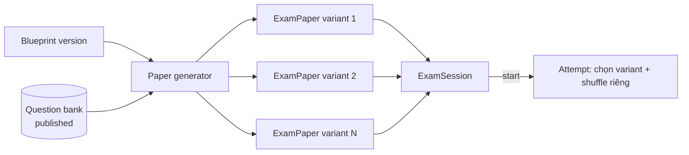

# Exam & Practice Engine

> Trạng thái: Draft · Phiên bản: 0.3 · Owner: Senior Golang Developer + EdTech Specialist · Cập nhật: 2026-11-16
> Liên quan: [QUESTION_BANK](QUESTION_BANK.md) · [ACTIVITY_ENGINE](ACTIVITY_ENGINE.md) · [LEARNING_ANALYTICS](LEARNING_ANALYTICS.md) · [ASSESSMENT_REGULATION_PROFILE](ASSESSMENT_REGULATION_PROFILE.md) · [ANTI_CHEAT](../10-security/ANTI_CHEAT.md) · [ADR-0072](../adr/ADR-0072-bo-vai-tro-giao-vien-hoc-sinh-tu-hoc-kiem-duyet-tap-trung.md) · [OQ-18](../12-project/OPEN_QUESTIONS.md) · Schema: [`assessment-blueprint.schema.json`](../../specs/schemas/assessment-blueprint.schema.json)

## 1. Phạm vi & định vị

Module `exam` (schema `assessment`) tổ chức **bài kiểm tra có cấu trúc đề, giới hạn thời gian và chính sách công bố kết quả**. Dùng chung `attempt`/`attempt_item`/`attempt_answer` và grader của question_bank. Mọi câu trong đề là loại server tự chấm; đề không có câu tự luận chấm tay ([ADR-0072](../adr/ADR-0072-bo-vai-tro-giao-vien-hoc-sinh-tu-hoc-kiem-duyet-tap-trung.md) mục 3). Người tạo đề và ExamSession của trường là `school_admin` hoặc `academic_manager` (thường qua LMS Assignment); đề dùng chung của platform do `content_admin` soạn.

**[Confirmed, OQ-18]** EduWorld hỗ trợ luyện đề, thi thử, kiểm tra do nhà trường giao. **Không** tổ chức kỳ thi có giá trị pháp lý trong Release 1.0 (OQ-18, owner 2026-11-20); không có proctoring (camera/khóa màn hình). Cờ `is_official` chỉ có nghĩa "kết quả được nhà trường ghi nhận trong sổ điểm LMS để tham khảo"; không thay đánh giá chính thức theo quy định của Bộ ([ASSESSMENT_REGULATION_PROFILE](ASSESSMENT_REGULATION_PROFILE.md)).

## 2. Loại đề [Confirmed — Master Prompt §4.5]

| `exam_type` | Mô tả | Ai tạo | `is_official` mặc định | Lượt làm |
|---|---|---|---|---|
| `practice_test` | Luyện đề tự do | Học sinh chọn từ thư viện đề | false | không giới hạn |
| `mock` | Thi thử mô phỏng kỳ thi | Platform (`content_admin`) / trường (`academic_manager`) | false | theo cấu hình (mặc định 3) |
| `chapter` | Kiểm tra theo chương | `school_admin` / `academic_manager` | true | 1 (có thể cho làm lại) |
| `semester` | Kiểm tra học kỳ | `school_admin` / `academic_manager` | true | 1 |
| `subject` | Kiểm tra theo môn | `school_admin` / `academic_manager` | true | 1 |
| `custom` | Đề tùy chỉnh | `school_admin` / `academic_manager` | tùy chọn | tùy chọn |
| `timed` | Thuộc tính, không phải loại: mọi loại có `duration_sec` | — | — | — |

Phân biệt rõ:

| Thuộc tính | Luyện tập (`practice_test`, `mock`) | Kiểm tra (`chapter`, `semester`, `subject`, `custom` official) |
|---|---|---|
| Phản hồi trong khi làm | Không (giống thi) | Không |
| Xem kết quả | Ngay sau nộp (`result_release = immediate`) | Theo `result_release` (mặc định `after_close`) |
| Ghi vào sổ điểm LMS | Không | Có (tham khảo) |
| Trọng số mastery (ADR-0017) | 0.7 (practice) | 1.0 (exam) |
| XP | Có (cap) | Không thưởng XP theo điểm [Confirmed] — chỉ XP tham gia cố định, tránh áp lực |
| Leaderboard | Không | Không |

## 3. Assessment Blueprint

Blueprint (versioned, ADR-0015) mô tả ma trận đề, ví dụ "Kiểm tra giữa kỳ I Toán 3":

```json
{
  "title": "Kiểm tra giữa kỳ I - Toán 3",
  "subject_id": "…", "grade_levels": [3],
  "duration_sec": 2400,
  "sections": [
    {
      "id": "sec_1", "title": "Phần I. Trắc nghiệm", "shuffle_items": true,
      "rules": [
        { "objective_ids": ["<MATH.G3.NUM.MUL_TABLE.2>"], "difficulty": { "min": 1, "max": 2 }, "types": ["single_choice"], "count": 4, "points_each": 0.5 },
        { "objective_ids": ["<MATH.G3.NUM.DIV_REMAINDER>"], "difficulty": { "min": 2, "max": 3 }, "types": ["single_choice", "true_false"], "count": 4, "points_each": 0.5 }
      ]
    },
    {
      "id": "sec_2", "title": "Phần II. Điền đáp số", "shuffle_items": false,
      "rules": [
        { "objective_ids": ["<MATH.G3.GEO.PERIMETER>"], "difficulty": { "min": 2, "max": 4 }, "types": ["numeric"], "count": 3, "points_each": 2 }
      ]
    }
  ],
  "total_points": 10,
  "variants": { "count": 4, "strategy": "independent_draw", "balance": { "enabled": true, "max_mean_p_diff": 0.05 } },
  "shuffle_options": true,
  "navigation": "free",
  "result_release": { "mode": "after_close", "show_correct_answers": true, "show_explanations": true },
  "feedback_timing": "after_close",
  "attempt_policy": { "max_attempts": 1, "score_policy": "last" }
}
```

Validation khi submit review: tổng điểm khớp `total_points`; pool mỗi rule ≥ `count × variants.count` (nếu `independent_draw`), ngược lại cảnh báo; không trùng câu giữa các rule; mọi `types` là loại câu tự chấm ([QUESTION_BANK §3](QUESTION_BANK.md#3-mười-một-dạng-câu-hỏi)); `feedback_timing` và `result_release.mode` thỏa ràng buộc ở [ACTIVITY_ENGINE §8.1](ACTIVITY_ENGINE.md#81-feedbacktiming-và-resultrelease) (đề không dùng `feedback_timing = immediate`).

## 4. Sinh đề



| Chiến lược `variants.strategy` | Mô tả |
|---|---|
| `fixed` | 1 đề cố định, chỉ shuffle thứ tự |
| `independent_draw` | N đề, mỗi đề rút ngẫu nhiên độc lập theo rule, cân bằng độ khó (§4.1) |
| `per_student` | Rút riêng cho từng học sinh khi start (seed = hash(exam_session, student)) — dùng cho practice_test |

- Render payload và media của câu hỏi đề **không** đưa lên CDN công khai; phục vụ qua API có kiểm quyền, media ở bucket private với signed URL ngắn hạn (ADR-0043, ADR-0044).
- `ExamPaper` (bất biến) = danh sách `question_version_id` theo section + điểm từng câu; sinh **khi publish ExamSession** (fixed/independent_draw) để người tạo đề xem trước và khóa đề.
- Mỗi attempt: chọn variant theo `hash(student_id, exam_session_id) mod N`, rồi shuffle item (nếu section cho phép) và option theo seed attempt.
- Câu đánh dấu `exam_only` được ưu tiên cho exam official.

### 4.1. Cân bằng độ khó giữa các biến thể [Confirmed]

Với `independent_draw`, các biến thể phải tương đương để học sinh không thiệt vì rút phải đề khó hơn:

1. Mỗi câu ứng viên có **độ khó ước lượng** `p̂`: dùng `p_value` khi câu đủ dữ liệu ([QUESTION_BANK §9](QUESTION_BANK.md#9-thống-kê-chất-lượng-câu-hỏi-item-analysis-confirmed)), ngược lại suy từ `difficulty` khai báo theo bảng ánh xạ ở cùng mục.
2. Generator rút ứng viên cho từng biến thể theo rule, tính `P_v = Σ(p̂ × points) / total_points` (tỉ lệ điểm kỳ vọng của biến thể v).
3. Nếu `max(P_v) − min(P_v) > balance.max_mean_p_diff` (mặc định 0,05, `variant_balance_max_mean_p_diff` [Confirmed — Technical Architect 2026-11-15]), hoán đổi câu cùng rule giữa các biến thể hoặc rút lại (tối đa 200 lần lặp, seed cố định để tái lập). Không đạt → vẫn sinh đề nhưng cảnh báo người tạo đề kèm số liệu từng biến thể.
4. `ExamPaper` lưu `expected_p` của biến thể; báo cáo sau đề so sánh điểm trung bình thực tế giữa các biến thể (§8.1).

## 5. ExamSession & cửa sổ thời gian

| Field | Mô tả |
|---|---|
| `exam_session_id` | |
| `blueprint_version_id` | **Ghim lúc tạo ExamSession** (ADR-0043): mọi học sinh cùng một version; publish/rollback blueprint hoặc câu hỏi trong giờ thi không ảnh hưởng. ExamPaper khóa `question_version_id` cụ thể |
| `exam_type`, `is_official` | Tên cột giữ nguyên trong `assessment.exam_sessions` (không dùng `type`) |
| `target` | khối của trường ± học sinh thêm/bớt, hoặc danh sách học sinh của trường (qua LMS Assignment — ADR-0095, [SCHOOL_LMS §4.1](../04-admin-portal/SCHOOL_LMS.md#41-tạo-và-giao-bài)); phiên không còn `course_id`, có `school_id` |
| `window_start`, `window_end` | khoảng được phép bắt đầu |
| `duration_sec` | thời gian làm bài cho mỗi học sinh (giây; cột `duration_sec`) |
| `late_start_policy` | `full_duration` / `until_window_end` (mặc định: `deadline = min(start + duration, window_end)`) |
| `accommodations[]` | gia hạn thời gian cho học sinh cụ thể (vd. +25%) — `school_admin`/`academic_manager` cấu hình khi tạo session hoặc thay cả danh sách bằng `putExamAccommodations` khi session còn `scheduled`/`open` (If-Match, lý do, audit `exam_session.accommodations_updated`); thời lượng mới áp cho lượt bắt đầu sau khi lưu, lượt đang làm giữ `deadline_at` đã tính |
| `status` | `scheduled → open → closed → results_released` |

Worker chuyển trạng thái theo thời gian; event `exam.opened`, `exam.closed`, `exam.results_released`.

## 6. Làm bài & deadline server

- `POST /api/v1/exams/sessions/{id}/attempts` → tạo attempt `mode=exam`, `started_at = now()` (server), `deadline_at` tính theo §5. Gọi lại khi đã có attempt `in_progress` → trả attempt cũ (resume).
- Client hiển thị đồng hồ dựa trên `deadline_at` + `server_time` trả về trong mọi response (bù lệch đồng hồ).
- Lưu câu trả lời: `PUT /api/v1/exams/attempts/{id}/answers/{position}` (ghi đè, chấm **trì hoãn** đến khi nộp; server vẫn lưu lịch sử append-only).
- Không trả `is_correct`/explanation trong khi làm; không có gợi ý.
- Mất kết nối: thời gian **vẫn chạy**; client giữ câu trả lời chưa gửi **chỉ trong bộ nhớ (RAM)** của phiên đang chạy, không ghi ra đĩa hay storage của trình duyệt (thoát game là mất phần chưa gửi), rồi gửi lại khi kết nối lại. Server nhận câu trả lời đến trễ nếu `answered_at_client` < `deadline_at` **và** server nhận trước `deadline_at + exam_offline_sync_grace`; `exam_offline_sync_grace` = 30 giây [Confirmed]. Ân hạn này chỉ áp cho đề kiểm tra; attempt hoạt động thường dùng ân hạn mạng `deadline_grace` ([ACTIVITY_ENGINE §11](ACTIVITY_ENGINE.md#11-toàn-vẹn-và-chống-gian-lận)). Client không tự quyết định theo ân hạn: server trả `EXAM_TIME_OVER` khi quá hạn.

## 7. Nộp bài

### 7.1. Nộp chủ động — idempotent

`POST /api/v1/exams/attempts/{id}:submit` với `Idempotency-Key` bắt buộc.

```sql
UPDATE assessment.attempts
SET status = 'submitted', submitted_at = now()
WHERE attempt_id = $1 AND status = 'in_progress'
RETURNING ...;
-- 0 row: nếu status ∈ (submitted, graded) → trả kết quả hiện có (cùng key) hoặc 409 EXAM_ALREADY_SUBMITTED (khác key)
```

### 7.2. Tự động nộp khi hết giờ

- Worker job `exam.autosubmit` chạy mỗi `exam_autosubmit_interval` = 15 giây [Confirmed]: chọn attempt `in_progress AND deadline_at + exam_offline_sync_grace < now()` (`FOR UPDATE SKIP LOCKED`), chuyển `expired → submitted` (`submit_reason='auto_timeout'`), đưa vào hàng chấm tự động.
- Đồng thời, request answer đến sau `deadline_at + exam_offline_sync_grace` bị từ chối `422 EXAM_TIME_OVER`.
- Window đóng: mọi attempt còn mở bị auto-submit; học sinh chưa bắt đầu → `absent` (bản ghi `exam_participation`).

## 8. Chấm & công bố kết quả

- Chấm trong worker (`exam.grade`) sau submit: gọi `question_bank.Grade` từng item, ghi `final_score`, `attempts.score`, `status='graded'`. Toàn bộ câu hỏi exam là dạng chấm tự động ([QUESTION_BANK §3](QUESTION_BANK.md#3-mười-một-dạng-câu-hỏi)).
- `result_release.mode` (`ResultRelease`, định nghĩa ở [ACTIVITY_ENGINE §8.1](ACTIVITY_ENGINE.md#81-feedbacktiming-và-resultrelease)):
  - `immediate` — ngay sau khi graded (mặc định cho practice_test/mock).
  - `after_close` — khi session `closed` (mặc định cho official, tránh lộ đề cho bạn chưa làm).
  - `manual` — `school_admin`/`academic_manager` bấm công bố.
- `feedback_timing` (`FeedbackTiming`) của đề: `after_submit` (mặc định practice_test/mock), `after_close` (mặc định official) hoặc `never`; không bao giờ sớm hơn thời điểm công bố kết quả.
- `show_correct_answers`, `show_explanations` cấu hình riêng.
- Event: `exam.submitted` (khi submit), `exam.graded` (khi có điểm — consumer learning_record dùng event này), `exam.results_released`.

### 8.1. Độ tin cậy của đề chính thức [Confirmed]

Sau khi session `is_official` đóng, worker tính và lưu vào báo cáo đề (`GET /api/v1/exams/sessions/{id}/report`):

| Chỉ số | Cách tính | Điều kiện |
|---|---|---|
| Độ tin cậy | KR-20 nếu mọi câu chấm 0/1, ngược lại Cronbach alpha; tính riêng từng biến thể | ≥ 30 học sinh đã nộp trên biến thể đó |
| Sai số đo lường chuẩn (SEM) | `SD × √(1 − reliability)` | Như trên |
| Chênh lệch giữa biến thể | Điểm trung bình, độ lệch chuẩn từng biến thể; cờ khi chênh ≥ 1 điểm trên thang 10 | ≥ 2 biến thể |
| Câu có vấn đề | `discrimination` < 0,1 hoặc âm, `p_value` < 0,1 hoặc > 0,95 | ≥ `item_analysis_min_responses` lượt ([QUESTION_BANK §9](QUESTION_BANK.md#9-thống-kê-chất-lượng-câu-hỏi-item-analysis-confirmed)) |

Reliability < 0,7 → báo cáo hiển thị cảnh báo "Độ tin cậy thấp, nên dùng kết quả thận trọng" cho người tạo đề và EdTech; không tự sửa điểm. Câu có vấn đề được gợi ý `drop_item` qua quy trình §9. Ngưỡng cảnh báo độ tin cậy (`exam_reliability_warn`: < 0,7, cần ≥ 30 học sinh) [Confirmed — Technical Architect 2026-11-15]; các ngưỡng khác là mặc định [Confirmed]; chỉ mục ở [CONFIG_DEFAULTS](../00-overview/CONFIG_DEFAULTS.md).

## 9. Chấm lại (regrade)

Regrade là **re-evaluate do hệ thống** (ADR-0072), không có chấm lại thủ công. Khi phát hiện câu hỏi sai đáp án:

1. Content tạo version mới cho câu hỏi (ADR-0015); **không** sửa version cũ.
2. `content_admin` hoặc `academic_manager` tạo `RegradeRequest` với `scope = exam_session` (`exam_session_id`, `question_version_id`, `action`, `reason`) — cùng thực thể với [ACTIVITY_ENGINE §7.3](ACTIVITY_ENGINE.md#73-thực-thể-evaluation), `action ∈ {accept_all, use_new_key, drop_item}`; có audit. Academic Manager mở yêu cầu từ hộp thoại chấm lại đề ở workspace C ([SCHOOL_LMS §4.5](../04-admin-portal/SCHOOL_LMS.md#45-công-bố-kết-quả-và-chấm-lại)).
3. Worker chấm lại tự động các attempt bị ảnh hưởng, ghi `attempt_score_revisions` (điểm cũ, điểm mới, lý do, người kích hoạt) — điểm gốc giữ nguyên trong lịch sử.
4. Phát `exam.regraded` và `attempt.re_evaluated` cho từng attempt; learning_record cập nhật evidence (event bù trừ, không xóa event cũ).

## 10. Phân tích câu sai & đề xuất ôn tập

Sau khi kết quả được công bố, API `GET /api/v1/exams/attempts/{id}/analysis` trả về:

| Phần | Nội dung |
|---|---|
| Tổng quan | điểm, thang 10, thời gian, mức tham khảo theo cấp học ([ASSESSMENT_REGULATION_PROFILE](ASSESSMENT_REGULATION_PROFILE.md)) — **không** xếp hạng với bạn |
| Theo section | điểm / tối đa |
| Theo LO | số câu đúng/tổng theo từng LO, mastery hiện tại |
| Câu sai | câu, lựa chọn của học sinh, đáp án đúng, explanation, phản hồi theo phương án đã chọn (theo `feedback_timing`/`result_release`) |
| Mẫu lỗi | phân loại lỗi phổ biến nếu option sai có `misconception_tag` (vd. "nhầm nhân với cộng") [Confirmed] |
| Đề xuất ôn tập | 1–3 LO yếu nhất → link Practice (SelectionRule `prefer_weak_objectives`), lesson tương ứng, quest liên quan |

Quy tắc đề xuất (chi tiết [LEARNING_ANALYTICS §6](LEARNING_ANALYTICS.md#6-recommendation-rules)): LO có tỉ lệ đúng trong đề < 60% **và** mastery < `proficient`; ưu tiên LO tiên quyết của LO sai nếu LO tiên quyết cũng yếu.

## 11. API tóm tắt

| Method | Path | Ai |
|---|---|---|
| GET | `/api/v1/exams/library?subject=&grade=&type=` | Học sinh (đề practice/mock khả dụng) |
| GET | `/api/v1/exams/sessions?status=` | Học sinh (đề được giao), `school_admin`/`academic_manager` |
| POST | `/api/v1/exams/sessions` | `school_admin`/`academic_manager` (thường qua LMS Assignment) |
| GET | `/api/v1/exams/sessions/{id}/papers` | Người tạo đề xem trước đề |
| POST | `/api/v1/exams/sessions/{id}/attempts` | Học sinh bắt đầu |
| PUT | `/api/v1/exams/attempts/{id}/answers/{position}` | Học sinh |
| POST | `/api/v1/exams/attempts/{id}:submit` | Học sinh (Idempotency-Key) |
| GET | `/api/v1/exams/attempts/{id}/result` | Học sinh (theo release), `school_admin`/`academic_manager` |
| GET | `/api/v1/exams/attempts/{id}/analysis` | Học sinh, `school_admin`/`academic_manager` |
| POST | `/api/v1/exams/sessions/{id}:release-results` | `school_admin`/`academic_manager` (`result_release = manual`) |
| PUT | `/api/v1/exams/sessions/{id}/accommodations` | `school_admin`/`academic_manager` (`lms.assignment.write`; If-Match, Idempotency-Key, lý do — F055) |
| POST | `/api/v1/cms/learning/regrade-requests` (`scope = exam_session`) | `content_admin` / `academic_manager` |
| GET | `/api/v1/exams/sessions/{id}/report` | `school_admin`/`academic_manager`: phổ điểm, item analysis, độ tin cậy, chênh lệch biến thể (§8.1) |

Mã lỗi: `EXAM_NOT_OPEN`, `EXAM_WINDOW_CLOSED`, `EXAM_TIME_OVER`, `EXAM_ALREADY_SUBMITTED`, `EXAM_MAX_ATTEMPTS`, `EXAM_RESULTS_NOT_RELEASED`, `EXAM_NOT_ASSIGNED`.

## 12. Toàn vẹn & chống gian lận

| Rủi ro | Biện pháp |
|---|---|
| Sửa điểm từ client | Client không gửi điểm; chấm trong worker |
| Nộp trùng | Optimistic state transition + Idempotency-Key |
| Kéo dài thời gian | Deadline server, từ chối answer sau grace |
| Lộ đề cho bạn chưa làm | Nhiều variant, shuffle, `after_close` |
| Nhờ người khác làm | Không phát hiện được hoàn toàn bằng kỹ thuật (không proctoring, OQ-18); ghi `client_platform`, `game_session_id`, IP hash để nhà trường đối chiếu khi cần |
| Tốc độ bất thường | Cờ `suspicious_speed` (ANTI_CHEAT); cờ `rapid_guess` loại evidence khỏi mastery ([ACTIVITY_ENGINE §11.1](ACTIVITY_ENGINE.md#111-cờ-rapid_guess--trả-lời-quá-nhanh-để-kịp-đọc-đề-confirmed)) |
| Mở nhiều thiết bị cùng lúc | Một attempt chỉ có một `active_device_token`; thiết bị thứ hai nhận `EXAM_ACTIVE_ON_OTHER_DEVICE` và có thể "chuyển sang thiết bị này" (vô hiệu thiết bị cũ, audit) |

Kết quả thi lưu bền vững trong PostgreSQL, không phụ thuộc Valkey (ADR-0004); backup theo [BACKUP_RECOVERY](../11-operations/BACKUP_RECOVERY.md).

## 13. Yêu cầu & acceptance

Mã FR, nhãn và phase do [PRODUCT_REQUIREMENTS §2.8](../00-overview/PRODUCT_REQUIREMENTS.md#28-exam--practice--exm-45) cấp (ADR-0082); bảng dưới chỉ chỉ ra phần chi tiết trong tài liệu này. AC của PRD (AC-EXM-001, AC-EXM-002) áp dụng nguyên văn; tiêu chí chi tiết của domain:

| Yêu cầu (mã PRD) | Chi tiết trong tài liệu này |
|---|---|
| FR-EXM-001 | Các loại đề (§2) |
| FR-EXM-002 | Assessment Blueprint, sinh đề, random đề/câu, xáo đáp án, thời gian và thang điểm (§3, §4, §5) |
| FR-EXM-003 | Nộp bài, chấm, công bố kết quả theo `result_release` (§7, §8); phân tích câu sai và đề xuất ôn tập (§10) |
| FR-EXM-004 | Phân biệt luyện tập và kiểm tra chính thức `is_official` (§1, §2) |
| FR-EXM-005 | Chống nộp trùng, chống sửa điểm (§7.1, §12); tự nộp khi hết giờ (§7.2) |
| FR-EXM-006 | Kết quả lưu bền vững trong PostgreSQL (§12) |
| FR-EXM-007 | Thi có giá trị pháp lý/proctoring không thuộc Release (§1, OQ-18) |
| FR-EXM-008 | Chấm lại (regrade) do hệ thống, có lịch sử (§9) |
| FR-EXM-009 | Gia hạn thời gian cá nhân `accommodations[]` (§5) |
| FR-EXM-010 | Cân bằng độ khó giữa biến thể (§4.1); độ tin cậy KR-20/alpha, SEM cho đề chính thức (§8.1) |

- AC-EXM-009: Học sinh bắt đầu đề 40 phút, thoát ra, vào lại sau 10 phút → đồng hồ còn ~30 phút.
- AC-EXM-010: Không nộp; sau deadline + grace, attempt chuyển `graded` với `submit_reason=auto_timeout` (chi tiết AC-EXM-001).
- AC-EXM-003: Session `after_close`: học sinh nộp sớm không xem được đáp án trước khi window đóng.
- AC-EXM-004: Hai học sinh cùng session nhận variant/thứ tự khác nhau (khi `variants.count > 1`).
- AC-EXM-005: Regrade `drop_item` do `academic_manager` kích hoạt → điểm mới tính trên thang đã loại câu; lịch sử điểm cũ truy xuất được; `school_admin` gọi → `403`.
- AC-EXM-006: Blueprint 4 biến thể `independent_draw` có `balance.enabled`: chênh `expected_p` giữa các biến thể ≤ 0,05, hoặc người tạo đề nhận cảnh báo kèm số liệu.
- AC-EXM-007: Session official 40 học sinh đóng → báo cáo có KR-20/alpha và SEM từng biến thể; reliability < 0,7 hiện cảnh báo.
- AC-EXM-008: Blueprint có `feedback_timing = immediate` hoặc rule dùng loại câu không tự chấm → bị từ chối khi submit review.
