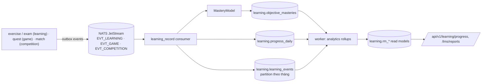

# Learning Progress & Analytics

> Trạng thái: Draft · Phiên bản: 0.1 · Owner: EdTech Specialist + Backend Architect · Cập nhật: 2026-11-15
> Liên quan: [ADR-0017](../adr/ADR-0017-mastery-model-co-the-cau-hinh-mac-dinh-weighted-evidence.md) · [ADR-0018](../adr/ADR-0018-glicko-2-cho-game-rating-tach-biet-learning-mastery.md) · [EVENT_DESIGN](../07-backend/EVENT_DESIGN.md) · [SCHOOL_LMS §8](../04-admin-portal/SCHOOL_LMS.md#8-teacher-dashboard) · [DATA_PRIVACY](../10-security/DATA_PRIVACY.md) · [DOMAIN_MODEL §10](../06-architecture/DOMAIN_MODEL.md#10-phân-biệt-năm-loại-số-liệu-bắt-buộc)

## 1. Phạm vi

- Module `learning_record` (schema `learning`): lưu **learning events** (LRS nội bộ, xAPI-like), tính **ObjectiveMastery**, **ProgressSnapshot**.
- Module `learning_analytics`: read model tổng hợp cho học sinh, giáo viên, lớp, trường, môn, chủ đề, LO.
- **[Confirmed]** Không đồng nhất điểm một lần làm bài với mastery; phương pháp mastery rõ ràng, cấu hình được.
- **[Confirmed]** Không dùng dữ liệu hành vi ngoài mục đích đã công bố.
- **Ranh giới:** tài liệu này chỉ về tiến bộ học tập (mastery, tiến độ, LO yếu). Chỉ số hành vi chơi game (DAU/retention, funnel quest, kinh tế, chơi lành mạnh, hiệu năng thiết bị) thuộc [GAME_ANALYTICS](../11-operations/GAME_ANALYTICS.md); sức khỏe hệ thống thuộc [MONITORING](../11-operations/MONITORING.md).

## 2. Nguồn dữ liệu



Learning event là append-only, có `idempotency_key` (= `<source_event_id>:<student_id>`), payload theo [EVENT_DESIGN](../07-backend/EVENT_DESIGN.md). Consumer idempotent qua `platform.processed_events`.

**Ghi nhận version (ADR-0043):** mỗi learning event mang `content_version_id` đã ghim cho lượt đó (không phải version theo con trỏ lúc xử lý event). Vì nhiều version có thể cùng được dùng trong các lượt đang diễn ra sau một lần publish/rollback, báo cáo theo câu hỏi/bài học nhóm theo `item_id` và cho phép tách theo `version_no`; widget "chất lượng câu hỏi" (tỉ lệ đúng, thời gian) tính theo từng version để phát hiện version lỗi và hỗ trợ quyết định rollback. Bảng `rm_content_version_stats(item_type, item_id, version_id, attempts, correct_rate, avg_time_ms, last_used_at)` cập nhật bởi rollup.

## 3. Mastery model mặc định (ADR-0017)

### 3.1. Định nghĩa

Mastery `M ∈ [0, 1]` theo cặp `(student_id, learning_objective_id)`. Mỗi **evidence** là một item đã chấm (`question.answered` với `is_scored=true`) gắn LO đó. Một item gắn nhiều LO → mỗi LO nhận một evidence.

Tham số (lưu trong `learning.mastery_model_configs`, phiên bản hóa, `model_version` ghi vào từng bản ghi mastery):

| Tham số | Ký hiệu | Mặc định [Proposed] |
|---|---|---|
| Prior ban đầu | `M0` | 0.30 |
| Tốc độ học cơ sở | `α_base` | 0.35 |
| Trần tốc độ | `α_max` | 0.60 |
| Trọng số ngữ cảnh | `w_ctx` | exam 1.0 · assignment 0.9 · practice 0.7 · retry_wrong 0.7 · quest 0.6 · minigame 0.6 · competition 0.4 |
| Trọng số độ khó khi đúng | `w_diff⁺(d)` | `0.8 + 0.1·(d − 1)` (d=1 → 0.8, d=5 → 1.2) |
| Trọng số độ khó khi sai | `w_diff⁻(d)` | `1.2 − 0.1·(d − 1)` (sai câu dễ "nặng" hơn) |
| Trọng số lặp lại | `w_rep` | 0.5 nếu cùng `question_id` đã trả lời trong 24 giờ, ngược lại 1.0 |
| Ngưỡng "đúng" cho partial | — | `o ≥ 0.5` |
| Ân hạn decay | `g` | 14 ngày |
| Chu kỳ bán rã decay | `h` | 90 ngày |
| Mastered: tối thiểu evidence / ngày khác nhau | `n_min`, `d_min` | 5 / 2 |

### 3.2. Công thức cập nhật

Với evidence thứ `n+1` (đã có `n` evidence), kết quả `o = score / max_score ∈ [0, 1]`, độ khó `d`:

```text
w      = w_ctx × w_diff(o, d) × w_rep
α_w    = min(α_max, α_base × w)
α_cold = 1 / (n + 3)                 # khởi động lạnh: vài evidence đầu cập nhật mạnh hơn
α      = max(α_w, α_cold)
M_new  = M + α × (o − M)             # EWMA, M là giá trị hiện tại (lần đầu = M0)
```

Decay khi **đọc** (không ghi đè giá trị gốc):

```text
Δ      = số ngày từ last_evidence_at
M_eff  = M × (0.5 + 0.5 × 0.5^(max(0, Δ − g) / h))   # giảm dần, tối đa còn 50% M
```

Level từ `M_eff`:

| Level | Điều kiện | Hiển thị cho học sinh (lớp 1–5 / 6–9) |
|---|---|---|
| `not_started` | n = 0 | ⚪ "Chưa học" |
| `beginning` | M_eff < 0.40 | 🌱 "Mới bắt đầu" |
| `developing` | 0.40 ≤ M_eff < 0.60 | 🌿 "Đang tiến bộ" |
| `proficient` | 0.60 ≤ M_eff < 0.80, hoặc ≥ 0.80 nhưng chưa đủ `n_min`/`d_min` | 🌳 "Thành thạo" |
| `mastered` | M_eff ≥ 0.80 **và** n ≥ 5 **và** evidence trên ≥ 2 ngày khác nhau | ⭐ "Làm chủ" |

### 3.3. Ví dụ tính

Học sinh lớp 3, LO `MATH.G3.NUM.MUL_TABLE.2`:

| # | Ngày | Ngữ cảnh | d | o | w | α_w | α_cold | α | M sau | Level |
|---|---|---|---|---|---|---|---|---|---|---|
| 0 | — | prior | — | — | — | — | — | — | 0.300 | not_started |
| 1 | 1 | practice | 2 | 1 | 0.7×0.9 = 0.63 | 0.2205 | 1/3 = 0.3333 | 0.3333 | 0.5333 | developing |
| 2 | 1 | practice | 2 | 0 | 0.7×1.1 = 0.77 | 0.2695 | 1/4 = 0.25 | 0.2695 | 0.3896 | beginning |
| 3 | 1 | practice | 3 | 1 | 0.7×1.0 = 0.70 | 0.2450 | 1/5 = 0.20 | 0.2450 | 0.5391 | developing |
| 4 | 3 | quest | 2 | 1 | 0.6×0.9 = 0.54 | 0.1890 | 1/6 = 0.1667 | 0.1890 | 0.6262 | proficient |
| 5 | 5 | exam | 3 | 1 | 1.0×1.0 = 1.00 | 0.3500 | 1/7 = 0.1429 | 0.3500 | 0.7570 | proficient |
| 6 | 5 | exam | 4 | 1 | 1.0×1.1 = 1.10 | 0.3850 | 1/8 = 0.125 | 0.3850 | 0.8506 | **mastered** (n=6, 3 ngày) |

Nếu sau đó 104 ngày không có evidence: `M_eff = 0.8506 × (0.5 + 0.5 × 0.5^(90/90)) = 0.8506 × 0.75 = 0.638` → `proficient` → hệ thống gợi ý ôn lại (§6).

Lưu ý: điểm bài exam ở ngày 5 có thể là 10/10, nhưng mastery chỉ 0.85 — hai số liệu khác nhau theo thiết kế.

### 3.4. Triển khai

```go
type MasteryModel interface {
    Version() string
    Apply(state MasteryState, ev Evidence, cfg MasteryConfig) MasteryState
    Effective(state MasteryState, now time.Time, cfg MasteryConfig) (value float64, level MasteryLevel)
}
```

- Cập nhật tuần tự theo `(student, objective)` — consumer partition theo `student_id` để tránh race; ghi bằng `UPDATE ... WHERE version = $v` (optimistic).
- **Recompute**: job có thể tính lại toàn bộ mastery từ `learning_events` khi đổi `model_version` (chạy shadow, so sánh, rồi chuyển).
- Regrade (EXAM_ENGINE §9) phát event bù → recompute LO bị ảnh hưởng của học sinh đó.
- Mô hình thay thế trong tương lai: BKT, IRT/Elo cho item — chỉ sau khi có ≥ 1 học kỳ dữ liệu và ADR mới.

## 4. Progress metrics

| Metric | Định nghĩa | Granularity |
|---|---|---|
| `lessons_completed` | số lesson có `lesson.completed` | HS × subject × ngày |
| `exercises_completed` | số attempt `graded` (mode ≠ exam) | HS × subject × ngày |
| `items_answered` / `items_correct` | số item có tính điểm / đúng | HS × LO × ngày |
| `accuracy` | `items_correct / items_answered` (chỉ lần trả lời đầu) | mọi cấp |
| `active_learning_time_sec` | Σ thời gian attempt (trừ pause) + thời gian lesson active (heartbeat ≤ 60 giây) — **không** tính thời gian đi lại trong game | HS × ngày |
| `attempt_count` | số attempt bắt đầu | HS × source |
| `objective_mastery_distribution` | số LO theo level | HS, lớp × subject |
| `weak_objectives` | LO level ≤ `developing` có ≥ 3 evidence | HS |
| `progress_over_time` | snapshot tuần: mean mastery, số LO mastered | HS × subject × tuần |
| `assignment_completion_rate` | đã nộp / được giao | lớp × assignment |
| `curriculum_coverage` | % LO của subject × grade có ≥ 1 evidence | HS, lớp |
| `last_game_login_at` | `identity.users.last_login_at` — lần vào game gần nhất (ADR-0031) | HS |
| `days_since_last_login` | số ngày từ `last_login_at` (chưa từng: từ `provisioned_at`, hiển thị "chưa vào game") | HS, lớp (phân bố 0–7 / 8–30 / > 30 ngày) |
| `game_logins` / `game_session_minutes` | số lần vào game, tổng thời gian phiên game từ `game.login_events` (tách khỏi `active_learning_time_sec`) | HS × ngày, lớp × tuần |
| `students_scheduled_for_cleanup` | số HS trong danh sách sắp bị dọn (ADR-0032) | tenant, trường |
| `video_completion_rate` / `video_watched_ratio` | tỷ lệ video đạt `completion_rule`; tỷ lệ khoảng đã xem thật (không tính tua) ([VIDEO_LEARNING](VIDEO_LEARNING.md)) | HS × activity, lớp × chapter |
| `video_rewatch_hotspots` | đoạn bị xem lại nhiều (gợi ý nội dung khó) | activity × chapter (gộp, không theo HS) |
| `cue_accuracy` | tỷ lệ đúng câu hỏi chèn | lớp × activity |
| `rubric_criterion_avg` | điểm trung bình từng tiêu chí rubric | lớp × rubric × tiêu chí |
| `review_turnaround_hours` | thời gian từ nộp đến khi giáo viên chấm | giáo viên × lớp |
| `simulation_goal_rate` | tỷ lệ đạt mục tiêu mô phỏng (đã kiểm chứng) | lớp × template |
| `speaking_submission_rate` | tỷ lệ nộp bài nói (không đo chất lượng giọng) | lớp × activity |

**Nguồn evidence cho mastery theo loại hoạt động (ADR-0048):** quiz/bài tương tác/mini-game: từng câu trả lời (`question.answered`); video/audio: câu hỏi chèn (`video.cue_answered`), **không** dùng thời gian xem làm evidence; tự luận/nói/dự án: điểm từng tiêu chí rubric có gắn LO (`rubric.criterion_scored`) **sau khi giáo viên chấm** (gợi ý AI và điểm phát âm máy không phải evidence chính thức, ADR-0053); mô phỏng: mục tiêu đạt **đã kiểm chứng** (`simulation.goal_met`, ADR-0052). Chấm lại sinh evidence điều chỉnh, không xóa evidence cũ.

**Không dùng thời gian chơi hay thời gian xem làm thước đo thành công học tập chính** (Master Prompt mới §23): các chỉ số thời gian chỉ để phát hiện khó khăn (xem lại nhiều, bỏ dở) và quản lý thời gian lành mạnh.

## 5. Read models & aggregation

| Bảng | Cập nhật | Nội dung |
|---|---|---|
| `learning.progress_daily` | streaming (consumer) | `(student_id, date, subject_id)` → counters |
| `learning.objective_masteries` | streaming | trạng thái mastery hiện tại |
| `learning.mastery_snapshots_weekly` | job hằng tuần (Chủ nhật 23:00) | lịch sử mastery để vẽ xu hướng |
| `learning.rm_class_objective_stats` | job mỗi 15 phút (giờ học) | `(class_id, objective_id)` → phân bố level, accuracy, số HS có evidence |
| `learning.rm_class_subject_summary` | job mỗi 15 phút | tổng hợp lớp × môn |
| `learning.rm_school_grade_summary` | job hằng đêm | trường × khối × môn (chỉ số gộp) |
| `learning.rm_student_recommendations` | streaming + hằng đêm | danh sách gợi ý (§6) |

Bảng trên gồm hai loại: **read model trạng thái hiện tại** (`objective_masteries`, `rm_*`) và **chuỗi thời gian** (`progress_daily`, `mastery_snapshots_weekly`). Dashboard có trục thời gian đọc các **rollup chuỗi thời gian** sau, dựng theo cơ chế chung ở [DASHBOARD_DATA](../07-backend/DASHBOARD_DATA.md) (ADR-0062: upsert gia tăng từ event, job chốt ngày 02:30 ICT, partition, read replica, cache):

| Bảng rollup | Chiều | Độ hạt | Cột đo chính |
|---|---|---|---|
| `learning.progress_daily` | học sinh, `class_id` (snapshot lúc event), môn | ngày | số hoạt động, câu trả lời, câu đúng (tử/mẫu), giây học, hist thời gian |
| `learning.rollup_class_daily` / `_weekly` / `_monthly` | lớp, môn | ngày / tuần / tháng | học sinh hoạt động (distinct, chốt cuối ngày), hoạt động hoàn thành, độ chính xác (tử/mẫu), giây học, bài giao nộp đúng hạn (tử/mẫu) |
| `learning.rollup_class_objective_weekly` | lớp, LO | tuần | số evidence, đúng (tử/mẫu), phân bố level cuối tuần |
| `learning.rollup_school_daily` / `_weekly` / `_monthly` | trường, khối, môn | ngày / tuần / tháng | như cấp lớp + số lớp có hoạt động |
| `learning.rollup_tenant_daily` / `_weekly` / `_monthly` | khối, môn | ngày / tuần / tháng | như cấp trường + số trường có hoạt động |

- Dashboard không đọc `learning_events`, `attempts`, `attempt_answers` (DASHBOARD_DATA §1, D-1).
- Read model gắn `school_id`, lọc theo RLS như bảng nghiệp vụ.
- Báo cáo cấp tổ chức/platform chỉ dùng dữ liệu **gộp**, ẩn ô có < 5 học sinh (k-anonymity tối thiểu) [Proposed].
- Mọi aggregate theo lớp dùng enrollment **tại thời điểm event** (`learning_events.class_id` snapshot) để chuyển lớp không làm méo số liệu lớp cũ.

## 6. Recommendation rules

Rule-based, giải thích được (không black-box) [Proposed]:

| # | Điều kiện | Gợi ý | Ưu tiên |
|---|---|---|---|
| R1 | Assignment chưa nộp, `due_at` < 48 giờ | "Hoàn thành bài cô giao" | 1 |
| R2 | LO level `beginning`/`developing` với ≥ 3 evidence, và LO tiên quyết ≥ `proficient` | Practice `prefer_weak_objectives` cho LO đó | 2 |
| R3 | LO yếu nhưng LO tiên quyết cũng yếu | Ôn LO tiên quyết trước | 2 |
| R4 | LO `mastered`/`proficient` có decay đưa M_eff giảm ≥ 0.15 | "Ôn lại" (spaced review) | 3 |
| R5 | Sau exam có LO đúng < 60% | Lesson + practice LO đó (EXAM_ENGINE §10) | 2 |
| R6 | Chưa có evidence ở topic kế tiếp trong lịch LMS | Lesson mới / quest tương ứng | 4 |

Giới hạn: tối đa 3 gợi ý hiển thị cùng lúc; không gợi ý lặp lại item đã bỏ qua 3 lần; gợi ý trong game hiển thị qua NPC/quest board (không thông báo đẩy dồn dập — xem CHILD_SAFETY).

## 7. Dashboard metrics theo đối tượng

| Đối tượng | Thấy | Không thấy |
|---|---|---|
| Học sinh | mastery của mình (biểu tượng thân thiện), tiến độ, gợi ý, lịch sử bài làm | mastery/điểm của bạn khác; so sánh xếp hạng học tập |
| Giáo viên | lớp được phân công (TeachingAssignment): bảng LO × HS, phân bố level, accuracy, assignment completion, HS cần hỗ trợ, thời gian học | lớp khác; Game Rating như năng lực; nội dung chat ngoài quyền |
| School Admin / Academic Manager | tổng hợp trường × khối × môn, độ phủ chương trình, mức tham gia | dữ liệu trường khác |
| Tenant `unit` (đơn vị) | dữ liệu gộp các trường trong tenant (ẩn ô < 5 HS) | dữ liệu cá nhân học sinh (trừ khi có quyền rõ ràng) |
| Vận hành tenant (TA/SA) | thêm: hoạt động đăng nhập game (lần cuối, số ngày chưa vào, lịch sử phiên — không IP/device_id), danh sách sắp bị dọn | tenant khác |
| Platform Admin | metric vận hành, gộp | dữ liệu cá nhân theo mặc định (truy cập phải có lý do + audit) |

Chi tiết màn hình giáo viên: [SCHOOL_LMS §8](../04-admin-portal/SCHOOL_LMS.md#8-teacher-dashboard). Quy tắc truy vấn (khoảng tối đa 2 năm, độ hạt tự chọn, phân trang, timeout, cache) và API dashboard bổ sung: [DASHBOARD_DATA §8, §14](../07-backend/DASHBOARD_DATA.md#8-quy-tắc-truy-vấn).

## 8. API

| Method | Path | Mô tả |
|---|---|---|
| GET | `/api/v1/learning/progress/me?subject=` | Tổng quan tiến độ của tôi |
| GET | `/api/v1/learning/mastery/me?subject=&grade=` | Mastery theo LO (level + biểu tượng, giá trị số chỉ cho lớp 6–9 [Proposed]) |
| GET | `/api/v1/learning/recommendations/me` | Gợi ý |
| GET | `/api/v1/lms/classes/{class_id}/analytics/objectives?subject=` | Bảng LO × HS (giáo viên) |
| GET | `/api/v1/lms/classes/{class_id}/analytics/summary` | Tổng quan lớp |
| GET | `/api/v1/lms/students/{student_id}/analytics` | Hồ sơ học tập (giáo viên có quyền) |
| GET | `/api/v1/lms/schools/{school_id}/analytics/summary` | School admin |
| POST | `/api/v1/learning/events` | **Chỉ** event phía client được whitelist (`lesson.viewed`, `material.opened`, heartbeat lesson); event kết quả học tập chỉ do server sinh |

## 9. Privacy & sử dụng dữ liệu

- Purpose limitation: dữ liệu học tập dùng cho (1) phản hồi học sinh, (2) giáo viên hỗ trợ, (3) quản lý chất lượng giáo dục của trường, (4) cải thiện nội dung (gộp, ẩn danh). Không dùng cho quảng cáo, không bán/chia sẻ bên thứ ba.
- Không ghi dữ liệu hành vi game chi tiết (vị trí, đường đi) vào learning events.
- Retention [TBD, OQ-12]: learning events chi tiết giữ trong thời gian học sinh học tại trường + 1 năm; sau đó gộp/ẩn danh. Xóa theo [DATA_PRIVACY](../10-security/DATA_PRIVACY.md).
- Truy cập hồ sơ học tập cá nhân bởi admin ngoài phạm vi lớp phải ghi audit (`audit.audit_logs`, action `learning.profile_viewed`).
- Mô hình mastery minh bạch: giáo viên xem được "vì sao" (danh sách evidence gần nhất) cho từng ô.

## 10. Yêu cầu & kiểm thử

| ID | Yêu cầu | Nhãn |
|---|---|---|
| FR-PRG-001 | Theo dõi tiến độ, số bài, accuracy, thời gian, số lần làm | [Confirmed] |
| FR-PRG-002 | Mastery theo LO, cấu hình được | [Confirmed] |
| FR-PRG-003 | Kỹ năng yếu, tiến bộ theo thời gian | [Confirmed] |
| FR-PRG-004 | Recompute mastery khi đổi model version | [Proposed] |
| FR-ANL-001 | Analytics cho HS, GV, lớp, trường, môn, chủ đề, LO | [Confirmed] |
| FR-ANL-002 | Ẩn ô < 5 HS trên báo cáo gộp | [Proposed] |
| FR-ANL-003 | Gợi ý ôn tập rule-based | [Proposed] |

Kiểm thử bắt buộc: bảng §3.3 là golden test của `MasteryModel`; event trùng không làm thay đổi mastery; Game Rating thay đổi không ảnh hưởng mastery; giáo viên lớp 3A không đọc analytics lớp 3B.
