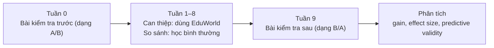

# Kế hoạch đo hiệu quả học tập (Learning Efficacy Plan)

> Trạng thái: Draft · Phiên bản: 0.1 · Owner: EdTech Specialist + Product Owner · Cập nhật: 2026-11-15
> Liên quan: [ADR-0080](../adr/ADR-0080-do-hieu-qua-hoc-tap-la-exit-criterion-pilot.md) · [LEARNING_ANALYTICS](LEARNING_ANALYTICS.md) · [EXAM_ENGINE](EXAM_ENGINE.md) · [QUESTION_BANK](QUESTION_BANK.md) · [EDU_FIT_REVIEW](../12-project/EDU_FIT_REVIEW.md) (PED-01, K1) · [PRODUCT_VISION](../00-overview/PRODUCT_VISION.md) · [ROADMAP](../12-project/ROADMAP.md) · [DATA_PRIVACY](../10-security/DATA_PRIVACY.md) · [OQ-12](../12-project/OPEN_QUESTIONS.md)

ADR-0080 đã Accepted (2026-11-17). Thiết kế chi tiết dưới đây vẫn là **[Confirmed]** cho tới khi chuyên gia đánh giá giáo dục/thống kê rà soát; yêu cầu là FR-ANL-017…023 trong [PRD](../00-overview/PRODUCT_REQUIREMENTS.md), triển khai ở [F035](../../specs/035-learning-efficacy-study/spec.md).

## 1. Mục đích và phạm vi

EduWorld tuyên bố giúp học sinh tiến bộ. Mastery ([LEARNING_ANALYTICS §3](LEARNING_ANALYTICS.md#3-mastery-model-mặc-định-adr-0017)) do chính hệ thống tính từ câu hỏi của chính hệ thống, nên **không đủ** để chứng minh hiệu quả: dùng mastery để đo tiến bộ là vòng tròn. Tài liệu này định nghĩa cách đo hiệu quả học tập bằng **bài kiểm tra độc lập**, cách kiểm tra mastery có dự báo đúng năng lực thật không, và hạ tầng thử nghiệm A/B để cải tiến mô hình mastery và quy tắc chọn câu.

| Trong phạm vi | Ngoài phạm vi |
|---|---|
| Nghiên cứu pilot 8 tuần, bài kiểm tra trước/sau, lớp so sánh | Đánh giá chính thức theo thông tư ([ASSESSMENT_REGULATION_PROFILE](ASSESSMENT_REGULATION_PROFILE.md)) |
| Chỉ số learning gain, effect size, predictive validity | KPI vận hành game ([GAME_ANALYTICS](../11-operations/GAME_ANALYTICS.md)) |
| Hạ tầng A/B cho `mastery_model_configs` và selection rule | A/B cho kinh tế game, UI thương mại |
| Đạo đức nghiên cứu và dữ liệu trẻ em | Nghiên cứu dài hạn nhiều năm |

## 2. Mục tiêu và câu hỏi nghiên cứu

| # | Câu hỏi | Chỉ số chính |
|---|---|---|
| Q1 | Học sinh dùng EduWorld 8 tuần có tiến bộ hơn lớp so sánh trên bài kiểm tra độc lập không? | Effect size (Hedges' g) của learning gain |
| Q2 | Mastery của hệ thống có dự báo đúng kết quả bài kiểm tra độc lập theo từng LO không? | Tương quan, độ hiệu chuẩn (§5) |
| Q3 | Học sinh có làm theo gợi ý tự động không, và gợi ý có giúp LO yếu tiến bộ không? | `recommendation_follow_rate`, gain theo LO được gợi ý |
| Q4 | Thay đổi mô hình mastery/selection rule có cải thiện học tập không? | Kết quả thử nghiệm A/B (§6) |

## 3. Thiết kế nghiên cứu pilot

### 3.1. Thiết kế

- **Loại:** bán thực nghiệm (quasi-experimental) có nhóm so sánh, chia theo **lớp** (không chia học sinh trong cùng lớp để tránh lây nhiễm).
- **Nhóm can thiệp:** lớp dùng EduWorld theo kế hoạch của trường (khuyến nghị ≥ 3 buổi × 20–30 phút/tuần).
- **Nhóm so sánh:** lớp cùng khối, cùng trường (hoặc trường tương đồng), học bình thường; chỉ dùng EduWorld để làm bài kiểm tra trước/sau. Được dùng đầy đủ sản phẩm sau khi kết thúc nghiên cứu (waitlist).
- **Thời lượng:** 8 tuần học, cùng phạm vi chương trình (cùng các topic/LO) ở hai nhóm.
- **Ghép cặp:** lớp được ghép theo khối, trường và điểm bài kiểm tra trước; phân nhóm ngẫu nhiên trong từng cặp khi trường đồng ý.

### 3.2. Bài kiểm tra độc lập

- **Độc lập với nội dung luyện tập:** ngân hàng câu riêng (`efficacy_instrument`), do EdTech soạn và người thứ hai duyệt, **không** xuất hiện trong practice/quest/minigame/đề thường (cơ chế `exam_only`, [QUESTION_BANK §8](QUESTION_BANK.md#8-chống-lộ-đáp-án)); không dùng câu tham số hóa từ template luyện tập.
- **Tự chấm trong game:** tổ chức như một ExamSession ([EXAM_ENGINE](EXAM_ENGINE.md)) với `feedback_timing = never`, `result_release = manual` (kết quả không công bố cho học sinh trong thời gian nghiên cứu), không thưởng XP theo điểm, không gợi ý; evidence **không** đưa vào mastery (để không làm nhiễu Q2).
- **Hai dạng song song A và B** cân bằng độ khó ([EXAM_ENGINE §4.1](EXAM_ENGINE.md#41-cân-bằng-độ-khó-giữa-các-biến-thể-confirmed)); một nửa số lớp làm A trước B sau, nửa còn lại ngược lại (counterbalancing).
- **Phủ LO:** mỗi LO trong phạm vi có ≥ 3 câu mỗi dạng để tính điểm theo LO; tổng 20–30 câu, ≤ 40 phút (lớp 1–3: ≤ 20 câu, có audio đọc đề).
- **Kiểm định trước khi dùng:** thử trên một lớp không tham gia, yêu cầu reliability (KR-20) ≥ 0,7 ([EXAM_ENGINE §8.1](EXAM_ENGINE.md#81-độ-tin-cậy-của-đề-chính-thức-confirmed)).
- Khi trường cho phép, thu thêm điểm bài kiểm tra định kỳ của nhà trường (ẩn danh hóa) làm tiêu chí ngoài thứ hai.

## 4. Chỉ số

| Chỉ số | Định nghĩa | Mục tiêu tham chiếu |
|---|---|---|
| Learning gain | `post − pre` (tỉ lệ đúng) của từng học sinh | — |
| Normalized gain | `(post − pre) / (1 − pre)` | Báo cáo kèm |
| Effect size | Hedges' g của chênh lệch gain giữa hai nhóm; mô hình chính: hồi quy đa mức (học sinh trong lớp) với điểm trước làm biến kiểm soát | g ≥ 0,2 là tín hiệu tích cực tối thiểu cho exit criterion pilot (ADR-0080) |
| Gain theo LO | Gain trên các LO được gợi ý ôn (Q3) so với LO không được gợi ý | — |
| Mức sử dụng | Thời gian học thực (`active_learning_time_sec`), số buổi, `rapid_guess_rate` | Báo cáo để giải thích kết quả (liều dùng) |
| Tỉ lệ rời nghiên cứu | Học sinh thiếu bài trước hoặc sau | < 20%; báo cáo phân tích độ nhạy nếu cao hơn |

**Cỡ mẫu (ước tính sơ bộ, cần chuyên gia thống kê xác nhận):** phát hiện g = 0,3 với power 0,8, α = 0,05 và hệ số tương quan nội lớp khoảng 0,1–0,2 cần khoảng 6–8 lớp mỗi nhóm (~200 học sinh/nhóm). Số liệu nhỏ hơn chỉ cho kết quả mô tả, không kết luận.

## 5. Đối chiếu mastery với bài kiểm tra độc lập (predictive validity)

Kiểm tra mastery có phản ánh năng lực thật không, dùng dữ liệu nhóm can thiệp:

| Phân tích | Cách làm | Ngưỡng tham chiếu |
|---|---|---|
| Tương quan theo LO | Spearman giữa `M_eff` ở cuối tuần 8 và tỉ lệ đúng của học sinh trên các câu của LO đó ở bài sau | ρ ≥ 0,4 |
| Hiệu chuẩn mức | Học sinh `mastered` ở LO X đạt ≥ 80% câu của LO X ở bài sau; học sinh `beginning` đạt < 50% | ≥ 70% học sinh thỏa |
| Phân biệt | AUC của `M_eff` khi dự đoán "đạt ≥ 2/3 câu của LO" | ≥ 0,7 |
| Phân tích lỗi | LO có tương quan thấp → xem lại câu hỏi (item analysis), trọng số ngữ cảnh, `rapid_guess` | Đưa vào backlog nội dung/mô hình |

Kết quả là đầu vào cho việc chỉnh tham số mastery và cho quyết định chuyển sang BKT/IRT ([LEARNING_ANALYTICS §3.4](LEARNING_ANALYTICS.md#34-triển-khai-và-lộ-trình-mô-hình)).

## 6. Hạ tầng A/B cho mastery model và selection rule

| Thành phần | Thiết kế [Confirmed] |
|---|---|
| Đăng ký thử nghiệm | Bảng `learning.experiments` (`experiment_id`, `code` ≤ 64, `kind` ∈ {`mastery_model`, `selection_rule`, `recommendation_rule`}, `arms` jsonb, `unit` ∈ {`student`, `class`}, `start_at`, `end_at`, `status`, `owner`), phiên bản hóa, thay đổi có audit |
| Phân nhánh | Hash ổn định `(experiment_id, unit_id) mod 100` → arm; mặc định đơn vị là **lớp** để tránh học sinh cùng lớp nhận trải nghiệm khác nhau; tenant phải đồng ý tham gia |
| Mastery model | Mỗi arm trỏ một `mastery_model_configs` version; arm không phải control **chạy shadow** cho mọi học sinh (tính song song, không hiển thị) trước khi hiển thị cho arm thật |
| Selection rule | Arm đổi tham số SelectionRule (ví dụ tỉ lệ câu anh em, interleaving, phân bố độ khó) |
| Ghi nhận | Learning event mang `experiment_arms` (danh sách `experiment_code:arm`) để phân tích; không lộ cho client |
| Chỉ số đánh giá | Chính: kết quả bài kiểm tra độc lập (nếu có) hoặc độ chính xác lần đầu trên câu **mới** cùng LO sau 7 ngày; phụ: log-loss dự đoán, thời gian học |
| Rào chắn | Không thử nghiệm trên đề `is_official` hoặc thứ ảnh hưởng điểm trong sổ điểm; dừng sớm khi arm làm giảm độ chính xác ≥ 5 điểm phần trăm so với control; không thử nghiệm làm tăng thời gian chơi hay áp lực (R19) |

Hạ tầng này chạm schema module learning và learning event; triển khai cần ADR riêng hoặc bổ sung vào ADR-0080 khi được chấp nhận.

## 7. Exit criterion của pilot

Kết quả nghiên cứu là điều kiện ra khỏi pilot ([ADR-0080](../adr/ADR-0080-do-hieu-qua-hoc-tap-la-exit-criterion-pilot.md)): có báo cáo đủ §4–§5 với dữ liệu tối thiểu một chu kỳ 8 tuần; effect size không âm có ý nghĩa và đạt ngưỡng tham chiếu §4, hoặc có kế hoạch khắc phục được Product Owner chấp nhận. Ngưỡng chính thức do ADR-0080 chốt, tài liệu này chỉ đề xuất.

## 8. Đạo đức nghiên cứu và dữ liệu trẻ em

- **Tham gia:** nhà trường đồng ý tham gia bằng thỏa thuận pilot; khi trường yêu cầu, học sinh được loại khỏi phần phân tích nghiên cứu (xem "Rút khỏi nghiên cứu") và vẫn học bình thường. Mô hình consent và nhận định pháp lý về nghiên cứu trên trẻ em ngoài version này ([ADR-0082](../adr/ADR-0082-spec-driven-development-va-noi-dung-deferred.md)).
- **Không tước quyền học:** nhóm so sánh học theo chương trình bình thường của trường và được dùng sản phẩm sau nghiên cứu.
- **Không gây áp lực:** bài kiểm tra trước/sau không tính vào điểm của trường, không công bố điểm cá nhân, không xếp hạng, không thưởng XP theo điểm.
- **Tối thiểu hóa và giả danh hóa:** bộ dữ liệu phân tích dùng mã giả danh, không tên, không lớp thật (mã lớp giả danh); khóa ánh xạ lưu riêng, chỉ EdTech lead truy cập, có audit; báo cáo chỉ công bố số liệu gộp, ẩn ô < 5 học sinh ([LEARNING_ANALYTICS §5](LEARNING_ANALYTICS.md#5-read-models--aggregation)).
- **Lưu trữ:** dữ liệu nghiên cứu ở hạ tầng tại Việt Nam, thời hạn theo DATA_PRIVACY; không chia sẻ bên thứ ba.
- **Rút khỏi nghiên cứu:** dữ liệu của học sinh rút lui bị loại khỏi phân tích kể từ thời điểm rút (ẩn danh hóa theo ADR-0070, không xóa vật lý).

## 9. Ai làm gì

| Vai trò | Trách nhiệm |
|---|---|
| EdTech Specialist (lead) | Thiết kế nghiên cứu, soạn và kiểm định bài kiểm tra, phân tích predictive validity, viết báo cáo |
| Chuyên gia đánh giá/thống kê (thuê ngoài hoặc đối tác) | Rà soát thiết kế, cỡ mẫu, mô hình phân tích; phản biện báo cáo |
| Product Owner | Chọn trường pilot, ký thỏa thuận, quyết định dựa trên kết quả (ADR-0080) |
| Nhà trường (`school_admin`, `academic_manager`) | Đồng ý tham gia, sắp lịch dùng sản phẩm và lịch làm bài kiểm tra, thông báo phụ huynh |
| Backend (module learning) | ExamSession cho bài kiểm tra, cờ `efficacy_instrument`, xuất dữ liệu giả danh, hạ tầng A/B (§6) |
| Data/Analytics | Pipeline dữ liệu nghiên cứu, dashboard theo dõi mức sử dụng trong 8 tuần |

## 10. Acceptance criteria

| AC | Kịch bản |
|---|---|
| AC-EFF-001 | Câu `efficacy_instrument` không xuất hiện trong mọi selection của practice/quest/minigame/đề thường |
| AC-EFF-002 | Bài kiểm tra trước/sau không tạo evidence mastery, không thưởng XP, không hiện kết quả cho học sinh trong thời gian nghiên cứu |
| AC-EFF-003 | Bộ dữ liệu xuất cho phân tích chỉ có mã giả danh; ô < 5 học sinh bị ẩn trong báo cáo |
| AC-EFF-004 | Hai học sinh cùng lớp luôn ở cùng arm khi `unit = class`; arm được ghi trong learning event |
| AC-EFF-005 | Báo cáo pilot có đủ effect size, khoảng tin cậy, predictive validity theo LO và tỉ lệ rời nghiên cứu |
