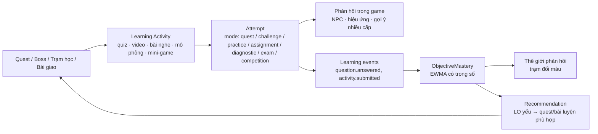

# Learning Experience — Trải nghiệm học tập trong game

> Trạng thái: Draft · Phiên bản: 0.3 · Owner: EdTech Specialist + UX/UI Designer · Cập nhật: 2026-11-16
> Liên quan: [GAME_DESIGN](../01-game-design/GAME_DESIGN.md) · [QUEST_SYSTEM](../01-game-design/QUEST_SYSTEM.md) · [MINIGAME_ENGINE](../08-game-client/MINIGAME_ENGINE.md) · [ACTIVITY_ENGINE](ACTIVITY_ENGINE.md) · [EXAM_ENGINE](EXAM_ENGINE.md) · [LEARNING_ANALYTICS](LEARNING_ANALYTICS.md) · [CONTENT_MODEL](CONTENT_MODEL.md) · [ADR-0072](../adr/ADR-0072-bo-vai-tro-giao-vien-hoc-sinh-tu-hoc-kiem-duyet-tap-trung.md) · [ADR-0016, ADR-0017](../adr/README.md)
> Yêu cầu (mã [PRD](../00-overview/PRODUCT_REQUIREMENTS.md)): FR-EXR-003 (§4) · FR-CNT-019 (§5.1) · FR-EXR-014 (§5.2) · FR-EXR-013 (§6.1) · FR-PRG-004, FR-PRG-008 (§6.2) · FR-PRG-005 (§7) · FR-EXM-003 (§9) · NFR-A11Y-001, NFR-A11Y-002 (§10)

## 1. Nguyên tắc

| # | Nguyên tắc | Hệ quả thiết kế | Nhãn |
|---|---|---|---|
| L1 | Game phục vụ Learning Engine | Mọi hoạt động học tập là một `attempt` của [Activity & Attempt Engine](ACTIVITY_ENGINE.md) (hoặc exam), bất kể được mở từ quest, boss, mini-game hay trận đấu | [Confirmed — §4] |
| L2 | Server-authoritative | Client nhận render payload, không có answer key (ADR-0016) | [Confirmed] |
| L3 | Mastery ≠ điểm một lần | Mastery từ nhiều bằng chứng, có trọng số theo ngữ cảnh (ADR-0017) | [Confirmed — §4.6] |
| L4 | Sai là một phần của học | Phản hồi mang tính hướng dẫn, không trừng phạt | [Proposed] |
| L5 | Phân biệt luyện tập và kiểm tra | Practice: phản hồi ngay, gợi ý; Exam: không gợi ý, kết quả sau khi nộp | [Confirmed — §4.5] |
| L6 | Nội dung theo chương trình, không hardcode | Curriculum/LO/question lấy từ CMS (ADR-0015) | [Confirmed] |
| L7 | **Không chỉ quiz** — học tập đa định dạng | Video có câu hỏi chèn, bài nghe hiểu, bài tập tương tác, mô phỏng/phòng thí nghiệm ảo, mini-game; tất cả server tự chấm qua [Activity Registry](ACTIVITY_ENGINE.md) (ADR-0048) để quest/assignment dùng chung. Hoạt động cần người chấm (tự luận, nói, dự án) ngoài Release (ADR-0072) | [Confirmed — Master Prompt mới §15; ADR-0072] |
| L8 | Công thức chỉ hiển thị trong game | Toán/Lý/Hóa hiển thị bằng SVG render sẵn (MathJax 4 trên portal); học sinh trả lời bằng chọn đáp án, nhập số, kéo thả… không gõ công thức (ADR-0055) | [Confirmed] |
| L9 | Học sinh tự học, hệ thống dẫn đường | Không có người lớn theo dõi trong game; phản hồi, gợi ý nhiều cấp và gợi ý ôn tập tự động phải đủ để học sinh tự tiến bộ (ADR-0072) | [Confirmed] |

## 2. Học tập nằm ở đâu trong thế giới game

Học sinh không mở "màn làm bài". Hoạt động học tập luôn có **ngữ cảnh game**: một lý do trong câu chuyện, một nhân vật, một hệ quả nhìn thấy được trong thế giới.

| Nơi trong game | Hoạt động học tập | Hệ quả trong game | Tài liệu game |
|---|---|---|---|
| NPC giao quest | Bước `activity` của quest (quiz, bài tương tác, video, bài nghe, mô phỏng…) | Câu chuyện tiến triển, mở khu/đồ vật, phần thưởng quest | [QUEST_SYSTEM](../01-game-design/QUEST_SYSTEM.md) |
| Challenge, Boss | Mỗi đòn/phase là một activity theo độ khó | Boss mất tiến độ, phase mới, phần thưởng; sai không bị phạt làm xấu hổ | [CHALLENGE_BOSS_SYSTEM](../01-game-design/CHALLENGE_BOSS_SYSTEM.md) |
| Mini-game trong khu học tập | Mini-game dùng câu hỏi Question Bank | Điểm mini-game, combo, phần thưởng theo rule | [MINIGAME_ENGINE](../08-game-client/MINIGAME_ENGINE.md) |
| Learning Zone (theo môn) | Bài học, ví dụ mẫu, video, bài nghe; bảng nhiệm vụ "Nhà trường giao" | Trạm học đổi màu theo mastery | [WORLD_DESIGN](../01-game-design/WORLD_DESIGN.md) |
| Practice Zone | Tự luyện theo chủ đề, luyện trộn chủ đề, ôn câu sai, bài khởi động (chẩn đoán) | Huy hiệu luyện tập, không xếp hạng | [WORLD_DESIGN](../01-game-design/WORLD_DESIGN.md) |
| Exam Zone | Thi thử, kiểm tra nhà trường giao | Không có hiệu ứng game trong lúc làm; chỉ XP "hoàn thành" cố định | [EXAM_ENGINE](EXAM_ENGINE.md) |
| Arena | Câu hỏi trong trận 1v1/đội | Kết quả trận, rating (không phải điểm học tập) | [COMPETITION_SYSTEM](../01-game-design/COMPETITION_SYSTEM.md) |

**Tách bạch tiến trình:** XP/level/vật phẩm là tiến trình **game**; mastery là tiến trình **học tập**; rating là tiến trình **thi đấu**. Không trộn thành một điểm, không dùng level game làm bằng chứng năng lực ([PROGRESSION_SYSTEM](../01-game-design/PROGRESSION_SYSTEM.md), ADR-0018).

### 2.1. Không biến game thành chuỗi quiz [Proposed]

| Quy tắc | Giá trị mặc định | Áp dụng |
|---|---|---|
| Số câu liên tiếp tối đa trước một "nhịp game" (di chuyển, hội thoại, hiệu ứng, khám phá) | g1_3: 3 · g4_5: 5 · g6_9: 8 | Quest, challenge (không áp dụng exam) |
| Mỗi quest học tập có ít nhất một bước không phải câu hỏi (khám phá, nói chuyện NPC, thu thập, mô phỏng) | ≥ 1 | Quest Builder validate |
| Đa dạng định dạng trong một chuỗi quest | ≥ 2 `activity_type` trong chuỗi ≥ 3 quest | Khuyến nghị khi biên tập (cảnh báo, không chặn) |
| Hoạt động học tập có lời dẫn trong câu chuyện | Bắt buộc với quest `learning`/`main` | Trường `narrative` của bước |

### 2.2. Gắn định dạng học tập vào trải nghiệm game [Proposed]

| Định dạng | Ngữ cảnh trong thế giới game | Lưu ý theo khối |
|---|---|---|
| Video bài học | NPC giảng bài trong phòng học, "phim tư liệu" trong quest, màn chiếu ở Learning Zone | Lớp 1–5: video ≤ 8 phút, phụ đề bật mặc định |
| Bài nghe | Góc Tiếng Anh, NPC kể chuyện, "nghe mật lệnh" mở cửa trong quest | Lớp 1–3: câu hỏi nghe dùng hình, chạm/kéo thay cho gõ |
| Ví dụ mẫu (`worked_example`) | NPC dẫn đường làm mẫu từng bước trước bài mới; nút "Xem ví dụ mẫu" sau khi sai | Lớp 1–3: mỗi bước có lồng tiếng |
| Mô phỏng | Phòng thí nghiệm ở khu Khoa học, cầu cân ở khu Toán | Thất bại được làm lại, không trừ điểm |

## 3. Chuỗi trải nghiệm: Quest → Activity → Feedback → Mastery → Recommendation

| Bước | Nơi diễn ra | Tài liệu sở hữu |
|---|---|---|
| Quest/Boss/Trạm | Client hiển thị theo version đã ghim | [QUEST_SYSTEM](../01-game-design/QUEST_SYSTEM.md), [CONTENT_MODEL §5.2](CONTENT_MODEL.md#52-version-pinning--học-sinh-đang-chơi-giữ-version-cũ) |
| Activity, Attempt, chấm, gợi ý | module learning | [ACTIVITY_ENGINE](ACTIVITY_ENGINE.md) |
| Mastery, trọng số theo ngữ cảnh (ADR-0017) | Worker learning_record | [LEARNING_ANALYTICS](LEARNING_ANALYTICS.md) |
| Recommendation | API gợi ý | §6, [LEARNING_ANALYTICS §6](LEARNING_ANALYTICS.md#6-recommendation-rules) |

## 4. Phản hồi đúng/sai thân thiện

### 4.1. Cấu trúc phản hồi

| Thành phần | Khi đúng | Khi sai (practice/quest) |
|---|---|---|
| Hiệu ứng | Âm thanh vui, hạt sáng, NPC vui mừng (≤ 1.5 s, có thể tắt) | Âm thanh nhẹ, NPC "suy nghĩ" — không âm báo lỗi gay gắt |
| Lời nhắn | Khen theo nỗ lực/chiến lược ("Em tách 6×7 thành 6×6+6 rất hay!") khi có dữ liệu; mặc định câu khen ngắn ngẫu nhiên | Phản hồi theo phương án đã chọn khi câu có `options[].feedback` ("Em đang cộng thay vì nhân"); nếu không, "Gần đúng rồi!", "Thử nhìn lại phần…" — không dùng "Sai rồi!", không chữ đỏ to |
| Giải thích | Có thể mở xem `explanation` | Gợi ý cấp 1 → thử lại → gợi ý cấp 2 → thử lại → lời giải đầy đủ + nút "Xem ví dụ mẫu" (nếu câu có `worked_example_ref`) |
| Tiến trình game | Hành động game tiến lên (cầu được sửa) | Hành động game tạm dừng, không mất tiến trình đã có |

Thời điểm hiện phản hồi theo `FeedbackTiming` của mode ([ACTIVITY_ENGINE §8.1](ACTIVITY_ENGINE.md#81-feedbacktiming-và-resultrelease)); bảng trên áp dụng khi `FeedbackTiming = immediate`.

### 4.2. Số lượt thử (Proposed)

| Grade band | Practice/Quest | Assignment | Exam |
|---|---|---|---|
| `g1_3` | 3 lượt/câu, gợi ý sau lượt 1 | Theo bài giao (mặc định 2) | 1 |
| `g4_5` | 2 lượt/câu | Theo bài giao (mặc định 1) | 1 |
| `g6_7`, `g8_9` | 2 lượt/câu | Theo bài giao (mặc định 1) | 1 |

Bảng này là **nguồn duy nhất** cho số lượt thử mỗi câu ([ACTIVITY_ENGINE §8](ACTIVITY_ENGINE.md#8-phản-hồi-trong-game) tham chiếu). Mastery dùng lượt trả lời đầu tiên làm bằng chứng chính ([LEARNING_ANALYTICS](LEARNING_ANALYTICS.md)); XP do module game tính ([PROGRESSION_SYSTEM](../01-game-design/PROGRESSION_SYSTEM.md)).

## 5. Scaffolding

| Kỹ thuật | Mô tả | Cấu hình ở |
|---|---|---|
| Gợi ý nhiều cấp | `hints[]` trong question version (cấp 1: định hướng; cấp 2: bước trung gian). Học sinh bấm nút "Gợi ý" (biểu tượng bóng đèn) trước khi trả lời, hoặc gợi ý tự bật sau lượt sai; mỗi lần bấm client gọi `POST …/items/{position}/hints:next` ([ACTIVITY_ENGINE §8.3](ACTIVITY_ENGINE.md#83-gợi-ý-trong-attempt-proposed)). Dùng gợi ý không mất XP, không bị đánh dấu xấu; mastery giảm trọng số ([LEARNING_ANALYTICS §3.1](LEARNING_ANALYTICS.md#31-định-nghĩa)) | [QUESTION_BANK §2](QUESTION_BANK.md#2-cấu-trúc-một-question-version) |
| Worked example | Trước bài mới, NPC trình bày 1 ví dụ mẫu từng bước; sau khi sai có thể mở lại | [CONTENT_MODEL §9.2](CONTENT_MODEL.md#92-khối-worked_example-proposed) |
| Độ khó thích ứng nhẹ | Selection rule chọn difficulty theo mastery hiện tại: `beginning` → 1–2, `developing` → 2–3, `proficient` → 3–4, `mastered` → 4–5 | Question Set selection rule |
| Bài khởi động | Bài chẩn đoán ngắn đầu năm/đầu chủ đề để không bắt học sinh làm lại thứ đã biết, cũng không bỏ qua LO tiên quyết còn yếu | [LEARNING_ANALYTICS §3.5](LEARNING_ANALYTICS.md#35-bài-chẩn-đoán-đặt-m0-ban-đầu-proposed) |
| Luyện trộn | Practice xen kẽ nhiều chủ đề đã học để học sinh phải chọn cách giải | [QUESTION_BANK §6](QUESTION_BANK.md#6-chọn-câu-ngẫu-nhiên-theo-điều-kiện) |
| Chia nhỏ | Câu nhiều bước tách thành chuỗi câu ngắn cho g1_3 | Content authoring |
| Hỗ trợ đọc | Lồng tiếng đề bài và hướng dẫn cho lớp 1–3 (bắt buộc); bắt buộc với Tiếng Anh nghe | §5.1, [CONTENT_MODEL §8.1](CONTENT_MODEL.md#81-audio-đọc-đề-và-hướng-dẫn-cho-nhóm-g1_3-proposed) |
| Công cụ trực quan | Que tính, bảng nhân, trục số ảo trong UI Toán g1_5 | Mini-game template |

### 5.1. Hỗ trợ đọc cho lớp 1–3 [Proposed]

Quy tắc dữ liệu (audio là điều kiện publish) ở [CONTENT_MODEL §8.1](CONTENT_MODEL.md#81-audio-đọc-đề-và-hướng-dẫn-cho-nhóm-g1_3-proposed); phần này là trải nghiệm trong game:

- **Tự đọc:** khi hiện đề bài, hướng dẫn activity hay hướng dẫn bước quest, game tự phát audio tiếng Việt (mặc định bật cho `g1_3`); nút loa lớn để nghe lại bất kỳ lúc nào; ngưỡng `rapid_guess` của `g1_3` đã nhân hệ số để tính cả thời gian nghe ([ACTIVITY_ENGINE §11.1](ACTIVITY_ENGINE.md#111-cờ-rapid_guess--trả-lời-quá-nhanh-để-kịp-đọc-đề-proposed)).
- **Không có tai nghe / tắt tiếng:** văn bản luôn hiển thị như phụ đề (chữ to theo §8, từ đang đọc được tô sáng khi có audio); hướng dẫn thao tác kèm biểu tượng (`instruction_icons[]`: chạm, kéo, nghe, chọn hình) và hoạt ảnh tay mẫu ở lần đầu gặp dạng câu.
- **Phòng máy:** khi game phát hiện không có thiết bị âm thanh, hiện biểu tượng phụ đề rõ ràng thay vì báo lỗi.
- Thoại NPC giao nhiệm vụ cho lớp 1–3 có lồng tiếng theo cùng quy tắc publish ([QUEST_SYSTEM](../01-game-design/QUEST_SYSTEM.md)).

### 5.2. Luyện trộn chủ đề (interleaving) [Proposed]

Sau khi học sinh đã học vài chủ đề, luyện xen kẽ giúp học sinh phải tự nhận ra nên dùng cách giải nào, thay vì làm liền 10 câu cùng một dạng. Gợi ý "Luyện trộn" do [LEARNING_ANALYTICS §6](LEARNING_ANALYTICS.md#6-recommendation-rules) kích hoạt; cơ chế chọn câu ở [QUESTION_BANK §6](QUESTION_BANK.md#6-chọn-câu-ngẫu-nhiên-theo-điều-kiện).

| Tham số | Mặc định |
|---|---|
| Số topic trong một lượt luyện trộn | 2–4 topic đã học của cùng môn |
| Tỉ lệ trộn (`interleave.mix`) | 50% câu từ topic đang học gần nhất, 50% chia đều cho các topic đã học trước đó |
| Số câu liên tiếp cùng topic tối đa | 2 |
| Độ dài lượt | Theo §8 (g1_3: 3–5 câu thì chỉ trộn 2 topic) |
| Áp dụng | Practice Zone, gợi ý "Luyện trộn"; không áp dụng cho exam, diagnostic |

Ba dòng đầu (`interleave_mix`): [Confirmed — Technical Architect 2026-11-15].

Trong game, lượt luyện trộn được trình bày như một "thử thách tổng hợp" ở Practice Zone; phản hồi và gợi ý như practice thường.

## 6. Retry câu sai và Recommendation

### 6.1. Ôn câu sai (`retry_wrong`)

- Câu trả lời sai (lượt đầu) vào danh sách ôn của học sinh, gắn LO.
- Lịch ôn đơn giản 1–3–7 ngày; đúng 2 lần liên tiếp ở các ngày khác nhau → rời danh sách [Proposed].
- Ôn ưu tiên **câu anh em** cùng LO, cùng loại, cùng độ khó, khác câu gốc (không chỉ lặp nguyên câu) để tránh học thuộc đáp án; quy tắc chọn ở [QUESTION_BANK §6](QUESTION_BANK.md#6-chọn-câu-ngẫu-nhiên-theo-điều-kiện) [Proposed].

### 6.2. Recommendation (Release 1.0: rule-based)

Gợi ý tự động là con đường chính để học sinh biết nên học gì tiếp (ADR-0072). Quy tắc và điều kiện kích hoạt là nguồn duy nhất ở [LEARNING_ANALYTICS §6](LEARNING_ANALYTICS.md#6-recommendation-rules); phần này mô tả cách Mây (NPC dẫn đường) trình bày, theo thứ tự ưu tiên [Proposed]:

1. Bài nhà trường giao chưa hoàn thành, gần deadline.
2. Bài khởi động khi bắt đầu năm học/chủ đề mới.
3. LO có mastery `beginning`/`developing` và có bằng chứng sai gần đây (ôn LO tiên quyết trước nếu cần).
4. Câu đến hạn ôn trong `retry_wrong`; ôn lại LO đang phai; luyện trộn chủ đề.
5. Quest kế tiếp trong chuỗi chủ đề hiện tại của lớp.
6. Hoạt động xã hội/thi đấu (chỉ khi 1–5 đã ổn trong ngày).

Mỗi gợi ý kèm lý do dễ hiểu ("Vì lần trước em còn nhầm phép nhân 7"). Recommendation dựa trên ML chỉ cân nhắc sau Release 1.0 khi có đủ dữ liệu thật [Proposed]; rule engine được thiết kế để thay thế được (strategy).

## 7. Hiển thị tiến bộ cho học sinh

| Grade band | Cách hiển thị mastery | Cách hiển thị điểm |
|---|---|---|
| `g1_3` | Hình ảnh: trạm đổi màu, cây lớn, 0–3 ngôi sao | Số câu đúng/tổng (vd. "7/8"), không thang 10 |
| `g4_5` | Hình ảnh + nhãn mức (Mới bắt đầu / Đang tiến bộ / Thành thạo / Xuất sắc) | Số câu đúng + thang 10 cho bài kiểm tra |
| `g6_7`, `g8_9` | Nhãn mức + % theo LO + biểu đồ tiến bộ theo thời gian | Thang 10, phân tích câu sai theo LO |

Nhãn mức ánh xạ `objective_mastery.level`: `beginning` → Mới bắt đầu, `developing` → Đang tiến bộ, `proficient` → Thành thạo, `mastered` → Xuất sắc [Proposed]. Không hiển thị mastery của học sinh này cho học sinh khác.

## 8. UX học tập theo grade band

| Yếu tố | `g1_3` | `g4_5` | `g6_7` | `g8_9` |
|---|---|---|---|---|
| Cỡ chữ đề bài tối thiểu (1080p) | 32 px | 28 px | 24 px | 22 px |
| Số lựa chọn tối đa | 3–4 | 4 | 4–6 | 4–6 |
| Loại câu ưu tiên | Single choice có hình, drag & drop, matching hình, true/false | + fill in blank, ordering, numeric | Tất cả 11 loại | Tất cả, nhiều short answer/numeric |
| Nhập liệu | Chạm/kéo; tránh gõ phím | Bàn phím số tùy biến | Bàn phím đầy đủ | Bàn phím đầy đủ + ký hiệu toán |
| Đồng hồ | Ẩn hoặc dạng "cát chảy", không số giây | Thanh thời gian | Số phút | Số phút:giây |
| Độ dài hoạt động | 3–5 câu | 5–8 câu | 8–12 câu | 10–20 câu, đề thử 15–45 phút |
| Âm thanh đọc đề | Bắt buộc có, tự phát (§5.1) | Tùy chọn | Tùy chọn | Tùy chọn |

Tất cả UI câu hỏi là template chung cho 11 loại (QUESTION_BANK), skin theo grade band.

## 9. Exam experience

- Trước khi bắt đầu: màn hình quy chế (số câu, thời gian, có được quay lại câu trước không, chính sách xem kết quả).
- Thời gian theo server (`deadline_at`); client hiển thị đếm ngược đồng bộ, tự nộp khi hết giờ (server cũng tự đóng attempt).
- Mất kết nối: được tiếp tục cùng attempt nếu còn trong `deadline_at` (resume policy) [Proposed].
- Sau khi nộp: điểm + phân tích theo LO + danh sách câu sai có giải thích (khi `ResultRelease`/`FeedbackTiming` cho phép, [ACTIVITY_ENGINE §8.1](ACTIVITY_ENGINE.md#81-feedbacktiming-và-resultrelease)) + nút "Luyện LO này".
- Không XP theo điểm thi chính thức; chỉ XP "hoàn thành" cố định để tránh áp lực điểm–thưởng [Proposed].

## 10. Accessibility và hòa nhập

- Chế độ chữ lớn, tương phản cao, giảm hiệu ứng chuyển động.
- Không dùng màu duy nhất để báo đúng/sai (kèm biểu tượng ✓/✗ và âm thanh).
- Thời gian mở rộng (x1.5) cho học sinh được nhà trường cấp quyền hỗ trợ đặc biệt (Assignment/Exam) [Proposed].
- Ngôn ngữ: song ngữ `vi-VN` (mặc định) / `en-US` theo lựa chọn của học sinh ([ADR-0056](../adr/ADR-0056-game-song-ngu-viet-anh.md)). Nội dung học tập hiển thị theo ngôn ngữ đã chọn nếu có bản dịch; nếu không, hiển thị ngôn ngữ gốc kèm nhãn **"Chưa có bản tiếng Anh"** / **"No Vietnamese version yet"** và không tính là lỗi. Hội thoại NPC, phản hồi, gợi ý trong game luôn có đủ hai ngôn ngữ. Ở khu Tiếng Anh, tên đồ vật và từ khóa có thể hiển thị song song Việt–Anh để hỗ trợ học từ vựng. Quy tắc dữ liệu: [CONTENT_MODEL §8](CONTENT_MODEL.md#8-ngôn-ngữ-nội-dung-và-bản-dịch-adr-0056).
