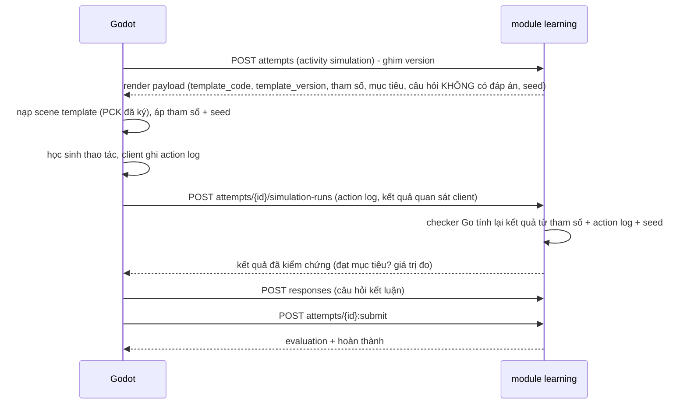

# Simulation Engine

> Trạng thái: Draft · Phiên bản: 0.1 · Owner: Senior Godot Developer + Senior Golang Developer + EdTech Specialist (Khoa học, Toán) · Cập nhật: 2026-11-26 (F099: khung client thân thiện — mục tiêu ✓/trống + chữ, bước đánh số, chỉ hiển thị; [STUDENT_GAME_UX_LEARNING §8](../05-ux/STUDENT_GAME_UX_LEARNING.md#8-mô-phỏng)) · 2026-11-16
> Liên quan: [ADR-0052](../adr/ADR-0052-thuc-thi-mo-phong-simulation-execution.md) · [ADR-0048](../adr/ADR-0048-learning-activity-registry-mo-rong-loai-hoat-dong-hoc-tap-kh.md) · [ACTIVITY_ENGINE](ACTIVITY_ENGINE.md) · [GODOT_ARCHITECTURE](../08-game-client/GODOT_ARCHITECTURE.md) · [WORLD_RENDERING](../08-game-client/WORLD_RENDERING.md) · [ANTI_CHEAT](../10-security/ANTI_CHEAT.md) · Schema: [`simulation.schema.json`](../../specs/schemas/activities/simulation.schema.json)

## 1. Mục đích và phạm vi

`activity_type = simulation`: học sinh tương tác với mô hình khoa học/toán học trong không gian 3D của Godot, quan sát kết quả và trả lời câu hỏi.

| Loại (`simulation_kind`) | Ví dụ | Nhãn |
|---|---|---|
| `science_simulation` | Vòng tuần hoàn của nước, quang hợp, chuỗi thức ăn | [Confirmed] tính năng |
| `physics` | Đòn bẩy, mặt phẳng nghiêng, mạch điện đơn giản, nổi/chìm | [Confirmed] |
| `geometry_3d` | Lắp ghép hình khối, trải phẳng hình hộp, tính thể tích bằng khối đơn vị | [Confirmed] |
| `virtual_lab` | Pha dung dịch, đo nhiệt độ, dùng kính lúp ảo theo quy trình an toàn | [Confirmed] |
| `interactive_experiment` | Thí nghiệm có giả thuyết → thay đổi biến → quan sát → kết luận | [Confirmed] |

## 2. Nguyên tắc (ADR-0052)

1. **Mô phỏng là scene Godot đóng gói sẵn** (`SimulationTemplate`), có trong bản build game hoặc gói PCK có chữ ký trên CDN (ADR-0044). Mỗi template có `template_code` (ví dụ `physics.lever.v1`) và `template_version`.
2. **CMS chỉ tham số hóa**: chọn template, đặt tham số (khối lượng, chiều dài cánh tay đòn, số khối…), mục tiêu, câu hỏi kèm theo, điều kiện hoàn thành. **CMS không nạp script hoặc code tùy ý** [Confirmed bởi ADR-0052].
3. **Client ghi lại** tham số đầu vào và **chuỗi hành động** của học sinh (action log có dấu thời gian tương đối, ví dụ "đặt vật 2 kg ở vị trí 3", "bấm Thả").
4. **Server kiểm chứng xác định**: mỗi template có một **checker viết bằng Go** trong module learning, tính lại kết quả từ tham số + action log. Kết quả client tự báo không được tin.
5. Template không có checker (ví dụ mô phỏng chỉ để quan sát) → chỉ chấm các câu hỏi đi kèm; phần mô phỏng tính "hoàn thành" theo các bước đã làm, không cấp evidence mastery từ kết quả mô phỏng.

## 3. Luồng



## 4. Mô hình nội dung

| Trường (`content`) | Mô tả |
|---|---|
| `template_code`, `min_template_version` | Template phải có trên client (manifest kiểm tra `min_client_version`) |
| `parameters` | Object theo schema tham số **của template** (template công bố `parameter_schema`); ví dụ `{ "mass_kg": 2, "arm_length_m": 1.5 }` |
| `goals[]` | `{goal_id, description (≤ 255), check: {metric, operator, value, tolerance}}` — ví dụ "cân bằng đòn bẩy" ⇔ `|torque_left − torque_right| ≤ 0.05` |
| `steps[]` | Hướng dẫn từng bước cho virtual lab (thứ tự, bước an toàn bắt buộc) |
| `questions[]` | Câu hỏi trước/sau mô phỏng (`question_version_id`) |
| `seed_policy` | `fixed` / `per_attempt` (server cấp seed để tái lập) |
| `interaction` | `max_runs` (số lần chạy lại), `time_limit_seconds`, `show_measurements` |

## 5. Kiểm chứng (checker)

```go
// Checker tính lại kết quả mô phỏng một cách xác định (deterministic).
type Checker interface {
    TemplateCode() string
    SupportedVersions() []int
    // Trả giá trị đo và mục tiêu đạt/không đạt; lỗi nếu action log không hợp lệ.
    Verify(ctx context.Context, params json.RawMessage, seed int64, log []Action) (Outcome, error)
}
```

- Checker và scene Godot dùng **cùng mô hình toán học đơn giản hóa** (không dùng engine vật lý Godot cho phần cần chấm, vì kết quả physics engine không xác định giữa nền tảng). Scene Godot dùng physics chỉ cho phần hiển thị.
- Mỗi template có **bộ vector kiểm thử chung** (tham số + action log → kết quả mong đợi) chạy cả trong test Go và test GdUnit4 để đảm bảo client và server khớp.
- Action log giới hạn ≤ 500 hành động, ≤ 64 KB; hành động không hợp lệ (vị trí ngoài phạm vi, thời gian âm) → `SIMULATION_LOG_INVALID`, ghi integrity signal.

## 6. Hiệu năng

| Mục tiêu [Confirmed] | Giá trị |
|---|---|
| FPS theo hạng thiết bị ([PERFORMANCE_BUDGET §3](../08-game-client/PERFORMANCE_BUDGET.md#3-mục-tiêu-khung-hình)) | ≥ 30 ở máy tầm trung, preset Trung bình |
| Kích thước gói một template | ≤ 15 MB |
| Thời gian nạp template | ≤ 3 giây trên mạng 10 Mbps (đã cache thì ≤ 1 giây) |
| Web export (Compatibility renderer) | Template phải chạy được; hiệu ứng nặng có bản giản lược |
| Checker phía server | p95 ≤ 50 ms mỗi lần kiểm chứng |

## 7. Dữ liệu (module learning)

| Bảng | Cột chính |
|---|---|
| Danh mục template | F066 [Confirmed]: registry descriptor nhúng trong mã module learning — `internal/domain/activity/simulation/templates/<template_code>/v<n>/descriptor.json` (`template_code`, `template_version`, `simulation_kind`, `title`, `parameter_schema`, `actions[]` {`action`, `args_schema`}, `metrics[]` {`metric`, `unit`, `display`}, `checker_available`, `min_client_version`, `status` `active`/`retired`), checker Go đăng ký theo `<code>@<version>`; thiếu checker khi descriptor khai báo có → service không ready. Bảng `content.simulation_templates` (DATABASE_DESIGN §2.6a) thêm khi có consumer đọc DB |
| `assessment.simulation_runs` | `run_id`, `tenant_id`, `attempt_id`, `template_code` varchar(64), `template_version`, `seed`, `action_log` jsonb (CHECK ≤ 64 KB), `client_outcome` jsonb, `verified_outcome` jsonb, `goals_met` jsonb, `verification_status` (`verified/rejected/not_verifiable`), `created_at`, `run_no` (1–50), `reject_code`, `idempotency_key` (partial unique theo attempt) — migration F066 `20261220000001`; run bất biến, run `rejected` cũng tính vào `max_runs` [Confirmed] |

## 8. API

| Method | Path | Mô tả |
|---|---|---|
| POST | `/api/v1/learning/activities/{activity_id}/attempts` | Bắt đầu (trả tham số + seed) |
| POST | `/api/v1/learning/activity-attempts/{attempt_id}/simulation-runs` | Gửi action log để kiểm chứng (Idempotency-Key) |
| GET | `/api/v1/cms/learning/simulation-templates` | Danh sách template + `parameter_schema` cho editor CMS |

Domain event: `simulation.run_verified`, `simulation.run_rejected` ([EVENT_DESIGN](../07-backend/EVENT_DESIGN.md)). Learning event: `simulation.goal_met` (mỗi mục tiêu checker xác nhận, evidence mastery) và `activity.completed`, theo [`learning-event.schema.json`](../../specs/schemas/learning-event.schema.json).

## 9. Nghiệm thu

Yêu cầu (mã PRD): FR-CNT-016 (mô phỏng, checker Go); AC-CNT-007 của PRD áp dụng nguyên văn.

| AC | Kịch bản |
|---|---|
| AC-SIM-001 | Học sinh cân bằng đòn bẩy: server tính lại từ action log, mục tiêu đạt, evidence ghi cho LO tương ứng |
| AC-SIM-002 | Client gửi `client_outcome` "đạt" nhưng action log không đạt: server trả không đạt, ghi integrity signal |
| AC-SIM-003 | CMS chỉ cho nhập tham số theo `parameter_schema`; không có ô nhập script |
| AC-SIM-004 | Vector kiểm thử chung của template cho kết quả giống nhau ở test Go và test Godot |
| AC-SIM-005 | Template chạy trên Web export đạt mục tiêu FPS của máy tầm trung ([PERFORMANCE_BUDGET §3](../08-game-client/PERFORMANCE_BUDGET.md#3-mục-tiêu-khung-hình), máy lab DEV-WEB-MID) |

Test: TC-SIM-001…005 trong [TEST_STRATEGY](../12-project/TEST_STRATEGY.md).
