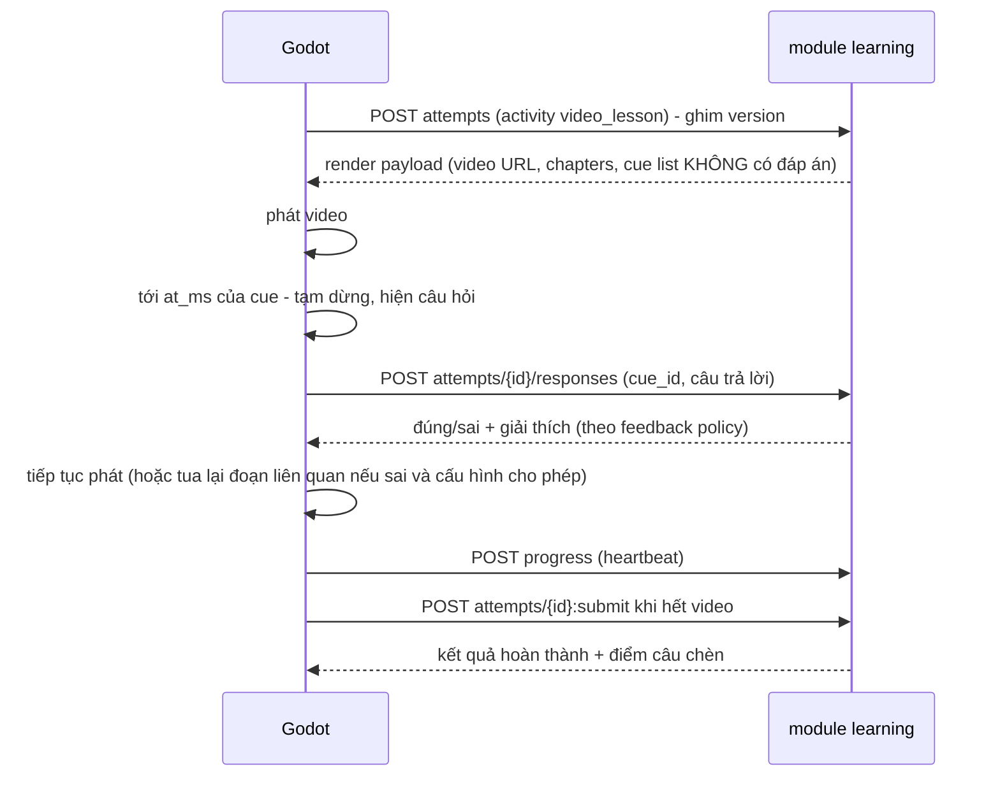

# Video Learning

> Trạng thái: Draft · Phiên bản: 0.2 · Owner: EdTech Specialist + Senior Godot Developer · Cập nhật: 2026-11-16
> Liên quan: [ACTIVITY_ENGINE](ACTIVITY_ENGINE.md) · [CONTENT_MODEL](CONTENT_MODEL.md) · [QUESTION_BANK](QUESTION_BANK.md) · [LEARNING_ANALYTICS](LEARNING_ANALYTICS.md) · [ADR-0044](../adr/ADR-0044-luu-tru-hinh-anh-va-media-object-storage-s3-compatible-cdn.md) · [ADR-0043](../adr/ADR-0043-phat-hanh-noi-dung-draft-publish-con-tro-phien-ban-giu-phien.md) · [GODOT_ARCHITECTURE](../08-game-client/GODOT_ARCHITECTURE.md) · Schema: [`video-lesson.schema.json`](../../specs/schemas/activities/video-lesson.schema.json)

## 1. Mục đích và phạm vi

Đặc tả `activity_type = video_lesson`: bài học video trong game (phòng học, NPC giảng bài, màn "xem phim tư liệu" trong quest) và trên web (preview CMS, xem lại).

| Tính năng | Nhãn |
|---|---|
| Video bài học, chapter | [Confirmed] Master Prompt mới §15.1 |
| Phụ đề tiếng Việt/Anh | [Confirmed] |
| Lưu tiến độ, xem tiếp (resume) | [Confirmed] |
| Câu hỏi chèn tại mốc thời gian | [Confirmed] |
| Video tương tác có nhánh | [Confirmed]; chi tiết UX [Proposed] |
| Theo dõi hoàn thành | [Confirmed]; quy tắc [Proposed] |

**Không** có upload video của học sinh. Video do CMS upload (ADR-0044).

## 2. Định dạng và phát

| Nền tảng | Định dạng | Cách phát |
|---|---|---|
| Godot (Windows, Android, iOS) | **Ogg Theora (.ogv)** + Vorbis, 480p và 720p | `VideoStreamPlayer` (Godot 4 chỉ phát Theora). Chọn độ phân giải theo thiết bị/mạng |
| Godot Web export | Ogg Theora 480p | Cùng `VideoStreamPlayer`; preload một phần trước khi phát |
| CMS / web | HLS (360p, 720p) + MP4 dự phòng | Trình phát web của Admin Portal |
| Phụ đề | **WebVTT** (`vi`, `en`; thêm ngôn ngữ khác theo cấu hình) | Godot: tự parse VTT và vẽ bằng Label theo Theme game. Web: `<track>` |

- Media worker chuyển đổi khi upload (ADR-0044). Video giới hạn ≤ 300 MB nguồn, khuyến nghị bài ≤ 8 phút cho lớp 1–5, ≤ 15 phút cho lớp 6–9 [Proposed].
- File phát qua CDN, URL có version/hash; nội dung riêng tenant dùng signed URL.
- Ghim version theo ADR-0043: học sinh đang xem không bị đổi video khi có version mới.

## 3. Mô hình nội dung

| Trường (trong `content`) | Mô tả |
|---|---|
| `video_asset_id` | Asset video (biến thể Theora/HLS do media worker sinh) |
| `duration_ms` | Do media worker đo, không nhập tay |
| `chapters[]` | `{chapter_id, title (≤ 128), start_ms, end_ms, objective_ids[]}` |
| `subtitles[]` | `{language (vi/en…), subtitle_asset_id (VTT), is_default}` |
| `embedded_questions[]` | `{cue_id, at_ms, question_version_id, pause: true, required: bool, allow_skip_after_wrong: bool}` |
| `branches[]` (video tương tác) | `{branch_point_id, at_ms, prompt (≤ 255), options: [{label, target_segment_id}]}` |
| `segments[]` (khi có nhánh) | `{segment_id, video_asset_id, next}` |
| `transcript_asset_id?` | Bản ghi lời (trợ năng) |

`interaction`: `allow_seek` (`free` / `backward_only` / `watched_only`), `playback_rates` ([0.75, 1, 1.25]), `allow_subtitles_toggle`, `autoplay_next_chapter`.

## 4. Tiến độ và resume

- Client gửi **heartbeat tiến độ** mỗi 10 giây khi đang phát và khi tạm dừng/thoát: `{attempt_id, position_ms, watched_ranges[], playback_rate}` qua `POST /api/v1/learning/activity-attempts/{attempt_id}/progress` (idempotent theo `client_seq`).
- Server lưu `video_progress` (gộp các khoảng đã xem, không lưu từng giây) và tính `watched_ratio` (tổng khoảng đã xem ÷ thời lượng).
- **Resume:** bắt đầu lại activity trong thời hạn resume ([ACTIVITY_ENGINE §6.3](ACTIVITY_ENGINE.md#63-resume)) → server trả `resume_position_ms`; client hỏi "Xem tiếp từ 03:12?".
- Server kiểm tra hợp lý: `watched_ranges` không thể tăng nhanh hơn thời gian thực × `playback_rate` tối đa (chống báo khống). Vượt ngưỡng thì bỏ phần bất hợp lý và ghi integrity signal ([ANTI_CHEAT](../10-security/ANTI_CHEAT.md)).

## 5. Câu hỏi chèn (embedded question)

- Câu hỏi chèn lấy từ Question Bank (`question_version_id`), chấm `auto` (ADR-0016).
- `required = true`: không xem tiếp được khi chưa trả lời (vẫn được trả lời sai). `allow_skip_after_wrong`: sau 2 lần sai được đi tiếp, hiện giải thích [Proposed].
- Client không được biết đáp án trước; danh sách cue chỉ có `at_ms` và `question` render payload.

## 6. Video tương tác có nhánh [Proposed]

- Tại `branch_point`, video dừng, học sinh chọn hướng (ví dụ "Thử nhỏ giọt nước vào dầu" / "vào nước").
- Lựa chọn được ghi vào attempt (dùng cho phân tích, không chấm đúng/sai trừ khi cấu hình là câu hỏi).
- Hoàn thành khi đi hết một nhánh tới điểm kết thúc được đánh dấu `is_ending`.

## 7. Quy tắc hoàn thành (`completion_rule`)

| Thuộc tính | Mặc định [Proposed] | Ghi chú |
|---|---|---|
| `min_watched_ratio` | 0,9 | Theo khoảng **đã xem thật**, tua qua không tính |
| `require_required_cues` | true | Mọi câu chèn `required` đã được trả lời |
| `min_score_ratio` | 0 | Tỉ lệ điểm câu chèn tối thiểu (trường `completion_rule.min_score_ratio` của [`activity-base.schema.json`](../../specs/schemas/activities/activity-base.schema.json)); có thể đặt 0,6 nếu muốn "đạt" chứ không chỉ "hoàn thành" |
| `allow_seek` | `watched_only` | Chỉ tua trong phần đã xem; lần xem lại sau khi hoàn thành thì tua tự do |

"Hoàn thành" khác "đạt": hoàn thành mở khóa bước quest/assignment; điểm câu chèn là evidence cho mastery.

## 8. Dữ liệu (module learning)

| Bảng | Cột chính |
|---|---|
| `assessment.video_progress` | `attempt_id` PK, `tenant_id`, `student_id`, `position_ms`, `watched_ranges` jsonb (≤ 64 khoảng), `watched_ratio` numeric(5,4), `last_heartbeat_at`, `client_seq` |
| `assessment.attempt_items` / `assessment.attempt_answers` | Mỗi câu chèn là một item của attempt (`position` theo thứ tự `at_ms`, `cue_id` lưu trong `presentation`); câu trả lời ghi `attempt_answers` như câu hỏi thường nên dùng chung scorer, gợi ý (`hints:next` theo `position`), `hints_used`, `rapid_guess` ([ACTIVITY_ENGINE §6.4](ACTIVITY_ENGINE.md#64-dữ-liệu-lưu-trữ-confirmed)) |
| `assessment.video_branch_choices` | `attempt_id`, `branch_point_id` varchar(64), `option_id` varchar(64), `chosen_at` |
| `assessment.integrity_signals` | Tiến độ tăng nhanh hơn thời gian thực × tốc độ phát tối đa bị cắt và ghi `signal_type = video_progress_implausible` |

Chi tiết DDL: [DATABASE_DESIGN](../07-backend/DATABASE_DESIGN.md).

## 9. API (module learning)

| Method | Path | Mô tả |
|---|---|---|
| POST | `/api/v1/learning/activities/{activity_id}/attempts` | Bắt đầu attempt (ghim version), trả render payload + `resume_position_ms` |
| POST | `/api/v1/learning/activity-attempts/{attempt_id}/progress` | Heartbeat tiến độ (idempotent `client_seq`) |
| POST | `/api/v1/learning/activity-attempts/{attempt_id}/responses` | Trả lời câu chèn / chọn nhánh |
| POST | `/api/v1/learning/activity-attempts/{attempt_id}:submit` | Kết thúc, tính hoàn thành |
| GET | `/api/v1/learning/activity-attempts/{attempt_id}` | Trạng thái, kết quả |

## 10. Event

| Event | Khi |
|---|---|
| `activity.started` | Bắt đầu attempt |
| `video.progressed` | Mỗi khi `watched_ratio` vượt mốc 25/50/75/100% (không phát mỗi heartbeat) |
| `video.cue_answered` | Trả lời câu chèn (kèm `question_version_id`, `is_correct`) |
| `activity.completed` | Thỏa `completion_rule` |

## 11. Phân tích

Thời lượng xem, tỷ lệ hoàn thành theo chapter, đoạn bị xem lại nhiều, câu chèn sai nhiều. **Không** dùng thời gian xem làm thước đo thành tích chính ([LEARNING_ANALYTICS](LEARNING_ANALYTICS.md)).

## 12. Lỗi

| Mã | Khi |
|---|---|
| `VIDEO_NOT_READY` | Media chưa xử lý xong |
| `VIDEO_SEEK_NOT_ALLOWED` | Báo tiến độ vượt phần cho phép tua |
| `CUE_ANSWER_REQUIRED` | Submit khi còn câu chèn bắt buộc |

## 13. Nghiệm thu

Yêu cầu (mã PRD): FR-CNT-014 (video bài học), FR-EXR-004 (resume, §4), FR-CNT-011 (version pinning); AC-CNT-006 của PRD áp dụng nguyên văn.

| AC | Kịch bản |
|---|---|
| AC-VID-001 | Video có câu chèn tại 01:30: video dừng đúng mốc, chưa trả lời thì không phát tiếp; trả lời được chấm server, có giải thích |
| AC-VID-002 | Học sinh tua tới cuối ngay khi mở: `watched_ratio` không tăng, activity không hoàn thành |
| AC-VID-003 | Thoát giữa chừng, mở lại trong thời hạn resume: hỏi xem tiếp, tiếp tục đúng vị trí |
| AC-VID-004 | Bật/tắt phụ đề tiếng Việt và tiếng Anh trong Godot; phụ đề hiển thị theo Theme game |
| AC-VID-005 | Publish version video mới khi học sinh đang xem: học sinh xem hết version cũ |

Test: TC-VID-001…005 trong [TEST_STRATEGY](../12-project/TEST_STRATEGY.md).
