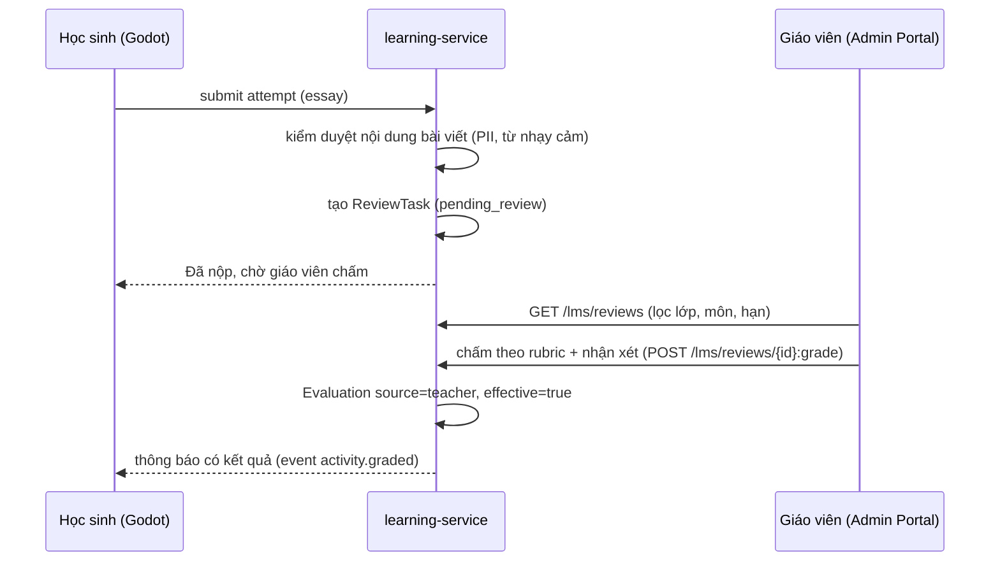

# Written Response, Rubric & Project-based Learning

> Trạng thái: Draft · Phiên bản: 0.1 · Owner: EdTech Specialist + Senior Golang Developer · Cập nhật: 2026-11-15
> Liên quan: [ACTIVITY_ENGINE](ACTIVITY_ENGINE.md) · [QUESTION_BANK](QUESTION_BANK.md) · [EXAM_ENGINE](EXAM_ENGINE.md) · [MODERATION](../03-social-multiplayer/MODERATION.md) · [SCHOOL_LMS](../04-admin-portal/SCHOOL_LMS.md) · [SCHOOL_LMS §8](../04-admin-portal/SCHOOL_LMS.md#8-teacher-dashboard) · [ADR-0053](../adr/ADR-0053-cham-diem-co-ho-tro-ai-ai-assisted-grading.md) · Schema: [`written-response.schema.json`](../../specs/schemas/activities/written-response.schema.json), [`rubric.schema.json`](../../specs/schemas/activities/rubric.schema.json), [`project.schema.json`](../../specs/schemas/activities/project.schema.json)

## 1. Mục đích và phạm vi

Đặc tả các hoạt động **cần viết hoặc nộp sản phẩm**, chấm bằng rubric và giáo viên:

| Loại | `activity_type` / `response_kind` | Chấm mặc định |
|---|---|---|
| Trả lời ngắn | `written_response` / `short_answer` | `accepted_answers` (tự động) |
| Trả lời dài | `written_response` / `long_answer` | `rubric` + `teacher_review` |
| Tự luận | `written_response` / `essay` | `rubric` + `teacher_review` |
| Lời giải toán | `written_response` / `math_solution` | `numeric_tolerance` cho đáp số + `rubric` cho các bước |
| Dự án | `project` | `rubric` + `teacher_review` |

[Confirmed] Master Prompt mới §15.1, §15.5. AI chỉ gợi ý, tắt mặc định (ADR-0053).

## 2. Trả lời ngắn (`short_answer`)

- Tối đa 255 ký tự [Proposed].
- Chấm `accepted_answers`: danh sách đáp án chấp nhận, chuẩn hóa (NFC, khoảng trắng, hoa/thường), tùy chọn chấp nhận không dấu, tùy chọn khoảng cách chỉnh sửa (typo) ≤ 1 cho từ ≥ 6 ký tự (chi tiết trong [QUESTION_BANK](QUESTION_BANK.md)).
- Câu trả lời không khớp nhưng có thể đúng → giáo viên có thể đánh dấu "chấp nhận thêm đáp án" để áp dụng cho các lượt sau (tạo **Draft** version mới của câu hỏi, không sửa version đã dùng).

## 3. Trả lời dài và tự luận

| Thuộc tính | Mặc định [Proposed] |
|---|---|
| `min_words` / `max_words` | Theo khối: lớp 3–5: 30–150 từ; lớp 6–9: 80–600 từ |
| Giới hạn ký tự lưu trữ | 10.000 ký tự (ADR-0041) |
| Lưu nháp tự động | Mỗi 15 giây, lưu server (resume trên thiết bị khác, ADR-0031) |
| Trình soạn | Văn bản thuần + định dạng tối thiểu (xuống dòng, đậm, gạch đầu dòng); không chèn link/ảnh trong Release 1.0 |
| Nhập trên game | Panel nhập liệu lớn, bàn phím ảo trên mobile; lớp 1–2 dùng chủ yếu `speaking` thay cho tự luận |

## 4. Lời giải toán (`math_solution`)

Game **chỉ hiển thị** công thức, **không nhập** công thức (ADR-0055 mục 5–6). Vì vậy bài lời giải toán trong game có giới hạn rõ:

- **Đề bài và gợi ý** có công thức (LaTeX, hóa học theo mhchem `\ce{...}`), hiển thị trong game bằng SVG render sẵn từ portal ([CONTENT_MODEL §9.1](CONTENT_MODEL.md#91-công-thức-toán-lý-hóa-adr-0055)).
- **Học sinh trả lời trong game:**
  - **Đáp số dạng số** (`numeric_answer`, ví dụ `5,5`), chấm tự động bằng `numeric_tolerance` có đơn vị (server-authoritative, ADR-0016).
  - **Các bước giải bằng văn bản thường và số** (không có trình nhập công thức; ví dụ "Chuyển 2x sang vế trái: 3x trừ 2x bằng 0,5 cộng 5"). Giáo viên chấm các bước theo rubric (ví dụ "Lập đúng phép tính", "Tính đúng", "Kết luận có đơn vị").
  - [Proposed] Tùy chọn `allow_photo_submission`: học sinh chụp **ảnh bài làm trên giấy** và nộp (bucket private, quét virus, chỉ giáo viên được phân công xem, xóa theo thời hạn lưu trữ) khi bài cần trình bày công thức phức tạp. Tắt mặc định.
- [Proposed] Câu hỏi yêu cầu học sinh **gõ biểu thức** (đáp án là biểu thức đại số/phương trình hóa học) không có trong game Release 1.0; dùng dạng chọn đáp án, nhập số, điền số/từ, ghép, sắp xếp, kéo thả ([QUESTION_BANK §3.6.1](QUESTION_BANK.md#361-câu-hỏi-có-công-thức-adr-0055)).
- **Giáo viên trên Admin Portal:** soạn đề và đáp án mẫu bằng **MathLive**; xem bài, viết **nhận xét có công thức** bằng MathLive, hiển thị bằng **MathJax 4**. Nhận xét có công thức gửi xuống game cũng hiển thị bằng SVG render sẵn (portal render khi lưu nhận xét).

## 5. Rubric

### 5.1. Mô hình

| Thực thể | Trường chính |
|---|---|
| **Rubric** (có version, publish như nội dung) | `rubric_id`, `version`, `tenant_id`/`owner_scope`, `title` (≤ 255), `subject_id`, `grade_levels`, `scoring_mode` (`points` / `levels`), `total_points`, `status` |
| **RubricCriterion** | `criterion_id`, `title` (≤ 128), `description` (≤ 1.000), `weight`, `objective_ids[]` (tiêu chí gắn learning objective để sinh evidence) |
| **RubricLevel** | `level_id`, `criterion_id`, `label` (≤ 64, ví dụ "Tốt"), `points`, `descriptor` (≤ 1.000, mô tả thế nào là đạt mức này) |

Ví dụ rubric tự luận lớp 7 (4 tiêu chí × 4 mức): Nội dung, Bố cục, Diễn đạt, Chính tả.

### 5.2. Quy tắc

- Rubric được chia sẻ, gán, clone theo ADR-0029; version bất biến sau publish.
- Activity tham chiếu `rubric_id + version`; chấm luôn theo version rubric đã ghim khi bắt đầu attempt (ADR-0043).
- Điểm tiêu chí × trọng số → điểm activity; mỗi tiêu chí sinh evidence cho các learning objective gắn với nó.

## 6. Hàng đợi chấm của giáo viên (teacher review queue)

| Tính năng | Chi tiết |
|---|---|
| Phân công | ReviewTask gán theo TeachingAssignment (giáo viên lớp × môn); tổ chuyên môn có thể phân lại |
| Hạn chấm | `review_due_at` (mặc định 7 ngày sau hạn nộp [Proposed]); nhắc giáo viên |
| Chấm hàng loạt | Danh sách bài, phím tắt chọn mức rubric, nhận xét mẫu (comment bank) |
| Ẩn danh khi chấm | Tùy chọn ẩn tên học sinh khi chấm để giảm thiên kiến [Proposed] |
| Trả lại | Giáo viên trả bài (`returned`) kèm nhận xét để học sinh sửa và nộp lại (nếu cho phép) |
| Chấm lại | Tạo evaluation mới, evaluation cũ `superseded`, ghi lý do, audit ([ACTIVITY_ENGINE §7.3](ACTIVITY_ENGINE.md#73-thực-thể-evaluation)) |
| Học sinh xem | Điểm từng tiêu chí, mô tả mức đạt, nhận xét của giáo viên |
| Gợi ý AI | Nếu tenant bật (ADR-0053): hiện điểm/nhận xét gợi ý **bên cạnh** form chấm, giáo viên phải tự xác nhận từng tiêu chí; lưu `model_ref`. Tắt mặc định |

## 7. Kiểm duyệt nội dung bài viết

Bài viết của học sinh **không phải chat**, nhưng có thể chứa thông tin cá nhân hoặc nội dung nguy hại.

- Khi nộp, chạy bộ phát hiện PII và danh mục từ nhạy cảm (dùng chung engine với [MODERATION](../03-social-multiplayer/MODERATION.md), cấu hình riêng cho nội dung học tập): **không chặn nộp bài**, chỉ gắn cờ cho giáo viên.
- Bài có dấu hiệu nghiêm trọng (tự gây hại, bị bắt nạt, xâm hại) → mở moderation case ưu tiên cao cho moderator của tenant, theo quy trình [CHILD_PROTECTION](../10-security/CHILD_SAFETY.md).
- Bài làm chỉ hiển thị cho học sinh, giáo viên được phân công và moderator trong case; bài nhóm hiển thị cho thành viên nhóm.

## 8. Project-based learning

| Thuộc tính | Mô tả |
|---|---|
| Bước (`milestones[]`) | Mỗi bước có hướng dẫn, hạn, loại sản phẩm nộp (`text`, `file` (ảnh/PDF ≤ 20 MB, qua presigned upload + quét virus), `recording`, `activity_ref` để làm một activity khác) |
| Nhóm | `group_mode`: `individual` / `group` (2–6 học sinh, giáo viên lập nhóm hoặc học sinh tự lập trong lớp) |
| Nộp | Bài nhóm có một sản phẩm chung + **phần đóng góp cá nhân** (mô tả ≤ 1.000 ký tự) |
| Chấm | Rubric cho sản phẩm nhóm + rubric/nhận xét cá nhân |
| Bằng chứng | [Confirmed] **Mỗi học sinh có attempt, evaluation và learning record riêng**; điểm nhóm không tự động gán nguyên cho từng thành viên (Master Prompt mới §7) |
| Hiển thị | Giáo viên thấy tiến độ từng bước của từng nhóm; học sinh thấy bảng bước của nhóm mình |

File nộp do học sinh upload là ngoại lệ có kiểm soát của nguyên tắc "học sinh không upload media" (ADR-0044 mục 3): chỉ trong ngữ cảnh project/ảnh bài làm, bucket private `ew-student-submissions` (prefix `submissions/`), quét virus, không công khai, xóa theo thời hạn lưu trữ [Proposed].

## 9. Dữ liệu (learning-service)

| Bảng | Cột chính |
|---|---|
| `learning.rubrics`, `learning.rubric_versions` | theo §5.1, `content` jsonb (tiêu chí + mức, CHECK kích thước) |
| `learning.written_responses` | `response_id`, `tenant_id`, `attempt_id`, `student_id`, `response_kind` varchar(32), `body` varchar(10000) (văn bản thường, không nhập công thức trong game), `numeric_answer` numeric(20,8) null, `photo_storage_key` varchar(512) null ([Proposed] ảnh bài làm), `word_count`, `draft_saved_at`, `submitted_at`, `flags` jsonb |
| `learning.review_tasks` | `review_task_id`, `tenant_id`, `attempt_id`, `assignee_teacher_id`, `class_id`, `subject_id`, `status` (`pending/in_progress/graded/returned`), `due_at`, `rubric_version_id` |
| `learning.evaluations` | theo [ACTIVITY_ENGINE §7.3](ACTIVITY_ENGINE.md#73-thực-thể-evaluation) |
| `learning.project_groups`, `learning.project_group_members` | `group_id`, `activity_id`, `class_id`, `name` (≤ 128); thành viên |
| `learning.project_submissions` | `submission_id`, `group_id?`, `attempt_id`, `milestone_id` varchar(64), `kind`, `storage_key` varchar(512) null, `text` varchar(10000) null, `contribution_note` varchar(1000) null |

## 10. API

| Method | Path | Mô tả |
|---|---|---|
| PUT | `/api/v1/learning/activity-attempts/{attempt_id}/written-response` | Lưu nháp (idempotent theo `client_seq`) |
| POST | `/api/v1/learning/activity-attempts/{attempt_id}:submit` | Nộp bài |
| POST | `/api/v1/learning/activity-attempts/{attempt_id}/submissions:presign` | Upload file sản phẩm project |
| GET | `/api/v1/lms/reviews` | Hàng đợi chấm (lọc lớp, môn, trạng thái, hạn) |
| GET | `/api/v1/lms/reviews/{review_task_id}` | Chi tiết bài + rubric + gợi ý AI (nếu bật) |
| POST | `/api/v1/lms/reviews/{review_task_id}:grade` | Chấm theo rubric + nhận xét (Idempotency-Key) |
| POST | `/api/v1/lms/reviews/{review_task_id}:return` | Trả bài cho học sinh sửa |
| POST | `/api/v1/lms/reviews/{review_task_id}:regrade` | Chấm lại (lý do bắt buộc) |
| GET/POST | `/api/v1/cms/learning/rubrics` (+ versions, publish) | Quản lý rubric (theo ADR-0043) |
| POST | `/api/v1/lms/project-groups` | Lập nhóm project |

## 11. Lỗi

| Mã | Khi |
|---|---|
| `RESPONSE_TOO_LONG` / `RESPONSE_TOO_SHORT` | Vượt/không đủ giới hạn từ hoặc ký tự |
| `REVIEW_NOT_ASSIGNED` | Giáo viên chấm bài không được phân công |
| `RUBRIC_INCOMPLETE` | Chưa chọn mức cho mọi tiêu chí bắt buộc |
| `SUBMISSION_FILE_REJECTED` | File không qua quét virus/định dạng |
| `MATH_RENDER_FAILED` | Giáo viên lưu đề/nhận xét có công thức thiếu SVG, SVG không hợp lệ hoặc LaTeX ngoài allowlist (ADR-0055) |

## 12. Nghiệm thu

| AC | Kịch bản |
|---|---|
| AC-WR-001 | Học sinh viết tự luận, mất kết nối, mở lại trên thiết bị khác: nháp còn nguyên |
| AC-WR-002 | Giáo viên chấm theo rubric 4 tiêu chí: điểm tổng đúng trọng số; học sinh thấy điểm từng tiêu chí và nhận xét; mastery cập nhật cho LO gắn tiêu chí |
| AC-WR-003 | Giáo viên không được phân công lớp không mở được bài (404) |
| AC-WR-004 | Bài viết chứa số điện thoại: nộp thành công, gắn cờ PII cho giáo viên |
| AC-WR-005 | Project nhóm 4 học sinh: mỗi học sinh có learning record riêng; điểm cá nhân có thể khác nhau |
| AC-WR-006 | Gợi ý AI tắt mặc định; khi bật, điểm gợi ý không có hiệu lực cho đến khi giáo viên xác nhận |
| AC-WR-007 | Bài `math_solution` lớp 7: đề có công thức hiển thị bằng SVG trong game; học sinh nhập đáp số `5,5` được chấm đúng tự động; các bước giải là văn bản, giáo viên chấm rubric |
| AC-WR-008 | Giáo viên viết nhận xét có công thức `\ce{2H2 + O2 -> 2H2O}` bằng MathLive trên portal; học sinh xem nhận xét trong game dưới dạng SVG; game không có ô nhập công thức |

Test: TC-WR-001…008 trong [TEST_STRATEGY](../12-project/TEST_STRATEGY.md).
