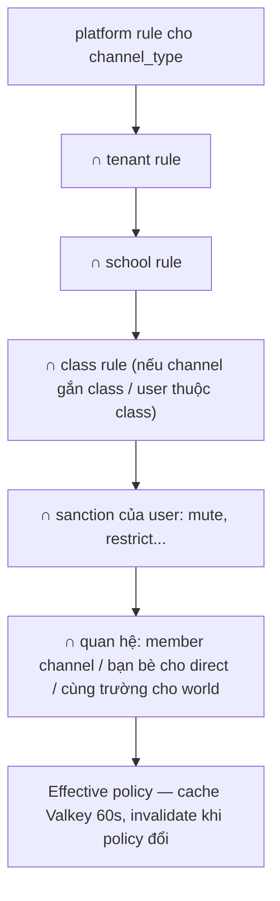
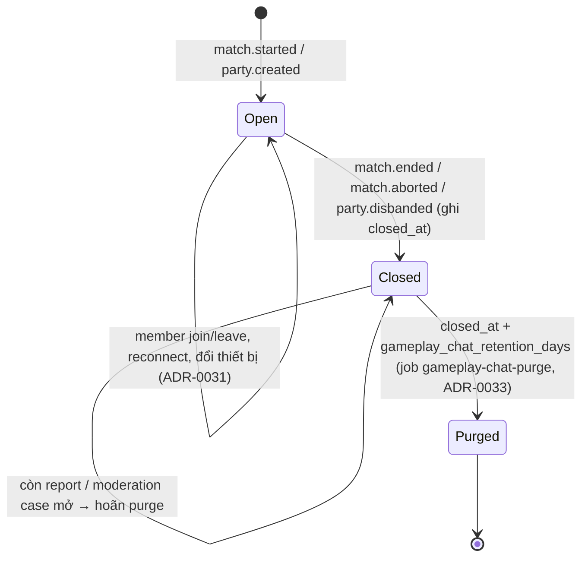
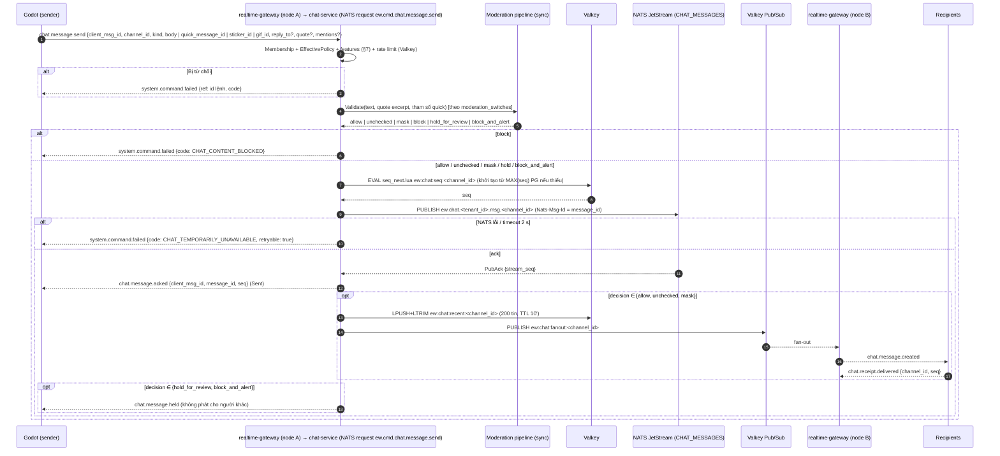
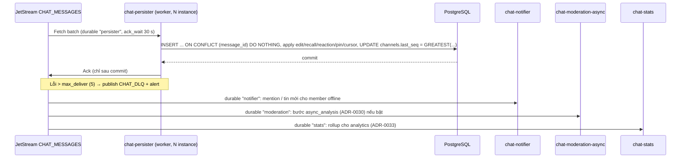

# Chat System

> Trạng thái: Draft · Phiên bản: 0.4 · Owner: Multiplayer Engineer + Identity & Security Engineer · Cập nhật: 2026-11-15
> Liên quan: [ADR-0020](../adr/ADR-0020-chat-thong-nhat-cho-moi-lop-moi-tin-nhan-phai-qua-kiem-tra-h.md) · [ADR-0030](../adr/ADR-0030-chinh-sach-tu-nhay-cam-trong-chat-danh-muc-quan-ly-duoc-va-c.md) · [ADR-0033](../adr/ADR-0033-purge-nhom-chat-gameplay-ngoai-le-co-kiem-soat-cua-adr-0028.md) · [ADR-0034](../adr/ADR-0034-bo-tinh-nang-chat-day-du.md) · [ADR-0035](../adr/ADR-0035-duong-truyen-chat-nats-jetstream-valkey-pub-sub-luu-postgres.md) · [MODERATION](MODERATION.md) · [SOCIAL_SYSTEM](SOCIAL_SYSTEM.md) · [CHILD_SAFETY](../10-security/CHILD_SAFETY.md) · [REALTIME_ARCHITECTURE](../06-architecture/REALTIME_ARCHITECTURE.md) · [VALKEY_DESIGN](../07-backend/VALKEY_DESIGN.md) · [AsyncAPI](../../specs/asyncapi/eduworld-realtime.v1.yaml)

## 1. Phạm vi & nguyên tắc

Tài liệu **duy nhất** về chat: channel, policy, tính năng tin nhắn, truyền tải, lưu trữ/purge và **trải nghiệm chat của học sinh** (§4.3). Kiểm duyệt nội dung (pipeline, danh mục từ nhạy cảm, công tắc, report, sanction) thuộc [MODERATION](MODERATION.md); quan hệ bạn bè/block/club thuộc [SOCIAL_SYSTEM](SOCIAL_SYSTEM.md).

Chat là **domain riêng** trong **chat-service** (ADR-0036), database `eduworld_chat`, schema `chat` **[Confirmed]**.

1. **Một bộ quy tắc cho mọi lớp 1–9** (ADR-0020, Accepted): `ChatPolicy` **không** có điều kiện theo `grade_level`/`grade_band`. Mọi học sinh có cùng loại channel, cùng loại tin nhắn (`text`, `emoji`, `quick`, `sticker`, `gif`, reaction) và cùng bộ tính năng (§7) và cùng rate limit **[Confirmed]**.
2. **Mọi tin nhắn phải hợp lệ trước khi phát**: tất cả nội dung mới (text, **bản sửa**, **tin forward**, đoạn **quote**, quick message có tham số, tên nhóm/channel do người dùng đặt) qua pipeline kiểm tra hợp lệ đồng bộ phía server ([MODERATION](MODERATION.md) §3) → `allow | mask | block | hold_for_review | block_and_alert`. Chỉ `allow`/`mask` được phát; `block` không lưu nội dung **[Confirmed]**. Từ nhạy cảm so khớp theo **danh mục quản lý trong CMS** ([MODERATION](MODERATION.md) §11). Pipeline **bật mặc định**; System Admin có thể tắt từng bước hoặc toàn bộ theo platform/tenant ([MODERATION](MODERATION.md) §12, ADR-0030). Khi tắt vẫn giữ độ dài tối đa, rate limit, quyền channel, sanction, block/mute/report **[Confirmed]**.
3. **Không mở tự do vô điều kiện**: quyền gửi vào một channel xác định theo **quan hệ** (thành viên trường, instance, nhóm, lớp, bạn bè) và `ChatPolicy`; không có rule = deny **[Confirmed]**.
4. **Tenant isolation**: tin nhắn chỉ đọc được bởi member channel; moderator chỉ trong phạm vi trường; không ai đọc toàn bộ chat của mọi trường **[Confirmed]**.
5. **Data minimization**: chỉ lưu những gì cần cho lịch sử + an toàn, có retention (OQ-12) **[Confirmed]**.
6. Voice chat: **không làm trong Release 1.0** ([ADR-0070](../adr/ADR-0070-release-1-khong-voice-chat-khong-xoa-vat-ly-khong-purge-analytics.md)); §11 chỉ giữ điểm mở rộng ở mức thiết kế **[Confirmed]**.
7. **Chat gameplay luôn có** (ADR-0020 mục 6): khi vào trận **1v1**, **chơi theo đội** hoặc **tạo nhóm chơi (party)**, hệ thống tự tạo channel `match`/`team`/`party` và tự cho người chơi tham gia (§4.1). Ba loại channel này là **always-on**: cài đặt tenant/trường/lớp **không tắt được**, không thu hẹp loại tin, không áp khung giờ. Chỉ mute/block của chính người chơi hoặc sanction của moderator mới ngăn được một người gửi. Kiểm tra nội dung vẫn theo công tắc ADR-0030 **[Confirmed]**.

## 2. Channel types

| `channel_type` | Phạm vi (`scope_ref`) | Tạo bởi | Membership | Nội dung cho phép (mọi lớp) | Retention [Proposed] |
|---|---|---|---|---|---|
| `world` | School (mặc định); toàn tenant nếu tenant `unit` bật mở rộng | Hệ thống | Ngầm định — người online cùng trường (hoặc cùng tenant) | `text`, `emoji`, `quick`, `sticker`, `gif`, reaction — qua kiểm tra hợp lệ | Ephemeral, **purge sau 24 h** (ADR-0033) |
| `area` | `room_id` (hub instance) | Hệ thống khi tạo instance | Ngầm định — người trong instance | `text`, `emoji`, `quick`, `sticker`, `gif`, reaction | Ephemeral, **purge sau 24 h** (ADR-0033) |
| `match` **(always-on)** | `match_id` | Tự động khi trận 1v1 / team battle / trận tournament bắt đầu (`match.started`) | Mọi người chơi của trận (cả hai đội) | `text`, `emoji`, `quick`, `sticker`, `gif`, reaction | **Purge** sau `gameplay_chat_retention_days` (mặc định 7, tối thiểu 3) kể từ `closed_at` (ADR-0033) |
| `party` **(always-on)** | `party_id` | Tự động khi tạo party | Member party | `text`, `emoji`, `quick`, `sticker`, `gif`, reaction | **Purge** sau `gameplay_chat_retention_days` kể từ khi party giải tán (ADR-0033) |
| `team` **(always-on)** | `team_id` / đội trong trận | Tự động khi trận đội bắt đầu (mỗi đội một channel) hoặc khi tạo Team bền vững | Member đội | `text`, `emoji`, `quick`, `sticker`, `gif`, reaction | Team theo trận: **purge** như `match` (ADR-0033). Team cố định: 180 ngày, không purge |
| `class` | `class_id` | Đồng bộ khi lớp được tạo; giáo viên có thể khóa | Học sinh + giáo viên lớp (từ Enrollment/TeachingAssignment) | `text`, `emoji`, `quick`, `sticker`, `gif`, reaction; giáo viên có thể đặt "chỉ giáo viên đăng" | 180 ngày |
| `study_group` | `study_group_id` | Giáo viên hoặc học sinh (theo policy trường, như nhau cho mọi lớp) | Member nhóm | `text`, `emoji`, `quick`, `sticker`, `gif`, reaction | 180 ngày |
| `direct` | cặp `(user_a, user_b)` | Khi gửi tin đầu tiên | 2 người **đã là bạn bè** và không block nhau | `text`, `emoji`, `quick`, `sticker`, `gif`, reaction | 180 ngày |

- Người ngoài trường (World mở rộng toàn tenant, team liên trường/liên tenant) chỉ thấy nickname và avatar, không thấy tên thật/trường/lớp.
- Giáo viên ↔ học sinh DM: **không** mở mặc định; nếu trường bật, mọi DM giáo viên–học sinh hiển thị cho school admin khi điều tra và có banner thông báo **[Proposed]**.

## 3. Policy resolution

`ChatPolicy` có 4 cấp: `platform → tenant → school → class`. Cấp dưới **chỉ được siết chặt hơn** cấp trên (ADR-0020), trừ khi cấp trên đặt `allow_override_relax=true` cho một rule cụ thể. Rule **không có** trường `grade_band`/`grade_level`; schema từ chối rule chứa điều kiện theo lớp.

Cấu trúc rule (JSON Schema ở [`specs/schemas/chat-policy.schema.json`](../../specs/schemas/chat-policy.schema.json)):

```json
{
  "channel_type": "party",
  "enabled": true,
  "allowed_kinds": ["text", "emoji", "quick", "sticker", "gif"],
  "reactions": true,
  "features": { "edit": true, "recall": true, "reply": true, "quote": true, "forward": true, "sticker": true, "gif": true, "reaction": true, "mention": true, "pin": true, "typing": true, "receipts": true, "search": true },
  "max_text_length": 200,
  "rate": { "messages_per_minute": 12, "burst": 3 },
  "slow_mode_seconds": 0,
  "allowed_hours": [{ "days": "mon-sun", "from": "06:30", "to": "21:30" }],
  "validation": {
    "strictness": "strict",
    "unknown_link": "block",
    "pii": "block",
    "profanity": "mask",
    "bullying_suspected": "hold_for_review"
  },
  "sensitive_term_policy": {
    "categories": ["profanity", "insult", "violence", "sexual", "drugs", "self_harm", "grooming_scam"],
    "action_overrides": { "insult": "block" }
  }
}
```

Thuật toán `EffectivePolicy(user, channel)`:



- Phép `∩` = lấy giá trị chặt hơn: `allowed_kinds` giao nhau, số lượng lấy min, giờ lấy giao, boolean `enabled` lấy AND, `strictness` lấy mức cao hơn.
- **Ngoại lệ always-on** (`match`, `team`, `party`): `enabled` luôn `true`, `allowed_kinds` luôn gồm `text`, `emoji`, `quick`, `sticker`, `gif`, mọi `features` bắt buộc ở §7.1 luôn `true`, không có `allowed_hours` ở mọi cấp. Cấp dưới chỉ được siết `rate`, `slow_mode_seconds` (tối đa 10 s) và `validation.strictness`. Schema v5 từ chối rule vi phạm (`enabled:false`, thiếu loại tin, có `allowed_hours`, slow mode > 10 s) và API trả `CHAT_POLICY_ALWAYS_ON`.
- Effective policy giống nhau cho mọi thành viên của cùng channel trong cùng trường/lớp: **không** có quy tắc "grade band thấp nhất" hay ngoại lệ theo khối.
- Không có rule ở bất kỳ cấp nào = **deny**.
- **Công tắc kiểm duyệt** (`moderation_switches`: `enabled_all`, `steps.{sensitive_terms,pii,spam,bullying,async_analysis}`, `expires_at`) nằm ở cấp platform và tenant, không nằm trong rule channel; chỉ System Admin thay đổi ([MODERATION](MODERATION.md) §12). `validation.*` và `sensitive_term_policy` chỉ có hiệu lực với các bước đang bật.

### 3.1. Mặc định platform [Proposed — giá trị số; cấu trúc Confirmed theo ADR-0020]

Một bảng duy nhất theo channel, áp dụng cho mọi học sinh lớp 1–9:

| channel_type | enabled | allowed_kinds | max_text_length | rate (msg/phút, burst) | slow mode | validation strictness |
|---|---|---|---|---|---|---|
| `world` | bật (phạm vi trường) | text, emoji, quick, sticker, gif | 120 | 6, 2 | 5 s | `strict` |
| `area` | bật | text, emoji, quick, sticker, gif | 120 | 10, 3 | 0 | `strict` |
| `match` | **luôn bật** (always-on) | text, emoji, quick, sticker, gif | 200 | 12, 3 | 0 | `strict` |
| `party` | **luôn bật** (always-on) | text, emoji, quick, sticker, gif | 200 | 12, 3 | 0 | `strict` |
| `team` | **luôn bật** (always-on) | text, emoji, quick, sticker, gif | 200 | 12, 3 | 0 | `strict` |
| `class` | bật (giáo viên có thể khóa) | text, emoji, quick, sticker, gif | 300 | 10, 3 | 0 | `strict` |
| `study_group` | bật | text, emoji, quick, sticker, gif | 300 | 10, 3 | 0 | `strict` |
| `direct` | bật (chỉ bạn bè) | text, emoji, quick, sticker, gif | 300 | 15, 4 | 0 | `strict` |

- Giới hạn tổng mỗi người: 30 tin/phút trên mọi channel [Proposed].
- Khung giờ mặc định: 06:30–21:30 giờ Việt Nam [Proposed]; trường có thể thu hẹp.
- Link: chỉ cho phép link nội bộ EduWorld đã whitelist (ví dụ mời vào quest); link ngoài bị chặn. Ảnh/file do người dùng upload: **không** hỗ trợ; sticker/GIF chỉ từ thư viện nội bộ đã duyệt (§7.5).
- `features` (§7.1) chỉ cấp platform được đổi; cấp dưới không nới.
- Trường/lớp có thể tắt channel, thu hẹp giờ, bật slow mode, nâng strictness — áp dụng như nhau cho mọi học sinh trong phạm vi đó. **Trừ** `match`/`party`/`team`: không tắt, không thu hẹp giờ; chỉ siết rate/slow mode (≤ 10 s)/strictness.
- Khung giờ chat không áp cho channel gameplay vì việc vào chơi đã bị giới hạn bởi giờ truy cập game của tenant (CHILD_SAFETY).

## 4. Membership

| Channel | Nguồn membership | Đồng bộ |
|---|---|---|
| `class` | `org.enrollments` + `org.teaching_assignments` | Consumer `enrollment.*`, `teaching_assignment.*`; học sinh chuyển lớp → rời channel lớp cũ (mất quyền đọc lịch sử mới, lịch sử cũ không còn truy cập) |
| `match` | `competition.match_participants` | Consumer `match.started` (tạo channel + thêm mọi participant), `match.ended`/`match.aborted` (đóng channel) |
| `party`/`team` | Party/team events, đội trong trận | `party.created` (tạo), `party.member_joined/left`, `party.disbanded` (đóng); `match.started` tạo channel `team` cho từng đội |
| `study_group` | `social.study_group_members` | |
| `direct` | 2 người | Block → channel bị "đóng băng" với cả hai |
| `world`/`area` | Không lưu `channel_members`; quyền kiểm tra động theo room | |

`chat.channel_members(channel_id, user_id, role, joined_at, left_at, muted_until, last_read_seq, notification_level)`.

### 4.1. Vòng đời channel gameplay (always-on)



| Chế độ | Channel tự tạo | Ai được tự join | Khi kết thúc |
|---|---|---|---|
| Knowledge Battle 1v1 | 1 × `match` | 2 người chơi | `match` đóng (read-only); lịch sử xem được từ màn hình kết quả/lịch sử trận đến khi purge |
| Team Battle / Co-op Challenge | 1 × `match` (cả trận) + 1 × `team` mỗi đội | Người chơi của trận; `team` chỉ thành viên đội | `match` và `team` của trận đóng (read-only), purge theo ADR-0033 |
| Trận tournament | Như 1v1/đội theo format | Người chơi của trận | Như trên |
| Party (nhóm chơi) | 1 × `party` | Mọi member, kể cả người vào sau | `party.disbanded` → đóng (read-only), purge theo ADR-0033; rời party → mất quyền gửi, không đọc tin mới |

Quy tắc:
- Tạo channel và thêm member nằm trong **cùng transaction** với tạo trận/party (outbox), nên người chơi luôn có chat ngay khi vào lobby/trận. Không có bước "bật chat".
- **Reconnect / đổi thiết bị** (ADR-0031): người chơi tiếp tục trận từ thiết bị mới vẫn là member channel; client gọi `system.session.resume` với `last_seq` để nhận tin bỏ lỡ.
- Không giới hạn theo quan hệ bạn bè/trường trong channel gameplay: ai cùng trận/party đều chat được với nhau (người ngoài trường chỉ thấy nickname). Block vẫn ẩn tin hai chiều; người chơi bị block không bị đưa ra khỏi trận.
- Học sinh đang bị sanction `mute` vẫn vào trận/party bình thường, chỉ không gửi được tin (UI hiển thị "Bạn đang tạm thời không thể chat") **[Proposed]**.

### 4.2. UI chat trong trận và party (Godot)

- Panel chat luôn có trong màn hình party lobby, trận 1v1, team battle (tab "Đội" / "Cả trận"). Người chơi có thể **thu gọn/ẩn panel** nhưng không tắt được tính năng; tin mới hiển thị badge.
- Hàng quick message (emoji + câu soạn sẵn như "Chúc may mắn!", "Hay quá!") luôn hiển thị để chat nhanh không làm gián đoạn câu hỏi; ô nhập text mở bằng một chạm.
- Mỗi tin có menu nhanh: **Tắt tiếng người này**, **Chặn**, **Báo cáo** (report gắn `match_id`/`party_id` làm ngữ cảnh).
- Trong lúc câu hỏi đang hiển thị ở Knowledge Battle hoặc boss, panel thu nhỏ tự động để không che câu hỏi; tin vẫn nhận và lưu [Proposed].
- Team battle có hai tab **Đội** (chỉ đồng đội) và **Cả trận**.
- Màn hình lịch sử trận/party ghi "Tin nhắn trong trận được giữ {N} ngày" (mặc định 7, tối thiểu 3 — §6.1); học sinh cần báo cáo thì báo cáo trước thời hạn.

### 4.3. Trải nghiệm chat của học sinh

Áp dụng như nhau cho mọi lớp 1–9 (ADR-0020); khác biệt chỉ ở cỡ chữ/nút theo [DESIGN_SYSTEM](../05-ux/DESIGN_SYSTEM.md).

**Phản hồi khi gửi** (quyết định từ [MODERATION](MODERATION.md)):

| Quyết định | Người gửi thấy | Người nhận thấy |
|---|---|---|
| `allow` / `unchecked` | Tin nhắn bình thường | Tin nhắn |
| `mask` | Tin với `***` + gợi ý "Hãy dùng lời lẽ thân thiện nhé" | Tin đã che |
| `block` (PII: SĐT, địa chỉ, link, mạng xã hội) | "Tin nhắn chưa gửi được: không chia sẻ thông tin cá nhân để giữ an toàn" | Không thấy |
| `block` (từ trong danh mục, mức trung bình) | "Tin nhắn có từ chưa phù hợp, em thử viết lại nhé" | Không thấy |
| `hold_for_review` | "Tin nhắn đang được kiểm tra" | Thấy sau khi duyệt (hoặc không) |
| `block_and_alert` (tự hại, dụ dỗ) | Thông điệp quan tâm + gợi ý nói với thầy cô/bố mẹ, đường dây nóng 111 khi phù hợp | Không thấy |
| Gửi quá nhanh | "Bạn gửi hơi nhanh, chờ chút nhé" | — |

Không bao giờ cho người gửi biết từ nào bị khớp, vị trí khớp hay danh mục cụ thể (ADR-0030). Khi System Admin tắt kiểm duyệt cho tenant, học sinh không thấy khác biệt nào [Proposed].

**Menu thao tác trên tin** (nhấn giữ trên mobile, chuột phải hoặc nút "⋯" trên desktop); mục hiển thị theo quyền và loại channel (§7.1):

| Mục | Ai thấy | Trải nghiệm |
|---|---|---|
| Trả lời | Mọi người | Thanh "Đang trả lời An: …" trên ô nhập; tin gửi có khung trích ngắn, chạm để nhảy tới tin gốc |
| Trích dẫn | Mọi người | Chọn đoạn chữ cần trích (server cắt từ bản đã che) |
| Chuyển tiếp | Mọi người (trừ World/Area) | Chọn tối đa 5 channel em được gửi; tin đến có nhãn "Đã chuyển tiếp từ {nickname}" |
| Sao chép | Mọi người | Thông báo nhỏ "Đã sao chép" |
| Ghim | Theo §7.8 | Tối đa 3 tin, hiện ở thanh trên cùng |
| Sửa | Người gửi, trong 15 phút | Ô nhập điền sẵn nội dung cũ; tin có nhãn "đã chỉnh sửa" |
| Thu hồi | Người gửi, trong 24 giờ | Hỏi lại trước khi thu hồi; mọi người thấy "Tin nhắn đã được thu hồi" |
| Thả cảm xúc | Mọi người | Hàng 6 emoji nhanh; tối đa 3 reaction/tin |
| Tắt tiếng · Chặn · Báo cáo | Mọi người (trừ tin của chính mình) | §9 |

**Thành phần khác:**
- Nút mặt cười mở bảng 3 tab Emoji / Sticker / GIF; pack sticker khóa hiện ổ khóa + "Mở khóa khi hoàn thành nhiệm vụ…"; GIF tìm theo chủ đề trong thư viện nội bộ, không có ô tìm kiếm Internet.
- Hàng quick message theo ngữ cảnh luôn ở trên ô nhập để học sinh nhỏ chat bằng một chạm (§8.5).
- Gõ `@` hiện danh sách nickname thành viên; tin có mention được tô sáng, biểu tượng chat có chấm "@".
- "An đang soạn tin…" dưới khung chat (không có ở World/Area).
- Trạng thái tin của mình: ✓ đã gửi, ✓✓ đã nhận, ✓✓ màu xanh đã xem; nhóm nhỏ chạm để xem ai đã xem, lớp chỉ hiện "12 bạn đã xem".
- Badge số chưa đọc trên nút chat ở HUD và từng channel; badge "@" riêng.
- Kéo lên để xem tin cũ; kính lúp tìm trong các channel đang tham gia (có dấu/không dấu đều được); tin trận chỉ tìm được trong thời hạn lưu giữ.
- Tin chưa gửi được có biểu tượng đồng hồ và tự gửi lại khi có mạng; chat tạm gián đoạn hiện "Đang kết nối lại chat…".

## 5. Kiến trúc truyền tải & message flow (ADR-0035)

### 5.1. Phân vai

| Thành phần | Vai trò trong chat | Không làm |
|---|---|---|
| **NATS JetStream** (stream `CHAT_MESSAGES`) | Đường ghi **bền vững**: mọi tin mới và mọi sự kiện thay đổi tin (sửa, thu hồi, reaction, pin, gỡ bởi moderator, forward) được publish vào stream **trước khi** người gửi nhận "Sent". Bộ đệm cho `chat-persister` và nguồn cho consumer bất đồng bộ | Không lưu lâu dài (`max_age` 72 h) |
| **Valkey Pub/Sub** (`ew:chat:fanout:<channel_id>`) | **Fan-out realtime** tới các node `realtime-gateway` giữ kết nối của thành viên (chat-service publish, gateway subscribe). Mang cả tín hiệu tạm thời: typing, receipts, `chat.unread.updated` | Không đảm bảo giao, không lưu |
| **Valkey** (key thường) | Cấp `seq` (`INCR ew:chat:seq:<channel_id>`), bộ đệm gần nhất `ew:chat:recent:<channel_id>`, cache unread, rate limit | Không là nguồn sự thật |
| **PostgreSQL** (schema `chat`) | **Nguồn sự thật**: tin nhắn, revision, reaction, pin, con trỏ, lịch sử, tìm kiếm | Không nằm trên đường trễ gửi/nhận |

Game client và CMS **không bao giờ** kết nối NATS hay Valkey; chỉ đi qua WebSocket `/realtime/v1` và REST `/api/v1/chat/*`.

### 5.2. Luồng gửi



- Tin chỉ được phát **sau khi** JetStream ack. Không có tin nào tới người nhận mà chưa nằm trong JetStream.
- `client_msg_id` là idempotency key ở realtime (Valkey `SET NX ew:chat:cmid:<sender>:<client_msg_id>` TTL 10'), `message_id` là khóa khử trùng lặp của JetStream (`duplicate_window` 2') và PostgreSQL (`ON CONFLICT DO NOTHING`).
- REST fallback `POST /api/v1/chat/channels/{channel_id}/messages` dùng cùng use case.
- `seq` cấp trước khi publish; nếu publish thất bại, `seq` đó bị bỏ trống. Client coi khoảng trống do lỗi gửi là bình thường: lịch sử không có tin đó, không retry vô hạn (§5.4).

### 5.3. Luồng lưu và consumer bất đồng bộ



- Mục tiêu độ trễ lưu (publish → commit) p95 ≤ 500 ms [Proposed]; metric `eduworld_chat_persist_lag_seconds`.
- Persister ghi theo lô (≤ 500 sự kiện hoặc 50 ms). Thứ tự ghi không quan trọng vì `seq` đã cấp trước; sự kiện thay đổi (sửa, thu hồi) áp dụng theo `revision` tăng dần, bản cũ đến muộn bị bỏ qua.
- Con trỏ đọc (`chat.receipt.read`) được realtime gộp (tối đa 1 lần/2 s/thành viên) rồi publish `ew.chat.<tenant_id>.cursor.<channel_id>` để persister cập nhật `channel_members.last_read_seq`.
- Tin `world`/`area` (ephemeral) cũng đi qua JetStream; persister ghi vào `chat.ephemeral_messages` (purge 24 h, ADR-0033).

### 5.4. Độ tin cậy

| Sự cố | Hành vi |
|---|---|
| Mất gói Valkey Pub/Sub (node restart, mạng chập chờn) | Client theo dõi `seq` từng channel; phát hiện **seq gap** → gọi `chat.sync` hoặc `GET /chat/channels/{id}/messages?after_seq=` để bù. Server trả từ `ew:chat:recent` (tin chưa kịp vào PG) hợp nhất với PostgreSQL |
| NATS không sẵn sàng | Realtime từ chối gửi `CHAT_TEMPORARILY_UNAVAILABLE` (retryable); UI hiển thị "Đang kết nối lại chat…". Đọc lịch sử vẫn hoạt động |
| PostgreSQL không sẵn sàng | Gửi/nhận realtime vẫn chạy; JetStream giữ tối đa 72 h; persister ghi bù khi DB trở lại. Lịch sử phục vụ tạm từ `ew:chat:recent` |
| Valkey mất key `seq` | Script Lua khởi tạo lại từ `MAX(seq)` trong PostgreSQL + số tin còn pending trong JetStream (đọc `channels.last_seq` sau khi persister bắt kịp); unique `(channel_id, seq)` chặn trùng — xung đột hiếm gặp được persister gán `seq` mới và phát `chat.message.resequenced` [Proposed] |
| Persister chậm | Alert khi consumer pending > 10.000 hoặc lag p95 > 5 s |

Thứ tự hiển thị luôn theo `seq`, không theo thứ tự đến.

## 6. Lưu trữ (PostgreSQL — ghi bởi `chat-persister`)

| Bảng | Ghi chú |
|---|---|
| `chat.channels` | `channel_id`, `tenant_id`, `channel_type`, `scope_ref`, `school_id?`, `is_gameplay`, `policy_overrides`, `retention_days`, `last_seq` (persister cập nhật bằng `GREATEST`), `status`, `closed_at`, `purge_after` |
| `chat.channel_members` | §4 + `last_delivered_seq`, `last_read_seq`, `unread_mentions` (con trỏ, §8.1) |
| `chat.messages` | Tin của channel **bền vững** (class, study_group, team cố định, direct). **Partition theo tháng** (`created_at`); unique `(channel_id, seq)` và `message_id`. Cột tính năng: `kind` (`text`/`emoji`/`quick`/`sticker`/`gif`/`system`), `body` (gốc), `body_display` (đã che), `sticker_id`, `gif_id`, `quick_message_id`, `reply_to_message_id`, `quote jsonb`, `forwarded_from jsonb`, `mentions uuid[]`, `edited_at`, `edit_count`, `revision`, `recalled_at`, `recalled_by`, `moderation_state`, `search_tsv` (generated, unaccent) |
| `chat.gameplay_messages` | Cùng cột với `messages`, cho channel gameplay (`match`, `team` theo trận, `party`). **Partition theo ngày tạo** (`created_on`), không phải di chuyển dòng khi channel đóng; purge theo channel đã hết hạn (§6.1) |
| `chat.message_revisions` | `(message_id, revision)`, `body`, `decision`, `edited_at`: bản cũ khi sửa (bằng chứng) |
| `chat.message_reactions` | `(message_id, user_id, emoji_code)` unique |
| `chat.pinned_messages` | `(channel_id, message_id)`, `pinned_by`, `pinned_at`; tối đa 3/channel |
| `chat.sticker_packs`, `chat.stickers` | Platform (Game Studio), `status`, `unlock_rule`, gán tenant (ADR-0029) |
| `chat.gif_assets`, `chat.gif_tags` | Thư viện GIF nội bộ đã duyệt, platform-only |
| `chat.quick_messages` | Danh mục đã duyệt, đa ngôn ngữ, quản lý trong CMS |
| `chat.ephemeral_messages` | World/area, partition theo ngày, **purge sau 24 h** (ADR-0033) |
| `chat.chat_policies` | §3 |

- `seq` theo channel được cấp bằng Valkey `INCR`, script Lua khởi tạo từ PostgreSQL (ADR-0035, [VALKEY_DESIGN](../07-backend/VALKEY_DESIGN.md)). PostgreSQL giữ unique `(channel_id, seq)` làm chốt chặn cuối.
- **Channel gameplay và World/Area: purge vật lý** theo §6.1 (ngoại lệ có kiểm soát của ADR-0028, quy định ở ADR-0033).
- **Channel bền vững:** retention job **ẩn danh hóa** nội dung quá `retention_days` (ghi đè `body`, `body_display`, revision; giữ metadata) và ẩn khỏi API. Ứng dụng không hard-delete (ADR-0028). Release 1.0 không gỡ partition, không xóa vật lý; partition đã ẩn danh hóa được giữ lại (ADR-0070). Tin liên quan `moderation_case` đang mở được sao vào case trước **[Proposed]**.
- **Thu hồi** (người gửi) = `recalled_at`. **Gỡ** (moderator) = `moderation_state = removed` + soft-delete. Cả hai giữ nội dung gốc làm bằng chứng; API người dùng chỉ trả placeholder.

### 6.1. Purge chat gameplay (ADR-0033)

| Loại channel | Bị purge? | Mốc tính | Thời hạn |
|---|---|---|---|
| `match` | Có | `closed_at` (trận kết thúc/hủy) | `gameplay_chat_retention_days`: mặc định 7, **tối thiểu 3** [Proposed] |
| `team` gắn với một trận | Có | `closed_at` | như `match` |
| `party` | Có | `closed_at` (party giải tán) | như `match` |
| `world`, `area` (ephemeral) | Có | `created_at` | 24 giờ |
| `class`, `study_group`, `team` cố định, `direct` | **Không** | — | Chính sách lưu trữ chung, ẩn danh hóa (OQ-12, ADR-0070) |

Quy trình job `gameplay-chat-purge` (worker của chat-service, role DB `chat_purger`, chi tiết DB/metric ở DATABASE_DESIGN và MONITORING):
1. Rollup chỉ số tổng hợp (số tin, số tin bị chặn theo category…) vào analytics.
2. Tin thuộc report, moderation case hoặc sanction → **sao chép** sang `chat.moderation_evidence` ([MODERATION](MODERATION.md) §6.1).
3. Channel còn report chưa xử lý hoặc case đang mở → **hoãn purge** đến khi case đóng.
4. Purge **theo channel** đã hết hạn: xóa lô 1.000 dòng `chat.gameplay_messages`, revision, reaction, pin, member, channel của các channel có `purge_after < now()` và không bị hoãn. Partition ngày `created_on = D` chỉ `DETACH` + `DROP` khi **mọi** channel có tin trong partition đó đã purge (kiểm tra bằng bảng theo dõi `chat.gameplay_partition_channels`) — nhanh với trận ngắn, an toàn với party sống lâu. Không có API ứng dụng nào làm việc này.
   *Lý do không partition theo `closed_on`:* tin được ghi khi channel còn mở (chưa biết `closed_on`), nên partition theo `closed_on` buộc phải di chuyển dòng khi đóng channel — tốn I/O và cần quyền ghi xóa cho role app. Partition theo ngày tạo tránh việc này [Proposed].
5. Ghi audit tổng hợp (không nội dung) + metric `eduworld_chat_purge_total{tenant,kind}`.

Phía người chơi: màn hình lịch sử trận/party ghi rõ "Tin nhắn trong trận được giữ N ngày", sau thời hạn chỉ còn kết quả trận, không còn tin nhắn.

## 7. Tính năng tin nhắn (ADR-0034)

### 7.1. Ma trận tính năng × loại channel (mặc định platform)

| Tính năng | world | area | match | party | team | class | study_group | direct |
|---|---|---|---|---|---|---|---|---|
| Gửi / nhận (text, emoji, quick) | ✓ | ✓ | ✓ luôn | ✓ luôn | ✓ luôn | ✓ | ✓ | ✓ |
| Sticker / GIF | ✓ | ✓ | ✓ luôn | ✓ luôn | ✓ luôn | ✓ | ✓ | ✓ |
| Sửa (15') | ✓ | ✓ | ✓ luôn | ✓ luôn | ✓ luôn | ✓ | ✓ | ✓ |
| Thu hồi (24 h) | ✓ | ✓ | ✓ luôn | ✓ luôn | ✓ luôn | ✓ | ✓ | ✓ |
| Reply / Quote | ✓ | ✓ | ✓ luôn | ✓ luôn | ✓ luôn | ✓ | ✓ | ✓ |
| Forward **ra khỏi** channel | ✗ | ✗ | ✓ | ✓ | ✓ | ✓ | ✓ | ✓ |
| Reactions | ✓ | ✓ | ✓ luôn | ✓ luôn | ✓ luôn | ✓ | ✓ | ✓ |
| Mention `@nickname` | ✓ | ✓ | ✓ luôn | ✓ luôn | ✓ luôn | ✓ (+ `@all` giáo viên) | ✓ | — (2 người) |
| Pin (≤ 3) | ✗ | ✗ | ✓ | ✓ (leader) | ✓ | ✓ (giáo viên) | ✓ (owner/giáo viên) | ✓ (cả hai) |
| Copy | ✓ | ✓ | ✓ | ✓ | ✓ | ✓ | ✓ | ✓ |
| Typing indicator | ✗ | ✗ | ✓ luôn | ✓ luôn | ✓ luôn | ✓ | ✓ | ✓ |
| Receipts | ✗ | ✗ | Chi tiết từng người (≤ 8) | Chi tiết (≤ 8) | Chi tiết (≤ 8) | "N người đã xem" | "N người đã xem" | Chi tiết |
| Unread + mention count | ✗ (chỉ badge mention) | ✗ | ✓ luôn | ✓ luôn | ✓ luôn | ✓ | ✓ | ✓ |
| Lịch sử & tìm kiếm | Lịch sử 24 h, không tìm | Lịch sử 24 h, không tìm | ✓ đến khi purge | ✓ đến khi purge | ✓ | ✓ | ✓ | ✓ |

- Cấu hình bằng `features` trong chat policy, **chỉ cấp platform** được bật/tắt từng tính năng; tenant/school/class không nới được. Channel gameplay (`match`/`party`/`team`): các mục "luôn" không tắt được (schema chặn).
- "✓ luôn" = bắt buộc theo ADR-0020 mục 6 + ADR-0034.

### 7.2. Sửa tin

- Lệnh `chat.message.edit {message_id, body, revision_expected}`. Chỉ người gửi, trong **15 phút** kể từ `created_at` [Proposed]; quá hạn → `CHAT_EDIT_WINDOW_EXPIRED`. Chỉ sửa `text` (sticker/GIF/quick không sửa).
- Nội dung mới **chạy lại toàn bộ pipeline** (ADR-0030, theo công tắc). `block` → giữ bản cũ, trả `CHAT_CONTENT_BLOCKED`; `hold_for_review` → bản mới chờ duyệt, người khác vẫn thấy bản cũ.
- Bản cũ lưu `chat.message_revisions (message_id, revision, body, decision, edited_at)`; `messages.edit_count`, `edited_at`. Người dùng chỉ thấy nhãn "đã chỉnh sửa", **không** xem được bản cũ; moderator xem trong case.
- Sự kiện: JetStream `chat.message_edited` → fan-out `chat.message.edited {message_id, seq, body, edited_at, revision}`.

### 7.3. Thu hồi

- Lệnh `chat.message.recall {message_id}`. Người gửi, trong **24 giờ** [Proposed]; quá hạn → `CHAT_RECALL_WINDOW_EXPIRED`.
- Mọi người thấy placeholder "Tin nhắn đã được thu hồi"; reaction, pin, quote/reply tới tin đó hiển thị "Tin nhắn gốc không còn". Tin bị pin tự bỏ ghim.
- Là **soft** (ADR-0028): đặt `recalled_at`, `recalled_by`; nội dung gốc **giữ làm bằng chứng** đến hết thời hạn lưu trữ của channel (gameplay: đến purge, ADR-0033), chỉ moderator xem trong case. API người dùng, tìm kiếm, forward, quote không bao giờ trả nội dung tin đã thu hồi.
- Vẫn **báo cáo được** tin đã thu hồi trong cửa sổ báo cáo (chống bắt nạt rồi xóa dấu vết) — [MODERATION](MODERATION.md) §6.1.
- Giáo viên/moderator gỡ tin của người khác là thao tác **moderation** (`moderation_state = removed`, audit), không phải thu hồi.

### 7.4. Reply, Quote, Forward

| Tính năng | Dữ liệu | Quy tắc |
|---|---|---|
| Reply | `reply_to_message_id` (cùng channel) | Client hiển thị trích ngắn (≤ 80 ký tự) của bản **đã kiểm duyệt** của tin gốc; tin gốc thu hồi/gỡ/purge → "Tin nhắn gốc không còn" |
| Quote | `quote: {message_id, excerpt_start, excerpt_end}` | Server tự cắt `excerpt` từ bản đã kiểm duyệt (đã che); client **không** gửi nội dung trích. Excerpt ≤ 200 ký tự |
| Forward | Lệnh `chat.message.forward {message_id, target_channel_ids[≤5]}` → tạo tin mới ở mỗi channel đích với `forwarded_from: {message_id, channel_type, sender_nickname}` | Chỉ trong **cùng tenant**; người dùng phải được gửi tin ở channel đích; **chạy lại pipeline và policy của channel đích**; không forward tin đã thu hồi/bị che/bị gỡ/đang held; không forward ra khỏi `world`/`area`. Vi phạm → `CHAT_FORWARD_NOT_ALLOWED` |

### 7.5. Emoji, Sticker, GIF

- **Emoji**: bộ Unicode giới hạn đã duyệt (danh sách cấu hình platform), loại emoji có thể dùng để bắt nạt/gợi dục.
- **Sticker**: `chat.sticker_packs` → `chat.stickers`, do **Game Studio (platform-only, ADR-0027)** quản lý; pack có thể **mở khóa làm phần thưởng** (`unlock_rule` tham chiếu reward rule) hoặc mặc định cho mọi người. Tin `kind = sticker` gửi `sticker_id`; server kiểm tra pack đã publish, được gán cho tenant (ADR-0029) và học sinh đã sở hữu (nếu pack bị khóa).
- **GIF**: **thư viện nội bộ đã duyệt** (`chat.gif_assets` + `chat.gif_tags`), platform upload qua presigned URL, kiểm tra kích thước (≤ 2 MB, ≤ 480 px), gắn tag tiếng Việt/Anh, publish; phục vụ từ CDN EduWorld. Học sinh tìm theo tag (`GET /chat/gifs?tag=`). **Không** gọi Giphy/Tenor hay dịch vụ GIF bên thứ ba.
- **Không có upload ảnh/file của người dùng**. Sticker/GIF không qua bước kiểm tra văn bản (đã duyệt trước) nhưng vẫn chịu rate limit (sticker/GIF tính chung, tối đa 4/phút/channel) [Proposed].

### 7.6. Reactions

`chat.reaction.toggle {message_id, emoji_code}` → bật/tắt; chỉ emoji trong bộ reaction; tối đa **3 reaction/người/tin** [Proposed]. Lưu `chat.message_reactions`; fan-out `chat.reaction.updated {message_id, counts, my_reactions}`. Không reaction tin đã thu hồi.

### 7.7. Mention

- Cú pháp `@nickname` trong text; client gửi kèm `mentions: [user_id]` lấy từ autocomplete. Server **kiểm tra lại**: mỗi user_id phải là thành viên channel, không block người gửi; nickname hiển thị lấy từ GameProfile — **không** dùng username đăng nhập (chứa mã học sinh).
- Tối đa **5 mention/tin** → vượt `CHAT_MENTION_LIMIT`. `@all` chỉ giáo viên trong channel `class` (và owner study group) [Proposed].
- Người được mention: tăng `channel_members.unread_mentions`, nhận `chat.mention.created` (realtime) hoặc thông báo qua `chat-notifier` khi offline; `notification_level = mentions` vẫn nhận.

### 7.8. Pin

- `chat.pin.add/remove {message_id}`; tối đa **3 tin/channel** → `CHAT_PIN_LIMIT_REACHED`. Quyền: leader (party), thành viên (match/team — bất kỳ người chơi), giáo viên (class), owner/giáo viên (study_group), cả hai (direct). Không có ở world/area.
- Lưu `chat.pinned_messages (channel_id, message_id, pinned_by, pinned_at)`; audit; fan-out `chat.pin.updated`. Tin bị thu hồi/gỡ → tự bỏ ghim.

### 7.9. Copy

Tính năng client: copy **nội dung đang hiển thị** (bản đã che, placeholder nếu đã thu hồi) vào clipboard (`DisplayServer.clipboard_set` trong Godot). Không có API riêng; không copy được nội dung gốc.

### 7.10. Typing indicator

`chat.typing.start/stop {channel_id}` → realtime throttle **1 lần/3 s**, tự hết sau **5 s** không cập nhật; publish chỉ qua Valkey Pub/Sub (`chat.typing.updated {channel_id, user_ids[]}`), **không** qua JetStream, **không** lưu DB. Không gửi tới người đã block; không có ở world/area. Hiển thị tối đa 3 nickname ("An, Bình đang soạn tin…").

## 8. Lịch sử, receipts, unread, tìm kiếm

### 8.1. Sent / Delivered / Read (theo con trỏ)

| Trạng thái | Định nghĩa | Lưu ở đâu |
|---|---|---|
| **Sent** | Server đã chấp nhận và JetStream đã ack (`chat.message.acked`) | Envelope JetStream → `messages` |
| **Delivered** | Thiết bị người nhận đã nhận và ack `chat.receipt.delivered {channel_id, seq}` | `channel_members.last_delivered_seq` (gộp, max) |
| **Read** | Người nhận mở channel, con trỏ đọc vượt `seq` (`chat.receipt.read {channel_id, seq}`) | `channel_members.last_read_seq` (gộp, max) |

- **Không** lưu một dòng cho mỗi tin × người. Trạng thái của tin `seq = s` với người X: Read nếu `X.last_read_seq ≥ s`, Delivered nếu `X.last_delivered_seq ≥ s`, ngược lại Sent.
- Realtime gộp receipt (≤ 1 lần/2 s/thành viên/channel), fan-out `chat.receipt.updated {channel_id, user_id, delivered_seq, read_seq}` qua Valkey Pub/Sub; persist qua JetStream subject `cursor`.
- Hiển thị: nhóm ≤ 8 người (party, match, team, direct) — chi tiết từng người; class/study_group — "N người đã xem" (`GET /chat/channels/{id}/messages/{message_id}/receipts` trả số đếm, danh sách chỉ cho giáo viên); world/area — không có.
- Người dùng bị block không thấy trạng thái đọc của nhau.

### 8.2. Unread count

- Theo channel: `channels.last_seq − channel_members.last_read_seq` (hiển thị "99+"); mention chưa đọc: `channel_members.unread_mentions` (reset khi đọc qua tin chứa mention).
- Tổng badge HUD = tổng unread của các channel `notification_level ≠ none` + tổng mention. Cache `ew:chat:unread:<user_id>` (hash channel → count), nguồn sự thật PostgreSQL; cập nhật đa thiết bị/màn hình qua `chat.unread.updated`.

### 8.3. Lịch sử & đồng bộ

| Chức năng | API / cơ chế |
|---|---|
| Danh sách channel | `GET /api/v1/chat/channels` — kèm `unread_count`, `unread_mentions`, `last_message` preview (đã lọc), `pinned_count` |
| Lịch sử | `GET /api/v1/chat/channels/{id}/messages?before_seq=&after_seq=&limit=50` — hợp nhất PostgreSQL với `ew:chat:recent` để che độ trễ persister; tin thu hồi/gỡ trả placeholder |
| Pins | `GET /api/v1/chat/channels/{id}/pins` |
| Đồng bộ khi reconnect / seq gap | WS `chat.sync {channel_id: last_seen_seq}` → server trả tin thiếu (≤ 200), nhiều hơn → client tải lịch sử REST |
| Quyền xem lịch sử | Member chỉ xem tin từ `joined_at` [Proposed]; giáo viên xem toàn bộ channel lớp mình dạy trong retention |

### 8.4. Tìm kiếm

- `GET /api/v1/chat/search?q=&channel_id=&sender_id=&from=&to=&cursor=` — chỉ trong channel người dùng **đang là thành viên**, luôn lọc `tenant_id`, `deleted_at IS NULL`, `recalled_at IS NULL`, `moderation_state IN ('allowed','masked')`.
- PostgreSQL full-text: cột `search_tsv tsvector GENERATED ALWAYS AS (to_tsvector('simple', unaccent(lower(body_display))))` + GIN index; tìm có dấu hoặc không dấu đều khớp. Trigram (`pg_trgm`) cho truy vấn ngắn ≤ 3 ký tự [Proposed].
- Tìm trên **nội dung đã che** (`body_display`), không bao giờ khớp nội dung gốc bị che.
- Không có ở world/area; dữ liệu gameplay đã purge không còn tìm được (ADR-0033).
- Moderator dùng công cụ tìm kiếm riêng, chỉ trong phạm vi case ([MODERATION](MODERATION.md) §6.1).

### 8.5. Quick messages

30–60 câu chia nhóm (chào hỏi, phối hợp quest "Đi theo mình!" / "Follow me!", khen ngợi, học tập "Mình cần gợi ý" / "I need a hint", cảm ơn); quản lý trong CMS, phiên bản hóa; mỗi câu là `localized_text` **bắt buộc đủ `vi` và `en`** [Confirmed — ADR-0056]. Client gửi `quick_message_id` (+ tham số); **mỗi người nhận thấy câu theo ngôn ngữ của chính mình** (người gửi chọn tiếng Việt, người nhận chọn tiếng Anh thì người nhận thấy bản tiếng Anh); tham số và ngữ cảnh vẫn qua pipeline.

### 8.6. Ngôn ngữ trong chat (ADR-0056)

- **Không dịch máy** tin nhắn tự do giữa người chơi (riêng tư, tránh sai nghĩa); tin hiển thị đúng nguyên văn người gửi viết.
- Quick message, tin hệ thống (`kind = system`: "Bạn A đã vào party"), nhãn kiểm duyệt ("Tin nhắn đã được thu hồi") gửi dưới dạng **mã + tham số** và client hiển thị theo ngôn ngữ của người xem.
- Pipeline kiểm duyệt chạy **cả danh mục `vi` và `en`** trên mọi tin, không phụ thuộc ngôn ngữ giao diện của người gửi (học sinh có thể gõ tiếng Anh khi đang chọn giao diện tiếng Việt và ngược lại); danh mục theo `locale` do [MODERATION §11](MODERATION.md) sở hữu.
- Sticker/GIF có nhãn và tag song ngữ để tìm kiếm ở cả hai ngôn ngữ.

## 9. Mute, block, report (phía chat)

| Hành động | Hiệu lực | API |
|---|---|---|
| Mute user (cá nhân) | Ẩn tin của người đó với mình; người kia không biết | `POST /api/v1/social/mutes` |
| Mute channel | Không thông báo | `PATCH /api/v1/chat/channels/{id}/membership {notification_level}` |
| Block | Ẩn tin hai chiều trong channel chung (trừ channel lớp: tin của người bị block hiển thị thu gọn), chặn DM, lời mời, friend request | `POST /api/v1/social/blocks` |
| Report message / user | Tạo `report` → [MODERATION](MODERATION.md); báo cáo được cả tin **đã thu hồi** hoặc **đã sửa** (moderator thấy bản gốc và các revision) | `POST /api/v1/chat/reports` |

Block **không** chặn được giáo viên trong channel lớp **[Proposed]**. Quy tắc quan hệ block/mute (hiệu lực ngoài chat: lời mời, ghép trận, instance) thuộc [SOCIAL_SYSTEM §5](SOCIAL_SYSTEM.md#5-block-mute-report-điểm-vào).

## 10. Notifications

- Module notification của chat-service: **chỉ in-app** (WS `notification.created`, hộp thông báo, badge). **Không push ngoài game cho học sinh trong Release 1.0** [Proposed] — thống nhất với [SOCIAL_SYSTEM §8](SOCIAL_SYSTEM.md#8-thông-báo-xã-hội) và nguyên tắc chống kéo trẻ quay lại game. Push (nếu sau này có) cần ADR mới: payload không chứa nội dung tin, không gửi ngoài giờ trường cho phép.
- `notification_level`: `all` / `mentions` / `none`. Mặc định: party/team/match `all`, class `mentions` + thông báo giáo viên, study_group `mentions`.

## 11. Mở rộng voice chat (chỉ thiết kế; không làm trong Release 1.0, ADR-0070)

Chuẩn bị sẵn để không phải đổi model:
- `channel.capabilities` có cờ `voice` (luôn `false` trong Release 1.0, ADR-0070); `ChatPolicy` có field `voice` (deny mặc định).
- Signaling dự kiến qua WS (`voice.session.*`), media qua SFU WebRTC bên ngoài (LiveKit/mediasoup) — cần ADR mới, đánh giá an toàn (ghi âm? kiểm duyệt realtime?) và pháp lý trước khi bật.
- UI Godot dành chỗ cho nút mic trong chat panel nhưng ẩn bằng feature flag.

## 12. Metrics

`eduworld_chat_messages_total{channel_type,kind,decision}`, `eduworld_chat_filter_latency_seconds`, `eduworld_chat_delivery_latency_seconds`, `eduworld_chat_rejected_total{code}`, `eduworld_chat_reports_total{reason}`, `eduworld_chat_active_channels`, `eduworld_chat_sensitive_matches_total{category,action}`, `eduworld_chat_unchecked_messages_total{tenant}`, `eduworld_chat_policy_disabled{tenant,step}` (gauge, alert khi = 1), `eduworld_chat_sensitive_catalog_version{scope}`, `eduworld_chat_send_latency_seconds` (nhận lệnh → `acked`), `eduworld_chat_persist_lag_seconds` (publish → commit PG), `eduworld_chat_jetstream_publish_errors_total`, `eduworld_chat_seq_gaps_total` (client báo), `eduworld_chat_events_total{event}` (edit/recall/forward/reaction/pin), `eduworld_chat_search_latency_seconds`. JetStream consumer pending/redelivered lấy từ `prometheus-nats-exporter`. Không gắn label nội dung hay user id.

## 13. Acceptance criteria (Master Prompt §22 — Chat)

| ID | Tiêu chí |
|---|---|
| AC-CHAT-001 | Tạo channel: tạo party → channel `party` tồn tại, mọi member có membership |
| AC-CHAT-002 | Tham gia channel: học sinh được thêm vào lớp → có quyền vào channel `class` |
| AC-CHAT-003 | Gửi/nhận: tin text hợp lệ ở party tới mọi member online ≤ 250 ms p95 (cùng region) |
| AC-CHAT-004 | Cùng một tin text hợp lệ, học sinh lớp 2 và lớp 8 gửi ở cùng loại channel nhận cùng kết quả `allow`; cùng một tin vi phạm (tục tĩu/PII) bị chặn như nhau cho cả hai — không có nhánh xử lý theo lớp |
| AC-CHAT-005 | Tin chứa số điện thoại bị chặn, người nhận không nhận được |
| AC-CHAT-006 | Block: sau khi A block B, B không DM/mời A được, A không thấy tin B trong party chung |
| AC-CHAT-007 | Report tin nhắn tạo `report` và `moderation_case` trong hàng đợi của trường đúng |
| AC-CHAT-008 | Không truy cập channel trái phép: user không phải member gọi history → 404 |
| AC-CHAT-009 | Không đọc tin trường khác: giáo viên/moderator trường A truy vấn channel trường B → 404, RLS chặn ở DB khi bỏ qua tầng app (test trực tiếp repository) |
| AC-CHAT-010 | Gửi lại cùng `client_msg_id` sau reconnect không tạo tin trùng |
| AC-CHAT-011 | Policy trường không thể nới lỏng quá platform (API trả `CHAT_POLICY_RELAX_NOT_ALLOWED`) |
| AC-CHAT-012 | Lưu policy có trường `grade_band`/`grade_level` bị từ chối (validation schema) |
| AC-CHAT-013 | DM chỉ gửi được khi hai người là bạn bè và không block nhau; ngược lại `CHAT_NOT_ALLOWED` |
| AC-CHAT-014 | Quick message có tham số chứa PII bị chặn như tin text |
| AC-CHAT-015 | Tin chứa term thuộc category đang bật bị xử lý theo action của danh mục; phản hồi chỉ có `category_code`, không có từ đã khớp |
| AC-CHAT-016 | Khi `enabled_all` của tenant tắt, tin vẫn được gửi với decision `unchecked`, vẫn tuân giới hạn độ dài, rate limit, quyền channel và sanction |
| AC-CHAT-017 | Trận 1v1 bắt đầu → channel `match` tồn tại, cả hai người chơi là member và gửi/nhận text được ngay, không cần bật |
| AC-CHAT-018 | Team battle → mỗi đội có channel `team` riêng (đội kia không đọc được) và một channel `match` chung |
| AC-CHAT-019 | Tạo party → channel `party` có ngay; người vào party sau tự thành member; giải tán → channel read-only |
| AC-CHAT-020 | Policy trường/lớp đặt `enabled:false`, bỏ `text`, đặt `allowed_hours` hoặc slow mode > 10 s cho `match`/`team`/`party` → bị từ chối `CHAT_POLICY_ALWAYS_ON` |
| AC-CHAT-021 | Người chơi đổi thiết bị giữa trận (ADR-0031) vẫn ở trong channel `match` và nhận tin bỏ lỡ qua resume |
| AC-CHAT-022 | Trận kết thúc → channel `match` read-only: gửi tin trả `CHAT_CHANNEL_CLOSED` |
| AC-CHAT-023 | Học sinh bị mute (sanction) vẫn vào trận/party, không gửi được tin; người khác vẫn chat bình thường |
| AC-CHAT-024 | Channel `match` đóng ngày D → purge đúng sau `gameplay_chat_retention_days` (mặc định 7); trước hạn vẫn xem được lịch sử, sau hạn API trả 404 |
| AC-CHAT-025 | Tin trong channel gameplay có report trước hạn purge được sao sang `moderation_evidence` và còn xem được trong case sau khi channel bị purge |
| AC-CHAT-026 | Channel có moderation case đang mở không bị purge cho đến khi case đóng |
| AC-CHAT-027 | Job purge không xóa bất kỳ dòng nào của `class`, `study_group`, `team` cố định, `direct` |
| AC-CHAT-028 | Cấu hình `gameplay_chat_retention_days` < 3 bị từ chối |
| AC-CHAT-029 | Người gửi chỉ nhận `chat.message.acked` sau khi JetStream ack; giả lập NATS lỗi → `CHAT_TEMPORARILY_UNAVAILABLE`, không người nhận nào thấy tin |
| AC-CHAT-030 | PostgreSQL ngừng 10 phút: gửi/nhận realtime vẫn chạy; sau khi DB trở lại, mọi tin trong khoảng đó có trong lịch sử, không trùng, đúng `seq` |
| AC-CHAT-031 | Bỏ một gói Valkey Pub/Sub: client phát hiện seq gap và bù đủ tin qua `chat.sync`/lịch sử |
| AC-CHAT-032 | Sửa tin trong 15': người khác thấy bản mới + nhãn "đã chỉnh sửa"; sau 15' → `CHAT_EDIT_WINDOW_EXPIRED`; bản sửa vi phạm bị chặn và bản cũ giữ nguyên |
| AC-CHAT-033 | Thu hồi trong 24 h: mọi người thấy placeholder; moderator vẫn xem được nội dung gốc trong case; tin đã thu hồi vẫn báo cáo được |
| AC-CHAT-034 | Quote/reply hiển thị bản đã che; tin gốc thu hồi → "Tin nhắn gốc không còn" |
| AC-CHAT-035 | Forward sang channel khác tenant hoặc channel không có quyền gửi → `CHAT_FORWARD_NOT_ALLOWED`; forward hợp lệ chạy lại kiểm duyệt của channel đích |
| AC-CHAT-036 | Sticker của pack chưa mở khóa / chưa gán cho tenant bị từ chối; GIF chỉ lấy từ thư viện nội bộ |
| AC-CHAT-037 | Mention > 5 người → `CHAT_MENTION_LIMIT`; người được mention nhận `chat.mention.created` và `unread_mentions` tăng; mention dùng nickname, không lộ username |
| AC-CHAT-038 | Pin tin thứ 4 → `CHAT_PIN_LIMIT_REACHED`; thu hồi tin đã pin → tự bỏ ghim |
| AC-CHAT-039 | Typing không ghi DB, không gửi tới người đã block, tự hết sau 5 s |
| AC-CHAT-040 | Receipts: trong party 4 người, người gửi thấy chính xác ai đã nhận/đã xem; trong class chỉ thấy "N người đã xem" |
| AC-CHAT-041 | Unread count và mention count đúng sau khi đọc trên thiết bị khác (cập nhật qua `chat.unread.updated`) |
| AC-CHAT-042 | Tìm "nhan vat" khớp tin "nhân vật"; không trả tin đã thu hồi/bị chặn/khác tenant/channel không phải thành viên; không khớp nội dung gốc đã bị che |
| AC-CHAT-043 | Copy tin đã che chỉ copy bản đã che |
