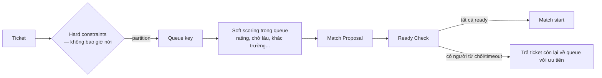
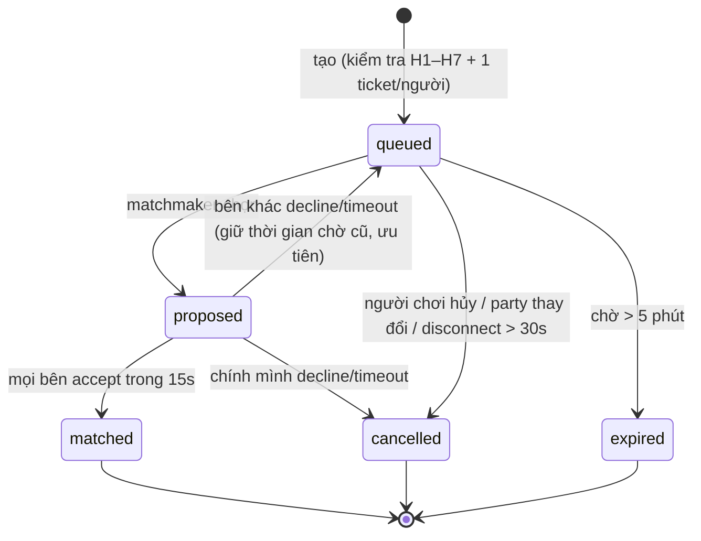
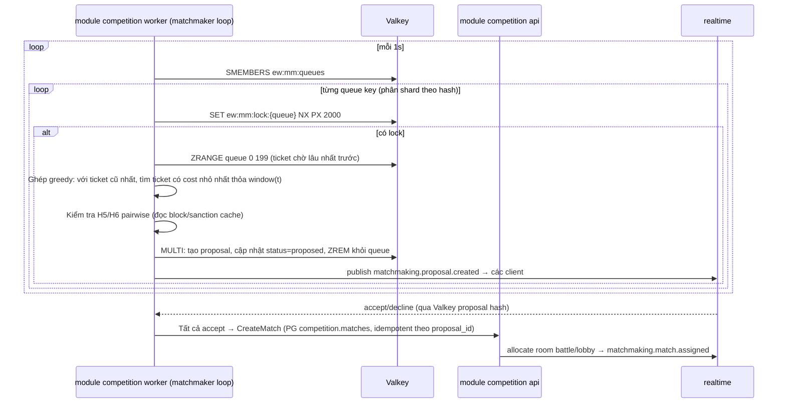

# Matchmaking

> Trạng thái: Draft · Phiên bản: 0.3 · Owner: Multiplayer Engineer · Cập nhật: 2026-11-27 (delta F109: `409 MM_TICKET_ALREADY_ACTIVE` kèm `ticket_id`, `chat_channel_ids` trong `matchmaking.match.assigned`, WS `competition.duel.received`) · 2026-11-26 (F108: §5.1 đọc version hiệu lực theo dòng thời gian release, invariant khối) · 2026-11-21 (triển khai [F104](../../specs/104-matchmaking/spec.md): quyết định ở Clarifications 2026-11-21) · 2026-11-15
> Liên quan: [MULTIPLAYER_GAMEPLAY](MULTIPLAYER_GAMEPLAY.md) · [PARTY_SYSTEM](PARTY_SYSTEM.md) · [COMPETITION_SYSTEM](../01-game-design/COMPETITION_SYSTEM.md) · [RANKING](../01-game-design/COMPETITION_SYSTEM.md) · [TOURNAMENT](../01-game-design/COMPETITION_SYSTEM.md) · [ADR-0018](../adr/ADR-0018-glicko-2-cho-game-rating-tach-biet-learning-mastery.md) · [ADR-0054](../adr/ADR-0054-tuong-tac-xa-hoi-lien-truong-cross-school-social-interaction.md) · [VALKEY_DESIGN](../07-backend/VALKEY_DESIGN.md) · [AsyncAPI](../../specs/asyncapi/eduworld-realtime.v1.yaml)

> [!IMPORTANT]
> **Bỏ khái niệm lớp — [ADR-0095](../adr/ADR-0095-bo-khai-niem-lop-hoc-sinh-theo-khoi.md) (owner chốt 2026-11-21).** Bỏ trọng số `same_class` của hàm chi phí và "ưu tiên bạn cùng lớp" khi chia đội; cấu hình matchmaking xuất bản version mới không có khóa này; ticket không còn trường `classes`. Ràng buộc khối/trường (FR-MM-002/003, ADR-0054) giữ nguyên. Đã áp ở WP-C1 (2026-11-21): code, cấu hình version 2, §2.2, §4 (ticket Valkey), §8 ([CODE_PLAN §4.2](../12-project/CODE_PLAN_CMS_LMS_FIRST.md#42-kế-hoạch-bỏ-khái-niệm-lớp-adr-0095)); khi mâu thuẫn, ADR-0095 và đoạn này thắng.

## 0. Mục đích & phạm vi

Tài liệu **sở hữu cơ chế ghép trận PvP**: hard constraints, queue, ticket, matchmaker, proposal/ready check, lobby, chia đội, friend duel, bot luyện tập. Luật chơi từng mode, scoring, Glicko-2, Competition Points, mùa và giải đấu thuộc [COMPETITION_SYSTEM](../01-game-design/COMPETITION_SYSTEM.md) (và RANKING/TOURNAMENT liên quan); mất kết nối trong trận thuộc [MULTIPLAYER_GAMEPLAY §9](MULTIPLAYER_GAMEPLAY.md#9-mất-kết-nối-kết-nối-lại-đổi-thiết-bị). Challenge/boss **PvE** không qua matchmaking ([CHALLENGE_BOSS_SYSTEM](../01-game-design/CHALLENGE_BOSS_SYSTEM.md)). Chạy trong **module competition**.

## 1. Yêu cầu nguồn

Master Prompt §5.2 **[Confirmed]**:

- Chế độ: Random, Skill-based, Grade-based, Subject-based, Topic-based, Friend, Team, Tournament matchmaking.
- **Ưu tiên kiểm tra điều kiện độ tuổi/khối và tính phù hợp nội dung trước khi dùng rating.** Không ghép lớp 1 với lớp 9 chỉ vì rating tương đương.
- Hỗ trợ: Queue, Matchmaking Ticket, Match Proposal, Lobby, Ready Check, Team Assignment, Match Start, Match End, Reconnect, Match Result.

## 2. Mô hình hai tầng: hard constraints → soft scoring



### 2.1. Hard constraints (thành phần của queue key — không nới theo thời gian)

| # | Constraint | Giá trị mặc định | Nhãn |
|---|---|---|---|
| H1 | **Grade**: lớp 1–5 cùng `grade_level`; lớp 6–9 cùng `grade_level` hoặc ±1 trong cùng `grade_band` (`g6_7`, `g8_9`) | Queue partition theo `grade_level` (1–5) hoặc `grade_band` (6–9) | [Confirmed] nguyên tắc / giá trị [Confirmed] |
| H2 | **Nội dung phù hợp**: `subject_id` + (tùy mode) `topic_id`; câu hỏi chọn từ grade thấp nhất trong trận | Bắt buộc | [Confirmed] |
| H3 | **Phạm vi**: cùng `school_id` (mặc định); toàn tenant `unit` khi tenant bật `cross_school_social_enabled`; `platform` chỉ cho giải/sự kiện liên tenant do platform tổ chức (ADR-0054) | `school` | [Confirmed] |
| H4 | **Mode** & ruleset version | Bắt buộc | [Confirmed] |
| H5 | **Trạng thái**: tài khoản active, không bị sanction `restrict_competition`, trong khung giờ cho phép | Kiểm tra lúc tạo ticket và lúc tạo proposal | [Confirmed] |
| H6 | **Block**: hai người block nhau không ghép cùng trận | Kiểm tra ở bước tạo proposal (pairwise) | [Confirmed] |
| H7 | Ngôn ngữ nội dung (vi/en cho môn Tiếng Anh) | Theo subject | [Confirmed] |

### 2.2. Soft scoring (trong một queue)

Điểm phù hợp giữa hai ticket `a`, `b` (càng nhỏ càng tốt):

```
cost(a,b) = w_r · |μa − μb| / window(t)            // chênh lệch rating Glicko-2 (RANKING)
          + w_rd · max(0, RDa + RDb − 300) / 300   // ưu tiên ghép người đã ổn định với nhau
          + w_rep · recent_opponent(a,b)           // tránh gặp lại cùng đối thủ trong 30 phút
```

Không còn trọng số `same_class` (ADR-0095): cấu hình matchmaking version 2 bỏ khóa `cost_weights.same_class` (payload cũ còn khóa này vẫn đọc được, khóa bị bỏ qua); không có trọng số thay thế theo khối — ràng buộc khối/trường là hard constraint §2.1.

Ghép hợp lệ khi `|μa − μb| ≤ window(t)` với **expanding window**:

| Thời gian chờ `t` | `window(t)` (rating Glicko-2 thang 1500) | Nhãn |
|---|---|---|
| 0–10 s | 100 | [Confirmed] |
| 10–20 s | 200 | [Confirmed] |
| 20–40 s | 350 | [Confirmed] |
| 40–60 s | ∞ (bỏ qua rating, vẫn giữ hard constraints) | [Confirmed] |
| > 90 s | Đề nghị client: chơi với bot luyện tập (unranked, không rating) hoặc tiếp tục chờ | [Confirmed] |

Hard constraints **không bao giờ** nới, kể cả khi chờ lâu.

## 3. Các chế độ matchmaking

| Mode | Queue? | Hard constraints thêm | Rating dùng? | Ranked? | Nhãn |
|---|---|---|---|---|---|
| Random | Có | H1–H7 | Không (FIFO) | Không | [Confirmed] |
| Skill-based | Có | H1–H7 | Có (expanding window) | Có | [Confirmed] |
| Grade-based | Có | H1 dùng `grade_level` chính xác cho mọi lớp | Tùy chọn | Tùy | [Confirmed] |
| Subject-based | Có | `subject_id` bắt buộc | Rating theo subject | Có | [Confirmed] |
| Topic-based | Có | `topic_id` bắt buộc | Rating theo subject (không tách theo topic — quá thưa) | Không mặc định | [Confirmed] / [Confirmed] |
| Friend | Không — thách đấu bạn trực tiếp (friend duel) | Hai người là bạn, H1 nới thành "cùng grade band", H5, H6 | Không | Không (unranked) | [Confirmed] / [Confirmed] |
| Team | Có — ticket nhóm (party `competition_team`) | H1 áp cho **mọi** member; team rating = trung bình có trọng số | Có | Có | [Confirmed] |
| Tournament | Không queue tự do — bracket quyết định cặp đấu, dùng cùng cơ chế proposal/ready check | Theo luật giải | Seeding | Theo giải | [Confirmed] |

## 4. Ticket

### 4.1. API

| Thao tác | Endpoint | Ghi chú |
|---|---|---|
| Tạo ticket | `POST /api/v1/competition/matchmaking/tickets` (`Idempotency-Key`) | Body: `mode`, `subject_id`, `topic_id?`, `party_id?`; server tự lấy grade, school, rating. Đã có ticket active → `409 MM_TICKET_ALREADY_ACTIVE`, kèm `ticket_id` chỉ khi ticket đó có chính người gọi (không bao giờ nêu ticket riêng của bạn khác trong party) |
| Xem ticket | `GET /api/v1/competition/matchmaking/tickets/{ticket_id}` | Trạng thái, thời gian chờ ước tính |
| Hủy ticket | `DELETE /api/v1/competition/matchmaking/tickets/{ticket_id}` hoặc WS `matchmaking.ticket.cancel` | |
| Thách đấu bạn | `POST /api/v1/competition/duels` (+ `:accept`, `:decline`) | Friend mode (F104); dùng tên `duels` để không trùng "challenge" PvE của module game [Confirmed]. Người được thách nhận WS `competition.duel.received` (chỉ người đó, sau commit, chỉ khi qua luật thách đấu; thẻ công khai của người thách — R16) [Confirmed — delta F109 2026-11-27] |
| Ready check | WS `matchmaking.proposal.accept` / `matchmaking.proposal.decline` | |

Sự kiện WS gửi client (tên theo [AsyncAPI](../../specs/asyncapi/eduworld-realtime.v1.yaml)): `matchmaking.ticket.updated` (status `queued`/`searching`/`cancelled`/`expired`, window mở rộng, ước tính chờ), `matchmaking.proposal.created`, `matchmaking.proposal.updated`, `matchmaking.proposal.cancelled`, `matchmaking.match.assigned` (kèm `room_id` lobby/battle và `chat_channel_ids` {`match`, `team`?} — id tất định `pkg/chatid` của kênh chat trận/đội F117, gửi riêng theo đội; `team` chỉ ở Team Battle), `competition.duel.received` (lời thách đấu đến).

### 4.2. Lifecycle



Quy tắc:

- Mỗi học sinh tối đa **1 ticket active** (Valkey `SET NX ew:mm:user:{student_id}`, tên key theo [VALKEY_DESIGN §3.1](../07-backend/VALKEY_DESIGN.md)) **[Confirmed]**.
- Party ticket: chỉ leader tạo; mọi member phải online và không có ticket riêng; member rời party → ticket party bị hủy.
- Decline/timeout ready check 3 lần trong 10 phút → cooldown 2 phút **[Confirmed]**.
- Ticket **chỉ tồn tại trong Valkey** (ADR-0004). Mất Valkey → client nhận `matchmaking.ticket.updated` (status `cancelled`, `cancel_reason = system` theo enum AsyncAPI) và tự tạo lại.

## 5. Thiết kế queue trong Valkey

Tên key cuối cùng theo [VALKEY_DESIGN](../07-backend/VALKEY_DESIGN.md); đề xuất:

| Key | Kiểu | Nội dung |
|---|---|---|
| `ew:mm:queue:{mode}:{scope}:{grade_key}:{subject}[:{topic}]` | sorted set | member = `ticket_id`, score = `enqueued_at` (ms) |
| `ew:mm:ticket:{ticket_id}` | hash | `student_ids`, `party_id`, `rating`, `rd`, `school_id`, `grade_level`, `enqueued_at`, `status`, `proposal_id` · TTL 10 phút |
| `ew:mm:user:{user_id}` | string | `ticket_id` (NX) · TTL 10 phút |
| `ew:mm:proposal:{proposal_id}` | hash | ticket ids, deadline, accept flags · TTL 30 s |
| `ew:mm:queues` | set | danh sách queue key đang có ticket (để matchmaker quét) |
| `ew:mm:lock:{queue_key}` | string NX | lock matchmaker per queue · TTL 5 s (gia hạn) |

`{scope}` = `s:{school_id}` | `t:{tenant_id}` | `p`. `{grade_key}` = `g3` (lớp 1–5) hoặc `b6_7` (lớp 6–9). Khóa thật có thêm kiểu ghép và cỡ đội (`team_battle`) — danh sách key cuối cùng ở [VALKEY_DESIGN §3.1](../07-backend/VALKEY_DESIGN.md).

Ví dụ: `ew:mm:queue:battle_1v1:s:018f…:g3:math`.

### 5.1. Cấu hình matchmaking — platform-only

Queue, mode, grade band, cửa sổ rating nới dần, timeout ready check là **cấu hình phiên bản hóa** (`competition.game_configs`/`game_config_versions`, `config_type = matchmaking-configs`, code `default`, `effective_from`) soạn trong **Game Operations Console** (workspace A, `/api/v1/game-admin/matchmaking-configs`, permission `competition.config.matchmaking.write`, chỉ `eduworld-portal` + role platform qua gateway nội bộ — ADR-0027). Matchmaker đọc version **hiệu lực theo dòng thời gian release** (publish từ `effective_from`, rollback ngay — [F108](../../specs/108-competition-config-portal/spec.md), [COMPETITION_SYSTEM §13](../01-game-design/COMPETITION_SYSTEM.md#13-cấu-hình-platform-only-adr-0027)); ràng buộc khối không nới được: lớp 1–5 cùng khối, lớp 6–9 tối đa ±1 khối sau ≥ 30 s (invariant của F108, payload theo `specs/schemas/matchmaking-config.schema.json`).. Vận hành tenant không thay đổi được; phạm vi ghép liên trường trong một tenant `unit` bật/tắt qua cài đặt tenant (an toàn), không qua cấu hình matchmaking.

## 6. Matchmaker (worker)



- Thuật toán greedy theo thời gian chờ là đủ cho quy mô pilot; queue > 500 ticket → chuyển sang chia bucket rating trước khi ghép **[Confirmed]**.
- Nhiều instance worker chạy song song; lock per-queue đảm bảo một queue chỉ một matchmaker xử lý tại một thời điểm. Lock TTL ngắn, worker chết → worker khác tiếp quản sau ≤ 2 s.
- Tạo `Match` trong PostgreSQL dùng `proposal_id` làm khóa idempotent (unique), chống tạo trận trùng khi retry.

## 7. Match Proposal, Ready Check, Lobby, Team Assignment

| Bước | Chi tiết | Timeout | Nhãn |
|---|---|---|---|
| Match Proposal | Gửi `matchmaking.proposal.created` (mode, môn, số người; **không** gửi tên/trường đối thủ trước khi accept) | — | [Confirmed] |
| Ready Check | Mỗi người accept | 15 s | [Confirmed] |
| Lobby | Room `lobby`: hiển thị nickname + avatar + tier đối thủ, đội, đếm ngược | 10 s (1v1), 20 s (team) | [Confirmed] |
| Team Assignment | Party giữ nguyên đội. Ticket lẻ trong team mode: snake draft theo rating (A1,B1,B2,A2…) để cân tổng rating (không còn ưu tiên bạn cùng lớp — ADR-0095) | — | [Confirmed] |
| Chat trận (always-on) | Khi tạo room `lobby`: tạo channel `match` (và `team` mỗi đội ở team mode), mọi người chơi tự join — chat có ngay từ lobby, không tắt được bằng cài đặt trường/lớp (ADR-0020 mục 6, [CHAT_SYSTEM §4.1](CHAT_SYSTEM.md#41-vòng-đời-channel-gameplay-always-on)) | — | [Confirmed] |
| Tạo trận (CreateMatch) | Khi mọi người accept: tạo `Match` (idempotent theo `proposal_id`) và **tạo luôn** `question_plan` server-side (facade `question-plans` của module learning, gọi trong tiến trình, [REALTIME_ARCHITECTURE §7.1](../06-architecture/REALTIME_ARCHITECTURE.md#71-state-machine-knowledge-battle)) từ Question Bank theo grade thấp nhất + subject/topic, cùng đề cho mọi người; plan **ghim** `question_version_id` theo con trỏ release lúc tạo trận (`matches.question_plan_version`, ADR-0043) — publish/rollback câu hỏi giữa trận không đổi đề; tạo plan thất bại → trận hủy trước lobby | — | [Confirmed] (server-authoritative) |
| Match Start | Room `battle` chuyển `running` với plan đã tạo | — | [Confirmed] |
| Match End | State machine kết thúc; `MatchResult` ghi một lần (unique `match_id`) | — | [Confirmed] |
| Reconnect | Theo [MULTIPLAYER_GAMEPLAY §9.2](MULTIPLAYER_GAMEPLAY.md#92-grace-theo-chế-độ-tài-liệu-này-sở-hữu-giá-trị) | 30–60 s | [Confirmed] |
| Đóng chat | `match.completed`/`match.aborted` → channel `match`/`team` read-only, purge sau `gameplay_chat_retention_days` (ADR-0033) | — | [Confirmed] |
| Match Result | `match.completed` → ranking, competition points, reward, learning evidence (`context=competition`) theo [COMPETITION_SYSTEM](../01-game-design/COMPETITION_SYSTEM.md) | — | [Confirmed] |

## 8. Party queue & Friend duel

- Party `competition_team` đủ size mode → một ticket; thiếu người → server cho phép "fill" bằng ticket lẻ cùng queue nếu leader bật `allow_fill` **[Confirmed]**.
- Rating đội dùng để ghép: `μ_team = Σ μ_i / n`, `RD_team = sqrt(Σ RD_i²) / n` **[Confirmed]**; cách cập nhật rating sau trận thuộc [RANKING](../01-game-design/COMPETITION_SYSTEM.md).
- Friend duel: lời thách đấu (event `duel.sent`; người được thách nhận WS `competition.duel.received`, không có thông báo lưu trữ) hết hạn 60 s, unranked, không tính Competition Points, vẫn tính XP theo cap và learning evidence; người đã block nhau không thách đấu được ([SOCIAL_SYSTEM §5](SOCIAL_SYSTEM.md#5-block-mute-report-điểm-vào)).

## 9. Bot luyện tập (fallback)

Khi không tìm được đối thủ sau 90 s, client có thể chọn "Đấu với Robot Học Giỏi" **[Confirmed]**: bot unranked, độ chính xác theo bảng cấu hình (60–85%) và thời gian trả lời ngẫu nhiên hợp lý; trận không ảnh hưởng rating/points/leaderboard; vẫn tạo attempt learning của học sinh. Bot luôn được gắn nhãn "Robot" rõ ràng — không giả làm người.

## 10. Metrics & alert

| Metric | Ghi chú |
|---|---|
| `eduworld_mm_queue_size{mode,grade_key,subject}` | gauge — dashboard queue |
| `eduworld_mm_wait_seconds{mode,result}` | histogram — p50/p95 chờ |
| `eduworld_mm_proposals_total{result=accepted|declined|timeout}` | counter |
| `eduworld_mm_rating_gap` | histogram — chênh lệch μ trong trận |
| `eduworld_mm_matches_created_total{mode}` | counter |
| `eduworld_mm_loop_duration_seconds` | histogram — vòng matchmaker |
| Alert | p95 chờ > 60 s trong 15 phút giờ cao điểm; loop duration > 1 s |

Không gắn `school_id`/`student_id` làm label Prometheus (cardinality, privacy).

## 11. Acceptance criteria

| ID | Tiêu chí |
|---|---|
| AC-MM-001 | Học sinh lớp 1 và lớp 9 có rating bằng nhau không bao giờ được ghép, kể cả chờ quá 60 s |
| AC-MM-002 | Hai học sinh lớp 3 cùng trường, cùng môn Toán, rating chênh 50 → được ghép trong ≤ 10 s khi queue chỉ có họ |
| AC-MM-003 | Một học sinh tạo ticket thứ hai khi đang có ticket → 409 `MM_TICKET_ALREADY_ACTIVE` |
| AC-MM-004 | Một bên decline ready check → bên còn lại quay lại queue giữ nguyên thời gian chờ |
| AC-MM-005 | Hai học sinh đã block nhau không bao giờ cùng proposal |
| AC-MM-006 | Matchmaker chạy 2 instance song song không tạo trùng match cho cùng ticket |
| AC-MM-007 | Team ticket: mọi member thỏa hard constraints; member rời party → ticket bị hủy, mọi member nhận thông báo |
| AC-MM-008 | Restart Valkey → client nhận `matchmaking.ticket.updated` (status `cancelled`) và có thể tạo lại; không có match "ma" trong PG |
