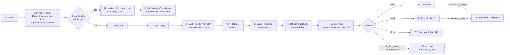
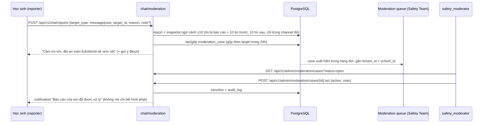
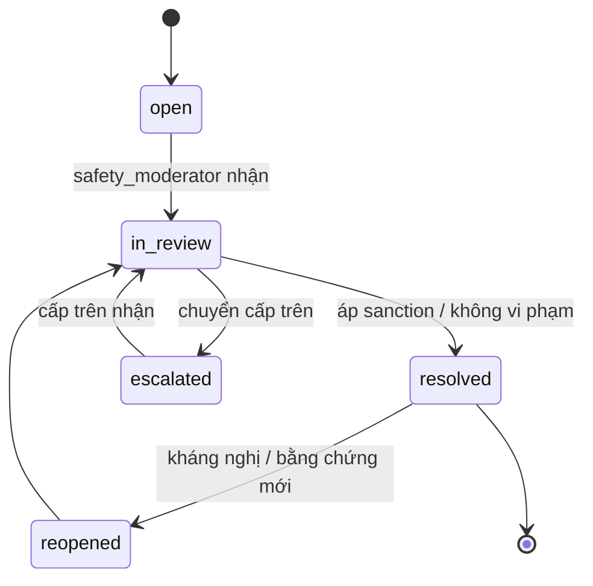

# Moderation — Kiểm duyệt & an toàn giao tiếp

> Trạng thái: Draft · Phiên bản: 0.4 · Owner: Identity & Security Engineer + EdTech Specialist · Cập nhật: 2026-11-17 (ADR-0074: pipeline bất đồng bộ chạy trong profile `worker-chat`; ADR-0078: PII/grooming luôn chạy, giới hạn công tắc, tenant `common`)
> Liên quan: [ADR-0020](../adr/ADR-0020-chat-thong-nhat-cho-moi-lop-moi-tin-nhan-phai-qua-kiem-tra-h.md) · [ADR-0030](../adr/ADR-0030-chinh-sach-tu-nhay-cam-trong-chat-danh-muc-quan-ly-duoc-va-c.md) · [ADR-0072](../adr/ADR-0072-bo-vai-tro-giao-vien-hoc-sinh-tu-hoc-kiem-duyet-tap-trung.md) · [ADR-0078](../adr/ADR-0078-mac-dinh-an-toan-cho-tre-nho.md) · [CHAT_SYSTEM](CHAT_SYSTEM.md) · [CHILD_SAFETY](../10-security/CHILD_SAFETY.md) · [DATA_PRIVACY](../10-security/DATA_PRIVACY.md) · [OPEN_QUESTIONS OQ-09, OQ-12](../12-project/OPEN_QUESTIONS.md)

> [!IMPORTANT]
> **Bỏ khái niệm lớp — [ADR-0095](../adr/ADR-0095-bo-khai-niem-lop-hoc-sinh-theo-khoi.md) (owner chốt 2026-11-21).** Chat policy còn 3 cấp platform → tenant → school (bỏ cấp `class`); không có channel `class`/`study_group`; thông báo vụ việc cho trường không kèm tên lớp. Đã áp ở WP-C1 (2026-11-21) cho chat policy cấp trường (§ chính sách nhà trường); nhắc lớp còn lại (nếu có) theo ADR-0095 ([CODE_PLAN §4.2](../12-project/CODE_PLAN_CMS_LMS_FIRST.md#42-kế-hoạch-bỏ-khái-niệm-lớp-adr-0095)); khi mâu thuẫn, ADR-0095 và đoạn này thắng.

## 0. Mục đích & phạm vi

Tài liệu **sở hữu** kiểm duyệt giao tiếp: pipeline kiểm tra nội dung (đồng bộ và bất đồng bộ), danh mục từ nhạy cảm, công tắc kiểm duyệt, report flow, moderation queue của Platform Safety Team, sanction, thông báo vụ việc cho nhà trường, kiểm soát an toàn cấp trường. Kênh chat và UX chat thuộc [CHAT_SYSTEM](CHAT_SYSTEM.md); quan hệ block/mute thuộc [SOCIAL_SYSTEM](SOCIAL_SYSTEM.md); chính sách an toàn trẻ em tổng thể thuộc [CHILD_SAFETY](../10-security/CHILD_SAFETY.md). Chạy trong **module chat**.

**Nơi chạy (ADR-0074):** bước kiểm tra đồng bộ chạy trong module chat của `core-api` (lệnh gửi tin nhận từ `realtime` qua NATS); phân tích bất đồng bộ (`chat-moderation-async`), thông báo (`chat-notifier`), thống kê (`chat-stats`) và purge chat gameplay chạy trong Swarm service `worker-chat` (`src/backend/cmd/worker --profile=chat`); job định kỳ khác của moderation (vd. hết hạn công tắc) chạy trong `worker-jobs` ([DEPLOYMENT §3.1](../11-operations/DEPLOYMENT.md#31-binary-và-swarm-service-backend-adr-0074)).

## 1. Yêu cầu nguồn [Confirmed]

Content Filtering, Profanity Filtering, Anti-spam, Anti-bullying, Personal Information Detection, Report Message, Report User, Block, Mute, Moderation Queue, Moderation Audit, School-level Chat Policy, Age/Grade-based Policy, Teacher/Admin Moderation. Không để một người có quyền truy cập toàn bộ chat của tất cả trường. Không dùng giám sát chat làm lý do thu thập dữ liệu vượt mục đích.

> **Thay đổi theo stakeholder (ADR-0020, Accepted 2026-11-15):** mục "Age/Grade-based Policy" được thay bằng **một bộ quy tắc chat chung cho mọi lớp 1–9**. An toàn cho học sinh nhỏ tuổi được bảo đảm bằng việc **mọi tin nhắn phải qua kiểm tra hợp lệ** với cùng mức nghiêm, không bằng cách phân quyền chat theo khối.

> **ADR-0072 (Accepted 2026-11-15):** mục "Teacher/Admin Moderation" được hiện thực bằng **kiểm duyệt tập trung** của **Platform Safety Team** (role platform `safety_moderator`; đăng nhập portal không MFA theo ADR-0094). Không có giáo viên hay moderator của từng trường; nhà trường đặt chat policy cấp trường trong giới hạn platform và nhận thông báo vụ việc nghiêm trọng để liên hệ phụ huynh (§6.4, §8).

> **ADR-0030 (Accepted 2026-11-15):** từ nhạy cảm được quản lý bằng **danh mục** trong CMS (§11). Toàn bộ pipeline kiểm tra nội dung có **công tắc bật/tắt** theo từng bước hoặc công tắc tổng, ở cấp platform hoặc tenant (§12). Mặc định **BẬT**. Khi tắt, chỉ còn các giới hạn kỹ thuật, tính năng người dùng và các bước luôn chạy (§12.3).

> **ADR-0078 (Accepted 2026-11-17, thay một phần ADR-0030):** bước **PII** và **phát hiện grooming** luôn chạy, không nằm trong công tắc; mọi lần tắt bước khác bắt buộc có `expires_at` ≤ `moderation_switch_max_duration` và phê duyệt của hai người (§12.2). Tenant `common` do Platform Safety Team kiểm duyệt với mặc định siết chặt ([CHILD_SAFETY §3.6](../10-security/CHILD_SAFETY.md#36-tenant-common-adr-0078)).

## 2. Phạm vi áp dụng

Pipeline kiểm duyệt áp dụng cho **mọi văn bản do học sinh nhập**: tin nhắn chat (mọi `kind`, kể cả tham số của quick message), tên party, tên đội, tên study group, nickname tự đặt (nếu cho phép), nội dung báo cáo (chỉ chuẩn hóa, không chặn). Nickname mặc định chọn từ danh sách sinh sẵn nên không cần lọc.

### 2.1. Sửa, forward, quote, sticker/GIF (ADR-0034)

| Thao tác | Kiểm duyệt |
|---|---|
| **Sửa tin** | Nội dung mới chạy lại **toàn bộ pipeline** (theo công tắc). `block` → giữ bản cũ; `hold_for_review` → bản mới chờ duyệt, người khác vẫn thấy bản cũ. Mọi bản cũ lưu `chat.message_revisions` làm bằng chứng |
| **Forward** | Tin forward là nội dung mới ở channel đích: chạy lại pipeline với **policy và công tắc của channel/tenant đích**. Không forward tin đã thu hồi, bị che, bị gỡ, đang held |
| **Quote** | Đoạn trích do server cắt từ `body_display` (đã che), không nhận nội dung trích từ client |
| **Mention** | Kiểm tra spam mention (≤ 5/tin) + mention lặp lại một người nhiều lần trong thời gian ngắn là tín hiệu bắt nạt cho `async_analysis` |
| **Sticker / GIF** | Đã duyệt trước ở thư viện platform nên không qua bước văn bản; vẫn chịu rate limit và spam (lặp sticker) |
| **Thu hồi** | Không xóa bằng chứng: nội dung gốc giữ đến hết retention channel (gameplay: đến purge ADR-0033), moderator xem trong case |

## 3. Pipeline đồng bộ (pre-send) — ADR-0020

- Bước 3, 5, 6 và các tín hiệu bắt nạt của phân tích bất đồng bộ là **bước có thể tắt** (`steps.*`, §12). Bước tắt được bỏ qua (coi như `allow`). **Bước 4 (PII) và phát hiện grooming luôn chạy** (ADR-0078), kể cả khi công tắc tổng tắt; vì vậy bước 1 (normalize) cũng luôn chạy.
- Giới hạn kỹ thuật ở đầu pipeline **luôn chạy**, kể cả khi công tắc tổng tắt.
- Ngân sách độ trễ: mục tiêu **p95 < 20 ms**, trần **50 ms** theo ADR-0030, cho toàn pipeline (chạy in-process trong **module chat** (handler lệnh NATS và REST), danh mục biên dịch sẵn trong bộ nhớ, reload theo §11.6) **[Confirmed]**.

### 3.1. Bước 1 — Normalize (tiếng Việt)

Tạo nhiều "góc nhìn" của cùng văn bản để so khớp:

| Biến đổi | Ví dụ |
|---|---|
| Unicode NFC → lowercase | `ĐỒ` → `đồ` |
| Bỏ dấu (`vi_fold`) | `đồ ngốc` → `do ngoc` |
| Teencode map (bảng cấu hình CMS) | `k`→`không`, `ko`/`hok`→`không`, `dc`/`đc`→`được`, `j`→`gì`, `ng`→`người`, `vl`… |
| Leetspeak / ký tự thay thế | `0`→`o`, `1`→`i`/`l`, `3`→`e`, `4`→`a`, `@`→`a`, `$`→`s` |
| Ký tự lặp | `ngooooc` → `ngoc` (giảm ≥3 ký tự lặp về 1–2) |
| Bỏ ký tự chèn giữa | `n.g.u`, `n g u`, `n_g_u` → `ngu` (gộp chuỗi ký tự đơn cách nhau bởi dấu/khoảng trắng) |
| Telex/VNI chưa gõ xong | `ddoof` → `đồ` (map Telex), `d9o62` (VNI) [Confirmed] |
| Homoglyph | Chữ Cyrillic/Greek giống Latin → Latin |

### 3.2. Bước 3 — Danh mục từ nhạy cảm (`steps.sensitive_terms`)

- So khớp văn bản đã normalize với **danh mục từ nhạy cảm hiệu lực** của tenant (danh mục platform + mục bổ sung của tenant, trừ category đang tắt). Data model, phạm vi và engine ở **§11**.
- Hành động lấy từ mục từ (nếu có ghi đè) hoặc từ category theo `severity`: `low → mask`, `medium → block`, `high → hold_for_review`, `critical → block_and_alert` (ADR-0030).
- Category có `severity = watch` [Confirmed] (từ nhạy cảm theo ngữ cảnh: "chết", "đánh") → `allow` + tăng điểm rủi ro cho phân tích async.
- `validation.strictness` của channel có thể nâng hành động lên một mức (vd. `very_strict`: `mask → block`). Không có điều kiện theo lớp.
- So khớp trên cả bản có dấu và không dấu, theo **ranh giới từ** (tránh false positive kiểu "ngủ" bị bắt vì "ngu": chỉ áp bản không dấu khi văn bản gốc **không có dấu**) **[Confirmed]**. Allowlist (§11.3) loại các cụm hợp lệ trước khi so khớp.
- Khi chặn/che, phản hồi cho client chỉ có `category_code` và thông điệp thân thiện, **không** trả từ đã khớp hay vị trí.

### 3.3. Bước 4 — PII detector (`steps.pii`, luôn chạy)

Bước này **không tắt được** (ADR-0078): không có trong công tắc kiểm duyệt; API công tắc từ chối mọi yêu cầu tắt `pii` (§12.2). Mẫu "hẹn gặp ngoài đời" và chia sẻ liên hệ lặp lại tạo điểm rủi ro grooming đồng bộ.

| Loại | Quy tắc phát hiện (ví dụ) | Hành động mặc định |
|---|---|---|
| Số điện thoại VN | Chuỗi chữ số sau normalize (kể cả viết bằng chữ "không chín một…", tách bằng dấu/khoảng trắng) khớp `(\+?84|0)(3|5|7|8|9)\d{8}`; ≥ 9 chữ số liên tiếp | block |
| Email | `[\w.+-]+@[\w-]+\.[\w.]+`, biến thể "a còng", "chấm com" | block |
| URL / domain | `http`, `www`, `.com/.vn/.net`, "chấm vn", rút gọn link | block (trừ domain allowlist EduWorld) |
| Mạng xã hội / app | `fb`, `facebook`, `zalo`, `tiktok`, `insta`, `discord`, `@handle`, "kết bạn zalo" | block |
| Địa chỉ | Mẫu "số nhà", "đường", "phường", "quận", "hẻm", "ngõ" + số | hold_for_review |
| Mã định danh | CCCD 12 số, số tài khoản ngân hàng | block |
| Hẹn gặp ngoài đời | "gặp ở", "nhà mình ở", "mấy giờ ra" + địa điểm | hold_for_review + điểm rủi ro grooming |
| Tên trường/lớp thật kèm tên người | NER đơn giản dựa danh sách trường trong org | mask |

Thông điệp trả về cho học sinh thân thiện và mang tính giáo dục, vd: *"Để an toàn, EduWorld không cho chia sẻ số điện thoại hay mạng xã hội trong game nhé!"* — không lặp lại nội dung vi phạm **[Confirmed]**.

### 3.4. Bước 5 — Anti-spam & trùng lặp (`steps.spam`)

Rate limit theo policy (`messages_per_minute` + burst và `chat_rate_per_user`, nguồn duy nhất ở [CHAT_SYSTEM §3.1](CHAT_SYSTEM.md#31-mặc-định-platform-confirmed--giá-trị-số-cấu-trúc-confirmed-theo-adr-0020)) là **giới hạn kỹ thuật, luôn chạy** ở đầu pipeline và không thuộc bước `spam`. Bước `spam` gồm các kiểm tra nội dung sau:

| Quy tắc | Ngưỡng (`chat_spam_thresholds`, [Confirmed — Technical Architect 2026-11-16]) | Hành động |
|---|---|---|
| Rate theo policy (luôn chạy, không tắt được) | `messages_per_minute` + burst trong cửa sổ [`chat_burst_window`](../00-overview/CONFIG_DEFAULTS.md) + `slow_mode_seconds` | `CHAT_RATE_LIMITED` |
| Lặp tin giống nhau | ≥ 3 tin giống (similarity ≥ 0.9) trong 60 s | block tin lặp |
| Viết hoa / ký tự lặp / emoji spam | > 70% chữ hoa, > 10 emoji liên tiếp | mask/giảm |
| Gửi cùng nội dung tới nhiều channel | ≥ 4 channel trong 2 phút | block + tăng điểm spam |
| Vi phạm liên tiếp | 3 lần block trong 10 phút | auto-mute 10 phút (sanction tự động `mute`, `auto_mute_spam`) |
| Mời/kết bạn hàng loạt | `party_invite_rate` ([PARTY_SYSTEM §10](PARTY_SYSTEM.md#10-rate-limit--chống-spam)), `friend_limits` ([SOCIAL_SYSTEM §4.1](SOCIAL_SYSTEM.md#41-quy-tắc)) | |

### 3.5. Bước 6–7 — Bắt nạt (`steps.bullying`) và context rules

Bước `bullying` dùng rule (cụm xúc phạm nhắm vào người, mention + từ `medium` trở lên) để chấm điểm tin đơn lẻ (Release 1.0 không dùng classifier ML, chỉ rule [Confirmed — owner 2026-11-20]); tắt bước này thì bỏ chấm điểm đồng bộ. Context rules luôn chạy khi còn bước nội dung bật:

Kết hợp loại channel, `validation.strictness` của effective policy (trường/lớp có thể nâng), giờ, quan hệ (bạn bè/không), cross-school để chọn mức xử lý. **Không** dùng lớp/khối của người gửi hay người nhận làm điều kiện: cùng một tin ở cùng channel và cùng policy cho cùng quyết định với mọi học sinh.

## 4. Phân tích bất đồng bộ (anti-bullying) — `steps.async_analysis`

Tắt bước này thì `chat-moderation-async` (profile `worker-chat`) bỏ qua các tín hiệu bắt nạt, loại trừ, dồn dập của tenant đó (vẫn xử lý report thủ công); **luật grooming vẫn chạy** (ADR-0078) — worker luôn tiêu thụ tin để tính tín hiệu grooming. Khi bật, worker tiêu thụ `chat.message.created` và tính **điểm rủi ro theo cặp/nhóm** trong cửa sổ trượt (Valkey, TTL 24 h). **Ngưỡng** cho từng tín hiệu rủi ro trẻ em (bắt nạt, hội đồng, loại trừ, số report) do [CHILD_SAFETY §8](../10-security/CHILD_SAFETY.md) sở hữu; bảng dưới chỉ mô tả loại tín hiệu:

| Tín hiệu | Ví dụ |
|---|---|
| Nhắm mục tiêu lặp lại | Nhiều tin mức `low`/`watch` hướng tới cùng một người (mention, reply) |
| Loại trừ | Nhiều member kick/ignore một người lặp lại (kết hợp event party) |
| Dồn dập | Nhiều người cùng gửi tin tiêu cực tới một người trong thời gian ngắn |
| Grooming pattern (luôn chạy) | Hỏi tuổi, địa chỉ, yêu cầu giữ bí mật, rủ chuyển nền tảng khác |
| Báo cáo trước đó | Người gửi có report được xác nhận |

Vượt ngưỡng → tạo `moderation_case` mức ưu tiên tương ứng, **không** tự động trừng phạt nặng; chỉ auto-mute ngắn với tín hiệu rõ ràng **[Confirmed]**. Release 1.0 **không** dùng mô hình ML/LLM phân loại [Confirmed — owner 2026-11-20]; bổ sung sau chỉ khi có ADR mới và xử lý trong hạ tầng đáp ứng OQ-12.

## 5. Report flow

- API kiểm duyệt của Safety Team nằm dưới `/api/v1/admin/moderation/*` (chỉ gateway nội bộ, `azp = eduworld-portal`, role platform); học sinh chỉ có `POST /api/v1/chat/reports`. Snapshot lúc tạo report là **±10 tin** (nguồn duy nhất của con số này; DATABASE_DESIGN theo); khi channel còn, moderator xem thêm ±200 tin ngữ cảnh (§6.1).
- `reason` (enum, chọn bằng icon cho lớp 1–5): `rude_language`, `bullying`, `asked_personal_info`, `spam`, `inappropriate_content`, `cheating`, `other`.
- Báo cáo `asked_personal_info` hoặc dấu hiệu grooming → `p1` theo §6.2, kèm thông báo nhà trường theo §6.4 **[Confirmed]**.
- Lạm dụng báo cáo (nhiều báo cáo bị bác bỏ) → giảm trọng số, không phạt trẻ (chỉ nhắc nhở) **[Confirmed]**.
- **Report từ trong trận/party:** chat gameplay luôn có (ADR-0020 mục 6), nên mỗi tin trong panel chat trận/party có menu nhanh **Tắt tiếng / Chặn / Báo cáo**; màn hình kết quả trận và lịch sử party có nút "Báo cáo người chơi". Report gắn `match_id`/`party_id` làm ngữ cảnh.
- **Cửa sổ report cho chat gameplay:** học sinh báo cáo được tin trong trận/party cho đến khi channel bị purge, tức **ít nhất 3 ngày** sau khi trận kết thúc/party giải tán (`gameplay_chat_retention_days` ≥ 3, mặc định 7 — ADR-0033). Snapshot ngữ cảnh được chụp ngay lúc tạo report nên không bị mất khi purge.

## 6. Moderation queue & quyền moderator

### 6.1. Vai trò và phạm vi

Kiểm duyệt tập trung ở platform (ADR-0072):

| Vai trò | Phạm vi được xem | Hành động |
|---|---|---|
| `safety_moderator` (Platform Safety Team, role platform) | Case của **mọi tenant**, chỉ trong module moderation: case, snapshot bằng chứng, tin liên quan case (±200 tin ngữ cảnh). Đọc liên tenant qua `tenancy.Bypass(ctx, "moderation_case")`, có audit và metric | Mọi sanction (§7), gỡ tin, escalate nội bộ, gửi thông báo nhà trường (§6.4), ghi mục từ bổ sung và bật/tắt nhóm từ của tenant (§11.3) |
| Trưởng ca Safety Team (`safety_moderator` được gán `lead`) | Như trên + case quá SLA, kháng nghị | Duyệt sanction dài hạn (`account_lock`, `restrict_multiplayer` > 7 ngày), phối hợp pháp lý, cơ quan chức năng |
| `system_admin` | Không xử lý case thường ngày; truy cập nội dung ngoài phạm vi case chỉ qua quy trình **break-glass** (lý do, thời hạn, phê duyệt hai người) | Danh mục platform, công tắc kiểm duyệt (§11–§12), khóa tài khoản toàn hệ thống khi có yêu cầu pháp lý |
| `school_admin` | **Không** đọc case hay nội dung chat; chỉ nhận thông báo tóm tắt về học sinh trường mình (§6.4) | Xác nhận đã liên hệ phụ huynh; đặt chat policy cấp trường (§8) |
| `tenant_admin` | Không đọc case; báo cáo tổng hợp ẩn danh của tenant; xem (chỉ đọc) trạng thái nhóm từ của tenant | Gửi yêu cầu cho Safety Team: thêm mục từ bổ sung, bật/tắt nhóm từ của tenant (§11.3) |

- **Không vai trò nào** có API duyệt/tìm kiếm tự do toàn bộ tin nhắn của mọi trường **[Confirmed]**. `safety_moderator` đọc liên tenant **chỉ** trong ngữ cảnh một case (snapshot + ngữ cảnh case), không duyệt lịch sử chat tùy ý; ngoài module moderation, `safety_moderator` không có quyền đọc dữ liệu tenant. Quyền đọc liên tenant đầy đủ chỉ thuộc `system_admin` (AGENTS.md R20).
- Case liên trường (vd. tin ở world/area hoặc trận liên trường): **một case** do Safety Team xử lý; thông báo gửi mỗi trường (§6.4) chỉ chứa thông tin học sinh của trường đó **[Confirmed]**.
- Mỗi case có `assignee_moderator_id` (`safety_moderator` đang xử lý, gán tự động theo vòng trực hoặc nhận thủ công); chỉ người được gán và trưởng ca đọc nội dung case. Tài khoản demo: `sm.antoan` (`safety_moderator`).
- Mọi truy cập nội dung case ghi `audit` (`moderation.case.viewed`) kèm `tenant_id` đích; mỗi lần `Bypass` tăng metric `eduworld_tenant_filter_bypass_total{reason="moderation_case"}`.
- **Tên tenant cho Safety Team** [Confirmed — F122 2026-11-23]: case (`ModerationCase.tenant_name`, `tenant_type`) mang tên và loại tenant chiếu từ `ref.tenants` của module chat (consumer `chat.projection_identity` chép `name` của `tenant.created`/`tenant.updated`; chưa có tên thì hiển thị mã tenant) — **không** gọi identity đồng bộ. Bộ lọc tenant của module Kiểm duyệt lấy từ `listModerationCaseTenants` (tenant đang có case, keyset theo `tenant_id` trong SQL, `moderation.case.read`, đọc liên tenant qua `tenancy.Bypass(ctx, "moderation_case")` có audit + metric). `safety_moderator` **không** được cấp `listTenants` (R20).
- **Tin đã thu hồi / đã sửa trong case:** snapshot case gồm nội dung gốc và mọi revision (người dùng thường chỉ thấy placeholder/bản mới). Báo cáo một tin đã thu hồi trong cửa sổ báo cáo vẫn tạo case bình thường; job purge giữ bằng chứng theo §10.
- **Tìm kiếm của moderator:** chỉ trong phạm vi case được gán (`GET /api/v1/admin/moderation/cases/{case_id}/messages?q=` trên snapshot và ±200 tin ngữ cảnh của channel liên quan), không có endpoint tìm toàn bộ chat; mỗi lượt tìm ghi audit `moderation.case.searched`.

### 6.2. Trạng thái case

Ưu tiên (nguồn duy nhất; [CHILD_SAFETY §9](../10-security/CHILD_SAFETY.md#9-báo-cáo-leo-thang-và-phản-hồi) chỉ tham chiếu) **[Confirmed]**:

| Ưu tiên | Loại vụ việc |
|---|---|
| `p1` | Grooming, đe dọa, tự hại/khủng hoảng; **xin/dụ người khác cung cấp thông tin cá nhân hoặc hẹn gặp ngoài đời** (`asked_personal_info`, PII của người nhận, mẫu grooming) |
| `p2` | Bắt nạt, xúc phạm, bắt nạt hội đồng; **chia sẻ thông tin cá nhân của người khác** (bêu xấu) |
| `p3` | Ngôn ngữ thô, spam; học sinh **tự chia sẻ PII của chính mình** bị pipeline chặn lặp lại (chỉ tạo case khi lặp ≥ 3 lần/24 h, mục tiêu là nhắc nhở) |

### 6.3. SLA xử lý [Confirmed]

| Ưu tiên | Phản hồi đầu tiên | Xử lý xong | Escalate tự động nếu quá hạn |
|---|---|---|---|
| p1 | **1 giờ, 24/7** (Safety Team có lịch trực on-call ngoài giờ cho p1 grooming/tự hại) — tự động `hold` người bị báo cáo khỏi chat ngay khi tạo case | 24 giờ | On-call thứ cấp → trưởng ca Safety Team → System Admin |
| p2 | 1 ngày làm việc | 3 ngày làm việc | `safety_moderator` → trưởng ca |
| p3 | 3 ngày làm việc | 7 ngày làm việc | — |

- Lịch trực p1 24/7, kênh gọi on-call (alert từ `eduworld_moderation_cases_open{severity="p1"}` chưa nhận sau `p1_unclaimed_alert_minutes` = 15 phút **[Confirmed — Technical Architect 2026-11-15]**) và diễn tập hằng quý: [CHILD_SAFETY §11](../10-security/CHILD_SAFETY.md#11-đào-tạo-và-vận-hành-moderator) **[Confirmed]**.
- Trong lúc chờ người xử lý, hệ thống chỉ **hạn chế tạm thời** người gửi (hold chat, chặn friend request/lời mời mới), không áp sanction dài hạn tự động.
- Nội dung liên quan tự hại/xâm hại: hiển thị hướng dẫn hỗ trợ (Tổng đài quốc gia bảo vệ trẻ em 111) cho `safety_moderator` và quy trình thông báo nhà trường (§6.4) để nhà trường liên hệ phụ huynh, theo [CHILD_SAFETY §8–§9](../10-security/CHILD_SAFETY.md#8-tín-hiệu-rủi-ro-an-toàn-trẻ-em-confirmed) **[Confirmed]**.

### 6.4. Thông báo vụ việc cho nhà trường [Confirmed]

Nhà trường không xử lý case nhưng là đầu mối liên hệ phụ huynh (EduWorld không có kênh phụ huynh trực tiếp, OQ-13).

| Mục | Quy tắc |
|---|---|
| Khi nào gửi | Case `p1`; sanction ≥ `restrict_multiplayer`; tín hiệu tự hại (kể cả khi người gửi không vi phạm); trường hợp khác khi `safety_moderator` thấy cần nhà trường quan tâm (vd. học sinh bị loại trừ lặp lại, [CHILD_SAFETY §8](../10-security/CHILD_SAFETY.md#8-tín-hiệu-rủi-ro-an-toàn-trẻ-em-confirmed)) |
| Người nhận | `school_admin` của trường có học sinh liên quan (mỗi trường chỉ nhận phần học sinh trường mình); hiển thị trong Admin Portal workspace C ("An toàn → Vụ việc cần liên hệ phụ huynh") + email báo có thông báo mới (email **không** chứa tên học sinh hay nội dung) |
| Nội dung | Mã case, học sinh liên quan của trường (tên, lớp), vai trò (người bị ảnh hưởng/người vi phạm), loại vụ việc (`category_code`), mức ưu tiên, biện pháp đã áp, **tóm tắt theo mẫu** do Safety Team viết; **không** có nội dung chat thô, không có thông tin học sinh trường khác |
| Thời điểm lưu | Trên `chat.moderation_cases` ([DATABASE_DESIGN](../07-backend/DATABASE_DESIGN.md)): `school_notified_at` (lúc gửi), `school_ack_at` + `acknowledged_by` (trường xác nhận đã liên hệ), `contact_outcome` (`parent_contacted`, `unable_to_contact`, `not_needed`), ghi chú ngắn ≤ 500 ký tự |
| SLA xác nhận của trường | `school_notification_ack_sla_hours` **[Confirmed — Technical Architect 2026-11-15]**: 24 giờ với case `p1`/tín hiệu tự hại, 72 giờ với trường hợp khác. Quá hạn → nhắc lại trường (Admin Portal + email không nội dung) và báo `safety_moderator` được gán theo dõi; quá hạn lần hai → trưởng ca Safety Team liên hệ trực tiếp đầu mối an toàn của trường |
| Tenant `common` (không có trường) | Kiểm duyệt bởi Platform Safety Team với mặc định siết chặt ([CHILD_SAFETY §3.6](../10-security/CHILD_SAFETY.md#36-tenant-common-adr-0078)). Không có `school_admin` để nhận thông báo: Release 1.0 **không** thu dữ liệu liên hệ phụ huynh/người giám hộ cho tenant chung (quy trình consent ngoài version này, ADR-0082) **[Confirmed — owner 2026-11-20, OQ-13]**: case `p1` của tenant `common` giữ hạn chế tạm thời người gửi và trưởng ca Safety Team quyết định phối hợp cơ quan chức năng khi có nguy cơ thể chất. `school_notified_at`/`school_ack_at` để trống, ghi `contact_path = platform_direct` |
| API | Safety Team: `GET /api/v1/admin/safety/school-notifications`, gửi qua `POST /api/v1/admin/moderation/cases/{case_id}:notify-school`. Nhà trường: `GET /api/v1/tenant/safety/school-notifications`, `POST /api/v1/tenant/safety/school-notifications/{notification_id}:acknowledge` (`Idempotency-Key`) — xem [API_DESIGN](../07-backend/API_DESIGN.md) |
| Audit | `moderation.school_notification.sent`, `moderation.school_notification.acknowledged` |

## 7. Sanctions

| `sanction_type` | Hiệu lực | Ai áp | Mặc định thời hạn |
|---|---|---|---|
| `warning` | Thông báo nhắc nhở thân thiện | Hệ thống, `safety_moderator` | — |
| `mute` | Không gửi text/quick ở channel (hoặc mọi channel) | Hệ thống (auto), `safety_moderator` | 10 phút (auto), tùy chỉnh (`safety_moderator`) |
| `restrict_text` | Chỉ quick message | `safety_moderator` | 7 ngày |
| `restrict_dm` | Tắt DM | `safety_moderator` | 30 ngày |
| `restrict_multiplayer` | Không vào party/hub chung (chỉ học cá nhân) | `safety_moderator` (> 7 ngày cần trưởng ca) | 7 ngày |
| `restrict_competition` | Không thi đấu ranked/giải | `safety_moderator` | theo vụ |
| `account_lock` | Khóa tài khoản (phối hợp Keycloak + `user.status=locked`) | Trưởng ca Safety Team, `system_admin` | theo vụ |

- Sanction lưu `chat.sanctions` (`user_id`, `school_id`, `type`, `scope`, `reason`, `case_id`, `issued_by`, `starts_at`, `ends_at`, `revoked_at`); cache Valkey để pipeline kiểm tra nhanh.
- Học sinh luôn thấy **lý do bằng ngôn ngữ phù hợp lứa tuổi** và thời hạn; nhà trường được thông báo (tóm tắt, §6.4) với sanction ≥ `restrict_multiplayer` để liên hệ phụ huynh **[Confirmed]**.
- `school_admin` vẫn có thể khóa/mở tài khoản học sinh vì lý do quản trị (nghỉ học, chuyển trường) trong quản lý người dùng; đó không phải sanction kiểm duyệt.
- Tinh thần giáo dục: ưu tiên `warning`, nhắc nhở, hướng dẫn ứng xử số; không công khai hình phạt.

## 8. Kiểm soát an toàn cấp trường

`school_admin` (Admin Portal, workspace C) đặt **chat policy cấp trường** trong giới hạn platform (ADR-0020, ADR-0030; chỉ siết chặt hơn, áp như nhau cho mọi học sinh của trường — không có điều kiện theo khối, R15):
- Bật/tắt DM, world chat (không còn channel lớp/study group — ADR-0095); nâng `validation.strictness`; mở rộng khung giới nghiêm của trường (không thu hẹp được giờ giới nghiêm platform `platform_curfew`, [CHILD_SAFETY §4.1](../10-security/CHILD_SAFETY.md#41-giờ-giới-nghiêm-cấp-platform-adr-0078)). Không còn tùy chọn tên thật cho bạn cùng lớp (ADR-0095).
- Chọn preset `chat_policy_preset = quick_message_emote_only` (chỉ quick message + emote cho cả trường, kể cả channel gameplay; [CHILD_SAFETY §3.5](../10-security/CHILD_SAFETY.md#35-preset-chỉ-quick-message--emote-adr-0078)).
- Không tắt được chat `match`/`team`/`party` (ADR-0020 mục 6).
- Không có channel lớp/khối (ADR-0095). Thông báo của nhà trường đến học sinh đi qua bảng tin của trường ([SOCIAL_SYSTEM §8](SOCIAL_SYSTEM.md#8-thông-báo-xã-hội)), không qua chat.
- Khung giờ truy cập game cấp trường ([CHILD_SAFETY §4](../10-security/CHILD_SAFETY.md#4-thời-gian-chơi-và-sức-khỏe-oq-17)).
- Nhận và xác nhận thông báo vụ việc (§6.4); xem báo cáo tháng tổng hợp (không nội dung).
- Đề nghị thêm từ nhạy cảm cho tenant qua Tenant Admin → Safety Team (§11.3).

## 9. Audit

Ghi `audit.audit_logs` cho: thay đổi `chat_policy` (before/after), mọi thay đổi danh mục từ nhạy cảm (category/term/allowlist, kèm `catalog_version`), **mọi lần bật/tắt công tắc kiểm duyệt** (cấp, tenant, bước, lý do, `expires_at`, actor), xem nội dung danh mục, thay đổi teencode map, mọi sanction (áp/thu hồi), xem nội dung case (kèm `tenant_id` đích và lý do `Bypass`), escalate, break-glass access, gỡ tin bởi `safety_moderator`, gửi/xác nhận thông báo nhà trường. Audit log **không** sao chép nội dung tin nhắn — chỉ tham chiếu `message_id`/`case_id`. Retention audit: theo [DATA_PRIVACY](../10-security/DATA_PRIVACY.md) (đề xuất 2 năm) **[Confirmed]**.

## 10. Data minimization & retention

- Bộ lọc xử lý in-memory; tin bị `block` **không lưu nội dung gốc** nếu chứa PII — chỉ lưu bản đã che + nhãn vi phạm (đủ để thống kê, xử lý tái phạm) **[Confirmed]**.
- Điểm rủi ro trong Valkey hết hạn sau 24 h; chỉ lưu bền vững khi thành `moderation_case`.
- Snapshot ngữ cảnh và bằng chứng của case (report, case, sanction, `moderation_evidence`) giữ đến khi case đóng + 1 năm (`moderation_snapshot_retention`) **[Confirmed — Technical Architect 2026-11-16]**; hết hạn thì ẩn danh hóa (ADR-0070). Mục này là nguồn duy nhất của thời hạn này.
- **Giữ bằng chứng trước khi purge chat gameplay (ADR-0033):** trước mỗi lần chạy `gameplay-chat-purge`, mọi tin trong channel `match`/`team` theo trận/`party`/World/Area đang được tham chiếu bởi report, moderation case (mọi trạng thái chưa hết hạn lưu giữ) hoặc sanction được **sao chép** sang `chat.moderation_evidence` (nội dung, người gửi, thời điểm, `channel_type`, `match_id`/`party_id`, `catalog_version`). Bằng chứng theo thời hạn lưu của moderation, không theo hạn purge của channel.
- Channel còn report chưa phân loại hoặc case `open`/`in_review`/`escalated`/`reopened` → **hoãn purge** đến khi case đóng; job ghi lý do hoãn.
- Moderator mở case sau khi channel đã bị purge chỉ thấy bằng chứng đã lưu, không truy cập được phần còn lại của cuộc trò chuyện.
- Không dùng dữ liệu chat để quảng cáo, hồ sơ hành vi ngoài mục đích an toàn **[Confirmed]**.

## 11. Danh mục từ nhạy cảm (ADR-0030)

### 11.1. Data model

| Entity | Thuộc tính chính | Ghi chú |
|---|---|---|
| **SensitiveTermCategory** | `category_id`, `tenant_id` (NULL = platform), `code` (`profanity`, `insult`, `violence`, `sexual`, `drugs`, `self_harm`, `grooming_scam`, `politics_religion`, `pii_pattern`…), `name`, `description`, `severity` (`watch` [Confirmed] / `low` / `medium` / `high` / `critical`), `default_action`, `enabled`, `allow_tenant_toggle`, `deleted_at` | Category platform do System Admin tạo. Tenant không tạo category mới, chỉ thêm term vào category có sẵn [Confirmed] |
| **SensitiveTerm** | `term_id`, `category_id`, `tenant_id` (NULL = platform), `term`, `match_type` (`word` / `phrase` / `contains` / `pattern`), `locale` (`vi` / `en`), `variants[]` (khai báo thêm), `severity_override?`, `action_override?`, `enabled`, `note`, `created_by`, `deleted_at` | `pattern` là RE2, tối đa 200 ký tự, cấm backreference/lookaround |
| **SensitiveAllowlistEntry** | `entry_id`, `tenant_id?`, `phrase`, `locale`, `reason`, `deleted_at` | Cụm hợp lệ chứa chuỗi trùng (địa danh, thuật ngữ khoa học, từ ghép) |
| **SensitiveCatalogVersion** | `catalog_version` (tăng đơn điệu theo phạm vi platform/tenant), `scope`, `tenant_id?`, `published_at`, `published_by`, `change_summary`, `term_count`, `checksum` | Mỗi lần publish thay đổi tạo version mới. Decision log ghi version đã dùng |

Biến thể **tự sinh** khi biên dịch: bản không dấu (`vi_fold`), teencode ngược (dùng bảng teencode CMS), leetspeak, chèn ký tự phân tách (`n.g.u`), ký tự lặp. Biến thể khai báo thêm (`variants[]`) cho các cách viết lóng không suy ra được.

### 11.2. Hành động theo mức độ

| Severity | Action mặc định | Hành vi | Phản hồi cho người gửi |
|---|---|---|---|
| `watch` [Confirmed] | `allow` | Gửi bình thường, cộng điểm rủi ro async | — |
| `low` | `mask` | Thay đoạn khớp bằng `***`, tin vẫn gửi | Nhắc nhẹ: "Một vài từ đã được ẩn để giữ lịch sự nhé" |
| `medium` | `block` | Không gửi, không lưu nội dung | "Tin nhắn có từ chưa phù hợp, em thử viết lại nhé" |
| `high` | `hold_for_review` | Không gửi, tạo `moderation_case` p2 | "Tin nhắn đang chờ đội an toàn xem" |
| `critical` | `block_and_alert` | Không gửi, tạo case p1, gọi on-call Safety Team ngay (§6.3) | Thông điệp hỗ trợ (đường dây nóng 111 nếu category `self_harm`) |

Không bao giờ trả về từ đã khớp, vị trí khớp hay nội dung danh mục; client chỉ nhận `category_code` và mã lỗi `CHAT_CONTENT_BLOCKED` / `CHAT_CONTENT_HELD`.

### 11.3. Phạm vi platform và tenant

| Phạm vi | Ai quản lý | Workspace (Admin Portal, ADR-0027) | Quyền |
|---|---|---|---|
| Danh mục platform (category, term, allowlist) | System Admin | D. Platform Administration → "An toàn chat → Danh mục từ nhạy cảm" | `chat.sensitive_terms.read`, `chat.sensitive_terms.write` (platform-only) |
| Mục từ bổ sung của tenant | **Chỉ Platform Safety Team** (`safety_moderator`), theo yêu cầu của Tenant Admin (ADR-0072) | E. Kiểm duyệt → "Từ bổ sung của tenant" (`menu.live_ops.tenant_terms`, chọn tenant đích — ADMIN_PORTAL §3.9, F122) | `chat.tenant_terms.write` (platform-only, gán cho `safety_moderator`); role tenant không có quyền đọc/ghi danh mục |
| Bật/tắt category cho tenant | **Chỉ Platform Safety Team** (`safety_moderator`) hoặc System Admin, theo yêu cầu của Tenant Admin, **chỉ khi** category có `allow_tenant_toggle = true` (ADR-0072) | E. Kiểm duyệt → "Nhóm từ của tenant" (chọn tenant đích); Tenant Admin chỉ xem ở C → Cài đặt tenant | `chat.tenant_category.toggle` (platform-only; role tenant không được cấp — AGENTS R20) |
| Công tắc kiểm duyệt (tổng / từng bước) | Chỉ System Admin | D. Platform Administration → "Công tắc kiểm duyệt" (`menu.platform_admin.moderation_switches`) | `chat.policy.toggle` (platform-only) |

- Thống nhất theo ADMIN_PORTAL §3.9 + ADR-0072 (F122 T048): từ bổ sung và bật/tắt nhóm từ của tenant ở **workspace E** do Safety Team làm theo yêu cầu của tenant; Tenant Admin chỉ **xem** nhóm từ ở C → "Chat policy trường" (tab Nhóm từ).
- Tenant chỉ **thêm** term (siết chặt) và không sửa/xóa term platform. Danh mục hiệu lực của tenant = term platform đang bật + term của tenant, trừ category đã tắt cho tenant (Safety Team tắt, khi category cho phép).
- Danh mục platform tự áp dụng cho mọi tenant; không cần gán theo ADR-0029. System Admin có thể **clone** bộ term bổ sung của một tenant sang tenant khác (ADR-0029).
- Nội dung danh mục là dữ liệu nhạy cảm: chỉ người có `chat.sensitive_terms.read` mới xem được; danh mục **không** gửi xuống client game, không xuất trong log.

### 11.4. Quy trình chỉnh sửa

1. Thêm/sửa term ở trạng thái nháp (theo phạm vi).
2. Chạy **thử chuỗi** (`POST .../sensitive-terms:test`): nhập câu mẫu → xem category/action sẽ áp dụng (chỉ người có quyền xem danh mục).
3. **Test hồi quy tự động**: bộ ≥ 2.000 câu mẫu gán nhãn (có dấu/không dấu/teencode) + tập hội thoại học tập bình thường. Publish bị chặn nếu recall < 95% với `high`/`critical` + PII hoặc false positive > 3% (ADR-0030) **[Confirmed]**.
4. Danh mục platform: một System Admin khác duyệt (four-eyes) trước khi publish [Confirmed]. Mục từ bổ sung của tenant: `safety_moderator` publish, ghi mã yêu cầu của Tenant Admin vào `change_summary`.
5. Publish → tạo `catalog_version` mới → event `sensitive_term.updated` → engine reload (§11.6).
6. Xóa term = soft-delete (ADR-0028), có hiệu lực ở version kế tiếp.

### 11.5. Engine

- Biên dịch danh mục hiệu lực thành: **Aho–Corasick** cho `word`/`phrase`/`contains` trên mọi "góc nhìn" đã normalize (§3.1), và **RE2** cho `pattern` (`sensitive_terms_engine_limits`: timeout 5 ms/pattern, tối đa 200 pattern/tenant **[Confirmed — Technical Architect 2026-11-16]**).
- `word` kiểm tra ranh giới từ sau khi khớp; allowlist được loại trừ trước (đánh dấu span hợp lệ).
- Kết quả: danh sách `(category_code, severity, action, span)`; lấy action nặng nhất; `mask` chỉ che các span khớp.

### 11.6. Reload không downtime

- Bản biên dịch lưu trong bộ nhớ mỗi instance **module chat**, khóa theo `(tenant_id, catalog_version_platform, catalog_version_tenant)`; cache bản tuần tự hóa trong Valkey `ew:chat:sensitive:compiled:<scope>:<version>` để node mới khởi động nhanh.
- Publish → worker phát Valkey pub/sub `ew:chat:sensitive:version` `{scope, tenant_id?, version}` → node biên dịch bản mới ở nền rồi **hoán đổi con trỏ nguyên tử**; tin đang xử lý dùng bản cũ. Hiệu lực ≤ 60 s trên mọi node (`moderation_config_propagation_max`, cũng áp cho công tắc kiểm duyệt).
- Node mất pub/sub: đối chiếu version định kỳ mỗi 60 s.

## 12. Công tắc kiểm duyệt (moderation switches) — ADR-0030

### 12.1. Cấp và bước

- **Cấp:** `platform` (mặc định toàn hệ thống) và `tenant`. Bật/tắt **từng category** cho một tenant là việc của Safety Team (§11.3), không phải công tắc kiểm duyệt.
- **Bước tắt được:** `sensitive_terms`, `spam`, `bullying`, `async_analysis` (chỉ phần tín hiệu bắt nạt/loại trừ/dồn dập), và **công tắc tổng** `enabled_all`.
- **Luôn chạy, không có công tắc** (ADR-0078): `pii` và phát hiện grooming (đồng bộ ở bước 4 và luật grooming bất đồng bộ). Cấu hình cũ có `steps.pii = false` bị bỏ qua khi resolve và được migrate về bật.
- **Hiệu lực:** `effective(step) = platform.enabled_all ∧ platform.steps[step] ∧ tenant.enabled_all ∧ tenant.steps[step]` (tenant chưa cấu hình = kế thừa platform). Cấp trên tắt thì cấp dưới không bật lại được.
- **Mặc định:** mọi bước **BẬT**.

### 12.2. Quy tắc thao tác

| Quy tắc | Chi tiết |
|---|---|
| Người thao tác | Chỉ System Admin (`chat.policy.toggle`, Admin Portal `eduworld-portal`, workspace Platform Administration) |
| Lý do | Bắt buộc (`reason` ≥ 10 ký tự), thiếu → `MODERATION_SWITCH_REASON_REQUIRED` |
| Bước không tắt được | Yêu cầu tắt `pii` hoặc grooming → `422 MODERATION_SWITCH_STEP_NOT_ALLOWED` ([API_DESIGN §4.1](../07-backend/API_DESIGN.md)) |
| Thời hạn | **Bắt buộc** `expires_at` ≤ `moderation_switch_max_duration` (24 giờ) khi tắt bất kỳ bước nào hoặc `enabled_all`; thiếu hoặc quá hạn → `422 MODERATION_SWITCH_EXPIRY_REQUIRED`; job trong `worker-jobs` tự bật lại khi hết hạn và ghi audit; muốn tắt tiếp phải tạo yêu cầu mới [Confirmed — Technical Architect 2026-11-17] (ADR-0078) |
| Phê duyệt hai người | Yêu cầu tắt tạo bản ghi `pending_approval`; chỉ có hiệu lực khi một System Admin **khác** phê duyệt (`moderation_switch_approvals` = 2); người đề xuất tự duyệt → `403 MODERATION_SWITCH_SELF_APPROVAL`; yêu cầu không được duyệt trong 24 giờ tự hết hạn. **Bật lại** không cần phê duyệt [Confirmed — Technical Architect 2026-11-17] (ADR-0078) |
| Từ chối | System Admin **khác** người đề xuất từ chối yêu cầu đang chờ (`rejectModerationSwitchChange`): `reason` bắt buộc 1–500 ký tự, `Idempotency-Key`, `If-Match` = `version` của yêu cầu (lệch → `412 VERSION_MISMATCH`); người đề xuất → `403 MODERATION_SWITCH_SELF_APPROVAL`; yêu cầu không còn chờ → `409 CONFLICT`. Yêu cầu chuyển `rejected`, giá trị hiệu lực không đổi, không ghi `moderation_switch_changes`; audit `chat.moderation_switch_request.rejected` (người đề xuất, người từ chối, lý do) và event `moderation_switch.change_rejected` cùng transaction [Confirmed — F122 2026-11-23] |
| Audit | Ghi before/after, cấp, tenant, bước, lý do, `expires_at`, người đề xuất, người phê duyệt; event `chat_policy.moderation_switch_changed` |
| Cảnh báo | CMS hiển thị banner **"Đang tắt kiểm duyệt"** (bước nào, đến khi nào) cho System Admin ở mọi màn hình của tenant đó, cho Tenant Admin của tenant và cho Safety Team (Safety Team: chưa có nguồn đọc — `listModerationSwitches` chỉ trả cho `chat.policy.toggle`, portal không gọi thay; F122 Clarifications 2026-11-24); System Admin không lọc tenant thấy **số** tenant đang tắt (`listModerationSwitches` không `tenant_ids` trả `disabled_tenant_count`, đếm trong SQL, không liệt kê — F122 T065); metric `eduworld_chat_policy_disabled{tenant,step}` = 1 và alert cho vận hành |
| Hiệu lực | Cache Valkey `ew:chat:switches:<tenant_id>`, invalidation qua pub/sub, ≤ 60 s |

### 12.3. Vẫn giữ khi tắt

Bước PII và phát hiện grooming (ADR-0078), độ dài tối đa tin nhắn, rate limit chống flood mức hệ thống, quyền vào channel (membership, quan hệ, policy channel), sanction đang hiệu lực (mute/restrict), block/mute/report của người dùng, moderation thủ công khi có report. Tin gửi khi bước nội dung bị tắt được ghi decision `unchecked` (kèm danh sách bước đã bỏ qua) để truy vết.

### 12.4. Decision log

Mỗi tin ghi metadata quyết định (không lưu nội dung khi `block`): `message_id?`, `tenant_id`, `channel_id`, `decision`, `category_codes[]`, `steps_run[]`, `steps_skipped[]`, `catalog_version_platform`, `catalog_version_tenant`, `switch_snapshot_id`, `latency_ms`. Lưu trong `chat.moderation_decisions` (DATABASE_DESIGN), thời hạn theo DATA_PRIVACY.

### 12.5. Chất lượng & dashboard

- Bộ test hồi quy ở §11.4 chạy trong CI cho mọi thay đổi engine và mỗi lần publish danh mục.
- Dashboard: tỷ lệ block/mask theo category, top category bị khớp (không hiển thị nội dung tin), thời gian xử lý case, case quá SLA, **danh sách tenant đang tắt kiểm duyệt**.

## 13. Acceptance criteria

| ID | Tiêu chí |
|---|---|
| AC-MOD-001 | Các biến thể "0912 345 678", "không chín một hai…", "09.12.34.56.78" đều bị chặn |
| AC-MOD-002 | "ngu", "n.g.u", "nguuuu", "ng u" bị xử lý theo severity của category `insult` (mặc định `medium` → `block`); "ngủ ngon" không bị chặn |
| AC-MOD-003 | "kết bạn zalo mình nhé" bị chặn |
| AC-MOD-004 | Pipeline p95 < 20 ms với tin 200 ký tự trên benchmark CI |
| AC-MOD-005 | Báo cáo tin nhắn của học sinh trường A xuất hiện trong queue Safety Team với đúng `tenant_id`/`school_id`; `school_admin` trường B không nhận thông báo nào về case đó |
| AC-MOD-006 | Role tenant (`school_admin`, `tenant_admin`, `academic_manager`) gọi API case/nội dung chat moderation → 403/404; `school_admin` chỉ đọc được thông báo tóm tắt của học sinh trường mình, không có nội dung chat thô |
| AC-MOD-007 | Không có endpoint nào cho phép tìm kiếm tin nhắn ngoài ngữ cảnh case/channel là member |
| AC-MOD-008 | 3 tin bị block trong 10 phút → auto-mute 10 phút, có audit |
| AC-MOD-009 | Mọi sanction và lượt xem case có bản ghi audit với actor, thời điểm, lý do |
| AC-MOD-010 | Tenant thêm term bổ sung → có hiệu lực ≤ 60 s, chỉ trong tenant đó |
| AC-MOD-011 | Term `word` khớp cả bản không dấu, teencode, leetspeak và có ký tự chen giữa; cụm trong allowlist không bị khớp |
| AC-MOD-012 | Publish danh mục mới trong khi đang có tải chat → không lỗi, không tăng latency p95 quá 50 ms, tin sau thời điểm hiệu lực dùng version mới |
| AC-MOD-013 | Phản hồi chặn/che không chứa từ đã khớp, vị trí khớp hay nội dung danh mục; client game không tải được danh mục |
| AC-MOD-014 | System Admin tắt `steps.sensitive_terms` cho tenant X (có `expires_at`, được System Admin thứ hai duyệt) → tin chứa term của danh mục ở tenant X được gửi; tenant Y vẫn bị chặn; decision ghi `steps_skipped=[sensitive_terms]` |
| AC-MOD-030 | Yêu cầu tắt `steps.pii` hoặc grooming ở mọi cấp → `MODERATION_SWITCH_STEP_NOT_ALLOWED`; khi `enabled_all` tắt, tin có SĐT và tin rủ chuyển app khác vẫn bị chặn/giữ (ADR-0078) |
| AC-MOD-031 | Tắt một bước không có `expires_at` hoặc `expires_at` > 24 giờ → `MODERATION_SWITCH_EXPIRY_REQUIRED`; người đề xuất tự phê duyệt → `MODERATION_SWITCH_SELF_APPROVAL`; chưa được duyệt thì bước vẫn bật |
| AC-MOD-015 | Tắt `enabled_all` → PII/grooming vẫn bị chặn, tin dài hơn giới hạn vẫn bị từ chối, gửi vượt rate limit vẫn `CHAT_RATE_LIMITED`, người bị mute vẫn không gửi được, report vẫn tạo case |
| AC-MOD-016 | Bật/tắt công tắc không có `reason` → `MODERATION_SWITCH_REASON_REQUIRED`; Tenant Admin gọi API công tắc → `PERMISSION_DENIED` (không route trên gateway public) |
| AC-MOD-017 | `safety_moderator` tắt cho tenant một category có `allow_tenant_toggle=false` → `TENANT_TOGGLE_NOT_ALLOWED`; Tenant Admin gọi API bật/tắt category → `PERMISSION_DENIED` |
| AC-MOD-018 | Công tắc có `expires_at` → tự bật lại đúng hạn, có audit, banner CMS biến mất |
| AC-MOD-019 | Mọi lần bật/tắt và mọi thay đổi danh mục có audit với actor, lý do, version |
| AC-MOD-023 | Trong trận 1v1/đội/party, người chơi mute/chặn/báo cáo được một người từ menu tin nhắn ≤ 2 chạm; report có `match_id`/`party_id` |
| AC-MOD-024 | Tin trong trận được báo cáo ngày D+2 (trước purge) → sau khi channel bị purge, moderator vẫn xem được tin đó trong `moderation_evidence` |
| AC-MOD-025 | Channel gameplay có case đang mở không bị purge; case đóng → purge ở lần chạy kế tiếp, bằng chứng còn nguyên |
| AC-MOD-026 | `safety_moderator` đọc được case của tenant X và Y qua module moderation, mỗi lượt có audit kèm tenant đích và metric `Bypass`; cùng token gọi API dữ liệu học tập/hồ sơ của tenant X → 403 |
| AC-MOD-027 | Case p1 → thông báo nhà trường (tóm tắt, không nội dung chat thô) lưu `school_notified_at`; trường xác nhận → lưu `school_ack_at`, `contact_outcome`; chưa xác nhận sau `school_notification_ack_sla_hours` (24 h với p1) → nhắc lại |
| AC-MOD-028 | Case p1 tạo lúc 23:00 → alert on-call trong ≤ 15 phút nếu chưa có người nhận; người gửi bị hold chat ngay khi tạo case |
| AC-MOD-029 | Tenant Admin gọi API ghi mục từ bổ sung → `PERMISSION_DENIED`; `safety_moderator` ghi cho tenant X → hiệu lực ≤ 60 s chỉ ở tenant X |
