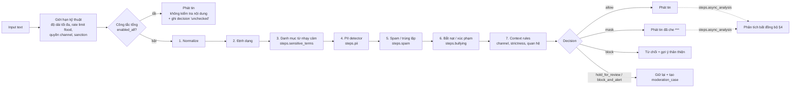
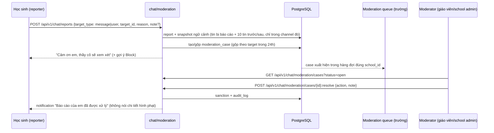
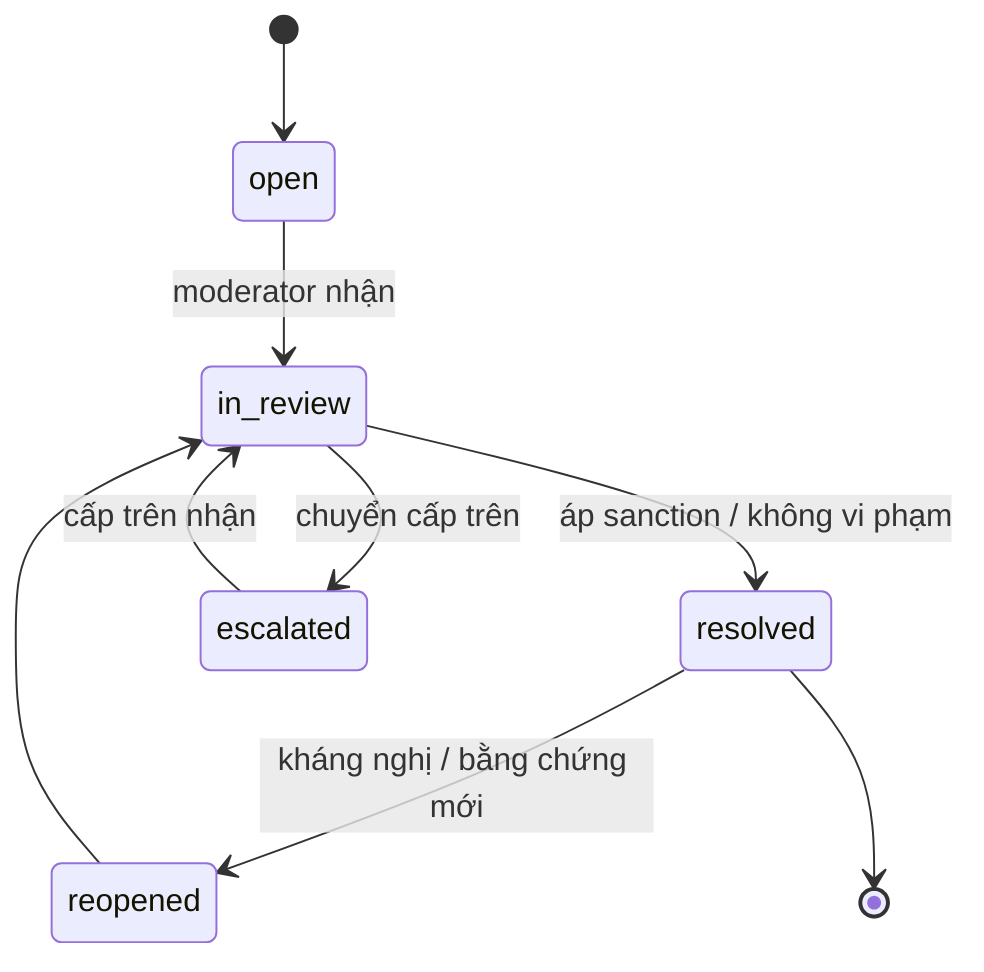

# Moderation — Kiểm duyệt & an toàn giao tiếp

> Trạng thái: Draft · Phiên bản: 0.2 · Owner: Identity & Security Engineer + EdTech Specialist · Cập nhật: 2026-11-15
> Liên quan: [ADR-0020](../adr/ADR-0020-chat-thong-nhat-cho-moi-lop-moi-tin-nhan-phai-qua-kiem-tra-h.md) · [ADR-0030](../adr/ADR-0030-chinh-sach-tu-nhay-cam-trong-chat-danh-muc-quan-ly-duoc-va-c.md) · [CHAT_SYSTEM](CHAT_SYSTEM.md) · [CHILD_SAFETY](../10-security/CHILD_SAFETY.md) · [CHILD_PROTECTION](../10-security/CHILD_SAFETY.md) · [DATA_PRIVACY](../10-security/DATA_PRIVACY.md) · [OPEN_QUESTIONS OQ-09, OQ-12](../12-project/OPEN_QUESTIONS.md)

## 0. Mục đích & phạm vi

Tài liệu **sở hữu** kiểm duyệt giao tiếp: pipeline kiểm tra nội dung (đồng bộ và bất đồng bộ), danh mục từ nhạy cảm, công tắc kiểm duyệt, report flow, moderation queue, sanction, teacher controls về an toàn. Kênh chat và UX chat thuộc [CHAT_SYSTEM](CHAT_SYSTEM.md); quan hệ block/mute thuộc [SOCIAL_SYSTEM](SOCIAL_SYSTEM.md); chính sách an toàn trẻ em tổng thể thuộc [CHILD_SAFETY](../10-security/CHILD_SAFETY.md). Chạy trong **chat-service**.

## 1. Yêu cầu nguồn [Confirmed]

Content Filtering, Profanity Filtering, Anti-spam, Anti-bullying, Personal Information Detection, Report Message, Report User, Block, Mute, Moderation Queue, Moderation Audit, School-level Chat Policy, Age/Grade-based Policy, Teacher/Admin Moderation. Không để một người có quyền truy cập toàn bộ chat của tất cả trường. Không dùng giám sát chat làm lý do thu thập dữ liệu vượt mục đích.

> **Thay đổi theo stakeholder (ADR-0020, Accepted 2026-11-15):** mục "Age/Grade-based Policy" được thay bằng **một bộ quy tắc chat chung cho mọi lớp 1–9**. An toàn cho học sinh nhỏ tuổi được bảo đảm bằng việc **mọi tin nhắn phải qua kiểm tra hợp lệ** với cùng mức nghiêm, không bằng cách phân quyền chat theo khối.

> **ADR-0030 (Accepted 2026-11-15):** từ nhạy cảm được quản lý bằng **danh mục** trong CMS (§11). Toàn bộ pipeline kiểm tra nội dung có **công tắc bật/tắt** theo từng bước hoặc công tắc tổng, ở cấp platform hoặc tenant (§12). Mặc định **BẬT**. Khi tắt, chỉ còn các giới hạn kỹ thuật và tính năng người dùng (§12.3).

## 2. Phạm vi áp dụng

Pipeline kiểm duyệt áp dụng cho **mọi văn bản do học sinh nhập**: tin nhắn chat (mọi `kind`, kể cả tham số của quick message), tên party, tên đội, tên study group, nickname tự đặt (nếu cho phép), nội dung báo cáo (chỉ chuẩn hóa, không chặn). Nickname mặc định chọn từ danh sách sinh sẵn nên không cần lọc.

### 2.1. Sửa, forward, quote, sticker/GIF (ADR-0034)

| Thao tác | Kiểm duyệt |
|---|---|
| **Sửa tin** | Nội dung mới chạy lại **toàn bộ pipeline** (theo công tắc). `block` → giữ bản cũ; `hold_for_review` → bản mới chờ duyệt, người khác vẫn thấy bản cũ. Mọi bản cũ lưu `chat.message_revisions` làm bằng chứng |
| **Forward** | Tin forward là nội dung mới ở channel đích: chạy lại pipeline với **policy và công tắc của channel/tenant đích**. Không forward tin đã thu hồi, bị che, bị gỡ, đang held |
| **Quote** | Đoạn trích do server cắt từ `body_display` (đã che), không nhận nội dung trích từ client |
| **Mention** | Kiểm tra spam mention (≤ 5/tin) + mention lặp lại một người nhiều lần trong thời gian ngắn là tín hiệu bắt nạt cho `async_analysis` |
| **Sticker / GIF** | Đã duyệt trước ở thư viện platform nên không qua bước văn bản; vẫn chịu rate limit và spam (lặp sticker) |
| **Thu hồi** | Không xóa bằng chứng: nội dung gốc giữ đến hết retention channel (gameplay: đến purge ADR-0033), moderator xem trong case |

## 3. Pipeline đồng bộ (pre-send) — ADR-0020

- Bước 3–6 và phân tích bất đồng bộ là **bước có thể tắt** (`steps.*`, §12). Bước tắt được bỏ qua (coi như `allow`). Bước 1–2 (normalize, định dạng) chỉ chạy khi còn ít nhất một bước nội dung bật.
- Giới hạn kỹ thuật ở đầu pipeline **luôn chạy**, kể cả khi công tắc tổng tắt.
- Ngân sách độ trễ: mục tiêu **p95 < 20 ms**, trần **50 ms** theo ADR-0030, cho toàn pipeline (chạy in-process trong **chat-service** (handler lệnh NATS và REST), danh mục biên dịch sẵn trong bộ nhớ, reload theo §11.6) **[Proposed]**.

### 3.1. Bước 1 — Normalize (tiếng Việt)

Tạo nhiều "góc nhìn" của cùng văn bản để so khớp:

| Biến đổi | Ví dụ |
|---|---|
| Unicode NFC → lowercase | `ĐỒ` → `đồ` |
| Bỏ dấu (`vi_fold`) | `đồ ngốc` → `do ngoc` |
| Teencode map (bảng cấu hình CMS) | `k`→`không`, `ko`/`hok`→`không`, `dc`/`đc`→`được`, `j`→`gì`, `ng`→`người`, `vl`… |
| Leetspeak / ký tự thay thế | `0`→`o`, `1`→`i`/`l`, `3`→`e`, `4`→`a`, `@`→`a`, `$`→`s` |
| Ký tự lặp | `ngooooc` → `ngoc` (giảm ≥3 ký tự lặp về 1–2) |
| Bỏ ký tự chèn giữa | `n.g.u`, `n g u`, `n_g_u` → `ngu` (gộp chuỗi ký tự đơn cách nhau bởi dấu/khoảng trắng) |
| Telex/VNI chưa gõ xong | `ddoof` → `đồ` (map Telex), `d9o62` (VNI) [Proposed] |
| Homoglyph | Chữ Cyrillic/Greek giống Latin → Latin |

### 3.2. Bước 3 — Danh mục từ nhạy cảm (`steps.sensitive_terms`)

- So khớp văn bản đã normalize với **danh mục từ nhạy cảm hiệu lực** của tenant (danh mục platform + mục bổ sung của tenant, trừ category đang tắt). Data model, phạm vi và engine ở **§11**.
- Hành động lấy từ mục từ (nếu có ghi đè) hoặc từ category theo `severity`: `low → mask`, `medium → block`, `high → hold_for_review`, `critical → block_and_alert` (ADR-0030).
- Category có `severity = watch` [Proposed] (từ nhạy cảm theo ngữ cảnh: "chết", "đánh") → `allow` + tăng điểm rủi ro cho phân tích async.
- `validation.strictness` của channel có thể nâng hành động lên một mức (vd. `very_strict`: `mask → block`). Không có điều kiện theo lớp.
- So khớp trên cả bản có dấu và không dấu, theo **ranh giới từ** (tránh false positive kiểu "ngủ" bị bắt vì "ngu": chỉ áp bản không dấu khi văn bản gốc **không có dấu**) **[Proposed]**. Allowlist (§11.3) loại các cụm hợp lệ trước khi so khớp.
- Khi chặn/che, phản hồi cho client chỉ có `category_code` và thông điệp thân thiện, **không** trả từ đã khớp hay vị trí.

### 3.3. Bước 4 — PII detector (`steps.pii`)

| Loại | Quy tắc phát hiện (ví dụ) | Hành động mặc định |
|---|---|---|
| Số điện thoại VN | Chuỗi chữ số sau normalize (kể cả viết bằng chữ "không chín một…", tách bằng dấu/khoảng trắng) khớp `(\+?84|0)(3|5|7|8|9)\d{8}`; ≥ 9 chữ số liên tiếp | block |
| Email | `[\w.+-]+@[\w-]+\.[\w.]+`, biến thể "a còng", "chấm com" | block |
| URL / domain | `http`, `www`, `.com/.vn/.net`, "chấm vn", rút gọn link | block (trừ domain allowlist EduWorld) |
| Mạng xã hội / app | `fb`, `facebook`, `zalo`, `tiktok`, `insta`, `discord`, `@handle`, "kết bạn zalo" | block |
| Địa chỉ | Mẫu "số nhà", "đường", "phường", "quận", "hẻm", "ngõ" + số | hold_for_review |
| Mã định danh | CCCD 12 số, số tài khoản ngân hàng | block |
| Hẹn gặp ngoài đời | "gặp ở", "nhà mình ở", "mấy giờ ra" + địa điểm | hold_for_review + điểm rủi ro grooming |
| Tên trường/lớp thật kèm tên người | NER đơn giản dựa danh sách trường trong org | mask |

Thông điệp trả về cho học sinh thân thiện và mang tính giáo dục, vd: *"Để an toàn, EduWorld không cho chia sẻ số điện thoại hay mạng xã hội trong game nhé!"* — không lặp lại nội dung vi phạm **[Proposed]**.

### 3.4. Bước 5 — Anti-spam & trùng lặp (`steps.spam`)

Rate limit theo policy (`messages_per_minute` + burst, CHAT_SYSTEM §3) là **giới hạn kỹ thuật, luôn chạy** ở đầu pipeline và không thuộc bước `spam`. Bước `spam` gồm các kiểm tra nội dung sau:

| Quy tắc | Ngưỡng [Proposed] | Hành động |
|---|---|---|
| Rate theo policy (luôn chạy, không tắt được) | `messages_per_minute` + burst | `CHAT_RATE_LIMITED` |
| Lặp tin giống nhau | ≥ 3 tin giống (similarity ≥ 0.9) trong 60 s | block tin lặp |
| Viết hoa / ký tự lặp / emoji spam | > 70% chữ hoa, > 10 emoji liên tiếp | mask/giảm |
| Gửi cùng nội dung tới nhiều channel | ≥ 4 channel trong 2 phút | block + tăng điểm spam |
| Vi phạm liên tiếp | 3 lần block trong 10 phút | auto-mute 10 phút (sanction tự động `mute`) |
| Mời/kết bạn hàng loạt | xem PARTY_SYSTEM §10 | |

### 3.5. Bước 6–7 — Bắt nạt (`steps.bullying`) và context rules

Bước `bullying` dùng rule (cụm xúc phạm nhắm vào người, mention + từ `medium` trở lên) và classifier [TBD] để chấm điểm tin đơn lẻ; tắt bước này thì bỏ chấm điểm đồng bộ. Context rules luôn chạy khi còn bước nội dung bật:

Kết hợp loại channel, `validation.strictness` của effective policy (trường/lớp có thể nâng), giờ, quan hệ (bạn bè/không), cross-school để chọn mức xử lý. **Không** dùng lớp/khối của người gửi hay người nhận làm điều kiện: cùng một tin ở cùng channel và cùng policy cho cùng quyết định với mọi học sinh.

## 4. Phân tích bất đồng bộ (anti-bullying) — `steps.async_analysis`

Tắt bước này thì worker bỏ qua tin của tenant đó (vẫn xử lý report thủ công). Khi bật, worker tiêu thụ `chat.message.created` và tính **điểm rủi ro theo cặp/nhóm** trong cửa sổ trượt (Valkey, TTL 24 h). **Ngưỡng** cho từng tín hiệu rủi ro trẻ em (bắt nạt, hội đồng, loại trừ, số report) do [CHILD_SAFETY §8](../10-security/CHILD_SAFETY.md) sở hữu; bảng dưới chỉ mô tả loại tín hiệu:

| Tín hiệu | Ví dụ |
|---|---|
| Nhắm mục tiêu lặp lại | Nhiều tin mức `low`/`watch` hướng tới cùng một người (mention, reply) |
| Loại trừ | Nhiều member kick/ignore một người lặp lại (kết hợp event party) |
| Dồn dập | Nhiều người cùng gửi tin tiêu cực tới một người trong thời gian ngắn |
| Grooming pattern | Hỏi tuổi, địa chỉ, yêu cầu giữ bí mật, rủ chuyển nền tảng khác |
| Báo cáo trước đó | Người gửi có report được xác nhận |

Vượt ngưỡng → tạo `moderation_case` mức ưu tiên tương ứng, **không** tự động trừng phạt nặng; chỉ auto-mute ngắn với tín hiệu rõ ràng **[Proposed]**. Mô hình ML/LLM phân loại có thể bổ sung sau, chỉ khi xử lý trong hạ tầng đáp ứng OQ-12 và có ADR **[TBD]**.

## 5. Report flow

- `reason` (enum, chọn bằng icon cho lớp 1–5): `rude_language`, `bullying`, `asked_personal_info`, `spam`, `inappropriate_content`, `cheating`, `other`.
- Báo cáo `asked_personal_info` hoặc dấu hiệu grooming → **ưu tiên cao**, đồng thời thông báo school admin **[Proposed]**.
- Lạm dụng báo cáo (nhiều báo cáo bị bác bỏ) → giảm trọng số, không phạt trẻ (chỉ nhắc nhở) **[Proposed]**.
- **Report từ trong trận/party:** chat gameplay luôn có (ADR-0020 mục 6), nên mỗi tin trong panel chat trận/party có menu nhanh **Tắt tiếng / Chặn / Báo cáo**; màn hình kết quả trận và lịch sử party có nút "Báo cáo người chơi". Report gắn `match_id`/`party_id` làm ngữ cảnh.
- **Cửa sổ report cho chat gameplay:** học sinh báo cáo được tin trong trận/party cho đến khi channel bị purge, tức **ít nhất 3 ngày** sau khi trận kết thúc/party giải tán (`gameplay_chat_retention_days` ≥ 3, mặc định 7 — ADR-0033). Snapshot ngữ cảnh được chụp ngay lúc tạo report nên không bị mất khi purge.

## 6. Moderation queue & quyền moderator

### 6.1. Vai trò và phạm vi

| Vai trò | Phạm vi được xem | Hành động |
|---|---|---|
| Giáo viên | Case liên quan **lớp mình chủ nhiệm/dạy** (người bị báo cáo hoặc channel thuộc lớp) | warn, mute ≤ 24 h, xóa tin trong channel lớp, escalate |
| School Admin / School Moderator (role gán theo trường) | Mọi case có `school_id` của trường mình | Mọi sanction trong trường, chỉnh school chat policy |
| Tenant moderator (tenant `unit`) [Proposed] | Case **đã escalate** liên trường trong tổ chức | Như school admin cho case liên trường |
| Platform Trust & Safety | Chỉ case **escalate lên platform** hoặc vi phạm pháp luật nghiêm trọng; truy cập qua quy trình "break-glass" có lý do, thời hạn, phê duyệt hai người | Khóa tài khoản toàn hệ thống, phối hợp pháp lý |

- **Không vai trò nào** có API duyệt/tìm kiếm tự do toàn bộ tin nhắn của mọi trường **[Confirmed]**. Moderator chỉ xem tin **trong ngữ cảnh một case** (snapshot), không duyệt lịch sử chat tùy ý; giáo viên xem channel lớp mình là quyền member thông thường.
- Case liên trường (vd. tin ở world/area hoặc trận liên trường): tạo **hai case con** cho mỗi trường, mỗi bên chỉ thấy thông tin học sinh của trường mình + nội dung tin liên quan **[Proposed]**.
- Mọi truy cập nội dung case ghi `audit` (`moderation.case.viewed`).
- **Tin đã thu hồi / đã sửa trong case:** snapshot case gồm nội dung gốc và mọi revision (người dùng thường chỉ thấy placeholder/bản mới). Báo cáo một tin đã thu hồi trong cửa sổ báo cáo vẫn tạo case bình thường; job purge giữ bằng chứng theo §10.
- **Tìm kiếm của moderator:** chỉ trong phạm vi case được gán (`GET /api/v1/chat/moderation/cases/{case_id}/search?q=` trên snapshot và ±200 tin ngữ cảnh của channel liên quan), không có endpoint tìm toàn bộ chat; mỗi lượt tìm ghi audit `moderation.case.searched`.

### 6.2. Trạng thái case

Ưu tiên: `p1` (an toàn: grooming, đe dọa, tự hại), `p2` (bắt nạt, PII), `p3` (ngôn ngữ thô, spam).

### 6.3. SLA xử lý [Proposed]

| Ưu tiên | Phản hồi đầu tiên | Xử lý xong | Escalate tự động nếu quá hạn |
|---|---|---|---|
| p1 | 1 giờ (trong giờ học) — tự động `hold` người bị báo cáo khỏi chat ngay khi tạo case | 24 giờ | School admin → tenant moderator / System Admin |
| p2 | 1 ngày học | 3 ngày học | Giáo viên → school admin |
| p3 | 3 ngày học | 7 ngày học | — |

Nội dung liên quan tự hại/xâm hại: hiển thị hướng dẫn hỗ trợ (đường dây nóng bảo vệ trẻ em 111) cho moderator và quy trình thông báo nhà trường/phụ huynh theo [CHILD_PROTECTION](../10-security/CHILD_SAFETY.md) **[Proposed]**.

## 7. Sanctions

| `sanction_type` | Hiệu lực | Ai áp | Mặc định thời hạn |
|---|---|---|---|
| `warning` | Thông báo nhắc nhở thân thiện | Hệ thống, giáo viên | — |
| `mute` | Không gửi text/quick ở channel (hoặc mọi channel) | Hệ thống (auto), giáo viên, admin | 10 phút (auto), ≤ 24 h (giáo viên), tùy chỉnh (admin) |
| `restrict_text` | Chỉ quick message | Giáo viên, admin | 7 ngày |
| `restrict_dm` | Tắt DM | Admin | 30 ngày |
| `restrict_multiplayer` | Không vào party/hub chung (chỉ học cá nhân) | Admin | 7 ngày |
| `restrict_competition` | Không thi đấu ranked/giải | Admin | theo vụ |
| `account_lock` | Khóa tài khoản (phối hợp Keycloak + `user.status=locked`) | School admin, platform | theo vụ |

- Sanction lưu `chat.sanctions` (`user_id`, `school_id`, `type`, `scope`, `reason`, `case_id`, `issued_by`, `starts_at`, `ends_at`, `revoked_at`); cache Valkey để pipeline kiểm tra nhanh.
- Học sinh luôn thấy **lý do bằng ngôn ngữ phù hợp lứa tuổi** và thời hạn; phụ huynh/giáo viên chủ nhiệm được thông báo với sanction ≥ `restrict_multiplayer` **[Proposed]**.
- Tinh thần giáo dục: ưu tiên `warning`, nhắc nhở, hướng dẫn ứng xử số; không công khai hình phạt.

## 8. Teacher controls

Giáo viên (trong LMS và trong game khi ở channel lớp):
- Bật/tắt channel lớp, chế độ "chỉ giáo viên đăng", giờ cho phép chat.
- Xóa tin trong channel lớp, mute học sinh ≤ 24 h, ghim thông báo.
- Xem báo cáo của học sinh lớp mình; escalate lên school admin.
- Đặt chính sách chặt hơn cho lớp (không thể nới hơn trường).

## 9. Audit

Ghi `audit.audit_logs` cho: thay đổi `chat_policy` (before/after), mọi thay đổi danh mục từ nhạy cảm (category/term/allowlist, kèm `catalog_version`), **mọi lần bật/tắt công tắc kiểm duyệt** (cấp, tenant, bước, lý do, `expires_at`, actor), xem nội dung danh mục, thay đổi teencode map, mọi sanction (áp/thu hồi), xem nội dung case, escalate, break-glass access, xóa tin bởi moderator. Audit log **không** sao chép nội dung tin nhắn — chỉ tham chiếu `message_id`/`case_id`. Retention audit: theo [DATA_PRIVACY](../10-security/DATA_PRIVACY.md) (đề xuất 2 năm) **[Proposed]**.

## 10. Data minimization & retention

- Bộ lọc xử lý in-memory; tin bị `block` **không lưu nội dung gốc** nếu chứa PII — chỉ lưu bản đã che + nhãn vi phạm (đủ để thống kê, xử lý tái phạm) **[Proposed]**.
- Điểm rủi ro trong Valkey hết hạn sau 24 h; chỉ lưu bền vững khi thành `moderation_case`.
- Snapshot ngữ cảnh của case giữ đến khi case đóng + 1 năm (OQ-12) **[TBD]**.
- **Giữ bằng chứng trước khi purge chat gameplay (ADR-0033):** trước mỗi lần chạy `gameplay-chat-purge`, mọi tin trong channel `match`/`team` theo trận/`party`/World/Area đang được tham chiếu bởi report, moderation case (mọi trạng thái chưa hết hạn lưu giữ) hoặc sanction được **sao chép** sang `chat.moderation_evidence` (nội dung, người gửi, thời điểm, `channel_type`, `match_id`/`party_id`, `catalog_version`). Bằng chứng theo thời hạn lưu của moderation, không theo hạn purge của channel.
- Channel còn report chưa phân loại hoặc case `open`/`in_review`/`escalated`/`reopened` → **hoãn purge** đến khi case đóng; job ghi lý do hoãn.
- Moderator mở case sau khi channel đã bị purge chỉ thấy bằng chứng đã lưu, không truy cập được phần còn lại của cuộc trò chuyện.
- Không dùng dữ liệu chat để quảng cáo, hồ sơ hành vi ngoài mục đích an toàn **[Confirmed]**.

## 11. Danh mục từ nhạy cảm (ADR-0030)

### 11.1. Data model

| Entity | Thuộc tính chính | Ghi chú |
|---|---|---|
| **SensitiveTermCategory** | `category_id`, `tenant_id` (NULL = platform), `code` (`profanity`, `insult`, `violence`, `sexual`, `drugs`, `self_harm`, `grooming_scam`, `politics_religion`, `pii_pattern`…), `name`, `description`, `severity` (`watch` [Proposed] / `low` / `medium` / `high` / `critical`), `default_action`, `enabled`, `allow_tenant_toggle`, `deleted_at` | Category platform do System Admin tạo. Tenant không tạo category mới, chỉ thêm term vào category có sẵn [Proposed] |
| **SensitiveTerm** | `term_id`, `category_id`, `tenant_id` (NULL = platform), `term`, `match_type` (`word` / `phrase` / `contains` / `pattern`), `locale` (`vi` / `en`), `variants[]` (khai báo thêm), `severity_override?`, `action_override?`, `enabled`, `note`, `created_by`, `deleted_at` | `pattern` là RE2, tối đa 200 ký tự, cấm backreference/lookaround |
| **SensitiveAllowlistEntry** | `entry_id`, `tenant_id?`, `phrase`, `locale`, `reason`, `deleted_at` | Cụm hợp lệ chứa chuỗi trùng (địa danh, thuật ngữ khoa học, từ ghép) |
| **SensitiveCatalogVersion** | `catalog_version` (tăng đơn điệu theo phạm vi platform/tenant), `scope`, `tenant_id?`, `published_at`, `published_by`, `change_summary`, `term_count`, `checksum` | Mỗi lần publish thay đổi tạo version mới. Decision log ghi version đã dùng |

Biến thể **tự sinh** khi biên dịch: bản không dấu (`vi_fold`), teencode ngược (dùng bảng teencode CMS), leetspeak, chèn ký tự phân tách (`n.g.u`), ký tự lặp. Biến thể khai báo thêm (`variants[]`) cho các cách viết lóng không suy ra được.

### 11.2. Hành động theo mức độ

| Severity | Action mặc định | Hành vi | Phản hồi cho người gửi |
|---|---|---|---|
| `watch` [Proposed] | `allow` | Gửi bình thường, cộng điểm rủi ro async | — |
| `low` | `mask` | Thay đoạn khớp bằng `***`, tin vẫn gửi | Nhắc nhẹ: "Một vài từ đã được ẩn để giữ lịch sự nhé" |
| `medium` | `block` | Không gửi, không lưu nội dung | "Tin nhắn có từ chưa phù hợp, em thử viết lại nhé" |
| `high` | `hold_for_review` | Không gửi, tạo `moderation_case` p2 | "Tin nhắn đang chờ thầy cô xem" |
| `critical` | `block_and_alert` | Không gửi, tạo case p1, báo moderator của tenant ngay | Thông điệp hỗ trợ (đường dây nóng 111 nếu category `self_harm`) |

Không bao giờ trả về từ đã khớp, vị trí khớp hay nội dung danh mục; client chỉ nhận `category_code` và mã lỗi `CHAT_CONTENT_BLOCKED` / `CHAT_CONTENT_HELD`.

### 11.3. Phạm vi platform và tenant

| Phạm vi | Ai quản lý | Workspace (Admin Portal, ADR-0027) | Quyền |
|---|---|---|---|
| Danh mục platform (category, term, allowlist) | System Admin | D. Platform Administration → "An toàn chat → Danh mục từ nhạy cảm" | `chat.sensitive_terms.read`, `chat.sensitive_terms.write` (platform-only) |
| Mục từ bổ sung của tenant | Tenant Admin, tenant moderator | C. School & Learning Management → "An toàn & Kiểm duyệt → Từ bổ sung" | `chat.tenant_terms.write` (+ `chat.sensitive_terms.read` giới hạn trong tenant) |
| Bật/tắt category cho tenant | Tenant Admin, **chỉ khi** category có `allow_tenant_toggle = true` | C. School & Learning Management → "An toàn & Kiểm duyệt → Nhóm từ" | `chat.tenant_category.toggle` |
| Công tắc kiểm duyệt (tổng / từng bước) | Chỉ System Admin | D. Platform Administration → "An toàn chat → Công tắc kiểm duyệt" | `chat.policy.toggle` (platform-only) |

- Tenant chỉ **thêm** term (siết chặt) và không sửa/xóa term platform. Danh mục hiệu lực của tenant = term platform đang bật + term của tenant, trừ category tenant đã tắt (khi được phép).
- Danh mục platform tự áp dụng cho mọi tenant; không cần gán theo ADR-0029. System Admin có thể **clone** bộ term bổ sung của một tenant sang tenant khác (ADR-0029).
- Nội dung danh mục là dữ liệu nhạy cảm: chỉ người có `chat.sensitive_terms.read` mới xem được; danh mục **không** gửi xuống client game, không xuất trong log.

### 11.4. Quy trình chỉnh sửa

1. Thêm/sửa term ở trạng thái nháp (theo phạm vi).
2. Chạy **thử chuỗi** (`POST .../sensitive-terms:test`): nhập câu mẫu → xem category/action sẽ áp dụng (chỉ người có quyền xem danh mục).
3. **Test hồi quy tự động**: bộ ≥ 2.000 câu mẫu gán nhãn (có dấu/không dấu/teencode) + tập hội thoại học tập bình thường. Publish bị chặn nếu recall < 95% với `high`/`critical` + PII hoặc false positive > 3% (ADR-0030) **[Proposed]**.
4. Danh mục platform: một System Admin khác duyệt (four-eyes) trước khi publish [Proposed]. Danh mục tenant: Tenant Admin publish.
5. Publish → tạo `catalog_version` mới → event `sensitive_term.updated` → engine reload (§11.6).
6. Xóa term = soft-delete (ADR-0028), có hiệu lực ở version kế tiếp.

### 11.5. Engine

- Biên dịch danh mục hiệu lực thành: **Aho–Corasick** cho `word`/`phrase`/`contains` trên mọi "góc nhìn" đã normalize (§3.1), và **RE2** cho `pattern` (timeout 5 ms/pattern, tối đa 200 pattern/tenant [Proposed]).
- `word` kiểm tra ranh giới từ sau khi khớp; allowlist được loại trừ trước (đánh dấu span hợp lệ).
- Kết quả: danh sách `(category_code, severity, action, span)`; lấy action nặng nhất; `mask` chỉ che các span khớp.

### 11.6. Reload không downtime

- Bản biên dịch lưu trong bộ nhớ mỗi instance **chat-service**, khóa theo `(tenant_id, catalog_version_platform, catalog_version_tenant)`; cache bản tuần tự hóa trong Valkey `ew:chat:sensitive:compiled:<scope>:<version>` để node mới khởi động nhanh.
- Publish → worker phát Valkey pub/sub `ew:chat:sensitive:version` `{scope, tenant_id?, version}` → node biên dịch bản mới ở nền rồi **hoán đổi con trỏ nguyên tử**; tin đang xử lý dùng bản cũ. Mục tiêu hiệu lực ≤ 60 s.
- Node mất pub/sub: đối chiếu version định kỳ mỗi 60 s.

## 12. Công tắc kiểm duyệt (moderation switches) — ADR-0030

### 12.1. Cấp và bước

- **Cấp:** `platform` (mặc định toàn hệ thống) và `tenant`. Ngoài ra Tenant Admin bật/tắt **từng category** của tenant khi được phép (§11.3).
- **Bước:** `sensitive_terms`, `pii`, `spam`, `bullying`, `async_analysis`, và **công tắc tổng** `enabled_all`.
- **Hiệu lực:** `effective(step) = platform.enabled_all ∧ platform.steps[step] ∧ tenant.enabled_all ∧ tenant.steps[step]` (tenant chưa cấu hình = kế thừa platform). Cấp trên tắt thì cấp dưới không bật lại được.
- **Mặc định:** mọi bước **BẬT**.

### 12.2. Quy tắc thao tác

| Quy tắc | Chi tiết |
|---|---|
| Người thao tác | Chỉ System Admin (`chat.policy.toggle`, Admin Portal `eduworld-portal` + MFA, workspace Platform Administration) |
| Lý do | Bắt buộc (`reason` ≥ 10 ký tự), thiếu → `MODERATION_SWITCH_REASON_REQUIRED` |
| Thời hạn | `expires_at` tùy chọn; worker tự bật lại khi hết hạn và ghi audit [Proposed] |
| Audit | Ghi before/after, cấp, tenant, bước, lý do, `expires_at`, actor; event `chat_policy.moderation_switch_changed` |
| Cảnh báo | CMS hiển thị banner **"Đang tắt kiểm duyệt"** (bước nào, đến khi nào) cho System Admin ở mọi màn hình của tenant đó và cho Tenant Admin/moderator của tenant; metric `eduworld_chat_policy_disabled{tenant,step}` = 1 và alert cho vận hành |
| Hiệu lực | Cache Valkey `ew:chat:switches:<tenant_id>`, invalidation qua pub/sub, ≤ 60 s |

### 12.3. Vẫn giữ khi tắt

Độ dài tối đa tin nhắn, rate limit chống flood mức hệ thống, quyền vào channel (membership, quan hệ, policy channel), sanction đang hiệu lực (mute/restrict), block/mute/report của người dùng, moderation thủ công khi có report. Tin gửi khi bước nội dung bị tắt được ghi decision `unchecked` (kèm danh sách bước đã bỏ qua) để truy vết.

### 12.4. Decision log

Mỗi tin ghi metadata quyết định (không lưu nội dung khi `block`): `message_id?`, `tenant_id`, `channel_id`, `decision`, `category_codes[]`, `steps_run[]`, `steps_skipped[]`, `catalog_version_platform`, `catalog_version_tenant`, `switch_snapshot_id`, `latency_ms`. Lưu trong `chat.moderation_decisions` (DATABASE_DESIGN), thời hạn theo DATA_PRIVACY.

### 12.5. Chất lượng & dashboard

- Bộ test hồi quy ở §11.4 chạy trong CI cho mọi thay đổi engine và mỗi lần publish danh mục.
- Dashboard: tỷ lệ block/mask theo category, top category bị khớp (không hiển thị nội dung tin), thời gian xử lý case, case quá SLA, **danh sách tenant đang tắt kiểm duyệt**.

## 13. Acceptance criteria

| ID | Tiêu chí |
|---|---|
| AC-MOD-001 | Các biến thể "0912 345 678", "không chín một hai…", "09.12.34.56.78" đều bị chặn |
| AC-MOD-002 | "ngu", "n.g.u", "nguuuu", "ng u" bị xử lý theo severity của category `insult` (mặc định `medium` → `block`); "ngủ ngon" không bị chặn |
| AC-MOD-003 | "kết bạn zalo mình nhé" bị chặn |
| AC-MOD-004 | Pipeline p95 < 20 ms với tin 200 ký tự trên benchmark CI |
| AC-MOD-005 | Báo cáo tin nhắn của học sinh trường A chỉ xuất hiện trong queue trường A |
| AC-MOD-006 | Giáo viên lớp 5A không xem được case của học sinh lớp 5B (không dạy lớp đó) |
| AC-MOD-007 | Không có endpoint nào cho phép tìm kiếm tin nhắn ngoài ngữ cảnh case/channel là member |
| AC-MOD-008 | 3 tin bị block trong 10 phút → auto-mute 10 phút, có audit |
| AC-MOD-009 | Mọi sanction và lượt xem case có bản ghi audit với actor, thời điểm, lý do |
| AC-MOD-010 | Tenant thêm term bổ sung → có hiệu lực ≤ 60 s, chỉ trong tenant đó |
| AC-MOD-011 | Term `word` khớp cả bản không dấu, teencode, leetspeak và có ký tự chen giữa; cụm trong allowlist không bị khớp |
| AC-MOD-012 | Publish danh mục mới trong khi đang có tải chat → không lỗi, không tăng latency p95 quá 50 ms, tin sau thời điểm hiệu lực dùng version mới |
| AC-MOD-013 | Phản hồi chặn/che không chứa từ đã khớp, vị trí khớp hay nội dung danh mục; client game không tải được danh mục |
| AC-MOD-014 | System Admin tắt `steps.pii` cho tenant X → tin có SĐT ở tenant X được gửi; tenant Y vẫn bị chặn; decision ghi `steps_skipped=[pii]` |
| AC-MOD-015 | Tắt `enabled_all` → tin dài hơn giới hạn vẫn bị từ chối, gửi vượt rate limit vẫn `CHAT_RATE_LIMITED`, người bị mute vẫn không gửi được, report vẫn tạo case |
| AC-MOD-016 | Bật/tắt công tắc không có `reason` → `MODERATION_SWITCH_REASON_REQUIRED`; Tenant Admin gọi API công tắc → `PERMISSION_DENIED` (không route trên gateway public) |
| AC-MOD-017 | Tenant Admin tắt category có `allow_tenant_toggle=false` → `TENANT_TOGGLE_NOT_ALLOWED` |
| AC-MOD-018 | Công tắc có `expires_at` → tự bật lại đúng hạn, có audit, banner CMS biến mất |
| AC-MOD-019 | Mọi lần bật/tắt và mọi thay đổi danh mục có audit với actor, lý do, version |
| AC-MOD-023 | Trong trận 1v1/đội/party, người chơi mute/chặn/báo cáo được một người từ menu tin nhắn ≤ 2 chạm; report có `match_id`/`party_id` |
| AC-MOD-024 | Tin trong trận được báo cáo ngày D+2 (trước purge) → sau khi channel bị purge, moderator vẫn xem được tin đó trong `moderation_evidence` |
| AC-MOD-025 | Channel gameplay có case đang mở không bị purge; case đóng → purge ở lần chạy kế tiếp, bằng chứng còn nguyên |
