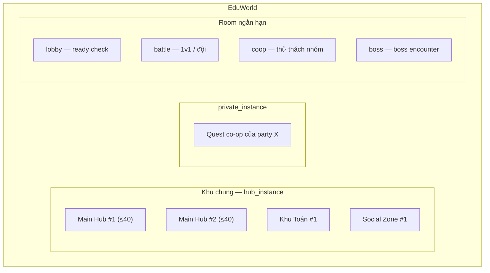
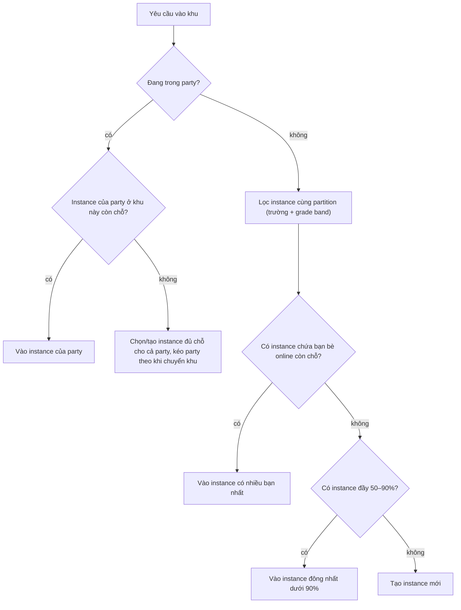

# Multiplayer Gameplay — Chơi cùng nhau trong thế giới

> Trạng thái: Draft · Phiên bản: 0.2 · Owner: Game Director + Multiplayer Engineer · Cập nhật: 2026-11-15
> Liên quan: [ADR-0011](../adr/ADR-0011-realtime-transport-websocket-qua-go-realtime-server.md) · [ADR-0012](../adr/ADR-0012-the-gioi-game-hybrid-hub-instance-private-instance-match-roo.md) · [ADR-0016](../adr/ADR-0016-server-authoritative-scoring-answer-key-khong-bao-gio-roi-se.md) · [ADR-0031](../adr/ADR-0031-game-chi-danh-cho-hoc-sinh-luu-lich-su-dang-nhap-mot-thiet-b.md) · [ADR-0054](../adr/ADR-0054-tuong-tac-xa-hoi-lien-truong-cross-school-social-interaction.md) · [PARTY_SYSTEM](PARTY_SYSTEM.md) · [MATCHMAKING](MATCHMAKING.md) · [SOCIAL_SYSTEM](SOCIAL_SYSTEM.md) · [CHAT_SYSTEM](CHAT_SYSTEM.md) · [WORLD_DESIGN](../01-game-design/WORLD_DESIGN.md) · [CHALLENGE_BOSS_SYSTEM](../01-game-design/CHALLENGE_BOSS_SYSTEM.md) · [REALTIME_ARCHITECTURE](../06-architecture/REALTIME_ARCHITECTURE.md) · [GAME_NETWORKING](../08-game-client/GAME_NETWORKING.md)

## 1. Mục đích & phạm vi

Tài liệu **sở hữu luật multiplayer ở góc gameplay**: người chơi gặp nhau ở đâu, với ai, cùng làm gì, và điều gì xảy ra khi mất kết nối hoặc đổi thiết bị. Gồm: loại không gian chơi chung (room), presence, gán instance, cùng khám phá, co-op, chính sách mất kết nối theo chế độ chơi.

Không thuộc tài liệu này (chỉ link):

| Chủ đề | Tài liệu sở hữu |
|---|---|
| Giao thức WS, owner node, checkpoint, fan-out, tick/snapshot kỹ thuật, capacity | [REALTIME_ARCHITECTURE](../06-architecture/REALTIME_ARCHITECTURE.md), [AsyncAPI](../../specs/asyncapi/eduworld-realtime.v1.yaml) |
| Nội suy, client prediction, reconnect phía Godot | [GAME_NETWORKING](../08-game-client/GAME_NETWORKING.md) |
| Party, Party Lobby, co-op session 9 bước | [PARTY_SYSTEM](PARTY_SYSTEM.md) |
| Ghép trận PvP | [MATCHMAKING](MATCHMAKING.md) |
| Luật thi đấu, rating, giải đấu | [COMPETITION_SYSTEM](../01-game-design/COMPETITION_SYSTEM.md) |
| Luật boss/challenge | [CHALLENGE_BOSS_SYSTEM](../01-game-design/CHALLENGE_BOSS_SYSTEM.md) |

Yêu cầu nguồn **[Confirmed]** (Master Prompt §13.4, §19, Party Addendum): Shared World, Party, Lobby, Room, Match, Session; người chơi gặp nhau, lập nhóm, mời bạn, cùng khám phá, cùng làm quest, thi đấu, học chung; server-authoritative cho chế độ cần công bằng; reconnect, heartbeat, timeout, room lifecycle; không ghép học sinh chênh lệch khối không phù hợp.

## 2. Trải nghiệm mục tiêu

- **Thế giới có người:** vào Main Hub là thấy bạn cùng trường đang đi lại, vẫy tay, rủ nhau vào quest; bạn bè được ưu tiên vào cùng instance.
- **Chơi cùng không ma sát:** từ danh sách bạn bè có "Tham gia bạn" và "Mời vào party"; party đi cùng nhau khi chuyển khu; co-op quest và boss nhóm có vai trò rõ ràng, mỗi người đóng góp phần mình.
- **Công bằng và an toàn không làm chậm trải nghiệm:** kiểm tra phạm vi trường/khối, block và sanction chạy ngầm phía server; học sinh chỉ thấy nickname/avatar của người ngoài trường; chat trong trận và party luôn có ([CHAT_SYSTEM §4.1](CHAT_SYSTEM.md#41-vòng-đời-channel-gameplay-always-on)).
- **Mất mạng không mất công:** tiến độ cá nhân luôn được giữ; quay lại trong thời gian grace là tiếp tục đúng chỗ, kể cả từ thiết bị khác (ADR-0031).

## 3. Nguyên tắc

1. **Server-authoritative** cho mọi trạng thái có giá trị: kết quả, tiến độ quest chung, điểm trận, trạng thái boss (ADR-0016) **[Confirmed]**.
2. **Không phải persistent MMO**: thế giới Hybrid gồm hub instance, private instance và match/boss room (ADR-0012) **[Confirmed]**.
3. **Một kênh WebSocket** tới `realtime`; logic room/party/matchmaking/battle chạy trong **module competition**, boss/challenge PvE chạy trong **module game** (dùng chung `src/backend/pkg/roomhost`) **[Confirmed]**.
4. **An toàn trẻ em trước hết:** chỉ gặp người trong phạm vi policy cho phép (cùng trường mặc định, ADR-0054), không ghép lớp nhỏ với lớp lớn ở không gian chung; hiển thị nickname, không tên thật **[Confirmed]**.
5. Valkey giữ trạng thái tạm (presence, room registry, lobby); PostgreSQL giữ bản ghi bền vững (room tóm tắt, `session_memberships`, party, match, encounter) (ADR-0004) **[Confirmed]**.

## 4. Không gian chơi chung (room)

| `room_type` | Trải nghiệm | Sức chứa | Vòng đời | Module | Nhãn |
|---|---|---|---|---|---|
| `hub_instance` | Bản sao một khu chung (Main Hub, các khu học tập, Arena sảnh, Social Zone, Quest Zone — [WORLD_DESIGN](../01-game-design/WORLD_DESIGN.md)) | 40 (theo `world_area.capacity`) | Tạo khi cần, đóng sau 5 phút rỗng | module competition | [Confirmed] |
| `private_instance` | Khu riêng cho party làm quest/khám phá | = số thành viên party (≤ 8) | Tạo khi party bắt đầu activity, đóng khi activity kết thúc hoặc 10 phút rỗng | module competition | [Confirmed] |
| `lobby` | Phòng chờ trước trận (ready check, chia đội) | Theo mode | 30–120 s | module competition | [Confirmed] |
| `battle` | Knowledge Battle 1v1, Team Battle, Timed Quiz, trận giải | 2–10 | Một trận | module competition | [Confirmed] |
| `coop` | Co-op Challenge, puzzle nhiều người | 2–8 | Một thử thách | module competition | [Confirmed] |
| `boss` | Boss encounter solo hoặc party | 1–8 (theo `party_size` của boss) | Một encounter | module game | [Confirmed] |

- **Chat đi kèm (luôn có):** `lobby`/`battle`/`coop` dùng channel `match` (+ `team` mỗi đội); party dùng channel `party` suốt vòng đời, kể cả trong `private_instance` và `boss` ([CHAT_SYSTEM §4.1](CHAT_SYSTEM.md#41-vòng-đời-channel-gameplay-always-on)).
- **Party Lobby** không phải room riêng: là trạng thái của party ([PARTY_SYSTEM §5](PARTY_SYSTEM.md#5-party-lobby)); khi bắt đầu activity mới sinh `private_instance` / `coop` / `boss` / ticket ghép trận.
- Vòng đời kỹ thuật của room (owner node, checkpoint, failover): [REALTIME_ARCHITECTURE](../06-architecture/REALTIME_ARCHITECTURE.md). Luật gameplay khi owner node chết giữa trận: trận khôi phục từ checkpoint; không có checkpoint hợp lệ → trận `aborted`, không có kết quả, không đổi rating, người chơi được thông báo và không bị tính abandon **[Confirmed]**.

## 5. Presence

| Trạng thái | Ý nghĩa | Ai thấy |
|---|---|---|
| `offline` | Không có kết nối | Bạn bè, thành viên party/club |
| `online` | Ở menu/hub | Bạn bè, party/club |
| `in_activity` | Đang làm bài/quest/mini-game | Bạn bè, party (không lộ nội dung bài) |
| `in_match` | Đang thi đấu hoặc đánh boss | Bạn bè, party |
| `away` | Không có input > 5 phút | Bạn bè, party |

- Năm giá trị trên là **enum presence duy nhất** của hệ thống, dùng chung cho realtime (AsyncAPI), `PlayerCard` và REST; không module hay client nào định nghĩa enum presence khác. Người bật "Ẩn trạng thái" hiển thị là `offline` với người không được thấy.
- Presence chỉ là trạng thái tạm (Valkey, TTL theo heartbeat — [REALTIME_ARCHITECTURE](../06-architecture/REALTIME_ARCHITECTURE.md)), không lưu bền vững; thống kê thời gian chơi lấy từ `game.game_sessions`.
- Học sinh có thể bật **"Ẩn trạng thái"** với bạn bè (không áp dụng với party đang tham gia) **[Confirmed]**.

## 6. Gán instance

Khi người chơi vào một khu (đăng nhập, chuyển khu, "Tham gia bạn"):

- **Partition mặc định:** `(school_id, grade_band)` trong tenant **[Confirmed]**. Trường có thể gộp grade band liền kề (ví dụ `g4_5` + `g6_7`); tenant `unit` có thể mở "liên trường cùng tenant" cho khu/sự kiện (ADR-0054). **Không bao giờ** gộp `g1_3` với `g8_9`.
- Người đã block nhau: tránh đặt cùng instance khi còn lựa chọn (soft constraint); block luôn ẩn chat/emote/lời mời của nhau.
- Chỗ dành cho party giữ 30 s khi leader chuyển khu.
- "Tham gia bạn" ([SOCIAL_SYSTEM §4.2](SOCIAL_SYSTEM.md#42-hành-động-từ-danh-sách-bạn-bè)) đi qua cùng thuật toán: chỉ thành công khi cùng partition và còn chỗ.

## 7. Cùng khám phá và co-op

| Hoạt động | Luật gameplay | Tài liệu chi tiết |
|---|---|---|
| Đi cùng nhau | Party cùng instance; khi leader chuyển khu, thành viên nhận đề nghị "Đi theo trưởng nhóm" (không bắt buộc) | [PARTY_SYSTEM §7](PARTY_SYSTEM.md#7-cooperative-gameplay) |
| Cùng khám phá | Discovery point tìm được bởi một thành viên ở instance party tính cho cả nhóm nếu quest/khu cho phép; mỗi người vẫn có tiến độ khám phá riêng | [PROGRESSION_SYSTEM](../01-game-design/PROGRESSION_SYSTEM.md) |
| Co-op quest | `shared_progress_policy`: bước gameplay chia sẻ, bước học tập mỗi người tự làm | [QUEST_SYSTEM](../01-game-design/QUEST_SYSTEM.md), [PARTY_SYSTEM §7.1](PARTY_SYSTEM.md#71-shared-quest-progress) |
| Puzzle / thử thách nhóm | Room `coop`; mỗi đóng góp là câu trả lời của **một** học sinh, ghi vào attempt của người đó | [COMPETITION_SYSTEM](../01-game-design/COMPETITION_SYSTEM.md) |
| Boss nhóm | Room `boss` (module game); đóng góp cá nhân + tiến độ nhóm; sai không bị phạt hay làm xấu hổ | [CHALLENGE_BOSS_SYSTEM](../01-game-design/CHALLENGE_BOSS_SYSTEM.md) |
| Emote cùng nhau | Emote đồng bộ cho người cùng instance; rate limit 1 emote/2 s | [CHARACTER_SYSTEM](../01-game-design/CHARACTER_SYSTEM.md) |

Bất biến **[Confirmed]**: kết quả học tập (attempt, điểm, mastery) luôn **riêng từng học sinh**; tiến độ nhóm chỉ dùng cho tiến độ game và phần thưởng.

## 8. Đồng bộ trong room (mức gameplay)

| Room | Người chơi thấy gì | Server kiểm tra |
|---|---|---|
| `hub_instance`, `private_instance` | Vị trí, hướng, animation, emote của người khác, mượt nhờ nội suy | Tốc độ tối đa, biên bản đồ; vi phạm → đưa về vị trí hợp lệ |
| `private_instance` (quest) | Trạng thái object tương tác, bước quest chung | Server quyết định trạng thái |
| `battle`, `coop`, `boss` | Câu hỏi, đếm ngược, kết quả từng câu, điểm/thanh máu boss | State machine server; câu hỏi không kèm đáp án (ADR-0016) |
| `lobby` | Danh sách người, ready, đội | Server |

Tần suất, interest grid, envelope: [REALTIME_ARCHITECTURE](../06-architecture/REALTIME_ARCHITECTURE.md), [GAME_NETWORKING](../08-game-client/GAME_NETWORKING.md).

## 9. Mất kết nối, kết nối lại, đổi thiết bị

### 9.1. Luật chung

- Mất kết nối khi WS đóng bất thường hoặc quá timeout heartbeat ([REALTIME_ARCHITECTURE](../06-architecture/REALTIME_ARCHITECTURE.md)). Server giữ **chỗ** của người chơi trong thời gian **grace** theo chế độ (§9.2); client tự kết nối lại và nhận lại trạng thái đầy đủ.
- **Đổi thiết bị (ADR-0031):** đăng nhập ở thiết bị mới khi đang có phiên → xác nhận takeover; thiết bị cũ bị đăng xuất. Nếu đang trong trận/quest co-op/boss/bài kiểm tra, người chơi **tiếp tục từ thiết bị mới** trong thời gian grace của chế độ, giữ nguyên membership room và channel chat.
- Abandon lặp lại (≥ 3 trận/24 h) → hạn chế ranked 15 phút và ghi audit **[Confirmed]** (chọn mức nhẹ hơn cho trẻ em; tài liệu này sở hữu giá trị); không tính các trận hủy do sự cố server.

### 9.2. Grace theo chế độ (tài liệu này sở hữu giá trị)

| Chế độ / room | Grace | Trong lúc mất kết nối | Hết grace | Nhãn |
|---|---|---|---|---|
| `hub_instance` | 30 s | Avatar đứng yên, mờ | Rời instance; quay lại → ưu tiên instance cũ | [Confirmed] |
| `private_instance` (quest co-op) | 120 s | Thành viên khác tiếp tục theo quy tắc disconnect của [QUEST_SYSTEM §6](../01-game-design/QUEST_SYSTEM.md#6-party--shared-progress) (`party_mode ≠ party_required` hoặc số người còn lại ≥ `party_size.min`) | Rời activity; tiến độ cá nhân giữ nguyên, vào lại được khi activity còn mở | [Confirmed] |
| `boss` | 120 s (`reconnect_grace_seconds` của boss version, mặc định `boss_reconnect_grace`) | Encounter tiếp tục nếu số người còn lại ≥ `party_size.min`; người chưa Ready trong grace kể từ khi tạo encounter coi là vắng (F103) | Rời encounter; đóng góp đã có được giữ; dưới `party_size.min` → encounter `abandoned`, không thưởng | [Confirmed] |
| `lobby` (ready check) | 10 s | — | Coi như `not_ready`, proposal hủy, người còn lại quay lại hàng chờ với ưu tiên | [Confirmed] |
| `battle_1v1` | 30 s | Câu hiện tại chạy tiếp; không trả lời = sai | Thua do `abandon`, tính rating, đối thủ thắng | [Confirmed] |
| `team_battle` | 45 s | Đội tiếp tục thiếu người | Thành viên ghi `abandon`; đội vẫn tính kết quả | [Confirmed] |
| `timed_quiz` | Tới hết giờ quiz | Đồng hồ server chạy tiếp | Nộp tự động các câu đã trả lời | [Confirmed] |
| Trận giải đấu | 60 s, tối đa 2 lần/trận | Như battle | Thua do `forfeit` ([COMPETITION_SYSTEM](../01-game-design/COMPETITION_SYSTEM.md)) | [Confirmed] |
| Party Lobby / leader | 60 s cho leader | [PARTY_SYSTEM §9](PARTY_SYSTEM.md#9-leader-disconnect--member-disconnect) | Tự chuyển leader | [Confirmed] |

## 10. Session membership

`session_memberships` ghi ai ở room nào, khi nào, để điều tra báo cáo hành vi và thống kê co-op: `room_id`, `room_type`, `tenant_id`, `school_id`, `student_id`, `game_session_id`, `party_id?`, `match_id?`, `encounter_id?`, `joined_at`, `left_at`, `leave_reason` (`left`, `disconnected`, `kicked`, `timeout`, `room_closed`, `transferred`, `replaced_by_other_device`). Ghi cho `private_instance`, `lobby`, `battle`, `coop`, `boss`; hub chỉ ghi khi bật `audit_hub_membership` (mặc định bật cho pilot, giữ 90 ngày) **[Confirmed — Technical Architect 2026-11-16]**.

## 11. Anti-cheat liên quan

- Mọi lệnh WS kiểm tra: người gửi là member room, trạng thái room cho phép, rate limit theo loại lệnh (di chuyển 12/s, emote 1/2 s).
- Vị trí bất thường → sửa về vị trí hợp lệ + đếm vi phạm; vượt ngưỡng → audit + cảnh báo ([ANTI_CHEAT](../10-security/ANTI_CHEAT.md)).
- Snapshot không chứa dữ liệu cá nhân: chỉ id rút gọn theo room, nickname, cấu hình avatar.

## 12. Metrics

`eduworld_rooms_active{room_type}`, `eduworld_room_players{room_type}`, `eduworld_instance_assign_duration_seconds`, `eduworld_reconnect_total{result}`, `eduworld_room_abandon_total{mode}`, `eduworld_join_friend_total{result}`. Metric hạ tầng (kết nối, băng thông snapshot): [REALTIME_ARCHITECTURE](../06-architecture/REALTIME_ARCHITECTURE.md).

## 13. Acceptance criteria

| ID | Tiêu chí |
|---|---|
| AC-MP-001 | Hai học sinh là bạn bè, cùng trường, cùng grade band vào Main Hub được gán cùng instance khi còn chỗ |
| AC-MP-002 | Học sinh lớp 2 và lớp 8 không bao giờ ở cùng `hub_instance` theo cấu hình mặc định |
| AC-MP-003 | Instance đạt 40 người → người thứ 41 được gán instance mới |
| AC-MP-004 | Mất mạng 10 s ở hub → kết nối lại cùng instance, thấy lại người chơi khác trong ≤ 2 s |
| AC-MP-005 | Mất kết nối quá 30 s trong `battle_1v1` → trận kết thúc, đối thủ thắng, kết quả ghi một lần |
| AC-MP-006 | Owner node bị kill khi trận `running` và không có checkpoint → trận `aborted`, không đổi rating, người chơi được thông báo |
| AC-MP-007 | Client gửi vị trí vượt tốc độ tối đa → server điều chỉnh vị trí, ghi nhận vi phạm |
| AC-MP-008 | Người không phải member gửi lệnh vào room → `ROOM_NOT_MEMBER`, room không bị ảnh hưởng |
| AC-MP-009 | Đổi thiết bị giữa boss encounter (takeover) trong 120 s → tiếp tục encounter, đóng góp và chat giữ nguyên |
| AC-MP-010 | "Tham gia bạn" khi bạn đang trong instance riêng của party khác → bị từ chối, không lộ vị trí chi tiết |
| AC-MP-011 | Party 4 người làm co-op quest: bước gameplay do một người hoàn thành tính cho cả nhóm, mỗi người có attempt học tập riêng |
