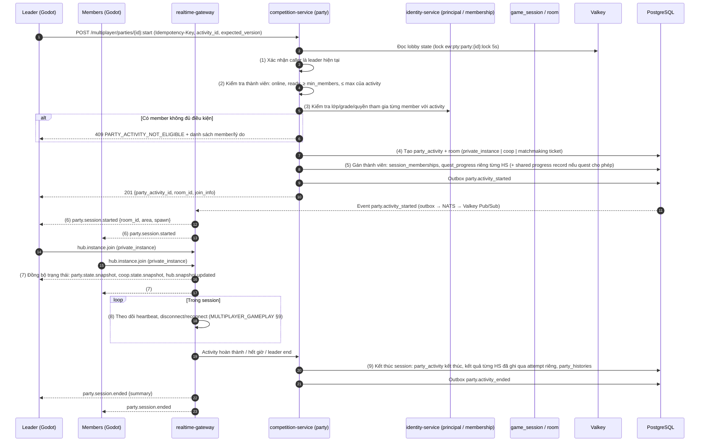
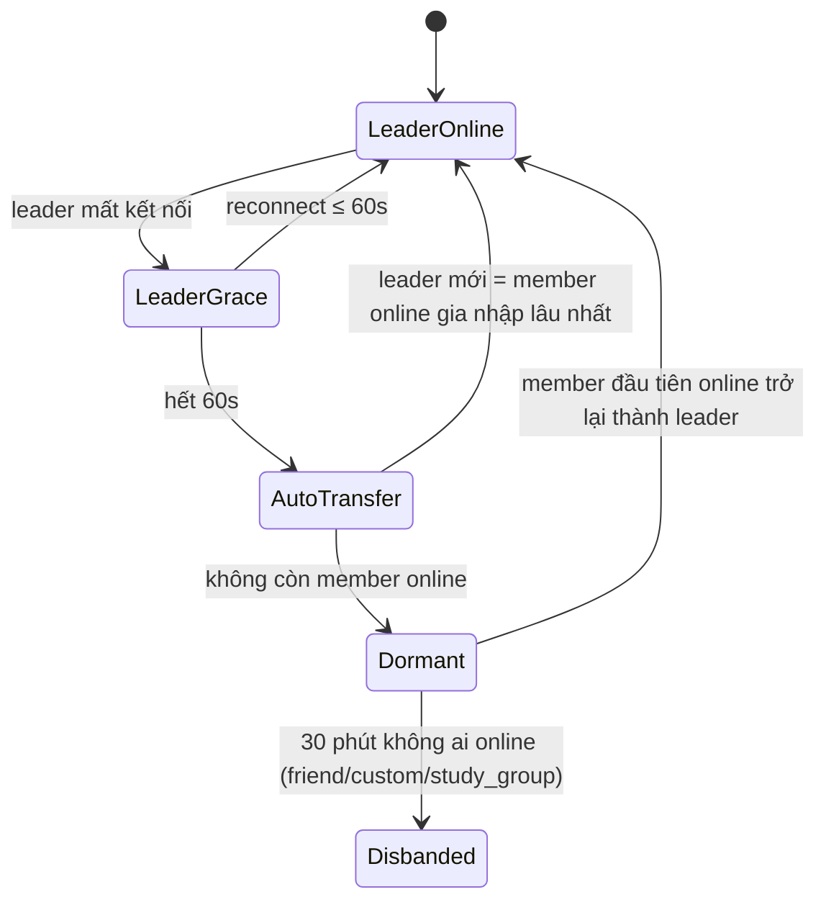
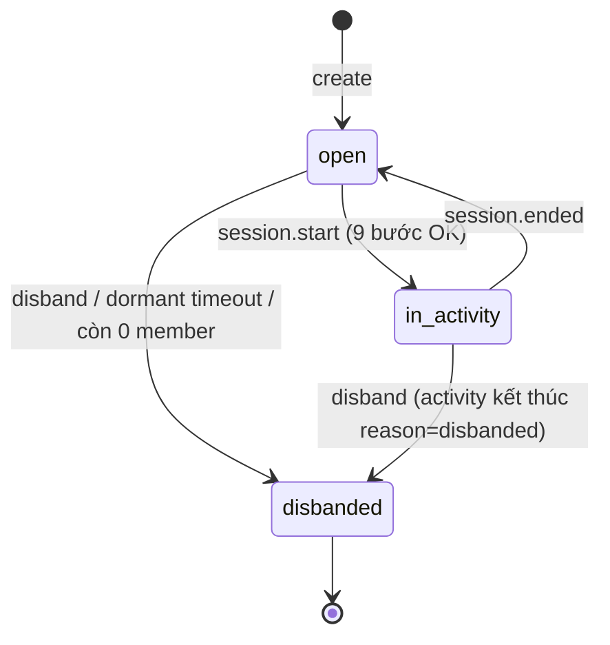
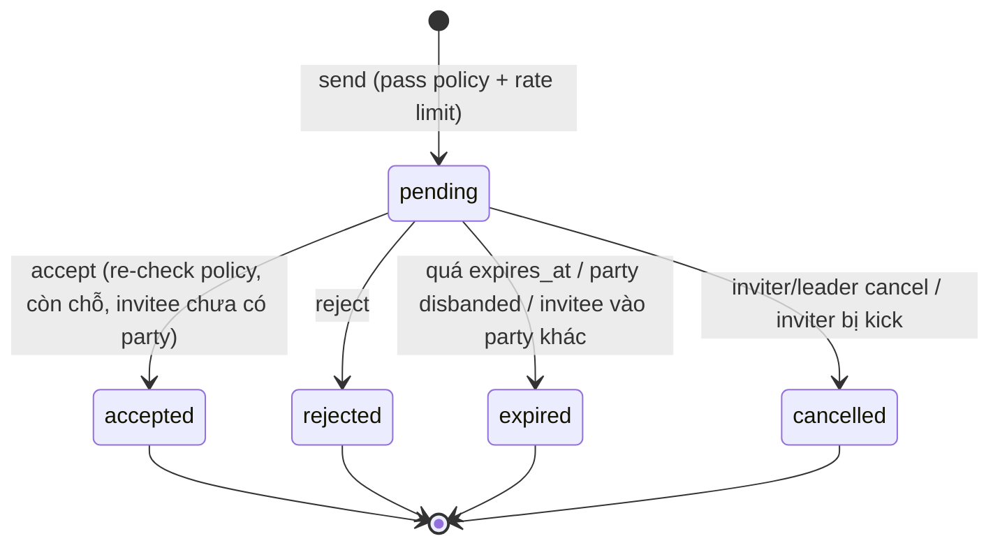

# Party, Group & Cooperative Multiplayer

> Trạng thái: Draft · Phiên bản: 0.2 · Owner: Multiplayer Engineer + Game Director · Cập nhật: 2026-11-15
> Liên quan: [ADR-0050 Party vs Club](../adr/ADR-0050-party-tam-thoi-va-guild-club-ben-vung-la-hai-khai-niem-tach.md) · [ADR-0054](../adr/ADR-0054-tuong-tac-xa-hoi-lien-truong-cross-school-social-interaction.md) · [MULTIPLAYER_GAMEPLAY](MULTIPLAYER_GAMEPLAY.md) · [SOCIAL_SYSTEM](SOCIAL_SYSTEM.md) · [MATCHMAKING](MATCHMAKING.md) · [CHAT_SYSTEM](CHAT_SYSTEM.md) · [QUEST_SYSTEM](../01-game-design/QUEST_SYSTEM.md) · [CHALLENGE_BOSS_SYSTEM](../01-game-design/CHALLENGE_BOSS_SYSTEM.md) · [DOMAIN_MODEL §6](../06-architecture/DOMAIN_MODEL.md#6-multiplayer-party--competition) · [VALKEY_DESIGN](../07-backend/VALKEY_DESIGN.md) · [EVENT_DESIGN](../07-backend/EVENT_DESIGN.md) · [OpenAPI](../../specs/openapi) · [AsyncAPI](../../specs/asyncapi/eduworld-realtime.v1.yaml)

Tài liệu này hiện thực hóa **toàn bộ Party Addendum** (nguồn [Confirmed]) và **sở hữu** mọi luật về Party (nhóm chơi **tạm thời**): thao tác, loại party, Party Lobby, co-op session, leader/member disconnect, rate limit lời mời. Nhóm **bền vững** (Club/Guild, Study Group, Team cố định) thuộc [SOCIAL_SYSTEM §6](SOCIAL_SYSTEM.md#6-club--guild-nhóm-bền-vững--adr-0050-proposed) (ADR-0050). Domain chạy trong **competition-service**, database `eduworld_competition`. Mọi tham số số học chưa có trong addendum mang nhãn [Proposed].

## 1. Mục tiêu

- Nhiều học sinh lập một Party để cùng di chuyển, khám phá, làm quest, giải puzzle, tham gia learning challenge và team competition **[Confirmed]**.
- Mỗi học sinh vẫn có **learning attempt và kết quả riêng**; không chia sẻ kết quả học tập cá nhân giữa thành viên **[Confirmed]**.
- Không cho phép dùng Party để vượt qua các điều kiện bảo vệ học sinh **[Confirmed]**.

## 2. Party Management — thao tác

| Thao tác | REST | Lệnh WS (client→server) | Ai được làm | Ghi chú |
|---|---|---|---|---|
| Create Party | `POST /api/v1/multiplayer/parties` | — | Học sinh không có active party; giáo viên (Class Group) | `Idempotency-Key` bắt buộc |
| Get Party | `GET /api/v1/multiplayer/parties/{party_id}` | — | Member, giáo viên lớp (Class Group) | |
| Get my Party | `GET /api/v1/multiplayer/parties/me` | — | Học sinh | |
| Update Settings | `PATCH /api/v1/multiplayer/parties/{party_id}` | — | Leader | name, visibility, invitation_policy, max_members (≥ số member hiện tại) |
| Invite Friend | `POST /api/v1/multiplayer/parties/{party_id}/invitations` | — (invitee nhận `party.invitation.received`) | Leader; member nếu `invitation_policy=members` | Rate limit §10 |
| List my invitations | `GET /api/v1/multiplayer/invitations?status=pending` | — | Invitee | |
| Accept Invitation | `POST /api/v1/multiplayer/invitations/{invitation_id}:accept` | — | Invitee | Kiểm tra lại toàn bộ rule tại thời điểm accept |
| Reject Invitation | `POST /api/v1/multiplayer/invitations/{invitation_id}:reject` | — | Invitee | |
| Cancel Invitation | `POST /api/v1/multiplayer/invitations/{invitation_id}:cancel` | — | Inviter, leader | |
| Join Party | `POST /api/v1/multiplayer/parties/{party_id}:join` | — | Chỉ khi `visibility=class` hoặc `friends` và thỏa rule; party `private` bắt buộc có invitation | `join_code` cho Class Group do giáo viên phát [Proposed] |
| Leave Party | `POST /api/v1/multiplayer/parties/{party_id}:leave` | — | Member | Leader rời → chuyển leader tự động §9 |
| Kick Member | `POST /api/v1/multiplayer/parties/{party_id}/members/{student_id}:kick` | — | Leader | Người bị kick không được mời lại vào party đó trong 10 phút [Proposed] |
| Transfer Leader | `POST /api/v1/multiplayer/parties/{party_id}:transfer-leader` | — | Leader | Đích phải là member `online` |
| Disband Party | `POST /api/v1/multiplayer/parties/{party_id}:disband` | — | Leader; giáo viên (Class Group); moderator | Kết thúc activity đang chạy theo §6.3 |
| Set Ready | `PUT /api/v1/multiplayer/parties/{party_id}/members/me/ready` | `party.member.ready_set` | Member | Chỉ ở Party Lobby |
| Select Activity / Mode | `PUT /api/v1/multiplayer/parties/{party_id}/activity` | `party.activity.select` | Leader | |
| Start Session | `POST /api/v1/multiplayer/parties/{party_id}:start` | `party.session.start` | Leader | §6 |
| Party Chat (**always-on**, ADR-0020 mục 6) | Channel `party` — [CHAT_SYSTEM](CHAT_SYSTEM.md) §4.1 | `chat.message.send` | Member | Tự tạo cùng transaction với tạo party, member tự join; không tắt được bằng cài đặt trường/lớp; đóng (read-only) khi disband, purge sau `gameplay_chat_retention_days` (ADR-0033) |

Thao tác ghi đi qua REST (có `Idempotency-Key`); WS chỉ dùng cho ready, chọn activity và start session. Mọi thay đổi trạng thái sinh domain event theo [EVENT_DESIGN](../07-backend/EVENT_DESIGN.md) (`party.created`, `party.invitation_sent|_accepted|_rejected|_expired`, `party.member_joined`, `party.member_left`, `party.member_kicked`, `party.leader_transferred`, `party.activity_started`, `party.activity_ended`, `party.disbanded`) qua outbox → NATS JetStream (ADR-0042). competition-service phát message WS qua realtime-gateway theo [AsyncAPI](../../specs/asyncapi/eduworld-realtime.v1.yaml): `party.invitation.received`, `party.invitation.updated`, `party.member.joined`, `party.member.left`, `party.member.status_changed`, `party.member.ready_changed`, `party.leader.transferred`, `party.activity.selected`, `party.session.started`, `party.session.ended`, `party.party.disbanded`, `party.state.snapshot`. Lỗi theo Problem Details với `code` ổn định: `PARTY_ALREADY_IN_PARTY`, `PARTY_FULL`, `PARTY_NOT_LEADER`, `PARTY_INVITE_NOT_ALLOWED`, `PARTY_INVITE_RATE_LIMITED`, `PARTY_POLICY_VIOLATION`, `PARTY_NOT_FOUND`, `PARTY_INVITATION_EXPIRED`, `PARTY_MEMBER_NOT_ONLINE`, `PARTY_ACTIVITY_NOT_ELIGIBLE`.

## 3. Thuộc tính Party

| Thuộc tính | Field | Mặc định | Nhãn |
|---|---|---|---|
| Party ID | `party_id` (UUIDv7) | | [Confirmed] |
| Party Name | `name` | Sinh tự động "Nhóm của <nickname>"; tên tự đặt đi qua bộ lọc [MODERATION](MODERATION.md) | [Confirmed] / lọc [Proposed] |
| Leader ID | `leader_id` | Người tạo | [Confirmed] |
| Members | `party_members` | | [Confirmed] |
| Maximum Members | `max_members` | 4 (cấu hình 2–8; giới hạn cứng platform 8) | [Confirmed] cấu hình / giá trị [Proposed] |
| Party Type | `party_type` | `friend` | [Confirmed] |
| Visibility | `visibility` ∈ `private`, `friends`, `class` | `private` | [Confirmed] / giá trị [Proposed] |
| Invitation Policy | `invitation_policy` ∈ `leader_only`, `members` | `leader_only` | [Confirmed] / giá trị [Proposed] |
| Current Activity | `current_activity_id` → `multiplayer.party_activities` | null | [Confirmed] |
| Current Game Session | `current_game_session_ref` (room/match id) | null | [Confirmed] |
| Tenant / Trường | `tenant_id`, `school_id` | Của leader lúc tạo | [Proposed] |
| Club nguồn | `club_id` (nullable) | Có khi party được tạo từ một club ([SOCIAL_SYSTEM §6.4](SOCIAL_SYSTEM.md#64-quan-hệ-party--club)); chỉ mời thành viên club | [Proposed] |
| Grade band | `grade_band` | Grade band của leader | [Proposed] |
| Status | `status` ∈ `open`, `in_activity`, `disbanded` | `open` | [Proposed] |
| Created/Updated At | `created_at`, `updated_at` | | [Confirmed] |

## 4. Party Types

| `party_type` | Ai tạo | Thời hạn | Đặc thù | Nhãn |
|---|---|---|---|---|
| `friend` | Học sinh | Tạm thời — tự giải tán sau 30 phút không có member online | Chỉ mời bạn bè | [Proposed] |
| `study_group` | Học sinh (lớp 6–9) hoặc giáo viên | Tạm thời — **phiên học nhóm**; gắn `club_id` khi tạo từ club `study_group` (nhóm học bền vững là club, không phải party) | Mặc định chọn activity học tập | [Proposed] |
| `quest` | Học sinh khi nhận cooperative quest | Đến khi quest kết thúc | `current_activity` cố định là quest | [Proposed] |
| `competition_team` | Học sinh | Theo mùa/giải | Dùng cho team matchmaking/tournament; size = size đội của mode | [Proposed] |
| `class_group` | Giáo viên | Theo tiết học/buổi | Member chỉ trong lớp; giáo viên là "owner" quản trị nhưng không bắt buộc là member chơi; join bằng `join_code` | [Proposed] |
| `custom` | Học sinh lớp 6–9 / giáo viên | Tạm thời | Cấu hình tự do trong khuôn khổ policy | [Proposed] |

## 5. Party Lobby

Party Lobby là **màn hình + trạng thái realtime** của party khi chưa (hoặc giữa các) hoạt động.

```text
┌─────────────── Party: "Nhóm Sao Băng" (Quest Party) ────────────┐
│ 👑 MèoXanh42 (bạn)   ● Online   ✔ Sẵn sàng                     │
│    CáHeoVui07        ● Online   ✔ Sẵn sàng                     │
│    GấuNâu15          ● Online   … Chưa sẵn sàng                │
│    [+ Mời bạn]                                                  │
│─────────────────────────────────────────────────────────────────│
│ Hoạt động: [Co-op Quest ▼] "Sửa cầu Rừng Phiêu Lưu"             │
│ [Chat nhóm] [Bắt đầu] (chỉ leader, khi tất cả sẵn sàng)         │
└─────────────────────────────────────────────────────────────────┘
```

Trải nghiệm: tạo party từ Social Zone/menu/danh sách bạn bè/club; mời bằng cách chạm avatar bạn (lớp nhỏ không cần gõ tên); lời mời là popup nhỏ có thể tắt; kết thúc hoạt động có tổng kết chung + kết quả học tập **riêng** từng người (chỉ người đó thấy điểm của mình).

| Chức năng | Mô tả | Nguồn dữ liệu |
|---|---|---|
| Danh sách thành viên | nickname, avatar, level, vai trò leader | PG + cache |
| Avatar & trạng thái online | `online`, `away`, `disconnected`, `in_activity` | Valkey presence |
| Ready / Not Ready | Từng member toggle; reset khi đổi activity | Valkey `party:{id}:lobby` |
| Leader Controls | Kick, transfer, đổi settings, chọn activity/mode, start | WS/REST |
| Activity Selection | Danh sách activity **mà mọi member đều đủ điều kiện** (grade, quyền, quest prerequisite); activity mà chỉ một số member đủ điều kiện hiển thị kèm cảnh báo, không thể start | REST `GET /api/v1/multiplayer/parties/{id}/eligible-activities` |
| Game Mode Selection | Với competition: `team_battle`, `coop_challenge`, `timed_quiz`...; với PvE: boss nhóm ([CHALLENGE_BOSS_SYSTEM](../01-game-design/CHALLENGE_BOSS_SYSTEM.md), encounter do game-service tạo) | |
| Invitation | Mời bạn bè online/offline (offline nhận notification) | |
| Group Chat | Channel `party` nhúng, **luôn có** (thu gọn được, không tắt được); quick message + text; menu Tắt tiếng / Chặn / Báo cáo trên từng tin | CHAT (ADR-0020 mục 6) |
| Start Session | Nút Start chỉ active khi: leader, ≥ `min_members` của activity, tất cả member online đều `ready` | |

Lobby state trong Valkey (key định nghĩa ở VALKEY_DESIGN; khuyến nghị `ew:pty:party:{party_id}:lobby` hash: `activity_id`, `mode`, `ready:{student_id}`, `version`). Mỗi thay đổi tăng `version`; client gửi `expected_version` cho lệnh leader để tránh race.

## 6. Party Session

### 6.1. Luồng 9 bước [Confirmed]



### 6.2. Kiểm tra ở bước (3) — eligibility

| Điều kiện | Mặc định | Nhãn |
|---|---|---|
| Cùng `school_id` | Bắt buộc; khác trường cùng tenant `unit` khi tenant bật; không bao giờ khác tenant (ADR-0054) | [Proposed] |
| Grade band | Mọi member trong cùng grade band, hoặc chênh tối đa 1 band liền kề nếu activity khai báo `allow_mixed_grade_band=true` (không bao giờ `g1_3` với `g8_9`) | [Proposed] |
| Activity grade | `activity.grade_levels` chứa `grade_level` của từng member | [Confirmed] (kiểm tra lớp học) |
| Trạng thái tài khoản | `active`, không bị sanction `restrict_multiplayer` | [Proposed] |
| Giờ truy cập | Trong khung giờ trường cho phép (OQ-17) | [TBD] |
| Block | Không có cặp member nào block nhau (kiểm tra cả lúc invite/join) | [Proposed] |
| Prerequisite quest | Mỗi member đáp ứng prerequisite của quest | [Proposed] |

### 6.3. Kết thúc session

- Nguyên nhân: `completed`, `timeout`, `leader_ended`, `all_left`, `disbanded`, `server_failure`.
- Attempt học tập đang dở của từng học sinh: chuyển `abandoned` (practice/quest) hoặc `submitted` tự động (nếu activity là timed challenge) theo cấu hình activity.
- Party quay lại `open` (Party Lobby) sau khi session kết thúc, trừ `disbanded`. Channel `party` vẫn mở suốt vòng đời party (kể cả trong session); trận đội trong session có thêm channel `match`/`team` riêng.
- Party `disbanded` → channel `party` **đóng** (`closed_at`), chỉ đọc; purge vật lý sau `gameplay_chat_retention_days` (mặc định 7, tối thiểu 3) trừ khi còn report/case (ADR-0033).

## 7. Cooperative Gameplay

| Khả năng [Confirmed] | Hiện thực |
|---|---|
| Cùng di chuyển trong game world | Party được gán cùng `hub_instance` ([MULTIPLAYER_GAMEPLAY §6](MULTIPLAYER_GAMEPLAY.md#6-gán-instance)); "Follow leader" khi chuyển area: member nhận đề nghị follow (message WS riêng — [Proposed], chưa có trong AsyncAPI v1) (không bắt buộc) |
| Cùng khám phá bản đồ | `private_instance` của quest exploration |
| Cùng thực hiện Quest | Cooperative Quest: `quest_version.shared_progress_policy` (xem dưới) |
| Cùng giải Educational Puzzle | Room `coop`: state machine server-authoritative; mỗi đóng góp là một câu trả lời của **một** học sinh → ghi vào attempt của học sinh đó |
| Learning Challenge | Mỗi member làm attempt riêng, kết quả nhóm = hàm tổng hợp (tổng/trung bình/ngưỡng) chỉ dùng cho tiến độ game & reward |
| Team Competition | Party `competition_team` vào team matchmaking ([MATCHMAKING](MATCHMAKING.md)) |
| Nhiệm vụ nhiều bước | Step gán cho `any_member`, `each_member`, `role:<x>` (vai trò trong nhóm) |

### 7.1. Shared Quest Progress

`shared_progress_policy` cấu hình theo quest version **[Confirmed]** (giá trị [Proposed]):

| Policy | Ý nghĩa |
|---|---|
| `none` | Mỗi member có tiến độ riêng, chỉ ở chung instance |
| `shared_steps` | Bước gameplay (đi tới, nhặt, kích hoạt) hoàn thành bởi một member tính cho cả nhóm |
| `shared_steps_individual_learning` (mặc định cho cooperative quest) | Bước gameplay chia sẻ; **bước `activity` (học tập) mỗi member tự làm** |
| `team_goal` | Mục tiêu tổng (vd. nhóm đúng 20 câu); mỗi câu trả lời vẫn ghi vào attempt riêng của người trả lời |

Bất biến **[Confirmed]**: không bao giờ copy `attempt`, `score`, `objective_mastery` từ member này sang member khác. Reward game của bước chia sẻ áp riêng cho từng member theo `reward_rule` (có cap, chống farm — [DOMAIN_MODEL §8](../06-architecture/DOMAIN_MODEL.md#8-gamification)).

## 8. Group Rules

| # | Quy tắc | Hiện thực | Nhãn |
|---|---|---|---|
| R1 | Một học sinh chỉ có một active Party (Addendum §6 ghi cho MVP; giữ cho Release 1.0) | Unique index `party_members(student_id) WHERE left_at IS NULL` + kiểm tra trong transaction | [Confirmed] |
| R2 | `max_members` cấu hình được | Party setting, giới hạn bởi platform (8) và activity | [Confirmed] |
| R3 | Leader quản lý Party | Kiểm tra `leader_id` ở mọi lệnh leader (đọc từ PG trong transaction, không tin client) | [Confirmed] |
| R4 | Chuyển Leader | Thủ công + tự động §9 | [Confirmed] |
| R5 | Xử lý Leader disconnect | §9 | [Confirmed] |
| R6 | Party riêng tư cần lời mời/quyền | `visibility=private` chỉ vào qua invitation `accepted` còn hạn | [Confirmed] |
| R7 | Giới hạn theo school, class, grade, activity | `party_policies` cấp platform/school/class: `allowed_party_types`, `cross_class`, `cross_grade_band`, `max_members_cap` | [Confirmed] |
| R8 | Không vượt qua điều kiện bảo vệ học sinh | Mọi kiểm tra chat policy, block, sanction, grade (ghép hoạt động) áp dụng y nguyên trong party; party chat dùng **cùng ChatPolicy cho mọi thành viên** (không phân biệt lớp, ADR-0020) và mọi tin phải qua kiểm tra hợp lệ | [Confirmed] / cơ chế [Proposed] |
| R9 | Chống spam lời mời | §10 | [Confirmed] |
| R10 | Chống duplicate membership | Unique index R1 + unique `(party_id, student_id) WHERE left_at IS NULL`; accept invitation idempotent | [Confirmed] |
| R11 | Rate limiting & audit log | §10, §11 | [Confirmed] |
| R12 | Party lớp 1–3 | Chỉ tạo `friend`/`class_group`, chỉ mời bạn cùng lớp (giới hạn ghép nhóm, **không** giới hạn chat — party chat như mọi lớp theo ADR-0020) | [Proposed] |

## 9. Leader disconnect & member disconnect



| Tình huống | Hành vi | Nhãn |
|---|---|---|
| Leader mất kết nối | Grace **60 s**; trong grace member vẫn chơi activity, lệnh leader tạm khóa; Party Lobby hiển thị "Trưởng nhóm đang kết nối lại" | [Proposed] |
| Hết grace | Auto-transfer cho member **online gia nhập lâu nhất** (`joined_at` nhỏ nhất); domain event `party.leader_transferred` (WS `party.leader.transferred`) reason `leader_disconnected` | [Proposed] |
| Leader cũ quay lại | Là member thường; leader mới có thể transfer lại | [Proposed] |
| `class_group` | Giáo viên (owner) luôn giữ quyền quản trị; auto-transfer chỉ áp cho quyền leader-in-game | [Proposed] |
| Member mất kết nối trong activity | Grace theo mode ([MULTIPLAYER_GAMEPLAY §9.2](MULTIPLAYER_GAMEPLAY.md#92-grace-theo-chế-độ-tài-liệu-này-sở-hữu-giá-trị)); người còn lại tiếp tục nếu activity `allow_continue_on_disconnect` [Confirmed]; nếu số member online < `min_members` quá 120 s → activity kết thúc `timeout` | [Proposed] |
| Member mất kết nối ở Party Lobby | Hiện `disconnected`; ready reset; vẫn là member đến khi party dormant/disband | [Proposed] |

Grace timer do competition-service quản lý (không phụ thuộc node gateway giữ kết nối leader); dùng Valkey key TTL (`ew:pty:party:{id}:leader_grace`) + keyspace-independent sweeper trong worker (quét mỗi 5 s) để không phụ thuộc node.

## 10. Rate limit & chống spam

| Hành động | Giới hạn | Nhãn |
|---|---|---|
| Gửi lời mời | 10/phút, 50/giờ mỗi học sinh | [Proposed] |
| Lời mời tới cùng một người | 1 pending; sau khi bị reject: chờ 5 phút; 3 lần reject/ngày → chặn mời người đó đến hết ngày | [Proposed] |
| Lời mời tồn tại | Hết hạn sau 5 phút (`expires_at`) | [Proposed] |
| Pending invitations tối đa nhận | 20; vượt → lời mời cũ nhất hết hạn | [Proposed] |
| Create/disband party | 10 lần/giờ | [Proposed] |
| Kick | 10/giờ mỗi leader | [Proposed] |
| Lệnh lobby (ready, select activity) | 5/giây | [Proposed] |

Giới hạn hiện thực bằng Valkey sliding window (`ew:rl:...` — VALKEY_DESIGN). Vượt ngưỡng nhiều lần → ghi `audit` và tăng điểm nghi spam cho [MODERATION](MODERATION.md).

## 11. Audit log

Ghi `audit.audit_logs` (qua event) cho: `party.created`, `party.disbanded` (ai, lý do), `party.member_kicked`, `party.leader_transferred` (thủ công/tự động), invitation bị từ chối do policy (`PARTY_POLICY_VIOLATION`), vượt rate limit, giáo viên/moderator can thiệp party. Không ghi nội dung chat vào audit (chat có lưu trữ riêng).

## 12. Thành phần kỹ thuật

### 12.1. Golang (competition-service, bounded context `party`)

| Service [Confirmed] | Trách nhiệm | Tiến trình |
|---|---|---|
| `PartyService` | Create, update settings, disband, transfer leader, get | api |
| `PartyMemberService` | Join, leave, kick, membership invariant R1/R10, eligibility | api |
| `PartyInvitationService` | Send/accept/reject/cancel/expire, rate limit, block check | api + worker (expire sweeper) |
| `PartyLobbyService` | Lobby state (ready, activity, mode), fan-out WS, version | realtime |
| `CooperativeSessionService` | 9 bước session, tạo `party_activity`/room/ticket, kết thúc, leader grace | api + realtime + worker |

Phụ thuộc (ADR-0036, ADR-0040): projection `ref_*` học sinh/lớp/khối và friend/block (nhận qua event từ identity-service và chat-service), `principals:resolve` của identity-service, eligibility quest/boss của game-service (typed client), `room.Allocator` và `matchmaking.Tickets` nội bộ, event `party.created`/`party.disbanded` để chat-service tạo/đóng channel `party`, `audit.recorded`.

### 12.2. Valkey [Confirmed] (tên key cuối cùng theo VALKEY_DESIGN)

| Mục đích | Key đề xuất | Kiểu | TTL |
|---|---|---|---|
| Party Presence | `ew:pty:party:{party_id}:presence` | hash `student_id → status` | refresh theo heartbeat |
| Realtime Party State | `ew:pty:party:{party_id}:state` | hash (leader, status, version) | 24 h, tái tạo từ PG |
| Lobby State | `ew:pty:party:{party_id}:lobby` | hash | 24 h |
| Invitation Cache | `ew:pty:inv:{invitee_id}` | sorted set theo `expires_at` | 5 phút |
| Lock thao tác leader | `ew:pty:party:{party_id}:lock` | string NX | 5 s |
| Leader grace | `ew:pty:party:{party_id}:leader_grace` | string | 60 s |
| Realtime Event Distribution | Valkey pub/sub channel `ew:rt:party:{party_id}` | pub/sub | — |

### 12.3. PostgreSQL — database `eduworld_competition`, schema `multiplayer` [Confirmed]

Mọi bảng có `tenant_id`, soft-delete và RLS theo tenant (ADR-0005, ADR-0028); cột chuẩn và DDL ở [DATABASE_DESIGN](../07-backend/DATABASE_DESIGN.md).

| Bảng | Cột chính | Ràng buộc |
|---|---|---|
| `parties` | `party_id`, `tenant_id`, `school_id`, `club_id?`, `name`, `leader_id`, `party_type`, `visibility`, `invitation_policy`, `max_members`, `grade_band`, `status`, `current_activity_id`, `current_game_session_ref`, `created_at`, `updated_at`, `disbanded_at` | RLS theo `school_id` |
| `party_members` | `party_id`, `student_id`, `role`, `joined_at`, `left_at`, `left_reason` | unique `(student_id) WHERE left_at IS NULL` |
| `party_invitations` | `invitation_id`, `party_id`, `inviter_id`, `invitee_id`, `status`, `created_at`, `expires_at`, `responded_at` | unique `(party_id, invitee_id) WHERE status='pending'` |
| `party_histories` | `party_id`, `event_type`, `actor_id`, `data`, `occurred_at` | append-only (Party History) |
| `party_activities` | `party_activity_id`, `party_id`, `activity_type` (quest/coop_challenge/learning_challenge/team_match/exploration), `activity_ref`, `room_id`, `match_id?`, `status`, `started_at`, `ended_at`, `end_reason` | (Party Activity) |
| `session_memberships` | xem [MULTIPLAYER_GAMEPLAY §10](MULTIPLAYER_GAMEPLAY.md#10-session-membership) | (Session Membership) |
| `party_policies` | `scope_type`, `scope_id`, `rules` (JSONB) | |

### 12.4. Godot [Confirmed]

| Thành phần | Scene/script đề xuất | Ghi chú |
|---|---|---|
| Party UI (HUD mini) | `scenes/social/party_hud.tscn` | Avatar nhỏ + trạng thái các member |
| Party Lobby | `scenes/social/party_lobby.tscn` | Danh sách member, ready, activity, start |
| Friend Invitation UI | `scenes/social/invite_dialog.tscn` | Chỉ hiện bạn bè đủ điều kiện; popup nhận lời mời có countdown |
| Member Status | `scripts/multiplayer/party_store.gd` | State store `RefCounted`, nhận event WS, phát signal |
| Leader Controls | Trong party_lobby | Ẩn với member thường (backend vẫn kiểm tra) |
| Group Chat | Nhúng `chat_panel` channel `party` — luôn hiển thị trong lobby và khi chơi cùng (thu gọn được) | ADR-0020 mục 6 |
| Cooperative Gameplay | `scripts/multiplayer/coop_room_client.gd` | Hiển thị đóng góp của member, không hiển thị điểm học tập của người khác |

UI lớp 1–5: nút lớn, mời bằng avatar bạn bè, không cần gõ tên; lớp 6–9: thêm settings nâng cao.

## 13. State machines

### 13.1. Party



### 13.2. Invitation



Accept khi invitee đang ở party khác: trả `PARTY_ALREADY_IN_PARTY` kèm lựa chọn "Rời nhóm hiện tại và tham gia" (client gọi leave rồi accept; không làm ngầm).

## 14. Acceptance criteria (Addendum §8) và test case

| ID | Tiêu chí [Confirmed] | Test case (tóm tắt) | Loại test |
|---|---|---|---|
| AC-PTY-001 | Học sinh A có thể tạo Party | A (không có party) `POST /parties` → 201, A là leader, `party.created` phát; gọi lại cùng `Idempotency-Key` → cùng party; A tạo party thứ hai → 409 `PARTY_ALREADY_IN_PARTY` | API, integration |
| AC-PTY-002 | A có thể mời B, C, D | A mời B, C, D (bạn bè cùng trường, cùng band) → 3 invitation `pending`, B/C/D nhận `party.invitation.received` qua WS hoặc notification nếu offline; mời E đã block A → 403 `PARTY_INVITE_NOT_ALLOWED` | API, WS |
| AC-PTY-003 | B, C, D chấp nhận lời mời | B, C, D accept → member count 4; accept trùng (retry) không tạo member trùng; với `max_members=3`, D accept → 409 `PARTY_FULL`; invitation quá 5 phút → `PARTY_INVITATION_EXPIRED` | API, concurrency test (B/C/D accept đồng thời) |
| AC-PTY-004 | Các thành viên nhìn thấy nhau trong Party Lobby | Sau accept, cả 4 client nhận `party.member.joined` và snapshot lobby với 4 avatar, trạng thái online trong ≤ 1 s (p95) | WS e2e, Godot integration |
| AC-PTY-005 | Leader có thể chọn hoạt động | A `party.activity.select` (quest co-op lớp 3) → mọi member nhận `party.activity.selected`, ready reset; B (không phải leader) select → `PARTY_NOT_LEADER` | WS |
| AC-PTY-006 | Mọi thành viên đủ điều kiện có thể tham gia cùng Game Session | Tất cả ready → A start → 9 bước, cả 4 nhận `party.session.started` cùng `room_id`, vào cùng `private_instance`; nếu D không đủ grade → 409 với lý do, không ai bị đưa vào session | API + WS e2e |
| AC-PTY-007 | Các thành viên có thể cùng thực hiện nhiệm vụ | Quest `shared_steps_individual_learning`: B kích hoạt cổng → bước tính cho cả nhóm; bước activity mỗi HS làm attempt riêng; quest hoàn thành khi điều kiện nhóm đạt | Integration (quest + exercise) |
| AC-PTY-008 | Một thành viên mất kết nối, những người còn lại tiếp tục nếu chế độ cho phép | Kill kết nối C: A, B, D tiếp tục, thấy C `disconnected`; C reconnect trong 120 s → về đúng instance, tiến độ giữ nguyên; với activity `allow_continue_on_disconnect=false` → activity tạm dừng/kết thúc theo cấu hình | Chaos/WS e2e |
| AC-PTY-009 | Leader mất kết nối có chính sách chuyển leader/phục hồi | Kill kết nối A: trong 60 s lệnh leader bị khóa; A quay lại trong 60 s → vẫn leader; nếu không → leader = member online gia nhập sớm nhất, `party.leader.transferred` reason `leader_disconnected`, audit ghi | WS e2e với clock giả lập |
| AC-PTY-010 | Kết quả học tập từng thành viên ghi nhận riêng | Sau quest: 4 `attempt` riêng với `student_id` riêng; điểm/mastery của B không đổi khi A trả lời; query DB xác nhận không có attempt nào có `student_id` khác người trả lời | Integration, data assertion |
| AC-PTY-011 | Không có thành viên trái phép tham gia Party riêng | E (không có invitation) `:join` party private → 403; E dùng invitation của B (sai invitee) → 403; học sinh trường khác dùng `party_id` → 404 (tenant isolation); E sửa client gửi `room.join` vào room party → `ROOM_NOT_MEMBER` | Security test, API, WS |

Kiểm thử bổ sung: rate limit lời mời (AC-PTY-012: lời mời thứ 11 trong 1 phút → 429 `PARTY_INVITE_RATE_LIMITED`), duplicate membership khi accept 2 invitation đồng thời từ 2 party khác nhau (AC-PTY-013: chỉ 1 thành công). Chat party always-on (AC-PTY-014: A tạo party → channel `party` có ngay; B, C, D accept → tự là member và chat được; policy trường đặt `party.enabled=false` bị từ chối `CHAT_POLICY_ALWAYS_ON`). Party giải tán (AC-PTY-015: channel `party` read-only ngay, bị purge sau `gameplay_chat_retention_days`, tin có report được giữ làm bằng chứng — ADR-0033).
