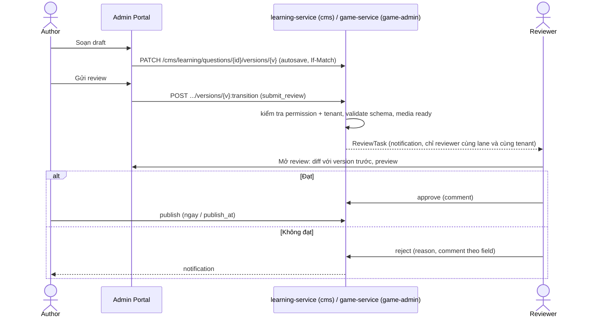

# Admin Portal — CMS/LMS cho vận hành game

> Trạng thái: Draft · Phiên bản: 0.5 (một Admin Portal, 5 workspace; hợp nhất) · Owner: Product Manager + Backend Architect + UX Architect · Cập nhật: 2026-11-15
> Liên quan: [ADR-0027](../adr/ADR-0027-cms-tach-vung-tenant-chi-thao-tac-learning-management-cau-hi.md) · [ADR-0005](../adr/ADR-0005-mo-hinh-multi-tenancy-shared-database-tenant-id-rls.md) · [ADR-0026](../adr/ADR-0026-dang-nhap-theo-tenant-xac-dinh-tenant-kiem-tra-cheo-mac-dinh.md) · [ADR-0028](../adr/ADR-0028-chi-soft-delete-khong-hard-delete-mac-dinh-khong-doc-du-lieu.md) · [ADR-0029](../adr/ADR-0029-system-admin-gan-du-lieu-cho-tenant-va-clone-du-lieu-giua-te.md) · [ADR-0022](../adr/ADR-0022-cms-lms-web-la-react-typescript-spa.md) · [ADR-0015](../adr/ADR-0015-content-versioning-bat-bien-sau-publish.md) · [ADR-0047](../adr/ADR-0047-hai-he-thong-giao-dien-game-godot-3d-va-admin-ops-cms-lms.md) · [DESIGN_SYSTEM](../05-ux/DESIGN_SYSTEM.md) · [CONTENT_MODEL](../02-learning/CONTENT_MODEL.md) · [SCHOOL_LMS](SCHOOL_LMS.md) · [SECURITY_ARCHITECTURE](../10-security/SECURITY_ARCHITECTURE.md) · [MULTITENANCY](../06-architecture/MULTITENANCY.md) · [OQ-07](../12-project/OPEN_QUESTIONS.md)

## 1. Định vị

- **[Confirmed]** CMS quản lý **nội dung** (curriculum, nội dung học tập, nội dung game, cấu hình thi đấu). LMS quản lý **hoạt động học tập** (giao bài, theo dõi). Backend: nội dung học tập và LMS thuộc **learning-service**; Game Studio (quest, mini-game, NPC, item, reward) thuộc **game-service**; cấu hình thi đấu thuộc **competition-service**; sticker/GIF và danh mục từ nhạy cảm thuộc **chat-service**; tenant, người dùng, phân quyền, Thùng rác/gán/clone điều phối ở **identity-service** (ADR-0036). SPA gọi qua APISIX, gateway định tuyến theo prefix tới service sở hữu.
- **[Confirmed — ADR-0005]** Tenant là một **trường độc lập** (`tenant_type = school`), một **đơn vị nhiều trường** (`unit`) hoặc **tenant chung** (`common`). Khóa cô lập dữ liệu là `tenant_id`; `school_id` là chiều phân loại bên trong tenant.
- **[Confirmed — ADR-0027 mục 7]** Giao diện quản trị là **một Admin Portal duy nhất** (`web/apps/portal`, một ứng dụng React, một Keycloak client `eduworld-portal`) gồm **5 workspace** (§1.2). Người dùng chỉ thấy workspace và menu mà permission cho phép. Mô hình 2 bundle `cms`/`admin` trước đây đã bị thay thế.
- Hai nhóm người dùng và phạm vi dữ liệu không đổi:

| Nhóm | Người dùng | Workspace thấy được | Phạm vi dữ liệu | Gateway gọi API |
|---|---|---|---|---|
| **Vận hành tenant** | Tenant Admin, School Admin, Academic Manager (tổ chuyên môn), giáo viên, biên tập/duyệt nội dung của tenant, moderator của tenant | School & Learning Management, Learning Content Studio | **Đúng một tenant** (tenant của phiên) | Public (`/api/v1/cms/learning/*`, `/api/v1/lms/*`, `/api/v1/schools/*`, `/api/v1/tenant/*`, `/api/v1/chat/moderation/*`) |
| **Đội EduWorld (platform)** | **System Admin** (người duy nhất xem dữ liệu liên tenant), Content Admin/Reviewer platform, Game Designer, Live-ops, Competition Admin | Theo role: cả 5 workspace với System Admin; Game Operations Console / Game Live Operations với đội game; Learning Content Studio (dữ liệu platform) với Content Admin | System Admin: mọi tenant (dropdown chọn tenant, §2.5). Các role platform khác: chỉ dữ liệu platform (`tenant_id = NULL`) | Workspace chỉ dành cho platform gọi **gateway nội bộ/VPN** (`/api/v1/game-admin/*`, `/api/v1/admin/*`); token phải có **MFA** (`acr`) |

- **[Confirmed — ADR-0027]** Vận hành tenant **không thấy và không thao tác** menu, API hay cấu hình game: quest, mini-game config, NPC dialogue, map/zone/world event, item/cosmetic, reward rule, XP/level, matchmaking, ranking rule, season, tournament template, leaderboard definition, feature flag game.
- Tenant vẫn **dùng** được nội dung game đã publish và được gán cho tenant (ADR-0029): giáo viên chọn quest/mini-game để giao bài, tạo thử thách lớp/giải trường **từ template do platform định nghĩa** (§3.6). Không sửa luật chơi, phần thưởng hay cấu hình thi đấu.
- **[Confirmed — ADR-0028]** Mọi thao tác "xóa" trong CMS là **soft-delete**; danh sách mặc định không hiển thị dữ liệu đã xóa; xem/khôi phục chỉ qua **Thùng rác** (§3.8).
- **[Confirmed — ADR-0029]** System Admin tạo dữ liệu dùng chung rồi **gán** cho tenant (chỉ đọc với tenant), và **clone** dữ liệu cấu hình/nội dung từ tenant này sang tenant khác (§3.7).
- Module Go `cms` điều phối workflow/review/preview. Dữ liệu nằm trong schema của module sở hữu (`curriculum`, `content`, `game`, `competition`, `gamification`).
- **[Confirmed]** CMS không được làm thay đổi lịch sử bài tập đã hoàn thành (§9).

### 1.1. Giao diện: Admin/Ops UI, không theo phong cách game (ADR-0047)

- **[Confirmed — ADR-0047]** Toàn bộ Admin Portal (mọi workspace) dùng **Admin/Ops design system** dành cho vận hành game: gọn, trung tính, dày dữ liệu. **Không** dùng phong cách, component hay Theme của game. Chi tiết: [DESIGN_SYSTEM §4](../05-ux/DESIGN_SYSTEM.md#4-adminops-design-system-cmslmsadmin).
- **[Proposed]** Thư viện: **Ant Design 5** + Ant Design Pro components (ProLayout, ProTable, ProForm, QueryFilter, StatisticCard), theme EduWorld qua `ConfigProvider` sinh từ `design/admin-tokens/` (màu thương hiệu, compact, sáng/tối, locale `vi_VN`). Component đặc thù trong `web/packages/ops-ui`: trình soạn 11 dạng câu hỏi, graph editor quest/NPC dialogue, bracket giải đấu, thư viện media có thumbnail 3D, `GamePreviewFrame`.
- **Ánh xạ mẫu màn → component:** danh sách = QueryFilter (có dropdown tenant cho System Admin) + ProTable + thao tác hàng loạt; chi tiết = Tabs (Thông tin/Phiên bản/Phát hành/Sử dụng/Audit) + Timeline; form = ProForm/StepsForm với validation sinh từ OpenAPI (`maxLength`, `required`); dashboard = StatisticCard + chart (ECharts hoặc Ant Design Charts).
- Layout: ProLayout, sidebar menu theo `GET /api/v1/me/permissions`; header có bộ lọc tenant (System Admin, chọn nhiều) hoặc bộ chọn đơn vị làm việc (nhân sự thuộc nhiều tenant, §1.3b), trạng thái hệ thống, thông báo; banner cảnh báo hệ thống (ví dụ "Đang tắt kiểm duyệt", ADR-0030).
- Màu môn học, độ hiếm, trạng thái nội dung dùng **mã màu nghiệp vụ dùng chung** với game (`design/shared-tokens/`), hiển thị bằng `Tag`.
- Ảnh nhân vật/item/NPC/khu vực là **thumbnail render từ tài sản 3D của game** (DESIGN_SYSTEM §7), hiển thị như dữ liệu nhận diện. Chỉ bên trong khung preview Godot Web (§5) mới mang giao diện game.

### 1.2. Admin Portal: 5 workspace (ADR-0027 mục 7, Master Prompt tái cấu trúc §16)

| Workspace | Ai thấy | Gateway | Module (✅ đã có đặc tả chi tiết · 🆕 đặc tả mới lượt này · [TBD] để lượt sau) |
|---|---|---|---|
| **A. Game Operations Console** | Chỉ platform: Game Designer, Live-ops, Competition Admin, System Admin | Nội bộ + MFA | Game Dashboard [TBD] · Game World / Zone / Area ✅ (§3.3) · NPC Management ✅ · Quest Builder ✅ ([QUEST_SYSTEM](../01-game-design/QUEST_SYSTEM.md)) · **Challenge Builder** 🆕 · **Boss Management** 🆕 · **Level & XP Configuration** 🆕 · **Achievement Builder** 🆕 · **Item / Inventory Catalog / Shop / Currency** 🆕 (§3.12) · Reward Configuration ✅ · **Event Builder & Season Track** 🆕 (§3.15, [EVENT_SEASON_SYSTEM](../01-game-design/EVENT_SEASON_SYSTEM.md)) · Player Management [TBD] · Party & Group Management [TBD] · Competition Management ✅ (§3.4) · Leaderboard Configuration ✅ · Sticker/GIF ✅ · Game Analytics [TBD] |
| **B. Learning Content Studio** | Tenant (dữ liệu tenant) + Content Admin/Reviewer platform (dữ liệu platform) + System Admin | Public (tenant) / nội bộ (dữ liệu platform) | Curriculum · Grade · Subject · Topic · Learning Objective · Learning Unit ✅ (§3.1) · Lesson Builder ✅ (§3.2) · **Learning Activity Builder theo activity type** 🆕 (§3.13) · Question Bank / Quiz / Exercise Builder ✅ · **Essay/Written Response + Rubric Management** 🆕 · **Video Manager** 🆕 · **Audio Manager** 🆕 · **Simulation Configuration** 🆕 · Assessment Builder ✅ · Learning Path Builder 🟡 ([SCHOOL_LMS](SCHOOL_LMS.md)) · Preview ✅ (§5) · Versioning / Approval / Publish ✅ (§3.11, §4, §6) |
| **C. School & Learning Management** | Tenant + System Admin (dropdown tenant) | Public | School · Class · Student Directory · Teacher (từ SIS, chỉ đọc) ✅ · SIS Synchronization ✅ · Learning Assignment ✅ · Student/Class Progress ✅ ([SCHOOL_LMS §8](SCHOOL_LMS.md#8-teacher-dashboard)) · Learning Analytics ✅ · Assessment Results ✅ · **Teacher Review Queue** (chấm tự luận/nói/dự án) 🆕 (§3.13) · Teacher Feedback 🟡 · Reports ✅ · An toàn & Kiểm duyệt của tenant ✅ (§3.9) · Hoạt động học sinh ✅ (§3.10) · Cài đặt tenant/trường ✅ |
| **D. Platform Administration** | Chỉ System Admin | Nội bộ + MFA | User & Role ✅ · Permission (catalog, chỉ xem) ✅ · Tenant Management ✅ · Gán / Clone (ADR-0029) ✅ · School Policies ✅ · Keycloak / SIS / APISIX (tham chiếu cấu hình) ✅ · System Configuration (dọn học sinh, retention) ✅ · Audit Logs ✅ · Data Retention ✅ · Thùng rác ✅ · Feature Flags ✅ · Integration Monitoring [TBD] · Danh mục từ nhạy cảm + Công tắc kiểm duyệt ✅ (§3.9) |
| **E. Game Live Operations** | Chỉ platform (Live-ops, System Admin, Trust & Safety thuộc System Admin) | Nội bộ + MFA | Online Players / CCU · Concurrent Sessions · Active Events · World Health · Matchmaking Status · Party Status · Game Session Status · Chat Moderation trực tiếp · Incident Management · Server Health · Operational Metrics: dashboard theo [DESIGN_SYSTEM §4](../05-ux/DESIGN_SYSTEM.md#4-adminops-design-system-cmslmsadmin) (KPI live-ops) và [MONITORING](../11-operations/MONITORING.md); màn hình chi tiết [TBD] |

- Tenant **không bao giờ** thấy workspace A, D, E; trong B và C chỉ thấy dữ liệu tenant mình + dữ liệu platform được gán (chỉ đọc).
- Mã nguồn mỗi workspace là một **chunk lazy-load** (`web/apps/portal/src/workspaces/<workspace>`); chỉ tải khi `GET /api/v1/me/permissions` trả về workspace đó. Đây là tối ưu tải trang, **không phải lớp bảo mật**: bảo mật dựa vào permission backend, gateway nội bộ và MFA (ADR-0027 mục 3).
- Workspace A, D, E gọi API chỉ có ở gateway nội bộ. Người dùng platform ngoài VPN mở portal vẫn thấy menu nhưng mọi thao tác trả lỗi kết nối; portal hiển thị thông báo "Cần kết nối mạng quản trị (VPN)" thay vì lỗi chung [Proposed].

### 1.3. Information Architecture (bố cục chung)

```text
┌──────────────────────────────────────────────────────────────────────────────────────────┐
│ [Logo] [Workspace ▾] [🔍 Tìm kiếm toàn portal]   [Tenant: Tất cả ▾]*  [🔔] [Trạng thái HT] [👤 ▾] │  ← Topbar
├───────────────┬──────────────────────────────────────────────────────────────┬───────────┤
│ Sidebar theo  │ Breadcrumb: Workspace / Module / Mục                          │ Panel     │
│ permission    │ [Thanh trạng thái item: Bản nháp · Đã xuất bản v3 · Đã lưu ✓]│ thuộc tính│
│ (module của   │                                                              │ (tùy chọn)│
│ workspace)    │ Nội dung chính: danh sách / editor / dashboard               │           │
└───────────────┴──────────────────────────────────────────────────────────────┴───────────┘
* chỉ System Admin; người dùng tenant thấy tên tenant cố định (tenant unit: chọn Trường trong đơn vị)
```

| Thành phần | Hành vi |
|---|---|
| **Workspace switcher** | Dropdown các workspace người dùng có quyền; nhớ workspace gần nhất theo người dùng (per-viewer). Phím tắt `Ctrl+K` mở tìm kiếm, `G W` đổi workspace [Proposed] |
| **Tìm kiếm toàn portal** | Tìm theo mã/tên trong phạm vi quyền: học sinh, lớp, câu hỏi, activity, quest, item, tenant (System Admin). Kết quả nhóm theo workspace; không trả mục ngoài tenant/permission |
| **Bộ chọn tenant** | System Admin: bộ **lọc** tenant, dropdown tìm kiếm, mặc định "Tất cả tenant", chọn nhiều (§2.5), áp cho mọi màn có dữ liệu theo tenant. Nhân sự thuộc nhiều tenant: bộ **chọn đơn vị làm việc** (chọn một; đổi = token mới + `X-Tenant-Id` mới, §1.3b). Nhân sự một tenant: chỉ hiển thị tên đơn vị |
| **Thông báo** | Review chờ duyệt, publish hẹn giờ, job clone/import xong, báo cáo chat mới, sự cố live-ops |
| **Trạng thái hệ thống** | Chấm màu tổng quan (lấy từ health API), banner cảnh báo cố định khi có sự cố hoặc "Đang tắt kiểm duyệt" (ADR-0030) |
| **User menu** | Hồ sơ, đổi ngôn ngữ (vi/en), chế độ sáng/tối, mật độ, đăng xuất |
| **Sidebar** | Module của workspace hiện tại, lọc theo permission; nhóm mục có thể thu gọn |
| **Breadcrumb** | Workspace / Module / Mục (/ Phiên bản) |
| **Thanh trạng thái item** | Trạng thái workflow, version đang xuất bản, autosave ("Đang lưu…", "Đã lưu lúc 10:42", "Lỗi lưu, thử lại") |
| **Panel thuộc tính bên phải** | Metadata (LO, khối, môn, độ khó, tag), quyền, lịch sử version, tenant được gán; thu gọn được |
| **Lịch sử version** | Mở từ thanh trạng thái hoặc tab "Phiên bản" (§3.11) |

Responsive: chi tiết ở §1.5.

### 1.3b. Đăng nhập portal và chọn tenant sau đăng nhập (ADR-0066, ADR-0067)

Admin Portal có **màn đăng nhập riêng** — trang Keycloak của client `eduworld-portal` với login theme `eduworld-ops` (giao diện vận hành theo Admin/Ops design system, khác hẳn form đăng nhập trong game). **Học sinh không đăng nhập được** (chặn ở Keycloak bằng realm role `tenant_staff`/`platform_staff`, và ở backend bằng `403 PORTAL_ACCESS_STAFF_ONLY`). **Không chọn tenant/trường trước khi đăng nhập**; không có URL theo tenant.

```text
Desktop (≥ 1200 px)                                         Mobile (< 768 px)
┌──────────────────────────────────────────────────────────┐ ┌────────────────────────────┐
│  [Logo EduWorld] Cổng quản trị                  [VI|EN]  │ │ [Logo] Cổng quản trị [VI]  │
│                                                          │ │                            │
│        ┌──────────────────────────────────────┐          │ │ Tên đăng nhập hoặc email   │
│        │ Đăng nhập                            │          │ │ [ gv.thdemo.0042        ]  │
│        │ Tên đăng nhập hoặc email             │          │ │ Mật khẩu                   │
│        │ [ co.lan@thcs-demo.edu.vn        ]   │          │ │ [ ••••••••          👁 ]   │
│        │ Mật khẩu                             │          │ │ [       Đăng nhập       ]  │
│        │ [ ••••••••••                  👁 ]   │          │ │ Quên mật khẩu?             │
│        │ [            Đăng nhập           ]   │          │ │                            │
│        │ Quên mật khẩu?                       │          │ │ Dành cho thầy cô và cán bộ │
│        └──────────────────────────────────────┘          │ │ quản lý. Học sinh vui lòng │
│  Dành cho thầy cô và cán bộ quản lý. Học sinh vui lòng   │ │ đăng nhập trong game.      │
│  đăng nhập trong game EduWorld.                          │ └────────────────────────────┘
└──────────────────────────────────────────────────────────┘

Bước MFA (chỉ người có role platform)        Chọn tenant (chỉ khi thuộc nhiều tenant)
┌──────────────────────────────────────┐     ┌──────────────────────────────────────────┐
│ Xác thực hai bước                    │     │ Chọn đơn vị làm việc                     │
│ Nhập mã 6 số từ ứng dụng xác thực    │     │ 🔍 [ Tìm theo tên/mã           ]         │
│ [ _ _ _ _ _ _ ]                      │     │ ( ) Phòng GD Cầu Giấy — Tenant Admin     │
│ [ Xác nhận ]   Dùng khóa bảo mật     │     │ ( ) THCS Demo B — Giáo viên              │
└──────────────────────────────────────┘     │ [✓] Nhớ lựa chọn cho lần sau             │
                                             │ [Đăng xuất]                  [Vào]       │
                                             └──────────────────────────────────────────┘
```

**Sau đăng nhập** portal gọi `GET /api/v1/me/tenants` (không cần `X-Tenant-Id`):

| Trường hợp | Kết quả |
|---|---|
| Có role platform (System Admin, Content Admin/Reviewer, Game Designer, Live-ops, Competition Admin) | Vào phạm vi platform (bắt buộc MFA). System Admin xem liên tenant bằng bộ lọc tenant (§2.5); khi ghi dữ liệu tenant chọn tenant đích → portal gửi `X-Tenant-Id` = tenant đích |
| Nhân sự thuộc đúng 1 tenant | Vào thẳng tenant đó; mọi request gửi `X-Tenant-Id` |
| Nhân sự thuộc nhiều tenant | Màn "Chọn đơn vị làm việc" (chọn sẵn tenant lần trước nếu đã nhớ, per-viewer); portal xin token mới với scope `organization:{alias}` qua SSO (không nhập lại mật khẩu) rồi gửi `X-Tenant-Id` |
| Không còn UserRole portal hiệu lực ở tenant nào và không có role platform | Màn "Tài khoản chưa được cấp quyền quản trị. Vui lòng liên hệ quản trị trường." (`403 PORTAL_ACCESS_STAFF_ONLY`) + nút Đăng xuất |
| Tài khoản học sinh | Keycloak từ chối ngay: "Tài khoản học sinh không dùng được cổng quản trị. Em hãy đăng nhập trong game nhé." Nếu lọt qua Keycloak: backend `403 PORTAL_ACCESS_STAFF_ONLY`, portal hiện cùng thông điệp và đăng xuất |

**Đổi tenant trên topbar:** nhân sự thuộc nhiều tenant thấy bộ chọn `[Đơn vị: THCS Demo B ▾]` trên topbar (mobile: trong menu ☰). Đổi tenant = xin token mới + đổi `X-Tenant-Id` + tải lại menu (`GET /me/permissions`) và đưa về trang tổng quan của workspace; bản nháp chưa lưu được cảnh báo trước khi đổi. Không bao giờ trộn dữ liệu hai tenant trong một màn.

**Trạng thái lỗi màn đăng nhập:**

| Tình huống | Thông điệp |
|---|---|
| Sai tên đăng nhập/email hoặc mật khẩu, tài khoản khóa tạm | "Tên đăng nhập, email hoặc mật khẩu chưa đúng." (không tiết lộ tài khoản tồn tại hay bị khóa) |
| Tài khoản bị vô hiệu hóa | "Tài khoản đã bị vô hiệu hóa. Vui lòng liên hệ quản trị." |
| Sai mã MFA | "Mã xác thực chưa đúng." |
| Phiên hết hạn (idle 30 phút / tối đa 10 giờ) | Hộp "Phiên làm việc đã hết, vui lòng đăng nhập lại"; giữ URL để quay lại sau đăng nhập |
| `403 TENANT_MISMATCH` khi đang dùng | "Đơn vị làm việc đã thay đổi quyền truy cập." → về màn chọn tenant |
| `403 MFA_REQUIRED` ở workspace platform | Yêu cầu đăng nhập lại có MFA (step-up) |

**Định danh (ADR-0067, [ADR-0069](../adr/ADR-0069-username-email-duy-nhat-theo-tenant-va-dang-nhap-khong-chon-tenant.md)):** đăng nhập portal bằng username **hoặc** email; cả hai là duy nhất trên SSO (một người một tài khoản, không phân biệt hoa thường), nên không trùng trong cùng tenant; Keycloak xác thực trước, identity-service kiểm tra tenant sau; nhân sự bắt buộc có email; một người làm nhiều trường dùng **một** tài khoản với nhiều membership và UserRole. "Quên mật khẩu?" gửi email đặt lại (chỉ nhân sự; học sinh do thầy cô đặt lại).

### 1.5. Bố cục responsive web/mobile của portal [Proposed]

Portal là web app (React + Ant Design 5, ADR-0047), chạy trên trình duyệt desktop, tablet và điện thoại. Cùng một ứng dụng, bố cục đổi theo breakpoint; quyền và dữ liệu không đổi theo thiết bị.

| Breakpoint | Độ rộng | Bố cục |
|---|---|---|
| **Desktop** | ≥ 1280 px | Topbar đầy đủ; sidebar mở (thu gọn được thành icon 64 px); panel thuộc tính bên phải; bảng nhiều cột |
| **Tablet** | 768–1279 px | Sidebar thành drawer (nút ☰); panel thuộc tính thành tab "Thuộc tính" trong trang; bảng ẩn cột phụ (cấu hình theo cột `priority`); form 2 cột → 1 cột dưới 1024 px |
| **Mobile** | < 768 px | Topbar rút gọn (☰, tên workspace, 🔔, 👤; tìm kiếm thành icon mở toàn màn; bộ chọn tenant của System Admin vào menu ☰); **bảng chuyển thành danh sách thẻ** (mỗi thẻ: tiêu đề, 2–3 trường chính, trạng thái, menu ⋯); form 1 cột, nút hành động chính cố định ở đáy; bộ lọc mở bằng ngăn kéo dưới (bottom sheet) |

| Quy tắc | Mô tả |
|---|---|
| Sidebar | Desktop: mở mặc định, nhớ trạng thái thu gọn theo người dùng; tablet/mobile: drawer đè nội dung, đóng khi chọn mục |
| Bảng → thẻ | Component `ResponsiveTable` (`web/packages/ops-ui`): khai báo cột có `priority` (1 = luôn hiện) và `cardTitle`; < 768 px tự render thẻ; thao tác hàng loạt chuyển thành chế độ chọn nhiều bằng nhấn giữ |
| Form | 1 cột trên mobile; nhóm trường thành bước (step) khi > 8 trường; trường công thức dùng `MathInput` (MathLive) có bàn phím ảo riêng |
| Vùng chạm | ≥ 44 px trên mobile/tablet |
| Hành động chính | Một nút chính cố định ở đáy màn mobile; hành động phụ trong menu ⋯ |
| Banner hệ thống | Luôn hiển thị trên mọi breakpoint (ví dụ "Đang tắt kiểm duyệt", sự cố live-ops) |

**Tác vụ hỗ trợ trên mobile:** xem dashboard (giáo viên, live-ops, analytics tổng hợp); duyệt nội dung (đọc, preview, phê duyệt/từ chối có lý do); **chấm bài nói và tự luận** (nghe bản ghi, đọc bài, chọn mức rubric, nhận xét — nhận xét có công thức dùng MathLive); xử lý moderation (xem case, ẩn tin, mute, chuyển cấp); xem/duyệt danh sách học sinh, lớp, bài giao; xác nhận các yêu cầu (club, clone, cleanup) khi có quyền.

**Tác vụ chỉ desktop/tablet ≥ 1024 px:** builder phức tạp (Question/Lesson/Activity Builder nhiều dạng, Quest Builder, Challenge/Boss, Event & Season Builder, cấu hình progression/economy), import hàng loạt, so sánh version (diff), quản lý tenant/gán/clone, preview game 3D tương tác. Mở trên mobile hiển thị trang "Tác vụ này cần màn hình lớn hơn" kèm link gửi về email/máy tính (không mất ngữ cảnh) và vẫn cho xem chỉ đọc.

#### 1.5.1. Dashboard giáo viên

```text
Desktop (≥ 1280)
┌ Topbar ───────────────────────────────────────────────────────────────────────────────┐
├ Sidebar ─┬ School & LMS / Lớp 3A / Tổng quan ─────────────────────────────────────────┤
│ Tổng quan│ [Lớp 3A ▾] [Môn: Toán ▾] [Tuần này ▾]                                      │
│ Bài giao │ ┌ Hoàn thành bài giao ┐ ┌ Đang chờ chấm ┐ ┌ Chưa vào game ≥7 ngày ┐ ┌ LO yếu ┐│
│ Học sinh │ │ 24/30  ▓▓▓▓▓▓▓░     │ │ 6 bài  [Chấm] │ │ 3 em   [Xem]          │ │ 2 LO   ││
│ Chấm bài │ └─────────────────────┘ └───────────────┘ └───────────────────────┘ └────────┘│
│ Báo cáo  │ ┌ Tiến độ theo LO (biểu đồ thanh) ─────────┐ ┌ Bài giao sắp hạn ────────────┐ │
│          │ │                                          │ │ Phân số (hạn 18/11)  20/30   │ │
│          │ └──────────────────────────────────────────┘ └──────────────────────────────┘ │
└──────────┴────────────────────────────────────────────────────────────────────────────┘

Mobile (< 768)
┌ ☰  Lớp 3A · Toán     🔔 👤 ┐
│ [Tuần này ▾]                │
│ ┌ Hoàn thành  24/30 ▓▓▓▓░ ┐ │  thẻ KPI xếp dọc,
│ ┌ Chờ chấm 6 bài   [Chấm]┐ │  chạm để đi tới danh sách
│ ┌ Chưa vào game 3 em     ┐ │
│ ┌ LO yếu: Nhân 7, Chia 8 ┐ │
│ Biểu đồ LO (cuộn ngang)     │
│ Bài giao sắp hạn (thẻ)      │
└─────────────────────────────┘
```

#### 1.5.2. Hàng chờ chấm (Review Queue)

```text
Desktop
├ Sidebar ─┬ School & LMS / Chấm bài ──────────────────────────────────────────────────┤
│          │ [Lớp ▾] [Loại: Bài nói · Tự luận · Dự án ▾] [Trạng thái: Chờ chấm ▾]     │
│          │ ┌ Danh sách (40%) ──────────────┐ ┌ Bài đang chấm (60%) ─────────────────┐ │
│          │ │ ● Lan · Bài nói · 2 ngày      │ │ [▶ 0:24 ▁▃▅▇▅▃] Nghe lại            │ │
│          │ │ ○ Minh · Tự luận · 1 ngày     │ │ Rubric: Phát âm ○1 ●2 ○3            │ │
│          │ │ ○ Nhóm 2 · Dự án · hôm nay    │ │         Lưu loát ○1 ○2 ●3           │ │
│          │ │ …                             │ │ Nhận xét [MathLive khi cần]          │ │
│          │ └───────────────────────────────┘ │ [Trả lại sửa]        [Lưu & chấm ▶] │ │
│          │                                   └──────────────────────────────────────┘ │

Mobile
┌ ☰ Chấm bài (6)        🔔 ┐      chạm một thẻ →   ┌ ← Lan · Bài nói          ┐
│ [Bộ lọc ▾]               │                       │ [▶] 0:24 ▁▃▅▇▅▃          │
│ ┌ Lan · Bài nói · 2 ngày┐│                       │ Rubric (mỗi tiêu chí 1    │
│ ┌ Minh · Tự luận · 1 ngày│                       │  hàng nút chọn mức)       │
│ ┌ Nhóm 2 · Dự án       ┐│                       │ Nhận xét                  │
└──────────────────────────┘                       │ [Trả lại] [Chấm & tiếp ▶]│
                                                   └───────────────────────────┘
```

"Chấm & tiếp" mở bài kế tiếp trong hàng chờ; vuốt trái/phải chuyển bài trên mobile.

#### 1.5.3. Danh sách nội dung (Learning Content Studio)

```text
Desktop
├ Sidebar ─┬ Learning Content Studio / Hoạt động ──────────────────────────────────────┤
│          │ [🔍] [Môn ▾] [Khối ▾] [Loại ▾] [Trạng thái ▾] [Ngôn ngữ: vi|en ▾] [+ Tạo]  │
│          │ ┌─────┬──────────────────────┬──────┬─────┬───────────┬─────┬──────────┐ │
│          │ │ ☐   │ Tên                  │ Loại │ Khối│ Trạng thái │ Bản │ Cập nhật │ │
│          │ │ ☐   │ Phân số là gì?       │ Video│ 4   │ Đã xuất bản│ v3  │ 10:42    │ │
│          │ │ ☐   │ Tả con vật           │ Tự luận│4  │ Chờ duyệt  │ v1  │ hôm qua  │ │
│          │ └─────┴──────────────────────┴──────┴─────┴───────────┴─────┴──────────┘ │

Mobile
┌ ☰ Hoạt động      🔍 🔔 ┐
│ [Bộ lọc ▾]   [+ Tạo]*   │  * mở trang "cần màn hình lớn hơn" với builder phức tạp
│ ┌ Phân số là gì?       ┐ │
│ │ Video · Khối 4 · v3  │ │  thẻ: tên, loại, khối, bản, trạng thái (chip màu nghiệp vụ)
│ │ ● Đã xuất bản    ⋯   │ │  ⋯ : Xem, Preview, Duyệt (nếu có quyền)
│ ┌ Tả con vật           ┐ │
│ │ Tự luận · Khối 4 · v1│ │
│ │ ● Chờ duyệt  [Duyệt] │ │
└─────────────────────────┘
```

### 1.4. Editor chung cho nội dung có version

Mọi builder (activity, quest, challenge, boss, achievement, item, event…) dùng chung khung editor `ContentEditorShell` trong `web/packages/ops-ui`:

| Khả năng | Mô tả |
|---|---|
| Soạn | Form theo JSON Schema của loại nội dung (ProForm/StepsForm sinh từ schema); khối nội dung kéo-thả (drag & drop) cho bài học, bước quest, phase boss, objective |
| Validate | Validate tức thời theo schema (`required`, `maxLength`, enum) + validate nghiệp vụ phía server khi lưu; lỗi hiển thị theo field |
| Preview | Preview web (học tập) hoặc **Godot Web** trong `GamePreviewFrame` (game, activity cần renderer game) với snapshot draft qua `preview_token` |
| Workflow | Draft → Review → Approved → Publish (ngay/hẹn giờ) → Archived; rollback, unpublish (§3.11, §4, §6) |
| So sánh version | Diff theo field/khối giữa 2 version |
| Autosave & khóa | Autosave 10 giây, `If-Match` chống ghi đè; cảnh báo khi người khác đang sửa |
| Audit | Mọi thao tác ghi audit (§7) |
| **Công thức Toán/Lý/Hóa** (ADR-0055) | Mọi trường có thể chứa công thức dùng **MathLive** `<math-field>` (component `MathInput`): nhập trực quan, bàn phím ảo tab Toán/Lý/Hóa (phân số, căn, lũy thừa, chỉ số, ma trận, `\ce{}` hóa học, `\pu{}` đơn vị), chèn inline `\( \)` hoặc block `\[ \]` vào rich text. Lưu **LaTeX** (kèm SVG + speech text render trên trình duyệt). Mọi nơi hiển thị (preview, danh sách, Teacher Dashboard, xem bài làm) dùng **MathJax 4** (component `MathText`, extension `mhchem`). Khi lưu/publish, portal dùng MathJax 4 **trên trình duyệt** render mỗi công thức thành SVG + speech text và gửi kèm nội dung (dùng cho game, vốn chỉ hiển thị công thức); editor chặn ngay công thức lỗi cú pháp. Server kiểm tra LaTeX theo allowlist và sanitize SVG; thiếu SVG, SVG không hợp lệ hoặc LaTeX chứa lệnh cấm → `422 MATH_RENDER_FAILED` kèm vị trí, editor tô đỏ đúng công thức lỗi và không cho gửi duyệt. **Bulk import** đi qua màn Import của portal (render trên trình duyệt trước khi gửi). Rule chặn lệnh nguy hiểm: [SECURITY_ARCHITECTURE §8b](../10-security/SECURITY_ARCHITECTURE.md#8b-công-thức-latex-là-dữ-liệu-không-tin-cậy-adr-0055) |

Áp dụng công thức cho các editor: Question editor (đề, phương án, đáp án, giải thích), Lesson Builder, Learning Activity Builder, Rubric (mô tả tiêu chí), màn chấm tự luận (đề bài và đáp án mẫu hiển thị bằng MathJax; giáo viên nhận xét có thể chèn công thức bằng MathLive), phụ đề/transcript có công thức.

### 1.5. Biên tập song ngữ (ADR-0056)

Game song ngữ `vi` + `en` ([ADR-0056](../adr/ADR-0056-game-song-ngu-viet-anh.md)); quy tắc bắt buộc/tùy chọn theo loại nội dung do [CONTENT_MODEL §8](../02-learning/CONTENT_MODEL.md#8-ngôn-ngữ-nội-dung-và-bản-dịch-adr-0056) sở hữu. Portal áp dụng như sau:

| Khả năng | Mô tả |
|---|---|
| **Hai cột vi / en** | Mọi trường `localized_text`/`i18nText` trong `ContentEditorShell` hiển thị hai cột cạnh nhau (component `BilingualField`); trên màn hẹp chuyển thành tab `VI | EN`. Ngôn ngữ gốc (`content_language`) đứng trước và có nhãn "Gốc" |
| **Trạng thái bản dịch** | Mỗi trường và mỗi version có huy hiệu `Đủ` / `Thiếu` / `Lỗi thời` (`translation_status`); bộ lọc danh sách "Cần dịch", "Bản dịch lỗi thời"; số lượng hiện trên dashboard workspace |
| **Chặn publish** | Nút Publish/Gửi duyệt bị khóa khi thiếu bản bắt buộc (nội dung game: cả `vi` và `en`; nội dung học tập: bản theo `content_language`), danh sách field thiếu bấm để nhảy tới; server vẫn kiểm tra và trả `422 TRANSLATION_INCOMPLETE` |
| **Preview theo ngôn ngữ** | `GamePreviewFrame` và preview học tập có công tắc `vi` / `en` / "song song" để người duyệt xem đúng bản học sinh thấy |
| **Xuất / nhập file dịch** | Xuất các trường cần dịch của một hoặc nhiều nội dung ra **XLIFF 2.1** hoặc **CSV** (khóa ổn định = `<content_type>/<id>/<version>/<json-pointer>`) cho người dịch ngoài hệ thống; nhập lại tạo Draft mới, so khớp khóa, báo trường không khớp; chỉ người có permission `learning_content.translate` hoặc `game.content.translate` (§2.2) |
| **Bản dịch lỗi thời** | Sửa bản gốc sau khi đã dịch → field dịch tự đánh dấu `Lỗi thời`, hiện diff bản gốc cũ/mới cho người dịch |
| **Giao diện portal** | Ngôn ngữ giao diện `vi` (mặc định) / `en` chọn ở user menu [Proposed]; chuỗi UI portal qua i18n của React (khóa `portal.<workspace>.<screen>.<element>`), không phụ thuộc ngôn ngữ nội dung đang soạn |
| **Không dịch máy tự động** | Không tự dịch khi publish. Gợi ý dịch máy (nếu bật sau này) chỉ điền Draft, người duyệt phải xác nhận [Proposed] |

## 2. Permission model

### 2.1. Nguyên tắc

1. Authorization dựa trên **permission** — quyền nguyên tử **định nghĩa trong code** (`internal/authorization/catalog.go`, có `scope_kind` `tenant`/`platform`). **Role** là tập permission **lưu trong DB** (`identity.roles`, `identity.role_permissions`): role hệ thống seed sẵn (`is_system`, không sửa/xóa) và role tùy biến của tenant [Proposed]. **UserRole** (`identity.user_roles`) gán role cho người dùng theo phạm vi và thời hạn (ADR-0066, [SECURITY_ARCHITECTURE §5](../10-security/SECURITY_ARCHITECTURE.md)).
2. Mỗi role có `role_scope_kind`:
   - `tenant`: UserRole ở scope `tenant`, `school`, `class` hoặc `subject`, luôn trong **một** tenant.
   - `platform`: UserRole chỉ ở scope `platform`.
3. **Bất biến:** role `tenant` (kể cả role tùy biến) **không bao giờ** chứa permission thuộc nhóm `game.*`, `competition.config.*`, `platform.*`. Kiểm tra khi khởi động (role seed), khi lưu role (use case `CreateRole`/`UpdateRole` → `422`) và bằng trigger DB; trigger chặn UserRole role `platform` ở scope tenant và role portal cho học sinh ([DATABASE_DESIGN](../07-backend/DATABASE_DESIGN.md)).
3b. **Học sinh không có quyền portal:** route portal yêu cầu `azp = eduworld-portal` và `user_type ≠ student` (`403 PORTAL_ACCESS_STAFF_ONLY`), học sinh không được gán role portal (ADR-0066).
3c. **Đánh giá quyền:** Principal = hợp permission của mọi UserRole còn hiệu lực trong tenant hiện tại (header `X-Tenant-Id`, ADR-0065) và phạm vi tài nguyên; cache 60 s; đổi role/UserRole phát `role.updated`/`user_role.changed` để làm mới cache và menu.
4. **Chỉ `system_admin` có permission `platform.cross_tenant.read`** (xem dữ liệu của tenant). Các role platform khác thao tác dữ liệu platform (`tenant_id = NULL`) và không đọc được dữ liệu của tenant.
5. Kiểm tra tại handler **và** use case: `authorization.Require(principal, perm, resource)`. Endpoint `/api/v1/game-admin/*`, `/api/v1/admin/*` còn kiểm tra `azp = eduworld-portal`, **MFA** (`acr` mức MFA, `amr` chứa `otp`) và principal có role `platform`.
6. Menu và workspace dựng từ `GET /api/v1/me/permissions?tenant_id=…` (trả role, permission và danh sách workspace). Ẩn/hiện menu chỉ là tiện ích hiển thị.

### 2.2. Permission catalog

| Nhóm | Permission | Role `tenant` | Role `platform` |
|---|---|---|---|
| `lms.*` | `lms.class.read`, `lms.assignment.read`, `lms.assignment.write`, `lms.challenge.write`, `lms.school_event.write` (sự kiện trường từ template — EVENT_SEASON_SYSTEM §10), `lms.schedule.write`, `lms.report.read`, `lms.course.write`, `lms.learning_path.write`, `lms.review.grade` (chấm/trả/chấm lại bài cần giáo viên — ADR-0048) | ✔ | ✔ (System Admin, theo tenant đích) |
| `learning_content.*` | `learning_content.read`, `learning_content.write`, `learning_content.review`, `learning_content.publish`, `content.release.rollback`, `learning_content.import`, `media.upload`, `learning_content.activity.write`, `learning_content.activity.review` (activity mọi `activity_type`, ADR-0048), `rubric.write` (rubric, WRITTEN_RESPONSE_RUBRIC), `learning_content.translate` (dịch, xuất/nhập file dịch — ADR-0056) | ✔ (dữ liệu của tenant) | ✔ (dữ liệu platform; System Admin cả dữ liệu tenant) |
| `curriculum.*` | `curriculum.read`, `curriculum.write`, `curriculum.publish` | `read` mọi role; `write/publish` Academic Manager scope tenant (curriculum riêng của tenant) | ✔ |
| `tenant.*` | `tenant.settings.read`, `tenant.settings.write` (chat policy tenant, khung giờ, thông báo), `tenant.user.read`, `tenant.user.write` (tạo/sửa nhân sự thủ công; một người một tài khoản SSO — ADR-0069), `tenant.school.read`, `tenant.school.write` (sửa thông tin hiển thị, duyệt trường `pending_review` — ADR-0060), `tenant.class.read` (lớp, sĩ số, học sinh chưa có lớp — ADR-0060), `tenant.role.read`, `tenant.role.write` (role tùy biến của tenant [Proposed] — ADR-0066), `tenant.user_role.write` (gán/thu hồi UserRole trong tenant; thay `tenant.roles.assign`), `tenant.sis.import`, `tenant.sis.read`, `tenant.trash.read`, `tenant.trash.restore` [Proposed] | ✔ | ✔ (System Admin) |
| `school.*` | `school.settings.read`, `school.settings.write`, `school.people.read` | ✔ | ✔ (System Admin) |
| `lms.student_activity.read` · `tenant.student_cleanup.*` | `lms.student_activity.read` (lịch sử đăng nhập game, lần đăng nhập cuối — ADR-0031), `tenant.student_cleanup.read` (danh sách sắp bị dọn), `tenant.student_cleanup.exclude` (loại trừ/gia hạn), `tenant.student_cleanup.configure` (đổi `inactive_student_cleanup_days` của tenant khi platform cho phép), `tenant.chat_retention.configure` (đổi `gameplay_chat_retention_days` ≥ 3 khi được phép — ADR-0033) | ✔ (Teacher chỉ `lms.student_activity.read` trong lớp; TA/SA phần còn lại) | ✔ (System Admin) |
| `analytics.*` · `report.export` | `analytics.class.read`, `analytics.school.read`, `analytics.tenant.read` (Learning Analytics và báo cáo **tổng hợp** Game Analytics của tenant/trường — [GAME_ANALYTICS §7.2](../11-operations/GAME_ANALYTICS.md#72-báo-cáo-tenant-workspace-school--learning-management); dashboard đọc rollup — ADR-0062), `report.export` (xuất báo cáo bất đồng bộ `/tenant/reports`, `/admin/reports` — [DASHBOARD_DATA §10](../07-backend/DASHBOARD_DATA.md#10-xuất-báo-cáo-bất-đồng-bộ)) | ✔ | ✔ (System Admin) |
| `game.analytics.read` | Game Analytics toàn platform, mọi panel Live Ops ([GAME_ANALYTICS](../11-operations/GAME_ANALYTICS.md)) | **✘ (cấm)** | ✔ (System Admin, live-ops, game designer) |
| `moderation.*` | `moderation.case.read`, `moderation.case.act` (trong tenant) | ✔ | ✔ (System Admin) |
| `chat.*` (tenant) | `chat.sensitive_terms.read` (xem danh mục hiệu lực của tenant), `chat.tenant_terms.write` (thêm/sửa/xóa mềm từ bổ sung của tenant), `chat.tenant_category.toggle` (bật/tắt category của tenant khi `allow_tenant_toggle`) | ✔ | ✔ (System Admin) |
| `chat.*` (platform) | `chat.sensitive_terms.write` (danh mục platform: category, term, allowlist, publish), `chat.policy.toggle` (công tắc kiểm duyệt platform/tenant) | **✘ (cấm)** | ✔ (chỉ System Admin) |
| `game.*` | `game.content.translate` (dịch nội dung game, xuất/nhập file dịch — ADR-0056), `game.chat_assets.write` (sticker pack, thư viện GIF — ADR-0034), `game.quest.write`, `game.minigame.write`, `game.npc.write`, `game.world.write`, `game.event.write` (sự kiện, template sự kiện — thay `game.world_event.write`), `game.event.operate` (dừng/tiếp tục/hủy sự kiện đang chạy), `game.season_track.write`, `game.item.write`, `game.reward_rule.write`, `game.level.write`, `game.challenge.write`, `game.boss.write`, `game.achievement.write`, `game.economy.write` (item, shop, currency, collection — ADR-0049), `game.economy.adjust` (bút toán bù, chỉ System Admin + người duyệt thứ hai), `game.liveops.read` (Game Live Operations), `game.content.review`, `game.content.publish` | **✘ (cấm)** | ✔ |
| `competition.config.*` | `competition.config.matchmaking.write`, `competition.config.ranking.write`, `competition.config.season.write`, `competition.config.tournament_template.write`, `competition.config.leaderboard.write`, `competition.config.reward.write` | **✘ (cấm)** | ✔ |
| `platform.*` (bổ sung) | `platform.settings.write` (cấu hình platform: dọn học sinh, thời hạn chat gameplay — ADR-0032/0033), `platform.student_cleanup.approve` (xác nhận lần dọn vượt ngưỡng) | **✘ (cấm)** | ✔ (System Admin) |
| `platform.*` | `platform.catalog.write` (danh mục quốc gia/tỉnh/kế thừa tỉnh, import trường — ADR-0060), `platform.role.read`, `platform.role.write` (role platform và role dùng chung), `platform.user_role.write` (gán/thu hồi UserRole platform và UserRole tenant ở tenant đích), `platform.cross_tenant.read`, `platform.tenant.manage`, `platform.tenant_data.assign`, `platform.tenant_data.clone`, `platform.trash.read`, `platform.trash.restore`, `platform.user.manage`, `platform.feature_flag.write`, `platform.audit.read_all`, `platform.sis_connection.manage` | **✘ (cấm)** | ✔ (chủ yếu System Admin) |

Chat policy cấp tenant/trường (`tenant.settings.write`, `school.settings.write`) là **cài đặt an toàn** theo ADR-0020, không phải cấu hình game. Cấp dưới chỉ siết chặt hơn mặc định platform.

Catalog role kiểm tra thêm bất biến (ADR-0030): `chat.sensitive_terms.write` và `chat.policy.toggle` là permission **platform-only**, không bao giờ nằm trong role tenant (cùng cơ chế với `game.*`).

### 2.3. Role × permission

**Role tenant** (`role_scope_kind = tenant`, workspace B và C, luôn trong một tenant):

| Role | Scope gán | Permission chính |
|---|---|---|
| `tenant_admin` | tenant | `tenant.*` (gồm `tenant.user.*`, `tenant.role.*`, `tenant.user_role.write`, `tenant.trash.*` nếu tenant được bật [Proposed]), `school.*`, `lms.*`, `learning_content.*`, `curriculum.read`, `analytics.tenant.read`, `moderation.case.*`, `chat.sensitive_terms.read`, `chat.tenant_terms.write`, `chat.tenant_category.toggle`. Với tenant `unit`: quản trị mọi trường trong đơn vị |
| `school_admin` | school (một trường trong tenant) | `school.*`, `tenant.user.read`, `tenant.user_role.write` (chỉ scope trường mình, chỉ role không vượt quyền của chính mình), `lms.*`, `learning_content.read/write/publish` (dữ liệu của tenant, phạm vi trường), `analytics.school.read`, `moderation.case.*` (trường mình), `tenant.sis.import` (trường mình) |
| `academic_manager` (tổ chuyên môn) | tenant / school / subject | `curriculum.read`, `curriculum.write/publish` (scope tenant), `learning_content.*`, `lms.report.read`, `analytics.*` trong scope |
| `teacher` | school (+ class × subject theo `TeachingAssignment`) | `lms.assignment.*`, `lms.challenge.write`, `lms.review.grade` (lớp/môn được phân công), `rubric.write` (rubric của tenant), `lms.schedule.write`, `lms.report.read`, `learning_content.read/write` (draft) [Proposed, OQ-07], `analytics.class.read`, `moderation.case.read` (channel lớp mình) |
| `tenant_content_editor` | tenant / school | `learning_content.read/write/import`, `learning_content.activity.write`, `rubric.write`, `media.upload` |
| `tenant_content_reviewer` | tenant / school | `learning_content.read/review/publish`, `learning_content.activity.review` |
| `tenant_moderator` | tenant / school | `moderation.case.*`, `chat.sensitive_terms.read`, `chat.tenant_terms.write` |

**Role platform** (`role_scope_kind = platform`, workspace A–E theo role; đăng nhập `eduworld-portal` bắt buộc MFA):

| Role | Permission chính | Xem dữ liệu tenant |
|---|---|---|
| `system_admin` | Toàn bộ `platform.*` (gồm `platform.cross_tenant.read`, gán/clone, thùng rác, quản lý tenant), mọi permission Learning Management trên tenant đích, có thể kiêm `game.*`/`competition.config.*` | **Có — duy nhất** (dropdown tenant, audit) |
| `content_admin` | `learning_content.*` (gồm activity), `rubric.write`, `curriculum.*` trên dữ liệu platform | Không |
| `content_reviewer` | `learning_content.review/publish`, `game.content.review` trên dữ liệu platform | Không |
| `game_designer` | `game.*` (trừ `game.content.publish`, `game.economy.adjust`) | Không |
| `liveops` | `game.event.write`, `game.event.operate`, `game.season_track.write`, `game.content.publish`, `game.liveops.read`, `game.analytics.read`, `competition.config.season.write` | Không |
| `competition_admin` | `competition.config.*` | Không |

Không còn role `platform_admin`/`trust_safety` riêng: việc quản trị tenant và kiểm duyệt liên tenant do `system_admin` làm.

### 2.4. Ma trận chức năng (tóm tắt)

| Chức năng \ Role | Tenant Admin | School Admin | Academic Manager | Teacher | Tenant Content Editor/Reviewer | System Admin | Content Admin | Game Designer / Live-ops | Competition Admin |
|---|---|---|---|---|---|---|---|---|---|
| Curriculum: xem | ✔ | ✔ | ✔ | ✔ | ✔ | ✔ | ✔ | ✔ | ✘ |
| Curriculum riêng của tenant: tạo/sửa/publish | ✘ | ✘ | ✔ | ✘ | ✘ | ✔ (tenant đích) | ✘ | ✘ | ✘ |
| Curriculum/nội dung platform: tạo/sửa/publish | ✘ | ✘ | ✘ | ✘ | ✘ | ✔ | ✔ | ✘ | ✘ |
| Nội dung học tập của tenant: soạn | ✔ | ✔ | ✔ | ✔ [Proposed] | ✔ / ✘ | ✔ (tenant đích) | ✘ | ✘ | ✘ |
| Nội dung học tập của tenant: duyệt/publish | ✔ | ✔ | ✔ | ✘ | ✘ / ✔ (≠ author) | ✔ | ✘ | ✘ | ✘ |
| Nội dung platform được gán: xem/dùng | ✔ (chỉ đọc) | ✔ | ✔ | ✔ | ✔ | ✔ | ✔ | — | — |
| Giao bài, lịch, thử thách từ template | ✔ | ✔ | ✔ | ✔ (lớp mình) | ✘ | ✔ (tenant đích) | ✘ | ✘ | ✘ |
| Báo cáo/analytics | tenant | trường | scope | lớp mình | ✘ | mọi tenant (lọc) | ✘ | ✘ | ✘ |
| Cài đặt tenant / trường, SIS import | ✔ / ✔ | – / ✔ | ✘ | ✘ | ✘ | ✔ | ✘ | ✘ | ✘ |
| Gán/thu hồi UserRole trong tenant | ✔ | trong trường | ✘ | ✘ | ✘ | ✔ | ✘ | ✘ | ✘ |
| Tạo/sửa role tùy biến của tenant [Proposed] | ✔ | ✘ | ✘ | ✘ | ✘ | ✔ | ✘ | ✘ | ✘ |
| Tạo/sửa role platform, gán UserRole platform | ✘ | ✘ | ✘ | ✘ | ✘ | ✔ | ✘ | ✘ | ✘ |
| Moderation chat | tenant | trường | ✘ | channel lớp | ✘ | mọi tenant (audit) | ✘ | ✘ | ✘ |
| Danh mục từ nhạy cảm platform (category, term, allowlist) | ✘ (chỉ xem danh mục hiệu lực) | ✘ | ✘ | ✘ | ✘ | ✔ | ✘ | ✘ | ✘ |
| Từ bổ sung của tenant / bật-tắt category (khi được phép) | ✔ / ✔ | ✘ | ✘ | ✘ | ✘ | ✔ (tenant đích) | ✘ | ✘ | ✘ |
| **Công tắc kiểm duyệt** (tổng / từng bước) | **✘** | **✘** | **✘** | **✘** | **✘** | ✔ | ✘ | ✘ | ✘ |
| Thùng rác | tenant [Proposed] | ✘ | ✘ | ✘ | ✘ | ✔ mọi tenant | ✘ | ✘ | ✘ |
| Gán dữ liệu platform cho tenant / clone giữa tenant | ✘ | ✘ | ✘ | ✘ | ✘ | ✔ | ✘ | ✘ | ✘ |
| **Quest, mini-game, NPC, world event, item, reward, level** | **✘** | **✘** | **✘** | **✘** | **✘** | ✔ | ✘ | ✔ | ✘ |
| **Matchmaking, ranking, season, tournament template, leaderboard** | **✘** | **✘** | **✘** | **✘** | **✘** | ✔ | ✘ | live-ops: season | ✔ |
| Quản lý tenant, feature flag | ✘ | ✘ | ✘ | ✘ | ✘ | ✔ | ✘ | ✘ | ✘ |

Nguyên tắc bổ sung:
- **Reviewer ≠ author** (bắt buộc kỹ thuật) trừ khi `self_approve_allowed` (scope trường, có audit).
- Mọi truy cập dữ liệu tenant của System Admin ghi audit (ai, tenant nào, màn hình nào — ADR-0027 §6).

### 2.5. Chế độ liên tenant của System Admin (ADR-0027 §6)

| Hạng mục | Người dùng tenant | System Admin |
|---|---|---|
| Phạm vi | Luôn đúng **một** tenant của phiên; không có dropdown tenant; tham số `tenant_ids` gửi lên bị bỏ qua | Mọi tenant |
| Bộ lọc tenant | — | **Dropdown tìm kiếm tenant** trên mọi màn hình có dữ liệu theo tenant: tìm theo mã/tên, **mặc định "Tất cả tenant"**, chọn **nhiều** tenant; lựa chọn lưu theo phiên làm việc (per-viewer) |
| Danh sách | Không có cột tenant | Luôn có cột **Tenant** (tên + loại `school`/`unit`/`common`); với tenant `unit` có thêm cột Trường |
| Thao tác ghi | Ghi vào tenant của phiên | Luôn chọn **một tenant đích** (form bắt buộc trường "Tenant") hoặc phạm vi **Platform** cho dữ liệu dùng chung. Không có ghi hàng loạt "tất cả tenant" ngầm định |
| API | Mọi request gửi `X-Tenant-Id` = tenant phiên (ADR-0065); `tenant_ids` bị bỏ qua; header hoặc `tenant_id` khác tenant phiên → `403 TENANT_MISMATCH` | List: **không** gửi `X-Tenant-Id`, nhận `tenant_ids[]`; ghi: `X-Tenant-Id` = tenant đích (thiếu → `400 TENANT_HEADER_REQUIRED`) |
| Audit | Theo thao tác | Mọi lần xem/ghi dữ liệu tenant: `actor`, `tenant_ids`, màn hình/endpoint |

### 2.6. Tenant chung (`common`)

Tenant chung chứa học sinh không thuộc tenant nào (ADR-0026). Không có vận hành tenant riêng mặc định: System Admin quản trị (giao nội dung đã gán, kiểm duyệt chat). Có thể chỉ định `tenant_admin` cho tenant chung nếu đội vận hành EduWorld cần [Proposed].

## 3. Module theo workspace

### 3.1. Curriculum Management (Master Prompt §8.1)

Quản lý chương trình, khối lớp, môn, chủ đề (cây kéo-thả), LO (mã chuẩn, prerequisite graph), mapping bộ sách, import/export YAML/CSV, so sánh hai version + bảng mapping LO. Chi tiết: [CURRICULUM_MODEL](../02-learning/CURRICULUM_MODEL.md). Curriculum chuẩn là dữ liệu platform được gán cho tenant (ADR-0029); tenant có thể có curriculum riêng (Academic Manager).

### 3.2. Content Management (§8.2)

| Màn hình | Chức năng |
|---|---|
| Lesson editor | Khối nội dung (CONTENT_MODEL §9), chèn activity, gắn LO |
| Learning Material / Media library | Upload, trạng thái pipeline, license, tìm kiếm, "đang dùng ở đâu" |
| Question editor | 11 dạng (form theo dạng), preview như học sinh thấy, kiểm tra hợp lệ (mỗi option có id, key khớp), tham số hóa, `misconception_tag` cho option sai; công thức nhập bằng MathLive, hiển thị bằng MathJax 4 (phương án lựa chọn có thể là công thức). Học sinh không gõ biểu thức trong game: câu hỏi có công thức dùng dạng chọn đáp án, đúng/sai, nhập số (numeric + dung sai), điền số/từ, ghép cặp, sắp xếp, kéo thả (ADR-0055 mục 6); editor cảnh báo nếu chọn dạng đòi học sinh nhập công thức |
| Question Bank browser | Lọc theo curriculum/grade/subject/topic/LO/difficulty/type/status/nguồn (của tenant / được gán từ platform); thống kê item analysis |
| Question Set editor | Static hoặc selection rules; hiển thị kích thước pool hiện tại |
| Assessment Blueprint editor | Ma trận LO × độ khó, kiểm tra tổng điểm, pool đủ, xem trước đề sinh mẫu |
| Exercise / Learning Activity | Gói question set + feedback policy mặc định |
| Bulk import | Excel/CSV/JSON mẫu → validate → **render công thức trên trình duyệt** (MathJax 4) → báo lỗi theo dòng (gồm công thức lỗi) → tạo draft |

Người dùng tenant thấy: dữ liệu `tenant_id` = tenant của mình **cộng** dữ liệu platform được gán cho tenant (nhãn "Từ EduWorld", **chỉ đọc**). Muốn chỉnh nội dung được gán thì yêu cầu System Admin clone sang tenant (ADR-0029). Nội dung tenant **không** gắn được vào quest/mini-game; việc gắn question set vào game content chỉ đội platform làm trong Game Studio.

### 3.3. Game Content Management (§8.3) — **workspace A (Game Operations Console), platform-only (ADR-0027)**

| Đối tượng | Editor | Permission | Ghi chú |
|---|---|---|---|
| Quest | Form + step list (talk_npc, go_to, activity, collect, minigame, party_activity), điều kiện, phần thưởng, lịch | `game.quest.write` | [QUEST_SYSTEM](../01-game-design/QUEST_SYSTEM.md) |
| Mini-game Configuration | Chọn `minigame_type`, question source (QuestionSet/rule), độ khó, thời gian, số câu, scoring, feedback, completion, reward | `game.minigame.write` | [MINIGAME_ENGINE](../08-game-client/MINIGAME_ENGINE.md) |
| Game Level | Bảng XP → level | `game.level.write` | |
| NPC Dialogue | Graph editor (node thoại, lựa chọn, điều kiện, action) | `game.npc.write` | |
| Reward Configuration | RewardRule: trigger, điều kiện, phần thưởng, cap, diminishing | `game.reward_rule.write` | |
| World / World Event | Zone, area; sự kiện theo thời gian (lễ hội, "Tuần lễ Toán học") dùng Event Builder §3.15 | `game.world.write`, `game.event.write` | [EVENT_SEASON_SYSTEM](../01-game-design/EVENT_SEASON_SYSTEM.md) |
| Item / Cosmetic | Định nghĩa vật phẩm, nguồn mở khóa | `game.item.write` | |
| Sticker pack | Tạo pack, upload sticker (presigned URL, webp/png ≤ 512 KB, alt text tiếng Việt), `unlock_rule` (mặc định / phần thưởng quest / item), duyệt, publish, gán tenant | `game.chat_assets.write` | ADR-0034; không có upload của học sinh |
| Thư viện GIF | Upload GIF (≤ 2 MB, ≤ 480 px, tự sinh preview tĩnh), gắn tag vi/en, duyệt (bắt buộc người duyệt khác người upload), publish/archive | `game.chat_assets.write` | ADR-0034; chỉ GIF nội bộ, không dịch vụ bên thứ ba |
| Game Activity | Liên kết activity học tập ↔ vị trí trong thế giới (bảng, cổng, NPC) | `game.world.write` | |

Game content là dữ liệu platform (`tenant_id = NULL`). Quest/mini-game muốn cho tenant giao bài thì System Admin **gán** cho tenant (ADR-0029); có tùy chọn "gán cho mọi tenant hiện tại và tenant mới" [Proposed]. Game content chỉ tham chiếu `area_id`/`npc_id`/`scene_ref` có trong **manifest** của bản build Godot hiện hành (`game.client_manifests`). API: `/api/v1/game-admin/*` ([API_DESIGN §9.13b](../07-backend/API_DESIGN.md)).

### 3.4. Competition Management (§8.4) — **workspace A, platform-only (ADR-0027)**

Matchmaking configuration (queue, grade band, mở rộng cửa sổ rating), ranking rules (Glicko-2 tham số, season reset), season, **tournament/challenge template**, leaderboard definition, competition reward. Chi tiết: [MATCHMAKING](../03-social-multiplayer/MATCHMAKING.md), [RANKING](../01-game-design/COMPETITION_SYSTEM.md), [TOURNAMENT](../01-game-design/COMPETITION_SYSTEM.md), [LEADERBOARD](../01-game-design/COMPETITION_SYSTEM.md). Cấu hình có version và hiệu lực từ thời điểm (`effective_from`), không áp hồi tố lên trận đã kết thúc. Permission `competition.config.*`. Template được gán cho tenant để tenant tạo thử thách/giải.

### 3.5. Content Workflow (§8.5)

Draft → Review → Approved → Published → Archived (state machine trong [CONTENT_MODEL §6](../02-learning/CONTENT_MODEL.md#6-workflow-trạng-thái)), áp dụng thống nhất cho mọi loại nội dung có version. Archive khác soft-delete: archive là trạng thái workflow (vẫn hiển thị khi lọc "Đã lưu trữ"), soft-delete đưa vào Thùng rác (§3.8).

| Luồng (`review_lane`) | Nội dung | Ai soạn | Ai duyệt/publish | Workspace |
|---|---|---|---|---|
| `tenant` | Câu hỏi, bộ câu hỏi, bài học, blueprint, curriculum riêng của tenant | Giáo viên, Tenant Content Editor, Academic Manager | Tenant Content Reviewer / Tenant Admin / School Admin (≠ author) | B |
| `platform_learning` | Nội dung học tập & curriculum platform (`tenant_id = NULL`) | Content Admin, System Admin | Content Reviewer platform | B (dữ liệu platform) |
| `platform_game` | Quest, mini-game, NPC, reward, world event, item, season, template... | Game Designer, Competition Admin | Content Reviewer (`game.content.review`) → Live-ops publish | A |

System Admin có thể duyệt thay trong lane `tenant` của một tenant đích khi tenant yêu cầu hỗ trợ (audit).

### 3.6. Tenant dùng nội dung game (không cấu hình)

Tenant chỉ **chọn** quest/mini-game đã publish và được gán (ADR-0029) để giao bài, và tạo thử thách lớp/giải trường từ **template** platform với `allowed_params`. Quy trình, API và nghiệm thu: [SCHOOL_LMS §4.1, §7](SCHOOL_LMS.md#7-thử-thách-học-tập-do-giáo-viên-tổ-chức). Không có màn hình nào trong workspace B/C cho phép sửa cấu hình game.

### 3.7. Gán dữ liệu cho tenant và clone giữa tenant (ADR-0029) — chỉ System Admin, workspace D

**Gán (assignment).**

| Bước | Màn hình | API |
|---|---|---|
| Chọn dữ liệu platform (curriculum, lesson, question/question set, blueprint, template thử thách/giải, quest/mini-game, item sự kiện) | Danh sách dữ liệu platform → nút "Gán cho tenant" | — |
| Chọn tenant (dropdown tìm kiếm, chọn nhiều) hoặc "Mọi tenant hiện tại và tenant mới" [Proposed] | Hộp thoại gán | `POST /api/v1/admin/tenant-assignments` |
| Xem tenant đang được gán | Tab "Tenant được gán" của bản ghi | `GET /api/v1/admin/tenant-assignments?resource_type=&resource_id=` |
| Gỡ gán | Chọn tenant → gỡ (soft-delete assignment); lịch sử học tập giữ nguyên | `DELETE /api/v1/admin/tenant-assignments` |

Permission `platform.tenant_data.assign`. Tenant chỉ đọc dữ liệu được gán.

**Clone.**

| Bước | Mô tả |
|---|---|
| 1. Chọn tenant nguồn (dropdown), loại tài nguyên, bản ghi (chọn nhiều) | Chỉ dữ liệu cấu hình/nội dung: nội dung học tập, ngân hàng câu hỏi, lớp mẫu **không có học sinh**, giao bài mẫu, cài đặt trường/tenant |
| 2. Chọn **một** tenant đích | Không cho chọn "tất cả tenant" |
| 3. Xem trước đồ thị phụ thuộc | Ví dụ question set → question → media; phụ thuộc là dữ liệu platform thì giữ tham chiếu, không clone |
| 4. Chạy | `POST /api/v1/admin/tenant-clones` (`Idempotency-Key`), worker xử lý bất đồng bộ; theo dõi `GET /api/v1/admin/tenant-clones/{job_id}` |
| 5. Kết quả | Bản sao ở tenant đích, ID mới, trạng thái `draft` (nội dung có workflow), cột `cloned_from_id`, `cloned_from_tenant_id`, `cloned_at`, `cloned_by`; audit ở cả tenant nguồn và đích |

Permission `platform.tenant_data.clone`. **Không bao giờ** clone dữ liệu cá nhân/học tập của học sinh (học sinh, enrollment, attempt, kết quả, chat, mastery).

### 3.8. Thùng rác (ADR-0028)

- Mọi nút "Xóa" trong CMS gọi `DELETE` = soft-delete (đặt `deleted_at`, `deleted_by`, `delete_reason` tùy chọn). Hộp thoại xác nhận yêu cầu nhập lý do với nội dung đã publish.
- Danh sách thường **không bao giờ** hiển thị bản ghi đã xóa; không có bộ lọc "hiện cả đã xóa" ở màn hình thường.
- **Thùng rác** là màn hình riêng:

| Người dùng | Phạm vi | API |
|---|---|---|
| System Admin | Mọi tenant (dropdown tenant) + dữ liệu platform | `GET /api/v1/admin/trash?resource_type=&tenant_ids=` · `POST /api/v1/admin/trash/{resource_type}/{id}:restore` |
| Tenant Admin (nếu tenant được cấp `tenant.trash.*`) [Proposed] | Tenant của mình | `GET /api/v1/tenant/trash?resource_type=` · `POST /api/v1/tenant/trash/{resource_type}/{id}:restore` |

- Khôi phục kiểm tra unique (vd. mã câu hỏi đã có bản ghi mới cùng mã → `409`), khôi phục theo quan hệ theo quy tắc aggregate ([DATABASE_DESIGN](../07-backend/DATABASE_DESIGN.md)). Mọi thao tác xem/khôi phục ghi audit.
- Không có nút "Xóa vĩnh viễn" trong ứng dụng.

### 3.9. An toàn chat: danh mục từ nhạy cảm và công tắc kiểm duyệt (ADR-0030)

Chi tiết nghiệp vụ: [MODERATION §11–§12](../03-social-multiplayer/MODERATION.md).

| Màn hình | Workspace | Người dùng | Chức năng |
|---|---|---|---|
| **Danh mục từ nhạy cảm** | D → An toàn chat | System Admin (`chat.sensitive_terms.write`) | CRUD category (code, severity, action mặc định, `enabled`, `allow_tenant_toggle`), term (match_type, locale, biến thể, override), allowlist; xóa = soft-delete; **thử chuỗi** (nhập câu → category/action sẽ áp); xem kết quả test hồi quy; gửi duyệt (four-eyes [Proposed]) và publish → `catalog_version` mới; lịch sử version |
| **Công tắc kiểm duyệt** | D → An toàn chat | System Admin (`chat.policy.toggle`) | Bảng theo tenant với **dropdown tenant** (mặc định "Tất cả", chọn nhiều) + dòng "Platform"; mỗi dòng có công tắc tổng `enabled_all` và 5 công tắc bước (`sensitive_terms`, `pii`, `spam`, `bullying`, `async_analysis`); khi tắt bắt buộc nhập **lý do**, tùy chọn **thời hạn tự bật lại**; hộp thoại xác nhận nêu rõ rủi ro với học sinh 6–15 tuổi; lịch sử thay đổi (audit) |
| **Từ bổ sung của tenant** | C → An toàn & Kiểm duyệt | Tenant Admin, tenant moderator (`chat.tenant_terms.write`) | Thêm/sửa/xóa mềm term trong category có sẵn (chỉ siết chặt), thử chuỗi trong tenant, publish → version tenant |
| **Nhóm từ của tenant** | C → An toàn & Kiểm duyệt | Tenant Admin (`chat.tenant_category.toggle`) | Danh sách category platform (chỉ tên, mô tả, mức độ; nội dung term platform **ẩn** trừ khi có `chat.sensitive_terms.read`); bật/tắt category **chỉ khi** `allow_tenant_toggle = true`, ngược lại công tắc bị khóa kèm chú thích |
| **Banner trạng thái** | Mọi workspace (topbar) | System Admin; Tenant Admin/moderator của tenant | Khi bất kỳ bước nào của tenant đang tắt: banner đỏ cố định **"Đang tắt kiểm duyệt: <bước> — đến <thời hạn>"** trên mọi màn hình của tenant đó |

### 3.10. Hoạt động đăng nhập game và dọn học sinh (ADR-0031, ADR-0032, ADR-0033)

| Màn hình | Workspace | Người dùng | Chức năng |
|---|---|---|---|
| **Hoạt động đăng nhập** (trong hồ sơ học sinh và danh sách lớp) | C (một tenant; System Admin có dropdown tenant) | Teacher (lớp), SA, TA; System Admin | Lần đăng nhập game gần nhất, số ngày chưa vào game, lịch sử phiên (thời điểm vào/ra, nền tảng, thiết bị rút gọn, lý do kết thúc như "đăng nhập thiết bị khác"). Không hiển thị IP. Lọc "chưa vào game ≥ N ngày" |
| **Học sinh sắp bị dọn** | C → Cài đặt tenant | TA, SA (`tenant.student_cleanup.read/exclude`) | Danh sách từ `GET /tenant/student-cleanup/preview` (ngày dự kiến dọn, lần đăng nhập cuối); chọn nhiều → **Loại trừ** / **Gia hạn đến ngày** (bắt buộc lý do); xem lịch sử các lần dọn của tenant |
| **Cài đặt dọn học sinh** | C → Cài đặt tenant (khi platform cho phép ghi đè) · D → Cấu hình hệ thống | TA (`tenant.student_cleanup.configure`) · System Admin (`platform.settings.write`) | Số ngày không đăng nhập (`0` = tắt), số ngày báo trước, ngưỡng % cần xác nhận (platform). Lưu bắt buộc lý do, audit. Cảnh báo khi đặt < 60 ngày (dễ dọn nhầm qua kỳ nghỉ hè) [Proposed] |
| **Lần dọn chờ xác nhận** | D → Cấu hình hệ thống | System Admin (`platform.student_cleanup.approve`) | Lần chạy vượt 10% học sinh của tenant ở trạng thái `awaiting_approval`; xem mẫu danh sách, **Xác nhận** hoặc **Hủy** |
| **Thời hạn lưu chat gameplay** | D → An toàn chat · C → Cài đặt tenant (khi được phép) | System Admin · TA (`tenant.chat_retention.configure`) | `gameplay_chat_retention_days` (mặc định 7, tối thiểu 3 — nhập < 3 bị chặn `RETENTION_BELOW_MINIMUM`), `ephemeral_retention_hours` (24, chỉ platform); hiển thị thống kê purge gần nhất (số channel/tin, không nội dung) |

**Không có** màn hình nào để vận hành vào game hoặc đóng vai học sinh: preview game trong CMS chạy Godot Web export với dữ liệu mẫu, không tạo game session/login event (ADR-0031).

### 3.11. Phát hành nội dung: Draft/Publish, lịch sử, rollback (ADR-0043)

Áp dụng cho mọi loại nội dung có version trong mọi workspace (nội dung học tập ở workspace B; nội dung game, sticker/GIF ở workspace A). Mô hình chi tiết: [CONTENT_MODEL §5](../02-learning/CONTENT_MODEL.md#5-version-release-pointer-và-draftpublish-adr-0015-adr-0043).

| Màn hình / thành phần | Chức năng | Permission |
|---|---|---|
| **Thanh trạng thái item** (đầu mọi trang soạn) | Badge: `Bản nháp` / `Đang duyệt` / `Đã duyệt` / `Đã xuất bản v{n}` / `Có bản nháp mới (v{n+1}) chưa xuất bản` / `Đã gỡ xuất bản`; hiển thị version học sinh đang nhận (con trỏ) và số lượt chơi/học còn đang ghim version cũ | `*.read` |
| **Soạn bản nháp** | "Tạo bản nháp từ v{n}" khi item đã publish; autosave, `If-Match`; ghi `change_note` (≤ 500 ký tự) | `*.write` |
| **Xuất bản** | Nút "Xuất bản ngay" hoặc "Hẹn giờ" (`publish_at`, giờ ICT, ≥ 5 phút tới) [Proposed]; hộp thoại tóm tắt thay đổi (diff với version đang xuất bản), cảnh báo nếu media chưa `ready`; tiến trình "Đang chuẩn bị cache → Đã xuất bản"; huỷ hẹn giờ trước giờ chạy | `*.publish` |
| **Lịch sử phiên bản** | Bảng mọi version: số, trạng thái, tác giả, người duyệt, người xuất bản, thời gian, `change_note`; dòng thời gian release (publish/rollback/unpublish, người làm, lý do); lọc theo trạng thái | `*.read` |
| **Xem version** | Mở nội dung một version ở chế độ **chỉ đọc** (kể cả version cũ đã publish, version archived) | `*.read` |
| **So sánh** | Chọn 2 version → diff theo field/khối (text, đáp án, media thay đổi, metadata). Reviewer thấy diff mặc định với version đang xuất bản | `*.read`; xem diff `answer_key` cần `*.review` |
| **Preview trong game** | Nút "Xem trong game" chạy Godot Web export với snapshot của version đã chọn (không tạo game session, không XP) — [§5](#5-preview) | `*.read` |
| **Rollback** | Trên một version đã publish: "Dùng lại phiên bản này cho học sinh". Bắt buộc lý do (≤ 500 ký tự), xác nhận lần 2, hiển thị ảnh hưởng: học sinh đang chơi/học giữ version hiện tại cho đến khi xong lượt; lượt mới nhận version được chọn | `content.release.rollback` (tenant: Tenant Admin, Academic Manager, reviewer tenant; platform: Content Admin, Live-ops) |
| **Gỡ xuất bản** | Con trỏ về rỗng; bắt buộc lý do; cảnh báo các bài giao/quest đang tham chiếu | `*.publish` |
| **Thư viện media** | Upload (kéo-thả, nhiều file), tiến trình `quarantined → processing → ready/rejected` kèm lý do từ chối (sai loại file, virus, quá dung lượng); xem biến thể; `alt_text` bắt buộc cho ảnh; license; "đang dùng ở version nào"; thay ảnh = upload asset mới rồi chọn trong bản nháp — [CONTENT_MODEL §7](../02-learning/CONTENT_MODEL.md#7-media-asset-pipeline-adr-0044) | `media.upload`, `*.read` |

Quy tắc giao diện: không có nút "Sửa" trên version đã publish (chỉ "Tạo bản nháp từ phiên bản này"); hành động rollback/gỡ xuất bản hiển thị màu cảnh báo và luôn ghi lý do vào audit.

### 3.12. Builder mới của Game Operations Console (workspace A, platform-only)

Nghiệp vụ chi tiết nằm trong tài liệu product; CMS chỉ đặc tả màn hình. Mọi builder dùng `ContentEditorShell` (§1.4), dữ liệu platform (`tenant_id = NULL`), API dưới `/api/v1/game-admin/` (gateway nội bộ + MFA).

| Builder | Nguồn nghiệp vụ | Thành phần chính | Validation đặc thù | Permission |
|---|---|---|---|---|
| **Level & XP Configuration** | [PROGRESSION_SYSTEM](../01-game-design/PROGRESSION_SYSTEM.md) | Bảng ngưỡng level (sinh từ công thức đường cong + chỉnh tay), biểu đồ đường cong XP, danh hiệu theo mốc level, phần thưởng lên cấp, bảng nguồn XP + cap ngày/tuần, mô phỏng "học sinh chơi N phút/ngày đạt level nào sau 4 tuần" | Ngưỡng tăng đơn điệu; cap > 0; thay đổi chỉ áp dụng từ `effective_from`, không thu hồi XP đã cấp | `game.level.write` |
| **Challenge Builder** | [CHALLENGE_BOSS_SYSTEM](../01-game-design/CHALLENGE_BOSS_SYSTEM.md) | Chọn loại thử thách, độ khó (Easy → Legendary), điều kiện theo khối/môn/LO, activity tham chiếu (Activity Registry), thời gian, luật thắng/thua, phần thưởng, lịch | Activity tham chiếu đã publish; độ khó phù hợp khối; không có cơ chế phạt gây xấu hổ | `game.challenge.write` [Proposed] |
| **Boss Management** | CHALLENGE_BOSS_SYSTEM | Hồ sơ boss (model 3D qua thumbnail/turntable), các phase kéo-thả (mỗi phase: loại yêu cầu, activity, ngưỡng tiến độ, giới hạn thời gian), đóng góp cá nhân/đội, retry, phần thưởng; preview Godot | Mỗi phase có điều kiện kết thúc; tổng thời gian ≤ giới hạn cấu hình; phase dùng activity hợp khối | `game.boss.write` [Proposed] |
| **Achievement Builder** | [PROGRESSION_SYSTEM](../01-game-design/PROGRESSION_SYSTEM.md) | Định nghĩa, trigger (event), điều kiện, tiến độ, phần thưởng, hiển thị (ẩn/hiện), version | Trigger là event có trong [EVENT_DESIGN](../07-backend/EVENT_DESIGN.md); điều kiện không dựa vào điểm học tập chính thức | `game.achievement.write` [Proposed] |
| **Item / Inventory Catalog / Shop / Currency** | [INVENTORY_ECONOMY](../01-game-design/INVENTORY_ECONOMY.md), ADR-0049 | Danh mục item (loại, độ hiếm, slot, thumbnail), nguồn nhận, giá trong Shop (chỉ tiền trong game), giới hạn mua, lịch bán; cấu hình tiền tệ; tra cứu sổ cái và **bút toán bù** có duyệt | Không có giá bằng tiền thật; không vật phẩm ngẫu nhiên trả phí; bút toán bù cần người duyệt khác người tạo | `game.item.write`, `game.economy.write` [Proposed], `game.economy.adjust` (bút toán bù) [Proposed] |

### 3.13. Builder mới của Learning Content Studio (workspace B) và Review Queue (workspace C)

| Builder / màn | Nguồn nghiệp vụ | Thành phần chính | Validation đặc thù | Permission |
|---|---|---|---|---|
| **Learning Activity Builder** | [ACTIVITY_ENGINE](../02-learning/ACTIVITY_ENGINE.md), ADR-0048 | Bước 1 chọn `activity_type` từ Activity Registry; bước 2 form sinh từ `ConfigSchema` của loại đó; metadata (khối, môn, chủ đề, LO, độ khó, thời gian, chấm điểm, feedback, reward); preview bằng renderer tương ứng | Theo schema của loại; loại chưa có renderer trên client hiện hành → cảnh báo không cho publish | `learning_content.write` |
| **Written Response & Rubric Management** | [WRITTEN_RESPONSE_RUBRIC](../02-learning/WRITTEN_RESPONSE_RUBRIC.md) | Đề tự luận/bài giải toán, rubric (tiêu chí × mức × điểm), bài mẫu, chế độ chấm (giáo viên / quy tắc / gợi ý AI theo ADR-0053 khi được bật) | Tổng điểm rubric khớp thang điểm; rubric đã dùng chấm thì chỉ tạo version mới | `learning_content.write`, `rubric.write` [Proposed] |
| **Video Manager** | [VIDEO_LEARNING](../02-learning/VIDEO_LEARNING.md) | Upload (media pipeline ADR-0044), chương (chapter), phụ đề (VTT), câu hỏi chèn theo mốc thời gian, điều kiện hoàn thành | Phụ đề tiếng Việt bắt buộc với video có lời [Proposed]; mốc câu hỏi nằm trong thời lượng | `learning_content.write`, `media.upload` |
| **Audio Manager** | [AUDIO_LANGUAGE_LEARNING](../02-learning/AUDIO_LANGUAGE_LEARNING.md) | Bài nghe, bài nói (audio mẫu, văn bản tham chiếu, rubric chấm tay — không AI giọng nói, ADR-0059), transcript | Transcript bắt buộc cho bài nghe | `learning_content.write`, `media.upload` |
| **Simulation Configuration** | [SIMULATION_ENGINE](../02-learning/SIMULATION_ENGINE.md), ADR-0052 | Chọn mô phỏng có sẵn trong client (theo manifest), nhập tham số, mục tiêu, câu hỏi gắn kèm; preview Godot | Tham số trong khoảng mô phỏng cho phép; không nạp script | `learning_content.write` |
| **Teacher Review Queue** (workspace C) | WRITTEN_RESPONSE_RUBRIC | Hàng chờ bài cần giáo viên chấm (tự luận, bài nói, dự án), lọc theo lớp/hạn; chấm theo rubric, nhận xét, trả bài; gợi ý AI hiển thị tách biệt và phải được giáo viên xác nhận (ADR-0053) | Không cho trả bài khi thiếu tiêu chí rubric; giáo viên chỉ thấy học sinh lớp mình | `lms.review.grade` [Proposed] |

### 3.14. Live Ops dashboards & Game Analytics

Định nghĩa chỉ số, nguồn dữ liệu, retention: [GAME_ANALYTICS](../11-operations/GAME_ANALYTICS.md) (ADR-0058). Portal chỉ hiển thị.

| Màn | Workspace | Nội dung | Bộ lọc | Quyền |
|---|---|---|---|---|
| **Live dashboard** | E. Game Live Operations | Số liệu thời gian thực từ MONITORING: CCU, phiên đang chạy, trận, hàng chờ ghép trận, tin bị chặn, lỗi; làm mới 15–30 s | Tenant (dropdown nhiều tenant), khu vực | `game.liveops.read` |
| **Game Analytics** | E. Game Live Operations | 11 panel theo [GAME_ANALYTICS §7.1](../11-operations/GAME_ANALYTICS.md#71-workspace-e--game-live-operations-platform): tổng quan, retention, onboarding, quest & cốt truyện, challenge & boss, tiến trình, kinh tế Xu, xã hội & thi đấu, sự kiện, chơi lành mạnh, hiệu năng thiết bị | Khoảng ngày, tenant (nhiều), trường, khối/grade band, nền tảng, ngôn ngữ, hạng thiết bị, phiên bản client, so sánh kỳ | `game.analytics.read` (platform-only) |
| **Báo cáo hoạt động game của tenant** | C. School & Learning Management | Bộ chỉ số tổng hợp [GAME_ANALYTICS §7.2](../11-operations/GAME_ANALYTICS.md#72-báo-cáo-tenant-workspace-school--learning-management); ô < 5 học sinh bị ẩn | Trường (tenant `unit`), khối, khoảng ngày | `analytics.tenant.read` (Tenant Admin), `analytics.school.read` (School Admin, trường mình) |

- Component: StatisticCard, chart chuỗi thời gian, heatmap cohort, biểu đồ funnel, ProTable top nội dung; xuất CSV qua job bất đồng bộ.
- Trạng thái: đang tải; không đủ dữ liệu (ô bị ẩn hiển thị "< 5"); dữ liệu hôm nay tạm tính (nhãn "cập nhật hằng giờ"); lỗi API theo `code`.
- Từ panel quest/challenge mở thẳng item trong Game Operations Console (workspace A) để chỉnh độ khó.
- Responsive: desktop đầy đủ; điện thoại chỉ xem thẻ tổng quan và chơi lành mạnh.

#### 3.14.1. Quy tắc UI chung cho mọi dashboard (ADR-0062)

Áp dụng cho dashboard giáo viên, trường, tenant, platform, Game Analytics. Cơ chế dữ liệu phía server: [DASHBOARD_DATA](../07-backend/DASHBOARD_DATA.md).

| Quy tắc | Hành vi |
|---|---|
| Bộ chọn khoảng thời gian | Preset: Hôm nay, 7 ngày, 30 ngày, Học kỳ này, Năm học này, 12 tháng; tùy chọn tối đa **2 năm** — ngày ngoài giới hạn bị vô hiệu trong date picker; không có lựa chọn "toàn bộ thời gian" |
| Độ hạt | Hiển thị nhãn độ hạt server trả về (Theo ngày / Theo tuần / Theo tháng); người dùng chỉ chọn được độ hạt thô hơn |
| Thời điểm dữ liệu | Mỗi widget có "Cập nhật lúc HH:mm"; số liệu hôm nay hoặc chưa chốt có nhãn **"Tạm tính"** |
| Trạng thái "đang tính" | Ngày vừa qua chưa chốt (trước 02:30 ICT) hoặc backfill đang chạy: hiển thị "Đang tính số liệu…" thay vì số 0 |
| Chỉ số mới | Hiển thị "Chưa có số liệu trước ngày …" theo `available_from` |
| Truy vấn bị từ chối | `DASHBOARD_RANGE_TOO_LARGE`: gợi ý thu hẹp khoảng; `DASHBOARD_BUSY`: tự thử lại sau 2–5 giây, tối đa 2 lần; `DASHBOARD_QUERY_TIMEOUT`: gợi ý thu hẹp phạm vi (trường → lớp) |
| Tải widget | Mỗi widget tải độc lập (skeleton riêng), không chặn cả trang; tối đa 4 yêu cầu song song từ một trang |
| Xuất báo cáo | Nút **Xuất** tạo job bất đồng bộ: thông báo "Đang chuẩn bị báo cáo", báo trong portal khi xong, link tải hết hạn 15 phút; không tải file trực tiếp từ request |
| Ô dữ liệu nhỏ | Báo cáo cấp tenant/platform hiển thị "< 5" thay cho số khi ô có dưới 5 học sinh |

### 3.15. Event Builder & Season (workspace A), giám sát sự kiện (E), sự kiện trường (C)

Nghiệp vụ: [EVENT_SEASON_SYSTEM](../01-game-design/EVENT_SEASON_SYSTEM.md). Portal chỉ đặc tả màn hình; lịch mùa thuộc Competition Management (§3.4).

| Màn | Workspace | Thành phần chính | Validation / quy tắc | Permission |
|---|---|---|---|---|
| **Danh sách sự kiện** | A | ProTable: tên (vi/en), loại, trạng thái chạy (Scheduled/Live/Suspended/Ended/Cancelled/Archived), lịch, đối tượng, phiên bản; lọc theo loại/trạng thái/khoảng ngày/tenant | — | `game.event.write` (xem/sửa), `game.liveops.read` (xem) [Proposed] |
| **Lịch sự kiện** | A | Calendar tháng/tuần (ICT), mỗi sự kiện một thanh màu theo loại; cảnh báo chồng chéo (2 sự kiện trang trí cùng vùng, quá nhiều sự kiện cùng khối) | Một vùng tối đa một bộ trang trí cùng lúc | `game.liveops.read` |
| **Event Builder (wizard)** | A | Dùng `ContentEditorShell` (§1.4), 8 bước: ① Thông tin song ngữ (tên, mô tả, tagline vi/en, theme, banner) → ② Đối tượng (phạm vi, tenant/trường/lớp, khối, môn; số học sinh ước tính) → ③ Nội dung tham chiếu (chọn quest/challenge/boss/shop item/collection đã publish; community goal: metric, phạm vi, mục tiêu, mốc, trần/ngày) → ④ Phần thưởng (tham gia, mốc điểm sự kiện, mốc community goal; chọn từ catalog) → ⑤ Lịch (bắt đầu/kết thúc ICT, cửa sổ ngày trong tuần, thời gian nhận thưởng) → ⑥ Preview (Event Center và trang trí trong Godot Web; chọn preset Thấp/Trung bình) → ⑦ Gửi duyệt → ⑧ Lên lịch (publish) | Thiếu bản `en` của sự kiện platform → chặn publish (`TRANSLATION_INCOMPLETE`); nội dung tham chiếu phải đã publish; phần thưởng không có tiền thật; lễ hội ≥ 7 ngày; cảnh báo nếu mốc thưởng cần > 3 phiên/tuần; gói trang trí vượt ngân sách mobile → chặn | `game.event.write`; duyệt `game.content.review`; publish `game.content.publish` |
| **Giám sát sự kiện đang chạy** | E | Trạng thái run, số học sinh tham gia, tiến độ community goal theo phạm vi, tỷ lệ nhận thưởng, lỗi; nút **Tạm dừng khẩn cấp / Tiếp tục / Hủy** (bắt buộc nhập lý do, xác nhận 2 bước) | Dừng khẩn cấp không cắt lượt chơi đang dở; mọi thao tác ghi audit | `game.event.operate` [Proposed] |
| **Season Track** | A | Chọn mùa (từ lịch mùa §3.4), bảng 30 cấp × phần thưởng, nguồn điểm mùa + trần/ngày, mô phỏng "chơi N ngày/tuần đạt cấp nào", preview màn Season Track | `paid_track` luôn tắt; thưởng chưa nhận tự cấp khi hết mùa; không phần thưởng ảnh hưởng học tập | `game.season_track.write` [Proposed] |
| **Template sự kiện cho tenant** | A | Template + `allowed_params` (tên, ngày ≤ 28 ngày, đối tượng trong tenant, mục tiêu community goal, danh sách quest/challenge/phần thưởng được chọn); gán tenant (§3.7) | Chỉ tham chiếu nội dung platform đã publish | `game.event.write` |
| **Sự kiện của trường** | C | Danh sách sự kiện trường; tạo từ template đã gán (form chỉ hiện tham số cho phép); xem tiến độ community goal theo lớp; hủy | Tham số ngoài template → `422`; tên qua kiểm tra từ nhạy cảm; tối đa 3 sự kiện chạy đồng thời/tenant | `lms.school_event.write` (Tenant Admin, School Admin, giáo viên khi trường cho phép) [Proposed] |

- Song ngữ: form có hai cột vi/en cạnh nhau, chỉ báo độ đầy đủ bản dịch.
- Responsive: Event Builder và Season Track chỉ trên desktop/tablet ngang; điện thoại xem danh sách, lịch, giám sát và dừng khẩn cấp.

### 3.16. Danh mục: quốc gia, tỉnh/thành, trường, lớp (ADR-0060)

**Workspace D — Platform Administration (System Admin):**

| Màn | Chức năng | Ghi chú |
|---|---|---|
| Quốc gia | Danh sách, bật/tắt quốc gia (Release 1.0 chỉ `VN`), tên song ngữ | Không xóa; tắt = `inactive` |
| Tỉnh/thành | Danh sách theo quốc gia, lọc `active`/`inactive`, tìm theo tên/mã; xem **lịch sử hiệu lực** và **kế thừa** (đơn vị cũ → đơn vị mới); sửa tên song ngữ, nhập `official_code` khi đã đối chiếu văn bản | Seed từ [specs/reference-data](../../specs/reference-data/) (34 đơn vị VN hiện hành + 63 đơn vị cũ). Thay đổi địa giới = tạo đơn vị mới + kế thừa, không sửa đè |
| Danh mục trường (liên tenant) | Bảng trường với bộ lọc **tenant** (dropdown, ADR-0027 mục 6), **tỉnh/thành**, **cấp học**, trạng thái (`active`/`pending_review`/`inactive`), nguồn (SIS/thủ công); xem số lớp/học sinh (từ bảng tổng hợp, ADR-0062) | Thao tác ghi chọn một tenant đích |
| Import trường (CSV) | Tải CSV theo cột của DTO `School` trong [EduWorld SIS Contract](../../specs/sis/eduworld-sis-contract.v1.yaml) (`school_external_id`, `school_code`, `name`, `province_code`, `moet_code`, `school_level`…), dry-run hiển thị diff, áp dụng bất đồng bộ | Mã tỉnh cũ tự ánh xạ qua kế thừa; mã không hợp lệ → dòng lỗi |

**Workspace C — School & Learning Management (Tenant Admin, School Admin):**

| Màn | Chức năng | Ghi chú |
|---|---|---|
| Trường của tenant | Xem/sửa thông tin hiển thị (tên song ngữ, tỉnh/thành, cấp học, địa chỉ); **duyệt trường `pending_review`** (chọn tỉnh/thành khi SIS không gửi) | Trường do SIS sở hữu: trường dữ liệu SIS chỉ đọc (sửa ở SIS); tỉnh/thành sửa được khi SIS không cung cấp |
| Lớp | Danh sách lớp theo năm học/khối, sĩ số, giáo viên chủ nhiệm | Lớp SIS chỉ đọc; trường dùng CSV tạo lớp qua import |
| Học sinh chưa có lớp | Danh sách `reconciliation_issue` loại `missing_class` (học sinh không vào được game, ADR-0060) với hướng dẫn bổ sung lớp trong SIS/CSV | Không có thao tác "gán lớp tạm" trên portal |

Permission: `platform.catalog.write` (platform-only), `tenant.school.write`, `tenant.class.read`. Bảng endpoint đề xuất: [SCHOOL_LMS §11](SCHOOL_LMS.md) và mục API dưới đây.

### 3.17. Người dùng, Role và UserRole (ADR-0066, ADR-0067)

Ba màn trong workspace C (Tenant Admin; School Admin giới hạn trường mình) và workspace D (System Admin, mọi tenant + platform). API: [API_DESIGN §9.16](../07-backend/API_DESIGN.md#916-admin-internal--apiv1admin) (**spec: chưa**).

**a) Role** — danh sách role dùng được trong tenant: role hệ thống (`is_system`, nhãn "Hệ thống", chỉ xem) và role tùy biến của tenant [Proposed].

```text
┌ Role ───────────────────────────────────────────────────────── [+ Tạo role] ┐
│ 🔍 [Tìm role]   Loại: [Tất cả ▾]                                            │
│ Mã               Tên                    Loại        Số người  Cập nhật      │
│ teacher          Giáo viên              Hệ thống    124       —             │
│ tenant_admin     Quản trị đơn vị        Hệ thống    3         —             │
│ to_truong_toan   Tổ trưởng Toán         Tùy biến    5         12/11 Lan     │
└─────────────────────────────────────────────────────────────────────────────┘
┌ Sửa role: Tổ trưởng Toán ───────────────────────────────────────────────────┐
│ Mã [to_truong_toan]  Tên (vi) [Tổ trưởng Toán]  Tên (en) [Math lead]        │
│ Mô tả [..........................................]                          │
│ Permission (nhóm theo workspace, chỉ permission tenant):                    │
│  ▸ Lớp & giao bài   [✓] lms.assignment.write  [✓] lms.report.read  [ ] ...  │
│  ▸ Nội dung học tập [✓] learning_content.review [ ] learning_content.publish│
│  ▸ Báo cáo          [✓] analytics.school.read                               │
│ Ảnh hưởng: 5 người đang có role này — thay đổi áp dụng trong ≤ 60 s         │
│ [Hủy]                                              [Lưu (cần lý do)]        │
└─────────────────────────────────────────────────────────────────────────────┘
```

- Picker chỉ liệt kê permission `scope_kind = tenant` (`GET /tenant/permissions`); permission `game.*`, `competition.config.*`, `platform.*` không bao giờ xuất hiện, server vẫn kiểm tra (`422`, `PERMISSION_NOT_ALLOWED_FOR_SCOPE`).
- Role hệ thống: nút "Nhân bản thành role tùy biến" thay cho "Sửa". Xóa role còn người dùng → `409`, gợi ý thu hồi UserRole trước. Lưu có `If-Match` và bắt buộc lý do; phát `role.updated`.
- System Admin (workspace D) thấy thêm role platform và role tùy biến của mọi tenant (lọc tenant), tạo/sửa role platform (`platform.role.write`).

**b) Người dùng** — danh sách người có membership trong tenant; tạo nhân sự thủ công.

```text
┌ Người dùng ─────────────────────────────────────────────── [+ Thêm nhân sự] ┐
│ 🔍 [Tên, username, email]  Loại: [Nhân sự ▾]  Trường: [Tất cả ▾]  Role: [▾]  │
│ Họ tên          Username             Email                  Role (phạm vi) │
│ Nguyễn Thị Lan  gv.thdemo.0042       lan@thdemo.edu.vn      Giáo viên (TH Demo A)│
│ Trần Văn Nam    gv.thdemo.0051       nam@thdemo.edu.vn      Tenant Admin   │
└─────────────────────────────────────────────────────────────────────────────┘
Form thêm nhân sự: Họ tên* · Username* (gợi ý gv.<mã trường>.<mã>) · Email* · Role ban đầu* + phạm vi*
Lỗi: "Tên đăng nhập đã được dùng" (409 USERNAME_TAKEN) · "Email đã được dùng" (409 EMAIL_TAKEN)
     → gợi ý: "Nếu đây là cùng một người đang làm ở đơn vị khác, hãy gán role cho tài khoản sẵn có"
```

- Username và email kiểm tra trùng trên **SSO và trong tenant**, không phân biệt hoa thường (ADR-0067, ADR-0069); nếu trùng với tài khoản ở tenant khác mà là cùng một người thì gán role cho tài khoản sẵn có thay vì tạo mới; email bắt buộc với nhân sự. Học sinh hiển thị chỉ đọc (dữ liệu từ SIS), không gán được role portal.
- Người dùng đến từ SIS hiển thị nhãn "SIS"; thông tin định danh do SIS sở hữu không sửa tay được.

**c) UserRole** — gán/thu hồi role theo người dùng, theo trường/lớp/môn, có thời hạn.

```text
┌ Phân quyền: Nguyễn Thị Lan ──────────────────────────────── [+ Gán role] ┐
│ Role            Phạm vi                 Hiệu lực          Nguồn   Người gán │
│ Giáo viên       Trường TH Demo A        01/09/26 → —      SIS     —         │
│ Tổ trưởng Toán  Môn Toán · TH Demo A    15/11/26 → 31/05/27 Thủ công Nam   [Thu hồi]│
└──────────────────────────────────────────────────────────────────────────┘
Hộp gán role: Role [▾ chỉ role người gán được phép cấp] · Phạm vi: (•) Đơn vị ( ) Trường [▾] ( ) Lớp [▾] ( ) Môn [▾]
              · Từ ngày [..] Đến ngày [..] (tùy chọn) · Lý do* · [Gán]
```

- Không gán role platform trong tenant; không gán role portal cho học sinh (`422`). School Admin chỉ gán trong trường mình và chỉ role không vượt quyền của chính mình [Proposed].
- UserRole nguồn `sis` không thu hồi tay (đồng bộ từ SIS quản lý) [Proposed]; chỉ bổ sung UserRole thủ công.
- Mọi gán/thu hồi phát `user_role.changed`, ghi audit; người được gán thấy menu mới trong ≤ 60 s. **Nhật ký phân quyền** liệt kê `role.*`/`user_role.*` (ai, khi nào, trước/sau, lý do).

## 4. Workflow duyệt



- **ReviewTask**: `task_id`, `tenant_id` (NULL với lane platform), `content_type`, `content_version_id`, `review_lane` (`tenant` | `platform_learning` | `platform_game`), `assignee_scope`, `assignee_id?`, `status`, `due_at`, `comments[]` (gắn field path).
- Hàng đợi review lọc theo lane, tenant và scope reviewer. Reviewer tenant không bao giờ thấy task lane platform hay task của tenant khác. SLA hiển thị (quá 3 ngày → cảnh báo) [Proposed].
- Bulk approve tối đa 50 item, mỗi item vẫn kiểm tra reviewer ≠ author.
- Khóa sửa đồng thời: optimistic concurrency (`ETag`/`If-Match`), autosave mỗi 10 giây.

## 5. Preview

| Loại | Cách preview | Workspace |
|---|---|---|
| Question / Question Set | Renderer web dùng chung component với LMS + chế độ "thử làm" (chấm bằng API preview, không lưu attempt) | B |
| Lesson | Renderer web | B |
| Mini-game / Quest / NPC dialogue / Challenge / Boss (draft) | Godot Web export nhúng nạp cấu hình draft qua token preview ngắn hạn (Phase 3) [Proposed] | A |
| Quest/mini-game đã publish và được gán (để giáo viên xem trước khi giao) | Mô tả, LO, ảnh/video minh họa; chạy thử bản published | C (chỉ đọc) |
| Assessment Blueprint | Sinh 1 đề mẫu (không lưu ExamPaper) | B |

Preview game chạy trong component `GamePreviewFrame` (iframe riêng chứa Godot Web export, renderer Compatibility/WebGL 2); phần còn lại của màn hình theo Admin/Ops UI (ADR-0047). Danh sách và form hiển thị thumbnail/turntable render sẵn từ asset 3D (DESIGN_SYSTEM §7) để không phải tải bản preview chỉ để nhận diện nội dung.

Preview API: `POST /api/v1/cms/learning/preview/sessions` (nội dung học tập) và `POST /api/v1/game-admin/preview/sessions` (nội dung game) → `preview_token` (TTL 30 phút, chỉ đọc draft được chỉ định). Preview **không** tạo learning event, XP hay attempt.

## 6. Publish & rollback (ADR-0043)

Mô hình version, release pointer, pinning, snapshot/cache và thời gian hiệu lực: **duy nhất** ở [CONTENT_MODEL §5](../02-learning/CONTENT_MODEL.md#5-version-release-pointer-và-draftpublish-adr-0015-adr-0043). Màn hình phát hành: §3.11. Quy tắc riêng của portal:

- Rollback bắt buộc lý do và permission `content.release.rollback`; ghi audit.
- Rollback curriculum version chỉ khi chưa tenant nào chọn version mới làm mặc định, hoặc có phê duyệt System Admin.

## 7. Audit trail

Mọi thao tác ghi `audit.audit_logs`:

| Field | Ví dụ |
|---|---|
| `actor_id`, `actor_roles`, `azp`, `workspace`, `acr` | `eduworld-portal`, `game_ops`, `mfa` |
| `tenant_id` / `tenant_ids` | Tenant của thao tác; với xem liên tenant của System Admin: danh sách tenant trong bộ lọc |
| `action` | `sensitive_term.created/updated/deleted`, `sensitive_catalog.published`, `chat_policy.moderation_switch_changed`, `chat_policy.tenant_category_toggled`, `content.version_created`, `content.submitted`, `content.approved`, `content.rejected`, `content.published`, `content.archived`, `content.rolled_back`, `content.unpublished`, `content.publish_scheduled`, `content.deleted`, `content.restored`, `media.uploaded`, `game_config.changed`, `tenant_data.assigned`, `tenant_data.unassigned`, `tenant_data.cloned`, `cross_tenant.viewed`, `authz.denied` |
| `resource_type`, `resource_id`, `version` | `question`, uuid, 4 |
| `diff_summary` | Danh sách field thay đổi |
| `reason` | Bắt buộc với reject/archive/rollback/delete nội dung đã publish/restore |
| `ip_hash`, `user_agent`, `trace_id`, `at` | |

Mọi lần bị từ chối vì thiếu permission ở `/game-admin/*`, `/admin/*` hoặc gọi thiếu MFA / không phải client `eduworld-portal` ghi `authz.denied` và cảnh báo bảo mật nếu lặp lại (≥ 5 lần/10 phút [Proposed]).

## 8. API (tóm tắt)

| Vùng | Prefix | Gateway / điều kiện token | Endpoint mẫu |
|---|---|---|---|
| Nội dung học tập | `/api/v1/cms/learning/` | Public (tenant) · nội bộ (dữ liệu platform) | `curricula`, `questions`, `question-sets`, `lessons`, `assessment-blueprints`, `media`, `imports`, `review-tasks`, `preview/sessions`, `audit` |
| Workflow | `/api/v1/cms/learning/content/{type}/{id}/versions/{v}:transition` | như trên | `submit_review/approve/reject/archive` |
| Phát hành (ADR-0043) | `/api/v1/cms/learning/content/{type}/{id}/` (tương tự `/api/v1/game-admin/{config_type}/{id}/`) | như trên | `versions`, `versions/{v}`, `versions/{v}:diff?with=`, `versions/{v}:publish`, `:rollback`, `:unpublish`, `releases` |
| Media (ADR-0044) | `/api/v1/cms/media` (game: `/api/v1/game-media`, chỉ gateway nội bộ) | như trên | `media:presign-upload`, `media/{asset_id}`, `media?kind=&status=&q=` |
| LMS | `/api/v1/lms/` | như trên | `assignments`, `challenges`, `catalog/*`, `courses`, `learning-paths`, `schedules`, `reports` |
| Tenant & trường | `/api/v1/tenant/`, `/api/v1/schools/{school_id}/` | như trên | `tenant/settings` (gồm `inactive_student_cleanup_days`, `gameplay_chat_retention_days`), `tenant/trash` [Proposed], `tenant/students/{id}/login-events`, `tenant/student-cleanup/preview`, `tenant/student-cleanup/exclusions`, `schools/{id}/settings`, `sis-imports` |
| Menu & tenant | `/api/v1/me/permissions`, `/api/v1/me/tenants` | `eduworld-portal` | `me/tenants` (không cần `X-Tenant-Id`) → tenant được vào sau đăng nhập; `me/permissions?tenant_id=` → role + permission + workspace |
| Phân quyền (ADR-0066) | `/api/v1/tenant/`, `/api/v1/admin/` | Public (tenant) · nội bộ (platform) | `tenant/permissions`, `tenant/roles`, `tenant/roles/{id}`, `tenant/user-roles`, `tenant/users`; `admin/permissions`, `admin/roles`, `admin/user-roles` — **spec: chưa** |
| **Game Studio** | `/api/v1/game-admin/` | **chỉ gateway nội bộ · `eduworld-portal` + MFA + role platform** | `{config_type}` (quests, minigame-configs, npc-dialogues, events, event-templates, items, reward-rules, levels, sticker-packs, gifs…), `preview/sessions` |
| **Cấu hình thi đấu** | `/api/v1/game-admin/` | như trên | `matchmaking-configs`, `ranking-rules`, `seasons`, `tournament-templates`, `challenge-templates`, `leaderboard-definitions` |
| Platform | `/api/v1/admin/` | như trên | `tenants`, `tenant-assignments`, `tenant-clones`, `trash`, `users`, `feature-flags`, `login-events`, `settings/student-cleanup`, `student-cleanup/runs` (+ `:approve`), `settings/chat-retention` |
| **An toàn chat (platform)** | `/api/v1/admin/chat/` | **chỉ gateway nội bộ · `eduworld-portal` + MFA + role platform** | `sensitive-categories`, `sensitive-terms` (+ `:test`), `sensitive-allowlist`, `sensitive-catalog:publish`, `moderation-switches` |
| An toàn chat (tenant) | `/api/v1/tenant/chat/` | Public | `sensitive-terms`, `categories`, `categories/{code}:toggle` |

Quy ước liên tenant: list endpoint nhận `tenant_ids[]` (chỉ System Admin, không gửi `X-Tenant-Id`); ghi của System Admin gửi `X-Tenant-Id` = tenant đích; response cho System Admin có `tenant_id`. Danh mục đầy đủ: [API_DESIGN](../07-backend/API_DESIGN.md) và `specs/openapi/eduworld-api.v1.yaml`.

## 9. Bảo vệ lịch sử học tập

| Thao tác CMS | Ảnh hưởng lên attempt/learning event đã có |
|---|---|
| Sửa câu hỏi đã publish | Không — tạo version mới; attempt cũ trỏ version cũ |
| Archive câu hỏi / question set | Không — vẫn render khi xem lại bài cũ; chỉ loại khỏi chọn mới |
| Soft-delete câu hỏi / question set | Không — bản ghi vẫn tồn tại (ADR-0028); bài cũ vẫn xem lại được; chỉ ẩn khỏi danh sách và chọn mới |
| Gỡ gán dữ liệu platform khỏi tenant | Không — attempt/assignment cũ giữ `content_version_id`; chỉ không giao mới được |
| Đổi đáp án đúng | Không tự động; chỉ qua **regrade** có phê duyệt, lưu revision ([EXAM_ENGINE §9](../02-learning/EXAM_ENGINE.md#9-chấm-lại-regrade)) |
| Đổi curriculum version | Không sửa LO trong event cũ; mastery chiếu qua mapping |
| Đổi reward rule (platform) | Không thu hồi phần thưởng đã cấp; áp cho event sau `effective_from` |

Kiểm thử bắt buộc: test tích hợp cho từng dòng bảng trên.

## 10. Màn hình chính (sitemap theo workspace)

Một portal, menu từng workspace lọc theo permission. System Admin thấy bộ lọc tenant trên topbar (mặc định "Tất cả tenant", chọn nhiều) và cột Tenant ở mọi danh sách có dữ liệu theo tenant; nhân sự thuộc nhiều tenant thấy bộ chọn đơn vị làm việc (§1.3b).

```text
[Màn đăng nhập portal — theme eduworld-ops, username/email + mật khẩu (+ MFA)] → [Chọn đơn vị — chỉ khi nhiều tenant]
EduWorld Admin Portal   [Workspace ▾]   [Tenant ▾ — System Admin: lọc · nhân sự nhiều tenant: chọn đơn vị]
│
├── C. School & Learning Management   (tenant · System Admin)
│   ├── Tổng quan (việc cần làm: review chờ, bài sắp hạn, import lỗi, báo cáo chat, bài chờ chấm)
│   ├── Trường (tenant unit) · Lớp & học sinh (từ SIS, chỉ đọc) · Giáo viên & phân công · Đồng bộ SIS/CSV
│   ├── Giao bài & lịch — Bài tập / đề · Hoạt động game được gán (chỉ đọc) · Thử thách lớp / giải trường (template)
│   ├── Khóa học & lộ trình học
│   ├── Tiến độ & báo cáo — Teacher Dashboard · Kết quả kiểm tra · Analytics
│   ├── Hàng chờ chấm (tự luận, bài nói, dự án) · Nhận xét của giáo viên
│   ├── An toàn & Kiểm duyệt (moderation case, chat policy tenant/trường, từ bổ sung, nhóm từ)
│   ├── Hoạt động học sinh (lần đăng nhập game cuối, lịch sử phiên)
│   ├── Người dùng & phân quyền — Người dùng (nhân sự, học sinh chỉ đọc) · UserRole · Role (hệ thống chỉ đọc, tùy biến [Proposed]) · Nhật ký phân quyền
│   ├── Cài đặt tenant / trường (khung giờ, thông báo, dọn học sinh, thời hạn chat gameplay khi được phép)
│   ├── Thùng rác (Tenant Admin, nếu được bật) [Proposed]
│   └── Nhật ký (audit trong tenant)
│
├── B. Learning Content Studio   (tenant: dữ liệu tenant + dữ liệu được gán chỉ đọc · platform: dữ liệu platform)
│   ├── Chương trình học — Curriculum · Khối · Môn · Chủ đề · Learning Objective · Learning Unit
│   ├── Bài học (Lesson Builder) · Learning Activity Builder (theo activity type)
│   ├── Ngân hàng câu hỏi · Bộ câu hỏi · Quiz/Exercise · Tự luận & Rubric · Ma trận đề / Assessment
│   ├── Video · Audio · Mô phỏng · Media
│   ├── Lộ trình học (Learning Path Builder)
│   └── Duyệt nội dung (lane tenant / platform_learning) · Preview
│
├── A. Game Operations Console   (chỉ platform · gateway nội bộ · MFA)
│   ├── Game Dashboard [TBD]
│   ├── Thế giới — World · Zone · Area · NPC & hội thoại · World event
│   ├── Quest Builder · Challenge Builder · Boss Management
│   ├── Level & XP · Achievement · Item / Shop / Tiền tệ · Phần thưởng
│   ├── Sự kiện & mùa · Thi đấu (matchmaking, ranking, mùa giải, template, leaderboard)
│   ├── Tài nguyên chat — Sticker pack · Thư viện GIF
│   ├── Người chơi · Party & nhóm [TBD]
│   └── Duyệt & publish (lane platform_game) · Preview Godot Web
│
├── E. Game Live Operations   (chỉ platform · gateway nội bộ · MFA)
│   ├── Live dashboard (CCU, phiên, sự kiện đang chạy, hàng chờ ghép trận, party, sức khỏe thế giới/server)
│   ├── Game Analytics (tổng quan, retention, onboarding, quest, challenge/boss, tiến trình, kinh tế, xã hội, sự kiện, chơi lành mạnh, hiệu năng thiết bị — §3.14)
│   ├── Kiểm duyệt chat trực tiếp · Báo cáo khẩn
│   └── Sự cố (incident) [TBD]
│
└── D. Platform Administration   (chỉ System Admin · gateway nội bộ · MFA)
    ├── Tenant (trường độc lập, đơn vị, tenant chung; kích hoạt; SIS connection)
    ├── Người dùng & phân quyền — Người dùng (mọi tenant) · Role platform & role dùng chung · UserRole (platform + tenant đích) · Permission catalog (chỉ xem)
    ├── Gán cho tenant · Clone giữa tenant (job)
    ├── Chính sách trường · An toàn chat — Danh mục từ nhạy cảm · Công tắc kiểm duyệt
    ├── Cấu hình hệ thống — Dọn học sinh · Thời hạn chat gameplay · Retention · Feature flag
    ├── Tích hợp — Keycloak · SIS · APISIX (tham chiếu, chỉ xem) · Integration Monitoring [TBD]
    ├── Thùng rác (mọi tenant + platform)
    └── Nhật ký toàn hệ thống
```

### 10.1. Đặc tả màn hình chính

Mỗi màn dưới đây áp dụng bố cục §1.3 và editor §1.4. Lỗi API hiển thị theo `code` của Problem Details (thông điệp tiếng Việt, kèm `trace_id` để báo hỗ trợ).

| Màn | Mục đích | Vai trò | Component chính | Hành động | Dữ liệu | Trạng thái | Validation | Lỗi thường gặp | Quyền | Responsive |
|---|---|---|---|---|---|---|---|---|---|---|
| Danh sách nội dung (câu hỏi, activity, quest…) | Tìm và quản lý nội dung | Biên tập, reviewer, giáo viên, đội game | QueryFilter + ProTable + bulk action + cột trạng thái/version/tenant | Lọc, tạo, nhân bản nháp, gửi duyệt hàng loạt, xóa mềm, gán tenant (System Admin) | Mã, tiêu đề, loại, khối/môn/LO, trạng thái, version xuất bản, người sửa, thời gian | Rỗng (gợi ý tạo mới), đang tải (skeleton), lỗi (thử lại), không có quyền | Bộ lọc giới hạn độ dài theo spec | `PERMISSION_DENIED`, `TENANT_MISMATCH` | `*.read` | Tablet: ẩn cột phụ; điện thoại: dạng thẻ, chỉ xem |
| Editor nội dung | Soạn/duyệt một item | Biên tập, reviewer | `ContentEditorShell`, panel thuộc tính, preview, `MathInput`/`MathText` | Lưu nháp, gửi duyệt, duyệt/từ chối, publish/hẹn giờ, rollback, so sánh version | Nội dung version, metadata, lịch sử, comment review | Nháp / đang duyệt / đã duyệt / đã xuất bản / có nháp mới / gỡ xuất bản | JSON Schema loại nội dung + `maxLength` + kiểm tra nghiệp vụ server + kiểm tra LaTeX/sanitize SVG công thức | `CONTENT_VERSION_CONFLICT`, `MEDIA_NOT_READY`, `VALIDATION_FAILED`, `MATH_RENDER_FAILED` | `*.write`/`*.review`/`*.publish` | Desktop/tablet; điện thoại chỉ duyệt |
| Teacher Dashboard | Theo dõi lớp | Giáo viên, School Admin | StatisticCard, bảng học sinh, heatmap LO, chart | Lọc lớp/môn/thời gian, xem học sinh, giao bài ôn | Tiến độ, mastery, bài trễ hạn, lần vào game cuối | Lớp chưa có dữ liệu, dữ liệu trễ (eventual) | — | `PERMISSION_DENIED` (lớp khác) | `lms.report.read` | Tablet đầy đủ; điện thoại tóm tắt |
| Hàng chờ chấm | Chấm bài cần giáo viên | Giáo viên | ProTable + màn chấm (bài làm, đề và đáp án mẫu có công thức hiển thị bằng MathJax 4, rubric, nhận xét có `MathInput`) | Chấm, trả bài, yêu cầu làm lại | Bài nộp, rubric, gợi ý AI (nếu bật) | Chưa chấm / đang chấm / đã trả | Đủ tiêu chí rubric | `ATTEMPT_ALREADY_SUBMITTED`, `PERMISSION_DENIED` | `lms.review.grade` | Desktop/tablet |
| Builder game (quest, challenge, boss, level/XP, achievement, item) | Cấu hình nội dung game | Game Designer, Live-ops | `ContentEditorShell`, graph/kéo-thả, thumbnail 3D, `GamePreviewFrame` | Soạn, preview Godot, gửi duyệt, publish, rollback, gán tenant | Cấu hình version, tham chiếu activity/scene | Như editor | Schema + tham chiếu tồn tại trong client manifest | `MFA_REQUIRED`, `CONTENT_VERSION_CONFLICT` | `game.*` | Chỉ desktop |
| Live dashboard | Giám sát vận hành | Live-ops, System Admin | StatisticCard, chart thời gian thực (làm mới 15–30 s), bảng sự kiện | Lọc tenant/khu vực, mở chi tiết, chuyển sang kiểm duyệt | CCU, phiên, trận, hàng chờ, tin bị chặn, lỗi | Bình thường / cảnh báo / sự cố | — | Mất kết nối gateway nội bộ ("Cần VPN") | `game.liveops.read` [Proposed] | Desktop; tablet xem |
| Quản lý tenant | Tạo/sửa tenant | System Admin | ProTable + ProForm | Tạo, kích hoạt/tắt, cấu hình SIS, gán nội dung | Mã, loại, trạng thái, số trường/học sinh | Đang hoạt động / tạm tắt | Mã tenant duy nhất, ≤ 64 ký tự | `CONFLICT` | `platform.tenant.manage` | Desktop |


## 11. Yêu cầu chức năng

Mã chuẩn `FR-CMS-*`/`FR-LMS-*` nằm trong [PRODUCT_REQUIREMENTS §2.26–2.27](../00-overview/PRODUCT_REQUIREMENTS.md). Bảng dưới là yêu cầu chi tiết ở mức thiết kế, đánh mã `CMS-D-NNN` để không trùng số với PRD.

| ID | Yêu cầu | Nhãn |
|---|---|---|
| CMS-D-001 | Vai trò gốc Master Prompt (Platform Admin → System Admin, Content Admin, Academic Manager, School Admin, Teacher, Content Reviewer) + role tenant (Tenant Admin, Tenant Content Editor/Reviewer, Tenant Moderator) + role platform (Game Designer, Live-ops, Competition Admin) | [Confirmed] gốc / [Proposed] bổ sung |
| CMS-D-002 | Module 8.1–8.4; 8.3 và 8.4 chỉ dành cho platform | [Confirmed] |
| CMS-D-003 | Workflow + versioning + preview + publishing + rollback + audit | [Confirmed] |
| CMS-D-004 | Không thay đổi lịch sử bài tập đã hoàn thành | [Confirmed] |
| CMS-D-005 | Reviewer ≠ author | [Proposed] |
| CMS-D-006 | Publish theo lịch | [Proposed] |
| CMS-D-007 | Godot Web preview cho game content | [Proposed] |
| CMS-D-008 | Bulk import có báo lỗi theo dòng | [Proposed] |
| CMS-D-009 | Game content chỉ tham chiếu scene có trong client manifest | [Proposed] |
| CMS-D-010 | Vận hành tenant đăng nhập CMS và thao tác chức năng Learning Management trong đúng một tenant | [Confirmed] ADR-0027 |
| CMS-D-011 | Vận hành tenant không thấy và không gọi được menu/API cấu hình game (`/api/v1/game-admin/*`) | [Confirmed] ADR-0027 |
| CMS-D-012 | Permission catalog trong code; role tenant không chứa `game.*`/`competition.config.*`/`platform.*`; kiểm tra lúc khởi động + trigger DB | [Confirmed] ADR-0027 |
| CMS-D-013 | **Một Admin Portal** (`web/apps/portal`, client `eduworld-portal`) với 5 workspace; workspace hiển thị theo permission; mã workspace lazy-load (không phải lớp bảo mật); workspace platform gọi gateway nội bộ, token bắt buộc MFA (thay mô hình 2 bundle) | [Confirmed] ADR-0027 mục 7 |
| CMS-D-014 | Menu dựng từ `GET /api/v1/me/permissions` | [Confirmed] ADR-0027 |
| CMS-D-015 | Tenant tạo thử thách lớp/giải trường từ template được gán, chỉ điền tham số cho phép | [Proposed] ADR-0027 |
| CMS-D-016 | System Admin là người duy nhất xem dữ liệu liên tenant: dropdown tìm kiếm tenant (mặc định "Tất cả", chọn nhiều), cột Tenant, ghi luôn chọn một tenant đích | [Confirmed] ADR-0027 §6 |
| CMS-D-017 | Xóa = soft-delete; danh sách không hiển thị dữ liệu đã xóa; Thùng rác để xem/khôi phục (System Admin; Tenant Admin nếu được cấp) | [Confirmed] ADR-0028 / [Proposed] Tenant Admin |
| CMS-D-018 | System Admin gán dữ liệu platform cho tenant (chỉ đọc với tenant) và gỡ gán | [Confirmed] ADR-0029 |
| CMS-D-019 | System Admin clone dữ liệu cấu hình/nội dung từ tenant nguồn sang một tenant đích, bất đồng bộ, không clone dữ liệu học sinh | [Confirmed] ADR-0029 |
| CMS-D-020 | System Admin quản lý danh mục từ nhạy cảm platform (category, term, allowlist, thử chuỗi, publish có version) | [Confirmed] ADR-0030 |
| CMS-D-021 | System Admin bật/tắt công tắc kiểm duyệt (tổng/từng bước) theo platform/tenant, lý do bắt buộc, thời hạn tùy chọn, audit, banner cảnh báo | [Confirmed] ADR-0030 |
| CMS-D-022 | Tenant thêm từ bổ sung (chỉ siết chặt) và bật/tắt category khi `allow_tenant_toggle` | [Proposed] ADR-0030 |
| CMS-D-023 | Draft/Publish cho mọi nội dung có version; publish ngay hoặc hẹn giờ | [Confirmed] ADR-0043 |
| CMS-D-024 | Xem lịch sử version, xem nội dung từng version đã publish (chỉ đọc), diff, preview trong game | [Confirmed] ADR-0043 |
| CMS-D-025 | Rollback = dùng lại version đã publish cho học sinh (đổi con trỏ, lý do bắt buộc, audit); unpublish | [Confirmed] ADR-0043 |
| CMS-D-026 | Thư viện media: upload presigned lên object storage, theo dõi pipeline, alt text, "đang dùng ở đâu" | [Confirmed] ADR-0044 |

## 12. Kiểm thử phân quyền bắt buộc

| ID | Kịch bản | Kỳ vọng |
|---|---|---|
| TC-CMS-AUTHZ-01 | School Admin (token `eduworld-portal`) gọi `POST /api/v1/game-admin/quests` qua gateway public | Không có route (404 tại APISIX); không chạm backend |
| TC-CMS-AUTHZ-02 | Token `eduworld-portal` của Tenant Admin gọi thẳng backend `/api/v1/game-admin/quests` (bỏ qua gateway, môi trường test) | 403 `PERMISSION_DENIED`, audit `authz.denied` |
| TC-CMS-AUTHZ-03 | System Admin gán role `game_designer` ở scope `tenant` | Bị từ chối (trigger DB + validate use case), audit |
| TC-CMS-AUTHZ-04 | Catalog code có role tenant chứa `game.quest.write` | Tiến trình không start (test unit trên catalog) |
| TC-CMS-RBAC-01 | Tenant Admin tạo role tùy biến chứa `game.quest.write` hoặc `platform.cross_tenant.read` (gọi API trực tiếp, bỏ qua picker) | `422 VALIDATION_FAILED` (`PERMISSION_NOT_ALLOWED_FOR_SCOPE`); chèn thẳng `role_permissions` bị trigger chặn; audit |
| TC-CMS-RBAC-02 | Gán UserRole `teacher` cho tài khoản học sinh | `422`; trigger DB chặn nếu bỏ qua use case |
| TC-CMS-RBAC-03 | Thu hồi UserRole của giáo viên đang đăng nhập | Trong ≤ 60 s mất quyền tương ứng (Principal cache bị xóa bởi `user_role.changed`), menu cập nhật |
| TC-CMS-RBAC-04 | Sửa role tùy biến (bỏ một permission) | Mọi người có role mất permission trong ≤ 60 s; `role.updated` có `permissions_removed[]` |
| TC-CMS-RBAC-05 | Sửa/xóa role `is_system` | `403 PERMISSION_DENIED` |
| TC-CMS-RBAC-06 | School Admin trường A gán UserRole ở trường B cùng tenant | `403 FORBIDDEN_SCOPE` |
| TC-CMS-LOGIN-01 | Học sinh đăng nhập portal bằng username hoặc email | Bị chặn ở Keycloak; nếu cấu hình Keycloak sai, mọi API portal trả `403 PORTAL_ACCESS_STAFF_ONLY`, audit |
| TC-CMS-LOGIN-02 | Nhân sự 1 tenant / nhiều tenant / chỉ role platform / không còn UserRole | Vào thẳng / chọn đơn vị sau đăng nhập và đổi trên topbar / phạm vi platform + MFA / `403 PORTAL_ACCESS_STAFF_ONLY` |
| TC-CMS-LOGIN-03 | Đổi đơn vị trên topbar rồi gửi request với `X-Tenant-Id` cũ | `403 TENANT_MISMATCH`; không đọc được dữ liệu tenant cũ bằng token mới |
| TC-CMS-LOGIN-04 | Thêm nhân sự với email đã dùng ở tenant khác (khác hoa thường) | `409 EMAIL_TAKEN`; không tạo tài khoản thứ hai; UI gợi ý gán role cho tài khoản sẵn có nếu cùng người (ADR-0069) |
| TC-CMS-AUTHZ-05 | Teacher đăng nhập portal | Chỉ tải chunk workspace B, C (kiểm tra network log); không có menu workspace A/D/E; mở URL trực tiếp `/portal/game-ops/...` → trang 403 của portal |
| TC-CMS-AUTHZ-09 | Game Designer có token **không** MFA gọi `/api/v1/game-admin/quests` (gateway nội bộ) | 401/403 `MFA_REQUIRED`, audit `authz.denied` |
| TC-CMS-AUTHZ-10 | Token của client khác (`eduworld-game-backend`, token học sinh) gọi `/api/v1/game-admin/*` hoặc `/api/v1/lms/*` | 403 `PORTAL_ACCESS_STAFF_ONLY` (azp không hợp lệ / học sinh), audit |
| TC-CMS-AUTHZ-06 | `GET /me/permissions` cho Teacher | Không có `game.*`, `competition.config.*`, `platform.*` |
| TC-CMS-AUTHZ-07 | Teacher tạo challenge từ template với tham số ngoài `allowed_params` | 422 |
| TC-CMS-AUTHZ-08 | Teacher tenant A giao bài cho lớp tenant B | 404 (ngoài tenant) |
| TC-CMS-TEN-01 | Tenant Admin gửi `GET /cms/learning/questions?tenant_ids=<B>` | Tham số bị bỏ qua, chỉ trả dữ liệu tenant A |
| TC-CMS-TEN-02 | System Admin list câu hỏi không chọn tenant | Trả dữ liệu mọi tenant, mỗi dòng có `tenant_id`; audit `cross_tenant.viewed` |
| TC-CMS-TEN-03 | System Admin tạo câu hỏi không gửi `tenant_id` và không chọn phạm vi platform | 422 |
| TC-CMS-TEN-04 | Content Admin (platform, không phải System Admin) list dữ liệu tenant | 403 `PERMISSION_DENIED` |
| TC-CMS-DEL-01 | Xóa câu hỏi rồi list | Không xuất hiện; có trong Thùng rác; bài cũ vẫn xem lại được |
| TC-CMS-DEL-02 | Khôi phục câu hỏi khi đã có câu hỏi mới cùng mã | 409 |
| TC-CMS-ASG-01 | Tenant giao quest chưa được gán cho tenant | 403 `RESOURCE_NOT_ASSIGNED` |
| TC-CMS-ASG-02 | Tenant sửa câu hỏi platform được gán | 403 (chỉ đọc) |
| TC-CMS-CLN-01 | Clone lớp mẫu từ tenant A sang B | Bản sao không có học sinh/enrollment; `cloned_from_*` đúng; audit ở A và B |
| TC-CMS-MOD-01 | Tenant Admin gọi `PUT /api/v1/admin/chat/moderation-switches` | Không có route ở gateway public; gọi thẳng backend → 403 `PERMISSION_DENIED` |
| TC-CMS-MOD-02 | Catalog role tenant chứa `chat.policy.toggle` hoặc `chat.sensitive_terms.write` | Tiến trình không start |
| TC-CMS-MOD-03 | Tenant Admin bật/tắt category có `allow_tenant_toggle=false` | 403 `TENANT_TOGGLE_NOT_ALLOWED` |
| TC-CMS-MOD-04 | System Admin tắt bước `pii` của tenant X không nhập lý do | 422 `MODERATION_SWITCH_REASON_REQUIRED` |
| TC-CMS-REL-01 | Teacher (không có `content.release.rollback`) gọi `:rollback` | 403 `PERMISSION_DENIED` |
| TC-CMS-REL-02 | Rollback không nhập lý do / tới version `archived` / version của item khác | 422 / `ROLLBACK_TARGET_INVALID` |
| TC-CMS-REL-03 | Publish bản nháp đã bị người khác sửa sau khi mở | 409 `CONTENT_VERSION_CONFLICT` |
| TC-CMS-REL-04 | Mở version cũ đã publish | Hiển thị chỉ đọc, không có nút Sửa; có "Tạo bản nháp từ phiên bản này" |
| TC-CMS-MED-01 | Upload file .exe đổi đuôi .png / ảnh 15 MB | `MEDIA_TYPE_NOT_ALLOWED` / `MEDIA_TOO_LARGE`; asset `rejected` |
| TC-CMS-MED-02 | Submit review khi media còn `processing` | 422 `MEDIA_NOT_READY` |
| TC-CMS-MOD-05 | Tenant X đang tắt `pii` | Banner hiện ở topbar portal của người dùng tenant X và của System Admin khi lọc tenant X; không hiện ở tenant Y |
| TC-CMS-MOD-06 | Teacher mở màn hình Nhóm từ | Không có menu; API trả 403 |
| TC-CMS-ACT-01 | Teacher xem lịch sử đăng nhập học sinh lớp khác trong cùng tenant | 404 |
| TC-CMS-ACT-02 | Response login events | Không có trường IP / `ip_hash` / `device_id` thô |
| TC-CMS-CLN-02 | TA đổi `inactive_student_cleanup_days` khi platform `allow_tenant_override = false` | 403 `PERMISSION_DENIED` |
| TC-CMS-CLN-03 | TA loại trừ học sinh khỏi đợt dọn | Học sinh không bị dọn ở lần chạy kế tiếp; audit |
| TC-CMS-RET-01 | Đặt `gameplay_chat_retention_days = 2` | 422 `RETENTION_BELOW_MINIMUM` |
| TC-CMS-GAME-01 | Giáo viên/TA dùng tài khoản CMS đăng nhập game | `403 GAME_ACCESS_STUDENT_ONLY`; không có login event |
