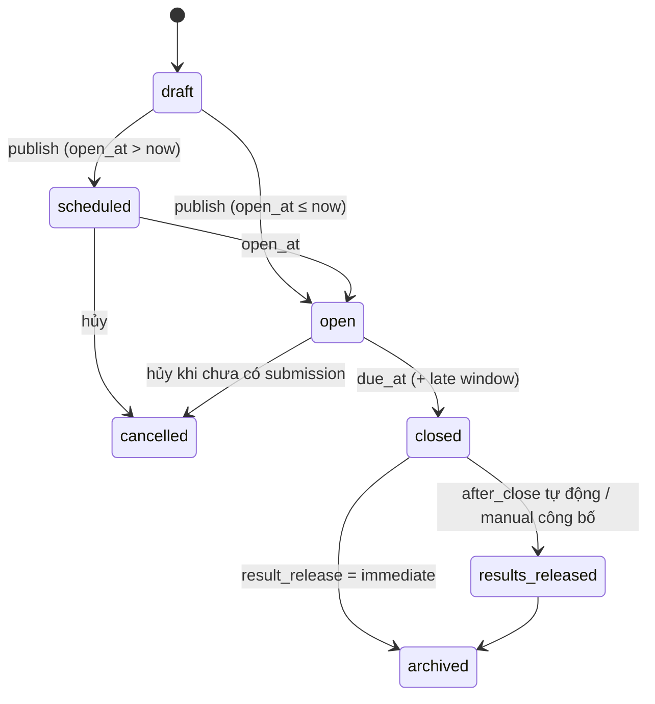

# School & Learning Management (LMS + School Learning Dashboard)

> Trạng thái: Draft · Phiên bản: 0.5 (học sinh tự học, nhà trường quản trị — ADR-0072) · Owner: Product Manager + EdTech Specialist + Backend Architect · Cập nhật: 2026-11-16
> Liên quan: [ADMIN_PORTAL](ADMIN_PORTAL.md) · [ACTIVITY_ENGINE](../02-learning/ACTIVITY_ENGINE.md) · [EXAM_ENGINE](../02-learning/EXAM_ENGINE.md) · [LEARNING_ANALYTICS](../02-learning/LEARNING_ANALYTICS.md) · [LEARNING_EXPERIENCE](../02-learning/LEARNING_EXPERIENCE.md) · [ASSESSMENT_REGULATION_PROFILE](../02-learning/ASSESSMENT_REGULATION_PROFILE.md) · [CONTENT_MODEL](../02-learning/CONTENT_MODEL.md) · [MODERATION](../03-social-multiplayer/MODERATION.md) · [DATA_PRIVACY](../10-security/DATA_PRIVACY.md) · [MULTITENANCY](../06-architecture/MULTITENANCY.md) · [DOMAIN_MODEL §9](../06-architecture/DOMAIN_MODEL.md#9-lms) · [ADR-0027](../adr/ADR-0027-cms-tach-vung-tenant-chi-thao-tac-learning-management-cau-hi.md) · [ADR-0043](../adr/ADR-0043-phat-hanh-noi-dung-draft-publish-con-tro-phien-ban-giu-phien.md) · [ADR-0072](../adr/ADR-0072-bo-vai-tro-giao-vien-hoc-sinh-tu-hoc-kiem-duyet-tap-trung.md)

> [!IMPORTANT]
> **Bỏ khái niệm lớp — [ADR-0095](../adr/ADR-0095-bo-khai-niem-lop-hoc-sinh-theo-khoi.md) (owner chốt 2026-11-21).** LMS không còn Course, Learning Path, Schedule/Lịch, nhóm học tập, quản lý lớp, dashboard lớp. Giao bài tập/đề theo **(trường, khối)** + thêm học sinh khác khối cùng trường − loại học sinh, hoặc danh sách học sinh; `subject_id` trực tiếp; học sinh mới vào khối được thêm vào bài còn mở; bài cũ theo lớp chuyển thành danh sách học sinh. School Learning Dashboard: trường → khối → học sinh, heatmap LO theo khối, che ô < 5 học sinh. Thử thách khối/giải trường từ template chỉ `school_admin`. Menu "Lớp & học sinh" → "Học sinh theo khối"; quyền `lms.class.read` → `lms.student.read`, `tenant.class.read` → `tenant.student.read`, bỏ `lms.course.write`, `lms.learning_path.write`, `lms.schedule.write`, `lms.study_group.write`. Nội dung bên dưới còn nhắc lớp/enrollment/course/learning path/lịch/nhóm học tập sẽ được viết lại ở WP-L1 (giao bài/đề), WP-L2 (dashboard/báo cáo), WP-P1 (màn portal) ([CODE_PLAN §4.2](../12-project/CODE_PLAN_CMS_LMS_FIRST.md#42-kế-hoạch-bỏ-khái-niệm-lớp-adr-0095)); khi mâu thuẫn, ADR-0095 và đoạn này thắng.

> Tài liệu này **gộp LMS Design và School Learning Dashboard**. Đây là đặc tả nghiệp vụ của workspace **C. School & Learning Management** trong Admin Portal. Bố cục portal, permission catalog, chế độ liên tenant của System Admin và tenant chung nằm **duy nhất** ở [ADMIN_PORTAL](ADMIN_PORTAL.md).

## 1. Mục đích và phạm vi

**[Confirmed — ADR-0072]** EduWorld là môi trường **học sinh tự học**: con đường học chính là learning path, quest học tập trong game và **gợi ý ôn tập tự động** theo mastery và đồ thị LO tiên quyết ([LEARNING_EXPERIENCE §6.2](../02-learning/LEARNING_EXPERIENCE.md#62-recommendation-release-10-rule-based), [LEARNING_ANALYTICS](../02-learning/LEARNING_ANALYTICS.md)). Mọi kết quả do server tự chấm (ADR-0016). **Nhà trường quản trị** ở cấp trường: School Admin và Academic Manager (tổ chuyên môn) tạo course, lộ trình, bài giao, lịch, đề theo blueprint, xem kết quả và LO yếu; vai trò và quyền theo [ADMIN_PORTAL §2.3](ADMIN_PORTAL.md#23-role--permission).

**[Confirmed]** LMS quản lý việc **triển khai** học tập ở trường: học sinh học gì, khi nào, kết quả ra sao, và đưa bài nhà trường giao **vào trong thế giới game** (bảng nhiệm vụ lớp ở Learning Zone, NPC Bưu tá Nhím, tab "Nhà trường giao" của quest journal). LMS không sở hữu nội dung (tham chiếu version từ Learning Content Studio) và không tự chấm (dùng [ACTIVITY_ENGINE](../02-learning/ACTIVITY_ENGINE.md), [EXAM_ENGINE](../02-learning/EXAM_ENGINE.md)). Module Go `lms` trong module learning.

**[Confirmed — ADR-0027]** Vận hành tenant chỉ **chọn và giao** nội dung game đã publish và được gán cho tenant (quest, mini-game), tạo thử thách từ **template platform**; không sửa cấu hình game.

**[Confirmed — ADR-0047]** Giao diện theo Admin/Ops UI ([DESIGN_SYSTEM §4](../05-ux/DESIGN_SYSTEM.md#4-adminops-design-system-cmslmsadmin)), không theo phong cách game. Quest/mini-game khi chọn để giao hiển thị thumbnail render từ asset 3D và nút mở `GamePreviewFrame`.

Module con: Course · Learning Path · Enrollment · Assignment · Schedule · Lesson Delivery · Assessment · Learning Progress · School Learning Dashboard · Báo cáo.

**Năm câu hỏi nhà trường cần trả lời mỗi tuần** (School Learning Dashboard §8 dựng theo đúng thứ tự này):

1. Học sinh đã làm bài nhà trường giao chưa?
2. Lớp, khối đang yếu ở LO nào?
3. Học sinh nào cần hỗ trợ ngay (bỏ bài, nhiều LO ở mức `beginning`, làm quá nhanh, lâu không vào game)?
4. Học sinh có tự học và tiến bộ sau gợi ý ôn tập tự động không?
5. Có thông báo vụ việc an toàn nào cần trường liên hệ phụ huynh không?

## 2. Mô hình

```mermaid
erDiagram
  CLASS ||--o{ COURSE : "has (subject × năm học)"
  COURSE ||--o{ LEARNING_PATH : contains
  LEARNING_PATH ||--|{ PATH_NODE : "ordered nodes"
  COURSE ||--o{ ASSIGNMENT : issues
  ASSIGNMENT ||--|{ ASSIGNMENT_TARGET : "to"
  ASSIGNMENT ||--o{ ASSIGNMENT_SUBMISSION : tracks
  ASSIGNMENT }o--o| EXAM_SESSION : "creates (graded exam)"
  COURSE ||--o{ SCHEDULE_ITEM : plans
  STUDY_GROUP ||--o{ ASSIGNMENT_TARGET : "may be"
```

| Entity | Thuộc tính chính | Ghi chú |
|---|---|---|
| **SchoolCurriculumSetting** | `tenant_id`, `school_id`, `academic_year_id`, `grade_level?`, `curriculum_version_id` (`lms.school_curriculum_settings`) | Curriculum version mặc định của trường theo năm học (và khối, tùy chọn) — §3 |
| **Course** | `course_id`, `tenant_id`, `school_id`, `class_id`, `subject_id`, `academic_year_id`, `curriculum_version_id`, `textbook_series_id?`, `status` (`active`/`hidden`/`archived`) | Một lớp × một môn × một năm học; **tự tạo** từ lớp (SIS) × các môn của khối trong curriculum version hiệu lực của trường (§3) [Confirmed]. Không phụ thuộc phân công giảng dạy |
| **LearningPath** | `path_id`, `course_id`, `title`, `unlock_mode` (`sequential`/`free`/`mastery_gate`), `is_template`, `version` (khóa lạc quan `If-Match`, không phải version nội dung) | Không có workflow phát hành (§3) |
| **PathNode** | `node_id`, `path_id`, `position`, `content_ref` (lesson/activity/question_set/assessment/quest) + `content_version_id` ghim, `unlock_rule` | |
| **Enrollment (view)** | Dẫn xuất từ enrollment SIS — LMS **không** tự tạo enrollment lớp | Mỗi học sinh có **đúng một lớp active** (ADR-0060), nên danh sách lớp, sĩ số và target `class` của bài giao luôn xác định; học sinh SIS chưa có lớp không xuất hiện trong lớp nào và không vào được game — hiển thị ở màn "Học sinh chưa có lớp" ([ADMIN_PORTAL §3.16](ADMIN_PORTAL.md)) để trường bổ sung trong SIS/CSV |
| **Assignment** | `assignment_id`, `tenant_id`, `school_id`, `course_id`, `created_by` (School Admin hoặc Academic Manager), `title`, `instructions`, `content_ref`, `pinned_version_id` / `follow_latest`, `mode` (`practice`/`graded`), `open_at`, `due_at`, `late_policy`, `max_attempts`, `score_policy` (`best`/`last`/`first`), `feedback_timing` (FeedbackTiming: `immediate`/`after_submit`/`after_close`/`never`), `result_release` (ResultRelease: `immediate`/`after_close`/`manual`), `status` | `status`: `draft`, `scheduled`, `open`, `closed`, `results_released`, `archived`, `cancelled` (§4) |
| **AssignmentTarget** | `target_type` (`class`/`study_group`/`students`), `target_id`/`student_ids[]` | Snapshot khi publish + đồng bộ khi enrollment đổi (§4.3) |
| **AssignmentSubmission** | `assignment_id`, `student_id`, `status` (`not_started`/`in_progress`/`submitted`/`late`/`missed`/`excused`), `best_attempt_id`, `score`, `submitted_at`, `rapid_guess_count` | Read model từ event attempt; `rapid_guess_count` = số câu trả lời bị gắn cờ `rapid_guess` (định nghĩa ở [ACTIVITY_ENGINE](../02-learning/ACTIVITY_ENGINE.md)) |
| **ScheduleItem** | `course_id`, `date`, `period?`, `kind` (`lesson`/`assignment_due`/`exam`/`event`), `ref` | Lịch hiển thị cho học sinh trong game và cho nhà trường trên portal |
| **StudyGroup** | Nhóm học tập trong lớp hoặc khối do School Admin/Academic Manager tạo — module learning sở hữu (`lms.study_groups`, `lms.study_group_members`; [ADR-0084](../adr/ADR-0084-nhom-hoc-tap-thuoc-learning-service.md)), không phải club; phát `study_group.*` để module chat mở channel `study_group` (từ M5) | Học sinh không tự tạo study group dùng làm đối tượng giao bài |

## 3. Course và Learning Path

- **Curriculum version của trường:** School Admin chọn curriculum version mặc định cho trường theo năm học, tùy chọn theo khối (`lms.school_curriculum_settings`, module learning; FR-CUR-008, [CURRICULUM_MODEL §5](../02-learning/CURRICULUM_MODEL.md#5-đa-chương-trình--di-chuyển-phiên-bản)). Chỉ nhận version đã publish của curriculum thuộc tenant hoặc platform được gán (chưa publish → `409 CONTENT_NOT_PUBLISHED`; chưa gán → `403 RESOURCE_NOT_ASSIGNED`); đổi cài đặt có audit và chỉ áp cho course tạo sau thời điểm đổi. Trường chưa cài đặt dùng version published mới nhất của curriculum tenant sở hữu hoặc được gán.
- Course tạo tự động khi có lớp mới trong năm học (SIS hoặc CSV, event `class.synced`) cho mọi môn của khối theo curriculum version hiệu lực của trường [Confirmed]; School Admin có thể ẩn course trường không dạy (`hidden`).
- Learning Path do Academic Manager (hoặc School Admin) dựng từ thư viện nội dung (nội dung tenant + nội dung platform được gán, ADR-0029) hoặc dùng path mẫu theo bộ sách ([CURRICULUM_MODEL](../02-learning/CURRICULUM_MODEL.md)). Course chưa có path riêng dùng path mẫu mặc định của bộ sách để học sinh luôn có con đường tự học.
- `mastery_gate`: node chỉ mở khi LO trước đạt ≥ `developing`; School Admin/Academic Manager mở khóa thủ công cho học sinh cụ thể (lý do bắt buộc, audit).
- **Learning path không có version nội dung** và không qua workflow duyệt/phát hành: sửa path (thêm/bớt/sắp lại node, đổi `unlock_mode`) lưu trực tiếp với `If-Match`, ghi audit và áp dụng ngay cho học sinh ở lần mở tiếp theo. Tiến độ và mở khóa của học sinh gắn theo `node_id`, nên node giữ nguyên thì tiến độ giữ nguyên; node bị xóa (soft-delete) không còn hiển thị nhưng lịch sử học tập của node đó vẫn giữ. Mỗi node ghim `content_version_id` của nội dung đã publish; nội dung có version mới thì node vẫn dùng version đã ghim cho tới khi nhà trường cập nhật node.
- **Trong game**, path hiện ở bảng nhiệm vụ lớp tại Learning Zone như một chuỗi nhiệm vụ "Nhà trường giao", có phần thưởng game theo reward rule của module game (không ảnh hưởng điểm).

## 4. Assignment



### 4.1. Tạo và giao bài

Người tạo: **School Admin** (trường mình) hoặc **Academic Manager** (trong scope tenant/trường/môn của UserRole). System Admin thao tác thay trên tenant đích khi hỗ trợ (audit).

1. Chọn nội dung **đã publish**: activity (chỉ `activity_type` trong Release — §6), question set, assessment blueprint, lesson, quest, mini-game.
2. Chế độ phiên bản (quy tắc pinning ở [CONTENT_MODEL §5.2](../02-learning/CONTENT_MODEL.md#52-version-pinning--học-sinh-đang-chơi-giữ-version-cũ)):
   - **Giữ phiên bản lúc giao** (mặc định).
   - **Luôn dùng bản mới nhất** (`follow_latest`) [Confirmed] — không áp dụng cho `mode=graded`.
3. Đối tượng (`target_type`): `class` (một hoặc nhiều lớp), `study_group`, `students` (danh sách học sinh) — luôn trong phạm vi trường/scope của người tạo.
4. Thời gian, số lần làm, chính sách điểm, `feedback_timing` (khi nào học sinh thấy đúng/sai và giải thích từng câu) và `result_release` (khi nào công bố kết quả/đáp án). Bài `mode=graded` mặc định `feedback_timing = after_close`, `result_release = after_close` [Confirmed — Technical Architect 2026-11-15].
5. `mode=graded` với assessment → tạo `ExamSession`; còn lại → attempt `mode=assignment`. Bài chẩn đoán đầu năm/đầu chủ đề dùng attempt `mode=diagnostic` [Confirmed] (PED-08, [EDU_FIT_REVIEW](../12-project/EDU_FIT_REVIEW.md)).
6. Nộp muộn: `late_window_hours` từ 0 (mặc định, không nhận nộp muộn) tới tối đa 168 giờ [Confirmed — Technical Architect 2026-11-15]. Nhắc học sinh chưa làm (`:remind`) tối đa 1 lần/ngày/bài (`assignment_remind_limit`) [Confirmed — Technical Architect 2026-11-15].
7. Publish → `assignment.published` → học sinh thấy bài **trong game** (tab "Nhà trường giao" của quest journal, bảng nhiệm vụ lớp, Bưu tá Nhím, thông báo).

### 4.2. Theo dõi

`AssignmentSubmission` cập nhật từ `activity.started`, `activity.submitted`, `activity.graded`, `exam.graded` có `assignment_id` (tên và payload: [EVENT_DESIGN](../07-backend/EVENT_DESIGN.md)); `attempt.re_evaluated` cập nhật lại điểm khi hệ thống chấm lại. Khi `closed`, worker đánh dấu `missed` (trừ `excused`).

### 4.3. Enrollment thay đổi khi bài đang mở

| Tình huống | Xử lý [Confirmed] |
|---|---|
| Học sinh mới vào lớp | Tự thêm vào target nếu `target_type=class` và bài còn `open` |
| Học sinh chuyển lớp/trường | Submission giữ nguyên ở lớp cũ; không thấy bài mới của lớp cũ |
| Tài khoản bị khóa | `excused` tự động nếu khóa trước `due_at` |

### 4.4. Gia hạn, miễn, nhắc

`extend` (`due_at` cá nhân), `excuse` từng học sinh và `remind` (thông báo trong game cho học sinh chưa làm) do School Admin/Academic Manager thực hiện; mọi thao tác ghi audit.

### 4.5. Công bố kết quả và chấm lại

- `result_release = immediate`: học sinh thấy kết quả ngay sau khi nộp; `after_close`: tự công bố khi bài `closed`; `manual`: School Admin/Academic Manager bấm **Công bố kết quả** (`:release-results`) → `results_released`.
- Không có chấm tay hay trả bài. Khi nội dung có lỗi (sai đáp án, câu lỗi), **hệ thống chấm lại** (re-evaluate) do Content Admin hoặc Academic Manager kích hoạt, có lý do và audit; điểm cập nhật qua `attempt.re_evaluated` ([ACTIVITY_ENGINE §7.3](../02-learning/ACTIVITY_ENGINE.md#73-thực-thể-evaluation), [EXAM_ENGINE §9](../02-learning/EXAM_ENGINE.md#9-chấm-lại-regrade)).
- **Hộp thoại chấm lại đề** (workspace C, trang kết quả đề/bài giao `mode=graded`): Academic Manager (`learning_content.re_evaluate`, trong scope môn) chọn câu lỗi trong đề, chọn `action` (`accept_all`/`use_new_key`/`drop_item`, với `use_new_key` chọn version đã sửa), nhập lý do, xem số bài làm bị ảnh hưởng rồi gửi `createRegradeRequest` với `scope = exam_session` (`Idempotency-Key`); theo dõi trạng thái yêu cầu và lịch sử điểm cũ/mới. School Admin không có quyền này (nút ẩn, API `403 PERMISSION_DENIED`).

## 5. Lesson Delivery

- Học sinh mở lesson trong game (Learning Zone). Client gửi heartbeat qua endpoint whitelist ([LEARNING_ANALYTICS](../02-learning/LEARNING_ANALYTICS.md)).
- `lesson.completed` do **server** xác định: đã xem khối bắt buộc (heartbeat ≥ 50% `estimated_duration_sec` [Confirmed]) **và** hoàn thành activity kiểm tra cuối (nếu có).

## 6. Chỉ giao hoạt động tự chấm

**[Confirmed — ADR-0072]** Mọi nội dung giao qua LMS do server tự chấm: `quiz`, `interactive_exercise`, `minigame`, `video_lesson`, `audio_lesson`, `simulation` (loại câu hỏi `short_answer` chấm tự động theo đáp án chấp nhận). Bộ chọn nội dung khi giao bài chỉ liệt kê các loại này. `written_response`, `speaking`, `project`, rubric và hàng đợi chấm **ngoài Release** — thiết kế tham khảo lưu ở [WRITTEN_RESPONSE_RUBRIC](../99-deferred/WRITTEN_RESPONSE_RUBRIC.md).

## 7. Thử thách lớp và giải trường

**School Admin** tạo **Class Challenge** hoặc **giải trường** từ **challenge/tournament template** platform đã publish **và được gán cho tenant** (ADR-0029); chưa gán → `403 RESOURCE_NOT_ASSIGNED`. Chỉ điền `allowed_params` (tên, lớp/khối, lịch, cá nhân/nhóm, question set); tham số khác → `422`. Thực thi ở module competition ([COMPETITION_SYSTEM](../01-game-design/COMPETITION_SYSTEM.md)); LMS chỉ là điểm tạo và xem kết quả. Permission `lms.challenge.write` (chỉ role `school_admin`; System Admin trên tenant đích). Kết quả **không** vào báo cáo kết quả học tập.

## 8. School Learning Dashboard

Người dùng: **School Admin** (trường mình) và **Academic Manager** (trong scope môn/trường của UserRole), permission `analytics.school.read`; API `GET /api/v1/lms/dashboards/school`. Tenant Admin xem bản tổng hợp cấp tenant (`analytics.tenant.read`, §8.8). Điều hướng **trường → khối/lớp → học sinh**; mọi số liệu đọc rollup (ADR-0062). Kết quả là **tham khảo** cho nhà trường, không thay đánh giá chính thức theo quy định của Bộ ([ASSESSMENT_REGULATION_PROFILE](../02-learning/ASSESSMENT_REGULATION_PROFILE.md)).

### 8.1. Trang tổng quan trường

| # | Câu hỏi (§1) | Widget | Metric | Nguồn |
|---|---|---|---|---|
| 1 | Đã làm bài giao chưa? | **Bài giao đang mở / sắp hạn (48 giờ)** | Tỉ lệ nộp theo lớp, số chưa bắt đầu, số `missed` tuần trước | `assignment_submissions` |
| 2 | Yếu ở LO nào? | **LO cần củng cố** + heatmap lớp × LO (§8.3) | Top LO có tỉ lệ học sinh ở mức `beginning` cao nhất theo khối/lớp | Rollup `objective_masteries` |
| 3 | Ai cần hỗ trợ? | **Cần chú ý** | ≥ 2 bài `missed` trong 14 ngày; ≥ 3 LO `beginning`; tỉ lệ câu trả lời `rapid_guess` ≥ 30% trong 7 ngày (hiển thị "làm quá nhanh"); chưa vào game ≥ 7 ngày (`last_login_at`, ADR-0031) — ngưỡng `dashboard_attention_thresholds` [Confirmed — Technical Architect 2026-11-15]; sắp bị dọn do không đăng nhập (ADR-0032, chỉ xem) [Confirmed] | Read model |
| 4 | Có tự học và tiến bộ? | **Tự học & gợi ý** | Thời gian học trung bình/học sinh, % học sinh làm hoạt động gợi ý tự động, số LO chuyển lên mức cao hơn sau ôn tập gợi ý | `progress_daily`, rollup mastery |
| 5 | Vụ việc an toàn? | **Thông báo an toàn** | Số thông báo vụ việc nghiêm trọng liên quan học sinh của trường chưa xác nhận đã liên hệ phụ huynh (tóm tắt, không có nội dung chat) | `GET /api/v1/tenant/safety/school-notifications` (`moderation.school_notification.read`; [ADMIN_PORTAL §3.9](ADMIN_PORTAL.md#39-an-toàn-chat-danh-mục-từ-nhạy-cảm-công-tắc-kiểm-duyệt-và-thông-báo-vụ-việc)) |

### 8.2. Theo dõi bài giao

Bảng học sinh × trạng thái, điểm tự chấm, số lần làm, thời gian, thời điểm nộp, cờ "làm quá nhanh". Hành động: gia hạn, miễn, nhắc (thông báo trong game), công bố kết quả (bài `result_release = manual`).

### 8.3. Bản đồ kỹ năng (LO heatmap)

- **Cấp trường/khối:** hàng = lớp, cột = LO; ô = phân bố mức mastery của lớp (thanh xếp chồng + % học sinh đạt ≥ `proficient`).
- **Cấp lớp:** hàng = học sinh, cột = LO; ô = mức mastery (màu + ký hiệu ○◔◑◕●, không chỉ dựa vào màu). Click ô → evidence gần nhất.
- Nút **"Giao hoạt động / ôn tập cho lớp"**: chọn LO yếu → gợi ý activity, quest, mini-game có `objective_ids` chứa LO đó (ưu tiên LO tiên quyết còn yếu) → giao cho cả lớp hoặc chỉ nhóm học sinh yếu LO đó trong 2 thao tác (tạo assignment `mode=practice`, §4.1). Hoạt động ôn LO tiên quyết do nhà trường giao không bị giảm XP theo quy tắc ở [PROGRESSION_SYSTEM](../01-game-design/PROGRESSION_SYSTEM.md).

### 8.4. Gợi ý tự động cho học sinh

- Mỗi học sinh luôn nhận gợi ý ôn tập tự động có lý do dễ hiểu (Mây trong game) theo thứ tự ưu tiên ở [LEARNING_EXPERIENCE §6.2](../02-learning/LEARNING_EXPERIENCE.md#62-recommendation-release-10-rule-based) và đồ thị LO tiên quyết ([LEARNING_ANALYTICS](../02-learning/LEARNING_ANALYTICS.md)); nhà trường **không cần** thao tác để học sinh được ôn tập.
- Dashboard hiển thị gợi ý đang hiện cho từng học sinh, đã làm hay chưa và thay đổi mastery sau đó; nhà trường có thể giao thêm bài (§8.3) hoặc bài chẩn đoán (`diagnostic`, §4.1).

### 8.5. Hồ sơ học sinh

Tổng quan môn, mastery theo topic, xu hướng 8 tuần, lịch sử bài, gợi ý hệ thống đang hiển thị cho học sinh. Tab **Hoạt động đăng nhập**: lần vào game gần nhất, số ngày chưa vào, 30 phiên gần nhất (nền tảng, thiết bị rút gọn, lý do kết thúc) từ `GET /api/v1/tenant/students/{id}/login-events`; không có IP hay mã thiết bị. **Không hiển thị**: Game Rating, vị trí trong game, danh sách bạn bè, nội dung chat.

### 8.6. Phân tích đề/bài

Phổ điểm, trung vị, tỉ lệ đạt; theo câu: p-value của lớp/trường, lựa chọn sai phổ biến (`misconception_tag`), thời gian trung bình, tỉ lệ `rapid_guess` (loại khỏi p-value); nút "Giao ôn tập cho học sinh sai câu này".

### 8.7. Component và bố cục

| Khối | Component (Ant Design Pro / ops-ui) |
|---|---|
| Khung trang, chọn khối/lớp/môn | `ProLayout` + `Select` khối, lớp, môn |
| Thẻ số liệu | `StatisticCard` |
| Danh sách bài, học sinh | `ProTable` |
| Heatmap LO | `MasteryHeatmap` (ops-ui): bảng lưới màu từ `admin-tokens` + ký hiệu mức, đọc được bằng bàn phím và trình đọc màn hình; biểu đồ cột/đường dùng ECharts (F056) |
| Hồ sơ học sinh | `Descriptions` + `Tabs` + `Timeline` |
| Hoạt động game được giao | `Card` có thumbnail 3D + `GamePreviewFrame` |
| Công thức trong câu hỏi | MathJax 4 (ADR-0055) |

```text
┌──────────────────────────────────────────────────────────────────────────────┐
│ EduWorld · School & LMS   TH Demo A · Khối [3 ▾] Lớp [Tất cả ▾] Môn [Toán ▾]  │
│                                                       🔔 2   ad.truong.a ▾   │
├──────────────────────────────────────────────────────────────────────────────┤
│ ① BÀI GIAO SẮP HẠN                        │ ③ CẦN CHÚ Ý                      │
│ ▸ Bảng nhân 6–9 (hạn 16/11 17:00)          │ ⚠ 7 HS chưa làm 2 bài gần nhất   │
│   3A ███████████░░░ 24/32  3B ████░░ 12/30 │ ⚠ 11 HS yếu "Chia có dư"         │
│ ▸ Ôn chu vi (hạn 18/11)       9/62         │ ⓘ 4 HS làm quá nhanh             │
│                                           │ ⓘ 5 HS không vào game 7 ngày     │
├───────────────────────────────────────────┴──────────────────────────────────┤
│ ② LO CẦN CỦNG CỐ: Chia có dư (3B) · Nhân với 7 (3A, 3C)  [Bản đồ kỹ năng]     │
│ ④ TỰ HỌC TUẦN NÀY  TB 42 phút/HS · 68% HS làm ôn tập gợi ý · 37 LO tiến bộ   │
│ ⑤ AN TOÀN  1 thông báo chờ xác nhận liên hệ phụ huynh            [Xem]       │
├──────────────────────────────────────────────────────────────────────────────┤
│ [+ Giao bài mới] [Giao ôn tập theo LO] [Nhóm học tập] [Thử thách lớp*]        │
└──────────────────────────────────────────────────────────────────────────────┘
* chỉ School Admin
```

### 8.8. Hiệu năng và UX

- Đọc read model trạng thái hiện tại và **rollup chuỗi thời gian** ([LEARNING_ANALYTICS §5](../02-learning/LEARNING_ANALYTICS.md#5-read-models--aggregation)), không đọc bảng nghiệp vụ hay `learning_events`; cơ chế dữ liệu, read replica, timeout 5 giây, cache và giới hạn khoảng thời gian (tối đa 2 năm, độ hạt tự chọn) theo [DASHBOARD_DATA](../07-backend/DASHBOARD_DATA.md) (ADR-0062). Tiến độ bài giao gần realtime qua `assignment.submission_updated`; số liệu tuần cập nhật ≤ 15 phút (`school_dashboard_refresh`, [CONFIG_DEFAULTS](../00-overview/CONFIG_DEFAULTS.md)).
- Mỗi widget hiển thị **"Cập nhật lúc HH:mm"** từ `data_as_of`; số liệu hôm nay có nhãn "tạm tính" (`is_partial`) cho tới khi chốt ngày (02:30 ICT).
- Cấp trường/khối đọc `rollup_school_*`; bản tổng hợp tenant (Tenant Admin) đọc `rollup_tenant_*`; khoảng > 31 ngày tự chuyển độ hạt tuần, > 1 năm chuyển tháng.
- Trang tổng quan tải < 1,5 giây p95 cho trường 1.500 học sinh; trang lớp < 1,5 giây p95 cho lớp 45 học sinh [Confirmed].
- Ngôn ngữ trung tính ("cần hỗ trợ" thay vì "kém"); không xếp hạng học sinh theo điểm học tập [Confirmed].

## 9. Phạm vi dữ liệu theo vai trò

Permission catalog và role mapping: [ADMIN_PORTAL §2](ADMIN_PORTAL.md#2-permission-model). Bảng dưới là **phạm vi dữ liệu** LMS áp lên các permission đó, kiểm tra theo scope của UserRole (`tenant`, `school`, `subject`); repository luôn lọc `tenant_id` + `deleted_at IS NULL`. Không có phạm vi theo lớp hay phân công giảng dạy (ADR-0072).

| Hành động / dữ liệu | Tenant Admin | School Admin | Academic Manager |
|---|---|---|---|
| Xem course, bài giao | Toàn tenant (chỉ đọc) | Trường mình | Trong scope (tenant/trường/môn) |
| Tạo/sửa bài giao, lịch, learning path; gia hạn/miễn/nhắc; công bố kết quả | ✘ | Trường mình | Trong scope |
| Thử thách lớp, giải trường từ template | ✘ | Trường mình | ✘ |
| Tạo study group | ✘ | Trường mình | Trong scope |
| Kết quả học tập, dashboard | Tổng hợp tenant, drill-down tới trường | Trường → lớp → học sinh | Trong scope, tới học sinh |
| Họ tên, mã học sinh | ✔ | ✔ | ✔ (trong scope) |
| Ngày sinh, liên hệ phụ huynh | Theo policy tenant | Theo policy trường | ✘ |
| Thông báo vụ việc an toàn (tóm tắt) | ✔ | Trường mình | ✘ |
| Nội dung chat (mọi kênh) | ✘ — chỉ Platform Safety Team trong module moderation | ✘ | ✘ |
| Game Rating, XP, inventory | Tổng hợp | Tổng hợp | ✘ |

- Truy cập hồ sơ ngoài scope → `403`/`404` (không lộ sự tồn tại); xem hồ sơ học sinh ghi audit [Confirmed].
- Học sinh chuyển lớp trong trường: dữ liệu giai đoạn cũ vẫn hiển thị theo lớp cũ; chuyển trường: trường cũ xem dữ liệu giai đoạn học tại trường trong 1 năm học [Confirmed].
- "Xóa" bài giao/thử thách/course là soft-delete (ADR-0028); bài đã có lượt làm chỉ `cancel`.

## 10. Báo cáo kết quả

- **Không có sổ điểm chấm tay.** Bảng kết quả course [Confirmed]: cột = bài `mode=graded`, giá trị là điểm **tự chấm** theo `score_policy`, thang 10; không có cột XP, rating, competition points; không đồng bộ ngược SIS trong Release 1.0 [Confirmed — owner 2026-11-20, OQ-01].
- **Báo cáo tham khảo theo quy định đánh giá:** mức theo TT27/2020 (tiểu học) và TT22/2021 (THCS) suy ra từ kết quả tự chấm và mastery theo profile ở [ASSESSMENT_REGULATION_PROFILE](../02-learning/ASSESSMENT_REGULATION_PROFILE.md); luôn ghi nhãn "Tham khảo — không thay đánh giá chính thức" [Confirmed].

| Báo cáo | Định dạng | Nội dung |
|---|---|---|
| Kết quả bài giao | XLSX, CSV | Học sinh × điểm tự chấm, trạng thái, thời gian, cờ "làm quá nhanh" |
| Bảng kết quả course | XLSX | Các bài graded |
| Báo cáo tham khảo TT27/TT22 | XLSX, PDF | Mức tham khảo theo môn/LO, nhãn "Tham khảo" |
| Bản đồ kỹ năng | XLSX, PDF | LO × lớp hoặc LO × học sinh |
| Báo cáo trường/lớp tháng | PDF | Tiến độ, LO mạnh/yếu, mức tham gia, tự học sau gợi ý |

Xuất là job nền (`POST /api/v1/lms/reports` → `report_id`, URL ký 15 phút; worker đọc read replica theo lô, giới hạn theo [DASHBOARD_DATA §10](../07-backend/DASHBOARD_DATA.md#10-xuất-báo-cáo-bất-đồng-bộ)), có watermark, chỉ dữ liệu trong quyền, audit `report.exported`, không xuất chat.

## 11. API

| Method | Path | Mô tả |
|---|---|---|
| GET | `/api/v1/lms/courses?school_id=&class_id=&subject=` | Course trong scope |
| PATCH | `/api/v1/lms/courses/{id}` | Ẩn/hiện course (`status`) |
| GET / PUT | `/api/v1/lms/schools/{school_id}/curriculum-settings?academic_year_id=` | Curriculum version mặc định của trường theo năm học/khối (`getSchoolCurriculumSettings`, `putSchoolCurriculumSettings` — `school.settings.write`, `If-Match`) |
| GET/POST/PATCH | `/api/v1/lms/courses/{course_id}/paths` | Learning path (sửa trực tiếp, `If-Match`, không có workflow phát hành) |
| POST | `/api/v1/lms/courses/{course_id}/paths/{path_id}/nodes/{node_id}/students/{student_id}:unlock` | Mở khóa node thủ công (lý do bắt buộc) |
| GET/POST/PATCH/DELETE | `/api/v1/lms/schedules` | Lịch (`lms.schedule.write`; xóa = soft-delete) |
| GET | `/api/v1/learning/my-learning-paths?subject_id=` · `/api/v1/learning/my-schedule?from=&to=` | Học sinh (game): lộ trình và lịch của mình |
| GET / POST | `/api/v1/lms/assignments` | Danh sách / tạo (Idempotency-Key) |
| POST | `/api/v1/lms/assignments/{id}:publish` · `:cancel` · `:release-results` · `:archive` · `:remind` | Workflow (`:remind` [Confirmed]) |
| POST | `/api/v1/lms/assignments/{id}/students/{sid}:extend` · `:excuse` | Ngoại lệ cá nhân |
| GET | `/api/v1/lms/assignments/{id}/submissions` | Theo dõi |
| GET | `/api/v1/learning/my-assignments?status=` (`listMyAssignments`) (lịch hạn nộp lấy từ danh sách này; route `/lms/*` chỉ dành cho nhân sự) | Học sinh (game) |
| GET | `/api/v1/lms/dashboards/school?school_id=&grade=&class_id=&subject=&from=&to=` | School Learning Dashboard (§8, đọc rollup; `analytics.school.read`) |
| GET | `/api/v1/lms/courses/{id}/results` | Bảng kết quả course (tự chấm) |
| CRUD | `/api/v1/lms/schools/{school_id}/study-groups` | Nhóm học tập (lớp hoặc khối) — ADR-0084 |
| GET / POST | `/api/v1/lms/challenges` | Thử thách từ template (`lms.challenge.write`) |
| GET | `/api/v1/lms/catalog/challenge-templates` · `/api/v1/lms/catalog/game-activities` | Danh mục chỉ đọc |
| POST | `/api/v1/lms/reports` | Xuất báo cáo |
| POST | `/api/v1/cms/learning/regrade-requests` (`scope = exam_session`) | Hộp thoại chấm lại đề (§4.5), `learning_content.re_evaluate` |

Không có endpoint hàng đợi chấm (`/api/v1/lms/reviews…`) trong Release (ADR-0072).

**Endpoint danh mục và tổ chức (ADR-0060) — đã có trong OpenAPI (SPEC-3), x-service `identity`; tóm tắt dưới đây, chuẩn ở [API_DESIGN §9.1.1, §9.16](../07-backend/API_DESIGN.md#911-danh-mục--apiv1catalog-adr-0060):**

| Method | Path | Quyền | Mô tả |
|---|---|---|---|
| GET | `/api/v1/catalog/countries` | mọi người dùng đã đăng nhập | Danh sách quốc gia `active` (song ngữ theo `Accept-Language`) |
| GET | `/api/v1/catalog/provinces?country=VN&status=active` | mọi người dùng đã đăng nhập | Tỉnh/thành theo quốc gia; `status=all` chỉ cho System Admin |
| GET | `/api/v1/catalog/schools?province=&school_level=&q=` | Tenant user: trường trong tenant; System Admin: thêm `tenant_ids[]` | Danh mục trường (phân trang cursor) |
| GET/PATCH | `/api/v1/tenant/schools/{school_id}` | `tenant.school.write` | Xem/sửa thông tin hiển thị; `:approve` cho trường `pending_review` |
| GET | `/api/v1/tenant/schools/{school_id}/classes?academic_year=&grade=` | `tenant.class.read` | Lớp và sĩ số |
| GET | `/api/v1/tenant/students/unassigned` | `tenant.class.read` | Học sinh SIS chưa có lớp (`missing_class`) |
| POST/PATCH | `/api/v1/admin/catalog/countries`, `/api/v1/admin/catalog/countries/{code}` | `platform.catalog.write` (gateway nội bộ) | Bật/tắt, sửa tên |
| POST/PATCH | `/api/v1/admin/catalog/provinces`, `/api/v1/admin/catalog/provinces/{province_id}` | `platform.catalog.write` | Tạo đơn vị mới, sửa tên/`official_code`, đặt `inactive` |
| POST | `/api/v1/admin/catalog/province-successions` | `platform.catalog.write` | Ghi kế thừa cũ → mới |
| POST | `/api/v1/admin/schools:import` | `platform.catalog.write` | Import CSV trường (dry-run, bất đồng bộ, Idempotency-Key) |
| — | `PlayerBootstrap.school` / `.class` (trả khi đăng nhập game) | học sinh | Trường (tên song ngữ, tỉnh/thành), lớp, khối của chính học sinh — không có endpoint riêng |

Path chuẩn: [API_DESIGN](../07-backend/API_DESIGN.md) và OpenAPI.

## 12. Events

| Event | Producer | Consumer |
|---|---|---|
| `assignment.published` | lms | notification, module game (bảng nhiệm vụ lớp, tab "Nhà trường giao") |
| `assignment.closed` | lms (worker) | lms (missed), analytics |
| `assignment.results_released` | lms | notification |
| `assignment.submission_updated` | lms | School Learning Dashboard (refresh realtime) |

## 13. Yêu cầu và nghiệm thu

Mã FR/US, nhãn và phase do [PRODUCT_REQUIREMENTS](../00-overview/PRODUCT_REQUIREMENTS.md) (§2.27 `LMS`, §4) cấp (ADR-0082); hai bảng FR và US dưới chỉ chỉ ra phần chi tiết trong tài liệu này. Tiêu chí nghiệm thu chi tiết của domain dùng mã `AC-LMS-*`.

| Yêu cầu (mã PRD) | Chi tiết trong tài liệu này |
|---|---|
| FR-LMS-001 | Mô hình Course, Learning Path, Enrollment, Assignment, Schedule, Lesson Delivery, Assessment, Progress, Analytics, School Learning Dashboard (§2, §3, §5) |
| FR-LMS-002 | Nhà trường giao bài tập, đề ôn tập (§4.1), công bố kết quả (§4.5) |
| FR-LMS-003 | Theo dõi kết quả, tiến độ, kỹ năng yếu (§4.2, §8) |
| FR-LMS-004 | Nhóm học tập (§2); thử thách lớp, giải trường (§7) |
| FR-LMS-005 | Phạm vi dữ liệu theo tenant, trường, môn — không theo lớp/phân công (§9) |
| FR-LMS-006 | Bài giao xuất hiện trong game: tab "Nhà trường giao", bảng nhiệm vụ lớp, Bưu tá Nhím (§4.1, §12) |
| FR-LMS-007 | Chỉ chọn quest/mini-game đã publish được gán; thử thách/giải trường từ template platform, chỉ `allowed_params` (§6, §7) |
| FR-LMS-011 | School Learning Dashboard (§8) |
| FR-LMS-012 | Gia hạn, miễn, nhắc cá nhân (§4.4) |
| FR-LMS-013 | Bảng kết quả tự chấm và xuất báo cáo (§10) |
| FR-CNT-011 | Ghim version nội dung khi giao bài (mặc định) hoặc `follow_latest` (§4.1) |
| FR-CMS-010, FR-CMS-011 | Vận hành tenant chỉ thao tác Learning Management, không truy cập cấu hình game (§1, §9) |
| FR-ANL-015 | Báo cáo tham khảo TT27/TT22 (§10, [ASSESSMENT_REGULATION_PROFILE](../02-learning/ASSESSMENT_REGULATION_PROFILE.md)) |

| AC | Kịch bản |
|---|---|
| AC-LMS-001 | `ad.truong.a` (School Admin TH Demo A) giao question set cho lớp 3A → mọi HS active của 3A thấy bài trong tab "Nhà trường giao"; HS 3B không thấy; `ad.truong.b` (School Admin trường B) không thấy bài này |
| AC-LMS-002 | Sau khi giao (giữ phiên bản), publish version mới hoặc rollback → bài đã giao dùng version đã ghim |
| AC-LMS-003 | `qlcm.truong.a` (Academic Manager scope môn Toán) tạo bài cho course Tiếng Việt 3A → `403` |
| AC-LMS-004 | Hết hạn, HS chưa nộp → `missed`; HS được `excuse` → không tính |
| AC-LMS-005 | Tạo challenge với `reward` ngoài `allowed_params` → `422`; tham số hợp lệ → luật/phần thưởng lấy từ template; Academic Manager tạo challenge → `403` |
| AC-LMS-006 | School Admin không thấy workspace Game Ops/Live Ops/Platform; gọi `/api/v1/game-admin/*` qua gateway public → không có route |
| AC-LMS-007 | Bộ chọn nội dung khi giao bài không liệt kê `written_response`/`speaking`/`project`; gọi API tạo assignment với activity loại đó → `422` |
| AC-LMS-008 | Bài `result_release = manual`: học sinh không thấy kết quả cho tới khi `:release-results`; `after_close`: tự công bố khi `closed` |
| AC-LMS-010 | `ad.truong.a` mở dashboard thấy đúng các lớp của trường mình trong năm học hiện tại; drill-down trường → lớp → học sinh |
| AC-LMS-011 | Heatmap khớp `objective_masteries` (lệch do cache ≤ 15 phút) |
| AC-LMS-012 | School Admin trường A gọi hồ sơ HS trường B cùng tenant → `403`/`404`, không lộ sự tồn tại |
| AC-LMS-013 | Báo cáo xuất không chứa HS ngoài scope, có watermark; báo cáo TT27/TT22 có nhãn "Tham khảo" |
| AC-LMS-014 | Nhà trường giao quest đã publish cho nhóm HS → HS thấy quest trong bảng nhiệm vụ game; portal không có thao tác sửa quest |
| AC-LMS-015 | Tab Hoạt động đăng nhập hiện đúng lần đăng nhập gần nhất; HS ngoài scope → 404 |
| AC-LMS-016 | Bài `follow_latest`: lượt mới sau publish nhận version mới; lượt đang làm giữ version cũ |
| AC-LMS-017 | HS có ≥ 30% câu trả lời `rapid_guess` trong 7 ngày xuất hiện ở "Cần chú ý" với nhãn "làm quá nhanh"; câu `rapid_guess` không tính vào p-value phân tích đề |
| AC-LMS-018 | Dashboard và mọi API LMS không trả nội dung chat; widget an toàn chỉ có tóm tắt và trạng thái xác nhận liên hệ phụ huynh; `sm.antoan` (Safety Moderator) gọi `GET /lms/dashboards/school` → `403` |

| User story (mã PRD) | Màn hình / mục trong tài liệu này |
|---|---|
| US-LMS-001 | Giao bài (§4.1) |
| US-LMS-002 | Bản đồ kỹ năng — LO heatmap (§8.3) |
| US-LMS-003 | Trang tổng quan trường (§8.1) |
| US-LMS-004 | Theo dõi bài giao (§8.2) |
| US-LMS-005 | Hồ sơ học sinh (§8.5) |
| US-LMS-006 | Giao ôn tập cho lớp/nhóm yếu một LO trong 2 thao tác (§8.3) |
| US-LMS-007 | Phân tích đề/bài (§8.6) |
| US-LMS-008, US-TRN-001 | Nhóm học tập (§2); thử thách lớp từ template (§7) |
| US-MOD-004 | Widget thông báo an toàn, xác nhận đã liên hệ phụ huynh (§8.1) |
| US-LMS-009 | Gợi ý tự động cho học sinh — tự học sau gợi ý (§8.4) |
| US-LMS-010 | Báo cáo kết quả, gồm tham khảo TT27/TT22 (§10) |
| US-LMS-011 | Giao quest/mini-game theo LO yếu (§4.1, §6) |
