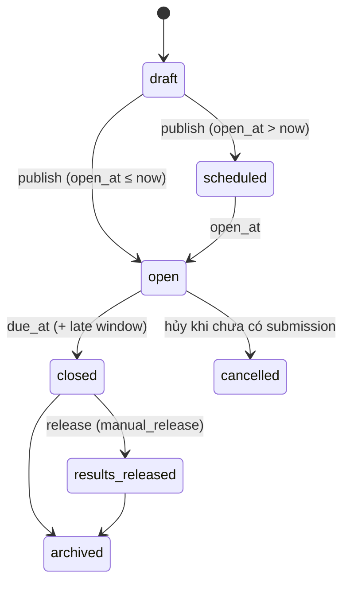

# School & Learning Management (LMS + Teacher Dashboard)

> Trạng thái: Draft · Phiên bản: 0.3 · Owner: Product Manager + EdTech Specialist + Backend Architect · Cập nhật: 2026-11-15
> Liên quan: [ADMIN_PORTAL](ADMIN_PORTAL.md) · [ACTIVITY_ENGINE](../02-learning/ACTIVITY_ENGINE.md) · [EXAM_ENGINE](../02-learning/EXAM_ENGINE.md) · [WRITTEN_RESPONSE_RUBRIC](../02-learning/WRITTEN_RESPONSE_RUBRIC.md) · [LEARNING_ANALYTICS](../02-learning/LEARNING_ANALYTICS.md) · [CONTENT_MODEL](../02-learning/CONTENT_MODEL.md) · [MODERATION](../03-social-multiplayer/MODERATION.md) · [DATA_PRIVACY](../10-security/DATA_PRIVACY.md) · [MULTITENANCY](../06-architecture/MULTITENANCY.md) · [DOMAIN_MODEL §9](../06-architecture/DOMAIN_MODEL.md#9-lms) · [ADR-0027](../adr/ADR-0027-cms-tach-vung-tenant-chi-thao-tac-learning-management-cau-hi.md) · [ADR-0043](../adr/ADR-0043-phat-hanh-noi-dung-draft-publish-con-tro-phien-ban-giu-phien.md)

> Tài liệu này **gộp LMS Design và Teacher Dashboard**. Đây là đặc tả nghiệp vụ của workspace **C. School & Learning Management** trong Admin Portal. Bố cục portal, permission catalog, chế độ liên tenant của System Admin và tenant chung nằm **duy nhất** ở [ADMIN_PORTAL](ADMIN_PORTAL.md).

## 1. Mục đích và phạm vi

**[Confirmed]** LMS quản lý việc **triển khai** học tập ở trường: ai học gì, khi nào, kết quả ra sao, và đưa bài giáo viên giao **vào trong thế giới game** (bảng nhiệm vụ lớp ở Learning Zone, NPC giáo viên). LMS không sở hữu nội dung (tham chiếu version từ Learning Content Studio) và không tự chấm (dùng [ACTIVITY_ENGINE](../02-learning/ACTIVITY_ENGINE.md), [EXAM_ENGINE](../02-learning/EXAM_ENGINE.md)). Module Go `lms` trong learning-service.

**[Confirmed — ADR-0027]** Vận hành tenant (Tenant Admin, School Admin, Academic Manager, giáo viên) chỉ **chọn và giao** nội dung game đã publish và được gán cho tenant (quest, mini-game), tạo thử thách từ **template platform**; không sửa cấu hình game.

**[Confirmed — ADR-0047]** Giao diện theo Admin/Ops UI ([DESIGN_SYSTEM §4](../05-ux/DESIGN_SYSTEM.md#4-adminops-design-system-cmslmsadmin)), không theo phong cách game. Quest/mini-game khi chọn để giao hiển thị thumbnail render từ asset 3D và nút mở `GamePreviewFrame`.

Module con: Course · Learning Path · Enrollment · Assignment · Schedule · Lesson Delivery · Assessment · Review Queue · Learning Progress · Teacher Dashboard · Báo cáo.

**Mục tiêu của giáo viên mỗi ngày:** (1) học sinh đã làm bài được giao chưa; (2) lớp đang yếu ở LO nào; (3) em nào cần hỗ trợ ngay; (4) có bài nào chờ mình chấm; (5) có vấn đề an toàn nào trong kênh chat lớp.

## 2. Mô hình

```mermaid
erDiagram
  CLASS ||--o{ COURSE : "has (subject × năm học)"
  COURSE ||--o{ LEARNING_PATH : contains
  LEARNING_PATH ||--|{ PATH_NODE : "ordered nodes"
  COURSE ||--o{ ASSIGNMENT : issues
  ASSIGNMENT ||--|{ ASSIGNMENT_TARGET : "to"
  ASSIGNMENT ||--o{ ASSIGNMENT_SUBMISSION : tracks
  ASSIGNMENT }o--o| EXAM_SESSION : "creates (graded exam)"
  COURSE ||--o{ SCHEDULE_ITEM : plans
  STUDY_GROUP ||--o{ ASSIGNMENT_TARGET : "may be"
```

| Entity | Thuộc tính chính | Ghi chú |
|---|---|---|
| **Course** | `course_id`, `tenant_id`, `school_id`, `class_id`, `subject_id`, `academic_year_id`, `curriculum_version_id`, `textbook_series_id?`, `teacher_ids[]`, `status` | Một lớp × một môn × một năm học; tự tạo từ TeachingAssignment (SIS) [Proposed] |
| **LearningPath** | `path_id`, `course_id`, `title`, `unlock_mode` (`sequential`/`free`/`mastery_gate`) | |
| **PathNode** | `node_id`, `path_id`, `position`, `content_ref` (lesson/activity/question_set/assessment/quest version), `unlock_rule` | |
| **Enrollment (view)** | Dẫn xuất từ enrollment SIS — LMS **không** tự tạo enrollment lớp | Mỗi học sinh có **đúng một lớp active** (ADR-0060), nên danh sách lớp, sĩ số và target `class` của bài giao luôn xác định; học sinh SIS chưa có lớp không xuất hiện trong lớp nào và không vào được game — hiển thị ở màn "Học sinh chưa có lớp" ([ADMIN_PORTAL §3.16](ADMIN_PORTAL.md)) để trường bổ sung trong SIS/CSV |
| **Assignment** | `assignment_id`, `tenant_id`, `school_id`, `course_id`, `created_by`, `title`, `instructions`, `content_ref`, `pinned_version_id` / `follow_latest`, `mode` (`practice`/`graded`), `open_at`, `due_at`, `late_policy`, `max_attempts`, `score_policy` (`best`/`last`/`first`), `result_visibility`, `status` | |
| **AssignmentTarget** | `target_type` (`class`/`study_group`/`students`), `target_id`/`student_ids[]` | Snapshot khi publish + đồng bộ khi enrollment đổi (§4.3) |
| **AssignmentSubmission** | `assignment_id`, `student_id`, `status` (`not_started`/`in_progress`/`submitted`/`pending_review`/`late`/`missed`/`excused`), `best_attempt_id`, `score`, `submitted_at` | Read model từ event attempt |
| **ScheduleItem** | `course_id`, `date`, `period?`, `kind` (`lesson`/`assignment_due`/`exam`/`event`), `ref` | Lịch cho học sinh và giáo viên |
| **StudyGroup** | Nhóm giáo viên tạo trong lớp — là một loại Guild/Club (ADR-0050), LMS tham chiếu | |

## 3. Course và Learning Path

- Course tạo tự động khi SIS có TeachingAssignment mới [Proposed]; giáo viên có thể ẩn course không dùng.
- Learning Path dựng từ thư viện nội dung (nội dung tenant + nội dung platform được gán, ADR-0029) hoặc path mẫu theo bộ sách ([CURRICULUM_MODEL](../02-learning/CURRICULUM_MODEL.md)).
- `mastery_gate`: node chỉ mở khi LO trước đạt ≥ `developing`; giáo viên mở khóa thủ công cho học sinh cụ thể.
- **Trong game**, path hiện ở bảng nhiệm vụ lớp tại Learning Zone như một chuỗi nhiệm vụ của NPC giáo viên, có phần thưởng game theo reward rule của game-service (không ảnh hưởng điểm).

## 4. Assignment



### 4.1. Tạo và giao bài

1. Chọn nội dung **đã publish**: activity, question set, assessment blueprint, lesson, quest, mini-game.
2. Chế độ phiên bản (quy tắc pinning ở [CONTENT_MODEL §5.2](../02-learning/CONTENT_MODEL.md#52-version-pinning--học-sinh-đang-chơi-giữ-version-cũ)):
   - **Giữ phiên bản lúc giao** (mặc định).
   - **Luôn dùng bản mới nhất** (`follow_latest`) [Proposed] — không áp dụng cho `mode=graded`.
3. Đối tượng: cả lớp, nhóm học tập, một số học sinh (chỉ trong lớp mình dạy).
4. Thời gian, số lần làm, chính sách điểm, hiển thị kết quả.
5. `mode=graded` với assessment → tạo `ExamSession`; còn lại → attempt `mode=assignment`.
6. Publish → `assignment.published` → học sinh thấy bài **trong game** (NPC giáo viên/bảng nhiệm vụ lớp, thông báo) và trong danh sách bài.

### 4.2. Theo dõi

`AssignmentSubmission` cập nhật từ `exercise.started`, `exercise.submitted`, `attempt.review_requested`, `exam.graded` có `context_ref.assignment_id`. Khi `closed`, worker đánh dấu `missed` (trừ `excused`).

### 4.3. Enrollment thay đổi khi bài đang mở

| Tình huống | Xử lý [Proposed] |
|---|---|
| Học sinh mới vào lớp | Tự thêm vào target nếu `target_type=class` và bài còn `open` |
| Học sinh chuyển lớp/trường | Submission giữ nguyên ở lớp cũ; không thấy bài mới của lớp cũ |
| Tài khoản bị khóa | `excused` tự động nếu khóa trước `due_at` |

### 4.4. Gia hạn và miễn

`extend` (`due_at` cá nhân) hoặc `excuse` từng học sinh; mọi thao tác ghi audit.

## 5. Lesson Delivery

- Học sinh mở lesson trong game (Learning Zone). Client gửi heartbeat qua endpoint whitelist ([LEARNING_ANALYTICS](../02-learning/LEARNING_ANALYTICS.md)).
- `lesson.completed` do **server** xác định: đã xem khối bắt buộc (heartbeat ≥ 50% `estimated_duration_sec` [Proposed]) **và** hoàn thành activity kiểm tra cuối (nếu có).

## 6. Hàng đợi chấm (Review Queue)

Bài tự luận, **bài nói (ghi âm, giáo viên nghe và chấm tay — không có AI giọng nói trong Release 1.0, ADR-0059)**, dự án cần giáo viên chấm vào hàng đợi trong workspace C. Quy trình chấm theo rubric, trả bài, chấm lại và API (`/api/v1/lms/reviews…`) đặc tả **duy nhất** ở [WRITTEN_RESPONSE_RUBRIC §6](../02-learning/WRITTEN_RESPONSE_RUBRIC.md#6-hàng-đợi-chấm-của-giáo-viên-teacher-review-queue). Dashboard (§8.1) hiển thị số bài chờ chấm và hạn chấm.

## 7. Thử thách học tập do giáo viên tổ chức

Giáo viên/School Admin/Tenant Admin tạo **Class Challenge** hoặc **giải trường** (tenant `unit`: giải liên trường trong đơn vị) từ **challenge/tournament template** platform đã publish **và được gán cho tenant** (ADR-0029); chưa gán → `403 RESOURCE_NOT_ASSIGNED`. Tenant chỉ điền `allowed_params` (tên, lớp/khối, lịch, cá nhân/nhóm, question set); tham số khác → `422`. Thực thi ở competition-service ([COMPETITION_SYSTEM](../01-game-design/COMPETITION_SYSTEM.md)); LMS chỉ là điểm tạo và xem kết quả. Permission `lms.challenge.write`. Kết quả **không** vào sổ điểm.

## 8. Teacher Dashboard

### 8.1. Trang chủ giáo viên

| Widget | Metric | Nguồn |
|---|---|---|
| Bài sắp đến hạn (48 giờ) | Tỉ lệ nộp, số chưa bắt đầu | `assignment_submissions` |
| Chờ chấm | Số bài `pending_review`, bài gần hạn chấm | Review queue |
| Cần chú ý | ≥ 2 bài `missed` trong 14 ngày; ≥ 3 LO `beginning`; chưa vào game ≥ 7 ngày (`last_login_at`, ADR-0031); sắp bị dọn do không đăng nhập (ADR-0032, chỉ xem) | Read model |
| Hoạt động lớp tuần này | Thời gian học trung bình, bài hoàn thành, độ chính xác | `progress_daily` |
| An toàn | Báo cáo chat chờ xử lý trong kênh lớp | Moderation cases |

### 8.2. Theo dõi bài giao

Bảng học sinh × trạng thái, điểm, số lần làm, thời gian, thời điểm nộp. Hành động: gia hạn, miễn, nhắc (thông báo trong game), công bố kết quả.

### 8.3. Bản đồ kỹ năng (LO heatmap)

Hàng = học sinh, cột = LO; ô = mức mastery (màu + ký hiệu ○◔◑◕●, không chỉ dựa vào màu). Click ô → evidence gần nhất. Nút **"Giao hoạt động game"**: chọn LO yếu → gợi ý quest/mini-game có `objective_ids` chứa LO đó → giao cho nhóm học sinh trong 2 thao tác.

### 8.4. Hồ sơ học sinh

Tổng quan môn, mastery theo topic, xu hướng 8 tuần, lịch sử bài, gợi ý hệ thống đang hiển thị cho học sinh. Tab **Hoạt động đăng nhập**: lần vào game gần nhất, số ngày chưa vào, 30 phiên gần nhất (nền tảng, thiết bị rút gọn, lý do kết thúc) từ `GET /api/v1/tenant/students/{id}/login-events`; không có IP hay mã thiết bị. **Không hiển thị**: Game Rating, vị trí trong game, danh sách bạn bè, nội dung chat riêng.

### 8.5. Phân tích đề/bài

Phổ điểm, trung vị, tỉ lệ đạt; theo câu: p-value lớp, lựa chọn sai phổ biến (`misconception_tag`), thời gian trung bình; nút "Giao ôn tập cho học sinh sai câu này".

### 8.6. Component

| Khối | Component (Ant Design Pro / ops-ui) |
|---|---|
| Khung trang, chọn lớp | `ProLayout` + `Select` lớp |
| Thẻ số liệu | `StatisticCard` |
| Danh sách bài, học sinh | `ProTable` |
| Heatmap LO | Heatmap ECharts, màu từ `admin-tokens`, kèm ký hiệu |
| Hồ sơ học sinh | `Descriptions` + `Tabs` + `Timeline` |
| Hoạt động game được giao | `Card` có thumbnail 3D + `GamePreviewFrame` |
| Công thức trong câu hỏi/bài làm | MathJax 4 (ADR-0055) |

```text
┌────────────────────────────────────────────────────────────────────────────┐
│ EduWorld · Giáo viên      Lớp: [3A ▾] Môn: [Toán ▾]     🔔 2   Cô Lan ▾  │
├────────────────────────────────────────────────────────────────────────────┤
│ BÀI SẮP ĐẾN HẠN                         │ CẦN CHÚ Ý                        │
│ ▸ Bảng nhân 6–9 (hạn 16/11 17:00)        │ ⚠ 3 HS chưa làm 2 bài gần nhất   │
│   ███████████░░░░  24/32 đã nộp          │ ⚠ 5 HS yếu "Chia có dư"          │
│ ▸ Ôn chu vi (hạn 18/11)                  │ ✎ 4 bài tự luận chờ chấm         │
│   ████░░░░░░░░░░░   9/32                 │ ⓘ 2 HS không vào game 7 ngày     │
├──────────────────────────────────────────┴─────────────────────────────────┤
│ TUẦN NÀY   Thời gian học TB: 42 phút/HS · Bài hoàn thành: 118 · Đúng: 76%   │
├────────────────────────────────────────────────────────────────────────────┤
│ [+ Giao bài mới] [Bản đồ kỹ năng] [Chấm bài] [Nhóm học tập] [Thử thách lớp]│
└────────────────────────────────────────────────────────────────────────────┘
```

### 8.7. Hiệu năng và UX

- Đọc read model trạng thái hiện tại và **rollup chuỗi thời gian** ([LEARNING_ANALYTICS §5](../02-learning/LEARNING_ANALYTICS.md#5-read-models--aggregation)), không đọc bảng nghiệp vụ hay `learning_events`; cơ chế dữ liệu, read replica, timeout 5 giây, cache và giới hạn khoảng thời gian (tối đa 2 năm, độ hạt tự chọn) theo [DASHBOARD_DATA](../07-backend/DASHBOARD_DATA.md) (ADR-0062). Tiến độ bài giao gần realtime qua `assignment.submission_updated`; số liệu tuần cập nhật ≤ 15 phút.
- Mỗi widget hiển thị **"Cập nhật lúc HH:mm"** từ `data_as_of`; số liệu hôm nay có nhãn "tạm tính" (`is_partial`) cho tới khi chốt ngày (02:30 ICT).
- Dashboard trường (School Admin) và tenant (Tenant Admin) đọc `rollup_school_*` / `rollup_tenant_*`; khoảng > 31 ngày tự chuyển độ hạt tuần, > 1 năm chuyển tháng.
- Trang chủ tải < 1,5 giây p95 cho lớp 45 học sinh [Proposed].
- Ngôn ngữ trung tính ("cần hỗ trợ" thay vì "kém"); không xếp hạng học sinh theo điểm học tập [Proposed].

## 9. Phạm vi dữ liệu theo vai trò

Permission catalog và role mapping: [ADMIN_PORTAL §2](ADMIN_PORTAL.md#2-permission-model). Bảng dưới chỉ là **phạm vi dữ liệu** LMS áp lên các permission đó (kiểm tra qua `teaching_assignments` hiện hành; repository luôn lọc `tenant_id` + `deleted_at IS NULL`).

| Hành động / dữ liệu | GV bộ môn | GV chủ nhiệm | School Admin | Academic Manager |
|---|---|---|---|---|
| Xem course | Course có phân công | Mọi course lớp chủ nhiệm (chỉ đọc) | Toàn trường | Trong scope |
| Tạo/sửa bài giao | Course mình dạy | Course mình dạy | ✔ (thay mặt, audit) | ✘ |
| Kết quả học tập | Môn, lớp mình dạy | Mọi môn lớp chủ nhiệm (chỉ đọc) | Toàn trường | Tổng hợp |
| Họ tên, mã học sinh | ✔ | ✔ | ✔ | Tổng hợp |
| Ngày sinh, liên hệ | ✘ | Theo policy trường | Theo policy | ✘ |
| Chat kênh lớp | Kênh lớp mình | ✔ | Theo moderation scope | ✘ |
| Chat DM/party | ✘ — chỉ nội dung bị báo cáo qua moderation | ✘ | Moderation scope | ✘ |
| Game Rating, XP, inventory | ✘ | ✘ | Tổng hợp | ✘ |
| Tạo study group, thử thách | Lớp mình dạy | Lớp chủ nhiệm | ✔ | ✘ |

- Truy cập hồ sơ ngoài phân công → `403`/`404` (không lộ sự tồn tại); truy cập hợp lệ của admin ghi audit.
- Sau khi học sinh chuyển lớp, giáo viên cũ xem được dữ liệu thuộc giai đoạn học lớp mình trong 1 năm học [Proposed].
- "Xóa" bài giao/thử thách/course là soft-delete (ADR-0028); bài đã có lượt làm chỉ `cancel`.

## 10. Sổ điểm và báo cáo

- Sổ điểm [Proposed]: cột = bài `mode=graded`, giá trị theo `score_policy`, thang 10; không có cột XP, rating, competition points; không đồng bộ ngược SIS trong Release 1.0 [TBD — OQ-01].

| Báo cáo | Định dạng | Nội dung |
|---|---|---|
| Kết quả bài giao | XLSX, CSV | Học sinh × điểm, trạng thái, thời gian |
| Sổ điểm course | XLSX | Các bài graded |
| Bản đồ kỹ năng | XLSX, PDF | LO × học sinh |
| Báo cáo lớp tháng | PDF | Tiến độ, LO mạnh/yếu, mức tham gia |

Xuất là job nền (`POST /api/v1/lms/reports` → `report_id`, URL ký 15 phút; worker đọc read replica theo lô, giới hạn theo [DASHBOARD_DATA §10](../07-backend/DASHBOARD_DATA.md#10-xuất-báo-cáo-bất-đồng-bộ)), có watermark, chỉ dữ liệu trong quyền, audit `report.exported`, không xuất chat.

## 11. API

| Method | Path | Mô tả |
|---|---|---|
| GET | `/api/v1/lms/courses?class_id=&subject=` | Course của tôi |
| GET/POST/PATCH | `/api/v1/lms/courses/{id}/paths` | Learning path |
| GET / POST | `/api/v1/lms/assignments` | Danh sách / tạo (Idempotency-Key) |
| POST | `/api/v1/lms/assignments/{id}:publish` · `:cancel` · `:release-results` | Workflow |
| POST | `/api/v1/lms/assignments/{id}/students/{sid}:extend` · `:excuse` | Ngoại lệ cá nhân |
| GET | `/api/v1/lms/assignments/{id}/submissions` | Theo dõi |
| GET | `/api/v1/lms/me/assignments?status=` · `/api/v1/lms/me/schedule` | Học sinh (game) |
| GET | `/api/v1/lms/courses/{id}/gradebook` | Sổ điểm |
| CRUD | `/api/v1/lms/classes/{id}/study-groups` | Nhóm học tập |
| GET / POST | `/api/v1/lms/challenges` | Thử thách từ template (`lms.challenge.write`) |
| GET | `/api/v1/lms/catalog/challenge-templates` · `/api/v1/lms/catalog/game-activities` | Danh mục chỉ đọc |
| POST | `/api/v1/lms/reports` | Xuất báo cáo |
| — | `/api/v1/lms/reviews…` | Xem [WRITTEN_RESPONSE_RUBRIC §6](../02-learning/WRITTEN_RESPONSE_RUBRIC.md#6-hàng-đợi-chấm-của-giáo-viên-teacher-review-queue) |

**Endpoint danh mục và tổ chức (ADR-0060) — đã có trong OpenAPI (SPEC-3), x-service `identity`; tóm tắt dưới đây, chuẩn ở [API_DESIGN §9.1.1, §9.16](../07-backend/API_DESIGN.md#911-danh-mục--apiv1catalog-adr-0060):**

| Method | Path | Quyền | Mô tả |
|---|---|---|---|
| GET | `/api/v1/catalog/countries` | mọi người dùng đã đăng nhập | Danh sách quốc gia `active` (song ngữ theo `Accept-Language`) |
| GET | `/api/v1/catalog/provinces?country=VN&status=active` | mọi người dùng đã đăng nhập | Tỉnh/thành theo quốc gia; `status=all` chỉ cho System Admin |
| GET | `/api/v1/catalog/schools?province=&school_level=&q=` | Tenant user: trường trong tenant; System Admin: thêm `tenant_ids[]` | Danh mục trường (phân trang cursor) |
| GET/PATCH | `/api/v1/tenant/schools/{school_id}` | `tenant.school.write` | Xem/sửa thông tin hiển thị; `:approve` cho trường `pending_review` |
| GET | `/api/v1/tenant/schools/{school_id}/classes?academic_year=&grade=` | `tenant.class.read` | Lớp và sĩ số |
| GET | `/api/v1/tenant/students/unassigned` | `tenant.class.read` | Học sinh SIS chưa có lớp (`missing_class`) |
| POST/PATCH | `/api/v1/admin/catalog/countries`, `/api/v1/admin/catalog/countries/{code}` | `platform.catalog.write` (gateway nội bộ) | Bật/tắt, sửa tên |
| POST/PATCH | `/api/v1/admin/catalog/provinces`, `/api/v1/admin/catalog/provinces/{province_id}` | `platform.catalog.write` | Tạo đơn vị mới, sửa tên/`official_code`, đặt `inactive` |
| POST | `/api/v1/admin/catalog/province-successions` | `platform.catalog.write` | Ghi kế thừa cũ → mới |
| POST | `/api/v1/admin/schools:import` | `platform.catalog.write` | Import CSV trường (dry-run, bất đồng bộ, Idempotency-Key) |
| — | `PlayerBootstrap.school` / `.class` (trả khi đăng nhập game) | học sinh | Trường (tên song ngữ, tỉnh/thành), lớp, khối của chính học sinh — không có endpoint riêng |

Path chuẩn: [API_DESIGN](../07-backend/API_DESIGN.md) và OpenAPI.

## 12. Events

| Event | Producer | Consumer |
|---|---|---|
| `assignment.published` | lms | notification, game-service (bảng nhiệm vụ lớp) |
| `assignment.closed` | lms (worker) | lms (missed), analytics |
| `assignment.results_released` | lms | notification |
| `assignment.submission_updated` | lms | Teacher Dashboard (refresh realtime) |

## 13. Yêu cầu và nghiệm thu

| ID | Yêu cầu | Nhãn |
|---|---|---|
| FR-LMS-001 | Course, Learning Path, Enrollment, Assignment, Schedule, Lesson Delivery, Assessment, Progress, Analytics, Teacher Dashboard | [Confirmed] |
| FR-LMS-002 | Giao bài tập, đề ôn tập; theo dõi kết quả, tiến độ, kỹ năng yếu | [Confirmed] |
| FR-LMS-003 | Tạo nhóm học tập, tổ chức thử thách | [Confirmed] |
| FR-LMS-004 | Phân quyền theo trường, lớp, môn | [Confirmed] |
| FR-LMS-005 | Version nội dung cố định khi giao bài | [Proposed] |
| FR-LMS-006 | Gia hạn / miễn cá nhân | [Proposed] |
| FR-LMS-007 | Sổ điểm xuất Excel | [Proposed] |
| FR-LMS-008 | Vận hành tenant chỉ thao tác Learning Management; không truy cập cấu hình game | [Confirmed] ADR-0027 |
| FR-LMS-009 | Thử thách/giải trường từ template platform, chỉ `allowed_params` | [Proposed] |
| FR-LMS-010 | Bài giao xuất hiện trong game (bảng nhiệm vụ lớp, NPC giáo viên) | [Proposed] |

| AC | Kịch bản |
|---|---|
| AC-LMS-001 | GV lớp 3A giao question set → mọi HS active của 3A thấy bài trong game; HS 3B không thấy |
| AC-LMS-002 | Sau khi giao (giữ phiên bản), publish version mới hoặc rollback → bài đã giao dùng version đã ghim |
| AC-LMS-003 | GV dạy Toán 3A tạo bài cho course Tiếng Việt 3A → `403` |
| AC-LMS-004 | Hết hạn, HS chưa nộp → `missed`; HS được `excuse` → không tính |
| AC-LMS-005 | Tạo challenge với `reward` ngoài `allowed_params` → `422`; tham số hợp lệ → luật/phần thưởng lấy từ template |
| AC-LMS-006 | School Admin không thấy workspace Game Ops/Live Ops/Platform; gọi `/api/v1/game-admin/*` qua gateway public → không có route |
| AC-LMS-010 | GV mở trang chủ thấy đúng các lớp được phân công năm học hiện tại |
| AC-LMS-011 | Heatmap khớp `objective_masteries` (lệch do cache ≤ 15 phút) |
| AC-LMS-012 | GV lớp 3A gọi hồ sơ HS lớp 3B → `403`/`404`, không lộ sự tồn tại |
| AC-LMS-013 | Báo cáo xuất không chứa HS ngoài lớp, có watermark |
| AC-LMS-014 | GV giao quest đã publish cho nhóm HS → HS thấy quest trong bảng nhiệm vụ game; GV không có thao tác sửa quest |
| AC-LMS-015 | Tab Hoạt động đăng nhập hiện đúng lần đăng nhập gần nhất; HS lớp khác → 404 |
| AC-LMS-016 | Bài `follow_latest`: lượt mới sau publish nhận version mới; lượt đang làm giữ version cũ |
| AC-LMS-017 | Bài tự luận nộp → xuất hiện trong "Chờ chấm" của đúng giáo viên phụ trách |

| User story | Nội dung | Nhãn |
|---|---|---|
| US-LMS-001…004 | Tổng quan lớp; tiến độ bài; heatmap LO; hồ sơ học sinh | [Confirmed] |
| US-LMS-005 | Giao ôn tập cho nhóm yếu một LO trong 2 thao tác | [Proposed] |
| US-LMS-006 | Phân tích đề: phổ điểm, câu nhiều HS sai | [Confirmed] |
| US-LMS-007 | Tạo nhóm học tập, thử thách lớp từ template | [Confirmed] |
| US-LMS-008 | Xử lý báo cáo chat kênh lớp | [Confirmed] |
| US-LMS-009…011 | Tổng quan lớp chủ nhiệm; xuất báo cáo; giao quest/mini-game theo LO yếu | [Proposed] |
