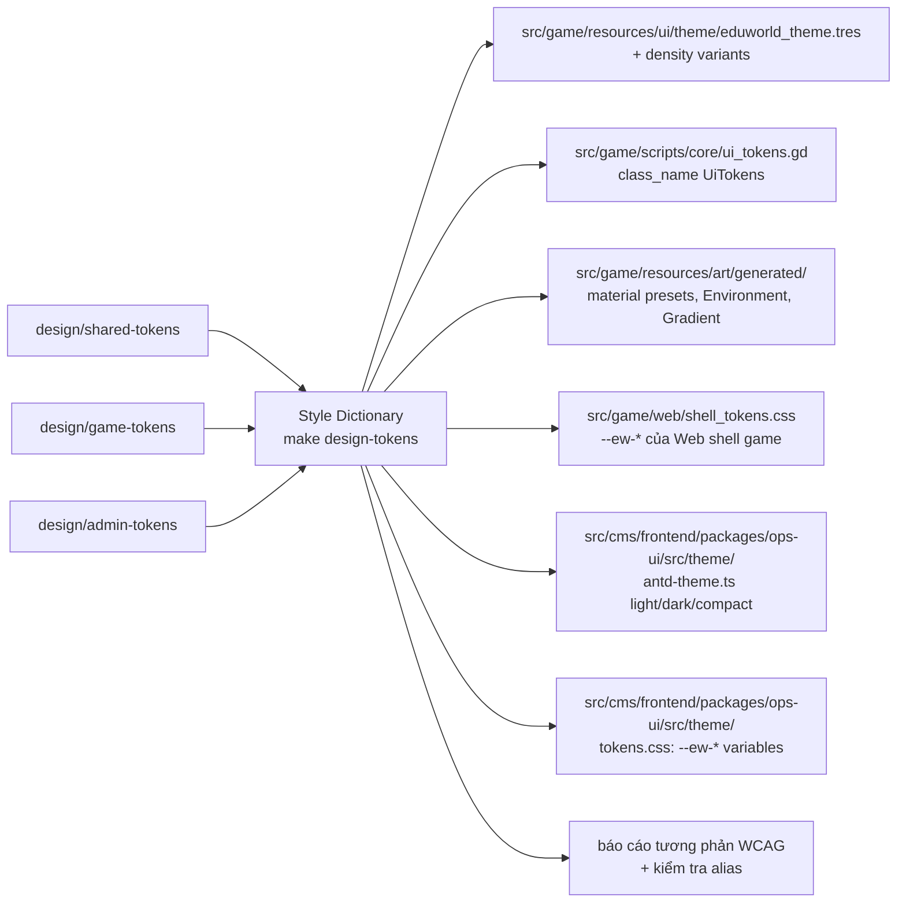

# Design System — Game (Godot 3D) và Admin/Ops (CMS/LMS)

> Trạng thái: Draft · Phiên bản: 0.1 · Owner: UX/UI Designer + Game Director · Cập nhật: 2026-11-28 (`tokens@0.23.0`: tag `processing`/`success` của Admin/Ops đạt AA — §4.1) · 2026-11-28 (`tokens@0.22.0`: chữ link, tab chọn, nút danger, tag cảnh báo của Admin/Ops đạt AA ở giao diện tối — §4.1) · 2026-11-27 (F119 sửa bố cục chat: biến thể `ChatTabButton`/`ChatTabButtonSelected`, `ChipScroller` bỏ mũi tên khi hàng đã vừa — giữ `tokens@0.20.0`) · 2026-11-27 (F119: `tokens@0.20.0` — `ChatPanel`, bong bóng chat, `ChatQuoteBox`, `ReactionPill`, icon chat + 32 emoji SVG) · 2026-11-27 (F102: `tokens@0.19.0` — `PartyMemberCard`, `PartyMemberCardAway`, `WarningBannerPanel`, `CountdownLabel`, icon nhóm) · 2026-11-26 (F113: §9 ma trận khối chỉ cửa sổ ngang 1280×720/1024×600/844×390 + kiểm màn "Xoay ngang" ở cửa sổ dọc; icon `rotate_phone`) · 2026-11-26 (`tokens@0.16.0`, F099: bộ màu thẻ không xanh lá/cam, `AnswerTileRest`, `grow_max`/`grow_max_tall`, `CaptionCard`, `MediaStage`, `MediaTrack`, `ChipScroller`; §9 kiểm dải trống) · 2026-11-26 (`tokens@0.15.0`, F098: thẻ đã chấm `AnswerTileCorrect`/`AnswerTileTry`, nhãn ghim `TileTag*`, `UiTokens.DENSITY_FONT_SMALL`, icon `retry_light`; §9 ma trận khối) · 2026-11-26 (F069: `RarityMark`, `ItemThumb`, `VirtualItemGrid`, `AvatarPreview3D`, `XpBar`, `CurrencyChip`, `RewardRow`, `FilterChips`; 10 icon game) · 2026-11-26 (`tokens@0.14.0`, F097: thẻ đáp án `AnswerTile1…6`, thẻ câu hỏi, vùng thả, bảng phản hồi nền nhạt, ô hình, cỡ đề/thẻ theo khối) · 2026-11-26 (`tokens@0.13.0`: icon game cho nút HUD, vùng World Map, sao/huy hiệu/chúc mừng, tick/cross thay emoji và glyph ngoài font; `Button` có icon kèm chữ; biến shell `--ew-component-{logo,backdrop,mascot,progress}-*`; quy tắc ký tự phải có trong font đóng gói; `BrandLockup`, `CelebrationBanner` — F096) · 2026-11-26 (`tokens@0.12.0`: màu môn Lịch sử `color.subject.history` dùng chung game + portal, slot `subject_history`, environment `history`/`ocean`/`mountain`/`exam`/`arena`, F094) · 2026-11-25 (`tokens@0.11.0`: 8 slot bảng màu mỹ thuật cho năm vùng môn học, F093) · 2026-11-25 (`tokens@0.10.0`: art direction "Chibi anime cartoon 3D" — cel shading, viền mực, preset skinned, blob shadow; ADR-0103, F068) · 2026-11-24 (F079: entry `@eduworld/ops-ui/game-console` — `SchemaForm`, `ThumbnailImage`, `TurntableViewer`, `GamePreviewFrame`, `ManifestRefPicker`; màu loại sự kiện từ token theme Admin) · 2026-11-24 (`tokens@0.9.0`: biến thể Theme dùng chung cho form học sinh, icon game SVG, vòng focus ngoài control, ô nhập cao theo khối — sửa màn S01) · 2026-11-19 (F005: pipeline token chạy được, `tokens@0.1.0`)
> Liên quan: [ADR-0047](../adr/ADR-0047-hai-he-thong-giao-dien-game-godot-3d-va-admin-ops-cms-lms.md) · [ADR-0022](../adr/ADR-0022-cms-lms-web-la-react-typescript-spa.md) · [WORLD_DESIGN](../01-game-design/WORLD_DESIGN.md) · [GODOT_ARCHITECTURE](../08-game-client/GODOT_ARCHITECTURE.md) · [WORLD_RENDERING](../08-game-client/WORLD_RENDERING.md) · [ADMIN_PORTAL](../04-admin-portal/ADMIN_PORTAL.md) · [SCHOOL_LMS §8](../04-admin-portal/SCHOOL_LMS.md#8-school-learning-dashboard)

## 1. Tổng quan

EduWorld có **hai hệ thống giao diện tách biệt**, mỗi hệ thống phục vụ đúng người dùng của nó (ADR-0047). CMS/LMS **không** theo phong cách game.

| | Game design system | Admin/Ops design system |
|---|---|---|
| Người dùng | Học sinh lớp 1–9 (6–15 tuổi) | Vận hành tenant và nhà trường (Tenant Admin, School Admin, tổ chuyên môn), biên tập nội dung, System Admin, Safety Team, game designer, live-ops |
| Nền tảng | Godot 4: thế giới 3D + UI `Control` | React SPA: **một Admin Portal** `src/cms/frontend/apps/portal` với 5 workspace (ADR-0027 mục 7) |
| Mục tiêu | Hấp dẫn, dễ hiểu, an toàn, chữ và nút lớn | Thao tác nhanh, xem nhiều dữ liệu, ít lỗi, đọc số liệu chính xác |
| Phong cách | Chibi anime cartoon 3D ([ADR-0103](../adr/ADR-0103-art-direction-chibi-anime-cartoon-3d-thay-stylized-low-poly.md), hướng tổng ở [WORLD_DESIGN §11](../01-game-design/WORLD_DESIGN.md#11-art-direction)): khối tròn mượt, cel shading + viền mực, nhân vật chibi, chuyển động hoạt hình | Trung tính, gọn, dày dữ liệu, ít trang trí |
| Thư viện | Theme Godot sinh từ token + component scene trong `src/game/scenes/ui/components/` | Ant Design 5 + Ant Design Pro components (ProLayout, ProTable, ProForm) [Confirmed] + `src/cms/frontend/packages/ops-ui` |
| Nguồn token | `design/game-tokens/` | `design/admin-tokens/` |

**Dùng chung giữa hai hệ thống** (không phải phong cách UI): logo, màu thương hiệu chính, và **mã màu nghiệp vụ** trong `design/shared-tokens/` (§6).

## 2. Cấu trúc thư mục `design/`

```text
design/
├── shared-tokens/          # dùng chung: brand + mã màu nghiệp vụ
│   ├── brand.json          # logo color, brand primary/secondary
│   └── domain.json         # màu môn học/khu vực, độ hiếm, trạng thái nội dung
├── game-tokens/            # chỉ cho Godot
│   ├── primitive.json      # palette gốc, thang font, spacing, radius
│   ├── semantic.json       # surface, text, accent, feedback (đúng/sai)
│   ├── component.json      # button, panel, quest-card, badge-xp, hud...
│   ├── density/{g1_3,g4_5,g6_7,g8_9}.json   # cỡ chữ/nút theo grade band
│   └── art3d.json          # palette vật liệu theo khu vực, toon/outline, environment, VFX, rarity glow
├── admin-tokens/           # chỉ cho CMS/LMS/Admin
│   ├── seed.json           # seed token Ant Design (colorPrimary, borderRadius, fontFamily...)
│   ├── semantic.json       # status, chart palette, banner cảnh báo
│   └── modes/{light,dark,compact}.json
├── icons/                  # SVG gốc; game và admin có bộ icon riêng, chỉ logo + icon nghiệp vụ (môn học, độ hiếm) dùng chung
├── fonts/                  # file font + LICENSE (OFL)
├── style-dictionary.config.mjs
└── README.md               # quy trình đổi token
```

Định dạng token: W3C Design Tokens (`$value`, `$type`, `$description`). Token tham chiếu nhau bằng alias (`{color.brand.primary}`); không lặp giá trị.

## 3. Pipeline sinh token



- Lệnh: `make design-tokens` (chạy trong CI ở mọi MR chạm `design/**`). File sinh ra **không sửa tay**; CI chạy lại và báo lỗi nếu khác (`make design-tokens-check`).
- Godot: Style Dictionary v4 phân giải alias, format riêng trong `design/sd/formats/` **ghi trực tiếp** `Theme` (`eduworld_theme.tres` mật độ `g6_7`, `eduworld_theme_<band>.tres` mỗi grade band, `eduworld_theme_high_contrast.tres`), `Environment` theo zone và `Gradient` VFX dạng text resource (`format=3`, dòng đầu là chú thích `;` GENERATED), cùng `UiTokens` và `Art3dTokens` (`src/game/resources/art/generated/art3d_tokens.gd`); font Be Vietnam Pro/Baloo 2 + OFL được chép vào `src/game/resources/ui/theme/fonts/`; icon `design/icons/game/*.svg` được thay placeholder màu `{token}` rồi ghi vào `src/game/resources/ui/icons/` (§5.1). Không cần Godot headless để sinh hay kiểm (F005, thay phương án `build_theme.gd`); JSON trung gian `design/build/godot/tokens.json` cho công cụ F060. Preset `ShaderMaterial` toon `mat_toon.tres` / `mat_toon_no_outline.tres` sinh cùng bảng màu `art.palette.*` (F067) [Confirmed].
- Kiểm khi build (`design/checks/`): cấu trúc W3C, alias thiếu/vòng lặp, literal ở tầng semantic/component/mode/density/art, màu nghiệp vụ chỉ ở shared + đủ 3 biến thể, tên token game và admin không trùng, tương phản WCAG 2.1 AA mọi cặp `contrastWith` (báo cáo `design/build/reports/contrast.json`), kích thước tối thiểu đọc từ §5.2 và §4.5 của tài liệu này, font OFL + bộ glyph tiếng Việt, semver so với nhánh gốc của PR.
- Web: xuất object `ThemeConfig` cho `ConfigProvider` của Ant Design và CSS variables `--ew-*` cho component tự viết trong `ops-ui`.
- Phiên bản token: `design/CHANGELOG.md` + semver (phiên bản đầu `tokens@0.1.0`, mục `## tokens@x.y.z`); thay đổi phá vỡ (đổi tên token) cần MR riêng và cập nhật mọi nơi dùng trong cùng MR.

## 4. Admin/Ops design system (CMS/LMS/Admin)

### 4.1. Theme Ant Design đề xuất [Confirmed]

| Token Ant Design | Giá trị đề xuất | Ghi chú |
|---|---|---|
| `colorPrimary` | `{color.brand.primary}` (xanh dương EduWorld: sáng `#2A62F0`, tối `#3567EB`; game giữ `#2F6BFF`) | Lấy từ shared-tokens; `#2F6BFF` chỉ đạt 4,49:1 với chữ trắng nên bản sáng được làm đậm hơn (F005) |
| `colorSuccess` / `colorWarning` / `colorError` / `colorInfo` | `#1F9D55` / `#D97706` / `#DC2626` / `#2563EB` | Chuẩn trạng thái cho icon, viền, chấm trạng thái (≥ 3:1, WCAG 1.4.11); **chữ** trạng thái dùng các token `ops.color.text.*` dưới đây vì `darkAlgorithm` dẫn xuất các seed này tối hơn (dưới 4,5:1 trên nền tối) |
| Chữ link, tab, nút danger, tag cảnh báo (`ops.color.text.{link,accent,danger,on-danger,warning}`, `tokens@0.22.0`) | sáng: link `#2563EB`, tab chọn `#2A62F0`, danger `#DC2626` chữ trắng trên nền danger, tag cảnh báo chữ `#92400E` trên `#FFFBE6`; tối: link/tab chọn `#8AB4F8`, danger `#F87171` (nút danger nền đặc chữ `#141414`), tag cảnh báo chữ `#FBBF24` trên `#2B2111` | `colorLink` là seed (bản tối hiển thị ≈ `#789CD6`, ≥ 5:1 trên thẻ tối `#282828`); `Tabs.itemSelectedColor`/`inkBarColor`, `Button.colorError`/`dangerColor`, `Tag.colorWarning`/`colorWarningBg` là component token, dùng đúng giá trị (không dẫn xuất). `colorPrimary` giữ làm nền nút chính (chữ trắng). Mọi cặp có `contrastWith` (axe F055 T043, F056 T046 — 2026-11-28) |
| Tag thông tin/`processing` và tag `success` (`ops.color.text.{info,success}`, `banner.success.bg`, `tokens@0.23.0`) | sáng: info `#2563EB` trên `#E6F4FF`, success `#166534` trên `#F6FFED`; tối: info `#8AB4F8` trên `#111A2C`, success `#86EFAC` trên `#162312` | `Tag.colorInfo`/`colorInfoBg`, `Tag.colorSuccess`/`colorSuccessBg` là component token (nhãn "Gốc" của `BilingualField`, trạng thái media "Sẵn sàng"); `colorInfo`/`colorSuccess` toàn cục không đổi. Mọi cặp có `contrastWith` (axe F058 T057 — 2026-11-28) |
| `fontFamily` | `"Be Vietnam Pro", "Segoe UI", Roboto, "Helvetica Neue", Arial, sans-serif` | Hỗ trợ đầy đủ tiếng Việt; tự host trong `design/fonts/` |
| `fontSize` | 15 (compact 13) | Chữ nội dung 15 px cho màn làm việc của thầy cô (owner chốt hướng B "Sổ tay giáo viên", 2026-11-21); compact 13 vẫn là lựa chọn của người dùng cho bảng lớn |
| `fontSizeHeading1` … `fontSizeHeading5` | 28 / 24 / 20 / 18 / 16 | Tiêu đề trang gọn và rõ (h1 28 px) |
| `borderRadius` / `borderRadiusLG` | 8 / 12 | Nút, ô nhập 8 px; thẻ (`Card`), hộp thoại 12 px |
| `controlHeight` | 36 (compact 28) | Vùng bấm thoải mái hơn cho giáo viên; compact giữ 28 |
| `colorBgLayout` | sáng `#F7F8FA` (nền trang ngả ấm nhẹ), tối `#000000` | Nền trang tách khỏi thẻ nền trắng |
| `colorBorderSecondary` | sáng `#E3E7EE`, tối `#303030` | Viền 1 px của thẻ, header, sidebar |
| `colorText` / `colorTextSecondary` | sáng `#1F2430` / `#4B5263`; tối `#E8E8E8` / `#A6A6A6` | Đạt AA trên nền thẻ và nền trang (kiểm khi build token) |
| Sidebar (`ops.color.sider.*`) | sáng: nền `#163A7A`, chữ `#DCE6FA`, hover `#1F4A94`, mục chọn ô trắng chữ `#163A7A`; tối: nền `#0E1C3A`, chữ `#C9D6F2`, hover `#1A2E58`, mục chọn nền `colorPrimary` chữ trắng | Tông xanh thương hiệu đậm (owner 2026-11-22); menu sidebar dùng `Menu theme="dark"` với token `Menu.dark*`; chữ ≥ 4,5:1 trên nền và hover, ô chọn ≥ 3:1 so với nền sidebar (kiểm khi build token) |
| Khoảng cách (`ops.size.space.*`) | 4 / 8 / 12 / 16 / 24 / 32 / 48 | Trùng `paddingXXS`…`paddingXL` của Ant Design; là thang `spacing` của lớp Tailwind (§4.2a, ADR-0098) |
| `components` | `Layout` (header nền thẻ, sidebar `ops.color.sider.bg`, thân nền trang), `Card` (tiêu đề 18 px), `Menu` (mục cao 40 px, bo 8 px), `Statistic` (số KPI 30 px, nhãn 14 px), `Tabs` (chữ tab chọn + vạch), `Button` (chữ và nền danger), `Tag` (tag cảnh báo) | Khai báo ở nhánh `antd.components.*` của `design/admin-tokens/seed.json`, sinh vào `ThemeConfig.components` |
| Thẻ KPI/widget | Viền trên 4 px (`dashboard.accent.width`) theo màu ngữ nghĩa (`colorPrimary`, `colorSuccess`, `colorWarning`, `colorInfo`, `colorError`) hoặc mã màu nghiệp vụ §6 | Màu chỉ là kênh phụ; thẻ luôn có tiêu đề bằng chữ |
| Theme màn đăng nhập (`authTheme`) | `controlHeight` 48, `borderRadius` 12, chữ trong ô nhập 16 px | Chỉ áp trong `AuthLayout` bằng `ConfigProvider` lồng (hướng A "Sân trường", [ADMIN_PORTAL §1.3b](../04-admin-portal/ADMIN_PORTAL.md#13b-đăng-nhập-portal-và-chọn-tenant-sau-đăng-nhập-adr-0091-adr-0066-adr-0067)) |
| Algorithm | `defaultAlgorithm` / `darkAlgorithm`; compact bằng seed token (`fontSize` 13, `fontSizeSM` 13, `controlHeight` 28 — `compactOverrides`), **không** dùng `compactAlgorithm` vì nó hạ cỡ chữ cơ sở xuống 12 px, dưới mức tối thiểu §4.5 | Người dùng chọn sáng/tối bằng nút nhanh trên header và tự bật compact trong menu tài khoản; mặc định là mật độ thường (15 px) từ 2026-11-21 |
| Locale | `vi_VN` (Ant Design) + `dayjs/locale/vi` | Định dạng ngày `DD/MM/YYYY`, số `1.234,5` |

Không override CSS nội bộ của component Ant Design; chỉ tùy chỉnh qua token và `components` token của `ConfigProvider`.

### 4.2. Layout chuẩn

```text
┌──────────────────────────────────────────────────────────────────────────┐
│ [■] EduWorld | [Workspace ▾] [Tenant ▾] (System Admin)  🌐VI ☾ 🔔 👤 │  ← Header nền thẻ, viền dưới 1 px, cố định
├───────────────┬──────────────────────────────────────────────────────────┤
│ Sidebar menu  │ ⚠ Banner cảnh báo (vd "Đang tắt kiểm duyệt cho tenant X")  │
│ (theo         │ Breadcrumb / Tiêu đề trang                    [Hành động] │
│  permission,  │ ┌────────────────────────────────────────────────────────┐ │
│  ADR-0027)    │ │ Nội dung trang (danh sách / chi tiết / form / dashboard) │ │
│ (nền xanh     │ └────────────────────────────────────────────────────────┘ │
│  đậm, cố định)│                    ↕ chỉ vùng nội dung cuộn                │
└───────────────┴──────────────────────────────────────────────────────────┘
```

- **ProLayout** với menu sinh từ `GET /api/v1/me/permissions` (ẩn menu chỉ là tiện ích, backend vẫn quyết định).
- **Header:** bộ chọn tenant dạng `SearchSelect` (owner 2026-11-23: mọi Select của header là `SearchSelect`) (chỉ System Admin, mặc định "Tất cả tenant", chọn nhiều; ADR-0027 §6); chỉ báo trạng thái hệ thống (lấy từ endpoint health tổng hợp); thông báo; **nút nhanh ngôn ngữ** (biểu tượng địa cầu + mã `VI`/`EN`, bấm là đổi ngay) và **nút sáng/tối** (mặt trời/mặt trăng), có tooltip và `aria-label` dịch, dùng được bằng bàn phím; menu tài khoản (tên người dùng, mật độ gọn, đăng xuất).
- **Banner cảnh báo hệ thống** dùng `Alert` banner cố định đầu vùng nội dung: tắt kiểm duyệt (ADR-0030), bảo trì, sự cố SIS sync, purge tồn đọng.
- **Header và sidebar cố định (owner 2026-11-22):** trang không cuộn; header (và banner) luôn ở trên, sidebar tự cuộn khi menu dài, chỉ vùng nội dung cuộn; dưới 1280 px sidebar thành drawer (☰) cùng tông màu sidebar; không cuộn ngang trang.
- **Giao diện "Sổ tay giáo viên" (owner chốt 2026-11-21, sidebar đổi tông 2026-11-22):** header nền thẻ với viền 1 px `colorBorderSecondary`, sidebar tông xanh thương hiệu đậm (§4.1), logo vuông màu `colorPrimary` cạnh tên sản phẩm; nền trang `colorBgLayout`; vùng nội dung lề `paddingXL`; thẻ viền 1 px, bo 12 px. Màn tổng quan dashboard mở đầu bằng **lời chào theo buổi** ("Chào buổi sáng, thầy cô") cùng hành động chính nổi bật ("+ Giao bài mới", nút `primary` cỡ lớn) ở bên phải; các widget là thẻ KPI có viền trên 4 px theo màu ngữ nghĩa, tiến độ dùng `Progress`. Mọi giá trị qua token (§4.1), không số liệu dựng sẵn.
- Một Admin Portal duy nhất (`src/cms/frontend/apps/portal`, ADR-0027 mục 7): mọi workspace dùng chung layout và `ops-ui`; mã mỗi workspace nằm trong `src/cms/frontend/apps/portal/src/workspaces/` theo tên thư mục ở [ADMIN_PORTAL §1.2](../04-admin-portal/ADMIN_PORTAL.md#12-admin-portal-5-workspace-adr-0027-mục-7-master-prompt-tái-cấu-trúc-16); topbar có workspace switcher, sidebar khác nhau theo workspace và permission ([ADMIN_PORTAL §1.3](../04-admin-portal/ADMIN_PORTAL.md#13-information-architecture-bố-cục-chung)).

### 4.2a. Tailwind CSS — lớp tiện ích bố cục (ADR-0098)

Portal (`apps/portal`) dùng thêm **Tailwind CSS v3** (ghim phiên bản) cho bố cục/tiện ích của shell; Ant Design vẫn là thư viện component (ADR-0047). Ràng buộc:

- Mọi class có **tiền tố `tw-`** (tránh đè DOM của MathLive/MathJax dùng tên class như `hidden`, `table`).
- **Preflight tắt**; plugin có mặc định là màu/độ dài thô (shadow, ring, blur, filter) tắt.
- `colors`, `spacing`, `fontSize`, `fontFamily`, `borderRadius`, `borderWidth` **thay hẳn** mặc định và chỉ trỏ `var(--ew-*)` của `tokens.css` (ví dụ `tw-bg-sider`, `tw-text-fg-secondary`, `tw-p-4` = `--ew-ops-size-space-16`); `screens` chỉ `md` 768 px và `xl` 1280 px (ADMIN_PORTAL §1.5).
- Không dùng arbitrary value (`tw-bg-[#…]`, `tw-p-[13px]`, `tw-[color:red]`) trừ `[var(--ew-*)]`: ESLint `ew/no-hardcoded-style` chặn; CSS chỉ chứa `@tailwind` (stylelint cấm `@apply`, `theme()`); `tailwind.test.ts` kiểm cấu hình và CSS sinh ra.
- Không dùng class Tailwind cho thuộc tính mà style Ant Design của component đã đặt (thứ tự cascade không bảo đảm); khi cần, dùng prop hoặc `style` với token.

### 4.3. Mẫu màn hình

| Mẫu | Thành phần | Quy tắc |
|---|---|---|
| **Danh sách** | Bộ lọc (QueryFilter, gồm dropdown tenant cho System Admin) + **ProTable** (sort, filter cột, cột cố định, phân trang cursor, chọn hàng) + thao tác hàng loạt (publish, gán tenant, khôi phục…) | Cột Tenant luôn có ở chế độ liên tenant; trạng thái hiển thị bằng `Tag` theo mã màu nghiệp vụ; hành động phá hủy có xác nhận + lý do |
| **Dropdown / Select** | `SearchSelect` của `ops-ui` (antd Select bọc sẵn) | Luôn tìm kiếm được, không phân biệt dấu/hoa thường, trạng thái rỗng, cảnh báo khi danh sách bị cắt; dữ liệu là toàn bộ danh sách — quy tắc phân trang thuộc [ADMIN_PORTAL §1.6](../04-admin-portal/ADMIN_PORTAL.md#16-danh-sách-bảng-và-dropdown-quy-tắc-phân-trang) |
| **Chi tiết** | Header thông tin + **Tabs** (Thông tin, Phiên bản, Phát hành, Sử dụng, Audit) + **Timeline** audit/version | Tab Phiên bản: danh sách version, xem chỉ đọc, diff, preview (ADR-0043) |
| **Form** | **ProForm** (StepsForm cho nội dung nhiều bước), autosave Draft | Validation sinh từ OpenAPI: `maxLength`, `required`, `pattern` (ADR-0041); hiển thị bộ đếm ký tự; lỗi `VALIDATION_FAILED` map về từng trường |
| **Dashboard live-ops** | Thẻ KPI (`StatisticCard`) + biểu đồ (ECharts hoặc Ant Design Charts [Confirmed]) + bảng sự kiện gần nhất | Tự làm mới 15–30 giây; ghi rõ thời điểm dữ liệu |
| **Trình soạn đặc thù** | Trong `src/cms/frontend/packages/ops-ui` | Trình soạn 11 dạng câu hỏi (gồm gợi ý nhiều cấp và phản hồi theo phương án), sơ đồ bước quest/NPC dialogue (graph editor), bracket giải đấu, trình xem danh mục từ nhạy cảm + thử chuỗi, thư viện media có thumbnail 3D, `MasteryHeatmap` (heatmap LO có ký hiệu mức, dùng ở School Learning Dashboard) |

**KPI dashboard live-ops (workspace Game Live Operations; phiên bản giới hạn theo tenant trong School & Learning Management):**

| KPI | Nguồn | Cảnh báo |
|---|---|---|
| CCU hiện tại / đỉnh hôm nay | realtime metrics | > 90% năng lực kế hoạch |
| Trận đang diễn ra, hàng chờ ghép trận theo mode | module competition | Thời gian chờ p95 > 60 s |
| Đăng nhập/phút, hàng chờ đăng nhập | Keycloak + module identity | Waiting room hoạt động |
| Tin nhắn/phút, tin bị chặn/che, báo cáo chờ xử lý | module chat | Báo cáo P1 quá SLA |
| Lỗi 5xx theo module, circuit breaker tích hợp ngoài mở | Prometheus | Theo MONITORING |
| Publish gần đây, rollback gần đây | learning/module game | Rollback trong 24 h |
| Trạng thái SIS sync theo tenant | module identity | Lần thành công cuối > 26 h |

### 4.4. Quy tắc trực quan hóa dữ liệu

- Một thư viện chart thống nhất; palette categorical lấy từ `admin-tokens/semantic.json` (tối đa 8 màu, đã kiểm tra phân biệt được với người mù màu); màu môn học dùng mã màu nghiệp vụ (§6).
- Trục bắt đầu từ 0 cho cột/thanh; số liệu định dạng `vi-VN`; luôn có đơn vị và thời điểm dữ liệu.
- Không dùng màu là kênh thông tin duy nhất (thêm nhãn/biểu tượng); tooltip có giá trị chính xác.
- Báo cáo nhóm < 5 học sinh ẩn số liệu theo LEARNING_ANALYTICS. Mọi màn (School Learning Dashboard, báo cáo tenant/platform, Game Analytics) hiển thị ô bị ẩn bằng **một** component dùng chung `SuppressedCell` (`src/cms/frontend/packages/ops-ui/src/dashboard/`): chữ "< 5" kèm tooltip giải thích, không hiện số thật, không tạo component riêng theo workspace.

### 4.5. Accessibility

- WCAG 2.1 AA: tương phản chữ ≥ 4.5:1 (≥ 3:1 cho chữ lớn và thành phần đồ họa), kiểm tra tự động khi build token và bằng axe trong E2E.
- Điều hướng bàn phím đầy đủ, focus rõ ràng, bảng có tiêu đề cột cho trình đọc màn hình; không dùng hover là cách duy nhất để thấy thông tin.
- Cỡ chữ tối thiểu 13 px ở compact, cho phép phóng to trình duyệt 200% không vỡ layout.

### 4.6. Công thức Toán, Vật lý, Hóa học (ADR-0055)

| Hạng mục | Quy định |
|---|---|
| Hiển thị | **MathJax 4**, output SVG (hoặc CHTML cho văn bản dài), extension `ams`, `mhchem` (`\ce{}`, `\pu{}`), font mặc định của MathJax 4. Dùng trong preview, danh sách (cột nội dung rút gọn), School Learning Dashboard, xem lại bài làm |
| Nhập | **MathLive** `<math-field>` trong mọi editor có công thức (Question/Lesson/Activity Builder, đáp án, giải thích, gợi ý, phản hồi theo phương án). Bàn phím ảo với tab Toán, Lý, Hóa; xuất LaTeX để lưu. MathLive chỉ dùng trong editor của portal (game không nhập công thức) |
| Kích thước và màu | Cỡ công thức theo token `math.font-scale` (mặc định 1.0 × cỡ chữ đoạn văn, 1.15 × với công thức block); màu theo `color.text` của theme sáng/tối, không màu hardcode; công thức lỗi hiển thị khung `color.danger` kèm thông báo vị trí lỗi |
| Trợ năng | Bật speech/braille của MathJax 4 (menu ngữ cảnh, `aria-label` sinh tự động); MathLive hỗ trợ điều hướng bàn phím và đọc công thức |
| Component | `MathText` (render chuỗi rich text có delimiter `\( \)`/`\[ \]`), `MathInput` (bọc `<math-field>`) trong `src/cms/frontend/packages/ops-ui`; có story trong Storybook (Toán/Lý/Hóa, sáng/tối, compact) |
| Render sẵn cho game | Khi lưu/publish, portal dùng MathJax 4 trên trình duyệt render mỗi công thức thành **SVG đơn sắc (`currentColor`) + speech text**, gửi kèm nội dung; server sanitize và lưu theo hash. Màn Import hàng loạt cũng render trên trình duyệt |
| Phiên bản | Ghim `mathjax@4.x` và `mathlive` (phiên bản cố định) trong `src/cms/frontend/apps/portal/package.json`; nâng cấp phải qua visual regression công thức mẫu. Đổi phiên bản không render lại nội dung đã publish (SVG bất biến theo version) |

## 5. Game design system (Godot 3D)

### 5.1. Token UI

- `semantic.json`: nền panel, chữ, nhấn, phản hồi đúng/sai, cảnh báo nhẹ; `component.json`: nút chính/phụ, panel nhiệm vụ, thẻ câu hỏi, dải phản hồi + nút gợi ý (`HintButton`, đếm cấp gợi ý), khung phụ đề lời thoại có icon người nói (`VoiceCaption`, dùng cho `g1_3` — PED-07), badge XP/cấp độ, thanh tiến độ, toast, HUD.
- Sinh `Theme` Godot (`src/game/resources/ui/theme/eduworld_theme.tres`) và lớp hằng `UiTokens` (`src/game/scripts/core/ui_tokens.gd`) để code dùng khi cần giá trị (khoảng cách, thời lượng tween).
- Sinh `src/game/web/shell_tokens.css` (biến `--ew-*` từ token game: màu ngữ nghĩa, khoảng cách, bo góc, viền, layout, font, density cơ sở) cho Web shell `src/game/web/shell.html` — trang HTML chạy trước engine trên bản Web (F133). Đây là output game, không chứa token admin; shell không có màu/cỡ literal. Từ `tokens@0.13.0` (F096) file có thêm `--ew-component-{logo,backdrop,mascot,progress}-*` để màn chờ vẽ logo Tia Sáng, nền trời S01, Mây và thanh tiến độ bo tròn (`component.progress.*`) chỉ bằng biến token.
- Mọi `Control` lấy style từ Theme; component tái sử dụng trong `src/game/scenes/ui/components/`.
- **Biến thể Theme dùng chung (tokens@0.9.0, sinh bởi `design/sd/formats/godot-tres.mjs`):** `IconButton` (nút chỉ có icon, vuông, cao bằng `density.<band>.button.min_height`), `ChoiceChip` (lựa chọn bật/tắt; từ F114 đang chọn = nền vàng + chữ mực + icon ✓, xem mục viền hoạt hình phân tầng bên dưới), `TextButton` (hành động dạng liên kết, chữ màu nhấn + icon, vùng chạm như nút), `InlineErrorPanel`/`InlineErrorLabel` (nền đỏ nhạt, luôn kèm icon cảnh báo; viền mực mảnh từ F114), `InfoBannerPanel`/`InfoBannerLabel`, `FormCard` (thẻ form/hộp thoại, `component.form_card.*`; từ F114 là khung tầng 1: viền mực + cạnh dưới, không bóng mềm), `SpeechBubble`/`SpeechBubbleLabel` (lời NPC), `LogoLabel` (wordmark Baloo 2 viền trắng), container `FormBox` (¾ khoảng cách khối), `FieldBox` (nhãn + ô), `ToolbarBox`, `ScreenMargin` (lề màn = khoảng cách khối). `LineEdit` cao bằng chiều cao nút tối thiểu của khối (có kiểu `read_only`); `CheckBox` có ô 40 px và vùng chạm theo khối. Padding dọc của nút/ô nhập tính từ chiều cao dòng thật của font thân (fontkit) để đạt đúng chiều cao tối thiểu.
- **Focus bàn phím/tay cầm:** mọi `Button` (và biến thể) dùng vòng focus chỉ có viền `component.focus_ring.*`, vẽ ra ngoài control một khoảng nhỏ — thấy được trên cả nút nền đặc lẫn nút viền; không phủ nền khi focus.
- **Icon game:** SVG gốc trong `design/icons/game/*.svg`; màu viết bằng placeholder `{token.path}` (vd. `{component.icon.primary}`) và pipeline thay bằng màu token khi sinh `src/game/resources/ui/icons/*.svg` (thư mục do pipeline sở hữu, không sửa tay; Godot import thành texture, file `.import` được commit). Bộ đầu: `globe`, `eye`, `eye_off`, `help`, `info`, `alert`, `check`, `checkbox_on`, `checkbox_off`. Icon không được là nơi duy nhất truyền đạt trạng thái bằng màu — đi kèm hình dạng (✓, !, i) hoặc chữ.
- **Icon kèm chữ trên mọi nút (F096):** Theme đặt `Button/constants/icon_max_width = component.icon.size` và `h_separation` cho mọi biến thể nút, nên icon SVG luôn cùng cỡ (32 px) và không làm nút cao hơn vùng chạm của khối. Bộ icon `tokens@0.13.0`: nút HUD `assignments`, `journal`, `bell`, `settings`, `wardrobe`, `map`, `home`, `emote`, `next`; học tập/kết quả `hint` (trắng, trên `HintButton`), `sound_on`, `sound_off`, `tick` (màu nhấn, trên nền sáng), `check`/`cross` (trắng, trên nền nhấn hoặc dải phản hồi), `star`, `medal`, `party`, `flag`, `fire`, `play`, `pause`; vùng World Map `area_<icon_key>` theo `icon_key` của seed thế giới. Màu icon theo nền: icon `{component.icon.primary}` trên nền sáng, `{component.icon.on_accent}` trên nền nhấn.
- **Ký tự phải có trong font đóng gói (F096-AC-15):** bản Web không có font hệ thống (Godot Web không hỗ trợ SystemFont), nên ký tự ngoài Baloo 2/Be Vietnam Pro hiện thành ô vuông. Không dùng emoji hay glyph biểu tượng (✓ ✗ ⏳ ● ○ ★ 🔔 💡 🎉 …) trong chuỗi `.po`, chuỗi trong script hay `text` của scene; biểu tượng dùng icon SVG ở trên. `tests/unit/core/test_font_coverage.gd` kiểm từng ký tự với `Font.has_char` của font Theme.
- **Nhận diện EduWorld (F096):** `BrandLockup` (`scenes/ui/components/BrandLockup.tscn`: `SparkMark` + wordmark `LogoLabel` + `CloudyMascot` tuỳ chọn) dùng ở splash trong game, màn trước thế giới và để `tools/brand_assets.gd` vẽ boot splash + icon ứng dụng ([GODOT_ARCHITECTURE §5](../08-game-client/GODOT_ARCHITECTURE.md#5-vòng-đời-ứng-dụng)); `CelebrationBanner` (Mây + bong bóng "Hoàn thành!" + sao icon, hiệu ứng một lần ≤ 1,5 s, tắt khi giảm chuyển động — STUDENT_GAME_UX_LEARNING §10.3) ở màn kết quả.
- **Màn học tập như trò chơi (`tokens@0.14.0`, F097):** biến thể `AnswerTile1…6` (thẻ đáp án: 6 bộ màu `component.answer_tile.bg_<n>`/`accent_<n>` — nền nhạt, viền màu nhấn, viền đáy dày `edge` kiểu kẹo, lề trái chừa huy hiệu số `badge_size`; chọn = nền màu nhấn chữ trắng `text_selected`; cao `density.<band>.answer.min_height`, chữ `density.<band>.font.stem`), `QuestionCard` (thẻ đề trắng bo 24, viền `sky.300`, bóng mềm), `StemLabel` (Baloo 2 cỡ đề), `InstructionLabel` (chữ đậm màu nhấn), `DropZone` (vùng thả trắng), `ActivityBoard` (bảng cream viền trắng trên nền trời, cách mép `component.activity_board.inset`), `PictureTile` (ô có ảnh phía trên — lề trên 1,5 × vùng chạm — và nhãn phía dưới; chọn = nền vàng như `ChoiceChip` từ F114), container `AnswerGrid`/`AnswerBox`/`AnswerFlow` (khoảng cách cơ sở của khối). `FeedbackCorrectPanel`/`FeedbackIncorrectPanel` là bảng **nền nhạt có viền** (`component.feedback.{correct,try}_{bg,border}`; chưa đúng = cam ấm, không đỏ đậm), `FeedbackLabel` chữ chính Baloo 2. StyleBox sinh hỗ trợ viền đáy dày, lề trái/trên riêng. Component vẽ `_draw()` theo token: `AnswerBadge` (đĩa màu nhấn + số; chọn = đĩa trắng + ✓), `ProgressTrail` (sao/vòng/chấm, `component.progress_trail.*`), `AvatarThumb` (chân dung chibi theo màu `avatar.*` của mẫu), `ColorDot` (chấm màu tròn + ✓), `CloudyMascot` thêm `compact` (`component.coach.size`), `side_tail`, `mood` (bình thường / vui / động viên). Icon mới: `verdict_correct`, `verdict_try` (✓/✗ trong đĩa), `exit`, `next_light` (→ trắng trên nút chính), `arrow_{up,down,left,right}`, `rotate_{left,right}`. Quy tắc dùng ở [STUDENT_GAME_UX_LEARNING](STUDENT_GAME_UX_LEARNING.md) §3.3a, §4.1a, §4.8 và [STUDENT_GAME_UX_CORE](STUDENT_GAME_UX_CORE.md) S02 §6a.
- **Chạm là trả lời (`tokens@0.15.0`, F098, [STUDENT_GAME_UX_LEARNING §4.1b](STUDENT_GAME_UX_LEARNING.md#41b-chạm-là-trả-lời-f098-confirmed--owner-duyệt-2026-11-26)):** biến thể `AnswerTileCorrect` (nền `component.answer_tile.correct_bg` xanh lá nhạt, viền `correct_border` dày `result_border`) và `AnswerTileTry` (nền `try_bg` cam ấm nhạt, viền `try_border` — không đỏ gắt), mọi trạng thái nút cùng một kiểu (thẻ đã chấm không đổi khi rê/nhấn), cùng cỡ/chữ/vòng focus như `AnswerTile1…6`; nhãn ghim trên mép trên thẻ `TileTagCorrect`/`TileTagTry` (nền `tag_correct_bg`/`tag_try_bg`, chữ `tag_text`) và `TileTagPending` (nền `tag_pending_bg`, viền `tag_pending_border`, chữ `tag_pending_text`) — Label nền viên thuốc, cỡ `density.<band>.font.small`; `AnswerBadge.verdict` vẽ ba chấm (đang chấm), ✓ trên đĩa xanh (đúng / đáp án đúng), ✗ mềm trên đĩa cam (chưa đúng). Trạng thái luôn có hình + chữ. `UiTokens.DENSITY_FONT_SMALL` (cỡ chữ nhỏ nhất theo khối) cho test ma trận khối. Icon `retry_light` (↻ trắng, nút chính "Gửi lại"). Sửa từ ma trận khối F098: ô `VirtualItemGrid` cao theo chữ dài nhất của danh sách (đo bằng font của ô, không còn chữ tràn sang hàng dưới ở `g1_3`/`g4_5`); `CurrencyChip` và nút "Thêm" của HUD giữ nhãn trên một dòng tới 280 px (`UiBuild.fit_wrapping`: rộng tối thiểu = cả nhãn hoặc từ dài nhất + icon — cột phải từng co lại chỉ còn icon; nhãn dài hơn vẫn xuống dòng giữa các từ); bàn phím số hai hàng ngang.
- **Màu trạng thái, bố cục cân, trình phát media (`tokens@0.16.0`, F099, [STUDENT_GAME_UX_LEARNING §3.3a, §4.1a, §5–§8](STUDENT_GAME_UX_LEARNING.md#41a-thẻ-câu-hỏi-và-thẻ-đáp-án-f097-confirmed--owner-chốt-hết-2026-11-26)):** bộ màu thẻ đáp án **không chứa xanh lá/cam** (màu trạng thái đúng/chưa đúng): `accent_1…6` = xanh dương, mận, hồng, xanh biển, tím, chàm (primitive mới `palette.{plum,cyan,indigo}.{50,700}`), sắc độ mỗi màu nhấn cách `correct_border`/`try_border` ≥ 30° (test `test_answer_palette.gd`); biến thể `AnswerTileRest` (thẻ nghỉ sau khi chấm: `component.answer_tile.rest_bg` trắng, `rest_border` = `palette.ink.200`, huy hiệu số trên đĩa `rest_accent`, chữ `rest_text`); trần cao thẻ khi còn chỗ `component.answer_tile.grow_max` = 1,5 (bảng ngang) và `grow_max_tall` = 4 (bảng dọc) — **sở hữu giá trị ở đây**; `CaptionCard`/`CaptionLabel` (thẻ phụ đề trắng, chữ đậm cỡ đề của khối, `component.caption.*`); `MediaStage` (khung video nền tối `component.media_stage.bg`); component `MediaTrack` vẽ `_draw()` theo `component.media_track.*` (rãnh, đã xem, đã phát, vạch chương, đĩa câu hỏi ?/✓, cao bằng vùng chạm của khối); `ChipScroller` (hàng chip cuộn ngang, mũi tên hai bên chỉ khi tràn). Icon mới `play_light`, `pause_light`, `rewind`, `captions`.
- **Tiến trình, kho đồ, cửa hàng, thành tựu, thử thách (F069, không thêm token):** component vẽ `_draw()` theo token — `RarityMark` (độ hiếm = màu `rarity.*` **và** hình riêng: thường chấm tròn, ít gặp thoi, hiếm sao, sử thi sao đôi, huyền thoại vương miện; chữ cho lớp 4–9), `ItemThumb` (ảnh 2D vật phẩm: hình loại vật phẩm kiểu chibi theo màu art palette của `ItemVisual` hoặc màu độ hiếm, viền mực ADR-0103; món chưa có = cùng hình qua `resources/art/shaders/ui_greyscale.gdshader` + chữ "Chưa có"); Control dựng từ biến thể Theme có sẵn — `XpBar` + `CurrencyChip` (HUD S03), `RewardRow` (chip phần thưởng icon + chữ, `QuestCard`), `FilterChips` (chip chọn một, ✓ khi chọn), `VirtualItemGrid` (lưới `PictureTile` ảo hóa: ô hiển thị + 1 hàng đệm), `AvatarPreview3D` (một SubViewport ≤ 512 px render một lần mỗi lần đổi), `UiBuild` (dựng cửa sổ panel, nút có icon theo vùng chạm của khối, Mây + bong bóng, thanh tiến độ). Icon mới: `coin`, `gift`, `moon`, `heart`, `shop`, `lock`, `clock`, `menu`, `collection`, `history`. Nút chính (nền nhấn) dùng icon sáng (`check`, `next_light`, `coin`); icon nét xanh chỉ trên nền sáng. Quy tắc dùng ở [STUDENT_GAME_UX_CORE](STUDENT_GAME_UX_CORE.md) S03 §6b, S06 §6a, S07 §6a và [STUDENT_GAME_UX_SOCIAL](STUDENT_GAME_UX_SOCIAL.md) §3–§4.
- **Viền hoạt hình phân tầng (`tokens@0.17.0`, F114 — owner duyệt 2026-11-26) [Confirmed]:** một màu mực duy nhất `color.outline` (= `palette.ink.900`, cũng là màu chữ chính; tương phản cao `palette.black`) cho viền và **cạnh cứng phía dưới** (không bóng mờ). Bề dày theo khối ở §5.2. Ba tầng:
  - **Tầng 1 — bấm được:** `Button` (nút chính), `SecondaryButton` (nền xanh nhạt `palette.sky.100`), `DangerButton` (đỏ `component.button.danger.*`, **chỉ cho rời đi/kết thúc**: nút đóng ✕ của cửa sổ, tab/nút "Đăng xuất", nút xác nhận "Đăng xuất" — không cho phản hồi học tập, không cho "Hủy"), `IconButton`, `HintButton`, `ChoiceChip`, `PictureTile`, `TabButton`/`TabButtonSelected`, `ToggleSwitch` (CheckButton: rãnh viền mực, núm trắng viền mực; bật = rãnh màu nhấn, núm phải; tắt = rãnh `palette.ink.200`, núm trái; luôn có chữ "Bật"/"Tắt"), `HSlider` (rãnh + phần đã kéo viền mực, núm `slider_knob`). Viền `outline.interactive` + cạnh dưới `depth.rest` ở trạng thái thường/rê/focus; **khi nhấn** cạnh còn `depth.pressed`, mặt nút vẽ thấp xuống đúng phần chênh (`expand_margin_top` âm) và nội dung lún theo — tổng chiều cao control không đổi (vẫn bằng `density.<band>.button.min_height`). Nút bật/tắt (chip) đang chọn dùng hình "đã nhấn". **Khung cửa sổ** (Panel/PanelContainer mặc định, `FormCard`, `WindowTitleBar` thanh tiêu đề màu nhấn chữ trắng in hoa `WindowTitleLabel`, `ConfirmTitleBar` thanh tiêu đề vàng chữ mực `ConfirmTitleLabel`, `SettingsTabColumn` cột tab nền nhạt viền phải) có viền + cạnh dưới nhưng không có trạng thái nhấn.
  - **Tầng 2 — thông tin:** `HudPanel` (toast), `HudChip` (chip Xu `CurrencyChip`), `SpeechBubble`, `InfoBannerPanel`, `InlineErrorPanel`, `ProgressBar`, `SectionTag` (nhãn mục: viên thuốc `component.section_tag.bg` vàng nhạt, chữ `section_tag.text` nâu đậm in hoa, đậm, cỡ `density.<band>.font.small`), `ValueChip` (giá trị cạnh thanh trượt, "70%"): chỉ viền mực mảnh `outline.info`, không cạnh dưới.
  - **Tầng 3 — giữ nguyên:** `StemLabel`, `QuestionCard`, `AnswerTile1…6`, `AnswerTileCorrect`, `AnswerTileTry`, `AnswerTileRest` (viền màu nhấn + cạnh kẹo của F097/F099), `TextButton` (dạng liên kết); thế giới/nhân vật 3D (viền toon ADR-0103) và Admin Portal (R32) không thuộc phạm vi. Test `test_outline_style.gd` so giá trị tầng 3 với `tokens@0.16.0`.
  - **Màu lựa chọn:** **xanh = hành động/vị trí** (nút chính, tab đang mở), **vàng = giá trị đang chọn**: `ChoiceChip` đang chọn = nền `component.choice_chip.selected_bg` (`palette.yellow.400`) + chữ `selected_text` (mực) + icon ✓ (icon trắng được Theme nhuộm mực qua `icon_pressed_color`); chưa chọn = nền trắng chữ mực, không ✓ — **thay quy tắc "đang chọn = nền nhấn + ✓" của F096**; áp cho mọi hàng chip (Cài đặt, Cửa hàng, Bộ sưu tập, Thử thách, bộ lọc — `UiBuild.mark_chips`). Icon tab `tab_*` vẽ trắng, Theme nhuộm màu nhấn (tab chưa mở) hoặc trắng (tab đang mở).
  - **Lớp phủ và hiện cửa sổ:** `Scrim` (`color.overlay.scrim`, mực 50%) sau mọi cửa sổ modal (`UiBuild.window`, Cài đặt, Lên cấp), `ScrimNested` (`color.overlay.scrim_nested`, mực 35% thêm — tổng ≈ 70%) sau hộp thoại lồng (xác nhận Đăng xuất, xác nhận mua); không làm mờ (blur). Cửa sổ hiện bằng phóng nhẹ `component.window.pop_scale` 0,96 → 1 trong `component.window.pop_duration` (≤ 0,2 s, `UiMotion.pop_in`), tắt hẳn khi bật Giảm chuyển động. **Sở hữu các giá trị lớp phủ và hiệu ứng mở ở đây.**
  - **Nút đóng cửa sổ (F125, đóng F114-3) — sở hữu quy tắc ở đây:** mọi **cửa sổ** có thanh tiêu đề của khung chung (`UiBuild.title_bar`: `WindowTitleBar` tầng 1, icon trên ô trắng `TitleIconBadge` — mọi màu icon đọc được trên thanh xanh —, `WindowTitleLabel` in hoa) có **đúng một** nút đóng `UiBuild.close_button()` — `DangerButton` icon ✕ + chữ "Đóng", ở **cuối bên phải** thanh tiêu đề (nút riêng của cửa sổ như "Rời nhóm", ví Xu đứng trước nó), vùng chạm của khối (sàn `compact` trên điện thoại); `Esc`/Back đóng cửa sổ như nút đó. Áp cho: Nhật ký quest, Bản đồ, Phối đồ, Tủ đồ/Cửa hàng, Thành tựu/Bộ sưu tập, Thử thách (bảng, kết quả), Hành trình, menu "Thêm", Hộp thông báo, Cài đặt, Nhóm (+ chọn bạn mời, chọn hoạt động), Đấu trường, sảnh đề thi. **Không** áp: hộp xác nhận (giữ "Hủy" trung tính), màn làm bài/thi (giữ luồng "Thoát" có xác nhận), sheet chat, lời thoại NPC, màn toàn khung (đăng nhập, màn chờ, "Xoay ngang"). Test `tests/scene/ui/test_window_close_button.gd`.
  - Icon mới: `tab_{language,graphics,sound,access,info}`, `exit_light`, `cancel`, `minus`, `plus`, `music`, `voice`, `quality_{low,medium,high}`, `toggle_{on,off}`, `slider_knob`. Bố cục dùng ở [STUDENT_GAME_UX_SOCIAL §10](STUDENT_GAME_UX_SOCIAL.md#10-cài-đặt).
- **Thông báo trong game (`tokens@0.18.0`, F123):** biến thể `CountBadge` (Label **tầng 2**: viên thuốc nền `component.count_badge.bg` = màu nhấn, chữ `component.count_badge.text` trắng đậm cỡ `density.<band>.font.small`, viền mực mảnh `outline.info`, không cạnh dưới) cho số chưa đọc bên phải icon chuông HUD ("99+" khi quá 99) và nhãn "MỚI" của dòng chưa đọc trong hộp thông báo — trạng thái luôn bằng số/chữ, không chỉ màu. Toast thông báo = `HudPanel` (tầng 2) + icon chuông trắng + mũi tên `next_light`, cao ≥ vùng chạm của khối. Hộp thông báo dùng khung cửa sổ tầng 1 như Cài đặt (`WindowTitleBar`, nút Đóng `DangerButton`), dòng là `QuestCard` + nút chính "Xem". Icon mới `tab_notifications` (chuông trắng, Theme nhuộm theo trạng thái tab). Cột tab Cài đặt dùng `FieldBox` (khoảng cách `size.space.4`) để 6 tab + Đăng xuất vừa khung ở `g1_3`. Bố cục ở [STUDENT_GAME_UX_CORE S03 §6c](STUDENT_GAME_UX_CORE.md#s03--main-hub-hud).
- **Nhóm (party) trong game (`tokens@0.19.0`, F102):** component `component.party_card.{bg,border,away_bg,away_border,away_text}` — biến thể `PartyMemberCard` (PanelContainer **tầng 2**: nền trắng, viền mực mảnh `outline.info`, bo theo thẻ đáp án; thẻ thành viên, dòng lời mời, thẻ hoạt động) và `PartyMemberCardAway` (thẻ của bạn đang mất kết nối: nền xám `palette.ink.200`, viền `palette.ink.600`) + `PartyAwayLabel` (chữ `palette.ink.700`, `contrastWith` nền xám mức AA) — trạng thái luôn kèm chữ "Đang kết nối lại…" và icon wifi gạch, không chỉ bằng màu; `component.warning_banner.{bg,border,text}` — `WarningBannerPanel`/`WarningBannerLabel` (băng vàng nhạt `palette.yellow.100`, tầng 2, luôn icon + chữ: "Đang kết nối lại…", "Trưởng nhóm đang kết nối lại…"); primitive `size.font.96` + `component.countdown.font_size` — `CountdownLabel` (số đếm ngược 3‑2‑1 bắt đầu phiên nhóm, màu và viền trắng của wordmark `component.logo.*`). Nhãn Sẵn sàng/Chưa sẵn sàng dùng lại `TileTagCorrect`/`TileTagPending` (viên thuốc có chữ). Nút "Em sẵn sàng!" là nút chính; khi đã sẵn sàng là `ChoiceChip` đang chọn (vàng + ✓). Nút chính bị khóa (Bắt đầu, Chọn hoạt động này) đổi icon trắng sang icon màu nhấn (`play`, `tick`) để vẫn đọc được trên nền xám. `AvatarThumb.standalone` vẽ chân dung riêng (thẻ thành viên, dải HUD, lời mời) và `ready_mark` vẽ huy hiệu ✓ (đĩa vàng, dấu mực) trên chân dung HUD. Icon mới: `group` (nút HUD "Nhóm", tiêu đề màn Nhóm), `crown` (trưởng nhóm), `invite`/`invite_light` (mời bạn), `presence_online` (đang trực tuyến), `wifi_off` (mất kết nối). Bố cục ở [STUDENT_GAME_UX_SOCIAL §5](STUDENT_GAME_UX_SOCIAL.md#5-party-lobby).
- **Chat trong game (`tokens@0.20.0`, F119):** component `component.chat.*` — biến thể `ChatPanel` (khung chat **tầng 2**: nền `color.surface.panel_alt`, viền mực mảnh), `ChatBubbleOther` (trắng, bên trái) / `ChatBubbleMine` (xanh `sky.200`, bên phải) / `ChatBubbleMention` (vàng, luôn kèm chữ "Nhắc tới em") — bong bóng tầng 2 viền mực mảnh, không cạnh dưới; `ChatQuoteBox` (khung trả lời/trích dẫn, vạch `color.accent.primary` bên trái), `ReactionPill` / `ReactionPillMine` (viên số cảm xúc; của em vàng như chip đã chọn + dấu tick), nhãn `ChatTextLabel`, `ChatMetaLabel` (cỡ `font.small`, giờ/trạng thái/nhãn), `ChatNameLabel` (nickname đậm xanh đậm), `ReactionLabel`; `TextEdit` (ô soạn chat nhiều dòng) cùng kiểu ô nhập `LineEdit`; các cặp chữ/nền đạt AA. Icon mới `chat`, `send`, `reply`, `quote`, `forward`, `copy`, `pin`, `edit`, `recall`, `block`, `tick_sent`/`tick_double`/`tick_double_read` (trạng thái tin luôn kèm chữ), `sticker`, `gif`, `report_rude`, `report_spam`, `report_cheating`, tab trắng `tab_{emoji,sticker,gif,team,match}`, `flag_light`/`forward_light`/`send_blue` (nút chính và trạng thái mờ) và 32 hình `emoji_<mã>` (emoji vẽ bằng SVG — bản Web không có font emoji, F096-AC-15). Sửa bố cục F119 (quy tắc "≥ 3 tin", [STUDENT_GAME_UX_SOCIAL §7](STUDENT_GAME_UX_SOCIAL.md#7-chat); không thêm token nên giữ `tokens@0.20.0`): biến thể `ChatTabButton` / `ChatTabButtonSelected` — tab bảng mặt cười (Cảm xúc / Nhãn dán / Ảnh động) và tab "Đội" / "Cả trận": cùng màu, cạnh dưới, icon trắng và chiều cao như `TabButton` / `TabButtonSelected` của Cài đặt nhưng **nửa lề ngang** (`spacing.base / 2`) để ba chip icon + chữ ở một dòng trong cột chat nửa cửa sổ, không xuống dòng. `ChipScroller` tính chỗ của cả hàng (trả lại bề rộng mũi tên đang hiện) và xếp lại khi mũi tên ẩn/hiện — hàng hẹp lúc đầu không còn giữ mũi tên khi đã đủ rộng.
- **Đấu trường trong game (F109, không thêm token — giữ `tokens@0.20.0`):** màn Đấu trường, màn trận, bảng xếp hạng và giải đấu dựng hoàn toàn từ biến thể có sẵn — `PictureTile` (thẻ chế độ `ModeCard`: hình chế độ trong lề trên, đang chọn vàng + nhãn `TileTagCorrect` "Đã chọn"), `TabButton`/`TabButtonSelected` (4 tab), `HudChip` (chip hạng, chữ mực), khung cửa sổ tầng 1 cho `MatchHeader` và kết quả, `PartyMemberCard`/`PartyMemberCardAway` (thẻ người chơi, người mất kết nối), `QuestCard` (dòng của em trên bảng, thẻ trận/giải), `SectionTag` (hug chữ bên trái cột), `FeedbackCorrectPanel`/`FeedbackIncorrectPanel` (dải phản hồi sau khi server chấm), `WarningBannerPanel` (đang kết nối lại), `HudPanel` (thanh hàng chờ, toast giải), `ActivityBoard` (bảng câu hỏi), `CountdownLabel` (3‑2‑1 bắt đầu trận). Icon game mới: `arena` (cúp — tiêu đề, ready check, thẻ 1v1), `podium` (Bảng xếp hạng ở menu "Thêm"), `bracket` (giải đấu, sơ đồ), `robot` ("Luyện với Robot"), `search` / `search_light` (hàng chờ / nút chính "Tìm trận"), icon tab trắng `tab_podium`, `tab_history`, `tab_bracket` (cùng `tab_match` của F119; Theme nhuộm theo trạng thái tab). Bố cục ở [STUDENT_GAME_UX_SOCIAL §8](STUDENT_GAME_UX_SOCIAL.md#8-competition-arena).
- **Hình minh họa vector:** nền trời (`SkyBackdrop`), Mây (`CloudyMascot`) và dấu Tia Sáng của logo (`SparkMark`) vẽ bằng `_draw()` với màu `UiTokens.COMPONENT_BACKDROP_*`/`COMPONENT_MASCOT_*`/`COMPONENT_LOGO_*`, tỉ lệ theo kích thước control — tĩnh, không ảnh tải về, nét ở mọi cỡ cửa sổ (§5.4 preset Thấp). Áp dụng đầu tiên ở S01 ([STUDENT_GAME_UX_CORE S01 §5a](STUDENT_GAME_UX_CORE.md#s01--đăng-nhập)).

### 5.2. Mật độ theo grade band

| Grade band | Cỡ chữ cơ sở | Chiều cao nút tối thiểu | Ghi chú |
|---|---|---|---|
| `g1_3` | 24 px | 64 px | Icon kèm chữ, ít chữ; đề bài và hướng dẫn quest có lồng tiếng tiếng Việt, kèm phụ đề + icon khi không có tai nghe ([LEARNING_EXPERIENCE §8](../02-learning/LEARNING_EXPERIENCE.md#8-ux-học-tập-theo-grade-band)) |
| `g4_5` | 22 px | 56 px | |
| `g6_7` | 18 px | 48 px | Mật độ thông tin cao hơn |
| `g8_9` | 18 px | 44 px | |

**Viền hoạt hình theo khối (F114, `density.<band>.outline.*`, `density.<band>.depth.*`) — sở hữu giá trị ở đây:**

| Grade band | Viền tầng 1 (`outline.interactive`) | Viền tầng 2 (`outline.info`) | Cạnh dưới (`depth.rest`) | Cạnh khi nhấn (`depth.pressed`) |
|---|---|---|---|---|
| `g1_3` | 3 | 2 | 5 | 1 |
| `g4_5` | 3 | 2 | 4 | 1 |
| `g6_7` | 2 | 2 | 3 | 1 |
| `g8_9` | 2 | 2 | 3 | 1 |

Đơn vị px. Lớp 6–9 nét mảnh hơn (nét dày trông "trẻ con") nhưng cùng phong cách. **Tương phản cao:** viền tầng 1 và tầng 2 = 3 px ở mọi khối, cạnh dưới giữ theo khối (`high-contrast.json`; `ThemeService` chép bề dày viền của Theme tương phản cao lên Theme khối).

**Chế độ `compact` — điện thoại (F125, `density/compact.json`, `component.compact.*`) — sở hữu giá trị ở đây** (ngưỡng vào `compact` do [STUDENT_GAME_UX §2](STUDENT_GAME_UX.md) sở hữu):

| Token | Giá trị | Dùng để |
|---|---|---|
| `component.compact.logical_height` | 540 px | Chiều cao canvas logic trong `compact`: `content_scale_factor` = chiều cao logic của cửa sổ / 540 (4/3 trên điện thoại ngang), không < 1, canvas không hẹp hơn 960 (16:9) |
| `density.compact.button.min_height` | 60 px | Sàn chiều cao mọi control bấm được ở mọi khối (`g1_3` giữ 64): ≥ 40 CSS px ở cửa sổ 740×360 |
| `density.compact.font.small` | 18 px | Sàn cỡ chữ nhỏ nhất ở mọi khối: ≥ 12 CSS px ở cửa sổ 740×360 |

Theme `compact` của mỗi khối (`eduworld_theme_<band>_compact.tres`, sinh) = Theme khối với `button.min_height` và `font.small` = max(khối, compact): cỡ chữ của khối **không bao giờ** bị hạ để vừa màn; màn không vừa canvas 540 phải xếp lại (cuộn dọc, cột, gom nút ít dùng vào "Thêm"). `ThemeService` đổi Theme khi `AppState.compact` đổi (không tải lại màn).

Mỗi khối còn có **cỡ chữ đề bài và thẻ đáp án** `density.<band>.font.stem` (`g1_3` 32, `g4_5` 28, `g6_7` 24, `g8_9` 22 px — giá trị do [LEARNING_EXPERIENCE §8](../02-learning/LEARNING_EXPERIENCE.md#8-ux-học-tập-theo-grade-band) sở hữu) và **chiều cao thẻ đáp án tối thiểu** `density.<band>.answer.min_height` (88 / 80 / 72 / 64 px, luôn ≥ chiều cao nút tối thiểu của khối; F097). Mật độ là tập token ghi đè (`density/*.json`) sinh ra các Theme biến thể; chọn theo `AppState.player.grade_band`. Người chơi chỉnh thêm 3 mức cỡ chữ, chế độ tương phản cao, giảm chuyển động. Cỡ chữ **đề bài** và số lựa chọn theo khối do [LEARNING_EXPERIENCE §8](../02-learning/LEARNING_EXPERIENCE.md#8-ux-học-tập-theo-grade-band) quy định (lớn hơn cỡ chữ cơ sở ở đây).

### 5.3. Token 3D/art (`art3d.json`)

| Nhóm | Ví dụ token | Sinh ra |
|---|---|---|
| Palette vật liệu theo khu vực | `zone.math.primary`, `zone.vietnamese.accent` | Màu nhấn theo vùng |
| Bảng màu mỹ thuật (F067, F068, F093) | `art.palette.<tên>` (F068 thêm slot 48–51: `eye_iris`, `eye_white` cho mắt anime, `ash`, `ash_dark` cho Cây Tia Sáng cấp 0; F093 thêm slot 52–59: `tile_blue`, `tile_blue_dark` ngói men xanh, `leaf_autumn` lá thu, `bronze`, `bronze_patina` đồng, `metal`, `metal_dark` thép, `blossom_violet` hoa bằng lăng; F094 thêm slot 60 `subject_history` — còn trống 61–63, lượt sau cần nâng mảng `palette[64]` theo Câu hỏi mở F094-1; sáu vùng F094 dùng slot sẵn có: tuyết `eye_light`, biển sâu `tile_blue_dark`, tinh thể `blossom_violet` + `wind`) (alias `palette.art.*`, `color.subject.*`, `palette.avatar.*`), mỗi token có slot cố định `$extensions.eduworld.index` — chỉ thêm cuối, không đánh số lại; tối đa 64 | `Art3dTokens.ART_PALETTE(_COLORS)` + mảng `palette` của preset `mat_toon.tres` / `mat_toon_no_outline.tres`; mesh bake chỉ lưu slot ([WORLD_RENDERING §8.1](../08-game-client/WORLD_RENDERING.md#81-quy-chuẩn)) |
| Cel shading (ADR-0103) | `toon.steps` = 2 (ba mức rõ: tối / giữa / sáng), `toon.band_softness` = 0,06 (nửa bề rộng cạnh dải, tính theo một bậc — nhỏ là cạnh sắc kiểu anime), `toon.shadow_tint` = `#3B3F6B`, `toon.rim_strength` = 0,35; không specular; cùng shader trên Mobile và Compatibility | Uniform của shader cel chung `resources/art/shaders/toon.gdshader` (mọi preset `mat_toon*.tres`) |
| Viền mực (outline) | `outline.width` = 0,02 m (to dần theo khoảng cách, 0,7–2,2×), `outline.color` = `#3A2C3F` (mực tím ấm, ADR-0103); inverted hull; mesh tĩnh đẩy theo pháp tuyến mượt trong COLOR, mesh skinned (nhân vật) đẩy theo NORMAL đã skin; tắt dần theo preset (`quality_presets`, [PERFORMANCE_BUDGET §5](../08-game-client/PERFORMANCE_BUDGET.md#5-preset-chất-lượng)) | `next_pass` `resources/art/shaders/toon_outline.gdshader` của preset `mat_toon.tres` (tĩnh) và `mat_toon_skinned.tres` (nhân vật, F068); `mat_toon_no_outline.tres` cho trang trí dày và mặt nhân vật |
| Blob shadow (F068) | `light.blob_shadow_color` (= `palette.zone.shadow-tint`), `light.blob_shadow_opacity` = 0,38 | Vật liệu của `BlobShadow` (shader `blob_shadow.gdshader`); khi nào hiện: [WORLD_RENDERING §7](../08-game-client/WORLD_RENDERING.md#7-lighting) |
| Ánh sáng & môi trường (F094 thêm `env.history`, `env.ocean`, `env.mountain`, `env.exam` dịu, `env.arena` ấm) | `env.<zone>.sky_top`, `env.<zone>.fog_color`, `light.sun_color`, `light.sun_energy` = 0,95, `light.ambient_color` (ấm) + `light.ambient_energy` = 0,5, `light.fog_density` = 0,0035, `light.exposure` = 1 | `Environment` `.tres` theo zone (ambient phẳng, tonemap linear); nắng do `ZoneRoot` đặt |
| VFX | `vfx.correct.gradient`, `vfx.reward.gradient`, `vfx.level_up.gradient` | `Gradient`/`GradientTexture1D` |
| Độ hiếm | `rarity.common…legendary` (từ shared-tokens) | Màu viền/hào quang item, khung UI |
| Bảng màu avatar | `avatar.skin_tone.<mã>`, `avatar.hair_color.<mã>` (alias `palette.avatar.*`; khóa = mã `skin_tones`/`hair_colors` của danh mục nhân vật, OQ F070-2) | `Art3dTokens.AVATAR_SKIN_TONES`/`AVATAR_HAIR_COLORS` cho `avatar_builder.gd` và ô màu S02/Tủ đồ |

### 5.4. UI 2D overlay và UI trong không gian 3D

- **Overlay 2D** (`CanvasLayer`): HUD, panel nhiệm vụ, bảng câu hỏi toàn màn, chat, menu. Luôn dùng Theme.
- **UI trong 3D** (`SubViewport` → `ViewportTexture` trên `MeshInstance3D`/`Sprite3D`): bảng tên NPC, bảng câu hỏi gắn trong màn, biển chỉ dẫn, bảng xếp hạng trong Arena. Cùng Theme, độ phân giải viewport theo preset chất lượng; tắt cập nhật khi không nhìn thấy.
- **Hiệu năng UI game (máy tầm trung, ADR-0057):** số viewport 3D hoạt động, thời gian CPU cho UI, số Control trên HUD, ảo hóa danh sách, tần suất cập nhật HUD, cache glyph/SVG và rút gọn animation ở preset Thấp theo [PERFORMANCE_BUDGET](../08-game-client/PERFORMANCE_BUDGET.md) §9 (nơi sở hữu). Thiết kế màn phải giữ được ở preset Thấp: không phụ thuộc hiệu ứng nền động, blur thời gian thực hay video nền để truyền đạt thông tin.
- Nickname trên đầu nhân vật dùng `Label3D` với font và màu từ token.

### 5.5. Font

- Một họ font tròn, thân thiện cho tiêu đề (ví dụ "Baloo 2") và một font dễ đọc cho nội dung (ví dụ "Be Vietnam Pro"), đều hỗ trợ đầy đủ tiếng Việt có dấu và license OFL [Confirmed, Game Director chọn]. Fallback font khai báo trong Theme. Không dùng font không có license nhúng cho ứng dụng.
- **Song ngữ (ADR-0056):** font phải phủ đủ tiếng Việt có dấu và Latin mở rộng cho cả hai ngôn ngữ; không có font riêng theo ngôn ngữ. Token `text.expansion_allowance = 1.35`: mọi component (nút, tab, nhãn HUD, thẻ quest) được thiết kế và kiểm tra với chuỗi dài hơn 35% bản ngắn nhất, dùng autowrap/ellipsis + tooltip thay vì cắt chữ. Chế độ "hiện tên song song" dùng kiểu chữ phụ (token `text.secondary_language`: cỡ 0,85×, nghiêng, màu `text.muted`) đặt sau tên chính, ví dụ "Vương quốc Số · *Math Kingdom*" ([WORLD_DESIGN §2.4](../01-game-design/WORLD_DESIGN.md#24-tên-song-ngữ-và-quy-tắc-hiển-thị-confirmed--adr-0056)). Ảnh chụp màn hình kiểm tra trực quan chạy ở `vi`, `en` và pseudo-locale ([GODOT_ARCHITECTURE §10.1](../08-game-client/GODOT_ARCHITECTURE.md#101-quốc-tế-hóa-i18n)).

### 5.6. Công thức trong game (ADR-0055)

- **Chỉ hiển thị, không nhập công thức.** Công thức được **render sẵn thành SVG** bởi Admin Portal (MathJax 4 trên trình duyệt) khi soạn/publish, server sanitize rồi lưu; render payload chứa tham chiếu `math/<sha256>.svg` + speech text. Godot nạp SVG (`Image.load_svg_from_string`, scale theo DPI và cỡ chữ của grade band, §5.2) và chèn inline trong `RichTextLabel`. SVG được render đơn sắc (`currentColor`) rồi **tô màu theo Theme game** (token `color.text` / màu nhấn theo khu vực) khi nạp, để công thức khớp chữ xung quanh ở mọi nền.
- **Không có bàn phím toán trong game.** Hoạt động có công thức dùng dạng trả lời không cần gõ công thức: chọn đáp án (đáp án có thể là công thức SVG), đúng/sai, nhập số, điền từ/số, ghép cặp, sắp xếp, kéo thả (ADR-0055 mục 6). Ô nhập số dùng bàn phím số chuẩn của Theme game. SVG cache cục bộ theo hash.
- **Trợ năng:** speech text sinh sẵn dùng cho TTS và mô tả thay thế.

### 5.7. UX màn hình học sinh trong game — danh mục màn

Quy ước chung và chỉ mục đặc tả chi tiết: [STUDENT_GAME_UX](STUDENT_GAME_UX.md).

Danh mục dùng để lập kế hoạch đặc tả UX từng màn (Master Prompt tái cấu trúc §25). Mọi màn dùng Theme game, mật độ theo grade band (§5.2), không hiển thị thông tin cá nhân nhạy cảm của học sinh cho người khác. Đặc tả chi tiết từng màn (thành phần, trạng thái, lỗi, quyền, responsive) nằm trong feature spec Godot sở hữu màn đó (`specs/<NNN>-*/spec.md`, cột cuối) và các tài liệu STUDENT_GAME_UX_*, không viết lại ở đây [Confirmed — owner 2026-11-20]; cột "Trạng thái đặc tả" cho biết nghiệp vụ đã đủ để thiết kế màn chưa.

| Màn | Mục đích | Tài liệu nghiệp vụ | Trạng thái đặc tả |
|---|---|---|---|
| Đăng nhập | Đăng nhập username/password (ADR-0063), không chọn trường (backend xác định), xác nhận đăng nhập thiết bị khác | [GODOT_ARCHITECTURE](../08-game-client/GODOT_ARCHITECTURE.md), [KEYCLOAK_SSO](../09-identity/KEYCLOAK_SSO.md) | Đặc tả UX đầy đủ (web/PC + mobile): [STUDENT_GAME_UX_CORE](STUDENT_GAME_UX_CORE.md#s01--đăng-nhập) |
| Tạo avatar lần đầu | Chọn ngoại hình, trang phục, nickname tự sinh | [CHARACTER_SYSTEM](../01-game-design/CHARACTER_SYSTEM.md) | Đặc tả UX đầy đủ (web/PC + mobile): [STUDENT_GAME_UX_CORE](STUDENT_GAME_UX_CORE.md#s02--tạo-avatar-lần-đầu) |
| Main Hub HUD | Mini-map, nhiệm vụ đang theo dõi, XP/level, thông báo, chat, party | [GAME_DESIGN](../01-game-design/GAME_DESIGN.md), [WORLD_DESIGN](../01-game-design/WORLD_DESIGN.md) | Đặc tả UX đầy đủ (web/PC + mobile): [STUDENT_GAME_UX_CORE](STUDENT_GAME_UX_CORE.md#s03--main-hub-hud) |
| World map | Khu vực, khu đã mở/khóa, điểm khám phá, dịch chuyển | [WORLD_DESIGN](../01-game-design/WORLD_DESIGN.md), [PROGRESSION_SYSTEM](../01-game-design/PROGRESSION_SYSTEM.md) | Đặc tả UX đầy đủ (web/PC + mobile): [STUDENT_GAME_UX_CORE](STUDENT_GAME_UX_CORE.md#s04--world-map) |
| Quest journal | Quest đang làm/hoàn thành, bước, phần thưởng, bài nhà trường giao | [QUEST_SYSTEM](../01-game-design/QUEST_SYSTEM.md), [SCHOOL_LMS](../04-admin-portal/SCHOOL_LMS.md) | Đặc tả UX đầy đủ (web/PC + mobile): [STUDENT_GAME_UX_CORE](STUDENT_GAME_UX_CORE.md#s05--quest-journal) |
| Challenge / Boss | Chọn độ khó, thanh tiến độ boss, phase, đóng góp đội | [CHALLENGE_BOSS_SYSTEM](../01-game-design/CHALLENGE_BOSS_SYSTEM.md) | Đặc tả UX đầy đủ (web/PC + mobile): [STUDENT_GAME_UX_CORE](STUDENT_GAME_UX_CORE.md#s06--challenge--boss) |
| Level-up | Hiệu ứng lên cấp, danh hiệu, phần thưởng | [PROGRESSION_SYSTEM](../01-game-design/PROGRESSION_SYSTEM.md) | Đặc tả UX đầy đủ (web/PC + mobile): [STUDENT_GAME_UX_CORE](STUDENT_GAME_UX_CORE.md#s07--level-up) |
| Inventory / Shop | Trang bị, tủ đồ, ví Xu, mua vật phẩm trang trí | [INVENTORY_ECONOMY](../01-game-design/INVENTORY_ECONOMY.md) | Nghiệp vụ có; UX màn ở F069 |
| Achievement / Collection | Thành tựu, bộ sưu tập, tiến độ | [INVENTORY_ECONOMY](../01-game-design/INVENTORY_ECONOMY.md) | Nghiệp vụ có; UX màn ở F069 |
| Party lobby | Thành viên, sẵn sàng, chọn hoạt động, chat party | [PARTY_SYSTEM](../03-social-multiplayer/PARTY_SYSTEM.md) | Nghiệp vụ có; UX màn ở F102 |
| Bạn bè | Danh sách, lời mời, chặn, báo cáo | [SOCIAL_SYSTEM](../03-social-multiplayer/SOCIAL_SYSTEM.md) | Nghiệp vụ có; UX màn ở F110 |
| Chat | Kênh, tin nhắn, menu nhấn giữ, quick message, sticker/GIF | [CHAT_SYSTEM](../03-social-multiplayer/CHAT_SYSTEM.md) | Nghiệp vụ có; UX màn một phần |
| Learning activity player | Khung chung chạy mọi `activity_type` trong Release (renderer registry), nút gợi ý | [ACTIVITY_ENGINE](../02-learning/ACTIVITY_ENGINE.md), [LEARNING_EXPERIENCE](../02-learning/LEARNING_EXPERIENCE.md) | Đặc tả UX đầy đủ (web/PC + mobile): [STUDENT_GAME_UX_LEARNING](STUDENT_GAME_UX_LEARNING.md) |
| Video / exercise player | Phát video có câu chèn; bảng câu hỏi 11 dạng; gợi ý nhiều cấp; phản hồi theo phương án sai; công thức SVG | [VIDEO_LEARNING](../02-learning/VIDEO_LEARNING.md), [QUESTION_BANK](../02-learning/QUESTION_BANK.md) | Đặc tả UX đầy đủ (web/PC + mobile): [STUDENT_GAME_UX_LEARNING](STUDENT_GAME_UX_LEARNING.md) |
| Kết quả học tập | Tổng kết, LO cần ôn, gợi ý tiếp theo, hiển thị mastery theo khối | [LEARNING_EXPERIENCE §7](../02-learning/LEARNING_EXPERIENCE.md#7-hiển-thị-tiến-bộ-cho-học-sinh) | Đặc tả UX đầy đủ (web/PC + mobile): [STUDENT_GAME_UX_LEARNING](STUDENT_GAME_UX_LEARNING.md) |
| Competition Arena | Chọn mode, hàng chờ, ready check, trận, kết quả, tier | [COMPETITION_SYSTEM](../01-game-design/COMPETITION_SYSTEM.md), [MATCHMAKING](../03-social-multiplayer/MATCHMAKING.md) | Nghiệp vụ có; UX màn ở F109 |
| Event center | Sự kiện đang diễn ra, nhiệm vụ ngày/tuần, mùa | [GAME_DESIGN](../01-game-design/GAME_DESIGN.md) | Nghiệp vụ có ([EVENT_SEASON_SYSTEM](../01-game-design/EVENT_SEASON_SYSTEM.md)); UX màn ở F111 |

## 6. Mã màu nghiệp vụ dùng chung (`shared-tokens/domain.json`)

| Nhóm | Giá trị (đề xuất) | Dùng ở game | Dùng ở CMS |
|---|---|---|---|
| Môn học / khu vực | Toán xanh dương, Tiếng Việt cam, Tiếng Anh tím, Khoa học xanh lá, Lịch sử & Địa lý nâu đỏ (`color.subject.history`, F094) [Confirmed, khớp [WORLD_DESIGN](../01-game-design/WORLD_DESIGN.md) §11] | Palette khu vực, cổng gió, biển hiệu (slot `subject_*`) | Tag môn học (`DomainTag`, nhãn `domain.subject.*`), màu series trong chart |
| Độ hiếm vật phẩm | common xám, uncommon xanh lá, rare xanh dương, epic tím, legendary vàng cam | Viền/hào quang item | Tag độ hiếm trong Game Studio |
| Trạng thái nội dung | draft xám, in_review vàng, approved xanh dương nhạt, published xanh lá, archived xám đậm, rejected đỏ | (preview) | Tag trạng thái, timeline |
| Brand | `brand.primary`, `brand.secondary`, logo | Splash, loading | `colorPrimary`, logo |

Mỗi màu nghiệp vụ có biến thể cho nền sáng/tối của CMS và biến thể đã bão hòa phù hợp ánh sáng 3D của game; tên token giống nhau ở cả hai bên.

## 7. Tài sản 3D hiển thị trong CMS (thumbnail/turntable)

- Job **render headless Godot** (`godot --headless --render-thumbnails`, chạy trong worker của module game/CI): với mỗi version đã publish của nhân vật, item, NPC, khu vực, quest marker → render ảnh tĩnh 512×512 và turntable 24 khung (WebP động hoặc sprite sheet), dùng đúng model, material và Environment của game.
- Kết quả lưu object storage (ADR-0044) theo `media/<sha256>/...`, đăng ký `media_assets` với `kind = render_thumbnail|render_turntable` và gắn vào version tương ứng (ADR-0043).
- CMS hiển thị thumbnail trong danh sách, form chọn item/phần thưởng, thư viện; đây là **dữ liệu nhận diện nội dung**, không phải phong cách UI của CMS.
- **Preview tương tác**: khung `GamePreviewFrame` (trong `ops-ui`) nhúng Godot Web export (renderer Compatibility/WebGL 2) ở iframe riêng; chỉ bên trong khung mang giao diện game.
- **Thành phần ops-ui (F079)** — entry riêng `@eduworld/ops-ui/game-console` (không kéo MathJax/MathLive vào chunk workspace A), mỗi thành phần có story Light/Dark/Compact: `ThumbnailImage` (ảnh 512×512 của đúng version khi `render_status = ready`; `pending`/`failed`/chưa có → khung giữ chỗ viền nét đứt + Tag trạng thái, kích thước theo `controlHeightLG`), `TurntableViewer` (sprite sheet 24 khung 6×4, xoay bằng Slider dùng được bàn phím), `GamePreviewFrame` (iframe `sandbox="allow-scripts allow-same-origin"`, nhận snapshot bằng `postMessage` tới đúng origin — không token trong URL), `ManifestRefPicker` (`SearchSelect` không có chế độ nhập tự do; giá trị không còn trong danh sách bị đánh dấu), `SchemaForm` (form sinh từ JSON Schema: bộ đếm `maxLength`, `const` ẩn, song ngữ vi/en có trạng thái dịch, mảng thêm/xóa/đổi chỗ, lỗi server theo đường dẫn field). Lịch sự kiện tô màu theo loại bằng token theme Admin (`colorPrimary`, `colorInfo`, `colorSuccess`, `colorWarning`, `colorError`…) — không có nhóm màu nghiệp vụ "loại sự kiện" trong `shared-tokens`.

## 8. Quản trị thay đổi (governance)

- Owner: Game Director (game-tokens, art3d), UX Lead (admin-tokens), cả hai cùng duyệt shared-tokens.
- Mọi thay đổi token qua merge request, kèm ảnh chụp trước/sau (Storybook/UI Gallery) và báo cáo tương phản; không đổi giá trị trực tiếp trong code.
- Nguồn thiết kế (Figma hoặc công cụ team dùng) xuất W3C tokens qua plugin; file trong Git là nguồn sự thật [Confirmed].
- Token bị bỏ đánh dấu `deprecated` ít nhất 1 phiên bản trước khi xóa.

## 9. Đảm bảo chất lượng

| Kiểm tra | Phạm vi | Công cụ |
|---|---|---|
| Storybook | `src/cms/frontend/packages/ops-ui` + theme Ant Design (sáng/tối/compact) | Storybook 8 |
| UI Gallery | Component UI game, mọi density | Scene `UiGallery.tscn` trong build debug |
| Visual regression | Màn CMS chính (danh sách, chi tiết, form, dashboard) | Playwright screenshot |
| Tương phản | Mọi cặp chữ/nền trong token admin | Script khi build token + axe trong E2E |
| Lint hardcode | Màu/font/kích thước trong CSS/TSX | stylelint + ESLint rule (`no-hardcoded-colors`) |
| Lint scene Godot | `.tscn` không override màu/font ngoài Theme (trừ allowlist) | Script `src/game/tools/lint_theme_overrides.gd` |
| Renderer parity | Ảnh chụp các zone/nhân vật mẫu trên Mobile, Forward+, Compatibility | So sánh ảnh (SSIM ≥ ngưỡng) trong CI [Confirmed] |
| Ma trận khối (F098) | Mỗi màn học sinh chính (S01, HUD Hub, làm bài nhiều dạng câu, phản hồi chạm-trả-lời, kết quả, S02, tủ đồ/cửa hàng, lên cấp, bản đồ) × 4 khối `g1_3`/`g4_5`/`g6_7`/`g8_9` × 4 cửa sổ ngang tham chiếu (1280×720, 1024×600 và hai điện thoại `compact` 844×390, 740×360 → logic 1280×720, 1280×750, 1168×540, 1110×540 với Theme `compact` — F125; F113: chỉ ngang, [STUDENT_GAME_UX §2](STUDENT_GAME_UX.md#2-nền-tảng-và-hướng-màn-hình); cửa sổ dọc 720×1280 và 390×844 chỉ kiểm màn "Xoay ngang": phủ khung, chữ ≥ `font.small`): nút ≥ `density.<band>.button.min_height`, chữ ≥ `density.<band>.font.small`, thẻ đáp án ≥ `density.<band>.answer.min_height` với chữ `font.stem`, không chữ/nút nào ra ngoài khung nhìn (ngoài nội dung cuộn), không nhãn một dòng bị cắt; **sàn vật lý ở hai điện thoại** (F125, sở hữu ở đây, chỉ trong test): kích thước logic × CSS px mỗi px logic (stretch × hệ số) — chữ ≥ **12 CSS px**, vùng chạm ≥ **40 CSS px** ở mọi khối; kiểm ngược: bố cục hệ số 1 ở 844×390 (logic 1558×720) phải bị báo lỗi | GdUnit4 `tests/scene/test_grade_band_matrix.gd` + `tests/fakes/band_layout_probe.gd` (màn dựng trong `SubViewport` cỡ logic, Theme của khối); ảnh 4 khối bằng `tools/capture_screens.gd --band=<khối>` (cỡ `1280x720`, `1024x600`, `844x390`, `740x360` — cửa sổ thật, `OrientationGuard` bật `compact` như trên máy; `390x844` cho màn `rotate_prompt`) |
| Dải trống + media (F099) | Màn chọn một, đúng/sai, đang chấm, đúng, chưa đúng × 4 khối × 3 cửa sổ: không dải trống dọc nào trong `ActivityBoard` (giữa hai nội dung liền nhau, hoặc từ nội dung cuối tới mép dưới bảng) cao hơn **25%** khung nhìn; màn video, video câu chèn, bài nghe, mô phỏng thêm vào ma trận (nút ≥ vùng chạm, chữ ≥ `font.small`, thanh tiến độ ≥ vùng chạm) | `BandLayoutProbe.empty_bands()` trong `tests/scene/test_grade_band_matrix.gd` (kiểm ngược `test_probe_flags_an_empty_band`) |

## 10. Yêu cầu và acceptance

| Mã | Yêu cầu | Nhãn |
|---|---|---|
| DS-001 | CMS/LMS/Admin dùng Admin/Ops UI (Ant Design theme EduWorld), không dùng component/phong cách game | [Confirmed] ADR-0047 |
| DS-002 | Game UI chỉ dùng Theme sinh từ game-tokens; không dùng component admin | [Confirmed] |
| DS-003 | Mã màu nghiệp vụ trùng tên và ý nghĩa ở game và CMS | [Confirmed] |
| DS-004 | Đổi một token shared → cả hai bên cập nhật sau `make design-tokens`, không sửa tay | [Confirmed] |
| DS-005 | CMS đạt WCAG 2.1 AA (tương phản, bàn phím) | [Confirmed] |
| DS-006 | Thumbnail render tự động cho mọi version publish của asset 3D | [Confirmed] |
| DS-007 | Không có màu/font hardcode trong CSS/TSX/`.tscn` (CI chặn) | [Confirmed] |
