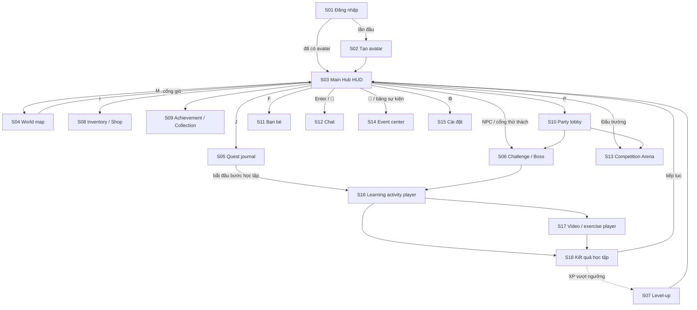

# UX màn hình học sinh trong game — quy ước chung và chỉ mục

> Trạng thái: Draft · Phiên bản: 1.2 · Owner: UX/UI Designer + Game Director · Cập nhật: 2026-11-26 (F113: §2 khóa ngang Android/iOS theo cảm biến, màn "Xoay ngang" khi cửa sổ dọc) · 2026-11-26 (F069: bảng XP dưới PlayerBadge, chip Xu + menu "Thêm" ở cột phải) · 2026-11-26 (F096: nút có icon kèm chữ ở mọi khối, thẻ "Việc tiếp theo", hướng dẫn lần đầu của Mây, không emoji/glyph ngoài font) · 2026-11-24 (ADR-0101: bỏ Windows, client chỉ Web/Android/iOS) · 2026-11-15
> Liên quan: [DESIGN_SYSTEM](DESIGN_SYSTEM.md) · [ADR-0056 song ngữ](../adr/ADR-0056-game-song-ngu-viet-anh.md) · [ADR-0057 máy tầm trung](../adr/ADR-0057-chay-tren-may-tam-trung-hang-thiet-bi-va-ngan-sach-hieu-nang.md) · [ADR-0047](../adr/ADR-0047-hai-he-thong-giao-dien-game-godot-3d-va-admin-ops-cms-lms.md) · [GODOT_ARCHITECTURE](../08-game-client/GODOT_ARCHITECTURE.md) · [PERFORMANCE_BUDGET](../08-game-client/PERFORMANCE_BUDGET.md) · [LEARNING_EXPERIENCE](../02-learning/LEARNING_EXPERIENCE.md)

## 1. Mục đích và phạm vi

Tài liệu này là **nguồn duy nhất** cho các quy ước UX dùng chung của mọi màn học sinh trong game Godot: nền tảng và hướng màn hình, khung HUD, điều khiển, vùng chạm, song ngữ, hiệu năng UI trên máy tầm trung, trạng thái chuẩn, trợ năng, mẫu đặc tả và chỉ mục 18 màn. Đặc tả chi tiết từng màn nằm ở ba file:

| File | Màn |
|---|---|
| [STUDENT_GAME_UX_CORE](STUDENT_GAME_UX_CORE.md) | S01–S07: đăng nhập, tạo avatar, Hub HUD, world map, quest journal, challenge/boss, level-up |
| [STUDENT_GAME_UX_SOCIAL](STUDENT_GAME_UX_SOCIAL.md) | S08–S15: inventory/shop, achievement/collection, party lobby, bạn bè, chat, competition arena, event center, cài đặt |
| [STUDENT_GAME_UX_LEARNING](STUDENT_GAME_UX_LEARNING.md) | S16–S18: learning activity player, video/exercise player, kết quả học tập |

Ngoài phạm vi: Admin Portal (xem [ADMIN_PORTAL](../04-admin-portal/ADMIN_PORTAL.md), Admin/Ops UI theo [DESIGN_SYSTEM §4](DESIGN_SYSTEM.md#4-adminops-design-system-cmslmsadmin)); token màu/font và mật độ theo khối (thuộc [DESIGN_SYSTEM §5](DESIGN_SYSTEM.md#5-game-design-system-godot-3d)); cỡ chữ đề bài và quy tắc học tập (thuộc [LEARNING_EXPERIENCE](../02-learning/LEARNING_EXPERIENCE.md)); ngân sách hiệu năng toàn game (thuộc [PERFORMANCE_BUDGET](../08-game-client/PERFORMANCE_BUDGET.md)).

## 2. Nền tảng và hướng màn hình

| Nền tảng | Kích thước tham chiếu | Nhập liệu | Ghi chú | Nhãn |
|---|---|---|---|---|
| **Web/PC** (trình duyệt PC, gồm PC phòng máy — không có bản Windows, ADR-0101) | Cửa sổ tối thiểu 1280×720; tham chiếu 1920×1080 | Chuột + bàn phím; có phím tắt | Cửa sổ thay đổi kích thước được; UI co giãn theo `stretch_mode = canvas_items`, `aspect = expand` | [Confirmed] |
| **Mobile — điện thoại** | Ngang, ≥ 6"; tham chiếu 2400×1080 (20:9) | Cảm ứng đa điểm | Tôn trọng safe area (notch, thanh điều hướng); khóa hướng **ngang** | [Confirmed] |
| **Mobile — tablet** | Ngang; tham chiếu 2160×1620 (4:3) | Cảm ứng; bàn phím ngoài nếu có | Dùng bố cục mobile với lề rộng hơn; panel có thể hiển thị hai cột | [Confirmed] |
| Trình duyệt trên điện thoại | Ngang, như dòng điện thoại | Cảm ứng | **Cho chơi**, bắt buộc cầm ngang (cửa sổ dọc → màn "Xoay ngang điện thoại để chơi nhé!" ở dưới); không chặn, không trang "Hãy tải ứng dụng"; trình duyệt theo NFR-COMP-004 (Chrome/Edge bắt buộc; Safari/Firefox — gồm mọi trình duyệt trên iOS — không kiểm thử, không chặn); hiệu năng nỗ lực tối đa, cam kết FPS theo hạng thiết bị chỉ cho ứng dụng Android/iOS và Web PC (NFR-COMP-001); ứng dụng vẫn là kênh chính trên điện thoại | [Confirmed — owner 2026-11-26, thay "Không hỗ trợ"; đóng F113-1] |

- **Hướng màn hình: ngang (landscape) trên mọi nền tảng** [Confirmed]. Không thiết kế bố cục dọc.
  - Android/iOS: chỉ hiển thị ngang, xoay theo cảm biến giữa hai chiều ngang (sensor landscape) [Confirmed — F113, owner "chốt hết" 2026-11-26]; cài đặt ở [GODOT_ARCHITECTURE §10.2](../08-game-client/GODOT_ARCHITECTURE.md#102-hiển-thị-stretch-và-hướng-màn-hình-f113).
  - Cửa sổ dọc (cao > rộng — trình duyệt không ép xoay được ở mọi nơi: điện thoại cầm dọc, cửa sổ trình duyệt kéo hẹp): game **không** đổi sang bố cục dọc mà hiện màn toàn màn hình **"Xoay ngang điện thoại để chơi nhé!"** (nền trời S01, Mây trong bong bóng lời, icon điện thoại xoay, dòng "Trên máy tính, em kéo cửa sổ rộng ra nhé."); game tạm dừng phía sau và chạy tiếp đúng chỗ khi xoay lại; màn chờ Web hiện cùng lời nhắc; thiết bị cảm ứng thử khóa ngang qua trình duyệt, không được thì bỏ qua im lặng [Confirmed — F113]. Bố cục dọc F097–F099 đã có chỉ còn là dự phòng (không làm thêm).
- **Breakpoint UI** (tính theo kích thước logic sau khi scale): `compact` (điện thoại, chiều cao logic < 800), `regular` (tablet, PC 1280×720), `wide` (PC ≥ 1600 chiều rộng). Mỗi màn ghi rõ khác biệt giữa **Web/PC** và **Mobile**; tablet dùng bố cục Mobile với lề rộng (`regular`).
- Tỉ lệ khác 16:9: phần thế giới 3D mở rộng theo chiều ngang; HUD bám góc theo anchor, không kéo giãn panel.

## 3. Khung HUD chuẩn

Mọi màn trong thế giới (Hub, vùng đất, boss) đặt HUD theo cùng vùng để học sinh không phải học lại:

| Vùng | Nội dung | PC | Mobile |
|---|---|---|---|
| Trên-trái | Avatar, nickname, level + danh hiệu, thanh XP | Đầy đủ | Rút gọn: avatar + level + thanh XP mảnh |
| Trên-phải | Ví Xu, chuông thông báo (badge), nút Cài đặt/menu | Đủ 3 nút | Ví Xu + chuông + menu (☰) |
| Trái | Thẻ **Việc tiếp theo** (một gợi ý: bài nhà trường giao, hoặc mở Bản đồ — F096, [CORE S03 §6a](STUDENT_GAME_UX_CORE.md#s03--main-hub-hud)); theo dõi quest (tối đa 3 quest, bước hiện tại) | Panel mở sẵn, thu gọn được | Thu gọn mặc định thành 1 dòng; chạm để mở |
| Dưới-trái | Chat | Khung chat trong suốt 360×180, mở rộng khi bấm Enter | Nút chat (badge chưa đọc); chạm mở panel chat nửa màn |
| Dưới-phải | Nút hành động/tương tác theo ngữ cảnh (Nói chuyện, Nhặt, Vào cổng…), emote | Gợi ý phím (E, T) | Nút tròn lớn: Tương tác, Nhảy, Emote; joystick ảo ở **dưới-trái** (chat dời lên trên joystick) |
| Giữa | **Để trống** cho thế giới 3D; chỉ hiện toast ngắn và gợi ý tương tác nổi trên đối tượng | | |
| Trên-giữa | Thông báo hệ thống tạm thời (mất kết nối, nhắc nghỉ, sự kiện) | Banner 1 dòng | Banner 1 dòng dưới safe area |

Lát cắt client hiện tại (F096, F069): cấp/danh hiệu/thanh XP nằm ở bảng ngay dưới `PlayerBadge`; chip Xu và nút "Thêm" (menu ☰ dạng ô lớn: Cửa hàng, Thành tựu & Bộ sưu tập, Núi Thử Thách, Hành trình của tôi) ở cột phải dưới thanh trên — chi tiết [STUDENT_GAME_UX_CORE S03 §6b](STUDENT_GAME_UX_CORE.md#s03--main-hub-hud).

```text
Web/PC (1920×1080)
┌───────────────────────────────────────────────────────────────────────────┐
│[Avatar] Cú Mèo 27  Lv12 Nhà thám hiểm      [!] Mất kết nối…    [Xu 340][🔔3][⚙]│
│[████████░░ XP]                                                            │
│┌Quest──────────────┐                                                      │
││★ Sửa cầu Vương q. Số│                                                      │
││  Bước 2/4: Gặp Ông Số│                (thế giới 3D)                        │
││☐ Daily: 3 bài Toán │                                                      │
│└──────────────────┘                     [E] Nói chuyện với Ông Số            │
│                                                                           │
│┌Chat (Party)──────────┐                                                  │
││Mèo Vàng: đi boss nhé │                                       [T] Emote   │
││> Enter để chat       │                              [M] Bản đồ [J] Nhiệm vụ│
│└──────────────────────┘                                                  │
└───────────────────────────────────────────────────────────────────────────┘

Mobile — điện thoại ngang (2400×1080, trong safe area)
┌──────────────────────────────────────────────────────────────┐
│[Av] Lv12 [███░]           (banner hệ thống)      [Xu 340][🔔][☰]│
│[★ Sửa cầu · B2/4 ▾]                                          │
│                                                              │
│                        (thế giới 3D)                [🗺][📜]  │
│[💬3]                                                         │
│   ╭───╮                                         (Nói)  (⤒)   │
│   │ ◉ │  joystick                                 (😊)        │
│   ╰───╯                                                      │
└──────────────────────────────────────────────────────────────┘
```

## 4. Điều khiển

### 4.1. Web/PC — phím mặc định (cho phép đổi phím trong Cài đặt) [Confirmed]

| Hành động | Phím | Hành động | Phím |
|---|---|---|---|
| Di chuyển | W A S D / phím mũi tên | Bản đồ thế giới | M |
| Chạy | Shift (giữ) | Nhật ký nhiệm vụ | J |
| Nhảy | Space | Túi đồ / Tủ đồ | I |
| Tương tác | E (hoặc nhấp chuột trái vào đối tượng) | Bạn bè | F |
| Xoay camera | Giữ chuột phải + kéo; cuộn chuột để zoom | Party | P |
| Chat | Enter (mở/gửi), Esc (đóng) | Vòng emote | T |
| Thi đấu | K | Cửa hàng | B |
| Đóng màn/menu | Esc | Chụp ảnh màn hình (cục bộ) | F12 |

Chuột: mọi chức năng đều bấm được bằng chuột (học sinh nhỏ có thể không dùng phím). Lớp 1–3 bật mặc định **bấm-để-đi** (click-to-move).

### 4.2. Mobile — cảm ứng

| Thành phần | Vị trí | Quy tắc |
|---|---|---|
| Joystick ảo | Nửa trái màn, xuất hiện tại điểm chạm (động) | Vùng chết 10%; đẩy > 80% = chạy |
| Xoay camera | Kéo một ngón ở nửa phải (ngoài nút) | Chụm 2 ngón để zoom |
| Nút Tương tác | Dưới-phải, lớn nhất | Nhãn theo ngữ cảnh ("Nói", "Nhặt", "Vào") |
| Nhảy, Emote | Quanh nút Tương tác | |
| Bấm-để-đi | Chạm vào mặt đất | Bật mặc định cho `g1_3`; tùy chọn cho khối khác |
| Rung (haptic) | Khi nhận thưởng, lên cấp, trả lời đúng | Tắt được trong Cài đặt; không rung khi trả lời sai |

### 4.3. Vùng chạm và cỡ chữ

- Vùng chạm/bấm tối thiểu **48 dp**; **lớp 1–3 ≥ 64 dp**; khoảng cách giữa hai vùng chạm ≥ 8 dp.
- Cỡ chữ cơ sở và chiều cao nút theo grade band: [DESIGN_SYSTEM §5.2](DESIGN_SYSTEM.md#52-mật-độ-theo-grade-band). Cỡ chữ đề bài: [LEARNING_EXPERIENCE §8](../02-learning/LEARNING_EXPERIENCE.md#8-ux-học-tập-theo-grade-band). Tài liệu màn **không chép số**, chỉ tham chiếu.
- Lớp 1–3: mọi nút có icon kèm chữ; có nút loa đọc to nội dung chính. Từ F096 mọi khối dùng nút HUD có icon SVG kèm chữ (icon cùng cỡ token, không làm nút cao hơn vùng chạm); nhãn nút không chứa phím PC (phím tắt ở tooltip).
- Biểu tượng là icon SVG của bộ icon game, không phải emoji hay ký tự ký hiệu: bản Web chỉ có font đóng gói nên ký tự ngoài font hiện thành ô vuông ([DESIGN_SYSTEM §5.1](DESIGN_SYSTEM.md#51-token-ui)).
- Lần đầu vào Hub, Mây hướng dẫn tối đa 3 bước, luôn bỏ qua được ([CORE S03 §6a](STUDENT_GAME_UX_CORE.md#s03--main-hub-hud)).

## 5. Song ngữ (ADR-0056)

| Quy ước | Chi tiết |
|---|---|
| Khóa dịch UI | `ui.<screen>.<element>[.<state>]`, chữ thường, gạch dưới. Ví dụ `ui.login.button_sign_in`, `ui.hub.quest_tracker.empty`. Thông điệp lỗi dùng `ui.error.<ProblemCode>` (ví dụ `ui.error.TENANT_MISMATCH`) |
| File dịch | `src/game/locale/vi.po` (gốc), `src/game/locale/en.po`; mọi `Label`/`Button` gán khóa, không gán chuỗi |
| Dữ liệu từ backend | Trường `i18nText` (`{vi, en}`); client chọn theo ngôn ngữ hiện tại, thiếu `en` thì dùng `vi` kèm nhãn nhỏ "VI" |
| Đổi ngôn ngữ | Trong Cài đặt (S15) và ở màn đăng nhập (S01); áp dụng ngay, không tải lại scene |
| Hiển thị song song | Tùy chọn hiển thị tên riêng/từ khóa ở cả hai ngôn ngữ (ví dụ "Vương quốc Số · Math Kingdom") [Confirmed] |
| Độ dài chuỗi | Bố cục chịu được chuỗi **dài hơn 35%** so với bản ngắn nhất; mỗi màn ghi "chuỗi dài nhất" để kiểm thử; chữ không vừa thì xuống dòng, không thu nhỏ dưới cỡ tối thiểu, không cắt ở nút chính |
| Kiểm thử | Pseudo-locale `xx` (kéo dài chuỗi 40%, thêm dấu) chạy trong CI chụp ảnh từng màn |

## 6. Hiệu năng UI trên máy tầm trung (ADR-0057)

Ngân sách tổng thể của game nằm trong [PERFORMANCE_BUDGET](../08-game-client/PERFORMANCE_BUDGET.md). Quy tắc UI áp dụng cho mọi màn:

| Quy tắc | Chi tiết | Nhãn |
|---|---|---|
| Số `Control` hiển thị | ≤ 150 node/màn ở preset Trung bình; danh sách dài dùng **ảo hóa** (chỉ tạo hàng nhìn thấy) | [Confirmed] |
| Cập nhật theo sự kiện | HUD cập nhật qua signal/event (XP, Xu, quest), **không** cập nhật trong `_process` mỗi frame | [Confirmed] |
| Không hiệu ứng nền nặng | Không blur nền, không `BackBufferCopy`/shader toàn màn cho panel; nền panel dùng `StyleBoxFlat` hoặc 9-slice | [Confirmed] |
| Texture | Icon/khung UI trong **atlas**; ảnh minh họa nén (WebP/ETC2/ASTC theo nền tảng); không nạp ảnh > 2048 px | [Confirmed] |
| Font | Font dạng MSDF cho tiêu đề cỡ lớn; giới hạn 2 họ font | [Confirmed] |
| Animation | ≤ 6 tween chạy đồng thời; particle UI ≤ 64 hạt/hiệu ứng; tắt khi bật "Giảm chuyển động" | [Confirmed] |
| Bản đồ nhỏ/xem trước 3D | Không dùng camera thứ hai render liên tục cho minimap; minimap/world map là ảnh 2D vẽ sẵn + marker. Xem trước 3D (avatar, item) dùng `SubViewport` độ phân giải theo preset, 30 FPS, tắt khi màn không hiển thị | [Confirmed] |
| Mở màn | Màn panel mở ≤ 200 ms trên máy tầm trung; dữ liệu lớn tải sau khung, hiển thị skeleton | [Confirmed] |
| Đo | Mỗi màn có cảnh benchmark trong CI (đếm Control, draw call UI, thời gian mở) | [Confirmed] |

## 7. Trạng thái chuẩn

| Trạng thái | Cách hiển thị | Khóa dịch gốc |
|---|---|---|
| Đang tải | Skeleton (khung xám) cho danh sách/panel; spinner chỉ dùng cho thao tác < 3 s; > 3 s hiện câu "Đang chuẩn bị…" với NPC Mây | `ui.common.loading` |
| Rỗng | Minh họa nhỏ + một câu hướng dẫn hành động tiếp theo | `ui.<screen>.empty` |
| Lỗi | Thông điệp thân thiện theo `ProblemCode` ([GODOT_ARCHITECTURE §9](../08-game-client/GODOT_ARCHITECTURE.md#9-error-handling--offline)), nút "Thử lại"; mã lỗi chỉ trong "Chi tiết" | `ui.error.*` |
| Mất mạng | Banner trên-giữa "Đang kết nối lại…"; khóa nút gửi/ghi; dữ liệu đã có vẫn xem được | `ui.common.reconnecting` |
| Khóa / chưa đủ điều kiện | Biểu tượng khóa + điều kiện còn thiếu bằng lời ("Hoàn thành chương 0 để mở"); không dùng màu đỏ | `ui.<screen>.locked_reason` |
| Thành công | Toast 2–3 s hoặc hiệu ứng ngắn; không chặn thao tác | `ui.common.success` |
| Ngoài khung giờ truy cập của trường / nhắc nghỉ | Hộp thoại nhẹ nêu giờ mở lại (khung giờ do School Admin đặt cho cả trường, áp như nhau cho mọi khu vực trong game) hoặc lời nhắc nghỉ, theo [CHILD_SAFETY](../10-security/CHILD_SAFETY.md) | `ui.common.outside_access_window`, `ui.common.break_reminder` |

Không dùng chữ "Thất bại" đỏ toàn màn, không đếm ngược gây áp lực ngoài hoạt động có giới hạn thời gian.

## 8. Trợ năng

- Tùy chọn: 3 mức cỡ chữ, tương phản cao, giảm chuyển động, phụ đề cho mọi âm thanh có lời, đọc to (TTS hai ngôn ngữ, [Confirmed]), bấm-để-đi.
- Lớp 1–3 (`g1_3`): đề bài và hướng dẫn quest có **lồng tiếng tiếng Việt** phát tự động (PED-07, điều kiện publish do tài liệu nội dung sở hữu — [LEARNING_EXPERIENCE §8](../02-learning/LEARNING_EXPERIENCE.md#8-ux-học-tập-theo-grade-band)); luôn kèm phụ đề và icon minh họa để học sinh không có tai nghe vẫn làm được ([STUDENT_GAME_UX_LEARNING §7](STUDENT_GAME_UX_LEARNING.md#7-hỗ-trợ-lớp-13-lồng-tiếng-phụ-đề-và-icon)).
- Điều hướng bàn phím trên PC: mọi nút có thể focus (Tab/Shift+Tab), focus hiển thị rõ; Enter/Space kích hoạt.
- Không truyền thông tin chỉ bằng màu (đúng/sai kèm icon ✓/✗ và chữ).
- Thời gian đọc thông báo tối thiểu 3 s; thông báo quan trọng không tự đóng.

## 9. An toàn và riêng tư

- Người chơi khác chỉ thấy **nickname + avatar + danh hiệu**; không hiển thị tên thật, trường, lớp cho người ngoài phạm vi ([CHILD_SAFETY](../10-security/CHILD_SAFETY.md), [ADR-0054](../adr/ADR-0054-tuong-tac-xa-hoi-lien-truong-cross-school-social-interaction.md)).
- Ảnh chụp màn hình (F12) chỉ lưu cục bộ, không có nút chia sẻ ra mạng xã hội.
- Mọi thao tác báo cáo/chặn ≤ 2 chạm từ nickname của người khác.

## 10. Mẫu đặc tả một màn

Mỗi màn trong ba file con dùng đúng các mục sau:

1. **Mục đích** · 2. **Người dùng & khối** · 3. **Điểm vào / ra** · 4. **Bố cục Web/PC** (wireframe ASCII) · 5. **Bố cục Mobile** (wireframe điện thoại ngang + ghi chú tablet) · 6. **Thành phần** (component Theme game) · 7. **Dữ liệu & API** (`operationId` REST, message WS; endpoint chưa có ghi "đề xuất") · 8. **Trạng thái** (§7) · 9. **Tương tác & phản hồi** (animation, âm thanh, haptic) · 10. **Khác biệt theo grade band** (`g1_3`/`g4_5`/`g6_9`) · 11. **Song ngữ** (khóa dịch, ví dụ vi/en, chuỗi dài nhất) · 12. **Trợ năng** · 13. **Hiệu năng máy tầm trung** · 14. **An toàn/riêng tư** · 15. **AC** (mã `AC-UX-<số màn 2 chữ số><thứ tự 2 chữ số>`, ví dụ `AC-UX-0101`).

## 11. Sơ đồ điều hướng



## 12. Chỉ mục 18 màn

| # | Màn | File | Tài liệu nghiệp vụ |
|---|---|---|---|
| S01 | Đăng nhập username/password (không chọn trường) / ngôn ngữ | [CORE](STUDENT_GAME_UX_CORE.md#s01--đăng-nhập) | [KEYCLOAK_SSO](../09-identity/KEYCLOAK_SSO.md), [GODOT_ARCHITECTURE §5](../08-game-client/GODOT_ARCHITECTURE.md#5-vòng-đời-ứng-dụng) |
| S02 | Tạo avatar lần đầu | [CORE](STUDENT_GAME_UX_CORE.md#s02--tạo-avatar-lần-đầu) | [CHARACTER_SYSTEM §5.0](../01-game-design/CHARACTER_SYSTEM.md#50-tạo-avatar-lần-đầu) |
| S03 | Main Hub HUD | [CORE](STUDENT_GAME_UX_CORE.md#s03--main-hub-hud) | [GAME_DESIGN](../01-game-design/GAME_DESIGN.md), [WORLD_DESIGN](../01-game-design/WORLD_DESIGN.md) |
| S04 | World map | [CORE](STUDENT_GAME_UX_CORE.md#s04--world-map) | [WORLD_DESIGN §3, §6–§8](../01-game-design/WORLD_DESIGN.md) |
| S05 | Quest journal | [CORE](STUDENT_GAME_UX_CORE.md#s05--quest-journal) | [QUEST_SYSTEM](../01-game-design/QUEST_SYSTEM.md), [SCHOOL_LMS](../04-admin-portal/SCHOOL_LMS.md) |
| S06 | Challenge / Boss | [CORE](STUDENT_GAME_UX_CORE.md#s06--challenge--boss) | [CHALLENGE_BOSS_SYSTEM](../01-game-design/CHALLENGE_BOSS_SYSTEM.md) |
| S07 | Level-up | [CORE](STUDENT_GAME_UX_CORE.md#s07--level-up) | [PROGRESSION_SYSTEM §4](../01-game-design/PROGRESSION_SYSTEM.md#4-level-và-đường-cong-xp) |
| S08 | Inventory / Shop | [SOCIAL](STUDENT_GAME_UX_SOCIAL.md) | [INVENTORY_ECONOMY](../01-game-design/INVENTORY_ECONOMY.md) |
| S09 | Achievement / Collection | [SOCIAL](STUDENT_GAME_UX_SOCIAL.md) | [INVENTORY_ECONOMY](../01-game-design/INVENTORY_ECONOMY.md) |
| S10 | Party lobby | [SOCIAL](STUDENT_GAME_UX_SOCIAL.md) | [PARTY_SYSTEM](../03-social-multiplayer/PARTY_SYSTEM.md) |
| S11 | Bạn bè | [SOCIAL](STUDENT_GAME_UX_SOCIAL.md) | [SOCIAL_SYSTEM](../03-social-multiplayer/SOCIAL_SYSTEM.md) |
| S12 | Chat | [SOCIAL](STUDENT_GAME_UX_SOCIAL.md) | [CHAT_SYSTEM](../03-social-multiplayer/CHAT_SYSTEM.md) |
| S13 | Competition Arena | [SOCIAL](STUDENT_GAME_UX_SOCIAL.md) | [COMPETITION_SYSTEM](../01-game-design/COMPETITION_SYSTEM.md), [MATCHMAKING](../03-social-multiplayer/MATCHMAKING.md) |
| S14 | Event center | [SOCIAL](STUDENT_GAME_UX_SOCIAL.md) | [GAME_DESIGN](../01-game-design/GAME_DESIGN.md) (Event & Season) |
| S15 | Cài đặt (ngôn ngữ, chất lượng đồ họa, điều khiển, trợ năng, âm thanh, tài khoản) | [SOCIAL](STUDENT_GAME_UX_SOCIAL.md) | [GODOT_ARCHITECTURE §10](../08-game-client/GODOT_ARCHITECTURE.md#10-settings-i18n--accessibility), [PERFORMANCE_BUDGET](../08-game-client/PERFORMANCE_BUDGET.md) |
| S16 | Learning activity player | [LEARNING](STUDENT_GAME_UX_LEARNING.md) | [ACTIVITY_ENGINE](../02-learning/ACTIVITY_ENGINE.md), [LEARNING_EXPERIENCE](../02-learning/LEARNING_EXPERIENCE.md) |
| S17 | Video / exercise player | [LEARNING](STUDENT_GAME_UX_LEARNING.md) | [VIDEO_LEARNING](../02-learning/VIDEO_LEARNING.md), [QUESTION_BANK](../02-learning/QUESTION_BANK.md) |
| S18 | Kết quả học tập | [LEARNING](STUDENT_GAME_UX_LEARNING.md) | [LEARNING_EXPERIENCE §7](../02-learning/LEARNING_EXPERIENCE.md#7-hiển-thị-tiến-bộ-cho-học-sinh) |

## 13. Acceptance criteria chung

| Mã | Tiêu chí |
|---|---|
| AC-UX-0001 | Mọi màn S01–S18 có bố cục Web/PC và Mobile, chơi được ở 1280×720 và điện thoại ngang 20:9 không chồng lấn safe area |
| AC-UX-0002 | Mọi chuỗi hiển thị dùng khóa dịch; đổi `vi`↔`en` trong Cài đặt cập nhật toàn bộ màn đang mở trong ≤ 1 s, không tải lại scene |
| AC-UX-0003 | Với pseudo-locale kéo dài 40%, không màn nào cắt chữ ở nút chính hoặc tràn panel |
| AC-UX-0004 | Trên thiết bị tham chiếu tầm trung ([ADR-0057](../adr/ADR-0057-chay-tren-may-tam-trung-hang-thiet-bi-va-ngan-sach-hieu-nang.md)), mở bất kỳ panel nào ≤ 200 ms và không làm FPS giảm dưới mục tiêu quá 1 s |
| AC-UX-0005 | Vùng chạm ≥ 48 dp (≥ 64 dp với `g1_3`) ở mọi nút trên mobile (kiểm bằng công cụ đo trong CI) |
| AC-UX-0006 | Mọi chức năng dùng được hoàn toàn bằng chuột (PC) và hoàn toàn bằng cảm ứng (mobile) |
| AC-UX-0007 | Tên thật, trường, lớp của học sinh không xuất hiện ở bất kỳ màn nào mà người chơi khác nhìn thấy |
| AC-UX-0008 | Mỗi màn có đủ trạng thái đang tải, rỗng, lỗi, mất mạng theo §7 |
