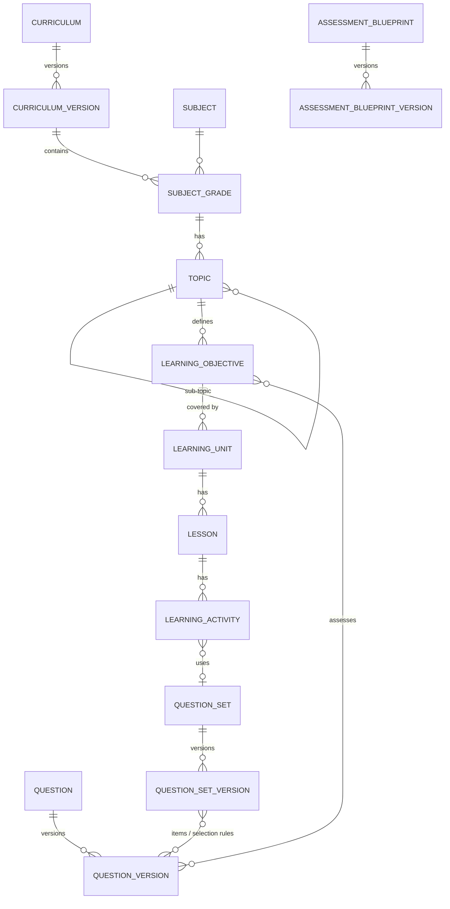
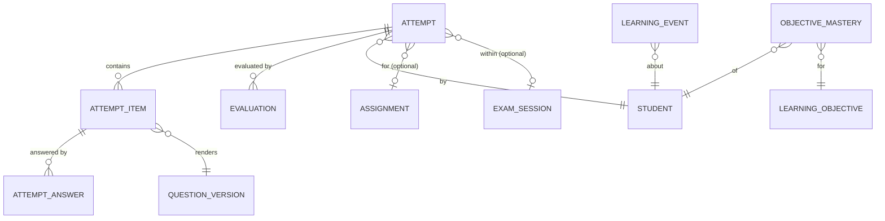
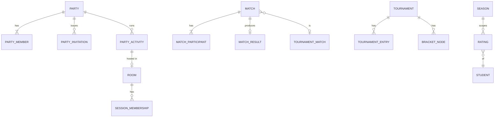

# Domain Model

> Trạng thái: Draft · Phiên bản: 0.6 · Owner: Backend Architect · Cập nhật: 2026-11-17 (ADR-0074: bounded context thuộc module của modular monolith, không còn service riêng)
> Liên quan: [SYSTEM_ARCHITECTURE](SYSTEM_ARCHITECTURE.md) · [ADR-0074](../adr/ADR-0074-modular-monolith-co-ranh-gioi-cuong-che.md) · [ADR-0037](../adr/ADR-0037-moi-service-mot-database-postgresql-thay-mot-phan-adr-0003.md) · [DATABASE_DESIGN](../07-backend/DATABASE_DESIGN.md) · [GLOSSARY](../00-overview/GLOSSARY.md)

**Mục đích.** Nguồn chuẩn về **tên entity, aggregate, quan hệ, bất biến và module sở hữu**. Mọi tài liệu, schema DB, API phải dùng đúng tên ở đây.
**Phạm vi.** Mô hình khái niệm. **Không** chứa cột, kiểu dữ liệu, độ dài, index, DDL: những thứ đó chỉ ở [DATABASE_DESIGN](../07-backend/DATABASE_DESIGN.md). Quy tắc nghiệp vụ chi tiết nằm ở tài liệu domain được link trong từng mục.

## 1. Bounded contexts

Mỗi bounded context thuộc đúng **một module** của modular monolith và lưu trong **database của module đó** (ADR-0074, ADR-0037). "Module" là thư mục `modules/<module>/` (năm module domain + `realtime`); "Package domain" là package trong `modules/<module>/internal/domain/`; "Schema" là namespace trong database của module.

| Context | Module · Database | Package domain | Schema | Aggregate chính | Sở hữu dữ liệu |
|---|---|---|---|---|---|
| Identity & Access | module identity · `eduworld_identity` | `identity`, `authorization` | `identity` | User, ExternalIdentity, Role, UserRole | Ai là ai, có quyền gì ở phạm vi nào |
| Tenancy & Organization | module identity · `eduworld_identity` | `tenancy`, `organization`, `student` | `platform`, `org` | **Tenant**, School, AcademicYear, Class, Student, Enrollment | Tenant và cấu trúc trường học (đồng bộ từ SIS); không có giáo viên/phân công giảng dạy (ADR-0072) |
| SIS Integration | module identity · `eduworld_identity` | `sis` | `sis` | SISConnection, SyncRun, SyncedStudent, ReconciliationIssue | Trạng thái và nguồn đồng bộ |
| Curriculum | module learning · `eduworld_learning` | `curriculum` | `curriculum` | Curriculum(+Version), Subject, Topic, LearningObjective | Khung chương trình |
| Content | module learning · `eduworld_learning` | `content`, `question_bank` | `content` | Lesson, Question, QuestionSet, AssessmentBlueprint, LearningActivity, MediaAsset, ContentRelease | Nội dung học tập phiên bản hóa |
| Assessment | module learning · `eduworld_learning` | `exercise`, `exam`, `assessment` | `assessment` | Attempt, Evaluation, ExamSession, ExamPaper | Lượt làm bài và kết quả |
| Learning Record | module learning · `eduworld_learning` | `learning_record`, `learning_analytics` | `learning` | LearningEvent, ObjectiveMastery | Bằng chứng học tập, mastery |
| LMS | module learning · `eduworld_learning` | `lms` | `lms` | Course, LearningPath, Assignment, Schedule | Triển khai hoạt động học do nhà trường giao (`school_admin`/`academic_manager`, ADR-0072) |
| Game | module game · `eduworld_game` | `game`, `quest`, `minigame`, `game_session` | `game` | GameProfile, WorldArea, QuestDefinition, QuestProgress, Challenge, BossEncounter, LevelDefinition, LevelSession, GameSession | Trạng thái và nội dung game |
| Progression & Economy | module game · `eduworld_game` | `gamification`, `reward`, `economy` | `gamification` | XPLedger, ProgressionCurve, Wallet, CurrencyLedger, Achievement, Collection, ShopItem | Động lực, phần thưởng, kinh tế |
| Multiplayer | module competition · `eduworld_competition` | `multiplayer/*` | `multiplayer` | Party, Room, MatchmakingTicket (Valkey) | Nhóm tạm thời, phòng, phiên chơi chung |
| Competition | module competition · `eduworld_competition` | `competition/*` | `competition` | Match, Rating, Season, Tournament, LeaderboardDefinition | Thi đấu và xếp hạng |
| Social | module chat · `eduworld_chat` | `social/*` | `social` | Friendship, Block, Guild/Club | Quan hệ xã hội, nhóm bền vững |
| Chat & Moderation | module chat · `eduworld_chat` | `chat/*` | `chat` | Channel, Message, ChatPolicy, ModerationCase, SensitiveTermCatalog | Giao tiếp và kiểm duyệt |
| Audit & Platform | module identity (audit, saga) · mọi module (`infra` trong database của từng module) | `audit`, `platform` | `audit`, `platform`, `infra` | AuditLog, OutboxEvent, IdempotencyRecord, TenantResourceAssignment, TenantCloneJob, SagaRun | Truy vết, hạ tầng, gán/clone dữ liệu (ADR-0029) |

Quản trị nội dung (Admin Portal) không phải context riêng: nó gọi API của context sở hữu nội dung (learning cho học tập, game cho Game Studio, chat cho sticker/GIF và danh mục từ nhạy cảm). Module `realtime` không sở hữu context nào và không có database.

## 1.1. Quy ước chung cho mọi entity nghiệp vụ

| Quy ước | Nội dung | ADR |
|---|---|---|
| Tenant | Mọi entity dữ liệu nghiệp vụ thuộc đúng một tenant (khóa cô lập). Dữ liệu platform dùng chung thuộc phạm vi platform và chỉ hiển thị cho tenant được gán | ADR-0005, ADR-0029 |
| School | Chiều phân loại bên trong tenant, **không** phải khóa cô lập | ADR-0005 |
| Soft-delete | Entity không append-only có trạng thái đã xóa; ứng dụng không hard-delete; truy vấn mặc định bỏ qua bản ghi đã xóa. Entity append-only (LearningEvent, AttemptAnswer, mọi Ledger, AuditLog, OutboxEvent) không có thao tác xóa. Ngoại lệ purge: chat gameplay (ADR-0033) | ADR-0028 |
| Tham chiếu chéo module | Bằng ID, **không FK chéo database**; dữ liệu đọc thường xuyên lấy từ projection (§1.2) | ADR-0037, ADR-0074 |
| Phiên bản nội dung | Nội dung có version; version đã publish bất biến; học sinh nhận version theo con trỏ phát hành khi **bắt đầu** một đơn vị chơi/học và giữ version đó tới khi kết thúc | ADR-0015, ADR-0043 |
| Chuỗi | Mọi thuộc tính chuỗi có độ dài tối đa | ADR-0041 |
| Clone | Entity clone được (nội dung, cài đặt, lớp mẫu, template) ghi nguồn gốc bản sao | ADR-0029 |

## 1.2. Projection giữa module

Module dùng dữ liệu của module khác qua **projection chỉ đọc** cập nhật từ event (consumer trong profile `worker-events`) hoặc gọi facade khi cần dữ liệu mới nhất ([API_DESIGN §12](../07-backend/API_DESIGN.md#12-facade-giữa-module-adr-0074-adr-0040)) (bảng: [DATABASE_DESIGN §2.17](../07-backend/DATABASE_DESIGN.md)):

| Projection | Nguồn sự thật | Có ở module |
|---|---|---|
| Tenant, School, Class, Student, Enrollment (rút gọn) | module identity | learning, game, competition, chat |
| PlayerProfile (nickname, avatar thumbnail, level) | module game | competition, chat |
| Party (thành viên, trạng thái) | module competition | chat |
| Login activity (lần vào game, số phiên) | module game | learning (School Learning Dashboard) |

Projection không bao giờ được ghi bởi use case nghiệp vụ; sai lệch sửa ở nguồn, projection tự đồng bộ hoặc rebuild.

## 2. Identity, Tenancy & Organization

```mermaid
erDiagram
  TENANT ||--|{ SCHOOL : contains
  TENANT ||--o{ TENANT_RESOURCE_ASSIGNMENT : "được gán"
  SCHOOL ||--o{ ACADEMIC_YEAR : has
  SCHOOL ||--o{ CLASS : has
  ACADEMIC_YEAR ||--o{ CLASS : "scoped to"
  CLASS ||--o{ ENROLLMENT : has
  STUDENT ||--o{ ENROLLMENT : "enrolled via"
  SCHOOL ||--o{ STUDENT : "belongs to"
  USER ||--o| STUDENT : "is"
  USER ||--o{ EXTERNAL_IDENTITY : "linked to"
  USER ||--o{ USER_ROLE : has
  STUDENT ||--o{ SIS_IDENTITY_LINK : "sourced from"
  COUNTRY ||--|{ PROVINCE : "has"
  PROVINCE ||--o{ SCHOOL : "located in"
  PROVINCE ||--o{ PROVINCE_SUCCESSION : "succeeded by"
```

| Entity | Định nghĩa & quan hệ | Bất biến |
|---|---|---|
| **User** | Định danh nội bộ EduWorld; loại `student`/`staff` (không có `teacher`, ADR-0072; nhân sự platform là `staff` không có `primary_tenant_id`, ADR-0081); vòng đời pending → active → locked/deactivated → anonymized. Một người = một User dù làm việc ở nhiều tenant (nhiều membership, nhiều UserRole) | Không dùng email/tên làm khóa chính. **`username` duy nhất toàn hệ thống** (chuẩn hóa trim/NFC/chữ thường, so không phân biệt hoa thường); **`email` duy nhất toàn hệ thống nếu có**, bắt buộc với nhân sự; soft-delete không giải phóng username/email cho đến khi ẩn danh hóa; duy nhất trên SSO nên không trùng trong cùng tenant (ADR-0067, ADR-0069) |
| **ExternalIdentity** | Liên kết `(issuer, subject)` từ token OIDC tới User | `(issuer, subject)` duy nhất |
| **Permission** | Quyền nguyên tử, **định nghĩa trong code** (catalog cố định), thuộc tính `scope_kind` `tenant` hoặc `platform` (ADR-0066) | Không tạo/sửa qua API. Danh sách: [ADMIN_PORTAL §2](../04-admin-portal/ADMIN_PORTAL.md#2-permission-model) |
| **Role** | Tập permission lưu DB: `code`, tên song ngữ, `role_scope_kind` (`tenant`/`platform`), `is_system`, `tenant_id` (NULL = dùng chung; có giá trị = role tùy biến của tenant [Proposed]) | Role `tenant` không bao giờ chứa permission `platform.*`/`game.*`/`competition.config.*` (ADR-0027, ADR-0066); role `is_system` không sửa/xóa; role tùy biến chỉ thấy trong tenant sở hữu |
| **UserRole** | Gán Role cho User trong `tenant_id` + `scope_type` (`platform`/`tenant`/`school`/`subject`) + `scope_id`, `valid_from`/`valid_to`, `granted_by`, `source` (chỉ `manual`; SIS không cấp UserRole — ADR-0072); thay `RoleAssignment` cũ | UserRole của role platform chỉ `scope_type = platform`; học sinh không có role portal; phát `user_role.changed` khi đổi; soft-delete |
| **Tenant** | Đơn vị cô lập dữ liệu và đơn vị đăng nhập; loại `school` (1 trường), `unit` (nhiều trường), `common` (tenant chung) | 1 Tenant = 1 Keycloak Organization (ADR-0026) |
| **Country** (danh mục platform) | Quốc gia theo ISO 3166-1 alpha-2, tên song ngữ; Release 1.0 chỉ bật `VN` (ADR-0060) | Không theo tenant; chỉ System Admin sửa |
| **Province** (danh mục platform) | Tỉnh/thành cấp 1 thuộc một Country: mã nội bộ ổn định, `official_code` (TBD), tên song ngữ, loại (thành phố trực thuộc trung ương/tỉnh), hiệu lực `effective_from/to`. Seed: 34 đơn vị VN đang hiệu lực + 63 đơn vị cũ inactive ([reference-data](../../specs/reference-data/provinces.vn.json)) | Không xóa; đơn vị hết hiệu lực chuyển `inactive` và có kế thừa |
| **ProvinceSuccession** | Ánh xạ đơn vị cũ → đơn vị mới (sáp nhập, giữ nguyên, đổi tên) | Mọi đơn vị inactive kế thừa tới đúng một đơn vị active |
| **School** | Trường trong danh mục trường: thuộc đúng một tenant và một Province; mã ngành (`moet_code` nếu có), cấp học, khối áp dụng, tên song ngữ; tenant `common` có một School ảo | Chiều phân loại trong tenant, không phải khóa cô lập |
| **AcademicYear · Class** | Năm học và lớp (khối 1–9) của trường; tenant `common` có **lớp ảo theo khối** ("Khối 3 – chung") | Lớp thuộc đúng một trường |
| **Student** | Vai trò học sinh của User trong một trường; nhân sự nhà trường là User `staff` có UserRole, không có entity riêng | Tối thiểu hóa dữ liệu cá nhân |
| **Enrollment** | Học sinh thuộc lớp trong một khoảng thời gian | **Mỗi học sinh có đúng một enrollment active** (một trường, một lớp) tại một thời điểm; chuyển lớp/trường đóng cũ và mở mới trong cùng transaction; học sinh SIS thiếu lớp không vào game (ADR-0060) |
| **TenantMembership** (view) | User thuộc tenant nào, suy ra từ enrollment (học sinh) và UserRole (nhân sự) | Không nhập tay; mỗi `(tenant_id, user_id)` đúng một dòng (ADR-0067, ADR-0069); nguồn đồng bộ membership Keycloak và kiểm tra `X-Tenant-Id` (ADR-0065) |
| **SISIdentityLink · SISLink** | Liên kết User/entity nội bộ ↔ bản ghi SIS `(sis_connection_id, external_id)` | Khóa nguồn duy nhất theo connection (ADR-0046) |
| **TenantResourceAssignment** | Dữ liệu platform được gán cho tenant | Tenant chỉ đọc (ADR-0029) |
| **TenantCloneJob** | Clone sâu dữ liệu cấu hình/nội dung giữa tenant | Không bao giờ clone dữ liệu học sinh |

Học sinh không thuộc tenant nào ở tenant `common` ([MULTITENANCY §8.3](MULTITENANCY.md#83-tenant-chung)). Người chơi khác chỉ thấy nickname và avatar ([SOCIAL_SYSTEM](../03-social-multiplayer/SOCIAL_SYSTEM.md)).

## 3. Curriculum & Content



| Entity | Định nghĩa & quan hệ | Bất biến / tài liệu |
|---|---|---|
| **Curriculum / CurriculumVersion** | Chương trình học, nhiều chương trình/bộ sách | [CURRICULUM_MODEL](../02-learning/CURRICULUM_MODEL.md) |
| **Subject · Topic · LearningObjective** | Môn, cây chủ đề theo (chương trình, môn, khối), mục tiêu học tập có mã | — |
| **LearningUnit · Lesson** | Cấu trúc giảng dạy chứa hoạt động | — |
| **LearningActivity / ActivityVersion** | Hoạt động học tập theo `activity_type` (6 loại trong Release: `quiz`, `interactive_exercise`, `minigame`, `video_lesson`, `audio_lesson`, `simulation`; ngoài Release: `written_response`, `speaking`, `project` — ADR-0072) | Quest/assignment/exam/challenge chỉ tham chiếu activity + version ([ACTIVITY_ENGINE](../02-learning/ACTIVITY_ENGINE.md), ADR-0048) |
| **Question / QuestionVersion** | Câu hỏi 11 dạng, tách phần hiển thị và đáp án | Answer key chỉ ở server (ADR-0016) · [QUESTION_BANK](../02-learning/QUESTION_BANK.md) |
| **QuestionSet · AssessmentBlueprint** | Tập câu tĩnh/quy tắc chọn câu; ma trận đề | Version bất biến |
| **MediaAsset** | File media trên object storage + CDN | Bất biến, khóa content-addressed (ADR-0044) |
| **ContentItem (release pointer)** | Con trỏ version mà lượt chơi/học mới nhận | ADR-0043 · [CONTENT_MODEL](../02-learning/CONTENT_MODEL.md) |
| **ContentRelease** | Lịch sử publish/rollback/unpublish | Append-only; rollback chỉ đổi con trỏ |
| **LessonSession** | Lượt học bài, ghim version bài học | — |
| **ReviewTask** (duyệt nội dung) | Nhiệm vụ duyệt trong workflow biên tập | Không có ReviewTask chấm bài trong Release (ADR-0072) |

Nội dung platform hiển thị cho tenant khi được gán; nội dung tenant chỉ tenant sở hữu thấy; muốn sửa nội dung platform → System Admin clone sang tenant (ADR-0029).

## 4. Assessment & Learning Record



| Entity | Định nghĩa & quan hệ | Bất biến |
|---|---|---|
| **Attempt** | Một lượt làm của một học sinh, theo `mode` (`practice`, `assignment`, `quest`, `minigame`, `challenge`, `exam`, `competition`, `retry_wrong`, `diagnostic`), ghim version nội dung; `status` `in_progress`/`submitted`/`graded`/`expired`/`abandoned` | Chỉ submit một lần; điểm do server tính |
| **AttemptItem · AttemptAnswer** | Câu đã hiển thị; câu trả lời theo thời gian server, kèm `hints_used` và cờ `rapid_guess` | Answer append-only |
| **Evaluation** | Kết quả chấm tự động | Đúng một evaluation có hiệu lực; re-evaluate tạo evaluation mới, không sửa cũ |
| **ExamSession · ExamPaper** | Đợt kiểm tra; đề cụ thể sinh từ blueprint | Đề bất biến sau khi phát; phân biệt luyện tập/chính thức ([EXAM_ENGINE](../02-learning/EXAM_ENGINE.md)) |
| **RegradeRequest** | Yêu cầu re-evaluate do hệ thống chạy lại khi nội dung có lỗi, do `content_admin`/`academic_manager` kích hoạt (`attempt.re_evaluated`); không có chấm lại thủ công (ADR-0072) | Không sửa đè điểm cũ (lưu lịch sử điểm); có audit |
| **IntegritySignal** | Tín hiệu nghi gian lận cho attempt/trận | Chỉ là tín hiệu, không tự động trừng phạt ([ANTI_CHEAT](../10-security/ANTI_CHEAT.md)) |
| **LearningEvent** | Bằng chứng học tập dạng xAPI-like | Append-only, idempotent ([EVENT_DESIGN §5](../07-backend/EVENT_DESIGN.md)) |
| **ObjectiveMastery** | Mức thành thạo theo (học sinh, mục tiêu) | Tính bởi MasteryModel (ADR-0017); không đồng nhất với điểm một lần làm |

### 4.1. Activity Engine (ADR-0048) — module learning

| Entity | Định nghĩa | Bất biến / tài liệu |
|---|---|---|
| **VideoProgress** | Tiến độ xem video | Server tính, chống báo khống · [VIDEO_LEARNING](../02-learning/VIDEO_LEARNING.md) |
| **SimulationTemplate / SimulationRun** | Mô phỏng đã đăng ký; lượt chạy với chuỗi hành động | Chỉ tin kết quả khi checker server kiểm chứng (ADR-0052) · [SIMULATION_ENGINE](../02-learning/SIMULATION_ENGINE.md) |

Tự luận, bài nói, dự án và rubric ngoài version này (ADR-0082); không có thực thể tương ứng trong mô hình.

## 5. Game

| Entity | Định nghĩa & quan hệ | Bất biến / tài liệu |
|---|---|---|
| **GameProfile** | Hồ sơ game của học sinh: nickname, level, avatar | Nickname không phải tên thật · [CHARACTER_SYSTEM](../01-game-design/CHARACTER_SYSTEM.md) |
| **AvatarConfig · AvatarPreset** | Ngoại hình (tham chiếu item), bộ phối đồ lưu nhanh | Chỉ dùng item sở hữu |
| **WorldArea · WorldAreaUnlock · ExplorationProgress** | Khu vực thế giới, điều kiện và trạng thái mở khóa, tiến độ khám phá | Mở khóa do server quyết định · [WORLD_DESIGN](../01-game-design/WORLD_DESIGN.md), [PROGRESSION_SYSTEM](../01-game-design/PROGRESSION_SYSTEM.md) |
| **QuestDefinition / QuestVersion · QuestProgress** | Nhiệm vụ 12 loại, nhiều bước; tiến độ theo học sinh (có thể theo party) | Hoàn thành do server xác nhận; party quest không gán chung kết quả học tập · [QUEST_SYSTEM](../01-game-design/QUEST_SYSTEM.md) |
| **MiniGameConfig / Version** | Cấu hình mini-game, lấy câu hỏi từ Learning Engine | Không chứa câu hỏi riêng · [MINIGAME_ENGINE](../08-game-client/MINIGAME_ENGINE.md) |
| **NPCDialogue / Version** | Đồ thị hội thoại NPC | Version bất biến |
| **Challenge / ChallengeVersion · ChallengeAttempt** | Thử thách PvE 11 loại, 5 mức độ khó; lượt chơi gồm nhiều Attempt học tập | Mỗi câu là Attempt riêng · [CHALLENGE_BOSS_SYSTEM](../01-game-design/CHALLENGE_BOSS_SYSTEM.md) |
| **BossDefinition / BossPhase · BossEncounter** | Boss nhiều phase; một trận boss (cá nhân hoặc party) và đóng góp từng người | Server-authoritative trong module game |
| **LevelDefinition / LevelVersion · LevelSession** | Gói màn/khu vực; lượt vào màn ghim version nội dung | Trong màn luôn thấy đúng version đã ghim (ADR-0043) |
| **ContentManifest** | Danh sách item → version hiện hành theo tenant | Bất biến theo `manifest_version` |
| **GameSession** | Phiên chơi trên một thiết bị | Tối đa một phiên active/học sinh (ADR-0031) |

## 6. Multiplayer, Party & Competition



| Entity | Định nghĩa & quan hệ | Bất biến / tài liệu |
|---|---|---|
| **Party · PartyMember · PartyInvitation · PartyPolicy** | Nhóm chơi **tạm thời** có leader, thành viên, lời mời, chính sách | Một học sinh tối đa một party active; policy cấp dưới chỉ siết chặt · [PARTY_SYSTEM](../03-social-multiplayer/PARTY_SYSTEM.md) |
| **Room** | Không gian realtime: hub instance, private instance, battle, co-op, lobby | Trạng thái realtime ở Valkey + room host ([REALTIME_ARCHITECTURE](REALTIME_ARCHITECTURE.md)) |
| **MatchmakingTicket** | Yêu cầu ghép trận | Chỉ trong Valkey; mất thì client tạo lại · [MATCHMAKING](../03-social-multiplayer/MATCHMAKING.md) |
| **Match · MatchParticipant · MatchResult** | Một trận đấu và kết quả | Kết quả ghi một lần, server-authoritative |
| **Rating** | Glicko-2 theo (học sinh, mode, môn, mùa) | Không dùng để đánh giá học tập (ADR-0018) |
| **Season · Tournament · Bracket** | Mùa giải, giải đấu và nhánh đấu | [COMPETITION_SYSTEM](../01-game-design/COMPETITION_SYSTEM.md) |
| **CompetitionPointLedger · LeaderboardSnapshot** | Điểm thi đấu append-only; bản lưu bền vững của bảng xếp hạng | Unique theo nguồn; snapshot dùng để rebuild cache |

## 7. Social & Chat

| Entity | Định nghĩa & quan hệ | Bất biến / tài liệu |
|---|---|---|
| **FriendRequest · Friendship · Block** | Kết bạn đối xứng; chặn người dùng | Phạm vi theo ADR-0054 · [SOCIAL_SYSTEM](../03-social-multiplayer/SOCIAL_SYSTEM.md) |
| **Guild/Club** | Nhóm **bền vững** (Study Group do `school_admin`/`academic_manager` tạo — ADR-0072, câu lạc bộ, đội thi cố định) | Trong một tenant (ADR-0050) |
| **Channel · ChannelMember · Message** | 8 loại channel; thành viên và con trỏ đọc; tin nhắn có `seq` | Chat gameplay luôn có và bị purge sau hạn (ADR-0020, ADR-0033) · [CHAT_SYSTEM](../03-social-multiplayer/CHAT_SYSTEM.md) |
| **ChatPolicy · SensitiveTermCatalog · ModerationSwitch** | Quy tắc chat theo cấp; danh mục từ nhạy cảm; công tắc kiểm duyệt | Không điều kiện theo khối lớp (ADR-0020, ADR-0030) |
| **Report · ModerationCase · Sanction · ModerationEvidence** | Báo cáo, hồ sơ xử lý, biện pháp, bằng chứng; case nghiêm trọng có **SchoolNotification** (tóm tắt gửi nhà trường, thời điểm gửi và thời điểm trường xác nhận đã liên hệ phụ huynh) | Xử lý tập trung bởi `safety_moderator`; đọc liên tenant chỉ trong module moderation qua `tenancy.Bypass(ctx, "moderation_case")`, có audit (ADR-0072) · [MODERATION](../03-social-multiplayer/MODERATION.md) |

## 8. Gamification

| Entity | Định nghĩa | Bất biến / tài liệu |
|---|---|---|
| **XPLedger · LevelHistory** | Sổ cái XP; lịch sử lên cấp | Append-only; tổng XP = tổng ledger · [PROGRESSION_SYSTEM](../01-game-design/PROGRESSION_SYSTEM.md) |
| **ProgressionCurve / ProgressionLevel** | Đường cong XP có version, danh hiệu, phần thưởng level | Publish curve mới không làm giảm level |
| **RewardRule · RewardGrant** | Quy tắc thưởng (trigger, cap, giảm dần khi lặp); lần trao thưởng | Idempotent; không thưởng cho spam |
| **Wallet · CurrencyLedger · ItemLedger** | Ví "Xu", sổ cái tiền tệ và vật phẩm | Số dư ≥ 0 = tổng ledger; không tiền thật (ADR-0049) · [INVENTORY_ECONOMY](../01-game-design/INVENTORY_ECONOMY.md) |
| **ItemDefinition · InventoryItem** | Danh mục vật phẩm và quyền sở hữu | Không vật phẩm tăng sức mạnh học tập |
| **ShopItem · ShopPurchase** | Mặt hàng cosmetic bán bằng Xu | Không hộp ngẫu nhiên |
| **Achievement · Collection** | Thành tựu; bộ sưu tập (pet, knowledge card…) | Không dựa trên thời gian chơi; trading tắt |

Phần thưởng game **không** ảnh hưởng điểm, mastery hay kết quả đánh giá chính thức.

## 9. LMS

| Entity | Định nghĩa & quan hệ | Tài liệu |
|---|---|---|
| **Course · LearningPath** | Course = lớp × môn × năm học, tạo tự động từ lớp (SIS) và môn theo khối của curriculum; chuỗi hoạt động có điều kiện mở khóa | [SCHOOL_LMS](../04-admin-portal/SCHOOL_LMS.md) |
| **Assignment · AssignmentTarget · AssignmentSubmission** | Bài do `school_admin`/`academic_manager` giao; `target_type` `class`/`study_group`/`students`; `status` `draft`/`scheduled`/`open`/`closed`/`results_released`/`archived`/`cancelled`; trạng thái nộp từng học sinh | Mặc định ghim version lúc giao (ADR-0043) |
| **Schedule** | Lịch học/kiểm tra | — |

## 10. Phân biệt năm loại số liệu (bắt buộc)

| Số liệu | Nguồn (entity) | Dùng cho | Ai thấy |
|---|---|---|---|
| **Learning Score** | Attempt / Evaluation | Kết quả bài/đề | Học sinh, nhà trường (School Learning Dashboard) |
| **Learning Mastery** | ObjectiveMastery | Năng lực theo mục tiêu, gợi ý ôn tập | Học sinh (dạng thân thiện), nhà trường |
| **Game Rating** | Rating (Glicko-2) | Ghép trận, xếp hạng thi đấu | Học sinh (tier); không dùng đánh giá học tập |
| **Game XP / Level** | XPLedger, ProgressionLevel | Tiến trình game, mở khóa | Học sinh, bạn bè |
| **Competition Points** | CompetitionPointLedger | Bảng xếp hạng mùa/giải | Theo phạm vi leaderboard |
