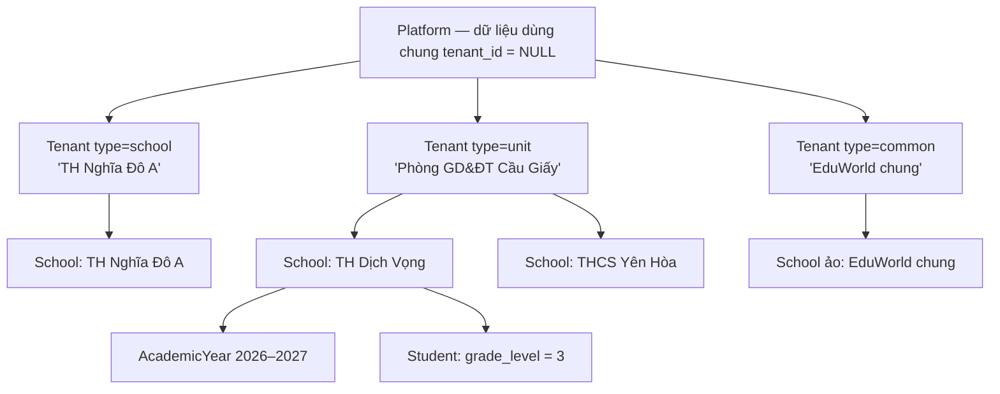
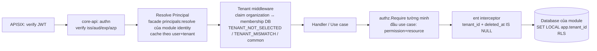
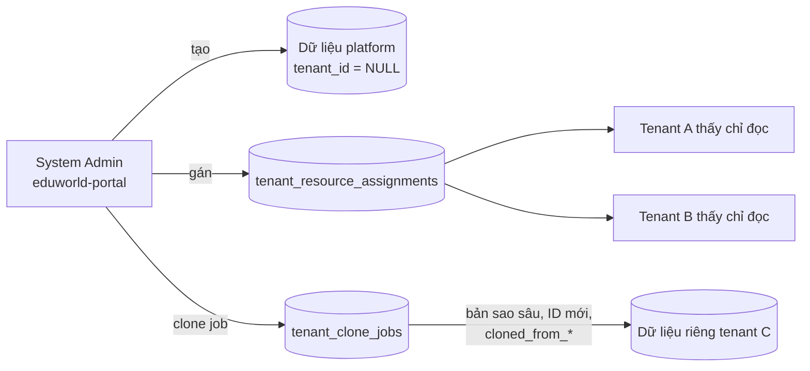

# Multi-tenancy

> Trạng thái: Draft · Phiên bản: 0.6 · Owner: Solution Architect · Cập nhật: 2026-11-17 (Áp ADR-0074: database theo module trên một cụm, ngữ cảnh tenant giữa module truyền trong tiến trình qua `src/backend/pkg/modcall`; áp ADR-0089: RLS chỉ lọc tenant, quy tắc interceptor theo mixin, ba loại scope, danh sách đóng `tenancy.Bypass`, bảng `infra` không RLS, role `_relay`/`_partition_admin`; làm rõ: mixin `TenantOptionalAppendOnly`, 10 reason kèm quyền DB, audit `cross_tenant.accessed`, hàm `identity.memberships_for_user`)
> Liên quan: [ADR-0005](../adr/ADR-0005-mo-hinh-multi-tenancy-shared-database-tenant-id-rls.md) · [ADR-0026](../adr/ADR-0026-dang-nhap-theo-tenant-xac-dinh-tenant-kiem-tra-cheo-mac-dinh.md) · [ADR-0027](../adr/ADR-0027-cms-tach-vung-tenant-chi-thao-tac-learning-management-cau-hi.md) · [ADR-0028](../adr/ADR-0028-chi-soft-delete-khong-hard-delete-mac-dinh-khong-doc-du-lieu.md) · [ADR-0029](../adr/ADR-0029-system-admin-gan-du-lieu-cho-tenant-va-clone-du-lieu-giua-te.md) · [DOMAIN_MODEL](DOMAIN_MODEL.md) · [SECURITY_ARCHITECTURE](../10-security/SECURITY_ARCHITECTURE.md) · [DATABASE_DESIGN](../07-backend/DATABASE_DESIGN.md)

> [!IMPORTANT]
> **Bỏ khái niệm lớp — [ADR-0095](../adr/ADR-0095-bo-khai-niem-lop-hoc-sinh-theo-khoi.md) (owner chốt 2026-11-21).** Phân cấp là `Platform → Tenant → School`; học sinh thuộc **đúng một trường với một khối** (`org.students.school_id`, `grade_level`), không có Class/Enrollment. Membership tenant (`identity.tenant_memberships_v`, Keycloak Organization) và `Principal.school_ids` của học sinh suy ra từ hồ sơ học sinh hiệu lực; tenant chung có School ảo + khối, không có lớp ảo. Cô lập tenant (R8) không đổi: mọi tương tác học sinh khác trường chỉ trong cùng tenant (ADR-0054). Nội dung bên dưới còn nhắc lớp/enrollment/course/learning path/lịch/nhóm học tập sẽ được viết lại ở WP-I1 ([CODE_PLAN §4.2](../12-project/CODE_PLAN_CMS_LMS_FIRST.md#42-kế-hoạch-bỏ-khái-niệm-lớp-adr-0095)); khi mâu thuẫn, ADR-0095 và đoạn này thắng.

**Mục đích & phạm vi.** Mô hình tenant (trường / đơn vị / tenant chung), cách cô lập dữ liệu ở tầng ứng dụng và RLS, tenant chung, soft-delete, gán/clone giữa tenant. SQL RLS chuẩn ở DATABASE_DESIGN §4; thuật toán xác định tenant khi đăng nhập ở IDENTITY_MAPPING §3.

> **Thay đổi v0.6 (ADR-0074):** backend là modular monolith; 5 module domain giữ 5 database riêng trên **một cụm** PostgreSQL. Mọi quy tắc cô lập tenant dưới đây giữ nguyên; "giữa service" nay là "giữa module": ngữ cảnh tenant truyền trong tiến trình qua `context.Context` (`src/backend/pkg/modcall`), không qua header HTTP nội bộ hay token service.
>
> **Thay đổi v0.4:** áp dụng cho 5 database (ADR-0037; khi đó là 6 microservice theo ADR-0036, nay thay bằng ADR-0074): mỗi database tự áp RLS `app.tenant_id` và có `infra.current_tenant_id()`; lớp ứng dụng dùng **ent interceptor** (global filter tenant + soft-delete, ADR-0039) thay cho quy ước sqlc; tenant/membership là nguồn sự thật ở module identity, module khác dùng projection `ref.tenants`/`ref.students` và facade `principals:resolve` của module identity ([DATABASE_DESIGN §2.17](../07-backend/DATABASE_DESIGN.md)).

## 1. Mục tiêu

| Mã | Yêu cầu | Nhãn |
|---|---|---|
| NFR-SEC-010 | Người dùng tenant A không đọc/ghi được dữ liệu tenant B qua bất kỳ API/WS nào | [Confirmed] |
| NFR-SEC-011 | Academic Manager có UserRole scope `subject` chỉ truy cập dữ liệu học tập của môn được gán, trong trường/tenant của phiên; không có phạm vi lớp theo phân công giảng dạy (ADR-0072) | [Confirmed] (viết lại theo ADR-0072) |
| NFR-SEC-012 | Tenant Admin chỉ quản trị trong tenant của mình; School Admin chỉ trong trường được gán bên trong tenant | [Confirmed] |
| NFR-SEC-013 | Chỉ System Admin xem/thao tác liên tenant đầy đủ; `safety_moderator` chỉ đọc liên tenant trong module moderation (case, bằng chứng, tin nhắn thuộc case) qua `tenancy.Bypass(ctx, "moderation_case")`; mọi truy cập liên tenant có điều kiện `tenant_id` tường minh và được audit | [Confirmed] ADR-0027, ADR-0072 |
| NFR-SEC-014 | Không người dùng nào truy cập toàn bộ chat của tất cả tenant | [Confirmed] |
| NFR-SEC-015 | Hai lớp bảo vệ độc lập trong **mỗi** module: ứng dụng (ent interceptor, bắt buộc) + RLS của database module (defense-in-depth) | [Confirmed] ADR-0005, ADR-0039 |
| NFR-SEC-019 | Lời gọi facade giữa module và event giữ đúng tenant: `TenantScope` trong context (`src/backend/pkg/modcall`)/envelope `tenant_id` bị bên nhận đối chiếu với dữ liệu của mình; không module nào đọc database của module khác | [Confirmed] ADR-0037, ADR-0074 |
| NFR-SEC-016 | Khi đăng nhập phải xác định đúng tenant của người dùng; không ai mở được phiên trong ngữ cảnh tenant mình không thuộc về | [Confirmed] ADR-0026 |
| NFR-SEC-017 | Mọi truy vấn lọc theo `tenant_id` **và** `deleted_at IS NULL`; ứng dụng không bao giờ hard-delete | [Confirmed] ADR-0005, ADR-0028 |
| NFR-SEC-018 | Tài khoản chỉ đến từ tenant SIS (provisioning) hoặc tenant chung `common` do platform tạo có chủ đích; không thuộc tenant chung và không thuộc tenant SIS nào → không cho đăng nhập (`ACCOUNT_NOT_PROVISIONED`), **không** tự đưa vào tenant chung | [Confirmed] ADR-0063 |

## 2. Mô hình tenant



| Cấp | Vai trò trong cô lập | Ví dụ dữ liệu |
|---|---|---|
| Platform | Không phải tenant. Dữ liệu `tenant_id = NULL`, `owner_scope = platform`; tenant chỉ thấy khi được gán (ADR-0029) | Curriculum chuẩn, question bank platform, cấu hình game, item definitions, ChatPolicy gốc |
| **Tenant** | **Đơn vị cô lập dữ liệu (`tenant_id`) và đơn vị đăng nhập** (một Keycloak Organization: `keycloak_org_id`, `keycloak_org_alias`, mã nhập `login_code`) | Mọi dữ liệu học sinh, lớp, attempt, learning event, chat, party, moderation, nội dung riêng của tenant |
| School | Chiều phân loại **bên trong** tenant (`school_id`): tenant `school` có 1 trường, tenant `unit` có nhiều trường, tenant `common` có 1 trường ảo | Học sinh (với khối), báo cáo theo trường/khối, phạm vi của School Admin |
| Khối (`grade_level`) | Thuộc tính của học sinh bên trong trường (không phải phạm vi phân quyền; không có thực thể Class — ADR-0095) | Assignment target (trường, khối), cấp khối của School Learning Dashboard, party lớp 1–3 |

### 2.1. Loại tenant

| `tenant_type` | Số School | Ví dụ | Ghi chú |
|---|---|---|---|
| `school` | Đúng 1 | Trường độc lập ký hợp đồng trực tiếp | Tenant Admin ≈ quản trị trường |
| `unit` | ≥ 1 | Sở/Phòng GD&ĐT, hệ thống trường | Dữ liệu mọi trường trong đơn vị cùng `tenant_id`; học sinh chuyển trường **trong** đơn vị không đổi tenant |
| `common` | 1 (School ảo "EduWorld chung") | Học sinh do platform (System Admin) tạo/import có chủ đích (ADR-0063) | Duy nhất (`code = 'common'`); không có SIS; nội dung do System Admin gán [Confirmed] |

## 3. Phân loại bảng

| Loại | Cột bắt buộc | RLS | Ví dụ |
|---|---|---|---|
| **Tenant-scoped** | `tenant_id uuid NOT NULL`, `deleted_at`, `deleted_by` (+ `school_id` nếu dữ liệu gắn trường) | Bật | `org.classes`, `org.enrollments`, `assessment.attempts`, `learning.objective_masteries`, `game.quest_progress`, `multiplayer.parties`, `chat.messages`, `lms.assignments` |
| **Tenant-scoped append-only** | `tenant_id NOT NULL` (không có `deleted_at`, không xóa) | Bật | `learning.learning_events`, `assessment.attempt_answers`, `gamification.xp_ledger`, `audit.audit_logs` (đọc qua API có scope) |
| **Nội dung lai** | `tenant_id uuid NULL` (NULL = platform), `owner_scope ∈ {platform, tenant}`, `deleted_at` | Bật (policy có nhánh assignment) | `content.questions`, `content.question_sets`, `content.lessons`, `lms.challenge_templates` |
| **Global/platform** | `deleted_at` | Tắt; chỉ ghi qua `/api/v1/game-admin/*`, `/api/v1/admin/*` | `curriculum.subjects`, `game.item_definitions`, `game.quest_definitions`, `platform.feature_flags`, **danh mục `catalog.countries`, `catalog.provinces`, `catalog.province_successions`** (ADR-0060: dùng chung mọi tenant, chỉ System Admin sửa, mọi người dùng đã đăng nhập được đọc) |
| **Cross-tenant có kiểm soát** | `tenant_ids uuid[]` hoặc bảng participants có `tenant_id` | Bật với policy đặc biệt | `competition.matches` (liên tenant), `competition.tournaments` do platform tạo |
| **Hạ tầng `infra`** | `tenant_id` (nếu có) chỉ là dữ liệu envelope | **Không bật** (ADR-0089 §4): `<module>_app` có `INSERT` trên outbox (cùng transaction trong `UnitOfWork`), `INSERT`/`SELECT` trên processed/idempotency, `INSERT` dead letters; relay dùng `<module>_relay` (`SELECT, UPDATE (published_at, attempts)`) để publish; `<module>_platform` `SELECT`/`UPDATE` cột xử lý dead letters; không role nào có `DELETE`/`TRUNCATE` | `infra.outbox_events`, `infra.processed_events`, `infra.idempotency_records`, `infra.dead_letters` (mọi DB) |
| **Platform internal** | — | Chỉ role `<module>_platform` | `platform.tenant_clone_jobs` (DB identity) |

Mỗi loại bảng ánh xạ đúng một mixin `src/backend/pkg/entx` (`Base`, `TenantAppendOnly`, `TenantOptional`, `TenantOptionalAppendOnly`, `HybridContent`, `GlobalBase`, `AppendOnly`), xem [DATABASE_DESIGN §2](../07-backend/DATABASE_DESIGN.md#2-danh-sách-bảng-theo-database--schema) và §4.4.

**Trường (School) là dữ liệu tenant-scoped:** `org.schools` có `tenant_id NOT NULL` — mỗi trường thuộc đúng một tenant và tham chiếu một tỉnh/thành trong danh mục platform. System Admin xem danh mục trường liên tenant với bộ lọc tenant/tỉnh/cấp học (ADR-0027 mục 6); Tenant Admin chỉ thấy trường của tenant mình. Học sinh có đúng một enrollment active (một trường, một lớp) trong tenant của mình (ADR-0060).

### 3.1. Nội dung: sở hữu và gán

| Nguồn | `tenant_id` | Ai thấy (khi `published`) | Ai sửa |
|---|---|---|---|
| Dữ liệu platform | `NULL` | Tenant có **assignment active** trong `infra.tenant_resource_assignments` của database sở hữu tài nguyên (ADR-0029); System Admin | System Admin / Content Admin platform |
| Dữ liệu riêng của tenant | `= tenant` | Chỉ tenant đó (+ System Admin) | Người có quyền biên tập trong tenant |
| Bản clone | `= tenant đích` | Như dữ liệu riêng của tenant đích | Như trên; giữ `cloned_from_*` để truy vết |

Draft/in_review chỉ người có quyền biên tập/duyệt trong phạm vi thấy. Attempt luôn mang `tenant_id` của **học sinh**, không phải của nội dung.

## 4. Lớp 1 — Ứng dụng (bắt buộc)

### 4.1. Principal và TenantScope

```go
// src/backend/pkg/authz — Principal dựng từ module identity (facade principals:resolve, gọi trong tiến trình), cache 60 s
type Principal struct {
    UserID      uuid.UUID
    UserType    UserType         // student, staff (ADR-0081); platform/tenant phân biệt bằng role + TenantID
    TenantID    *uuid.UUID       // tenant hoạt động của phiên (ADR-0026); nil với System Admin
    TenantType  TenantType       // school | unit | common
    SchoolIDs   []uuid.UUID      // các trường trong tenant mà user có phạm vi (School Admin, Academic Manager); học sinh = [school_id]
    SubjectIDs  []uuid.UUID      // môn được gán qua UserRole scope subject (Academic Manager); rỗng = mọi môn trong phạm vi
    Permissions PermissionSet    // hợp permission của các UserRole hiệu lực trong tenant (ADR-0066)
    IsSystemAdmin bool           // chế độ liên tenant: role system_admin + token eduworld-portal (không MFA — ADR-0094)
    GradeLevel  *int
    SessionID   string
}

// TenantScope bắt buộc truyền vào mọi repository tenant-scoped.
type TenantScope struct {
    tenantIDs []uuid.UUID // đúng 1 với người dùng tenant; 1..n (đã chọn ở dropdown) với System Admin
    crossTenant bool      // chỉ authz.CrossTenantScope(p, tenantIDs, reason) tạo được
    reason      string    // bắt buộc khi crossTenant → ghi audit
}
```

Quy tắc:

1. Scope **chỉ** được tạo bởi package `authz`: `authz.ScopeFor(p)` cho người dùng tenant (luôn `[p.TenantID]`), `authz.CrossTenantScope(p, ids, reason)` cho System Admin, `authz.PlatformScope(p)` cho nhân sự platform và `authz.SystemPlatformScope(job)` cho job platform thao tác dữ liệu `tenant_id IS NULL` (§4.4). Bỏ filter chỉ qua `tenancy.Bypass(ctx, reason)` với `reason` thuộc danh sách đóng (§4.4); riêng module moderation của module chat dùng `tenancy.Bypass(ctx, "moderation_case")` cho `safety_moderator` khi đọc case, bằng chứng và tin nhắn thuộc case (ADR-0072). Linter cấm literal `TenantScope{}` ngoài `authz`.
2. `TenantScope` được đặt vào `context` bởi middleware `principal`/`tenant` của `src/backend/pkg/httpx` (HTTP), adapter NATS (lệnh realtime) hoặc `outbox.Consumer` (event, `tenant_id` lấy từ envelope) — không qua mediator (ADR-0087); **ent interceptor** (`src/backend/pkg/entx`, đọc scope của `src/backend/pkg/tenancy`) tự thêm điều kiện theo mixin của entity (§4.4, vd. `tenant_id IN (scope) AND deleted_at IS NULL` với `Base`) và trả lỗi `ErrMissingTenantScope` nếu entity cần scope mà context không có. SQL tường minh cho read model phải nhận `scope` làm tham số, tự có `deleted_at IS NULL` và được job `tenancy-guard` kiểm tra (§11).
3. Command/query handler gọi **tường minh** `authz.Require(ctx, p, permission, resource)` ở đầu use case, **trước** khi gọi repository (ADR-0087); resource chứa `tenant_id`/`school_id`/`class_id` nạp từ DB, không lấy từ request body.
4. ID trong URL không đủ để truy cập: `GET /attempts/{id}` → load với scope → không thấy (khác tenant hoặc đã soft-delete) = `404`.
5. **Header `X-Tenant-Id` bắt buộc (ADR-0065):** mọi request REST tenant-scoped của game và portal mang `X-Tenant-Id` (giá trị lấy từ PlayerBootstrap/`GET /me/tenants` sau đăng nhập). APISIX từ chối thiếu/sai định dạng (`400 TENANT_HEADER_REQUIRED`); middleware `tenant` so header với tenant của phiên (claim `organization` + membership) — lệch → `403 TENANT_MISMATCH` + audit. `Principal.TenantID` = kết quả kiểm tra, **không** lấy thẳng từ header. Người dùng tenant gửi `tenant_ids` → bị bỏ qua. Miễn header: `POST /auth/session`, `GET /game/client-config`, health, `GET /me/tenants`. WebSocket: tenant cố định khi cấp realtime ticket.
6. System Admin: thao tác ghi gửi `X-Tenant-Id` = tenant đích; danh sách nhận `tenant_ids[]` từ dropdown (không gửi header) (rỗng = "tất cả tenant" → `CrossTenantScope` với toàn bộ tenant active, vẫn là danh sách tường minh); thao tác ghi bắt buộc **một** `tenant_id` đích hoặc phạm vi platform. Mỗi lần dùng `CrossTenantScope` hoặc `tenancy.Bypass` phát `audit.recorded` với `action = cross_tenant.accessed` (trường `reason`, `tenant_ids`, `mode` = `read`/`write`; ADR-0089 §3).
7. **Giữa module:** module gọi facade của module khác trong tiến trình; `src/backend/pkg/modcall` mang `TenantScope` và Principal gốc của request qua `context.Context` (ADR-0074 mục 3); module nhận kiểm tra caller có trong `x-allowed-callers` và tenant tồn tại/hoạt động trong `ref.tenants` của mình, rồi dùng đúng scope đó. Consumer event tạo `TenantScope` từ `tenant_id` của envelope. Event platform (`tenant_id = null`) chỉ consumer platform xử lý.

### 4.2. Đọc nội dung lai (riêng tenant + được gán)

```sql
-- module learning: read model query (SQL tường minh trong infrastructure/persistence, scope truyền vào)
SELECT qs.*
FROM content.question_sets qs
WHERE qs.deleted_at IS NULL
  AND qs.status = 'published'
  AND (
        qs.tenant_id = ANY(@tenant_ids::uuid[])
     OR (qs.tenant_id IS NULL AND EXISTS (
          SELECT 1 FROM infra.tenant_resource_assignments a   -- cùng database eduworld_learning
          WHERE a.resource_type = 'question_set'
            AND a.resource_id = qs.question_set_id
            AND a.tenant_id = ANY(@tenant_ids::uuid[])
            AND a.deleted_at IS NULL))
  )
ORDER BY qs.updated_at DESC
LIMIT @limit;
```

### 4.3. Middleware chuỗi



Cache Principal (`ew:<module>:principal:<user_id>:<tenant_id>`, mỗi module một prefix theo ACL Valkey, [VALKEY_DESIGN](../07-backend/VALKEY_DESIGN.md)) bị xóa khi nhận event `user.access_revoked`, `enrollment.changed`, `user_role.changed`, `role.updated`, `tenant_membership.changed`, `tenant.updated`.

### 4.4. Quy tắc interceptor theo mixin, ba loại scope và cổng bypass (ADR-0089)

| Loại bảng | Mixin `src/backend/pkg/entx` | Điều kiện interceptor thêm vào | Context không có scope |
|---|---|---|---|
| **T** | `Base` | `tenant_id IN (scope) AND deleted_at IS NULL` | `ErrMissingTenantScope` |
| **TA** | `TenantAppendOnly` | `tenant_id IN (scope)` | `ErrMissingTenantScope` |
| **T\*** (`user_roles`, `account_locks`) | `TenantOptional` | Phiên tenant: `tenant_id IN (scope) AND deleted_at IS NULL`; dòng `tenant_id IS NULL` chỉ đọc qua `PlatformScope` | `ErrMissingTenantScope` |
| **H** (nội dung lai) | `HybridContent` (tên cũ `PlatformBase`) | `deleted_at IS NULL AND (tenant_id IN (scope) OR (tenant_id IS NULL AND được gán cho tenant trong scope))`; phiên platform (`content_admin`…): `tenant_id IS NULL` | `ErrMissingTenantScope` |
| **G** | `GlobalBase` | `deleted_at IS NULL` | Không cần scope |
| **GA** | `AppendOnly` | Không | Không cần scope |
| **TA\*** (`identity.login_events`, `content.content_releases`, `content.content_transitions`) | `TenantOptionalAppendOnly` | Phiên tenant: `tenant_id IN (scope)`; dòng `tenant_id IS NULL` chỉ đọc qua `PlatformScope` | `ErrMissingTenantScope` |

Dòng `tenant_id IS NULL` của bảng T\*/TA\*/H chỉ được ghi bằng role `<module>_platform` dưới `PlatformScope` (vd. đăng nhập thất bại trước khi biết tenant, role platform, nội dung platform); policy RLS áp cho `<module>_app` giữ điều kiện tenant thuần.

Mỗi entity khai báo đúng một mixin; CI có test liệt kê mọi schema ent và từ chối schema không có mixin. Hiển thị nội dung platform cho tenant chỉ qua `infra.tenant_resource_assignments` (ADR-0029), không có cờ "public cho mọi tenant".

**Ba loại scope** (API công khai của `src/backend/pkg/tenancy`/`src/backend/pkg/authz` khóa từ F002; đổi chữ ký cần ADR):

| Scope | Dùng cho | Phạm vi |
|---|---|---|
| `TenantScope` | Phiên người dùng tenant, consumer event (`tenant_id` từ envelope), lệnh realtime | Đúng một tenant |
| `CrossTenantScope` | System Admin (ADR-0027) | Danh sách `tenant_ids` tường minh, có audit |
| `PlatformScope` | `authz.PlatformScope(p)` cho nhân sự platform, `authz.SystemPlatformScope(job)` cho job platform; thao tác dữ liệu `tenant_id IS NULL` (nội dung platform, role platform) | Chỉ dòng `tenant_id IS NULL`; không đọc được dòng có `tenant_id` khác NULL |

**`tenancy.Bypass(ctx, reason)`** là cổng duy nhất để bỏ filter. `reason` là hằng số kiểu `tenancy.BypassReason`, thuộc danh sách đóng (thêm reason mới cần sửa ADR-0089); linter cấm literal ngoài danh sách:

| Reason | Dùng cho | Quyền DB |
|---|---|---|
| `system_admin_cross_tenant` | System Admin đọc/ghi liên tenant | `<module>_platform` |
| `moderation_case` | `safety_moderator` trong module moderation (ADR-0072) | `chat_platform` |
| `break_glass` | Truy cập khẩn cấp nội dung chat đã được hai System Admin duyệt (F124) | `chat_platform` |
| `trash` | Thùng rác (ADR-0028) | `<module>_platform` |
| `auth_login` | Đọc membership trên đường đăng nhập | Hàm `SECURITY DEFINER` `identity.memberships_for_user` |
| `tenant_clone` | Saga clone/gán (ADR-0029) | `<module>_platform` |
| `inactive_cleanup` | Dọn học sinh không đăng nhập (ADR-0032) | `<module>_platform` |
| `re_evaluation` | Chấm lại attempt sau khi sửa nội dung platform (F031) | `learning_platform` |
| `efficacy_study` | Nghiên cứu hiệu quả học tập liên tenant (F035, ADR-0080) | `learning_platform` |
| `platform_job` | Job platform khác: rollup liên tenant, đồng bộ SIS theo lịch | `<module>_platform` |

Mỗi lần gọi ghi audit `cross_tenant.accessed` (trường `reason`, `tenant_ids`, `mode` = `read`/`write`) và tăng metric `eduworld_tenant_filter_bypass_total{module,reason}` ([MONITORING](../11-operations/MONITORING.md)); ngoại lệ audit của `platform_job` theo [ADR-0089 §3](../adr/ADR-0089-chot-tang-du-lieu-rls-mixin-outbox.md#3-ba-loại-scope-và-một-cổng-bypass).

**Đường đăng nhập:** trước khi biết tenant, module identity gọi hàm `identity.memberships_for_user(user_id)` (`SECURITY DEFINER`, owner là role `identity_membership_reader` `NOLOGIN` + `BYPASSRLS` chỉ có `SELECT` trên nguồn membership, chỉ trả cột membership của đúng user đó; `EXECUTE` cấp cho `identity_app`, [DATABASE_DESIGN §4](../07-backend/DATABASE_DESIGN.md#4-row-level-security)) bên trong `tenancy.Bypass(ctx, "auth_login")`. Chỉ route `/auth/session`, `/auth/game/*` và `login-credentials:verify` được gọi (test kiến trúc chặn nơi khác); không cần `BYPASSRLS`. Kết quả chỉ gồm danh sách tenant của chính user đó (thuật toán chọn tenant: §8.2).

## 5. Lớp 2 — Row-Level Security (defense-in-depth)

### 5.1. Role DB

Mỗi database có bộ role riêng theo module (`identity_*`, `learning_*`, `game_*`, `competition_*`, `chat_*`; ADR-0074 mục 4); bảng dưới dùng `<module>` đại diện. Năm database nằm chung một cụm PostgreSQL nhưng không truy cập chéo.

| Role | Dùng bởi | RLS | Quyền |
|---|---|---|---|
| `<module>_migrator` | job `migrate --module=<module>` (Atlas) | Owner bảng | DDL trong database của module |
| `<module>_app` | pool của module trong `core-api` + consumer thường trong `worker` | **Áp dụng** (`NOBYPASSRLS`) | `SELECT, INSERT, UPDATE` — **không có `DELETE`, `TRUNCATE`** (ADR-0028) |
| `<module>_platform` | Phiên System Admin liên tenant, job platform (SIS sync, rollup, bước saga clone/cleanup), ghi dòng `tenant_id IS NULL` của bảng T\*/TA\*/H dưới `PlatformScope`, reason `Bypass` tương ứng (§4.4) | `BYPASSRLS` | `SELECT, INSERT, UPDATE` — **không có `DELETE`, `TRUNCATE`**; truy vấn vẫn có `tenant_id` tường minh; audit |
| `chat_purger` | Chỉ job `gameplay-chat-purge` của module chat (ADR-0033) | Policy riêng: chỉ channel gameplay đã đóng | `DELETE` **chỉ** trên bảng chat gameplay trong `eduworld_chat` — ngoại lệ duy nhất của ADR-0028 ([DATABASE_DESIGN §1.1](../07-backend/DATABASE_DESIGN.md)) |
| `<module>_relay` | Relay outbox của module (profile `worker-events`) | — (bảng `infra` không bật RLS) | `SELECT, UPDATE (published_at, attempts)` trên `infra.outbox_events` (ADR-0089 §4) |
| `<module>_partition_admin` | Chỉ job `infra-partition-maintenance` | — | `CREATE`/`DETACH`/`DROP` partition trên schema `infra` (ADR-0089 §5) |
| `<module>_readonly` | Reporting/BI | Áp dụng | `SELECT` chỉ trên view `<schema>.<table>_live` (`WHERE deleted_at IS NULL`) và view tổng hợp; không quyền trên bảng gốc (ADR-0089 §1) |
| `<module>_backup` | Backup | — | Theo [BACKUP_RECOVERY](../11-operations/BACKUP_RECOVERY.md) |

Bảng do `<module>_migrator` sở hữu và bật `FORCE ROW LEVEL SECURITY`. Không role nào có `CONNECT` vào database của module khác.

### 5.2. Set ngữ cảnh mỗi transaction

```go
// src/backend/pkg/entx — unit of work dùng chung cho ent (mọi module)
func (u *UnitOfWork) InTenantTx(ctx context.Context, scope authz.TenantScope, fn func(ctx context.Context, tx *ent.Tx) error) error {
    return u.withTx(ctx, u.clientFor(scope), func(ctx context.Context, tx *ent.Tx) error {
        if _, err := tx.Exec(ctx,
            `SELECT set_config('app.tenant_id', $1, true)`,
            scope.SessionTenantID()); err != nil { // '' với CrossTenantScope (client <module>_platform, BYPASSRLS)
            return fmt.Errorf("set tenant context: %w", err)
        }
        return fn(authz.WithScope(ctx, scope), tx) // interceptor đọc scope từ ctx
    })
}
```

`set_config(..., true)` tương đương `SET LOCAL`. `u.clientFor(scope)` chọn ent client của `<module>_app` (người dùng tenant) hoặc `<module>_platform` (CrossTenantScope). Command handler (write context) gọi `UnitOfWork.InTenantTx` (`src/backend/pkg/entx`); adapter read model (read context, `infrastructure/persistence/read`) dùng phiên chỉ đọc `entx.ReadSession.InTenantRead` (transaction `READ ONLY`, cùng `set_config`, được dùng replica), không dùng `UnitOfWork` (ADR-0087). **Cấm** truy vấn tenant-scoped ngoài hai cơ chế này.

### 5.3. Policy RLS

Ba loại policy, SQL chuẩn ở [DATABASE_DESIGN §4](../07-backend/DATABASE_DESIGN.md#4-row-level-security):

| Loại bảng | Điều kiện đọc | Ghi |
|---|---|---|
| T/T\* (tenant-scoped, có soft-delete) | `tenant_id = infra.current_tenant_id()` | INSERT/UPDATE chỉ với đúng tenant; **không có policy DELETE** |
| TA/TA\* (append-only) | `tenant_id = infra.current_tenant_id()` | Chỉ INSERT; dòng `tenant_id IS NULL` (T\*/TA\*/H) chỉ ghi bằng `<module>_platform` dưới `PlatformScope` |
| H (nội dung lai platform + gán + riêng tenant) | Dòng của tenant **hoặc** dòng platform (`tenant_id IS NULL`) có assignment active cho tenant (ADR-0029) | Theo quyền Game Studio/CMS |

**RLS chỉ lọc tenant, không lọc `deleted_at`** (ADR-0089 §1): PostgreSQL buộc dòng mới của `UPDATE` (có `WHERE`/`RETURNING`) thỏa policy `SELECT`, nên policy có `deleted_at IS NULL` sẽ chặn soft-delete. `deleted_at IS NULL` do ent interceptor (§4.4) và SQL tường minh có test bảo đảm; view `<table>_live` là lớp thứ hai cho `<module>_readonly`/BI.

Không set `app.tenant_id` → `NULL` → không trả dòng nào. Phiên System Admin dùng client `<module>_platform` (BYPASSRLS) nên bộ lọc tenant nằm ở điều kiện `tenant_id = ANY(@tenant_ids)` tường minh trong query (§4.1). Thùng rác (ADR-0028) đọc dữ liệu đã xóa qua `tenancy.Bypass(ctx, "trash")` (§4.4), có audit.

### 5.4. Hiệu năng

- Index phức hợp bắt đầu bằng `tenant_id` trên mọi bảng tenant-scoped lớn, dạng partial `WHERE deleted_at IS NULL`: `(tenant_id, student_id, created_at) WHERE deleted_at IS NULL`.
- Index assignment `(tenant_id, resource_type, resource_id) WHERE deleted_at IS NULL`.
- `infra.current_tenant_id()` là `STABLE`.
- `EXPLAIN` trong integration test cho truy vấn nóng (attempt, learning_events, chat.messages).

## 6. Valkey và realtime

- Key chứa dữ liệu tenant có `tenant_id` trong key ([VALKEY_DESIGN](../07-backend/VALKEY_DESIGN.md)). Gateway không tự quyết định subscribe: module sở hữu (chat/competition) kiểm tra `tenant_id` của channel/room so với `Ew-Tenant-Id` của lệnh rồi mới trả `subscribe` cho gateway.
- Hub instance cấp theo `(tenant_id, school_id, grade_band)` [Confirmed]; tenant chung có instance riêng. Instance/match liên tenant chỉ tồn tại cho sự kiện do platform tạo, chat theo cùng ChatPolicy (ADR-0020), chỉ hiển thị nickname.
- Pub/sub không mang dữ liệu vượt tenant: message của channel tenant A chỉ publish trên `ew:chat:fanout:<channel_id>`, chỉ node có subscriber hợp lệ nhận.
- **NATS JetStream (ADR-0035):** subject chat chứa tenant: `ew.chat.<tenant_id>.{msg|evt|cursor}.<channel_id>`. Persister và mọi consumer của module chat đối chiếu `tenant_id` của envelope với channel trong `eduworld_chat`; ghi qua unit of work có `TenantScope` + RLS `app.tenant_id` của envelope. Domain event `EVT_*` cũng mang `tenant_id` trong envelope; consumer của mọi module áp cùng quy tắc. Envelope sai tenant → DLQ + alert bảo mật.

## 7. Các tình huống đặc biệt

| Tình huống | Xử lý | Nhãn |
|---|---|---|
| **Lên khối** (năm học mới) | SIS cập nhật `grade_level` của học sinh; dữ liệu học tập giữ khối tại thời điểm sự kiện; không còn chuyển lớp (ADR-0095) | [Confirmed] |
| **Chuyển trường trong cùng tenant `unit`** | Đổi `school_id` của học sinh (không có enrollment — ADR-0095); **không** đổi tenant, không đổi membership Keycloak; lịch sử vẫn trong tenant | [Confirmed] |
| **Chuyển sang trường thuộc tenant khác** | User giữ `user_id`; Student đổi `tenant_id`/`school_id` hiện tại; bản ghi lịch sử **giữ `tenant_id` cũ**. Tenant mới không tự thấy lịch sử cũ. Mastery & Game Profile đi theo học sinh. Không chia sẻ hồ sơ học tập cũ cho tenant mới | [Confirmed] |
| **Học sinh không thuộc tenant SIS nào** | Chỉ vào tenant `common` nếu platform đã tạo tài khoản ở đó; nếu không → `ACCOUNT_NOT_PROVISIONED`, không cho đăng nhập; xem [§8.3](#83-tenant-chung) | [Confirmed] ADR-0063 |
| **Xã hội liên trường trong tenant `unit`** | Cài đặt tenant `cross_school_social_enabled` (`platform.tenants.settings`, mặc định tắt, chỉ có nghĩa với tenant `unit`): bật → kết bạn, DM, party, club, World mở rộng, ghép trận giữa các trường trong cùng tenant; không bao giờ mở liên tenant. Quy tắc chi tiết: [SOCIAL_SYSTEM §7](../03-social-multiplayer/SOCIAL_SYSTEM.md#7-quy-tắc-liên-trường--adr-0054) | [Confirmed — Technical Architect 2026-11-16] ADR-0054 |
| **Thi đấu liên tenant** | `competition.matches.tenant_ids[]`; mỗi `match_participants` có `tenant_id`; đối thủ chỉ thấy nickname/avatar/tier. Attempt/learning event ghi theo `tenant_id` của từng học sinh | [Confirmed] |
| **Giải đấu trong tenant `unit`** | Tạo từ template platform trong tenant; đăng ký chỉ học sinh của tenant | [Confirmed] |
| **Nội dung platform dùng trong tenant** | Chỉ đọc khi được gán; muốn sửa → System Admin clone sang tenant (ADR-0029) | [Confirmed] |
| **Báo cáo tổng hợp tenant `unit`** | Tenant Admin xem báo cáo theo trường trong tenant; báo cáo vượt tenant chỉ System Admin, dạng aggregate k-anonymity ≥ 5 [Confirmed] | [Confirmed] |
| **Moderation** | Tập trung ở Platform Safety Team (`safety_moderator`, ADR-0072); case luôn gắn `tenant_id` (tin nhắn liên tenant bị report → case thuộc tenant của người bị report); đọc liên tenant chỉ trong module moderation qua `tenancy.Bypass(ctx, "moderation_case")` có audit; nhà trường nhận thông báo tóm tắt vụ việc nghiêm trọng của học sinh trường mình | [Confirmed] ADR-0072 |
| **System Admin hỗ trợ** | `CrossTenantScope(reason)`, dropdown chọn tenant, audit | [Confirmed] |

## 8. Xác định tenant khi đăng nhập và ở mỗi request (ADR-0026)

### 8.1. Nguyên tắc

| # | Nguyên tắc | Nhãn |
|---|---|---|
| 1 | Mỗi **Tenant** là một Keycloak Organization; `platform.tenants.keycloak_org_id` + `keycloak_org_alias` (duy nhất) là khóa nối. Không tạo Organization cho từng School trong tenant `unit` | [Confirmed] |
| 2 | **Học sinh đăng nhập username + password, không chọn trường** (ADR-0063): lần đăng nhập không kèm tenant; thuộc nhiều tenant thì chọn sau đăng nhập (game: `login_ticket`, ADR-0068; portal: header `X-Tenant-Id`, ADR-0091) — không client nào gửi scope `organization:{tenant_alias}`. Không có ô mã trường, QR, gợi ý tenant trước đăng nhập hay nhận diện theo tên miền email trong Release 1.0 ([KEYCLOAK_SSO §8](../09-identity/KEYCLOAK_SSO.md#8-trải-nghiệm-đăng-nhập-cho-học-sinh)) | [Confirmed] |
| 3 | Backend **luôn** xác định tenant từ membership trong DB: claim là điều kiện cần khi có, DB là điều kiện đủ | [Confirmed] |
| 4 | Sau đăng nhập (ADR-0063): đúng 1 tenant (tenant SIS hoặc tenant chung) → vào thẳng; nhiều tenant → `TENANT_NOT_SELECTED` kèm danh sách, chọn **sau** khi đăng nhập; không thuộc tenant chung và không thuộc tenant SIS nào → `403 ACCOUNT_NOT_PROVISIONED`, audit, thu hồi phiên Keycloak | [Confirmed] |
| 5 | Membership Keycloak Organization do worker đồng bộ từ SIS/UserRole ([ACCOUNT_PROVISIONING](../09-identity/ACCOUNT_PROVISIONING.md)) | [Confirmed] |
| 6 | Một tenant hoạt động cho mỗi phiên. Username, email, mã học sinh **không** dùng để suy ra tenant | [Confirmed] |
| 7 | **Portal cũng không chọn tenant trước đăng nhập** (ADR-0067): role platform → phạm vi platform; nhân sự 1 tenant → vào thẳng; nhiều tenant → chọn sau, đổi trên topbar; không có role portal nào → `403 PORTAL_ACCESS_STAFF_ONLY`; học sinh → chặn (ADR-0066). Không có URL `/t/{tenant_alias}` | [Confirmed] |
| 8 | **Username và email duy nhất toàn hệ thống** (không phân biệt hoa thường) để đăng nhập không chọn tenant luôn xác định đúng một tài khoản; một người nhiều tenant = một tài khoản nhiều membership; do đó không trùng trong cùng tenant; SSO xác thực trước, module identity kiểm tra tenant sau (ADR-0067, ADR-0069) | [Confirmed] |

### 8.2. Kiểm tra chéo khi xác định tenant của phiên (`POST /api/v1/auth/game/login`, `GET /api/v1/me/tenants`)

Tóm tắt: có claim `organization` thì tenant đó phải thuộc membership của user (không → `TENANT_MISMATCH`); không có claim thì 1 membership → dùng, nhiều → `TENANT_NOT_SELECTED` (kèm danh sách), 0 → `ACCOUNT_NOT_PROVISIONED` (thu hồi phiên Keycloak, không tự đưa vào tenant chung). **Thuật toán đầy đủ, sơ đồ và thứ tự kiểm tra mã lỗi** chỉ ở [IDENTITY_MAPPING §3 và §4.1](../09-identity/IDENTITY_MAPPING.md#41-mã-lỗi-khi-resolve-thứ-tự-kiểm-tra); luồng OIDC ở [KEYCLOAK_SSO §6](../09-identity/KEYCLOAK_SSO.md).

### 8.3. Tenant chung

| Hạng mục | Quy tắc | Nhãn |
|---|---|---|
| Ai vào | Chỉ tài khoản do platform (System Admin) **tạo/import có chủ đích** vào tenant chung, kèm khối (không có lớp ảo — ADR-0095; ADR-0063). Không có JIT tự đưa người dùng vào tenant chung; người không thuộc tenant chung và không thuộc tenant SIS nào bị từ chối `ACCOUNT_NOT_PROVISIONED` | [Confirmed] |
| Cấu trúc | Tenant `common`, School ảo "EduWorld chung"; học sinh có khối do System Admin đặt khi tạo/import tài khoản; không có lớp ảo (9 lớp ảo `common-g1` … `common-g9` bị bỏ — ADR-0095) | [Confirmed] |
| Nội dung | Chỉ dữ liệu platform được System Admin gán cho `common` | [Confirmed] |
| Chuyển sang tenant thật | Khi SIS của một tenant đồng bộ bản ghi khớp user → membership tenant đó → lần đăng nhập sau dùng tenant mới; lịch sử ở `common` giữ `tenant_id = common` | [Confirmed] |
| An toàn (ADR-0078) | Mặc định siết chặt `common_tenant_social_defaults`: **tắt** kết bạn, DM và World chat; giờ giới nghiêm platform `platform_curfew` bắt buộc; kiểm duyệt bởi Platform Safety Team (ADR-0072); consent do platform thu trực tiếp (ADR-0077). Không có nhà trường nhận thông báo vụ việc nên Safety Team tự liên hệ theo quy trình platform. Chính sách chi tiết: [CHILD_SAFETY §3.6](../10-security/CHILD_SAFETY.md#36-tenant-common-adr-0078); chỉ System Admin bật lại từng mục, có lý do + audit | [Confirmed — Technical Architect 2026-11-17] |
| Lý do | "Cùng tenant" ở `common` là hàng nghìn học sinh không quen nhau và không có trường thu consent hay giám sát, nên quy tắc "cùng trường" của SOCIAL_SYSTEM không đủ an toàn | — |

### 8.4. Mỗi request sau khi có phiên

- Client gửi `X-Tenant-Id` ở mọi request (ADR-0065). APISIX: thiếu/sai → `400 TENANT_HEADER_REQUIRED`. Tenant middleware so header với claim `organization` và membership (cache 60 s) → lệch → `403 TENANT_MISMATCH` + audit; `Principal.TenantID` = kết quả kiểm tra.
- Mỗi module: `authz.ScopeFor(p)` → `TenantScope{[TenantID]}`; unit of work đặt `app.tenant_id = TenantID` trong database của module.
- Realtime: ticket WebSocket (module game cấp) gắn `tenant_id`; gateway gắn `Ew-Tenant-Id` vào mọi lệnh NATS; module chat/module competition từ chối join room/channel của tenant khác (`PERMISSION_DENIED`).

### 8.5. Tình huống đăng nhập đặc biệt

| Tình huống | Xử lý | Nhãn |
|---|---|---|
| Nhân sự có UserRole ở nhiều tenant | Member của mọi tenant có UserRole hiệu lực. Đăng nhập portal (không chọn trước) → chọn tenant sau đăng nhập (ADR-0063 mục 5, ADR-0067); đổi tenant = đổi header `X-Tenant-Id` (backend kiểm tra membership), không xin token mới (ADR-0091, thay cách dùng `organization:{alias}` của ADR-0067) | [Confirmed] |
| Nhân sự quản lý nhiều trường trong cùng tenant `unit` | Một phiên tenant; `Principal.SchoolIDs` gồm các trường có UserRole scope `school`; màn hình portal lọc theo trường | [Confirmed] |
| Học sinh chuyển sang tenant khác | Worker gỡ membership tenant cũ, thêm tenant mới, thu hồi session gắn tenant cũ, phát `user.access_revoked`. Lần đăng nhập sau backend tự xác định tenant mới; token còn mang tenant cũ → `TENANT_MISMATCH`, client đăng nhập lại | [Confirmed] |
| Thiết bị phòng máy dùng chung | Tenant cố định trong file cấu hình thiết bị ([GODOT_ARCHITECTURE](../08-game-client/GODOT_ARCHITECTURE.md)) | [Confirmed] |
| Nhân sự (School Admin, Tenant Admin, System Admin…) mở game | Không được vào game: `403 GAME_ACCESS_STUDENT_ONLY` (ADR-0031); tenant không thay đổi điều này | [Confirmed] |
| Học sinh đăng nhập thiết bị thứ hai | Tenant của phiên mới phải khớp như bình thường; takeover chỉ kết thúc session cũ, không đổi tenant (ADR-0031) | [Confirmed] |
| Học sinh bị dọn do không đăng nhập (ADR-0032) | Soft-delete + gỡ membership tenant; đăng nhập lại và còn hợp lệ trong SIS của **cùng tenant** → khôi phục; SIS tenant khác → xử lý như chuyển tenant | [Confirmed] |
| System Admin | Đăng nhập Admin Portal (`eduworld-portal`, username + mật khẩu, không MFA — ADR-0094), không chọn tenant, không gắn tenant; dropdown chọn tenant ở mỗi màn hình (ADR-0027 §6); thao tác ghi gửi `X-Tenant-Id` tenant đích; `CrossTenantScope` + audit | [Confirmed] |
| Nhân sự tenant đăng nhập portal | Không chọn tenant (ADR-0067); 1 tenant → vào thẳng; nhiều → hộp chọn sau đăng nhập + bộ chọn trên topbar; không có UserRole portal hiệu lực → `403 PORTAL_ACCESS_STAFF_ONLY` | [Confirmed] |
| Học sinh mở portal | Bị chặn ở Keycloak (realm role gate) và backend (`403 PORTAL_ACCESS_STAFF_ONLY`) (ADR-0066) | [Confirmed] |
| Thi đấu/giải liên tenant | Mỗi học sinh vẫn ở phiên tenant mình; match room cross-tenant có kiểm soát | [Confirmed] |

## 9. Soft-delete (ADR-0028)

| Quy tắc | Cách thực thi |
|---|---|
| Không hard-delete | `REVOKE DELETE, TRUNCATE` cho `<module>_app`/`<module>_platform` ở mọi database; ent hook chuyển delete → update `deleted_at`; lint `sqlguard` chặn `DELETE FROM` trong SQL tường minh của `src/backend/modules/**` (trừ purge của module chat); CI kiểm tra grant |
| "Xóa" = `UPDATE ... SET deleted_at = now(), deleted_by = $actor` | ent `DeleteOne` qua hook soft-delete (`src/backend/pkg/tenancy`); command phát event `<entity>.deleted` qua outbox; audit |
| Đọc mặc định loại dữ liệu đã xóa | ent interceptor `deleted_at IS NULL` (§4.4) + SQL tường minh có test + view `<table>_live` cho `<module>_readonly`; RLS chỉ lọc tenant (ADR-0089) |
| Unique sau khi xóa | Partial unique index `WHERE deleted_at IS NULL` |
| Khôi phục | Chỉ qua Thùng rác (System Admin liên tenant; Tenant Admin trong tenant của mình — School Admin không dùng Thùng rác, [ADMIN_PORTAL](../04-admin-portal/ADMIN_PORTAL.md)): module identity điều phối, module sở hữu thực hiện qua facade platform `trash/{resource_type}/{id}:restore` (spec internal, gọi trong tiến trình); event `<entity>.restored`; audit |
| Append-only | Không có thao tác xóa; sửa sai bằng bản ghi bù |
| Nghĩa vụ xóa theo luật | Ẩn danh hóa; Release 1.0 không xóa vật lý (ADR-0070) |

## 10. Gán và clone dữ liệu giữa tenant (ADR-0029)



- Gán: `infra.tenant_resource_assignments(resource_type, resource_id, tenant_id, assigned_by, assigned_at, deleted_at)` nằm trong **database của module sở hữu tài nguyên**; System Admin thao tác qua `/api/v1/admin/tenant-assignments` (module identity định tuyến tới module sở hữu theo `resource_type`); tùy chọn `apply_to_new_tenants` lưu ở `platform.tenant_default_assignments` (identity) và được áp khi có `tenant.created` [Confirmed].
- Clone: saga do module identity điều phối (`platform.tenant_clone_jobs`), từng module thực hiện phần của mình qua facade platform `tenant-clones/{job_id}/steps` (idempotent theo `job_id`, gọi trong tiến trình), đồ thị phụ thuộc theo loại tài nguyên; phụ thuộc chéo module (vd. quest tham chiếu question set) được ánh xạ bằng `id_map` trả về của bước trước; **không clone** học sinh, enrollment, attempt, kết quả, chat, mastery, XP. Audit ghi ở cả tenant nguồn và đích.

## 11. Test bắt buộc

| Mã | Kịch bản | Loại test |
|---|---|---|
| AC-ORG-001 | Người dùng tenant A gọi mọi endpoint với ID tài nguyên của tenant B → 404, không rò dữ liệu | API test sinh từ OpenAPI (mọi path có `{id}`) |
| AC-ORG-002 | Academic Manager scope môn Toán xem kết quả môn Tiếng Việt trên School Learning Dashboard → từ chối; School Admin trường X xem lớp của trường Y cùng tenant → từ chối | API |
| AC-ORG-003 | Tenant Admin tenant `unit` liệt kê học sinh → mọi trường trong tenant, không có tenant khác; School Admin → chỉ trường được gán | API |
| AC-ORG-004 | System Admin lọc dropdown tenant A+B → chỉ dữ liệu A, B; có audit `cross_tenant.accessed` | API + audit assert |
| AC-ORG-005 | `app.tenant_id` = A, truy vấn bảng có dữ liệu B **không** thêm WHERE → RLS trả 0 dòng | Integration — chạy cho mọi bảng tenant-scoped của **mọi database** (liệt kê tự động) |
| AC-ORG-006 | Không set `app.tenant_id` → mọi truy vấn tenant-scoped trả 0 dòng | Integration |
| AC-ORG-007 | WS: subscribe channel/room tenant B → `PERMISSION_DENIED` | Realtime integration |
| AC-ORG-008 | Chuyển sang tenant khác: tenant mới không thấy attempt cũ; học sinh vẫn thấy lịch sử của mình | Integration |
| AC-ORG-009 | Nội dung riêng tenant A không xuất hiện ở tenant B; nội dung platform chưa gán không xuất hiện ở tenant nào | Integration |
| AC-ORG-010 | Cache Principal bị vô hiệu sau `enrollment.changed` ≤ 60 s | Integration |
| AC-ORG-011 | Học sinh tenant A đăng nhập với `organization:{alias B}` (đúng mật khẩu) → `TENANT_MISMATCH` + audit | E2E Keycloak + API |
| AC-ORG-012 | Học sinh thuộc 1 tenant đăng nhập (màn đăng nhập không có bước chọn trường) → vào đúng tenant đó | API, E2E |
| AC-ORG-013 | Nhân sự có UserRole ở 2 tenant đăng nhập portal không chọn → danh sách 2 tenant để chọn sau đăng nhập; token tenant A gọi tài nguyên B → 404 | API |
| AC-ORG-025 | `safety_moderator` đọc case của tenant A qua module moderation → được, có audit `moderation_case`; dùng cùng token gọi API học tập/chat ngoài moderation của tenant A → `403` | API + audit assert |
| AC-ORG-014 | (a) Tài khoản platform tạo trong tenant `common` → phiên trong `common`, bootstrap `is_common_tenant = true`; (b) tài khoản không thuộc tenant chung và không thuộc tenant SIS nào → `403 ACCOUNT_NOT_PROVISIONED`, phiên Keycloak bị thu hồi, không tạo user/membership trong `common` | API |
| AC-ORG-015 | Tenant bị tắt → `TENANT_ACCESS_DISABLED` cho mọi thành viên | API |
| AC-ORG-016 | Soft-delete một lớp → không xuất hiện ở mọi API đọc; tạo lại lớp cùng tên được (partial unique); Thùng rác thấy và khôi phục được | API + Integration |
| AC-ORG-026 | Soft-delete (`UPDATE ... SET deleted_at`) bằng role `<module>_app` dưới RLS → thành công; dòng biến mất khỏi đọc qua interceptor và view `_live` (ADR-0089) | Integration — mọi bảng T của mọi database |
| AC-ORG-027 | `tenancy.Bypass` với `reason` ngoài danh sách đóng → linter/test thất bại; mỗi lần gọi hợp lệ có audit `cross_tenant.accessed` (`reason`, `tenant_ids`, `mode`) + metric `eduworld_tenant_filter_bypass_total{module,reason}`; `platform_job` chỉ audit khi lần chạy xử lý ≥ 1 dòng (ADR-0089 §3) | Lint + Unit |
| AC-ORG-028 | Đường đăng nhập đọc membership qua `identity.memberships_for_user` bằng `identity_app` (không `BYPASSRLS`) → chỉ trả tenant của user đó; `identity_app` truy vấn `tenant_memberships_v` trực tiếp khi chưa set `app.tenant_id` → 0 dòng | Integration |
| AC-ORG-017 | Role `<module>_app`/`<module>_platform` của mọi database chạy `DELETE` → lỗi quyền; role của module A không `CONNECT` được database module B (cùng cụm) | Integration |
| AC-ORG-020 | ent query không có `TenantScope` trong context → `ErrMissingTenantScope`, không trả dữ liệu | Unit + Integration |
| AC-ORG-021 | module game gọi facade `attempts` của module learning với `TenantScope` = A cho học sinh tenant B → module learning từ chối (404/403) | Facade test + Integration |
| AC-ORG-023 | Request tenant-scoped thiếu `X-Tenant-Id` → `400 TENANT_HEADER_REQUIRED` (gateway); header khác tenant của token/membership → `403 TENANT_MISMATCH` + audit (ADR-0065) | API + Security |
| AC-ORG-024 | System Admin ghi dữ liệu không gửi `X-Tenant-Id` tenant đích → `400 TENANT_HEADER_REQUIRED`; đọc liên tenant bằng `tenant_ids` có audit | API |
| AC-ORG-022 | Event mang `tenant_id` = A nhưng tham chiếu channel của tenant B → consumer từ chối, chuyển DLQ, alert | Integration |
| AC-ORG-018 | Clone question set A → C: bản sao có ID mới, `cloned_from_*`, trạng thái `draft`; không có dữ liệu học sinh nào được sao | Integration |
| AC-ORG-019 | Gỡ gán nội dung platform khỏi tenant → tenant không còn thấy; attempt cũ vẫn xem được kết quả | Integration |

CI có job `tenancy-guard`: (1) mọi bảng có cột `tenant_id` đều có `ENABLE`+`FORCE ROW LEVEL SECURITY` và policy; (2) mọi bảng nghiệp vụ không append-only có `deleted_at`, `deleted_by`; (3) mọi entity ent khai báo đúng một mixin trong danh sách §4.4 (có interceptor), policy RLS không chứa `deleted_at`, và mọi SQL tường minh có tham số scope + `deleted_at IS NULL`; (4) không có `DELETE FROM`/`TRUNCATE` trong query ứng dụng; (5) grant của role ứng dụng không chứa `DELETE`/`TRUNCATE`.
