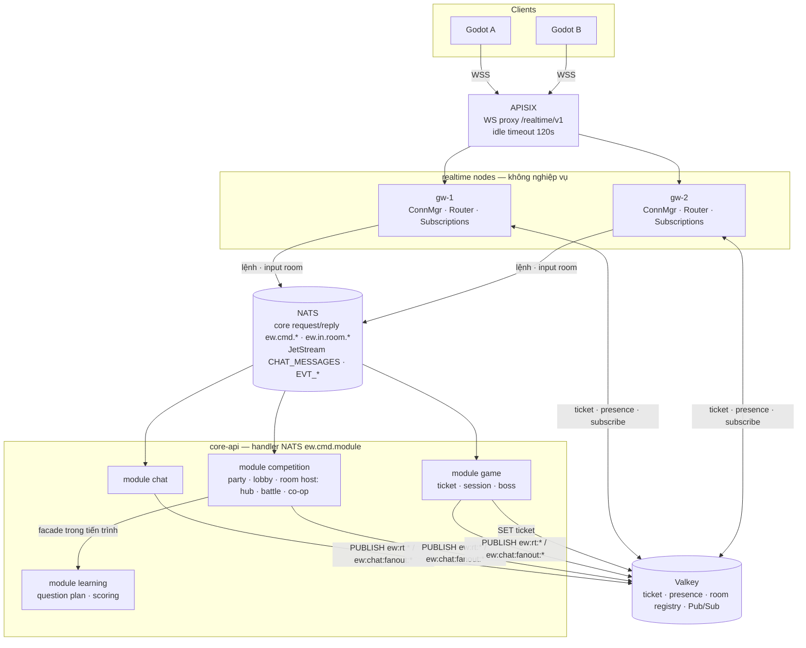
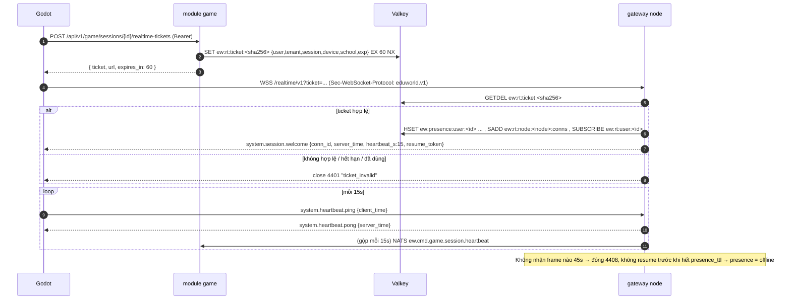
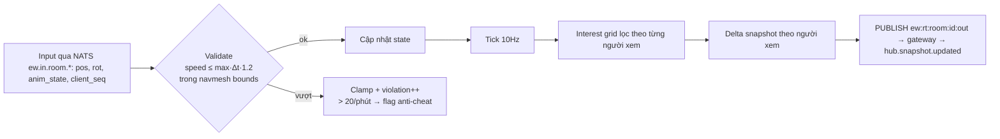
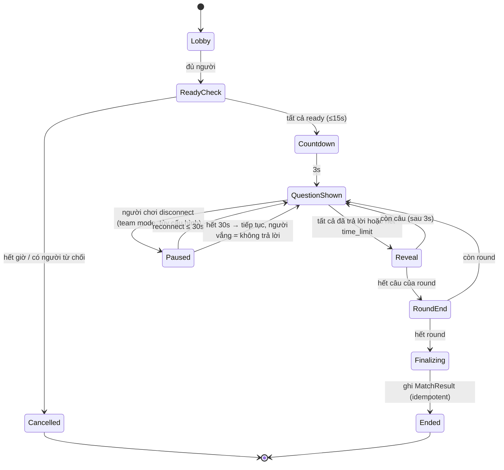
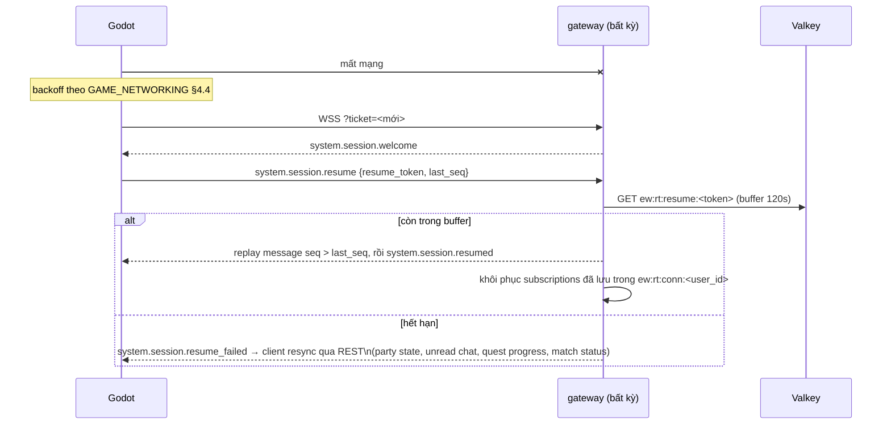

# Realtime Architecture

> Trạng thái: Draft · Phiên bản: 0.4 · Owner: Multiplayer Engineer · Cập nhật: 2026-11-17 (§3.1: `session.session.ended` trước close; `4410` chỉ khi không thu hồi credential (giờ giới nghiêm ADR-0078), `4403` khi thu hồi — quyết định Technical Architect; ADR-0074: binary `realtime` chỉ giữ kết nối, ticket, presence và định tuyến; lệnh nghiệp vụ và room host của module competition chạy trong `core-api` qua NATS request/reply; NATS user theo binary) · 2026-11-15
> Liên quan: [ADR-0008](../adr/ADR-0008-access-token-cua-keycloak-la-credential-api-realtime-dung-ti.md) · [ADR-0011](../adr/ADR-0011-realtime-transport-websocket-qua-go-realtime-server.md) · [ADR-0012](../adr/ADR-0012-the-gioi-game-hybrid-hub-instance-private-instance-match-roo.md) · [ADR-0035](../adr/ADR-0035-duong-truyen-chat-nats-jetstream-valkey-pub-sub-luu-postgres.md) · [ADR-0074](../adr/ADR-0074-modular-monolith-co-ranh-gioi-cuong-che.md) · [AsyncAPI](../../specs/asyncapi/eduworld-realtime.v1.yaml) · [VALKEY_DESIGN](../07-backend/VALKEY_DESIGN.md) · [GAME_NETWORKING](../08-game-client/GAME_NETWORKING.md) · [MULTIPLAYER_GAMEPLAY](../03-social-multiplayer/MULTIPLAYER_GAMEPLAY.md) · [BACKEND_DESIGN §9](../07-backend/BACKEND_DESIGN.md)

> **Thay đổi v0.4 (ADR-0074, thay ADR-0036):** `realtime` là **binary** riêng (`src/backend/cmd/realtime`, module `realtime`, Swarm service `realtime` ≥ 2 replica, drain khi deploy). Binary này chỉ kết thúc WebSocket, xác thực ticket, presence và định tuyến lệnh/sự kiện; không nạp module domain, không có database, không gọi facade. Mọi bước nghiệp vụ chạy trong module sở hữu bên trong `core-api`, nhận lệnh qua NATS request/reply `ew.cmd.<module>.>`: chat trong **module chat**; party/lobby/matchmaking và **room host** (hub instance, battle/co-op state machine, trạng thái trong Valkey với lease theo room) trong **module competition**, chấm điểm qua facade module learning trong tiến trình; game session/ticket/boss trong **module game**.
>
> **Thay đổi v0.3:** `eduworld-realtime` của monolith cũ được thay bằng `realtime` mỏng, logic nghiệp vụ realtime chạy trong module sở hữu (ADR-0036, nay thay bằng ADR-0074).

## 1. Phạm vi và phân vai

`realtime` là điểm kết thúc WebSocket `/realtime/v1` duy nhất. Nó **không** chứa logic nghiệp vụ, **không** có database và không nạp module domain nào (ADR-0074 mục 2).

| Tính năng | Kiểu lưu lượng | Module có thẩm quyền | Đường đi |
|---|---|---|---|
| Chat, typing, receipts, unread | Lệnh + fan-out | module chat | Lệnh: NATS request `ew.cmd.chat.*`; giao: Valkey `ew:chat:fanout:<channel>`, `ew:rt:user:<id>` |
| Notification | Fan-out | module phát (module chat cho mention/tin; các module khác cho sự kiện của mình) | Valkey `ew:rt:user:<id>` |
| Presence (online/area/activity) | Heartbeat + fan-out | realtime (online/offline) + module gửi area/activity | Valkey `ew:presence:*`, `ew:rt:user:<friend>` |
| Party / Party Lobby | Lệnh + sự kiện | module competition | NATS request `ew.cmd.competition.party.*`; sự kiện fan-out tới `ew:rt:user:<member_id>` của từng thành viên |
| Matchmaking events | Push trạng thái ticket/proposal | module competition (matchmaker trong profile `worker-jobs`) | NATS request `ew.cmd.competition.matchmaking.*`; Valkey `ew:rt:user:<id>` |
| Hub sync | Input ≤10 Hz, snapshot 10 Hz | module competition (room host trong `core-api` giữ hub instance, state trong Valkey) | Input: NATS core `ew.in.room.<room_id>` (không request/reply); output: Valkey `ew:rt:room:<id>:out` |
| Battle / Co-op room | State machine theo câu hỏi | module competition (room host trong `core-api`, state machine + lease theo room trong Valkey); câu hỏi + chấm điểm ở module learning qua facade trong tiến trình | Lệnh: NATS request `ew.cmd.competition.battle.*`; output: Valkey `ew:rt:room:<id>:out` |
| Quest progress, XP, reward push | Sự kiện | module game | Valkey `ew:rt:user:<id>` |
| Đăng nhập thiết bị khác (takeover) | Sự kiện điều khiển | module game | Valkey `ew:rt:user:<id>` → gateway đóng `4409` |

Không dùng REST cho chuyển động 3D [Confirmed §14]. Không dùng Valkey làm game simulation server [Confirmed §14].

## 2. Kiến trúc tổng thể




### 2.1. Thành phần trong một node gateway

| Thành phần | Trách nhiệm |
|---|---|
| `ConnManager` | Accept WS, xác thực ticket (`GETDEL` Valkey), đăng ký `conn_id`, heartbeat, đóng kết nối |
| `Session` (per connection) | Danh tính đã xác thực (user, tenant, game_session, device), hàng đợi gửi (bounded), `seq` outbound, buffer resume, rate limiter |
| `Router` | Ánh xạ `type` của message → subject NATS: lệnh `<domain>.<entity>.<verb>` → `ew.cmd.<module>.<domain>.<entity>.<verb>` (bảng định tuyến trong config, sinh từ AsyncAPI); input hub → `ew.in.room.<room_id>` |
| `Subscriptions` | Map topic → session local; `SUBSCRIBE`/`UNSUBSCRIBE` Valkey theo đếm tham chiếu (`ew:rt:user:<id>` khi kết nối; `ew:chat:fanout`, `ew:rt:room:*:out` khi module trả `subscribe` trong reply) |

| `Presence` | Ghi online/offline, heartbeat vào `ew:presence:*` |
| `Revocation` | Nhận `user.access_revoked` / `session.session.replaced` qua `ew:rt:user:<id>` → đóng `4403`/`4409` |

Header NATS gateway gắn vào mọi lệnh: `Ew-Tenant-Id`, `Ew-User-Id`, `Ew-Game-Session-Id`, `Ew-Device-Id`, `Ew-Conn-Id`, `Ew-Node-Id`, `traceparent`. Handler trong `core-api` tin các header này **chỉ** khi message đến qua NATS user của binary `realtime` (quyền publish `ew.cmd.>`/`ew.in.>` chỉ cấp cho user `realtime`, [SECURITY_ARCHITECTURE §8.1](../10-security/SECURITY_ARCHITECTURE.md)); handler dựng `TenantScope` từ `Ew-Tenant-Id` rồi gọi command/query handler của module như request HTTP.

## 3. Vòng đời kết nối



| Tham số | Giá trị | Nhãn |
|---|---|---|
| Ticket TTL / số lần dùng | 60 s / 1 lần | [Confirmed] ADR-0008 |
| Heartbeat client | 15 s (`system.heartbeat.ping`) | [Confirmed] |
| Timeout không nhận frame | 45 s | [Confirmed] |
| `game_session_heartbeat_timeout` — game session không còn heartbeat (WS hoặc REST khi WS chưa Online) | 45 s → module game kết thúc session `end_reason = timeout`; job `game-session-timeout` quét mỗi 15 s | [Confirmed — Technical Architect 2026-11-16] |
| WS ping control frame từ server | 20 s | [Confirmed] |
| Kích thước frame tối đa client→server | 16 KB | [Confirmed] |
| Resume window | 120 s | [Confirmed] |
| Timeout lệnh NATS request | 2 s (quá hạn → `system.command.failed` `UNAVAILABLE`, `retryable`) | [Confirmed] |
| Số kết nối đồng thời mỗi user | 1 (kết nối mới đóng kết nối cũ với `4409 replaced`) | [Confirmed] ADR-0031 |
| Ai được kết nối | Chỉ học sinh: module game chỉ cấp ticket cho game session của `student` (ADR-0031) | [Confirmed] |

### 3.1. Close codes ứng dụng

Nguồn chuẩn của mã đóng kết nối. Hành vi phía client (reconnect, backoff, thông báo) ở [GAME_NETWORKING §4.4](../08-game-client/GAME_NETWORKING.md#44-reconnect--resume).

| Code | Ý nghĩa |
|---|---|
| 4400 | Bad message/protocol |
| 4401 | Ticket không hợp lệ |
| 4403 | Tài khoản bị khóa/thu hồi quyền (kể cả chuyển trường khác tenant), dọn học sinh, đặt lại mật khẩu, kết thúc do quản trị — credential/phiên đã bị thu hồi: gửi `session.session.ended` (`reason` = `account_locked`/`access_revoked`/`cleanup`/`admin`/`password_changed`) trước khi đóng; client đăng xuất và xóa refresh token |
| 4408 | Heartbeat timeout |
| 4409 | Bị thay thế, gồm **đăng nhập trên thiết bị khác** (gửi `session.session.replaced` trước khi đóng) |
| 4410 | Game session bị server kết thúc **không** thu hồi credential — giờ giới nghiêm hoặc giới hạn chơi/ngày (OQ-17, owner 2026-11-20): gửi `session.session.ended` (`reason = curfew` hoặc `daily_limit`, `reopen_at`; với `daily_limit` là 00:00 ICT hôm sau) trước khi đóng; client không tự kết nối lại, giữ refresh token — module game publish (F014), gateway giao và đóng (F090) |
| 4429 | Vượt rate limit nặng |
| 1012 | Node shutdown (graceful): gateway gửi `system.server.draining` (kèm `reconnect_after_ms` ngẫu nhiên để giãn tải) rồi đóng `1012`, rải trong `ws_drain_window` ([Proposed] 15 s, ≤ 30 s); client resume ở node khác |

### 3.2. Một thiết bị cho mỗi tài khoản (ADR-0031)


- Room/trận/quest co-op mà A đang ở: module competition coi A mất kết nối; B xin ticket mới và **rejoin** (REST resync `GET /api/v1/competition/matches/{id}`, party state) trong grace của mode.
- Session không heartbeat quá 45 s → job `game-session-timeout` (worker module game, mỗi 15 s) kết thúc `end_reason = timeout`.
- Đóng game / "Đăng xuất": `POST /api/v1/game/sessions/{id}:end` (best effort) → `end_reason = logout`.

## 4. Message envelope

Định nghĩa chuẩn ở [AsyncAPI](../../specs/asyncapi/eduworld-realtime.v1.yaml). JSON UTF-8, `snake_case`. Mọi trường chuỗi có `maxLength` (ADR-0041).

```json
{
  "v": 1,
  "type": "chat.message.send",
  "id": "01JCX4Z7Q2Z7N3M5V9W1A2B3C4",
  "ts": 1763190000123,
  "payload": { "channel_id": "…", "kind": "text", "body": "Chào cả nhóm!" }
}
```

| Trường | Chiều | Ý nghĩa |
|---|---|---|
| `v` | cả hai | Phiên bản protocol (int) |
| `type` | cả hai | `<domain>.<entity>.<action>` (≤ 64); lệnh client dùng động từ hiện tại, sự kiện server dùng quá khứ |
| `id` | client→server | ID lệnh do client sinh (ULID/UUIDv7, ≤ 36), idempotency trong cửa sổ resume, ghép `system.command.acked`/`system.command.failed` |
| `ref` | server→client | `id` của lệnh mà message này phản hồi |
| `seq` | server→client | Số thứ tự tăng dần theo kết nối logic (giữ qua resume) — do gateway cấp |
| `ts` | cả hai | Epoch ms; server time là thẩm quyền |
| `payload` | cả hai | Nội dung theo `type` |

Mọi lệnh client nhận đúng một `system.command.acked` hoặc `system.command.failed` với `ref` = `id` (gateway tạo từ reply NATS của handler trong `core-api`). Message hub tần suất cao (`hub.player.move`) **không** ack.

### 4.1. Dịch lệnh WS → NATS

| Tiền tố `type` | Subject NATS | Bên xử lý |
|---|---|---|
| `chat.*` | `ew.cmd.chat.<type>` (request/reply) | module chat (`core-api`) |
| `party.*`, `matchmaking.*`, `battle.*`, `coop.*`, `hub.instance.*` | `ew.cmd.competition.<type>` (request/reply) | module competition (`core-api`); lệnh trong trận tới replica `core-api` đang giữ lease room |
| `hub.player.move` | `ew.in.room.<room_id>` (core publish, không reply) | room host của module competition (replica `core-api` giữ lease) |
| `game.*`, `session.*`, `boss.*` | `ew.cmd.game.<type>` (request/reply) | module game (`core-api`; encounter boss chạy room host trong module game; encounter party chỉ tạo từ Party Lobby qua `startPartyActivity` — [CHALLENGE_BOSS_SYSTEM §4](../01-game-design/CHALLENGE_BOSS_SYSTEM.md#4-multiplayer-boss-chạy-ở-đâu)) |
| `system.*` | xử lý tại gateway | realtime |

Reply của handler: `{ok: true, result?, subscribe?: [topics], unsubscribe?: [topics]}` hoặc `{ok: false, problem: {code, retryable, retry_after_ms?}}`. Gateway áp `subscribe`/`unsubscribe` cho session (ví dụ khi join party/channel/room), rồi gửi ack/failed xuống client.

## 5. Routing sự kiện và room

Kết nối nằm ngẫu nhiên trên gateway node bất kỳ (APISIX round-robin, không cần sticky).

1. **Topic fan-out (Valkey Pub/Sub):** module (trong `core-api`/`worker`) `PUBLISH`; gateway node có subscriber local mới `SUBSCRIBE` (đếm tham chiếu).
2. **Room host (module competition trong `core-api`):** room có trạng thái (hub instance, lobby, battle, co-op) được **một replica `core-api` sở hữu** (lease Valkey, state trong Valkey). Input từ gateway tới room qua NATS `ew.in.room.<room_id>` (replica giữ lease subscribe subject của room mình); output qua Valkey `ew:rt:room:<room_id>:out`. Chấm điểm gọi facade module learning trong tiến trình.

| Topic Pub/Sub | Publisher | Nội dung |
|---|---|---|
| `ew:rt:user:<user_id>` | mọi module | Message riêng user (notification, invitation, matchmaking, quest/XP, takeover, revocation) |
| `ew:chat:fanout:<channel_id>` | module chat | Tin nhắn và sự kiện tin, typing, receipts — **sau khi** tin đã vào JetStream (ADR-0035) |
| — | module competition | Sự kiện party/lobby **không** có topic riêng: module competition publish tới `ew:rt:user:<member_id>` của từng thành viên (≤ `party_max_members`), nên người bị kick/rời party không còn nhận ngay khi membership đổi |
| `ew:rt:room:<room_id>:out` | module competition (room host trong `core-api`) | Snapshot/sự kiện room |
| `ew:rt:broadcast` | module identity (admin) | Thông báo hệ thống (bảo trì) |

Pub/Sub là best-effort. Message cần đảm bảo đã được ghi bền vững trước khi publish (party/lời mời ghi `eduworld_competition`; tin chat đã JetStream ack). Client bù bằng resync REST/`chat.sync` khi phát hiện seq gap hoặc resume thất bại.

### 5.0. Chat (ADR-0035 trong module chat)

- module chat là publisher duy nhất của tin chat: nhận NATS request `ew.cmd.chat.message.send` từ gateway → kiểm tra membership/policy/rate limit → kiểm duyệt (ADR-0030) → `seq` (Valkey `INCR`) → publish JetStream `ew.chat.<tenant_id>.msg.<channel_id>` (`Nats-Msg-Id = message_id`, chờ PubAck ≤ 2 s) → reply `acked` → `PUBLISH ew:chat:fanout:<channel_id>`.
- Sự kiện thay đổi tin đi `ew.chat.<tenant_id>.evt.<channel_id>`; con trỏ đọc gộp đi `ew.chat.<tenant_id>.cursor.<channel_id>`. Typing và broadcast receipts chỉ qua Valkey Pub/Sub.
- NATS JetStream lỗi → module chat trả `CHAT_TEMPORARILY_UNAVAILABLE`; gateway và các tính năng realtime khác không bị ảnh hưởng.
- Chi tiết: [CHAT_SYSTEM §5](../03-social-multiplayer/CHAT_SYSTEM.md).

### 5.1. Room registry & failover (module competition)

```text
ew:rt:room:<room_id>        HASH  {owner_instance, type, tenant_id, school_id, capacity, members, state_version}
ew:rt:room:<room_id>:lease  STRING owner_instance  EX 10   (gia hạn mỗi 3s bằng SET XX)
ew:rt:room:<room_id>:ckpt   STRING JSON checkpoint  EX 3600
```

- Tạo room: module competition (trong `core-api`) xử lý lệnh, ghi room/match vào `eduworld_competition`, chọn owner = replica `core-api` có ít room nhất (ZSET tải `ew:cmp:instances`) → `SET lease NX`; replica owner subscribe NATS `ew.in.room.<room_id>` và `ew.cmd.competition.room.<room_id>.>` (queue group theo room).
- Owner mất lease (replica `core-api` chết hoặc bị thay khi rolling update): replica khác phát hiện qua watcher `SET lease NX` để nhận quyền.
  - **Hub instance:** state tái tạo được (vị trí từ input client gửi lại) → client nhận `hub.instance.migrated`.
  - **Battle/Co-op:** checkpoint sau mỗi chuyển trạng thái (câu hiện tại, điểm tạm, deadline). Owner mới khôi phục từ checkpoint; câu đang dở được **làm lại**. Không có checkpoint → match `aborted`, không tính rating ([ANTI_CHEAT](../10-security/ANTI_CHEAT.md)).
- Graceful shutdown (rolling update `core-api`, [DEPLOYMENT §11.2](../11-operations/DEPLOYMENT.md#112-chiến-lược-rollout)): replica ngừng nhận room mới, handoff checkpoint sang replica khác trong ≤ 30 s.

## 6. Hub sync (ADR-0011/0012)

| Tham số | Giá trị | Nhãn |
|---|---|---|
| Sức chứa hub instance | 40 người | [Confirmed] |
| Client gửi `hub.player.move` | ≤ 10 Hz, chỉ khi thay đổi (+1 Hz keepalive khi đứng yên) | [Confirmed] |
| Server tick / snapshot | 10 Hz (room host trong module competition) | [Confirmed] |
| Interest grid | Ô 16 m × 16 m, gửi thực thể trong ô hiện tại + 8 ô lân cận | [Confirmed] |
| Interpolation buffer client | 100 ms | [Confirmed] |
| Tốc độ tối đa | theo `world_area` (vd. 6 m/s chạy); vượt → clamp + đếm vi phạm | [Confirmed] |



- Snapshot chứa `tick`, danh sách entity `{eid, p:[x,y,z], r:yaw, a:anim}`; entity rời AOI → `removed[]`. Snapshot theo người xem được đóng gói theo gateway node (một message Valkey chứa snapshot cho các user trên node đó) để giảm số message Pub/Sub [Confirmed].
- Hub chỉ xác thực mức vừa đủ (tốc độ, biên); không có vật lý server-side. Va chạm giữa người chơi tắt.
- Tương tác có giá trị (mở quest, nhận item) đi qua REST của module game; kiểm tra khoảng cách (dung sai 3 m) dựa trên vị trí gần nhất do room host của module competition giữ (`ew:rt:room:<id>:pos:<user>` TTL 5 s). module game **không** đọc trực tiếp key Valkey thuộc module competition (ACL theo module); lấy vị trí qua facade của module competition, gọi trong tiến trình `core-api` (ADR-0074) — operation do F071 khai báo trong `competition.internal.v1.yaml` (`x-allowed-callers: [game]`), phía competition đọc vị trí do room host hub của F091 giữ [Confirmed — owner 2026-11-20].
- Party ưu tiên cùng instance; nếu đầy, cả party chuyển sang instance mới (`hub.instance.assigned`).

## 7. Battle & Co-op room (server-authoritative)

### 7.1. State machine Knowledge Battle



Quy tắc:

1. Khi tạo match, module competition (trong `core-api`) gọi facade `question-plans` của module learning trong tiến trình (ADR-0074) → nhận `plan_id` + render payload từng câu (**không** answer key). Render payload gửi client lúc `QuestionShown` (ADR-0016).
2. `battle.answer.submit` chứa `question_instance_id` + `response`; room host gắn `received_at` (server time). Trả lời sau `deadline + 300 ms grace` bị từ chối (`ANSWER_LATE`).
3. Chấm: room host gọi facade `question-plans/{plan_id}/answers:score` của module learning trong tiến trình `core-api` (module learning chấm bằng answer key, ghi `AttemptAnswer` `mode=competition` cho từng học sinh — learning record riêng [Confirmed Addendum §4]). Bonus thời gian tính trên server time của room host (trừ RTT ước lượng tối đa 150 ms) [Confirmed]. module learning lỗi/chậm → câu được làm lại, quá 2 lần → match `aborted`.
4. `Finalizing` chạy command `FinalizeMatch(match_id, results)` — unique theo `match_id` → không tính trùng [Confirmed §22]; outbox `match.completed` → module game (XP), module chat (đóng channel `match`), module learning (evidence).

### 7.2. Co-op room

- Dùng cho Cooperative Quest / Educational Puzzle của Party (private instance hoặc room riêng), host ở module competition (`core-api`); tiến độ quest chung ghi ở module game qua event `party.activity_completed`.
- State: `puzzle_state` (từ `MiniGameConfig` — module competition đọc qua facade của module game khi tạo room), `contributions` theo người, `shared_progress` theo `shared_progress_policy`.
- Mỗi hành động học tập của từng thành viên là attempt riêng ở module learning.
- Thành viên disconnect: room tiếp tục theo quy tắc disconnect của quest ([QUEST_SYSTEM §6](../01-game-design/QUEST_SYSTEM.md#6-party--shared-progress)) [Confirmed Addendum §8].

## 8. Backpressure & giới hạn

| Cơ chế | Giá trị | Hành vi |
|---|---|---|
| Send queue mỗi session (gateway) — `ws_send_queue` | 256 message | Đầy → bỏ message `droppable` (snapshot cũ, presence); message quan trọng không đẩy được trong 5 s → đóng `4408` để client resume |
| Coalescing | Snapshot hub chỉ giữ bản mới nhất | Client chậm nhận ít snapshot hơn |
| Write deadline (`ws_send_queue`) | 10 s | Vượt → đóng kết nối |
| Nhận kết nối mới mỗi node — `ws_accept_rate` | 200 kết nối/giây | Quá tải → đóng `4429` kèm thời gian thử lại |
| Room tick budget (module competition) | ≤ 5 ms/tick cho hub 40 người | Metric `eduworld_room_tick_duration_seconds`; cảnh báo p99 > 20 ms |
| NATS request in-flight mỗi kết nối — `ws_inflight_commands` | 8 | Vượt → `RATE_LIMITED` |
| Lỗi giao thức lặp lại — `ws_protocol_errors` [Proposed] | 5 lần/phút | Mỗi lỗi → `system.command.failed` (`VALIDATION_FAILED`/`UNKNOWN_TYPE`), không chuyển tiếp; vượt → đóng `4400` |

### 8.1. Rate limit theo kết nối (token bucket tại gateway + tổng hợp Valkey ở module)

| Loại lệnh | Giới hạn | Nhãn |
|---|---|---|
| Tổng frame (`ws_frame_rate`) | 30/s, burst 60 | [Confirmed — Technical Architect 2026-11-16] |
| `hub.player.move` (`ws_frame_rate`) | 12/s | [Confirmed — Technical Architect 2026-11-16] |
| `chat.message.send` | Theo ChatPolicy hiệu lực; giá trị và cách đếm (Valkey xuyên node) chỉ định nghĩa ở [CHAT_SYSTEM §3.1](../03-social-multiplayer/CHAT_SYSTEM.md); gateway không có giới hạn chat riêng ngoài `ws_frame_rate` | — |
| `party.invitation.send` | `party_invite_rate` (module competition; giá trị ở [PARTY_SYSTEM §10](../03-social-multiplayer/PARTY_SYSTEM.md)) | — |
| `matchmaking.proposal.accept/decline`, `matchmaking.ticket.cancel` | 10/phút (tạo ticket đi qua REST `POST /api/v1/competition/matchmaking/tickets`, limit 6/phút tại APISIX) | [Confirmed] |

Vi phạm nhẹ → `system.command.failed` mã `RATE_LIMITED` kèm `retry_after_ms`; liên tục > 3 lần/phút (`ws_frame_rate`) → đóng `4429`, ghi metric và audit (gửi `audit.recorded` qua NATS).

## 9. Reconnect & session recovery



- Buffer resume: message **không droppable** của 120 s gần nhất mỗi user trong `ew:rt:resume:<token>` (LIST ≤ 500) [Confirmed].
- Ticket mới bắt buộc (dùng 1 lần).
- Battle: grace 30 s giữ chỗ (module competition); quay lại nhận `battle.state.snapshot`.
- Party: thành viên disconnect → `party.member.status_changed{status:"disconnected"}`; leader disconnect > 60 s → tự chuyển leader [Confirmed] ([PARTY_SYSTEM](../03-social-multiplayer/PARTY_SYSTEM.md)).
- Presence chuyển `offline` sau 45 s không có kết nối.

## 10. Bảo mật realtime

- Ticket opaque, hash SHA-256 khi lưu, `GETDEL` (dùng 1 lần). Không đặt JWT vào URL.
- Kiểm tra `Origin` cho Web client; giới hạn subprotocol `eduworld.v1`.
- Gateway không quyết định quyền nghiệp vụ: mọi lệnh join/subscribe được module sở hữu kiểm tra quyền + tenant rồi mới trả `subscribe` trong reply ([MULTITENANCY](MULTITENANCY.md)).
- Chỉ user NATS `realtime` (binary `realtime`) được publish `ew.cmd.>`/`ew.in.>`; handler trong `core-api` bỏ qua message lệnh từ nguồn khác.
- Revocation: module identity phát `user.access_revoked` → `PUBLISH ew:rt:user:<id>` → gateway đóng `4403` trong ≤ 5 s.
- Không gửi PII trong message hub/battle: chỉ `nickname`, `avatar_config`, `eid`.

## 11. Scaling & ước lượng năng lực — mục tiêu 10.000 CCU (ADR-0045) [Confirmed — mục tiêu thiết kế, phải xác minh bằng load test]

Mục tiêu năng lực Release 1.0 là **10.000 người chơi đồng thời** [Confirmed] (NFR-SCAL-002). Bảng dưới là ước lượng để dựng hạ tầng và kịch bản load test, chưa phải cam kết.

| Giả định | Pilot | **Release 1.0 (10.000 CCU)** | Ghi chú |
|---|---|---|---|
| Kết nối WS đồng thời | 1.000 | 10.000 (+ 20% dự phòng reconnect) | Mỗi người chơi 1 kết nối |
| Kết nối/gateway node mục tiêu | 5.000 | 4.000 (giữ ≤ 50% CPU) | Đo thực tế để điều chỉnh |
| Replica `realtime` (N+1) | 2 | **4** (4–6 replica, tăng theo lịch học và alert số kết nối; Docker Swarm không autoscale theo tải) | Node 2 vCPU / 2 GB ([DEPLOYMENT §4.2](../11-operations/DEPLOYMENT.md#42-release-10-10000-ccu-trên-docker-swarm-nfr-scal-002-confirmed-adr-0024-adr-0045--sizing-confirmed)) |
| Phân bố người chơi | — | ~70% ở hub (≤ 40/instance → ~175 instance), ~20% trong trận/co-op, ~10% học/làm bài | Theo GAMEPLAY_LOOP |
| Room host (module competition trong `core-api`) | 2 replica `core-api` | Chia trên các replica `core-api`; ~175 hub instance + trận, tick ≤ 5 ms → ≈ 9 vCPU ở đỉnh | Theo số room hub + trận |
| Hub: input vào (NATS core `ew.in.room.*`) | 10k msg/s | ~70k msg/s (7.000 × 10 Hz) | Gộp/giảm tần suất khi đứng yên |
| Hub: snapshot ra (Valkey, gộp theo gateway node) | 1k–2k msg/s | ~7k–14k msg/s | 175 instance × 10 Hz × số gateway node chứa thành viên |
| Lệnh request/reply NATS (chat, party, battle) | < 2k req/s | < 15k req/s | |
| Chat (gửi) | < 200 msg/s | ~1.000–2.000 msg/s đỉnh | JetStream `CHAT_MESSAGES` |
| Valkey Pub/Sub tổng | < 20k msg/s | ~100k–150k msg/s | Dùng **sharded Pub/Sub** (Valkey cluster) khi vượt ~100k msg/s |
| Băng thông xuống/người (hub) | ≤ 30 KB/s | ≤ 30 KB/s → ~300 MB/s tổng ở đỉnh | Delta snapshot + interest grid |

Chiến lược scale:

1. Scale ngang `realtime` (theo số kết nối) và `core-api` (theo lệnh nghiệp vụ và số room) độc lập; trên Docker Swarm (ADR-0024) không có autoscale theo tải: số replica tăng theo lịch học (`ops-scheduler`, DEPLOYMENT §4.4) và theo alert khi `eduworld_rt_connections` > 3.500/replica hoặc CPU > 70%. APISIX cân bằng kết nối mới giữa các task (`tasks.realtime`, least-conn); không cần sticky session vì client reconnect bằng ticket mới và resume theo `last_seq`.
2. Gộp snapshot theo gateway node để giảm Pub/Sub; affinity (APISIX `chash` theo cookie `rt_affinity`) đặt thành viên cùng room/party trên ít gateway node.
3. **Bão kết nối** đầu giờ học: kết nối WS chỉ mở sau khi đăng nhập xong nên được hàng chờ đăng nhập (ADR-0045) điều tiết; gateway giới hạn tốc độ nhận kết nối mới mỗi node (200 kết nối/giây [Confirmed]) và trả close 4429 kèm thời gian thử lại khi quá tải.
4. Scale trước theo lịch học (`ops-scheduler`, `docker service scale`, DEPLOYMENT §4.4) cho `realtime`, `core-api`, `worker-chat`.
5. Khi > 50k CCU hoặc cần vật lý thời gian thực → ADR mới (dedicated game server).

Kiểm chứng: TC-PERF (10.000 CCU giả lập, 70% hub/20% trận/10% học) trong [TEST_STRATEGY](../12-project/TEST_STRATEGY.md).

## 12. Observability

| Metric | Loại | Nguồn |
|---|---|---|
| `eduworld_rt_connections{node}` | gauge | gateway |
| `eduworld_rt_messages_total{direction,type}` | counter | gateway |
| `eduworld_rt_send_queue_dropped_total{type}` | counter | gateway |
| `eduworld_rt_cmd_latency_seconds{module,type}` | histogram — thời gian NATS request/reply tới `core-api` | gateway |
| `eduworld_rt_cmd_failed_total{module,code}` | counter | gateway |
| `eduworld_room_count{type}`, `eduworld_room_tick_duration_seconds` | gauge, histogram | module competition (`core-api`) |
| `eduworld_rt_resume_total{result}` | counter | gateway |
| `eduworld_rt_ticket_rejected_total{reason}` | counter | gateway |
| `eduworld_rt_message_delivery_latency_seconds` (đo bằng `ts` server) | histogram — NFR-PERF-003 | gateway |

Trace: gateway tạo span cho lệnh client quan trọng (chat send, battle answer, party start) và truyền `traceparent` qua header NATS sang `core-api`, tiếp tục qua lời gọi facade (`src/backend/pkg/modcall`) và outbox.
