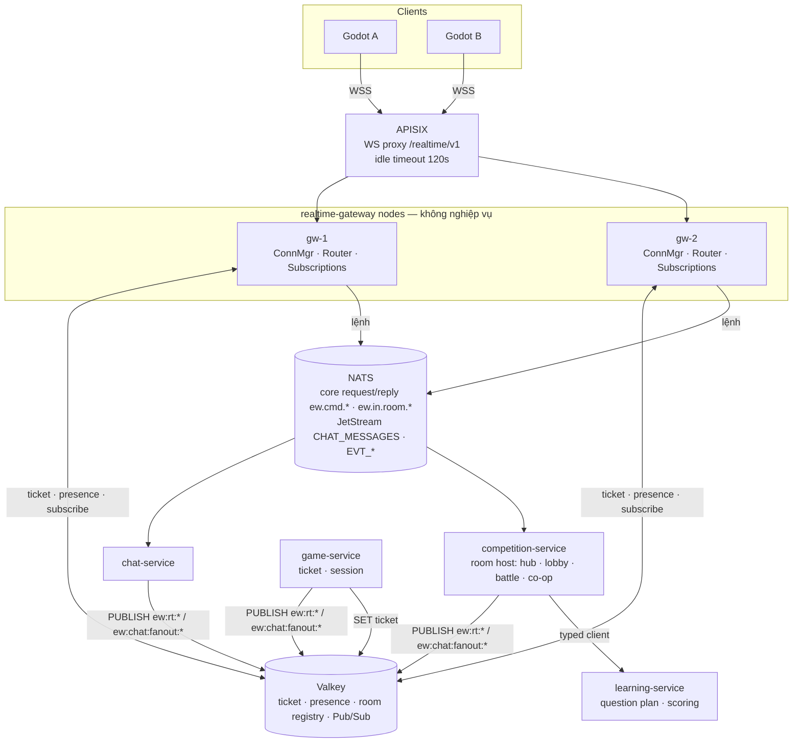
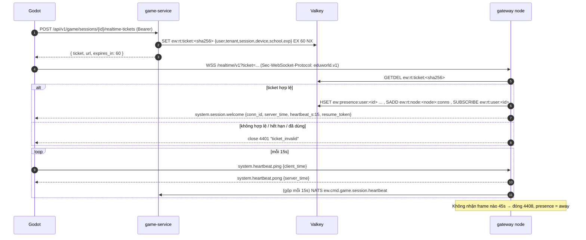
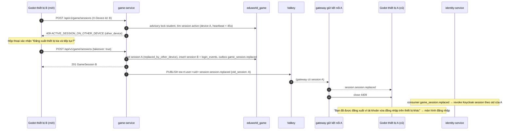
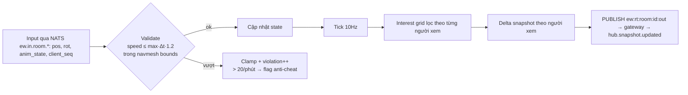
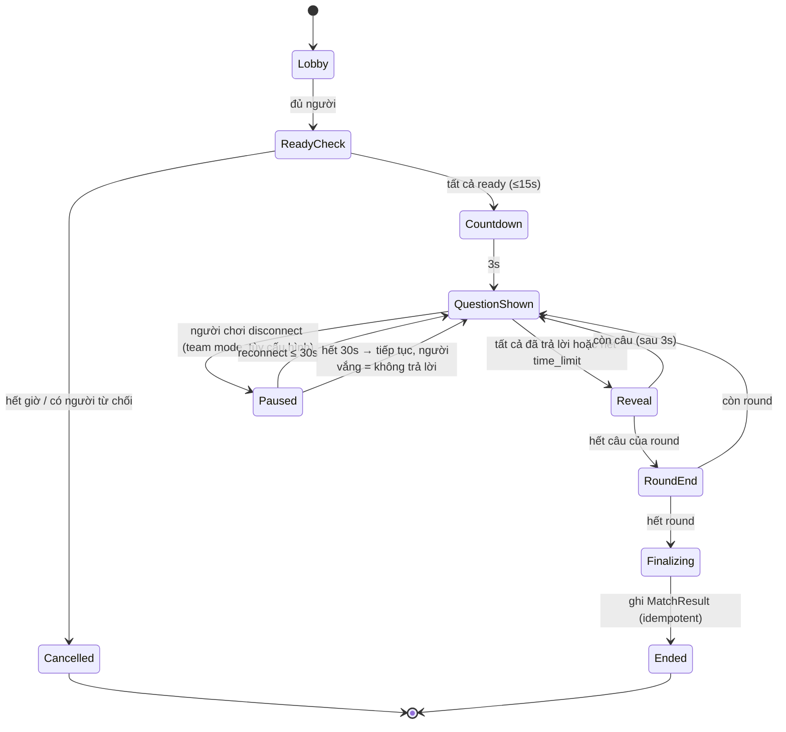
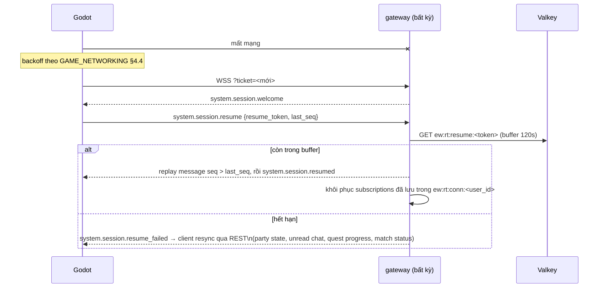

# Realtime Architecture

> Trạng thái: Draft · Phiên bản: 0.3 · Owner: Multiplayer Engineer · Cập nhật: 2026-11-15
> Liên quan: [ADR-0008](../adr/ADR-0008-access-token-cua-keycloak-la-credential-api-realtime-dung-ti.md) · [ADR-0011](../adr/ADR-0011-realtime-transport-websocket-qua-go-realtime-server.md) · [ADR-0012](../adr/ADR-0012-the-gioi-game-hybrid-hub-instance-private-instance-match-roo.md) · [ADR-0035](../adr/ADR-0035-duong-truyen-chat-nats-jetstream-valkey-pub-sub-luu-postgres.md) · [ADR-0036](../adr/ADR-0036-microservices-theo-he-thong-lon-thay-adr-0001.md) · [AsyncAPI](../../specs/asyncapi/eduworld-realtime.v1.yaml) · [VALKEY_DESIGN](../07-backend/VALKEY_DESIGN.md) · [GAME_NETWORKING](../08-game-client/GAME_NETWORKING.md) · [MULTIPLAYER_GAMEPLAY](../03-social-multiplayer/MULTIPLAYER_GAMEPLAY.md) · [BACKEND_DESIGN §9](../07-backend/BACKEND_DESIGN.md)

> **Thay đổi v0.3:** `eduworld-realtime` (binary của monolith) được thay bằng **`realtime-gateway`** — service mỏng chỉ giữ kết nối và định tuyến. Logic nghiệp vụ realtime chạy trong service sở hữu: chat trong **chat-service**, party/lobby/matchmaking/hub instance/battle/co-op trong **competition-service**, game session/ticket trong **game-service** (ADR-0036).

## 1. Phạm vi và phân vai

`realtime-gateway` là điểm kết thúc WebSocket `/realtime/v1` duy nhất. Nó **không** chứa logic nghiệp vụ và **không** có database.

| Tính năng | Kiểu lưu lượng | Service có thẩm quyền | Đường đi |
|---|---|---|---|
| Chat, typing, receipts, unread | Lệnh + fan-out | chat-service | Lệnh: NATS request `ew.cmd.chat.*`; giao: Valkey `ew:chat:fanout:<channel>`, `ew:rt:user:<id>` |
| Notification | Fan-out | dịch vụ phát (chat-service cho mention/tin; các service khác cho sự kiện của mình) | Valkey `ew:rt:user:<id>` |
| Presence (online/area/activity) | Heartbeat + fan-out | realtime-gateway (online/offline) + service gửi area/activity | Valkey `ew:presence:*`, `ew:rt:user:<friend>` |
| Party / Party Lobby | Lệnh + sự kiện | competition-service | NATS request `ew.cmd.competition.party.*`; Valkey `ew:rt:party:<id>` |
| Matchmaking events | Push trạng thái ticket/proposal | competition-service (matchmaker worker) | NATS request `ew.cmd.competition.matchmaking.*`; Valkey `ew:rt:user:<id>` |
| Hub sync | Input ≤10 Hz, snapshot 10 Hz | competition-service (room host giữ hub instance) | Input: NATS core `ew.in.room.<room_id>` (không request/reply); output: Valkey `ew:rt:room:<id>:out` |
| Battle / Co-op room | State machine theo câu hỏi | competition-service (room host); câu hỏi + chấm điểm ở learning-service | Lệnh: NATS request `ew.cmd.competition.battle.*`; output: Valkey `ew:rt:room:<id>:out` |
| Quest progress, XP, reward push | Sự kiện | game-service | Valkey `ew:rt:user:<id>` |
| Đăng nhập thiết bị khác (takeover) | Sự kiện điều khiển | game-service | Valkey `ew:rt:user:<id>` → gateway đóng `4409` |

Không dùng REST cho chuyển động 3D [Confirmed §14]. Không dùng Valkey làm game simulation server [Confirmed §14].

## 2. Kiến trúc tổng thể



### 2.1. Thành phần trong một node gateway

| Thành phần | Trách nhiệm |
|---|---|
| `ConnManager` | Accept WS, xác thực ticket (`GETDEL` Valkey), đăng ký `conn_id`, heartbeat, đóng kết nối |
| `Session` (per connection) | Danh tính đã xác thực (user, tenant, game_session, device), hàng đợi gửi (bounded), `seq` outbound, buffer resume, rate limiter |
| `Router` | Ánh xạ `type` của message → subject NATS: lệnh `<domain>.<entity>.<verb>` → `ew.cmd.<service>.<domain>.<entity>.<verb>` (bảng định tuyến trong config, sinh từ AsyncAPI); input hub → `ew.in.room.<room_id>` |
| `Subscriptions` | Map topic → session local; `SUBSCRIBE`/`UNSUBSCRIBE` Valkey theo đếm tham chiếu (`ew:rt:user:<id>` khi kết nối; `ew:chat:fanout`, `ew:rt:party`, `ew:rt:room:*:out` khi service trả `subscribe` trong reply) |
| `Presence` | Ghi online/offline, heartbeat vào `ew:presence:*` |
| `Revocation` | Nhận `user.access_revoked` / `session.session.replaced` qua `ew:rt:user:<id>` → đóng `4403`/`4409` |

Header NATS gateway gắn vào mọi lệnh: `Ew-Tenant-Id`, `Ew-User-Id`, `Ew-Game-Session-Id`, `Ew-Device-Id`, `Ew-Conn-Id`, `Ew-Node-Id`, `traceparent`. Service tin các header này **chỉ** khi message đến qua NATS account của gateway (quyền publish `ew.cmd.>`/`ew.in.>` chỉ cấp cho user `svc-realtime`, [SECURITY_ARCHITECTURE §8.1](../10-security/SECURITY_ARCHITECTURE.md)).

## 3. Vòng đời kết nối



| Tham số | Giá trị | Nhãn |
|---|---|---|
| Ticket TTL / số lần dùng | 60 s / 1 lần | [Proposed] ADR-0008 |
| Heartbeat client | 15 s (`system.heartbeat.ping`) | [Proposed] |
| Timeout không nhận frame | 45 s | [Proposed] |
| WS ping control frame từ server | 20 s | [Proposed] |
| Kích thước frame tối đa client→server | 16 KB | [Proposed] |
| Resume window | 120 s | [Proposed] |
| Timeout lệnh NATS request | 2 s (quá hạn → `system.command.failed` `UNAVAILABLE`, `retryable`) | [Proposed] |
| Số kết nối đồng thời mỗi user | 1 (kết nối mới đóng kết nối cũ với `4409 replaced`) | [Confirmed] ADR-0031 |
| Ai được kết nối | Chỉ học sinh: game-service chỉ cấp ticket cho game session của `student` (ADR-0031) | [Confirmed] |

### 3.1. Close codes ứng dụng

Nguồn chuẩn của mã đóng kết nối. Hành vi phía client (reconnect, backoff, thông báo) ở [GAME_NETWORKING §4.4](../08-game-client/GAME_NETWORKING.md#44-reconnect--resume).

| Code | Ý nghĩa |
|---|---|
| 4400 | Bad message/protocol |
| 4401 | Ticket không hợp lệ |
| 4403 | Tài khoản bị khóa/thu hồi quyền (kể cả chuyển trường khác tenant) |
| 4408 | Heartbeat timeout |
| 4409 | Bị thay thế, gồm **đăng nhập trên thiết bị khác** (gửi `session.session.replaced` trước khi đóng) |
| 4429 | Vượt rate limit nặng |
| 4500 | Node shutdown (graceful) |

### 3.2. Một thiết bị cho mỗi tài khoản (ADR-0031)



- Room/trận/quest co-op mà A đang ở: competition-service coi A mất kết nối; B xin ticket mới và **rejoin** (REST resync `GET /api/v1/competition/matches/{id}`, party state) trong grace của mode.
- Session không heartbeat quá 45 s → job `game-session-timeout` (worker game-service, mỗi 15 s) kết thúc `end_reason = timeout`.
- Đóng game / "Đăng xuất": `POST /api/v1/game/sessions/{id}:end` (best effort) → `end_reason = logout`.

## 4. Message envelope

Định nghĩa chuẩn ở [AsyncAPI](../../specs/asyncapi/eduworld-realtime.v1.yaml). JSON UTF-8, `snake_case`. Mọi trường chuỗi có `maxLength` (ADR-0041).

```json
{
  "v": 1,
  "type": "chat.message.send",
  "id": "01JCX4Z7Q2Z7N3M5V9W1A2B3C4",
  "ts": 1763190000123,
  "payload": { "channel_id": "…", "kind": "text", "body": "Chào cả nhóm!" }
}
```

| Trường | Chiều | Ý nghĩa |
|---|---|---|
| `v` | cả hai | Phiên bản protocol (int) |
| `type` | cả hai | `<domain>.<entity>.<action>` (≤ 64); lệnh client dùng động từ hiện tại, sự kiện server dùng quá khứ |
| `id` | client→server | ID lệnh do client sinh (ULID/UUIDv7, ≤ 36), idempotency trong cửa sổ resume, ghép `system.command.acked`/`system.command.failed` |
| `ref` | server→client | `id` của lệnh mà message này phản hồi |
| `seq` | server→client | Số thứ tự tăng dần theo kết nối logic (giữ qua resume) — do gateway cấp |
| `ts` | cả hai | Epoch ms; server time là thẩm quyền |
| `payload` | cả hai | Nội dung theo `type` |

Mọi lệnh client nhận đúng một `system.command.acked` hoặc `system.command.failed` với `ref` = `id` (gateway tạo từ reply NATS của service). Message hub tần suất cao (`hub.player.move`) **không** ack.

### 4.1. Dịch lệnh WS → NATS

| Tiền tố `type` | Subject NATS | Service |
|---|---|---|
| `chat.*` | `ew.cmd.chat.<type>` (request/reply) | chat-service |
| `party.*`, `matchmaking.*`, `battle.*`, `coop.*`, `hub.instance.*` | `ew.cmd.competition.<type>` (request/reply) | competition-service |
| `hub.player.move` | `ew.in.room.<room_id>` (core publish, không reply) | competition-service (room host) |
| `game.*`, `session.*` | `ew.cmd.game.<type>` (request/reply) | game-service |
| `system.*` | xử lý tại gateway | realtime-gateway |

Reply của service: `{ok: true, result?, subscribe?: [topics], unsubscribe?: [topics]}` hoặc `{ok: false, problem: {code, retryable, retry_after_ms?}}`. Gateway áp `subscribe`/`unsubscribe` cho session (ví dụ khi join party/channel/room), rồi gửi ack/failed xuống client.

## 5. Routing sự kiện và room

Kết nối nằm ngẫu nhiên trên gateway node bất kỳ (APISIX round-robin, không cần sticky).

1. **Topic fan-out (Valkey Pub/Sub):** service `PUBLISH`; gateway node có subscriber local mới `SUBSCRIBE` (đếm tham chiếu).
2. **Room host (competition-service):** room có trạng thái (hub instance, lobby, battle, co-op) được **một instance competition-service sở hữu** (lease Valkey). Input từ gateway tới room qua NATS `ew.in.room.<room_id>` (instance giữ lease subscribe subject của room mình); output qua Valkey `ew:rt:room:<room_id>:out`.

| Topic Pub/Sub | Publisher | Nội dung |
|---|---|---|
| `ew:rt:user:<user_id>` | mọi service | Message riêng user (notification, invitation, matchmaking, quest/XP, takeover, revocation) |
| `ew:chat:fanout:<channel_id>` | chat-service | Tin nhắn và sự kiện tin, typing, receipts — **sau khi** tin đã vào JetStream (ADR-0035) |
| `ew:rt:party:<party_id>` | competition-service | Sự kiện party/lobby |
| `ew:rt:room:<room_id>:out` | competition-service (room host) | Snapshot/sự kiện room |
| `ew:rt:broadcast` | identity-service (admin) | Thông báo hệ thống (bảo trì) |

Pub/Sub là best-effort. Message cần đảm bảo đã được ghi bền vững trước khi publish (party/lời mời ghi `eduworld_competition`; tin chat đã JetStream ack). Client bù bằng resync REST/`chat.sync` khi phát hiện seq gap hoặc resume thất bại.

### 5.0. Chat (ADR-0035 trong chat-service)

- chat-service là publisher duy nhất của tin chat: nhận NATS request `ew.cmd.chat.message.send` từ gateway → kiểm tra membership/policy/rate limit → kiểm duyệt (ADR-0030) → `seq` (Valkey `INCR`) → publish JetStream `ew.chat.<tenant_id>.msg.<channel_id>` (`Nats-Msg-Id = message_id`, chờ PubAck ≤ 2 s) → reply `acked` → `PUBLISH ew:chat:fanout:<channel_id>`.
- Sự kiện thay đổi tin đi `ew.chat.<tenant_id>.evt.<channel_id>`; con trỏ đọc gộp đi `ew.chat.<tenant_id>.cursor.<channel_id>`. Typing và broadcast receipts chỉ qua Valkey Pub/Sub.
- NATS JetStream lỗi → chat-service trả `CHAT_TEMPORARILY_UNAVAILABLE`; gateway và các tính năng realtime khác không bị ảnh hưởng.
- Chi tiết: [CHAT_SYSTEM §5](../03-social-multiplayer/CHAT_SYSTEM.md).

### 5.1. Room registry & failover (competition-service)

```text
ew:rt:room:<room_id>        HASH  {owner_instance, type, tenant_id, school_id, capacity, members, state_version}
ew:rt:room:<room_id>:lease  STRING owner_instance  EX 10   (gia hạn mỗi 3s bằng SET XX)
ew:rt:room:<room_id>:ckpt   STRING JSON checkpoint  EX 3600
```

- Tạo room: instance competition-service xử lý lệnh chọn owner = instance có ít room nhất (ZSET tải `ew:cmp:instances`) → `SET lease NX`; owner subscribe NATS `ew.in.room.<room_id>` và `ew.cmd.competition.room.<room_id>.>` (queue group theo room).
- Owner mất lease (instance chết): instance khác phát hiện qua watcher `SET lease NX` để nhận quyền.
  - **Hub instance:** state tái tạo được (vị trí từ input client gửi lại) → client nhận `hub.instance.migrated`.
  - **Battle/Co-op:** checkpoint sau mỗi chuyển trạng thái (câu hiện tại, điểm tạm, deadline). Owner mới khôi phục từ checkpoint; câu đang dở được **làm lại**. Không có checkpoint → match `aborted`, không tính rating ([ANTI_CHEAT](../10-security/ANTI_CHEAT.md)).
- Graceful shutdown: instance ngừng nhận room mới, handoff checkpoint sang instance khác trong ≤ 30 s.

## 6. Hub sync (ADR-0011/0012)

| Tham số | Giá trị | Nhãn |
|---|---|---|
| Sức chứa hub instance | 40 người | [Proposed] |
| Client gửi `hub.player.move` | ≤ 10 Hz, chỉ khi thay đổi (+1 Hz keepalive khi đứng yên) | [Proposed] |
| Server tick / snapshot | 10 Hz (room host trong competition-service) | [Proposed] |
| Interest grid | Ô 16 m × 16 m, gửi thực thể trong ô hiện tại + 8 ô lân cận | [Proposed] |
| Interpolation buffer client | 100 ms | [Proposed] |
| Tốc độ tối đa | theo `world_area` (vd. 6 m/s chạy); vượt → clamp + đếm vi phạm | [Proposed] |



- Snapshot chứa `tick`, danh sách entity `{eid, p:[x,y,z], r:yaw, a:anim}`; entity rời AOI → `removed[]`. Snapshot theo người xem được đóng gói theo gateway node (một message Valkey chứa snapshot cho các user trên node đó) để giảm số message Pub/Sub [Proposed].
- Hub chỉ xác thực mức vừa đủ (tốc độ, biên); không có vật lý server-side. Va chạm giữa người chơi tắt.
- Tương tác có giá trị (mở quest, nhận item) đi qua REST của game-service; game-service kiểm tra khoảng cách dựa trên vị trí gần nhất do room host công bố (`ew:rt:room:<id>:pos:<user>` TTL 5 s) với dung sai 3 m.
- Party ưu tiên cùng instance; nếu đầy, cả party chuyển sang instance mới (`hub.instance.assigned`).

## 7. Battle & Co-op room (server-authoritative)

### 7.1. State machine Knowledge Battle



Quy tắc:

1. Khi tạo match, competition-service gọi learning-service `POST /internal/v1/question-plans` (typed client, ADR-0040) → nhận `plan_id` + render payload từng câu (**không** answer key). Render payload gửi client lúc `QuestionShown` (ADR-0016).
2. `battle.answer.submit` chứa `question_instance_id` + `response`; room host gắn `received_at` (server time). Trả lời sau `deadline + 300 ms grace` bị từ chối (`ANSWER_LATE`).
3. Chấm: room host gọi `POST /internal/v1/question-plans/{plan_id}/answers:score` (learning-service chấm bằng answer key, ghi `AttemptAnswer` `mode=competition` cho từng học sinh — learning record riêng [Confirmed Addendum §4]). Bonus thời gian tính trên server time của room host (trừ RTT ước lượng tối đa 150 ms) [Proposed]. learning-service lỗi/chậm → câu được làm lại, quá 2 lần → match `aborted`.
4. `Finalizing` chạy command `FinalizeMatch(match_id, results)` — unique theo `match_id` → không tính trùng [Confirmed §22]; outbox `match.completed` → game-service (XP), chat-service (đóng channel `match`), learning-service (evidence).

### 7.2. Co-op room

- Dùng cho Cooperative Quest / Educational Puzzle của Party (private instance hoặc room riêng), host ở competition-service; tiến độ quest chung ghi ở game-service qua event `party.activity_completed`.
- State: `puzzle_state` (từ `MiniGameConfig` — đọc qua game-service internal API khi tạo room), `contributions` theo người, `shared_progress` theo `shared_progress_policy`.
- Mỗi hành động học tập của từng thành viên là attempt riêng ở learning-service.
- Thành viên disconnect: room tiếp tục nếu `allow_continue_on_disconnect=true` (mặc định co-op) [Confirmed Addendum §8].

## 8. Backpressure & giới hạn

| Cơ chế | Giá trị | Hành vi |
|---|---|---|
| Send queue mỗi session (gateway) | 256 message | Đầy → bỏ message `droppable` (snapshot cũ, presence); message quan trọng không đẩy được trong 5 s → đóng `4408` để client resume |
| Coalescing | Snapshot hub chỉ giữ bản mới nhất | Client chậm nhận ít snapshot hơn |
| Write deadline | 10 s | Vượt → đóng kết nối |
| Room tick budget (competition-service) | ≤ 5 ms/tick cho hub 40 người | Metric `eduworld_room_tick_duration_seconds`; cảnh báo p99 > 20 ms |
| NATS request in-flight mỗi kết nối | 8 | Vượt → `RATE_LIMITED` |

### 8.1. Rate limit theo kết nối (token bucket tại gateway + tổng hợp Valkey ở service)

| Loại lệnh | Giới hạn | Nhãn |
|---|---|---|
| Tổng frame | 30/s, burst 60 | [Proposed] |
| `hub.player.move` | 12/s | [Proposed] |
| `chat.message.send` | theo `ChatPolicy` (mặc định 1 msg/2s, 20/phút, burst 3) — chat-service đếm ở Valkey xuyên node | [Proposed] |
| `party.invitation.send` | 10/phút, 50/ngày (competition-service) | [Proposed] |
| `matchmaking.proposal.accept/decline`, `matchmaking.ticket.cancel` | 10/phút (tạo ticket đi qua REST `POST /api/v1/competition/matchmaking/tickets`, limit 6/phút tại APISIX) | [Proposed] |

Vi phạm nhẹ → `system.command.failed` mã `RATE_LIMITED` kèm `retry_after_ms`; liên tục > 3 lần/phút → đóng `4429`, ghi metric và audit (gửi `audit.recorded` qua NATS).

## 9. Reconnect & session recovery



- Buffer resume: message **không droppable** của 120 s gần nhất mỗi user trong `ew:rt:resume:<token>` (LIST ≤ 500) [Proposed].
- Ticket mới bắt buộc (dùng 1 lần).
- Battle: grace 30 s giữ chỗ (competition-service); quay lại nhận `battle.state.snapshot`.
- Party: thành viên disconnect → `party.member.status_changed{status:"disconnected"}`; leader disconnect > 60 s → tự chuyển leader [Proposed] ([PARTY_SYSTEM](../03-social-multiplayer/PARTY_SYSTEM.md)).
- Presence chuyển `offline` sau 45 s không có kết nối.

## 10. Bảo mật realtime

- Ticket opaque, hash SHA-256 khi lưu, `GETDEL` (dùng 1 lần). Không đặt JWT vào URL.
- Kiểm tra `Origin` cho Web client; giới hạn subprotocol `eduworld.v1`.
- Gateway không quyết định quyền nghiệp vụ: mọi lệnh join/subscribe được service sở hữu kiểm tra quyền + tenant rồi mới trả `subscribe` trong reply ([MULTITENANCY](MULTITENANCY.md)).
- Chỉ user NATS `svc-realtime` được publish `ew.cmd.>`/`ew.in.>`; service bỏ qua message lệnh từ nguồn khác.
- Revocation: identity-service phát `user.access_revoked` → `PUBLISH ew:rt:user:<id>` → gateway đóng `4403` trong ≤ 5 s.
- Không gửi PII trong message hub/battle: chỉ `nickname`, `avatar_config`, `eid`.

## 11. Scaling & ước lượng năng lực — mục tiêu 10.000 CCU (ADR-0045) [số liệu Proposed, phải xác minh bằng load test]

Mục tiêu năng lực Release 1.0 là **10.000 người chơi đồng thời** [Confirmed] (NFR-SCAL-002). Bảng dưới là ước lượng để dựng hạ tầng và kịch bản load test, chưa phải cam kết.

| Giả định | Pilot | **Release 1.0 (10.000 CCU)** | Ghi chú |
|---|---|---|---|
| Kết nối WS đồng thời | 1.000 | 10.000 (+ 20% dự phòng reconnect) | Mỗi người chơi 1 kết nối |
| Kết nối/gateway node mục tiêu | 5.000 | 4.000 (giữ ≤ 50% CPU) | Đo thực tế để điều chỉnh |
| Gateway node (N+1) | 2 | **4** (4–6 replica, tăng theo lịch học và alert số kết nối; Docker Swarm không autoscale theo tải) | Node 2 vCPU / 2 GB |
| Phân bố người chơi | — | ~70% ở hub (≤ 40/instance → ~175 instance), ~20% trong trận/co-op, ~10% học/làm bài | Theo GAMEPLAY_LOOP |
| competition-service (room host) | 2 | 4–6 | Theo số room hub + trận |
| Hub: input vào (NATS core `ew.in.room.*`) | 10k msg/s | ~70k msg/s (7.000 × 10 Hz) | Gộp/giảm tần suất khi đứng yên |
| Hub: snapshot ra (Valkey, gộp theo gateway node) | 1k–2k msg/s | ~7k–14k msg/s | 175 instance × 10 Hz × số gateway node chứa thành viên |
| Lệnh request/reply NATS (chat, party, battle) | < 2k req/s | < 15k req/s | |
| Chat (gửi) | < 200 msg/s | ~1.000–2.000 msg/s đỉnh | JetStream `CHAT_MESSAGES` |
| Valkey Pub/Sub tổng | < 20k msg/s | ~100k–150k msg/s | Dùng **sharded Pub/Sub** (Valkey cluster) khi vượt ~100k msg/s |
| Băng thông xuống/người (hub) | ≤ 30 KB/s | ≤ 30 KB/s → ~300 MB/s tổng ở đỉnh | Delta snapshot + interest grid |

Chiến lược scale:

1. Scale ngang gateway (theo số kết nối) và competition-service (theo số room) độc lập; trên Docker Swarm (ADR-0024) không có autoscale theo tải: số replica tăng theo lịch học (`ops-scheduler`, DEPLOYMENT §4.4) và theo alert khi `eduworld_rt_connections` > 3.500/replica hoặc CPU > 70%. APISIX cân bằng kết nối mới giữa các task (`tasks.realtime-gateway`, least-conn); không cần sticky session vì client reconnect bằng ticket mới và resume theo `last_seq`.
2. Gộp snapshot theo gateway node để giảm Pub/Sub; affinity (APISIX `chash` theo cookie `rt_affinity`) đặt thành viên cùng room/party trên ít gateway node.
3. **Bão kết nối** đầu giờ học: kết nối WS chỉ mở sau khi đăng nhập xong nên được hàng chờ đăng nhập (ADR-0045) điều tiết; gateway giới hạn tốc độ nhận kết nối mới mỗi node (200 kết nối/giây [Proposed]) và trả close 4429 kèm thời gian thử lại khi quá tải.
4. Scale trước theo lịch học (`ops-scheduler`, `docker service scale`, DEPLOYMENT §4.4) cho gateway, competition-service, chat-service.
5. Khi > 50k CCU hoặc cần vật lý thời gian thực → ADR mới (dedicated game server).

Kiểm chứng: TC-PERF (10.000 CCU giả lập, 70% hub/20% trận/10% học) trong [TEST_STRATEGY](../12-project/TEST_STRATEGY.md).

## 12. Observability

| Metric | Loại | Nguồn |
|---|---|---|
| `eduworld_rt_connections{node}` | gauge | gateway |
| `eduworld_rt_messages_total{direction,type}` | counter | gateway |
| `eduworld_rt_send_queue_dropped_total{type}` | counter | gateway |
| `eduworld_rt_cmd_latency_seconds{service,type}` | histogram — thời gian NATS request/reply | gateway |
| `eduworld_rt_cmd_failed_total{service,code}` | counter | gateway |
| `eduworld_room_count{type}`, `eduworld_room_tick_duration_seconds` | gauge, histogram | competition-service |
| `eduworld_rt_resume_total{result}` | counter | gateway |
| `eduworld_rt_ticket_rejected_total{reason}` | counter | gateway |
| `eduworld_rt_message_delivery_latency_seconds` (đo bằng `ts` server) | histogram — NFR-PERF-003 | gateway |

Trace: gateway tạo span cho lệnh client quan trọng (chat send, battle answer, party start) và truyền `traceparent` qua header NATS sang service, tiếp tục sang typed client/outbox.
