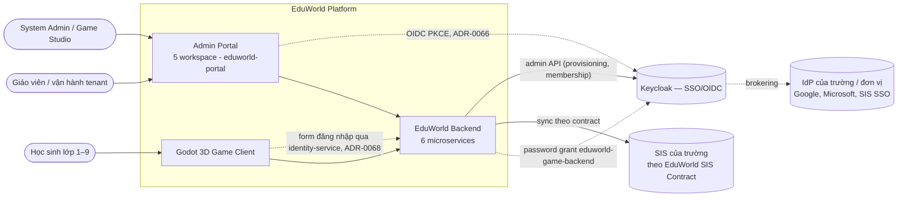
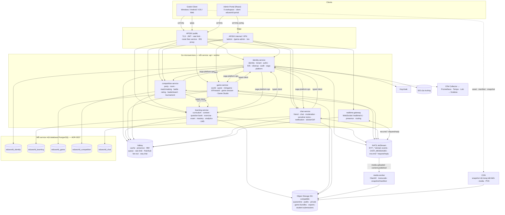
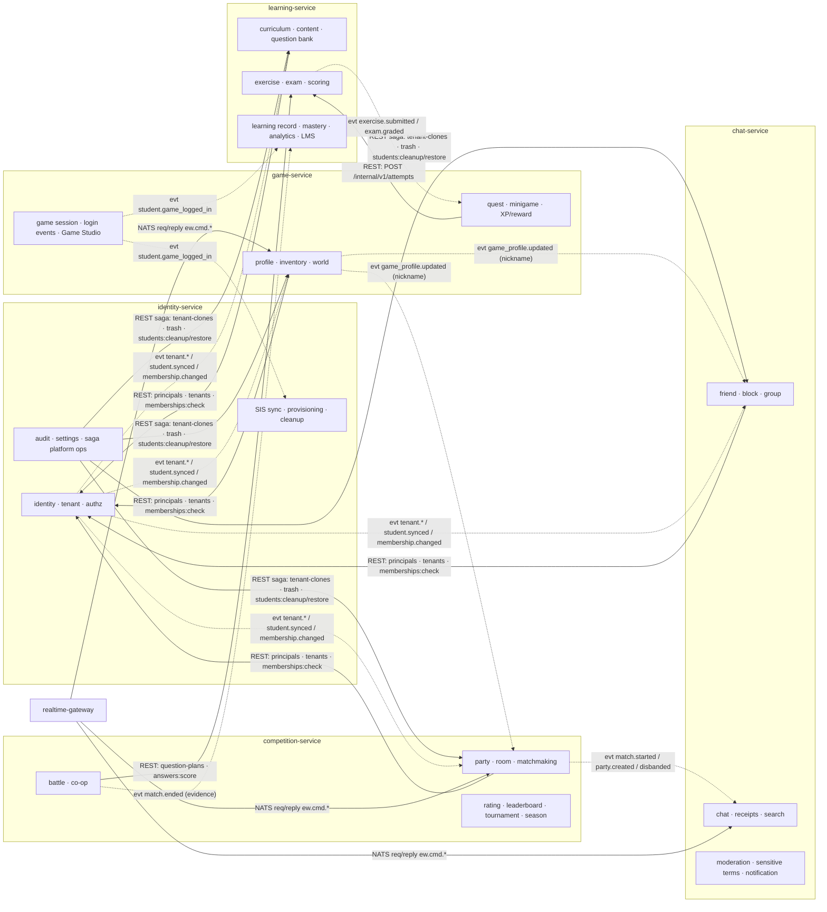
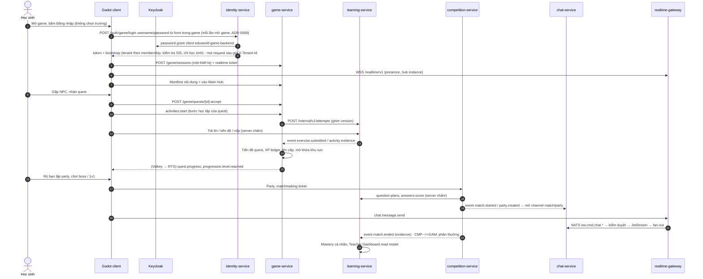
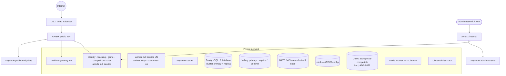

# System Architecture

> Trạng thái: Draft · Phiên bản: 0.4 · Owner: Solution Architect · Cập nhật: 2026-11-15
> Liên quan: [ADR](../adr/README.md) (ADR-0036…0042) · [DOMAIN_MODEL](DOMAIN_MODEL.md) · [MULTITENANCY](MULTITENANCY.md) · [REALTIME_ARCHITECTURE](REALTIME_ARCHITECTURE.md) · [SECURITY_ARCHITECTURE](../10-security/SECURITY_ARCHITECTURE.md) · [BACKEND_DESIGN](../07-backend/BACKEND_DESIGN.md) · [DATABASE_DESIGN](../07-backend/DATABASE_DESIGN.md) · [EVENT_DESIGN](../07-backend/EVENT_DESIGN.md)

> **Thay đổi v0.3:** chuyển từ Go modular monolith (ADR-0001, đã Superseded) sang **6 microservice Go** (ADR-0036), **database riêng mỗi service** (ADR-0037), **CQRS + Clean Architecture** (ADR-0038), **ent + Atlas** (ADR-0039), **typed REST client** service-to-service (ADR-0040), **maxLength bắt buộc** (ADR-0041), **outbox → NATS JetStream** (ADR-0042). v0.4: tài liệu này là **điểm vào duy nhất** của kiến trúc; sơ đồ container và luồng chơi end-to-end chỉ vẽ ở đây, tài liệu khác link về.

## 0. Mục đích, phạm vi và bản đồ tài liệu kỹ thuật

**Mục đích.** Mô tả EduWorld ở mức hệ thống: ai dùng, gồm những container/service nào, chúng nối với nhau ra sao, và **một lượt chơi đi qua các service như thế nào**. **Phạm vi:** C4 context + container, phụ thuộc giữa service, luồng chơi end-to-end, NFR nền, cấu trúc repo. **Ngoài phạm vi** (có tài liệu riêng): giao thức WebSocket, cột DB, endpoint chi tiết, event catalog, key Valkey, luồng đăng nhập chi tiết.

| Service | Domain sở hữu | Tài liệu nghiệp vụ | Tài liệu kỹ thuật | Spec |
|---|---|---|---|---|
| `identity-service` | Identity, tenant, permission, SIS, provisioning, cleanup, audit, saga platform | [MULTITENANCY](MULTITENANCY.md) | [KEYCLOAK_SSO](../09-identity/KEYCLOAK_SSO.md) · [IDENTITY_MAPPING](../09-identity/IDENTITY_MAPPING.md) · [ACCOUNT_PROVISIONING](../09-identity/ACCOUNT_PROVISIONING.md) · [SIS_INTEGRATION](../09-identity/SIS_INTEGRATION.md) | `specs/openapi/services/identity*.yaml`, `specs/sis/` |
| `learning-service` | Curriculum, nội dung, question bank, activity/attempt, chấm điểm, exam, mastery, analytics, LMS | [ACTIVITY_ENGINE](../02-learning/ACTIVITY_ENGINE.md) và các tài liệu `02-learning/` · [SCHOOL_LMS](../04-admin-portal/SCHOOL_LMS.md) | [DATABASE_DESIGN](../07-backend/DATABASE_DESIGN.md) | `specs/openapi/services/learning*.yaml`, `specs/schemas/` |
| `game-service` | World, nhân vật, quest, challenge/boss, progression, kinh tế, game session, Game Studio | [GAME_DESIGN](../01-game-design/GAME_DESIGN.md) và các tài liệu `01-game-design/` | [GODOT_ARCHITECTURE](../08-game-client/GODOT_ARCHITECTURE.md) (client) | `specs/openapi/services/game*.yaml` |
| `competition-service` | Party, room, matchmaking, trận đấu, rating, leaderboard, tournament | [COMPETITION_SYSTEM](../01-game-design/COMPETITION_SYSTEM.md) · [PARTY_SYSTEM](../03-social-multiplayer/PARTY_SYSTEM.md) · [MATCHMAKING](../03-social-multiplayer/MATCHMAKING.md) · [MULTIPLAYER_GAMEPLAY](../03-social-multiplayer/MULTIPLAYER_GAMEPLAY.md) | [REALTIME_ARCHITECTURE](REALTIME_ARCHITECTURE.md) | `specs/openapi/services/competition*.yaml`, `specs/asyncapi/` |
| `chat-service` | Bạn bè, nhóm bền vững, chat, kiểm duyệt, thông báo | [SOCIAL_SYSTEM](../03-social-multiplayer/SOCIAL_SYSTEM.md) · [CHAT_SYSTEM](../03-social-multiplayer/CHAT_SYSTEM.md) · [MODERATION](../03-social-multiplayer/MODERATION.md) | [EVENT_DESIGN §4.10](../07-backend/EVENT_DESIGN.md) | `specs/openapi/services/chat*.yaml` |
| `realtime-gateway` | Kết nối WebSocket, presence, định tuyến | — | [REALTIME_ARCHITECTURE](REALTIME_ARCHITECTURE.md) · [GAME_NETWORKING](../08-game-client/GAME_NETWORKING.md) | `specs/asyncapi/` |

Tài liệu kỹ thuật dùng chung: [BACKEND_DESIGN](../07-backend/BACKEND_DESIGN.md) (cấu trúc service, CQRS, ent) · [API_DESIGN](../07-backend/API_DESIGN.md) (quy ước + catalog endpoint + internal API) · [DATABASE_DESIGN](../07-backend/DATABASE_DESIGN.md) · [EVENT_DESIGN](../07-backend/EVENT_DESIGN.md) · [VALKEY_DESIGN](../07-backend/VALKEY_DESIGN.md) · [DOMAIN_MODEL](DOMAIN_MODEL.md) · [SECURITY_ARCHITECTURE](../10-security/SECURITY_ARCHITECTURE.md) · [DEPLOYMENT](../11-operations/DEPLOYMENT.md).

## 1. Mục tiêu kiến trúc

| # | Mục tiêu | Cách đạt được |
|---|---|---|
| 1 | Education first: Learning Engine độc lập với gameplay | `learning-service` sở hữu nội dung, answer key, chấm điểm, mastery; game/competition gọi qua internal API (ADR-0040), không đọc DB của learning |
| 2 | Server-authoritative cho mọi kết quả có giá trị | ADR-0016; Godot chỉ hiển thị và gửi input; điểm do learning-service, kết quả trận do competition-service |
| 3 | Data-driven content | Quest, mini-game, NPC dialogue, reward là dữ liệu phiên bản hóa (ADR-0015), Game Studio ở game-service |
| 4 | An toàn trẻ em mặc định | Kiểm duyệt chat (ADR-0020/0030), PII minimization, tenant isolation (ADR-0005) ở **mọi** database |
| 5 | Scale và phát hành độc lập theo hệ thống lớn | 6 service (ADR-0036), mỗi service một DB (ADR-0037), giao tiếp qua typed client + NATS |
| 6 | Dễ bảo trì, kiểm thử | CQRS + Clean Architecture đồng nhất ở mọi service (ADR-0038), platform kit dùng chung `pkg/` |
| 7 | Tích hợp trường học | Keycloak SSO (ADR-0006/0026), SIS contract do EduWorld sở hữu (ADR-0021) trong identity-service |

## 2. Context diagram (C4 — Level 1)



## 3. Container diagram (C4 — Level 2)



Release 1.0 hỗ trợ 4 nền tảng client: Windows, Android, iOS, Web (ADR-0013 [Proposed], OQ-04).

### 3.1. Trách nhiệm từng container

| Container | Trách nhiệm | Không làm |
|---|---|---|
| Godot Client | Render 3D, input, UI, nội suy, gọi REST/WS, cache nội dung | Chấm điểm, quyết định reward/kết quả, gọi SIS/NATS/Valkey, giữ answer key |
| Admin Portal (`web/apps/portal`) | Một ứng dụng, 5 workspace theo permission (ADR-0027 mục 7): School & LMS và Learning Content Studio cho tenant; Game Operations, Live Operations, Platform Administration cho platform (qua gateway nội bộ + MFA). Giao diện Admin/Ops (Ant Design 5 + Pro; ADR-0047). Chi tiết: [ADMIN_PORTAL](../04-admin-portal/ADMIN_PORTAL.md) | Quyết định phân quyền (chỉ ẩn/hiện) |
| APISIX public / internal | TLS, route theo prefix → service, JWT validation, rate limit, size limit, CORS, WS proxy | Authorization nghiệp vụ, tenant check |
| **identity-service** | Tenant, User, School/Class/Enrollment (nguồn sự thật), ExternalIdentity, permission catalog, Role/UserRole (ADR-0066), Keycloak membership, SIS sync (contract_v1/csv), JIT, student cleanup (ADR-0032), platform settings, audit store, Thùng rác/gán/clone (điều phối saga), đăng nhập game qua backend (`/auth/game/*`, ADR-0068), login session bootstrap portal (`/auth/session`, `/me/tenants`) | Nội dung học tập, game state |
| **learning-service** | Curriculum, content, question bank (answer key), exercise/exam attempt, chấm điểm, learning events, mastery, analytics, LMS (assignment, challenge từ template), Teacher Dashboard read model | Game state, chat |
| **game-service** | Game profile/nickname, avatar/inventory, world/area, quest, mini-game, XP/level/reward (ledger), game session + single device (ADR-0031), login events, realtime ticket, Game Studio config (quest, mini-game, NPC, item, reward, level). Sticker pack/GIF do chat-service sở hữu, UI Game Studio gọi `/api/v1/game-admin/sticker-packs|gifs` được APISIX định tuyến tới chat-service | Chấm điểm (gọi learning) |
| **competition-service** | Party, room, hub instance assignment, matchmaking (worker), battle/co-op state machine, rating Glicko-2, leaderboard, tournament, season, cấu hình thi đấu | Chấm điểm (gọi learning) |
| **chat-service** | Friend/block/team/study group, 8 loại channel, gửi/nhận (ADR-0034/0035), kiểm duyệt + sensitive terms + công tắc (ADR-0030), moderation case, notification, purge gameplay chat (ADR-0033), sticker pack/GIF library | Quyết định membership trận/party (nhận từ event) |
| **realtime-gateway** | Giữ WS, xác thực ticket (Valkey), presence, heartbeat, định tuyến lệnh WS → service qua NATS request/reply `ew.cmd.*`, giao sự kiện từ Valkey Pub/Sub `ew:rt:*`/`ew:chat:fanout:*` xuống client, backpressure | Logic nghiệp vụ, DB nghiệp vụ |
| Keycloak | Xác thực, SSO, brokering, Organization theo tenant, client credentials cho service | Phạm vi trường/lớp, permission chi tiết |
| PostgreSQL ×5 DB | Nguồn sự thật của từng service | Truy cập chéo DB |
| NATS JetStream | Domain events (outbox, ADR-0042), chat durable stream (ADR-0035), request/reply lệnh realtime | Lưu lâu dài; không mở cho client |
| Valkey | Cache, presence, queue matchmaking, rate limit, ticket, seq chat, Pub/Sub fan-out (ADR-0004), snapshot nội dung bất biến + con trỏ release (ADR-0043) | Nguồn sự thật; domain event (không còn Streams) |
| Object storage + CDN | File media (ADR-0044), snapshot/gói nội dung game và content manifest bất biến (ADR-0043), build Godot/PCK | Câu hỏi đề kiểm tra, answer key (chỉ qua API) |
| Media worker | Quét ClamAV, kiểm magic bytes, xóa EXIF, chuyển đổi ảnh/âm thanh/video/3D, dựng snapshot và manifest khi publish; chạy như worker của service sở hữu nội dung (learning, game, chat), dùng chung thư viện `pkg/media` [Proposed] | Quyết định publish (chỉ thực thi sau event) |

## 4. Service và phụ thuộc



### 4.1. Gọi đồng bộ và bất đồng bộ

Bản đồ gọi đồng bộ chuẩn (endpoint, mục đích, idempotency, resilience) nằm **duy nhất** ở [API_DESIGN §12](../07-backend/API_DESIGN.md#12-internal-api-giữa-service-adr-0036-adr-0040); bản đồ consumer event ở [EVENT_DESIGN §3.2](../07-backend/EVENT_DESIGN.md#32-bản-đồ-consumer-giữa-service). Quy tắc kiến trúc:

1. Không gọi đồng bộ theo vòng (A → B → A). Phụ thuộc đồng bộ chỉ đi theo chiều: game/competition → learning → identity; identity → service khác chỉ trong saga platform (trạng thái saga ở `platform.saga_runs`/`saga_steps` của `eduworld_identity`).
2. Gọi đồng bộ chỉ khi người dùng cần kết quả ngay. Phản ứng phụ (XP, tiến độ quest, mở channel, read model) luôn qua event.
3. Dữ liệu tham chiếu đọc thường xuyên (tenant, học sinh, nickname) là **projection `ref_*`** trong DB bên dùng ([DOMAIN_MODEL §1.2](DOMAIN_MODEL.md)).
4. identity-service lỗi → bên gọi trả `503`, **không fail-open** về quyền.

## 5. Luồng chơi end-to-end — xương sống "game-first"

Một ngày chơi điển hình của học sinh đi qua mọi service. Sơ đồ chỉ thể hiện **service nào làm gì**; chi tiết từng bước nằm ở tài liệu sở hữu (bảng dưới).



| Bước | Ý nghĩa với người chơi | Service sở hữu | Tài liệu chi tiết |
|---|---|---|---|
| 1–3 | Đăng nhập username/password mỗi lần mở game (ADR-0063, ADR-0064), không chọn trường — backend xác định tenant (1 tenant: vào thẳng; nhiều tenant: chọn sau đăng nhập; không thuộc tenant chung lẫn tenant SIS: `ACCOUNT_NOT_PROVISIONED`, thu hồi phiên Keycloak), chỉ học sinh | identity | [KEYCLOAK_SSO](../09-identity/KEYCLOAK_SSO.md) (luồng) · [IDENTITY_MAPPING](../09-identity/IDENTITY_MAPPING.md) (tenant/SIS) |
| 4–5 | Vào game trên một thiết bị, kết nối realtime | game, realtime-gateway | [REALTIME_ARCHITECTURE §3](REALTIME_ARCHITECTURE.md) · [GAME_NETWORKING](../08-game-client/GAME_NETWORKING.md) |
| 6 | Thế giới 3D, manifest nội dung đã ghim version | game | [WORLD_DESIGN](../01-game-design/WORLD_DESIGN.md) · [CONTENT_MODEL](../02-learning/CONTENT_MODEL.md) |
| 7–11 | Quest → hoạt động học tập → chấm điểm phía server | game, learning | [QUEST_SYSTEM](../01-game-design/QUEST_SYSTEM.md) · [ACTIVITY_ENGINE](../02-learning/ACTIVITY_ENGINE.md) |
| 12–13 | XP, lên cấp, mở khóa khu vực, phần thưởng | game | [PROGRESSION_SYSTEM](../01-game-design/PROGRESSION_SYSTEM.md) · [INVENTORY_ECONOMY](../01-game-design/INVENTORY_ECONOMY.md) |
| 14–16 | Party, boss, thi đấu, chấm câu trả lời | competition, game, learning | [PARTY_SYSTEM](../03-social-multiplayer/PARTY_SYSTEM.md) · [CHALLENGE_BOSS_SYSTEM](../01-game-design/CHALLENGE_BOSS_SYSTEM.md) · [COMPETITION_SYSTEM](../01-game-design/COMPETITION_SYSTEM.md) |
| 17–19 | Chat luôn có trong party/trận, kiểm duyệt | chat, realtime-gateway | [CHAT_SYSTEM](../03-social-multiplayer/CHAT_SYSTEM.md) · [MODERATION](../03-social-multiplayer/MODERATION.md) |
| 20–21 | Kết quả học tập riêng từng học sinh, giáo viên theo dõi | learning | [LEARNING_ANALYTICS](../02-learning/LEARNING_ANALYTICS.md) · [TEACHER_DASHBOARD](../04-admin-portal/SCHOOL_LMS.md) |

Nguyên tắc xuyên suốt luồng: client chỉ hiển thị và gửi input (ADR-0016); mọi điểm, XP, phần thưởng, kết quả trận do server quyết định và idempotent; mỗi học sinh luôn có learning record riêng kể cả khi chơi theo nhóm; dữ liệu học tập và dữ liệu game tách biệt (ADR-0018).

## 6. Kiến trúc triển khai (logical)



Môi trường pilot: 5 database có thể nằm chung một cluster PostgreSQL (khác database, khác user). Tách cluster khi tải hoặc yêu cầu cô lập đòi hỏi [Proposed]. Chi tiết: [DEPLOYMENT](../11-operations/DEPLOYMENT.md).

## 7. Non-functional baseline

| Mã | Yêu cầu | Giá trị | Nhãn |
|---|---|---|---|
| NFR-PERF-001 | REST p95 latency (đọc) | < 200 ms tại gateway | [Proposed] |
| NFR-PERF-002 | REST p95 latency (ghi: submit bài) | < 400 ms | [Proposed] |
| NFR-PERF-003 | WS message delivery p95 (chat, lobby) | < 250 ms | [Proposed] |
| NFR-PERF-004 | Client FPS theo hạng thiết bị ([PERFORMANCE_BUDGET §3](../08-game-client/PERFORMANCE_BUDGET.md#3-mục-tiêu-khung-hình), ADR-0057) | Máy tầm trung, preset Trung bình: Hub ổn định 30 FPS trên mobile/web (FPS p10 ≥ 27); số theo từng nền tảng/hạng ở PERFORMANCE_BUDGET | Yêu cầu Accepted, thông số [Proposed] (ADR-0057) |
| NFR-PERF-011 | Gọi internal service-to-service p95 | < 50 ms (không tính xử lý nghiệp vụ nặng) | [Proposed] |
| NFR-PERF-012 | Độ trễ event (outbox → consumer) p95 | < 1 s | [Proposed] |
| NFR-SCAL-001 | Pilot | 5 trường · 5.000 học sinh · 1.000 CCU | [Proposed] (số trường/học sinh chờ OQ-03) |
| NFR-SCAL-002 | **Mục tiêu năng lực Release 1.0** | **10.000 người chơi đồng thời (CCU)** trên game | **[Confirmed]** ADR-0045 |
| NFR-SCAL-005 | Bão đăng nhập | 5.000 lượt đăng nhập trong 10 phút; đỉnh 100 đăng nhập mật khẩu/giây (mọi lượt mở game đều nhập mật khẩu); 500 refresh token/giây | [Proposed] ADR-0045, ADR-0064 |
| NFR-PERF-013 | Đăng nhập mật khẩu → vào hub | p95 ≤ 3 s (Keycloak xác thực p95 ≤ 800 ms) | [Proposed] ADR-0045 |
| NFR-PERF-014 | Refresh token; `auth/session` + `game/sessions` | p95 ≤ 200 ms; p95 ≤ 300 ms | [Proposed] ADR-0045 |
| NFR-PERF-015 | Publish → học sinh nhận bản mới ở lượt chơi kế tiếp | ≤ 30 s | [Proposed] ADR-0043 |
| NFR-PERF-016 | Tải nội dung một màn (snapshot + media đã cache CDN) | p95 ≤ 2 s trên Wi-Fi trường học/4G | [Proposed] |
| NFR-AVAIL-001 | Availability trong giờ học (6:30–22:00 ICT) | 99.5%/tháng | [TBD] OQ-11 |
| NFR-AVAIL-002 | RPO / RTO dữ liệu học tập | RPO ≤ 5 phút · RTO ≤ 4 giờ (theo từng database) | [Proposed] |
| NFR-SEC-001 | Mọi endpoint ngoài health có authN + authZ (kể cả internal: token service, allowlist `azp`) | 100% | [Confirmed] |
| NFR-PRIV-001 | Dữ liệu cá nhân học sinh lưu trữ tại Việt Nam | — | [TBD] OQ-12 |
| NFR-OBS-001 | Trace xuyên APISIX → service → service → DB/NATS | 100% request | [Proposed] |

Các NFR còn lại (scale độc lập, cô lập lỗi, bảo trì, maxLength NFR-MAINT-005…) do [PRODUCT_REQUIREMENTS](../00-overview/PRODUCT_REQUIREMENTS.md) sở hữu. Không tuyên bố năng lực tải khi chưa có benchmark ([TEST_STRATEGY](../12-project/TEST_STRATEGY.md)).

## 8. Cấu trúc repository

Monorepo (ADR-0002), Go workspace (`go.work`) gom các module service và platform kit.

```text
eduworld/
├── go.work                       # use ./pkg ./services/*
├── pkg/                          # platform kit dùng chung (module Go riêng, version theo tag)
│   ├── mediator/                 # CommandHandler/QueryHandler generic + pipeline behaviors
│   ├── authz/                    # Principal, permission catalog, Require
│   ├── tenancy/                  # TenantScope, Bypass (lý do + audit), RLS session setter
│   ├── entx/                     # mixin chung + interceptor tenant/soft-delete + hook soft-delete
│   ├── outbox/                   # outbox writer + relay → NATS JetStream
│   ├── natsx/                    # JetStream publisher/consumer, request/reply helpers
│   ├── httpx/                    # server, middleware, Problem Details, idempotency
│   ├── svcclient/                # typed client wrapper: service token, failsafe-go, context headers
│   ├── observability/            # slog, OTel, metrics
│   └── config/
├── services/
│   ├── identity/                 # identity-service
│   ├── learning/                 # learning-service
│   ├── game/                     # game-service
│   ├── competition/              # competition-service
│   ├── chat/                     # chat-service
│   └── realtime-gateway/
│       # mỗi service:
│       # cmd/{api,worker,migrate}/
│       # internal/{domain,application/{command,query},infrastructure,presentation}/
│       # ent/schema/  migrations/ (Atlas)  api/ (oapi-codegen gen)  tests/
├── godot/                        # Godot 4.x project (ADR-0014); resources/ui/theme + resources/art/generated sinh từ design/game-tokens
├── design/                       # design tokens & tài sản (ADR-0047)
│   ├── game-tokens/              # game design system (UI Godot + token 3D)
│   ├── admin-tokens/             # Admin/Ops design system (theme Ant Design)
│   ├── shared-tokens/            # logo/brand + mã màu nghiệp vụ dùng chung
│   ├── icons/  fonts/
│   └── style-dictionary.config.mjs
├── web/                          # React SPA (ADR-0022, ADR-0027, ADR-0047)
│   ├── apps/portal/              # Admin Portal duy nhất: 5 workspace, chunk lazy-load theo workspace (ADR-0027 mục 7)
│   └── packages/ops-ui/          # theme Ant Design sinh từ admin-tokens + component đặc thù + Storybook
├── specs/                        # OpenAPI public + services/*.internal, AsyncAPI, JSON Schema, events
├── deploy/                       # compose, apisix, keycloak realm, nats, observability
├── scripts/
├── docs/
└── README.md · AGENTS.md · CONTRIBUTING.md · CHANGELOG.md · VIBE_CODING_PROMPT.md
```

Chi tiết cấu trúc một service: [BACKEND_DESIGN](../07-backend/BACKEND_DESIGN.md).
