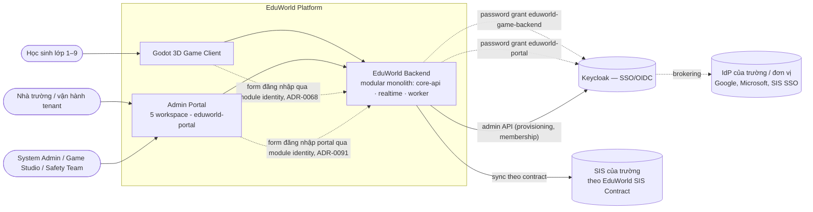
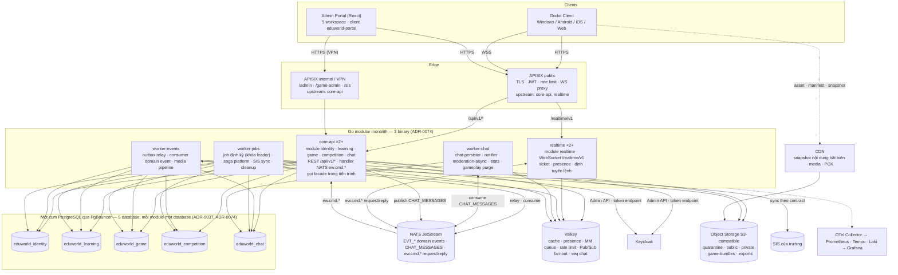
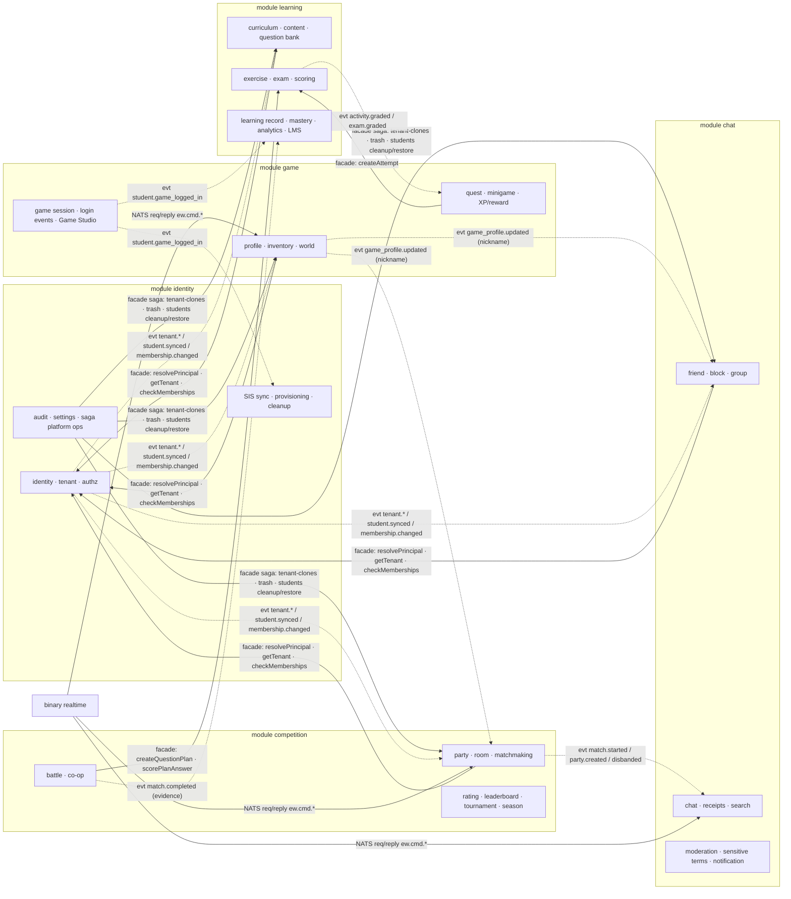
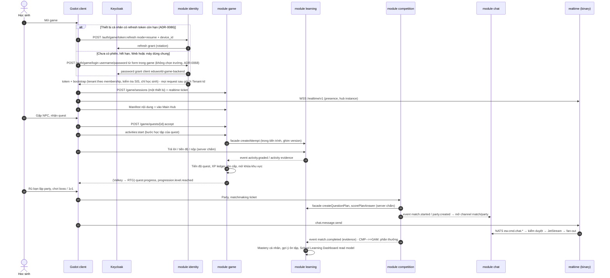
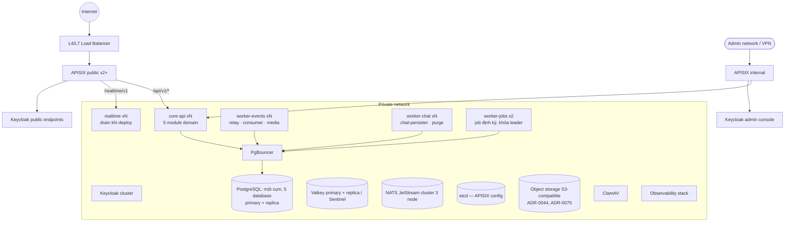

# System Architecture

> Trạng thái: Draft · Phiên bản: 0.5 · Owner: Solution Architect · Cập nhật: 2026-11-17 (ADR-0074: modular monolith, 3 binary + profile worker, một cụm PostgreSQL 5 database, facade trong tiến trình) · 2026-11-16 (ADR-0086: giữ phiên game bằng refresh token)
> Liên quan: [ADR](../adr/README.md) (ADR-0074, ADR-0037…0042) · [DOMAIN_MODEL](DOMAIN_MODEL.md) · [MULTITENANCY](MULTITENANCY.md) · [REALTIME_ARCHITECTURE](REALTIME_ARCHITECTURE.md) · [SECURITY_ARCHITECTURE](../10-security/SECURITY_ARCHITECTURE.md) · [BACKEND_DESIGN](../07-backend/BACKEND_DESIGN.md) · [DATABASE_DESIGN](../07-backend/DATABASE_DESIGN.md) · [EVENT_DESIGN](../07-backend/EVENT_DESIGN.md)

> **Thay đổi v0.3:** 6 microservice Go (ADR-0036), database riêng mỗi service (ADR-0037), CQRS + Clean Architecture (ADR-0038), ent + Atlas (ADR-0039), typed REST client (ADR-0040), maxLength bắt buộc (ADR-0041), outbox → NATS JetStream (ADR-0042). v0.4: tài liệu này là **điểm vào duy nhất** của kiến trúc; sơ đồ container và luồng chơi end-to-end chỉ vẽ ở đây, tài liệu khác link về.
>
> **Thay đổi v0.5 ([ADR-0074](../adr/ADR-0074-modular-monolith-co-ranh-gioi-cuong-che.md), thay ADR-0036):** backend là **modular monolith có ranh giới cưỡng chế**: một Go module, năm module domain + module `realtime`, **ba binary** `core-api`, `realtime`, `worker` (profile `worker-events`, `worker-chat`, `worker-jobs`); năm database của module trên **một cụm PostgreSQL**; gọi giữa module qua **facade sinh từ spec internal, trong tiến trình** (không HTTP nội bộ, không token `svc-*`); domain event vẫn qua outbox → NATS. Phần ADR-0040 về typed client HTTP chỉ còn giữ vai trò spec internal làm hợp đồng.

## 0. Mục đích, phạm vi và bản đồ tài liệu kỹ thuật

**Mục đích.** Mô tả EduWorld ở mức hệ thống: ai dùng, gồm những container (binary) và module nào, chúng nối với nhau ra sao, và **một lượt chơi đi qua các module như thế nào**. **Phạm vi:** C4 context + container, phụ thuộc giữa module, luồng chơi end-to-end, NFR nền, cấu trúc repo. **Ngoài phạm vi** (có tài liệu riêng): giao thức WebSocket, cột DB, endpoint chi tiết, event catalog, key Valkey, luồng đăng nhập chi tiết.

| Module | Domain sở hữu | Tài liệu nghiệp vụ | Tài liệu kỹ thuật | Spec |
|---|---|---|---|---|
| module `identity` | Identity, tenant, permission, SIS, provisioning, cleanup, audit, saga platform | [MULTITENANCY](MULTITENANCY.md) | [KEYCLOAK_SSO](../09-identity/KEYCLOAK_SSO.md) · [IDENTITY_MAPPING](../09-identity/IDENTITY_MAPPING.md) · [ACCOUNT_PROVISIONING](../09-identity/ACCOUNT_PROVISIONING.md) · [SIS_INTEGRATION](../09-identity/SIS_INTEGRATION.md) | `specs/openapi/modules/identity*.yaml`, `specs/sis/` |
| module `learning` | Curriculum, nội dung, question bank, activity/attempt, chấm điểm, exam, mastery, analytics, LMS | [ACTIVITY_ENGINE](../02-learning/ACTIVITY_ENGINE.md) và các tài liệu `02-learning/` · [SCHOOL_LMS](../04-admin-portal/SCHOOL_LMS.md) | [DATABASE_DESIGN](../07-backend/DATABASE_DESIGN.md) | `specs/openapi/modules/learning*.yaml`, `specs/schemas/` |
| module `game` | World, nhân vật, quest, challenge/boss, progression, kinh tế, game session, Game Studio | [GAME_DESIGN](../01-game-design/GAME_DESIGN.md) và các tài liệu `01-game-design/` | [GODOT_ARCHITECTURE](../08-game-client/GODOT_ARCHITECTURE.md) (client) | `specs/openapi/modules/game*.yaml` |
| module `competition` | Party, room, matchmaking, trận đấu, rating, leaderboard, tournament | [COMPETITION_SYSTEM](../01-game-design/COMPETITION_SYSTEM.md) · [PARTY_SYSTEM](../03-social-multiplayer/PARTY_SYSTEM.md) · [MATCHMAKING](../03-social-multiplayer/MATCHMAKING.md) · [MULTIPLAYER_GAMEPLAY](../03-social-multiplayer/MULTIPLAYER_GAMEPLAY.md) | [REALTIME_ARCHITECTURE](REALTIME_ARCHITECTURE.md) | `specs/openapi/modules/competition*.yaml`, `specs/asyncapi/` |
| module `chat` | Bạn bè, nhóm bền vững, chat, kiểm duyệt, thông báo | [SOCIAL_SYSTEM](../03-social-multiplayer/SOCIAL_SYSTEM.md) · [CHAT_SYSTEM](../03-social-multiplayer/CHAT_SYSTEM.md) · [MODERATION](../03-social-multiplayer/MODERATION.md) | [EVENT_DESIGN §4.10](../07-backend/EVENT_DESIGN.md) | `specs/openapi/modules/chat*.yaml` |
| module `realtime` (binary riêng, không database) | Kết nối WebSocket, presence, định tuyến | — | [REALTIME_ARCHITECTURE](REALTIME_ARCHITECTURE.md) · [GAME_NETWORKING](../08-game-client/GAME_NETWORKING.md) | `specs/asyncapi/` |

Tài liệu kỹ thuật dùng chung: [BACKEND_DESIGN](../07-backend/BACKEND_DESIGN.md) (cấu trúc module, composition root, CQRS, ent) · [API_DESIGN](../07-backend/API_DESIGN.md) (quy ước + catalog endpoint + facade giữa module) · [DATABASE_DESIGN](../07-backend/DATABASE_DESIGN.md) · [EVENT_DESIGN](../07-backend/EVENT_DESIGN.md) · [VALKEY_DESIGN](../07-backend/VALKEY_DESIGN.md) · [DOMAIN_MODEL](DOMAIN_MODEL.md) · [SECURITY_ARCHITECTURE](../10-security/SECURITY_ARCHITECTURE.md) · [DEPLOYMENT](../11-operations/DEPLOYMENT.md).

## 1. Mục tiêu kiến trúc

| # | Mục tiêu | Cách đạt được |
|---|---|---|
| 1 | Education first: Learning Engine độc lập với gameplay | Module `learning` sở hữu nội dung, answer key, chấm điểm, mastery; game/competition gọi qua facade (ADR-0074), không đọc DB của learning |
| 2 | Server-authoritative cho mọi kết quả có giá trị | ADR-0016; Godot chỉ hiển thị và gửi input; điểm do module `learning`, kết quả trận do module `competition` |
| 3 | Data-driven content | Quest, mini-game, NPC dialogue, reward là dữ liệu phiên bản hóa (ADR-0015), Game Studio ở module `game` |
| 4 | An toàn trẻ em mặc định | Kiểm duyệt chat (ADR-0020/0030), PII minimization, tenant isolation (ADR-0005) ở **mọi** database |
| 5 | Ranh giới hệ thống lớn rõ, vận hành vừa sức đội nhỏ | Modular monolith (ADR-0074): mỗi module một database (ADR-0037), ranh giới mã cưỡng chế bằng compiler + linter, facade trong tiến trình + NATS; hồ sơ chạy khác nhau (`core-api`, `realtime`, profile worker) scale riêng; tách module thành service khi có số đo (ADR-0074 mục 7) |
| 6 | Dễ bảo trì, kiểm thử | CQRS tách write/read context, không mediator (ADR-0038, ADR-0087) + Clean Architecture đồng nhất ở mọi module, platform kit dùng chung `src/backend/pkg/` |
| 7 | Tích hợp trường học | Keycloak SSO (ADR-0006/0026), SIS contract do EduWorld sở hữu (ADR-0021) trong module `identity` |

## 2. Context diagram (C4 — Level 1)



## 3. Container diagram (C4 — Level 2)

Backend là **modular monolith có ranh giới cưỡng chế** (ADR-0074): một Go module, sáu module mã nguồn (`identity`, `learning`, `game`, `competition`, `chat`, `realtime`), đóng gói thành **ba binary** chạy như năm Swarm service (`core-api`, `realtime`, `worker-events`, `worker-chat`, `worker-jobs`). Năm module domain giữ năm database riêng trên **một cụm PostgreSQL**.



Mỗi binary chỉ mở kết nối tới database của module nó nạp, bằng role của module đó (`<module>_app`, `_platform`, `_relay`…); không module nào đọc database của module khác (quyền `CONNECT` theo module). Gọi giữa module là gọi facade **trong cùng tiến trình** (không có mũi tên mạng giữa module); phản ứng phụ đi qua outbox → NATS. Binary `realtime` không có database và chỉ chạm logic nghiệp vụ qua NATS request/reply tới `core-api`.

Release 1.0 hỗ trợ 4 nền tảng client: Windows, Android, iOS, Web (ADR-0013 [Confirmed], OQ-04).

### 3.1. Trách nhiệm từng container

| Container | Trách nhiệm | Không làm |
|---|---|---|
| Godot Client | Render 3D, input, UI, nội suy, gọi REST/WS, cache nội dung | Chấm điểm, quyết định reward/kết quả, gọi SIS/NATS/Valkey, giữ answer key |
| Admin Portal (`src/cms/frontend/apps/portal`) | Một ứng dụng, 5 workspace theo permission (ADR-0027 mục 7): School & LMS và Learning Content Studio cho tenant; Game Operations, Live Operations, Platform Administration cho platform (qua gateway nội bộ; không MFA — ADR-0094). Giao diện Admin/Ops (Ant Design 5 + Pro; ADR-0047). Chi tiết: [ADMIN_PORTAL](../04-admin-portal/ADMIN_PORTAL.md) | Quyết định phân quyền (chỉ ẩn/hiện) |
| APISIX public / internal | TLS, JWT validation, rate limit, size limit, CORS, WS proxy; hai upstream: `core-api` (mọi REST) và `realtime` (`/realtime/v1`) ([API_DESIGN §10](../07-backend/API_DESIGN.md#10-apisix-route-mapping)) | Authorization nghiệp vụ, tenant check |
| **`core-api`** (binary `src/backend/cmd/core-api`) | Nạp năm module domain; phục vụ REST public `/api/v1/*`, route gateway nội bộ (`/game-admin/*`, `/admin/*`, `/sis/*`), webhook `/internal/sis/*`, `/internal/auth/*`; handler NATS request/reply `ew.cmd.<module>.>` cho lệnh từ realtime; ghi outbox trong transaction của từng module | Relay outbox, consumer event, job định kỳ |
| **`realtime`** (binary `src/backend/cmd/realtime`) | Giữ WS, xác thực ticket (Valkey), presence, heartbeat, định tuyến lệnh WS → module trong `core-api` qua NATS request/reply `ew.cmd.*`, giao sự kiện từ Valkey Pub/Sub `ew:rt:*`/`ew:chat:fanout:*` xuống client, backpressure (room host nằm ở `competition` trong `core-api`) | Logic nghiệp vụ, database, gọi facade module domain |
| **`worker-events`** (`src/backend/cmd/worker --profile=events`) | Outbox relay của mọi module (role `<module>_relay`), consumer domain event (projection `ref_*`, quest/XP, mastery, rollup dashboard, analytics, membership Keycloak, audit sink), media pipeline | Phục vụ HTTP public |
| **`worker-chat`** (`src/backend/cmd/worker --profile=chat`) | `chat-persister`, `chat-notifier`, `chat-moderation-async`, `chat-stats`, `gameplay-chat-purge`, `chat-partition-maintainer` (role `chat_purger`, ADR-0033) | Consumer của module khác |
| **`worker-jobs`** (`src/backend/cmd/worker --profile=jobs`) | Job định kỳ có khóa leader: game session timeout, dọn học sinh (saga), SIS sync, matchmaker loop, tournament, leaderboard snapshot, chốt ngày dashboard, `infra-partition-maintenance` | Phục vụ HTTP public |
| Keycloak | Xác thực, SSO, brokering, Organization theo tenant; client `svc-identity` chỉ để module identity gọi Admin API (ADR-0074 mục 5) | Phạm vi trường/lớp, permission chi tiết, xác thực giữa module |
| PostgreSQL (một cụm, 5 database) | Nguồn sự thật của từng module; backup một cụm (pgBackRest), khôi phục được theo từng database | Truy cập chéo database, transaction chéo module |
| NATS JetStream | Domain events (outbox, ADR-0042), chat durable stream (ADR-0035), request/reply lệnh realtime | Lưu lâu dài; không mở cho client |
| Valkey | Cache, presence, queue matchmaking, rate limit, ticket, seq chat, Pub/Sub fan-out (ADR-0004), snapshot nội dung bất biến + con trỏ release (ADR-0043) | Nguồn sự thật; domain event (không còn Streams) |
| Object storage + CDN | File media (ADR-0044), snapshot/gói nội dung game và content manifest bất biến (ADR-0043), build Godot/PCK | Câu hỏi đề kiểm tra, answer key (chỉ qua API) |
| Media pipeline | Quét ClamAV, kiểm magic bytes, xóa EXIF, chuyển đổi ảnh/âm thanh/video/3D, dựng snapshot và manifest khi publish; thư viện `src/backend/pkg/media` chạy trong `worker-events` thay module sở hữu nội dung (learning, game, chat) [Confirmed] | Quyết định publish (chỉ thực thi sau event) |

Trách nhiệm nghiệp vụ của từng module (`identity`, `learning`, `game`, `competition`, `chat`) ở bảng §0; ranh giới mã và composition root ở [BACKEND_DESIGN §3](../07-backend/BACKEND_DESIGN.md#3-cấu-trúc-repository-và-module-clean-architecture).

## 4. Module và phụ thuộc

Sơ đồ thể hiện phụ thuộc **logic** giữa module; mọi mũi tên "facade" là lời gọi trong tiến trình (`src/backend/pkg/modcall`), mũi tên "evt" đi qua outbox → NATS JetStream, mũi tên "NATS req/reply" là lệnh từ binary `realtime` tới `core-api`.



### 4.1. Gọi đồng bộ và bất đồng bộ

Bản đồ gọi facade chuẩn (operation, mục đích, idempotency, deadline) nằm **duy nhất** ở [API_DESIGN §12](../07-backend/API_DESIGN.md#12-facade-giữa-module-adr-0074-adr-0040); bản đồ consumer event ở [EVENT_DESIGN §3.2](../07-backend/EVENT_DESIGN.md#32-bản-đồ-consumer-giữa-module). Quy tắc kiến trúc:

1. Không gọi facade theo vòng (A → B → A). Phụ thuộc đồng bộ chỉ đi theo chiều: game/competition → learning → identity; identity → module khác chỉ trong saga platform (trạng thái saga ở `platform.saga_runs`/`saga_steps` của `eduworld_identity`).
2. Gọi facade chỉ khi người dùng cần kết quả ngay. Phản ứng phụ (XP, tiến độ quest, mở channel, read model) luôn qua event, kể cả khi hai module chạy chung tiến trình, vì mỗi module có database và transaction riêng.
3. Dữ liệu tham chiếu đọc thường xuyên (tenant, học sinh, nickname) là **projection `ref_*`** trong database của module dùng ([DOMAIN_MODEL §1.2](DOMAIN_MODEL.md)).
4. Module identity lỗi (database không sẵn sàng, vượt deadline) → bên gọi trả `503`, **không fail-open** về quyền.
5. Không join, không transaction chéo database; thao tác ghi vắt qua nhiều module dùng saga/outbox, các bước saga gọi facade trong tiến trình (ADR-0074 mục 4).
6. Ranh giới mã được cưỡng chế bằng compiler (`internal/`) và linter theo `x-allowed-callers` ([BACKEND_DESIGN §3.2](../07-backend/BACKEND_DESIGN.md#32-cưỡng-chế-ranh-giới-compiler-depguard-go-arch-lint)). Tách một module thành service cần ADR mới theo tiêu chí ADR-0074 mục 7 (chat là ứng viên đầu tiên).

## 5. Luồng chơi end-to-end — xương sống "game-first"

Một ngày chơi điển hình của học sinh đi qua mọi module. Sơ đồ chỉ thể hiện **module nào làm gì** (module domain chạy trong `core-api` hoặc `worker`; `realtime` là binary riêng); chi tiết từng bước nằm ở tài liệu sở hữu (bảng dưới).



| Bước | Ý nghĩa với người chơi | Module sở hữu | Tài liệu chi tiết |
|---|---|---|---|
| 1–3 | Đăng nhập username/password bằng form trong game (ADR-0063, ADR-0068); thiết bị cá nhân còn phiên thì vào lại bằng refresh token, không nhập mật khẩu (ADR-0086); không chọn trường — backend xác định tenant (1 tenant: vào thẳng; nhiều tenant: chọn sau đăng nhập; không thuộc tenant chung lẫn tenant SIS: `ACCOUNT_NOT_PROVISIONED`, thu hồi phiên Keycloak), chỉ học sinh | identity | [KEYCLOAK_SSO](../09-identity/KEYCLOAK_SSO.md) (luồng) · [IDENTITY_MAPPING](../09-identity/IDENTITY_MAPPING.md) (tenant/SIS) |
| 4–5 | Vào game trên một thiết bị, kết nối realtime | game, realtime | [REALTIME_ARCHITECTURE §3](REALTIME_ARCHITECTURE.md) · [GAME_NETWORKING](../08-game-client/GAME_NETWORKING.md) |
| 6 | Thế giới 3D, manifest nội dung đã ghim version | game | [WORLD_DESIGN](../01-game-design/WORLD_DESIGN.md) · [CONTENT_MODEL](../02-learning/CONTENT_MODEL.md) |
| 7–11 | Quest → hoạt động học tập → chấm điểm phía server | game, learning | [QUEST_SYSTEM](../01-game-design/QUEST_SYSTEM.md) · [ACTIVITY_ENGINE](../02-learning/ACTIVITY_ENGINE.md) |
| 12–13 | XP, lên cấp, mở khóa khu vực, phần thưởng | game | [PROGRESSION_SYSTEM](../01-game-design/PROGRESSION_SYSTEM.md) · [INVENTORY_ECONOMY](../01-game-design/INVENTORY_ECONOMY.md) |
| 14–16 | Party, boss, thi đấu, chấm câu trả lời | competition, game, learning | [PARTY_SYSTEM](../03-social-multiplayer/PARTY_SYSTEM.md) · [CHALLENGE_BOSS_SYSTEM](../01-game-design/CHALLENGE_BOSS_SYSTEM.md) · [COMPETITION_SYSTEM](../01-game-design/COMPETITION_SYSTEM.md) |
| 17–19 | Chat luôn có trong party/trận, kiểm duyệt | chat, realtime | [CHAT_SYSTEM](../03-social-multiplayer/CHAT_SYSTEM.md) · [MODERATION](../03-social-multiplayer/MODERATION.md) |
| 20–21 | Kết quả học tập riêng từng học sinh, gợi ý ôn tập tự động; nhà trường theo dõi | learning | [LEARNING_ANALYTICS](../02-learning/LEARNING_ANALYTICS.md) · [SCHOOL_LMS](../04-admin-portal/SCHOOL_LMS.md) (School Learning Dashboard) |

Nguyên tắc xuyên suốt luồng: client chỉ hiển thị và gửi input (ADR-0016); mọi điểm, XP, phần thưởng, kết quả trận do server quyết định và idempotent; mỗi học sinh luôn có learning record riêng kể cả khi chơi theo nhóm; dữ liệu học tập và dữ liệu game tách biệt (ADR-0018).

## 6. Kiến trúc triển khai (logical)



Mọi môi trường: 5 database của module chung **một cụm** PostgreSQL qua PgBouncer (khác database, khác role theo module; ADR-0074 mục 4); backup một cụm, khôi phục được theo từng database. `core-api` và `realtime` tối thiểu 2 replica; mỗi profile worker là một Swarm service riêng nên một profile hỏng hoặc quá tải không chặn profile khác, và chat tăng đột biến chỉ cần tăng replica `worker-chat`. Tách cụm database hoặc tách module thành service chỉ khi có số đo theo ADR-0074 mục 7. Chi tiết image, replica, sizing: [DEPLOYMENT](../11-operations/DEPLOYMENT.md).

## 7. Non-functional baseline

| Mã | Yêu cầu | Giá trị | Nhãn |
|---|---|---|---|
| NFR-PERF-001 | REST p95 latency (đọc) | < 200 ms tại gateway | [Confirmed] |
| NFR-PERF-002 | REST p95 latency (ghi: submit bài) | < 400 ms | [Confirmed] |
| NFR-PERF-003 | WS message delivery p95 (chat, lobby) | < 250 ms | [Confirmed] |
| NFR-PERF-004 | Client FPS theo hạng thiết bị ([PERFORMANCE_BUDGET §3](../08-game-client/PERFORMANCE_BUDGET.md#3-mục-tiêu-khung-hình), ADR-0057) | Máy tầm trung, preset Trung bình: Hub ổn định 30 FPS trên mobile/web (FPS p10 ≥ 27); số theo từng nền tảng/hạng ở PERFORMANCE_BUDGET | Yêu cầu Accepted, thông số [Confirmed] (ADR-0057) |
| NFR-PERF-011 | Lời gọi facade giữa module p95 (trong tiến trình, gồm truy vấn DB của module đích) | < 50 ms (không tính xử lý nghiệp vụ nặng) | [Confirmed] |
| NFR-PERF-012 | Độ trễ event (outbox → consumer) p95 | < 1 s | [Confirmed] |
| NFR-SCAL-001 | Pilot · năm 1 | Pilot: 5 trường · 5.000 học sinh · 1.000 CCU; năm 1: 50.000 học sinh · 5.000 CCU (trong năng lực NFR-SCAL-002) | [Confirmed — owner 2026-11-20, OQ-03] |
| NFR-SCAL-002 | **Mục tiêu năng lực Release 1.0** | **10.000 người chơi đồng thời (CCU)** trên game | **[Confirmed]** ADR-0045 |
| NFR-SCAL-005 | Bão đăng nhập | 5.000 lượt đăng nhập trong 10 phút; đỉnh 100 đăng nhập mật khẩu/giây (giả định thận trọng của ADR-0064 mục 6, giữ dù ADR-0086 cho vào lại bằng refresh token); 500 refresh token/giây (gồm `resume` khi mở game) | [Confirmed] ADR-0045, ADR-0064, ADR-0086 |
| NFR-PERF-013 | Đăng nhập mật khẩu → vào hub | p95 ≤ 3 s (Keycloak xác thực p95 ≤ 800 ms) | [Confirmed] ADR-0045 |
| NFR-PERF-014 | Refresh token; `auth/session` + `game/sessions` | p95 ≤ 200 ms; p95 ≤ 300 ms | [Confirmed] ADR-0045 |
| NFR-PERF-015 | Publish → học sinh nhận bản mới ở lượt chơi kế tiếp | ≤ 30 s | [Confirmed] ADR-0043 |
| NFR-PERF-016 | Tải nội dung một màn (snapshot + media đã cache CDN) | p95 ≤ 2 s trên Wi-Fi trường học/4G | [Confirmed] |
| NFR-AVAIL-001 | Availability trong giờ học (6:30–22:00 ICT); bảo trì theo `maintenance_window` | 99.5%/tháng | [Confirmed — owner 2026-11-20, OQ-11] |
| NFR-AVAIL-002 | RPO / RTO dữ liệu học tập | RPO ≤ 5 phút · RTO ≤ 4 giờ (theo từng database) | [Confirmed] |
| NFR-SEC-001 | Mọi endpoint ngoài health có authN + authZ; facade giữa module áp `TenantScope` + quyền của Principal gốc và chỉ module trong `x-allowed-callers` được gọi | 100% | [Confirmed] |
| NFR-PRIV-001 | Dữ liệu cá nhân học sinh lưu trữ tại Việt Nam | — | [Confirmed] (rà soát pháp lý ngoài version này, ADR-0082) |
| NFR-OBS-001 | Trace xuyên APISIX → binary → module (span facade) → DB/NATS → worker | 100% request | [Confirmed] |

Các NFR còn lại (scale theo hồ sơ chạy, cô lập lỗi, bảo trì, maxLength NFR-MAINT-005…) do [PRODUCT_REQUIREMENTS](../00-overview/PRODUCT_REQUIREMENTS.md) sở hữu. Không tuyên bố năng lực tải khi chưa có benchmark ([TEST_STRATEGY](../12-project/TEST_STRATEGY.md)).

## 8. Cấu trúc repository

Monorepo (ADR-0002); mã nguồn nằm trong `src/` ([ADR-0092](../adr/ADR-0092-to-chuc-ma-nguon-trong-src.md)): backend là **một Go module** ở `src/backend/` (`src/backend/go.mod` duy nhất, ADR-0074), Admin Portal ở `src/cms/frontend/`, Godot client ở `src/game/`. Contract, hạ tầng, tài liệu và design token ở gốc repository.

```text
eduworld-platform/
├── src/
│   ├── backend/                      # Go module duy nhất — module github.com/tanguyen2020/eduworld-platform/src/backend
│   │   ├── go.mod  go.sum
│   │   ├── cmd/                      # composition root
│   │   │   ├── core-api/             # 5 module domain: REST /api/v1/*, route gateway nội bộ, handler NATS ew.cmd.*
│   │   │   ├── realtime/             # module realtime: WebSocket /realtime/v1
│   │   │   ├── worker/               # --profile=events|chat|jobs
│   │   │   └── migrate/              # job Atlas migrate --module=<module>
│   │   ├── modules/
│   │   │   ├── identity/             # module identity · eduworld_identity
│   │   │   ├── learning/             # module learning · eduworld_learning
│   │   │   ├── game/                 # module game · eduworld_game
│   │   │   ├── competition/          # module competition · eduworld_competition
│   │   │   ├── chat/                 # module chat · eduworld_chat
│   │   │   └── realtime/             # không database
│   │   │       # mỗi module:
│   │   │       # module.go                 Register(...) cho composition root
│   │   │       # api/                      facade công khai, sinh từ specs/openapi/modules/<module>.internal.v1.yaml
│   │   │       # internal/{domain,application/{command,query,port/{write,read}},infrastructure/{persistence/{write,read},modules},presentation}/
│   │   │       # CQRS tách write/read context, không mediator (ADR-0087)
│   │   │       # ent/schema/  migrations/ (Atlas)  tests/
│   │   ├── pkg/                      # platform kit dùng chung (package trong cùng Go module, không import modules/*)
│   │   │   ├── authz/                # Principal, permission catalog, Require
│   │   │   ├── tenancy/              # TenantScope, Bypass (lý do + audit), RLS session setter
│   │   │   ├── entx/                 # mixin chung + interceptor tenant/soft-delete + hook soft-delete + UnitOfWork (tx + outbox)
│   │   │   ├── outbox/               # outbox writer + relay → NATS JetStream
│   │   │   ├── natsx/                # JetStream publisher/consumer, request/reply helpers
│   │   │   ├── httpx/                # server, middleware, Problem Details, idempotency
│   │   │   ├── modcall/              # gọi facade trong tiến trình: span, deadline, TenantScope, Principal gốc, Idempotency-Key, lỗi
│   │   │   ├── module/               # Registry + Deps cho Register(...) của module
│   │   │   ├── observability/        # slog, OTel, metrics, span theo use case
│   │   │   └── config/
│   │   ├── tools/                    # công cụ Go của repo: archgen, entlint, sqlguard, allowedcallers
│   │   └── test/                     # integration test không thuộc module nào
│   ├── cms/
│   │   └── frontend/                 # React SPA, pnpm workspace (ADR-0022, ADR-0027, ADR-0047)
│   │       ├── apps/portal/          # Admin Portal duy nhất: 5 workspace, chunk lazy-load theo workspace (ADR-0027 mục 7)
│   │       └── packages/ops-ui/      # theme Ant Design sinh từ admin-tokens + component đặc thù + Storybook
│   └── game/                         # Godot 4.x project (ADR-0014); resources/ui/theme + resources/art/generated sinh từ design/game-tokens
├── design/                           # design tokens & tài sản (ADR-0047)
│   ├── game-tokens/                  # game design system (UI Godot + token 3D)
│   ├── admin-tokens/                 # Admin/Ops design system (theme Ant Design)
│   ├── shared-tokens/                # logo/brand + mã màu nghiệp vụ dùng chung
│   ├── icons/  fonts/
│   └── style-dictionary.config.mjs
├── specs/                            # OpenAPI public + openapi/modules/*.internal (hợp đồng facade), AsyncAPI, JSON Schema, events, feature spec
├── deploy/                           # compose, apisix, keycloak realm, nats, observability, swarm
├── scripts/
├── tools/versions.mk                 # phiên bản công cụ dùng chung
├── docs/
├── .github/  Makefile
└── README.md · AGENTS.md · CONTRIBUTING.md · CHANGELOG.md · VIBE_CODING_PROMPT.md
```

Chi tiết cấu trúc một module, composition root và linter: [BACKEND_DESIGN §3](../07-backend/BACKEND_DESIGN.md#3-cấu-trúc-repository-và-module-clean-architecture).
