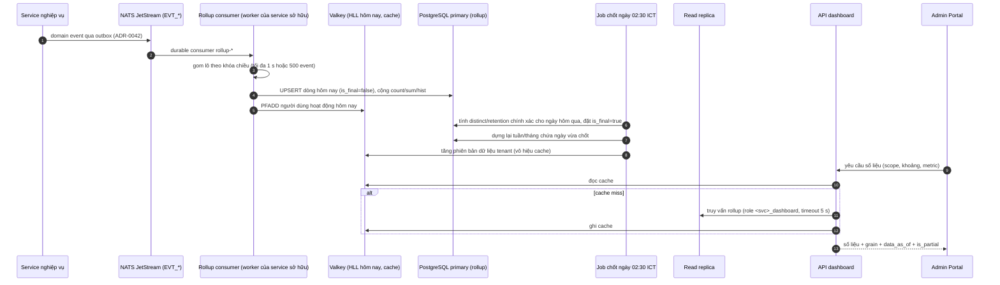
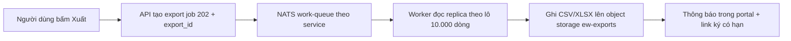

# Dashboard Data — cơ chế dữ liệu cho mọi dashboard

> Trạng thái: Draft · Phiên bản: 0.1 · Owner: Backend Architect + Data/Analytics · Cập nhật: 2026-11-15
> Liên quan: [ADR-0062](../adr/ADR-0062-kien-truc-du-lieu-dashboard-khong-truy-van-du-lieu-tho.md) · [ADR-0058](../adr/ADR-0058-game-analytics-tong-hop-trong-postgresql-qua-su-kien-nats.md) · [ADR-0037](../adr/ADR-0037-moi-service-mot-database-postgresql-thay-mot-phan-adr-0003.md) · [ADR-0042](../adr/ADR-0042-domain-event-qua-transactional-outbox-nats-jetstream-thay-tr.md) · [GAME_ANALYTICS](../11-operations/GAME_ANALYTICS.md) · [LEARNING_ANALYTICS](../02-learning/LEARNING_ANALYTICS.md) · [SCHOOL_LMS](../04-admin-portal/SCHOOL_LMS.md) · [ADMIN_PORTAL](../04-admin-portal/ADMIN_PORTAL.md) · [DATABASE_DESIGN](DATABASE_DESIGN.md) · [VALKEY_DESIGN](VALKEY_DESIGN.md) · [MONITORING](../11-operations/MONITORING.md) · [CONFIG_DEFAULTS](../00-overview/CONFIG_DEFAULTS.md)

**Mục lục:** 1. Mục đích và phạm vi · 2. Danh mục dashboard · 3. Mô hình rollup chung · 4. Pipeline gia tăng · 5. Dữ liệu đến muộn và backfill · 6. Lưu trữ: partition và index · 7. Bảo vệ database khi truy vấn · 8. Quy tắc truy vấn · 9. Cache · 10. Xuất báo cáo bất đồng bộ · 11. Ước lượng kích thước · 12. Ngưỡng nâng cấp · 13. Quan sát và cảnh báo · 14. API đề xuất · 15. Kiểm thử tải · 16. Tiêu chí nghiệm thu

## 1. Mục đích và phạm vi

Tài liệu là **nguồn sở hữu cơ chế dữ liệu dashboard** (ADR-0062): cách dựng, lưu, truy vấn, cache và xuất số liệu cho mọi dashboard của EduWorld, sao cho dữ liệu lớn theo từng ngày **không làm treo database**.

- **Thuộc phạm vi:** mô hình rollup, pipeline, partition/index, read replica, giới hạn truy vấn, cache, export, sizing, giám sát, kiểm thử tải.
- **Không thuộc phạm vi:** định nghĩa chỉ số học tập ([LEARNING_ANALYTICS](../02-learning/LEARNING_ANALYTICS.md)), định nghĩa chỉ số game ([GAME_ANALYTICS](../11-operations/GAME_ANALYTICS.md)), giao diện màn hình ([SCHOOL_LMS §8](../04-admin-portal/SCHOOL_LMS.md#8-teacher-dashboard), [ADMIN_PORTAL §3.14](../04-admin-portal/ADMIN_PORTAL.md#314-live-ops-dashboards--game-analytics)), số liệu kỹ thuật thời gian thực của hạ tầng ([MONITORING](../11-operations/MONITORING.md)).

**Nguyên tắc cốt lõi [Confirmed — ADR-0062]:**

| # | Nguyên tắc |
|---|---|
| D-1 | Dashboard **không bao giờ** đọc bảng nghiệp vụ (`attempts`, `learning_events`, `xp_ledger`…) hay bảng sự kiện thô (`analytics.events_raw`). Chỉ đọc **bảng rollup** hoặc **read model trạng thái hiện tại** |
| D-2 | Rollup dựng **gia tăng** từ event NATS + job chốt ngày; không quét lại toàn bộ lịch sử khi người dùng mở dashboard |
| D-3 | Truy vấn dashboard chạy trên **read replica**, role riêng, có `statement_timeout`, pool và giới hạn đồng thời riêng |
| D-4 | Mọi truy vấn bắt buộc có **tenant** (và scope theo quyền) + **khoảng thời gian** có giới hạn; độ hạt tự chọn theo khoảng |
| D-5 | Xuất báo cáo lớn **luôn bất đồng bộ** |
| D-6 | Rollup nằm trong database của service sở hữu dữ liệu; không join chéo database (ADR-0037) |

## 2. Danh mục dashboard

| Dashboard | Người xem | Service sở hữu | Nguồn đọc | Độ trễ chấp nhận |
|---|---|---|---|---|
| Trang chủ giáo viên, theo dõi bài giao | Giáo viên | learning-service | `lms.assignment_submissions` (read model trạng thái) + `learning.rollup_class_daily` | Tiến độ bài giao: gần thời gian thực (event); số liệu tuần: ≤ 15 phút |
| Bản đồ kỹ năng lớp (LO heatmap) | Giáo viên | learning-service | `learning.rm_class_objective_stats` (trạng thái hiện tại) + `learning.rollup_class_objective_weekly` (xu hướng) | ≤ 15 phút |
| Hồ sơ học sinh (tiến độ, xu hướng 8 tuần) | Giáo viên | learning-service | `learning.progress_daily`, `learning.mastery_snapshots_weekly` | ≤ 15 phút |
| Tổng hợp trường | School Admin, Academic Manager | learning-service | `learning.rollup_school_daily/weekly/monthly` | Hôm nay ≤ 15 phút; ngày đã chốt sau 02:30 ICT |
| Tổng hợp tenant (đơn vị nhiều trường) | Tenant Admin | learning-service + game-service | `learning.rollup_tenant_*`, `analytics.rollup_*` (game) | Như trên |
| Platform học tập | System Admin | learning-service | `learning.rollup_tenant_*` (liên tenant qua role platform) | Ngày đã chốt |
| Live Ops thời gian thực | Live-ops | MONITORING (Prometheus), không qua database | Metric | 15–30 giây |
| Game Analytics | Platform; Tenant Admin (tổng hợp) | game-service | `analytics.rollup_*`, `analytics.cohort_retention`, `analytics.funnel_daily`, `analytics.perf_daily` | Hôm nay ≤ 1 giờ; ngày đã chốt sau 02:30 ICT |
| Hoạt động đăng nhập game (giáo viên/tenant) | Giáo viên, Tenant Admin | learning-service | `ref.login_activity` (projection từ event game-service) | ≤ 5 phút |

Có **hai loại nguồn đọc**:

1. **Read model trạng thái hiện tại** (không có trục thời gian, ví dụ `rm_class_objective_stats`, `assignment_submissions`): kích thước tỷ lệ với số thực thể đang hoạt động, không tăng theo ngày.
2. **Rollup chuỗi thời gian** (`rollup_*_daily/weekly/monthly`): tăng theo ngày, áp dụng toàn bộ quy tắc partition/độ hạt/cache dưới đây.

## 3. Mô hình rollup chung

### 3.1. Cấu trúc bảng

Mỗi bảng rollup chuỗi thời gian có:

| Cột | Ý nghĩa |
|---|---|
| `tenant_id` | Bắt buộc (RLS, ADR-0005) |
| Chiều phạm vi: `school_id`, `class_id`, `grade_level`, `subject_id`… (tùy cấp) | Khóa phạm vi; cột tường minh, **không** dùng jsonb để còn index được |
| `bucket_date` (`date`) | Ngày; với bảng tuần là thứ Hai đầu tuần ISO; bảng tháng là ngày 1 |
| `metric_version` | Phiên bản định nghĩa chỉ số (đổi công thức không trộn số cũ/mới) |
| Cột đo cộng dồn được (`count_*`, `sum_*`) | Cộng được qua ngày và qua phạm vi con |
| Cột đo không cộng dồn được (§3.2) | Distinct, tỷ lệ, percentile |
| `is_final` (`boolean`) | `false` = số tạm tính (hôm nay/đang trong cửa sổ trễ); `true` = đã chốt |
| `computed_at` | Thời điểm cập nhật gần nhất, hiển thị "cập nhật lúc…" |

Khóa chính: `(tenant_id, <chiều phạm vi>, bucket_date, metric_version)`. Không có `deleted_at` (bảng dẫn xuất, dựng lại được; không phải dữ liệu nghiệp vụ — ADR-0028 áp dụng cho nguồn).

### 3.2. Cột đo không cộng dồn được

| Loại | Ví dụ | Cách xử lý |
|---|---|---|
| Đếm distinct (người dùng) | DAU, số học sinh hoạt động trong lớp/tuần | **Hôm nay:** HyperLogLog trong Valkey (`PFADD`/`PFCOUNT`, sai số ~0,8%) hiển thị tạm tính. **Đã chốt:** job cuối ngày tính chính xác từ bảng 1 dòng/người/ngày (`learning.progress_daily`, `analytics.player_days`). Tuần/tháng **không** cộng từ ngày mà tính từ bảng người/ngày theo cửa sổ |
| Tỷ lệ | Độ chính xác, tỷ lệ hoàn thành | Lưu **tử số và mẫu số** riêng (`numerator`, `denominator`); tỷ lệ tính khi đọc → cộng dồn đúng qua ngày/phạm vi |
| Percentile | Thời gian phiên p50, thời gian làm bài p50 | Lưu **histogram bucket cố định** (`hist` = mảng số đếm theo các mốc cấu hình); cộng histogram qua ngày/phạm vi rồi nội suy percentile khi đọc. Độ chính xác đủ cho dashboard (sai số trong một bucket) [Proposed] |
| Retention, cohort | D1/D7/D30 | Tính trong job cuối ngày vào bảng cohort riêng (GAME_ANALYTICS §6) |
| Mastery | Phân bố level theo LO | Read model trạng thái hiện tại + snapshot tuần (LEARNING_ANALYTICS §5) |

Không dùng extension HLL của PostgreSQL trong Release 1.0 (thêm phụ thuộc vận hành); cân nhắc khi chuyển kho phân tích (§12).

### 3.3. Cấp tổng hợp và tập chiều cố định

Không lưu tích Descartes của mọi chiều. Mỗi service khai báo **tập chiều (grouping set) được phép**; chiều không nằm trong tập thì dashboard không lọc được (thêm chiều = thay đổi có backfill, §5).

| Service | Cấp (bảng) | Chiều |
|---|---|---|
| learning-service | học sinh × ngày (`progress_daily`) | `student_id`, `class_id` (snapshot lúc event), `subject_id` |
| | lớp (`rollup_class_*`) | `class_id`, `subject_id` |
| | lớp × LO (`rollup_class_objective_weekly`) | `class_id`, `objective_id` (chỉ theo tuần) |
| | trường (`rollup_school_*`) | `school_id`, `grade_level`, `subject_id` |
| | tenant (`rollup_tenant_*`) | `grade_level`, `subject_id` |
| game-service | `analytics.rollup_*` | Tập cố định theo [GAME_ANALYTICS §6](../11-operations/GAME_ANALYTICS.md#6-mô-hình-dữ-liệu): `(tenant)`, `(tenant, school)`, `(tenant, grade_band)`, `(tenant, platform)`, `(tenant, locale)`, `(tenant, device_tier)`; cột `grouping_set` cho biết dòng thuộc tập nào |

## 4. Pipeline gia tăng

- **Upsert gia tăng:** consumer cộng dồn vào dòng của ngày event (`ON CONFLICT … DO UPDATE SET count = count + excluded.count`), idempotent nhờ `processed_events` (ADR-0042). Gom lô để giảm số câu lệnh ghi.
- **Job chốt ngày** (`dashboard-day-close`, 02:30 ICT [Proposed]): chạy theo service, theo từng tenant để chia nhỏ; tính các chỉ số không cộng dồn (§3.2); đặt `is_final = true`; dựng tuần/tháng từ bảng ngày (không từ dữ liệu thô).
- **Read model 15 phút** (LEARNING_ANALYTICS §5) vẫn giữ cho trạng thái hiện tại; rollup chuỗi thời gian không phụ thuộc vào chúng.
- Rollup chỉ chạy trên **primary** bằng role `<svc>_app`/worker; replica chỉ đọc.

## 5. Dữ liệu đến muộn và backfill

| Tình huống | Xử lý |
|---|---|
| Event đến muộn ≤ 48 giờ (client offline, consumer chậm) | Upsert vào đúng `bucket_date`; nếu ngày đó đã `is_final` thì đánh dấu ngày "cần chốt lại"; job chốt lại các ngày bị đánh dấu trong cửa sổ 48 giờ và cập nhật tuần/tháng liên quan |
| Event đến muộn > 48 giờ | Không sửa rollup; ghi metric `eduworld_rollup_late_events_total`; nếu vượt ngưỡng thì vận hành chạy backfill có chủ đích |
| Đổi định nghĩa chỉ số | Tăng `metric_version`; dashboard chỉ đọc version hiện hành; backfill version mới trong giới hạn retention của nguồn |
| Thêm chiều mới / thêm cấp | Migration thêm bảng/cột (expand); job **backfill** chạy nền theo tenant × tháng, giới hạn tốc độ, ghi `available_from` cho chỉ số; dashboard hiển thị "chưa có số liệu trước ngày …" |
| Nguồn hết hạn lưu trữ | Backfill chỉ được trong phạm vi nguồn còn giữ: `learning_events` theo OQ-12; game raw 90 ngày (ADR-0058) |
| Dựng lại toàn bộ (lỗi logic) | Job `rollup-rebuild` theo tenant × khoảng ngày, ghi vào bảng tạm rồi hoán đổi partition; không chặn dashboard |

## 6. Lưu trữ: partition và index

| Bảng | Partition | Index | Retention |
|---|---|---|---|
| `*_daily` | Theo **tháng** của `bucket_date` | B-tree `(tenant_id, <scope_id>, bucket_date)` (PK); **BRIN** `(bucket_date)` | 2 năm [Proposed] |
| `*_weekly` | Theo **năm** | B-tree như trên | 3 năm [Proposed] |
| `*_monthly` | Không partition (nhỏ) hoặc theo năm | B-tree như trên | 5 năm [Proposed] |
| `learning.progress_daily` (cấp học sinh) | Theo tháng | B-tree `(tenant_id, class_id, bucket_date)`, `(tenant_id, student_id, bucket_date)`; BRIN `(bucket_date)` | Theo LEARNING_ANALYTICS |

- Tạo partition trước 3 tháng bằng **pg_partman** (hoặc job worker tương đương) [Proposed]; có partition `DEFAULT` và cảnh báo khi có dòng rơi vào.
- Partition giúp truy vấn theo khoảng ngày chỉ chạm vài partition (partition pruning); Release 1.0 giữ lại mọi partition, không gỡ (ADR-0070). Bảng rollup không chứa PII cấp cá nhân, trừ `progress_daily` (theo retention học tập).
- BRIN theo `bucket_date` rất nhỏ (vài trang) và hiệu quả vì dữ liệu ghi theo thứ tự thời gian; B-tree theo phạm vi phục vụ lọc theo tenant/trường/lớp.

## 7. Bảo vệ database khi truy vấn

| Biện pháp | Giá trị mặc định | Nhãn |
|---|---|---|
| Truy vấn trên **read replica** của `eduworld_learning` và `eduworld_game` | Bắt buộc ở staging/production; local dùng primary | [Proposed] |
| Role `<svc>_dashboard` (`learning_dashboard`, `game_dashboard`) | Chỉ `SELECT` trên bảng rollup/read model và view dashboard; chịu RLS; không truy cập bảng nghiệp vụ/thô | [Proposed] |
| `statement_timeout` | 5 giây (role dashboard) | [Confirmed — ADR-0062] |
| `idle_in_transaction_session_timeout` | 10 giây | [Proposed] |
| `work_mem` cho role dashboard | 32 MB | [Proposed] |
| Pool kết nối dashboard tách khỏi pool nghiệp vụ | ≤ 10 kết nối/replica API | [Proposed] |
| Đồng thời theo người dùng | ≤ 4 truy vấn dashboard đang chạy; vượt → `429 DASHBOARD_BUSY` | [Proposed] |
| Đồng thời theo tenant | ≤ 30 | [Proposed] |
| Replica lag | Dashboard hiển thị `data_as_of`; lag > 60 s → cảnh báo; lag > 5 phút → API đọc fallback primary bị **cấm**, trả số liệu kèm cảnh báo trễ | [Proposed] |

Timeout trả `504 DASHBOARD_QUERY_TIMEOUT` kèm gợi ý thu hẹp khoảng/phạm vi; không tự retry phía server.

## 8. Quy tắc truy vấn

1. **Bắt buộc** `tenant_id` của phiên (System Admin: danh sách tenant tường minh, ADR-0027) và scope theo quyền (lớp được phân công, trường của mình…).
2. **Bắt buộc** khoảng thời gian `from`–`to`; tối đa **2 năm** (`dashboard_max_range_days` = 730). Vượt → `422 DASHBOARD_RANGE_TOO_LARGE`.
3. **Độ hạt tự chọn** (server quyết định, client chỉ gợi ý):

   | Khoảng | Độ hạt | Bảng đọc |
   |---|---|---|
   | ≤ 31 ngày | Ngày | `*_daily` |
   | 32 ngày – 1 năm | Tuần | `*_weekly` |
   | > 1 năm (≤ 2 năm) | Tháng | `*_monthly` |

   Người dùng có thể yêu cầu độ hạt **thô hơn**, không được yêu cầu mịn hơn quy tắc.
4. Mọi chuỗi trả về có số điểm ≤ 120 (31 ngày, 52 tuần, 24 tháng đều thỏa).
5. **Danh sách chi tiết** (ví dụ học sinh trong lớp, top nội dung): phân trang cursor, tối đa **100 dòng/trang**, sắp xếp theo cột có index.
6. Không có truy vấn tự do (ad-hoc) từ portal; mỗi widget gọi một truy vấn đã định nghĩa sẵn (query catalog trong code, có test kế hoạch thực thi).
7. Ô có < 5 học sinh ẩn với báo cáo cấp tenant/platform (k-anonymity, LEARNING_ANALYTICS §5, GAME_ANALYTICS §7.2).
8. Phản hồi luôn có `grain`, `data_as_of` (thời điểm `computed_at` cũ nhất trong kết quả), `is_partial` (có dòng `is_final = false`).

## 9. Cache

| Khóa (Valkey) | Nội dung | TTL |
|---|---|---|
| `ew:<svc>:dash:ver:<tenant_id>` | Phiên bản dữ liệu dashboard của tenant (tăng khi chốt ngày/backfill) | Không hết hạn |
| `ew:<svc>:dash:res:<tenant_id>:<ver>:<hash(query_id, scope, from, to, grain, locale)>` | Kết quả truy vấn đã serialize | **5 phút** nếu khoảng chứa hôm nay; **24 giờ** nếu toàn bộ đã chốt |
| `ew:<svc>:dash:hll:<metric>:<tenant_id>:<scope>:<yyyymmdd>` | HyperLogLog người dùng hoạt động hôm nay | 3 ngày |
| `ew:<svc>:dash:inflight:<user_id>` | Bộ đếm truy vấn đang chạy (giới hạn đồng thời) | 30 giây |

- **Vô hiệu cache:** không xóa từng khóa; job chốt ngày/backfill tăng `ver` của tenant → khóa cũ không còn được đọc và tự hết hạn.
- Chống "dồn cache" (cache stampede): khóa ngắn `SET NX` khi tính lại cùng một kết quả; người đến sau chờ tối đa 2 giây rồi đọc cache.
- Dashboard **không phụ thuộc** cache để đúng (ADR-0004): mất Valkey → đọc replica trực tiếp, giới hạn đồng thời chặt hơn.

## 10. Xuất báo cáo bất đồng bộ

- Một người dùng tối đa 2 export đang chạy; một export tối đa 1.000.000 dòng [Proposed]; quá → yêu cầu thu hẹp.
- Link tải ký **15 phút** (khớp SCHOOL_LMS §10), file giữ 7 ngày trên bucket `ew-exports` (ADR-0044) rồi hết hạn theo lifecycle.
- Có watermark (người xuất, thời điểm), audit `report.exported`, chỉ dữ liệu trong quyền, không xuất chat.
- Báo cáo LMS dùng endpoint sẵn có `/lms/reports` (SCHOOL_LMS §10); export Game Analytics dùng `/admin/analytics/game/exports` (GAME_ANALYTICS §11); các cấp còn lại xem §14.

## 11. Ước lượng kích thước

Giả định để minh họa [Proposed]: **10.000 học sinh**, 300 lớp, 20 trường, 1 tenant; 5 môn; học sinh hoạt động trung bình 2 môn/ngày; 365 ngày/năm (game có hoạt động cả ngày nghỉ).

| Bảng | Công thức | Dòng/năm | Dòng/2 năm |
|---|---|---|---|
| `learning.progress_daily` (học sinh × ngày × môn) | 10.000 × 365 × 2 | ≈ 7,3 triệu | ≈ 14,6 triệu |
| `learning.rollup_class_daily` (lớp × ngày × môn) | 300 × 365 × 5 | ≈ 0,55 triệu | ≈ 1,1 triệu |
| `learning.rollup_school_daily` (trường × khối × ngày × môn) | 20 × 9 × 365 × 5 | ≈ 0,33 triệu | ≈ 0,66 triệu |
| `learning.rollup_tenant_daily` | 9 × 365 × 5 | ≈ 16 nghìn | ≈ 33 nghìn |
| `analytics.rollup_daily` (game) | ~45 chỉ số × ~35 tổ hợp chiều × 365 | ≈ 0,57 triệu | ≈ 1,15 triệu |
| `analytics.player_days` | 10.000 × 0,6 hoạt động × 365 | ≈ 2,2 triệu | (giữ 400 ngày) |

Với 50.000 học sinh (giả định sizing của DATABASE_DESIGN §8): nhân khoảng 5 cho bảng cấp học sinh/lớp, các bảng cấp trường/tenant gần như không đổi.

**Số dòng một truy vấn phải đọc** (minh họa, đều qua index + partition pruning):

| Truy vấn | Bảng | Dòng đọc |
|---|---|---|
| Giáo viên: lớp 45 HS × 1 môn × 31 ngày, chuỗi theo ngày | `rollup_class_daily` | 31 |
| Giáo viên: danh sách 45 HS × 1 môn × 31 ngày | `progress_daily` | ≤ 1.395 (phân trang 100 HS) |
| School Admin: trường × 9 khối × 5 môn × 2 năm (độ hạt tháng) | `rollup_school_monthly` | 9 × 5 × 24 = 1.080 |
| Tenant Admin: tenant × 9 khối × 1 năm (độ hạt tuần) | `rollup_tenant_weekly` | 9 × 52 = 468 |
| Live-ops: 1 chỉ số × 1 tập chiều × 31 ngày | `analytics.rollup_daily` | 31 × (số giá trị chiều) ≤ vài trăm |

So với dữ liệu thô (`learning_events` ≈ 700 triệu dòng/năm ở 50.000 học sinh — DATABASE_DESIGN §8), mỗi truy vấn dashboard đọc **dưới vài nghìn dòng**, nên p95 ≤ 2 giây là khả thi ngay cả khi không có cache. Cần xác nhận bằng kiểm thử tải §15.

## 12. Ngưỡng nâng cấp

Đánh giá kho phân tích cột (ClickHouse hoặc tương đương) bằng ADR mới khi một điều kiện kéo dài ≥ 2 tuần (thống nhất với ADR-0058, ADR-0062):

- truy vấn dashboard p95 > 2 giây dù đã đúng quy tắc §8;
- một bảng rollup ngày > 500 triệu dòng;
- job chốt ngày > 2 giờ;
- rollup làm tăng p95 ghi của database nghiệp vụ > 20%.

## 13. Quan sát và cảnh báo

| Metric | Nhãn | Ý nghĩa |
|---|---|---|
| `eduworld_dashboard_query_duration_seconds` (histogram) | `service`, `query_id`, `grain`, `cache` (`hit`/`miss`) | Thời gian truy vấn dashboard |
| `eduworld_dashboard_cache_requests_total` | `service`, `result` | Tỷ lệ cache hit |
| `eduworld_dashboard_rejected_total` | `service`, `reason` (`range`, `busy`, `timeout`) | Truy vấn bị từ chối |
| `eduworld_rollup_lag_seconds` | `service`, `rollup` | Thời gian từ event đến khi vào rollup "hôm nay" |
| `eduworld_rollup_day_close_duration_seconds` | `service` | Thời gian job chốt ngày |
| `eduworld_rollup_late_events_total` | `service`, `bucket` (`<=48h`, `>48h`) | Event đến muộn |
| `eduworld_export_jobs_total` / `_duration_seconds` | `service`, `status` | Export |

Cảnh báo (định nghĩa ngưỡng chính thức ở [MONITORING](../11-operations/MONITORING.md)): DashboardSlow (p95 > 2 s trong 15 phút), DashboardTimeoutsSpike, RollupLagHigh (> 15 phút cho học tập, > 1 giờ cho game), DayCloseNotDone (chưa chốt xong lúc 05:00 ICT), DashboardReplicaLag (> 60 s), LateEventsHigh.

## 14. API đề xuất

Các endpoint dashboard đã có giữ nguyên đường dẫn, **bổ sung quy ước chung** của §8 (tham số `from`, `to`, `grain` gợi ý; phản hồi có `grain`, `data_as_of`, `is_partial`): `/lms/classes/{class_id}/analytics/*`, `/lms/students/{student_id}/analytics`, `/lms/schools/{school_id}/analytics/summary` (LEARNING_ANALYTICS §8), `/admin/analytics/game/*`, `/tenant/analytics/game/summary` (GAME_ANALYTICS §11).

Endpoint bổ sung (đã có trong OpenAPI — operationId `getTeacherDashboard`, `getSchoolAnalyticsSeries`, `getTenantLearningSummary`, `getPlatformLearningSummary`, `createTenantReport`, `getTenantReport`, `createPlatformReport`, `getPlatformReport`; chuẩn ở [API_DESIGN §9.14, §9.16](API_DESIGN.md#914-lms--apiv1lms)):

| Method | Path | Service | Mô tả | Quyền |
|---|---|---|---|---|
| GET | `/api/v1/lms/dashboards/teacher?class_id=&subject_id=&from=&to=` | learning | Gói widget trang chủ giáo viên trong một lần gọi | Giáo viên (lớp được phân công) |
| GET | `/api/v1/lms/schools/{school_id}/analytics/series?metric=&grade_level=&subject_id=&from=&to=&grain=` | learning | Chuỗi thời gian cấp trường | `analytics.school.read` |
| GET | `/api/v1/tenant/analytics/learning/summary?school_ids=&grade_level=&from=&to=` | learning | Tổng hợp học tập cấp tenant | `analytics.tenant.read` |
| GET | `/api/v1/admin/analytics/learning/summary?tenant_ids=&from=&to=` | learning | Tổng hợp học tập liên tenant (gateway nội bộ) | System Admin |
| POST | `/api/v1/tenant/reports` → 202 | learning | Export báo cáo cấp tenant (bất đồng bộ) | `analytics.tenant.read` |
| GET | `/api/v1/tenant/reports/{report_id}` | learning | Trạng thái + link ký | Người tạo |
| POST | `/api/v1/admin/reports` → 202 / GET `/api/v1/admin/reports/{report_id}` | learning | Export liên tenant | System Admin |

Mã lỗi (trong [API_DESIGN §4.1](API_DESIGN.md#41-catalog-mã-lỗi) và enum `ProblemCode`): `DASHBOARD_RANGE_TOO_LARGE` (422), `DASHBOARD_BUSY` (429), `DASHBOARD_QUERY_TIMEOUT` (504), `EXPORT_LIMIT_REACHED` (429).

## 15. Kiểm thử tải

| Kịch bản | Dữ liệu | Mục tiêu |
|---|---|---|
| Sinh dữ liệu tổng hợp 2 năm | Generator tạo rollup + `progress_daily` cho 50.000 học sinh, 1.500 lớp, 100 trường, 5 tenant (≈ 5 lần §11) | Đủ để đo trên kích thước năm 1 |
| Giờ cao điểm giáo viên | 1.500 giáo viên mở trang chủ trong 10 phút, 30% mở heatmap | p95 ≤ 2 s; replica CPU < 70%; không ảnh hưởng p95 ghi primary |
| Báo cáo trường/tenant | 200 phiên đồng thời chọn khoảng 1–2 năm | p95 ≤ 2 s; không truy vấn nào > 5 s |
| Cache lạnh | Ngay sau job chốt ngày (phiên bản tăng) | p95 ≤ 2 s khi cache miss toàn bộ |
| Job chốt ngày | Dữ liệu 50.000 học sinh, 1 ngày | Hoàn tất < 30 phút; primary p95 ghi tăng < 20% trong lúc chạy |
| Export | 20 export đồng thời, mỗi export 200.000 dòng | Không làm chậm dashboard > 10% |
| Dữ liệu đến muộn | 5% event đến trễ 1–48 giờ | Rollup đúng sau chốt lại |

Kiểm tra `EXPLAIN (ANALYZE, BUFFERS)` của mọi truy vấn trong query catalog trong CI trên dữ liệu mẫu: phải dùng index/partition pruning, không có `Seq Scan` trên bảng rollup ngày.

## 16. Tiêu chí nghiệm thu

| ID | Tiêu chí |
|---|---|
| AC-DASH-001 | Không endpoint dashboard nào truy vấn bảng nghiệp vụ hay bảng thô (kiểm bằng role `<svc>_dashboard` không có quyền trên các bảng đó) |
| AC-DASH-002 | Truy vấn thiếu khoảng thời gian hoặc khoảng > 730 ngày bị từ chối `DASHBOARD_RANGE_TOO_LARGE` |
| AC-DASH-003 | Độ hạt trả về đúng quy tắc §8 (31 ngày → ngày; 6 tháng → tuần; 2 năm → tháng) |
| AC-DASH-004 | Truy vấn chạy quá 5 giây bị hủy ở database, API trả `DASHBOARD_QUERY_TIMEOUT`, không giữ kết nối |
| AC-DASH-005 | Người dùng thứ 5 gửi truy vấn đồng thời nhận `429 DASHBOARD_BUSY` |
| AC-DASH-006 | Số liệu hôm nay hiển thị nhãn tạm tính và "cập nhật lúc…" từ `data_as_of`; sau job chốt ngày, `is_final = true` và DAU khớp đếm chính xác |
| AC-DASH-007 | Event đến muộn 30 giờ được tính vào đúng ngày sau lần chốt lại; event muộn 60 giờ không làm đổi số đã chốt và được đếm vào metric |
| AC-DASH-008 | Sau chốt ngày, kết quả cache cũ không còn được trả về (phiên bản tenant tăng) |
| AC-DASH-009 | Export 500.000 dòng chạy bất đồng bộ, link hết hạn sau 15 phút, có audit |
| AC-DASH-010 | Kiểm thử tải §15 đạt p95 ≤ 2 giây trên dữ liệu 2 năm của 50.000 học sinh |
| AC-DASH-011 | Báo cáo tenant ẩn ô < 5 học sinh |
| AC-DASH-012 | Mất Valkey: dashboard vẫn trả đúng số liệu (chậm hơn), không lỗi |
