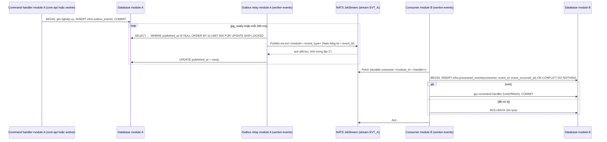

# Event Design

> Trạng thái: Draft · Phiên bản: 0.6 · Owner: Backend Architect + EdTech Specialist · Cập nhật: 2026-11-20 (owner chốt OQ-17: `game_session.ended`/`student.game_logged_out` thêm `end_reason = daily_limit`; module identity tiêu thụ `game_session.ended` cho projection thời gian chơi/ngày) · 2026-11-17 (payload schema event M-C0/M-C1 — identity, game, `audit.recorded`; `user.provisioned` thêm `source = platform_common`, `platform_settings.changed` thêm scope `school`/`feature_flag` và `curfew_window`, `end_reason = curfew`) · 2026-11-17 (domain event `lesson.completed` — owner F031, consumer XP F074; nhắc nghỉ không phải domain event mà là telemetry client `break_reminder_shown`) · 2026-11-17 (Áp ADR-0074: relay và consumer chạy ở profile `worker-events`/`worker-chat`, event là tích hợp giữa module; subject `ew.evt.<module>.*` không đổi) · 2026-11-17 (Áp ADR-0089: retention outbox/processed events/dead letters bằng gỡ partition, khóa partition `event_occurred_at`) · 2026-11-16 (event `study_group.*` — ADR-0084; identity thu hồi phiên game giữ bằng refresh token — ADR-0086; event học tập thống nhất `activity.*`)
> Liên quan: [ADR-0042](../adr/ADR-0042-domain-event-qua-transactional-outbox-nats-jetstream-thay-tr.md) · [ADR-0074](../adr/ADR-0074-modular-monolith-co-ranh-gioi-cuong-che.md) · [ADR-0019](../adr/ADR-0019-transactional-outbox-valkey-streams-cho-domain-events.md) · [VALKEY_DESIGN](VALKEY_DESIGN.md) · [DATABASE_DESIGN](DATABASE_DESIGN.md) · [LEARNING_ANALYTICS](../02-learning/LEARNING_ANALYTICS.md) · [JSON Schema learning event](../../specs/schemas/learning-event.schema.json) · [DATA_PRIVACY](../10-security/DATA_PRIVACY.md)

> **Thay đổi v0.3:** domain event giữa các module đi qua transactional outbox trong database của từng module → NATS JetStream (stream `EVT_<MODULE>`, subject `ew.evt.<module>.<event_type>`), thay Valkey Streams (ADR-0042). Cột "Producer" trong catalog ghi tên domain con; domain con thuộc module nào theo [DOMAIN_MODEL §1](../06-architecture/DOMAIN_MODEL.md).
>
> **Thay đổi v0.6 (ADR-0074):** backend là modular monolith, nhưng mỗi module vẫn có database và transaction riêng nên domain event vẫn là cơ chế tích hợp giữa module (không gọi thẳng handler của module khác). Outbox relay và consumer domain event chạy ở profile `worker-events`, consumer của `CHAT_MESSAGES` ở `worker-chat`, job ở `worker-jobs` (binary `src/backend/cmd/worker`); `core-api` chỉ ghi outbox trong transaction. Stream, subject và tên consumer không đổi.

## 1. Hai loại event

| Loại | Mục đích | Lưu bền vững | Vận chuyển |
|---|---|---|---|
| **Domain event** | Tích hợp giữa module (cộng XP, cập nhật quest, projection `ref`, audit) | `infra.outbox_events` trong database của module phát (30 ngày) | Outbox relay (profile `worker-events`) → NATS JetStream `ew.evt.<module>.<event_type>` (stream `EVT_<MODULE>`) |
| **Learning event** | Bằng chứng học tập (LRS nội bộ, xAPI-like) cho mastery, analytics, báo cáo | `learning.learning_events` trong `eduworld_learning` (partition tháng, giữ theo retention của DATA_PRIVACY) | Ghi trực tiếp trong transaction của use case **và** đồng thời phát domain event `learning.event_recorded` (tùy chọn, cho consumer realtime) |

Learning event là **dữ liệu**; domain event là **tín hiệu**. Không suy ra lịch sử học tập từ stream. Learning event phát sinh ở module khác (quest, trận đấu) được module learning ghi khi tiêu thụ domain event tương ứng (`quest.completed`, `match.completed`).

## 2. Envelope chuẩn

Áp dụng cho cả hai loại (learning event có thêm trường bắt buộc §5.1).

```json
{
  "event_id": "0193a5f4-6c1e-7b2a-9d1f-3c4e5a6b7c8d",
  "event_type": "activity.submitted",
  "schema_version": 1,
  "occurred_at": "2026-11-15T07:30:12.345Z",
  "recorded_at": "2026-11-15T07:30:12.360Z",
  "producer": "learning/activity",
  "tenant_id": "0192f…",
  "actor": { "type": "student", "id": "0192e…" },
  "subject": { "type": "attempt", "id": "0193a…" },
  "session_id": "0193a…",
  "idempotency_key": "attempt:0193a…:submit",
  "trace_id": "4bf92f3577b34da6a3ce929d0e0e4736",
  "payload": { }
}
```

| Trường | Kiểu | Bắt buộc | Ghi chú |
|---|---|---|---|
| `event_id` | UUIDv7 | ✔ | Sinh tại producer; sắp xếp theo thời gian |
| `event_type` | string (≤ 64) | ✔ | `<entity>.<past_tense_verb>` |
| `schema_version` | int | ✔ | Tăng khi payload thay đổi không tương thích |
| `occurred_at` | timestamp UTC | ✔ | Thời điểm nghiệp vụ (server time) |
| `recorded_at` | timestamp UTC | ✔ | Thời điểm ghi |
| `producer` | string (≤ 64) | ✔ | `<module>/<thành phần>`, vd. `learning/exercise` (pattern trong [envelope.schema.json](../../specs/events/envelope.schema.json); đổi từ `<x>-service/…` theo ADR-0074 trước khi có code, envelope vẫn là v1) |
| `tenant_id` | UUID | ✔ (trừ event platform, khi đó `null`) | Tenant (ADR-0005); consumer phải dùng làm `TenantScope`. `school_id` (trường bên trong tenant) nếu cần nằm trong `payload` |
| `actor` | object | ✔ | `student`, `staff` (nhân sự trường hoặc platform, ADR-0081), `system`, `service`. Learning event chỉ dùng `student`, `system`, `staff` (§5.1) |
| `subject` | object | ✔ | Tài nguyên chính của event |
| `session_id` | UUID | — | `game_session_id` hoặc phiên CMS |
| `idempotency_key` | string (≤ 128) | ✔ | Khóa nghiệp vụ tất định — giống nhau khi sự việc lặp lại |
| `trace_id` | string (≤ 64) | — | W3C trace id |
| `payload` | object | ✔ | Theo catalog §4; **chỉ ID và giá trị cần thiết**, không PII |

## 3. Outbox → NATS JetStream (ADR-0042)



Bảng `infra.outbox_events` và `infra.processed_events` có trong **database của mỗi module**; relay của module A đọc outbox bằng role `<module>_relay`, consumer của module B ghi `processed_events` trong database của B, nên module A và B không bao giờ chung transaction dù chạy cùng tiến trình `worker-events`; DDL chuẩn ở [DATABASE_DESIGN §3.9](DATABASE_DESIGN.md#39-outbox--processed-events).

`pg_notify('ew_outbox')` sau commit để relay phản ứng nhanh; polling 200 ms làm dự phòng.

### 3.1. Stream, subject và consumer

| Stream | Subjects | Producer | Lưu | Ghi chú |
|---|---|---|---|---|
| `EVT_IDENTITY` | `ew.evt.identity.>` | module identity | 7 ngày, file, 3 replicas | Tenant, user, SIS, membership, cleanup, settings |
| `EVT_LEARNING` | `ew.evt.learning.>` | module learning | 7 ngày | Content, activity/attempt, exam, mastery, LMS |
| `EVT_GAME` | `ew.evt.game.>` | module game | 7 ngày | Game session, login, quest, XP, reward, Game Studio publish |
| `EVT_COMPETITION` | `ew.evt.competition.>` | module competition | 7 ngày | Party, match, rating, tournament |
| `EVT_CHAT` | `ew.evt.chat.>` | module chat | 7 ngày | Domain event chat/moderation (không chứa nội dung tin) |
| `CHAT_MESSAGES` | `ew.chat.*.msg.*`, `ew.chat.*.evt.*`, `ew.chat.*.cursor.*` | module chat | 72 h | Đường ghi tin nhắn (ADR-0035, §4.10) |
| `DLQ_<MODULE>` (`DLQ_IDENTITY`, `DLQ_LEARNING`, `DLQ_GAME`, `DLQ_COMPETITION`, `DLQ_CHAT`) | `ew.dlq.<module>.<consumer>` | consumer của module nhận | 30 ngày | Event và message chat xử lý lỗi quá số lần (theo module nhận; module chat dùng chung `DLQ_CHAT` cho consumer của `CHAT_MESSAGES`) |
| `IDENTITY_SIS_JOBS` | `ew.job.identity.sis.>` | module identity (`core-api`: upload CSV, webhook SIS; `worker-jobs`: lịch) | Work-queue (retention `WorkQueue`) | Hàng đợi job SIS sync, thay `ew:sis:jobs` cũ |

Stream và durable consumer được tạo idempotent khi binary `worker` khởi động profile chạy consumer đó (`worker-events` cho `EVT_*`, `worker-chat` cho `CHAT_MESSAGES`; `CreateOrUpdateStream`/`CreateOrUpdateConsumer`), cấu hình trong code đăng ký ở `module.go` + env. Consumer đặt tên `<module_nhận>.<handler>` (vd. `game.quest_on_activity_submitted`) và dùng `FilterSubjects` chỉ lấy event cần.

### 3.2. Bản đồ consumer giữa module

Mọi consumer dưới đây chạy trong profile `worker-events` (consumer của chat trên stream `CHAT_MESSAGES` chạy ở `worker-chat`, §4.10); cột là module nhận.

| Event (producer) | identity | learning | game | competition | chat |
|---|---|---|---|---|---|
| `tenant.*`, `school.*`, `class.*` (gồm `class.synced`), `student.synced`, `enrollment.changed` (identity) | — | projection `ref.*`, LMS (course, đối tượng bài giao) | projection `ref.*`; `student.synced`/`enrollment.changed` kích hoạt quy tắc chuyển năm học ([PROGRESSION_SYSTEM §5.1](../01-game-design/PROGRESSION_SYSTEM.md#51-chuyển-năm-học-lên-lớp-confirmed)) | projection `ref.*` | projection `ref.*`, channel lớp |
| `school.updated` (identity; gồm cài đặt trường `settings_subset`) | — | projection `ref.schools` | projection `ref.schools` | projection `ref.schools` (giờ truy cập, bảng xếp hạng bị tắt) | projection `ref.schools`, chính sách chat cấp trường |
| `tenant_data.assigned`, `tenant_data.unassigned` (identity, ADR-0029) | — | xóa cache pool câu hỏi; projection `ref.game_activities` khi `resource_type` là `quest`/`minigame_config` (catalog giao bài) | — (module game nhận gán qua facade `applyTenantAssignment` trước khi identity phát) | — | — |
| `user_role.changed`, `role.updated`, `tenant_membership.changed` (identity) | Keycloak membership + realm role `tenant_staff`/`platform_staff` | invalidate Principal cache | invalidate | invalidate | invalidate |
| `user.access_revoked`, `student.cleaned_up`, `student.restored` (identity) | thu hồi `game_auth_sessions` + phiên Keycloak (`access_revoked`/`cleanup`, ADR-0086) — xử lý nội bộ của `keycloak-provisioner` | `ref.students` | đóng game session, `ref.students` | rời party, `ref.students` | rời channel, `ref.students` |
| `activity.submitted`, `activity.graded`, `exam.graded`, `attempt.re_evaluated`, `learning_objective.*` (learning) | — | mastery (nội bộ) | quest progress, XP/reward; `learning_objective.mastered` → XP nguồn `mastery.objective_mastered` (một lần mỗi học sinh × LO, [PROGRESSION_SYSTEM](../01-game-design/PROGRESSION_SYSTEM.md)) | — | — |
| `lesson.completed` (learning, F031) | — | `progress_daily.lessons_completed` (nội bộ, consumer `learning.progress_daily`) | XP nguồn `lesson.completed` (consumer `game.reward_engine`, [PROGRESSION_SYSTEM §3.1](../01-game-design/PROGRESSION_SYSTEM.md#31-catalog-nguồn-xp)) | — | — |
| `assignment.published`, `assignment.results_released` (learning) | — | — | — | — | thông báo trong game (`social.notifications`; "Thông báo trường" chỉ gồm bài giao và kết quả bài giao) |
| `party.invitation_sent` (competition), `level.reached`, `achievement.unlocked` (game), `friend_request.sent` (chat) | — | — | — | — | thông báo trong game (worker `chat-notifier`) |
| `sanction.applied`, `sanction.lifted`, `moderation.school_notified`, `moderation.case_assigned` (chat) | `sanction.applied` loại khóa tài khoản → tạo `account_locks` nguồn `moderation_sanction`, thu hồi `game_auth_sessions` + phiên Keycloak; `sanction.lifted` → giải phóng đúng khóa đó; `moderation.school_notified` → email cho `school_admin` qua SMTP (`identity.email_deliveries`); `moderation.case_assigned` (P1) → email gọi trực | — | — | — | — |
| `study_group.created/updated/member_changed/deleted` (learning, ADR-0084) | — | — | — | — | tạo/đổi tên/cập nhật thành viên/lưu trữ channel `study_group` (từ M5) |
| `student.game_logged_in/out` (game) | `users.last_login_at` | `ref.login_activity` (dashboard) | — | — | — |
| `activity.*`, `exam.graded`, `attempt.re_evaluated`, `assignment.*`, `learning_objective.*` (learning — nội bộ) | — | consumer `learning.rollup_dashboard`: upsert `progress_daily` và `rollup_class/school/tenant_daily` ([DASHBOARD_DATA §4](DASHBOARD_DATA.md#4-pipeline-gia-tăng)) | — | — | — |
| `game_profile.updated` (game) | — | — | — | `ref.player_profiles` | `ref.player_profiles` |
| `game_session.ended` (game) | projection thời gian chơi trong ngày ICT của học sinh (`duration_ms`) để từ chối đăng nhập game khi đạt `daily_play_limit_minutes` của trường ([CHILD_SAFETY §4.2](../10-security/CHILD_SAFETY.md#42-cưỡng-chế-giới-hạn-chơingày-oq-17), F013-AC-33) | — | — | — | — |
| `game_session.replaced` (game) | revoke Keycloak session (`sid`) + đánh dấu `game_auth_sessions` của thiết bị cũ thu hồi (`takeover`, ADR-0086) — refresh token lưu trên thiết bị cũ không dùng lại được | — | — | đánh dấu disconnect trong grace | — |
| `quest.completed` (game) | — | learning event (evidence) | — | — | — |
| `match.started`, `match.completed`, `party.created/disbanded`, `party.member_*` (competition) | — | evidence `competition` (mastery trọng số thấp) | XP/reward thi đấu, co-op quest | — | mở/đóng channel `match`/`team`/`party`, `ref.parties` — channel tạo bằng consumer sau khi competition commit (outbox), không cùng transaction vì hai database khác nhau |
| `audit.recorded` (mọi module) | ghi `audit.audit_logs` | — | — | — | — |
| Sự kiện chơi: `game_session.*`, `world.*`, `story.*`, `avatar.created`, `quest.*`, `challenge.*`, `boss.*`, `xp.awarded`, `level.reached`, `currency.*`, `shop.item_purchased`, `achievement.unlocked`, `collection.completed` (game); `party.created`, `party.activity_started`, `match.completed`, `duel.*` (competition); `chat.daily_stats` (chat); `activity.submitted` (learning, chỉ đếm) | — | — | **analytics consumer** (durable `analytics`, ghi `analytics.events_raw` — [GAME_ANALYTICS](../11-operations/GAME_ANALYTICS.md), ADR-0058) | — | — |
| `user.blocked`, `user.unblocked`, `friend.added`, `friend.removed` (chat) | — | — | — | projection `ref.blocks`, `ref.friendships` (consumer F091: chặn mời party, ghép trận, duel; ưu tiên bạn bè trong hub) | — |
| `content.published`, `content.rolled_back`, `content.unpublished` (game — cấu hình Game Studio: `quest`, `minigame_config`, `world_area`, `item`, `reward_rule`…) | — | projection `ref.game_activities` (`quest`/`minigame_config`, catalog giao bài) | snapshot/manifest (nội bộ) | projection `ref.world_areas` (`world_area`, hub) | — (sticker pack/GIF thuộc module chat, không cần event chéo) |

Consumer rollup dashboard (`learning.rollup_dashboard`, `game.analytics`) gom lô ≤ 1 s/500 event, upsert idempotent theo `processed_events`, chạy trên primary; job chốt ngày và xử lý event đến muộn ≤ 48 giờ theo [DASHBOARD_DATA §4–5](DASHBOARD_DATA.md#4-pipeline-gia-tăng) (ADR-0062).

Realtime push tới client **không** là consumer JetStream: module xử lý event (consumer trong `worker-events`) hoặc command (trong `core-api`) tự `PUBLISH` Valkey `ew:rt:user:<id>` / `ew:rt:room:<id>` / `ew:chat:fanout:<channel>`; binary `realtime` subscribe và giao xuống WS ([REALTIME_ARCHITECTURE](../06-architecture/REALTIME_ARCHITECTURE.md)).

## 4. Catalog domain events

Producer/consumer ghi theo domain con (package trong `src/backend/modules/<module>/internal/domain`); domain con → module: identity/tenancy/organization/sis/audit → **module identity**; content/curriculum/activity/exam/learning_record/learning_analytics/lms → **module learning**; game_session/quest/minigame/gamification/reward → **module game**; party/multiplayer/competition/ranking/leaderboard/tournament/season → **module competition**; friend/chat/moderation/notification → **module chat**; RT = đẩy realtime qua Valkey Pub/Sub tới binary `realtime`. Bản đồ consumer giữa module: §3.2.

**Feature sở hữu schema (R33, ADR-0082).** Mỗi event có đúng một module phát (cột Producer) và, trong module đó, đúng một feature sở hữu: feature hiện thực use case phát event, ghi event trong mục "Event / outbox" của `specs/<NNN>-*/data-model.md` và tạo `specs/events/payloads/<module>/<event_type>.v<N>.schema.json`. Feature khác cùng phát (vd. thêm trường tương thích) ghi "owner F<NNN>" trên dòng event; feature tiêu thụ chỉ tham chiếu schema, không tạo. Event chung `audit.recorded` có một schema ở `payloads/common/` (owner F003). Cột Producer có thể ghi mã feature (vd. `quest (F103)`) và khi đó phải khớp feature sở hữu. Kiểm tra: `node scripts/specs/check-cross-features.mjs` (`--list` in bảng module:event → feature).

Ký hiệu consumer: GAM = gamification, QST = quest, LR = learning_record, LA = learning_analytics, LMS, RT = realtime push, AUD = audit, NTF = notification, RNK = ranking, LDB = leaderboard, MOD = moderation, ANA = game analytics consumer (module game, [GAME_ANALYTICS](../11-operations/GAME_ANALYTICS.md)). Mọi event chơi liệt kê ở §3.2 dòng "Sự kiện chơi" đều có ANA là consumer dù cột Consumers bên dưới không ghi lại.

### 4.1. Identity, Tenancy, Organization & SIS

| Event | Producer | Consumers | Payload chính |
|---|---|---|---|
| `user.provisioned` | identity | AUD, GAM (tạo GameProfile) | `user_id`, `user_type`, `source` (jit/sis/manual/platform_common — học sinh tenant chung do System Admin tạo, F010-AC-24) |
| `user.activated` | identity | AUD, GAM | `user_id`, `external_identity_id` — lần đăng nhập đầu chuyển `pending → active` ([ACCOUNT_PROVISIONING](../09-identity/ACCOUNT_PROVISIONING.md)) |
| `user.access_revoked` | identity | RT (đóng WS, close code 4403), AUD | `user_id`, `reason` (locked/deactivated/transferred/password_changed — đặt lại mật khẩu chỉ thu hồi phiên, không tắt user, [ACCOUNT_PROVISIONING §6d](../09-identity/ACCOUNT_PROVISIONING.md#6d-đặt-lại-mật-khẩu-học-sinh)) |
| `user.access_restored` | identity | AUD, NTF | `user_id`, `reason` — mở khóa; Keycloak `enabled=true` |
| `user.status_changed` | identity | AUD, MOD | `user_id`, `from`, `to` |
| `user.email_changed` | identity | identity (keycloak_access: email Keycloak, `emailVerified = false`), AUD | `user_id`, `email_verified` (`false`) — không chứa địa chỉ email (OQ F012-1) |
| `user_role.changed` | identity | AUD, cache invalidation (Principal, menu portal), tenancy (đồng bộ membership Keycloak Organization và realm role `tenant_staff`/`platform_staff`, ADR-0066) | `user_role_id`, `user_id`, `role_id`, `role_code`, `tenant_id` (null nếu platform), `scope_type`, `scope_id`, `source` (`manual`), `op` (granted/revoked/expired/updated), `actor_id` — thay `role_assignment.changed` |
| `role.updated` | identity | AUD, cache invalidation (Principal của mọi user có UserRole với role này) | `role_id`, `code`, `tenant_id` (null = dùng chung), `role_scope_kind`, `op` (created/updated/deleted), `permissions_added[]`, `permissions_removed[]`, `actor_id` (ADR-0066) |
| `tenant.created` / `tenant.updated` | tenancy | identity (cache alias, membership), Keycloak sync (tạo/cập nhật Organization), AUD | `tenant_id`, `tenant_type`, `status`, `changed_fields[]` |
| `tenant_data.assigned` / `tenant_data.unassigned` | tenancy (F045 — phát sau khi module sở hữu tài nguyên ghi gán qua facade, kể cả tài nguyên của module game) | content/lms (pool câu hỏi, catalog giao bài `ref.game_activities`), AUD | `resource_type`, `resource_id`, `tenant_id`, `assignment_id` (ADR-0029) |
| `tenant_data.cloned` | tenancy (worker clone) | AUD (ghi cả tenant nguồn và đích), NTF (System Admin) | `job_id`, `source_tenant_id`, `target_tenant_id`, `resource_type`, `count`, `status` |
| `tenant_membership.changed` | tenancy | identity (cache, Keycloak Organization member add/remove, thu hồi session) | `user_id`, `tenant_id`, `op` (added/removed), `source` |
| `<entity>.deleted` / `<entity>.restored` | module sở hữu entity | AUD, cache invalidation, consumer liên quan (vd. `class.deleted` → chat ẩn channel lớp) | `<entity>_id`, `tenant_id`, `deleted_by`/`restored_by`, `reason` — soft-delete/khôi phục (ADR-0028) |
| `student.provisioning_requested` | sis | identity (worker tạo user Keycloak qua admin API) | `student_id`, `tenant_id`, `school_id`, `sis_connection_id` |
| `student.synced` | sis | AUD, cache invalidation, game (quy tắc chuyển năm học khi đổi khối) | `student_id`, `school_id`, `action` (create/update/deactivate), `sync_run_id` |
| `school.synced` | sis | AUD, cache invalidation | `school_id`, `sync_run_id`, `changed_fields[]` |
| `enrollment.changed` | organization | identity (cache), LMS, chat (channel lớp), game (chuyển năm học), AUD | `student_id`, `class_id`, `op` (added/ended/transferred) |
| `student.transferred` | organization | chat, party (rời party), LMS, tenancy (đổi membership nếu khác tenant), AUD | `student_id`, `from_tenant_id`, `to_tenant_id`, `from_school_id`, `to_school_id` |
| `class.created` / `class.updated` | organization | chat (tạo channel lớp), LMS | `class_id`, `grade_level` |
| `school.updated` | organization (F010) | mọi module (projection `ref.schools` gồm `settings_subset`), AUD | `school_id`, `tenant_id`, `status`, `name?`, `settings_subset` (chỉ khóa module nhận cần: giờ truy cập, `daily_play_limit_minutes` cho module game — F015-AC-30, bảng xếp hạng bị tắt, `allow_cross_school_listing`, chính sách chat cấp trường), `changed_fields[]`, `source_version` — đổi cài đặt trường (F015) phát cùng event và schema |
| `class.synced` | identity (đồng bộ SIS định kỳ hoặc khi học sinh đăng nhập — ADR-0060, ADR-0061) | chat (thành viên channel lớp), LMS, projection `ref.classes`, dashboard (sĩ số), cache Principal | `class_id`, `school_id`, `grade_level`, `name`, `academic_year`, `status`, `op` (`created`/`updated`/`closed`), `trigger` (`scheduled_sync`/`login_sync`/`manual_import`), `sis_connection_id`, `changed_fields[]` — không chứa danh sách học sinh |
| `province.updated` | identity (danh mục platform, ADR-0060; envelope `tenant_id = null`) | learning, game (projection `ref.provinces`), identity (`ref.schools` tên tỉnh phi chuẩn hóa) | `province_id`, `code`, `country_code`, `official_code`, `name {vi,en}`, `status`, `effective_to`, `successor_code`, `op` (`created`/`updated`/`deactivated`/`succession_recorded`) |
| `student.cleanup_scheduled` | worker `student-inactive-cleanup` | NTF (Tenant Admin/School Admin: danh sách sắp bị dọn), AUD | `tenant_id`, `student_ids[]` (lô), `scheduled_cleanup_at`, `cutoff_days` (ADR-0032) |
| `student.cleaned_up` | worker `student-inactive-cleanup` | identity (gỡ Keycloak Organization, thu hồi session; **giữ** user Keycloak enabled để đăng nhập lại khôi phục — [ACCOUNT_PROVISIONING §6b](../09-identity/ACCOUNT_PROVISIONING.md#6b-dọn-học-sinh-không-đăng-nhập-game-adr-0032)), party (rời party), RT (đóng WS), LA, AUD | `student_id`, `tenant_id`, `last_login_at`, `cutoff_days`, `run_id` — soft-delete, không xóa dữ liệu |
| `student.restored` | identity (JIT khi học sinh đăng nhập lại) | identity (thêm lại membership), LA, AUD | `student_id`, `tenant_id`, `cleaned_up_at`, `restored_via` (`login`/`admin`) |
| `user.anonymized` | identity (F016, saga `user_anonymize`) | mọi module (ẩn danh hóa projection `ref.*`, learning events theo §9), AUD | `user_id`, `tenant_id`, `user_type`, `trigger` (`data_request`/`retention`), `data_request_id?`, `anonymized_at` — không chứa PII cũ |
| `platform_settings.changed` | tenancy | API/worker (invalidate cache), game/chat (giới nghiêm), AUD | `key` (`student_cleanup`/`chat_retention`/`platform_curfew`/`curfew_window`… hoặc khóa flag), `scope` (`platform`/`tenant`/`school`/`feature_flag`), `tenant_id?`, `school_id?`, `flag_key?`, `before`, `after`, `curfew_window?` (ADR-0078), `reason`, `actor_id` (F015) |
| `audit.recorded` | mọi module (outbox) | module identity (ghi `audit.audit_logs`) | `actor_id`, `actor_type`, `action`, `target_type`, `target_id`, `result`, `reason?`, `metadata` — không PII/nội dung chat (§3.2) |
| `sis.sync_completed` | sis | AUD, NTF (admin) | `sync_run_id`, `stats`, `issues_count` |
| `student.sis_link_created` | identity (provisioning/JIT/reconciliation) | AUD, LA | `user_id`, `tenant_id`, `school_id`, `sis_connection_id`, `student_external_id`, `via` (`provisioning`/`jit_login_key`/`jit_lookup`/`transfer`) (ADR-0046) |
| `student.sis_link_superseded` | identity (reconciliation chuyển trường giữa hai SIS) | AUD, LA | `user_id`, `old_sis_connection_id`, `old_student_external_id`, `new_sis_connection_id`, `new_student_external_id`, `cross_tenant` (ADR-0046) |
| `sis.reconciliation_issue_raised` | sis | NTF (school admin) | `issue_id`, `kind` |

**Mở rộng sau (ADR-0063):** `login_credential.issued` / `login_credential.revoked` (đăng nhập nhanh PIN/thẻ QR/mật khẩu hình ảnh, ADR-0045) không phát trong Release 1.0. Payload JSON Schema của event identity: [`specs/events/payloads/identity/`](../../specs/events/payloads/identity/) — F010, F011, F012, F013, F015 và `student.cleaned_up`, `student.restored` của F016 đã có (2026-11-17); `audit.recorded` ở [`specs/events/payloads/common/`](../../specs/events/payloads/common/) (owner F003).

### 4.2. Content & Curriculum

| Event | Producer | Consumers | Payload chính |
|---|---|---|---|
| `content.version_submitted` | learning / game (module sở hữu item; game: workflow Game Studio) | NTF (reviewer) | `content_type`, `content_id`, `version_id` |
| `content.version_approved` / `content.version_rejected` | như trên | NTF, AUD | như trên + `reviewer_id` |
| `content.published` | learning / game / chat (module sở hữu item) | snapshot worker cập nhật con trỏ cache `ew:<module>:current:*`, manifest builder (game), LMS (bài `follow_latest`), QB pool cache, AUD | `item_type`, `item_id`, `from_version_id`, `to_version_id`, `to_version`, `release_id`, `owner_scope`, `tenant_id?`, `scheduled`, `published_by` (ADR-0043). Với module learning: `item_type` theo enum `LearningContentType`, thêm `activity_type?`, `grade_levels[]`, `subject_id?`, `objective_ids[]` — schema [`content.published.v1`](../../specs/events/payloads/learning/content.published.v1.schema.json) |
| `content.rolled_back` | như trên | như trên | như `content.published` + `reason` (bắt buộc) |
| `content.unpublished` | như trên | như trên (xóa con trỏ cache, gỡ khỏi manifest) | `item_type`, `item_id`, `from_version_id`, `release_id`, `reason` |
| `content.publish_scheduled` | như trên | worker hẹn giờ, AUD | `item_type`, `item_id`, `version_id`, `publish_at` |
| `content.manifest_updated` | game (manifest builder) | realtime → WS `content.manifest.updated` tới học sinh online của tenant (chỉ báo, áp dụng ở màn sau) | `tenant_id`, `manifest_version`, `etag`, `changed_items[]` (≤ 200) |
| `content.version_archived` | learning / game (module sở hữu item) | cache, LMS | như `content.published` (không đổi con trỏ) |
| `media.uploaded` | learning / game / chat | media worker | `asset_id`, `tenant_id?`, `kind`, `quarantine_key`, `size_bytes` (ADR-0044) |
| `media.processed` | media worker | module sở hữu (cập nhật `media_assets.status=ready`, `variants`), NTF (người upload) | `asset_id`, `sha256`, `variants[]` |
| `media.rejected` | media worker | module sở hữu, NTF | `asset_id`, `reason` (`virus`/`type_mismatch`/`too_large`/`transcode_failed`) |
| `curriculum.version_published` | curriculum | content, LA | `curriculum_version_id` |

### 4.3. Assessment (exercise / exam)

| Event | Producer | Consumers | Payload chính |
|---|---|---|---|
| `activity.started` | activity engine | LA, LMS | `attempt_id`, `student_id`, `activity_type?`, `mode`, `context_type?`, `context_id?`, `content_version_id`, `recommendation_id?` (khi attempt bắt đầu từ gợi ý tự động, LEARNING_ANALYTICS §6) |
| `activity.abandoned` | activity engine | LA, LMS | `attempt_id`, `student_id`, `mode`, `reason` (`expired`/`user`/`superseded`) ([ACTIVITY_ENGINE](../02-learning/ACTIVITY_ENGINE.md)) |
| `exam.opened` / `exam.closed` | exam | NTF, RT, LMS, AUD | `exam_session_id`, `school_id`, `window_start`, `window_end`, `status` — cửa sổ thi chuyển `open`/`closed` ([EXAM_ENGINE](../02-learning/EXAM_ENGINE.md)) |
| `exam.started` | exam | LA, AUD | `attempt_id`, `exam_session_id`, `deadline_at` |
| `exam.submitted` | exam | LMS, AUD | `attempt_id`, `exam_session_id`, `submit_reason` (manual/timeout) |
| `exam.graded` | exam | **LR** (evidence mastery lấy từ đây, không từ `exam.submitted`), LMS, NTF, GAM | `attempt_id`, `evaluation_id`, `exam_session_id`, `score`, `max_score`, `is_official`, `result_release` |
| `exam.results_released` | exam | NTF, RT, LMS | `exam_session_id`, `released_by?` (`manual`), `released_at` ([EXAM_ENGINE §8](../02-learning/EXAM_ENGINE.md#8-chấm--công-bố-kết-quả)) |
| `exam.regraded` | exam | LR (event bù trừ evidence, không xóa event cũ), LMS, NTF | `exam_session_id`, `regrade_request_id`, `question_version_id`, `action`, `affected_attempt_ids[]` — `RegradeRequest` là lệnh **re-evaluate do hệ thống chạy** (không chấm tay), do `content_admin`/`academic_manager` tạo qua `POST /cms/learning/regrade-requests` (`createRegradeRequest`, permission `learning_content.re_evaluate`); mỗi attempt bị ảnh hưởng phát `attempt.re_evaluated` với `trigger.re_evaluation_id` = `regrade_request_id` ([EXAM_ENGINE §9](../02-learning/EXAM_ENGINE.md#9-chấm-lại-regrade)) |
| `activity.submitted` | activity engine (ADR-0048) | GAM, QST, LR, LMS, RT | `attempt_id`, `student_id`, `activity_id?`, `activity_type` (`ActivityType`), `content_version_id`, `mode` (`AttemptMode`), `context_type?`, `context_id?`, `assignment_id?`, `status` (`graded` khi chấm xong lúc nộp / `submitted` khi chấm hoặc công bố trì hoãn), `score?`, `max_score?`, `correct_count?`, `item_count`, `hints_used`, `rapid_guess_count`, `duration_ms`, `submit_reason`, `objective_ids[]` — schema [`activity.submitted.v1`](../../specs/events/payloads/learning/activity.submitted.v1.schema.json) ([ACTIVITY_ENGINE](../02-learning/ACTIVITY_ENGINE.md)) |
| `activity.graded` | activity engine | LR, LMS, NTF, GAM | `attempt_id`, `student_id`, `evaluation_id`, `activity_type`, `mode`, `source` (luôn `system` — mọi hoạt động trong Release do server tự chấm, ADR-0072), `strategies[]`, `score`, `max_score`, `passed?`, `result_release`, `results_visible_at?`, `objective_ids[]` — schema [`activity.graded.v1`](../../specs/events/payloads/learning/activity.graded.v1.schema.json) |
| `attempt.re_evaluated` | activity engine (F031 — re-evaluate; chấm lại đề ở exam phát cùng schema) | LR (bút toán điều chỉnh evidence), LMS (cập nhật `AssignmentSubmission`), NTF | `attempt_id`, `previous_evaluation_id`, `new_evaluation_id`, `previous_score`, `new_score`, `question_version_ids[]`, `reason`, `trigger {role_code: content_admin \| academic_manager, re_evaluation_id}` — hệ thống chấm lại khi nội dung có lỗi, có audit; envelope `actor.type = staff` (người kích hoạt) hoặc `system` (ADR-0072 mục 3) |
| `simulation.run_verified` / `simulation.run_rejected` | activity engine | LR, AUD (rejected → integrity) | `run_id`, `attempt_id`, `template_code`, `goals_met` |
| `assignment.created` | lms | LMS read model, AUD | `assignment_id`, `school_id`, `course_id?`, `created_by`, `created_by_role` (`school_admin`/`academic_manager`/`system_admin`), `content_type`, `content_id`, `pinned_version_id?`, `follow_latest`, `mode`, `status`, `targets[] {target_type: class \| study_group \| students, target_id?, student_count}`, `open_at`, `due_at`, `max_attempts`, `feedback_timing`, `result_release`, `objective_ids[]` — schema [`assignment.created.v1`](../../specs/events/payloads/learning/assignment.created.v1.schema.json) |
| `assignment.published` | lms | NTF, RT (tab "Nhà trường giao" trong game) | Như `assignment.created` với `status` = `scheduled`/`open` ([SCHOOL_LMS §4.1](../04-admin-portal/SCHOOL_LMS.md#41-tạo-và-giao-bài)) |
| `assignment.results_released` | lms | NTF, RT | `assignment_id`, `released_at`, `released_by?` (khi `result_release = manual`) |
| `assignment.completed` | lms | GAM, LMS read model | `assignment_id`, `student_id`, `attempt_id` |
| `assignment.submission_updated` | lms | LMS read model, dashboard rollup | `assignment_id`, `student_id`, `status` (`not_started`/`in_progress`/`submitted`/`late`/`missed`/`excused`), `best_attempt_id?`, `score?` |
| `assignment.closed` | lms (worker đóng bài khi qua `due_at` + cửa sổ nộp muộn) | NTF, LMS read model, AUD | `assignment_id`, `school_id`, `closed_at`, `missed_count` |
| `assignment.reminded` | lms (F041, `RemindAssignment` — số lần nhắc có giới hạn) | NTF (thông báo trong game tới học sinh chưa nộp), AUD | `assignment_id`, `school_id`, `student_ids[]` (≤ 500/lô), `reminder_no`, `due_at`, `reminded_by` |
| `report.completed` | learning_analytics (F044, job báo cáo) | NTF portal (người yêu cầu), AUD | `report_job_id`, `report_type`, `status` (`completed`/`failed`), `requested_by`, `row_count?`, `expires_at?` — không chứa nội dung báo cáo [Confirmed] |
| `study_group.created` | lms ([ADR-0084](../adr/ADR-0084-nhom-hoc-tap-thuoc-learning-service.md)) | chat (tạo channel `study_group`, từ M5), AUD | `study_group_id`, `school_id`, `class_id?`, `grade_level`, `name`, `member_ids[]`, `version`, `created_by` — schema [`study_group.created.v1`](../../specs/events/payloads/learning/study_group.created.v1.schema.json) |
| `study_group.updated` | lms | chat (đổi tên channel), AUD | `study_group_id`, `school_id`, `class_id?`, `grade_level`, `name`, `version`, `updated_by` — schema [`study_group.updated.v1`](../../specs/events/payloads/learning/study_group.updated.v1.schema.json) |
| `study_group.member_changed` | lms | chat (thành viên channel), LMS read model, AUD | `study_group_id`, `school_id`, `added_member_ids[]`, `removed_member_ids[]`, `member_count`, `version`, `changed_by` — schema [`study_group.member_changed.v1`](../../specs/events/payloads/learning/study_group.member_changed.v1.schema.json) |
| `study_group.deleted` | lms | chat (lưu trữ channel, không purge), AUD | `study_group_id`, `school_id`, `version`, `deleted_by` (soft-delete, ADR-0028) — schema [`study_group.deleted.v1`](../../specs/events/payloads/learning/study_group.deleted.v1.schema.json) |

Chấm tay, trả bài và bài nói ngoài version này (ADR-0082): không có event. Payload JSON Schema của event learning: [`specs/events/payloads/learning/`](../../specs/events/payloads/learning/).

### 4.4. Learning record

| Event | Producer | Consumers | Payload chính |
|---|---|---|---|
| `learning_objective.progressed` | learning_record | GAM (achievement), RT, LA | `objective_id`, `from`, `to` (value), `level` |
| `learning_objective.mastered` | learning_record | GAM (XP `mastery.objective_mastered`), NTF, LMS | `objective_id`, `value`, `evidence_count` |
| `lesson.completed` | learning_record (F031) | GAM (XP nguồn `lesson.completed`, [PROGRESSION_SYSTEM §3.1](../01-game-design/PROGRESSION_SYSTEM.md#31-catalog-nguồn-xp) — F074), LA (`progress_daily.lessons_completed`, nội bộ) | `lesson_session_id`, `lesson_id`, `lesson_version_id` (ghim khi bắt đầu, R31), `lesson_version`, `student_id`, `subject_id?`, `grade_levels[]`, `completion_rule` (`all_required_activities`/`any_activity`), `mode` (`practice`/`assignment`), `assignment_id?`, `learning_path_id?`, `recommendation_id?`, `required_activity_count`, `completed_activity_count`, `attempt_ids[]`, `objective_ids[]`, `started_at`, `completed_at`, `duration_ms` — phát cùng learning event `lesson.completed` (§5.2) khi học sinh hoàn thành mọi activity bắt buộc của bài; đúng một lần mỗi `(student_id, lesson_version_id)` (`idempotency_key` = `lesson:<student_id>:<lesson_version_id>:completed`) — schema [`lesson.completed.v1`](../../specs/events/payloads/learning/lesson.completed.v1.schema.json) |
| `learning.recommendation_generated` | learning_analytics | RT, LMS | `student_id`, `objective_ids[]`, `content_refs[]` |

### 4.5. Game

| Event | Producer | Consumers | Payload chính |
|---|---|---|---|
| `game_session.started` / `game_session.ended` | game_session | LA (thời gian học), AUD; `game_session.ended` thêm module identity (projection thời gian chơi/ngày, F013-AC-33) | `game_session_id`, `platform`, `client_version`, `duration_ms`, `end_reason` (`logout`/`replaced_by_other_device`/`timeout`/`account_locked`/`access_revoked`/`cleanup`/`client_crash`/`curfew`/`daily_limit` — `curfew`: ADR-0078; `daily_limit`: job đóng phiên khi học sinh đạt giới hạn chơi/ngày của trường, [CHILD_SAFETY §4.2](../10-security/CHILD_SAFETY.md#42-cưỡng-chế-giới-hạn-chơingày-oq-17), F014-AC-27; ánh xạ từ `user.access_revoked.reason`: `account_locked` → `account_locked`, `cleanup` → `cleanup`, `access_revoked`/`admin`/`password_changed` → `access_revoked`) |
| `student.game_logged_in` | game_session | LA (hoạt động, lần đăng nhập cuối), AUD | `student_id`, `tenant_id`, `game_session_id`, `login_event_id`, `platform`, `login_at` — không có IP/device_id thô (ADR-0031) |
| `student.game_logged_out` | game_session | LA, AUD | `student_id`, `game_session_id`, `logout_at`, `end_reason` |
| `game_session.replaced` | game_session | RT (gửi `session.session.replaced` tới thiết bị cũ, close 4409), identity (revoke Keycloak session theo `sid`), multiplayer (đánh dấu disconnect, giữ chỗ trong grace), AUD | `old_game_session_id`, `new_game_session_id`, `student_id`, `new_platform`, `old_keycloak_sid`, `old_device_id` (identity thu hồi phiên Keycloak + phiên game đã lưu của thiết bị cũ — ADR-0086) |
| `quest.accepted` | quest | LA | `quest_version_id`, `party_id?` |
| `quest.step_completed` | quest | RT | `quest_version_id`, `step_id` |
| `quest.completed` | quest | GAM, LR, RT, NTF, ANA | `quest_version_id`, `quest_type`, `party_id?`, `objective_ids[]` |
| `quest.abandoned` | quest (`:abandon` hoặc hết hạn/thất bại theo QUEST_SYSTEM) | ANA | `quest_version_id`, `quest_type`, `reason` (`player`/`expired`/`failed`), `step_id` |
| `quest.party_completed` | quest (F103 — phiên quest chung của party) | competition (kết thúc party activity, F101), GAM, ANA | `party_quest_session_id`, `party_activity_id`, `party_id`, `quest_version_id`, `outcome` (`completed`/`failed`/`abandoned`), `member_ids[]` — kết quả từng học sinh vẫn phát `quest.completed` riêng |
| `world.area_entered` | world | ANA | `area_id`, `from_area_id`, `instance_kind` — gộp tối đa 1 event/area/phút/người chơi |
| `minigame.completed` | minigame | QST, GAM (trigger reward rule) | `minigame_version_id`, `attempt_id`, `result` — module game phát đúng một lần khi nhận `activity.graded` của attempt mode `minigame`; module learning **không** tiêu thụ event này (evidence đã có từ attempt) ([MINIGAME_ENGINE](../08-game-client/MINIGAME_ENGINE.md)) |
| `item.granted` | reward | RT, AUD | `item_id`, `grant_id` |
| `event.scheduled` / `event.started` / `event.suspended` / `event.resumed` / `event.ended` / `event.cancelled` | event (live-ops, [EVENT_SEASON_SYSTEM](../01-game-design/EVENT_SEASON_SYSTEM.md)) | content manifest, RT (Event Center), NTF (trong game), QST, ANA, AUD | `event_id`, `event_run_id`, `event_version_id`, `event_kind`, `audience` (scope + id), `starts_at`, `ends_at`, `reason?` (bắt buộc với suspended/cancelled) |
| `event.participation_started` | event | ANA, achievement | `event_run_id`, `student_id` |
| `event.milestone_claimed` | event | reward, ANA | `event_run_id`, `milestone_id`, `student_id` |
| `community_goal.milestone_reached` / `community_goal.completed` | event | reward (thưởng người có đóng góp), RT, world (đổi trang trí) | `goal_id`, `scope_id`, `milestone_pct`, `world_change_code?` |
| `season_track.tier_reached` | season_track | reward, RT, ANA | `season_id`, `student_id`, `tier` |
| `season_track.reward_claimed` | season_track | reward, ANA, AUD | `season_id`, `student_id`, `tier`, `auto_granted` (bool) |

**Nhắc nghỉ không phải domain event.** Lời nhắc nghỉ do game client hiển thị (F062-AC-21, ngưỡng `break_reminder` của [CHILD_SAFETY](../10-security/CHILD_SAFETY.md)); server không biết thời điểm nhắc nên không có producer outbox. Client ghi nhận bằng telemetry `break_reminder_shown` qua `POST /game/telemetry` ([GAME_ANALYTICS §3.2](../11-operations/GAME_ANALYTICS.md#32-nguồn-client-telemetry-post-apiv1gametelemetry), F062 gửi, F080 tổng hợp chỉ số chơi lành mạnh); không thêm vào catalog này.

### 4.6. Gamification

| Event | Producer | Consumers | Payload chính |
|---|---|---|---|
| `xp.awarded` | gamification | RT, LDB (xp leaderboard nếu bật) | `amount`, `source_type`, `source_code`, `source_id`, `rule_id`, `capped` (bool) |
| `level.reached` | gamification | RT, NTF, reward, achievement | `from_level`, `to_level`, `curve_version`, `title_code` ([PROGRESSION_SYSTEM](../01-game-design/PROGRESSION_SYSTEM.md)) |
| `achievement.progressed` | gamification | RT | `achievement_id`, `tier`, `progress` |
| `achievement.unlocked` | gamification | RT, NTF, reward | `achievement_id`, `tier` |
| `avatar.created` | game | achievement, LA (funnel) | `student_id`, `preset_code?` |
| `avatar.updated` | game (F070) | ANA, RT (realtime cập nhật ngoại hình trong phòng) | `student_id`, `avatar_config_hash` |
| `game_profile.updated` | game (F070) | competition, chat (projection `ref.player_profiles`) | `student_id`, `tenant_id`, `nickname`, `avatar_config_hash`, `avatar_config` (JSON ngoại hình đã chuẩn hóa, ≤ 4 KB — competition hiển thị trong hub, F091), `avatar_thumb_key?`, `level`, `source_version` |
| `world.area_unlocked` | game | RT, NTF, QST | `area_id`, `rule_version` |
| `world.discovery_found` | game | QST, achievement, reward | `area_id`, `interactable_id`, `kind` (discovery/collectible) |
| `world.area_completed` | game | achievement, reward | `area_id`, `completion_pct` |
| `story.chapter_completed` | game | achievement, reward, RT, LA | `student_id`, `chapter_code`, `chapter_version_id`, `region_code` ([WORLD_DESIGN §2.2](../01-game-design/WORLD_DESIGN.md)) — phát một lần/chương/học sinh |
| `challenge.started` | game | LA | `challenge_attempt_id`, `challenge_version_id`, `difficulty`, `party_id?` |
| `challenge.completed` | game | reward, achievement, QST, LA | `challenge_attempt_id`, `status` (succeeded/failed/abandoned), `score`, `difficulty`, `objective_ids[]` ([CHALLENGE_BOSS_SYSTEM](../01-game-design/CHALLENGE_BOSS_SYSTEM.md)) |
| `boss.encounter_started` | game | RT, LA | `encounter_id`, `boss_version_id`, `member_ids[]` |
| `boss.phase_completed` | game | RT | `encounter_id`, `phase_id` |
| `boss.encounter_completed` | game | reward, achievement, QST, LA | `encounter_id`, `result` (defeated/ended), `contributions[]` (`student_id`, `eligible`) |
| `currency.credited` / `currency.debited` | gamification | RT, AUD | `currency_code`, `delta`, `balance_after`, `reason_code`, `source_id` ([INVENTORY_ECONOMY](../01-game-design/INVENTORY_ECONOMY.md), ADR-0049) |
| `shop.item_purchased` | gamification | RT, achievement, AUD | `shop_item_version_id`, `item_id`, `price` |
| `collection.item_added` / `collection.completed` | gamification | RT, reward, achievement | `collection_id`, `item_id` |
| `economy.adjusted` | gamification | AUD | `entry_ids[]`, `reason`, `approved_by` |
| `reward.granted` | reward | RT, AUD | `grant_id`, `items[]`, `xp`, `source_event_id` |

### 4.7. Multiplayer & Party

| Event | Producer | Consumers | Payload chính |
|---|---|---|---|
| `party.created` | party | AUD, chat (tạo channel party) | `party_id`, `party_type`, `leader_id`, `max_members` |
| `party.settings_updated` | party | RT, AUD | `party_id`, `changed_fields[]` |
| `party.invitation_sent` / `_accepted` / `_rejected` / `_expired` / `_cancelled` | party | RT, NTF, AUD | `invitation_id`, `inviter_id`, `invitee_id` |
| `party.member_joined` / `party.member_left` / `party.member_kicked` | party | RT, chat, AUD | `party_id`, `student_id`, `reason` |
| `party.leader_transferred` | party | RT, chat (vai trò leader trong channel `party`), game (co-op), AUD | `party_id`, `from`, `to`, `reason` (`manual`/`leader_disconnected`/`leader_left`) |
| `party.activity_selected` | party | RT | `party_id`, `activity_type` (gồm `boss`, [PARTY_SYSTEM](../03-social-multiplayer/PARTY_SYSTEM.md)), `activity_ref` |
| `party.activity_started` | party | RT, QST, AUD | `party_id`, `activity_ref`, `room_id`, `game_session_ref` |
| `party.activity_ended` | party | RT, AUD | `party_id`, `outcome` (completed/failed/abandoned/aborted) |
| `party.activity_completed` | party | GAM (trigger reward rule co-op), QST, LA | `party_activity_id`, `party_id`, `activity_type`, `activity_ref`, `member_ids[]` — phát **thêm** khi `party.activity_ended` có `outcome=completed`; kết quả học tập vẫn ghi riêng từng học sinh |
| `party.disbanded` | party | RT, chat (đóng channel), AUD | `party_id`, `reason` |

Ready/Not ready là trạng thái tạm thời của lobby (Valkey), **không** phải domain event: chỉ đẩy qua WS (`party.member.ready_changed`), không ghi outbox.

### 4.7.1. Quy tắc đặt tên: domain event ↔ WebSocket message

| Loại | Dạng | Ví dụ | Nơi định nghĩa |
|---|---|---|---|
| Domain event (outbox → NATS JetStream) | `<entity>.<past_verb>` — **2 phần**, động từ ghép dùng `_` | `party.member_joined`, `chat.message_held` | Tài liệu này |
| WS server → client | `<domain>.<entity>.<past_verb>` — **3 phần** | `party.member.joined`, `chat.message.created` | [AsyncAPI](../../specs/asyncapi/eduworld-realtime.v1.yaml) |
| WS client → server (lệnh) | `<domain>.<entity>.<verb>` — 3 phần, động từ hiện tại | `party.member.ready_set`, `chat.message.send` | AsyncAPI |

Module sở hữu dịch domain event/kết quả command thành WS message theo bảng ánh xạ (code `internal/presentation/realtime/eventmap.go` của từng module) rồi `PUBLISH` Valkey; `realtime` chỉ giao xuống client. Tài liệu domain khi nói về **message gửi tới client** dùng tên 3 phần; khi nói về **outbox/consumer** dùng tên 2 phần.

| Domain event | WS message (server → client) | Ghi chú |
|---|---|---|
| `party.member_joined` / `party.member_left` / `party.member_kicked` | `party.member.joined` / `party.member.left` (kèm `reason=kicked`) | |
| `party.leader_transferred` | `party.leader.transferred` | |
| `party.invitation_sent` | `party.invitation.received` (chỉ tới invitee) | |
| `party.invitation_accepted` / `_rejected` / `_expired` / `_cancelled` | `party.invitation.updated` (`status`) | |
| `party.settings_updated` | `party.state.snapshot` | Gửi lại snapshot đầy đủ |
| `party.activity_selected` | `party.activity.selected` | |
| `party.activity_started` / `party.activity_ended` | `party.session.started` / `party.session.ended` | |
| `party.disbanded` | `party.party.disbanded` | |
| `chat.message_created` (persister phát qua outbox **sau** khi commit PG; chỉ cho audit/analytics) | `chat.message.created` | Đường giao tin tới client **không** chờ domain event: module chat publish NATS JetStream → ack → `PUBLISH ew:chat:fanout:<channel_id>` (ADR-0035, §4.10) |
| `chat.message_edited` / `chat.message_recalled` | `chat.message.edited` / `chat.message.recalled` | Như trên: fan-out ngay sau JetStream ack |
| `chat.message_pinned` / `chat.message_unpinned` | `chat.pin.updated` | |
| `chat.message_held` | `chat.message.held` (chỉ người gửi) | |
| `chat.message_removed` | `chat.message.removed` | |
| `sanction.applied` | `chat.sanction.applied` (chỉ người bị áp dụng) | |
| — (trạng thái Valkey của matchmaker) | `matchmaking.ticket.updated`, `matchmaking.proposal.created` / `.updated` / `.cancelled` | Matchmaking queue là dữ liệu tạm (ADR-0004), không qua outbox |
| `match.created` | `matchmaking.match.assigned` (tới từng participant) | |
| `match.completed` | `battle.match.ended` | Từ state machine của room; `match.completed` là bản ghi bền vững |

### 4.8. Competition

| Event | Producer | Consumers | Payload chính |
|---|---|---|---|
| `match.created` | competition | AUD | `match_id`, `mode`, `participants[]` |
| `match.started` | competition | LA, chat (mở channel `match`/`team`) | `match_id`, `mode`, `participants[] {student_id, team_no}` |
| `match.completed` | competition | RNK, LDB, GAM, LR, NTF | `match_id`, `mode`, `subject_id`, `results[] {student_id, outcome, points}` |
| `match.aborted` | competition | AUD | `match_id`, `reason` |
| `rating.updated` | ranking | LDB, RT | `student_id`, `mode`, `subject_id`, `season_id`, `rating`, `rd` |
| `competition_points.awarded` | ranking (F106) | LDB, RT, ANA | `student_id`, `season_id`, `source_type` (`match`/`tournament`), `source_id`, `points`, `balance_after` |
| `leaderboard.period_closed` | leaderboard (F106, job đóng kỳ) | NTF (trong game), RT, AUD | `leaderboard_id`, `scope_type`, `scope_id`, `period_key`, `top[]` (≤ 100: `student_id`, `rank`, `value`) |
| `competition_config.published` | competition (F108) | competition (nạp lại cấu hình matchmaking/ranking/tournament, F104/F106/F107), AUD | `config_type`, `config_id`, `config_version_id`, `action` (`publish`/`rollback`/`unpublish`), `effective_from` |
| `tournament.match_scheduled` / `tournament.completed` | tournament | NTF, RT, GAM | `tournament_id`, `node_id?`, `match_id?`, `scheduled_at?` |
| `tournament.rewarded` | tournament (F107) | module game (cấp vật phẩm/badge/title theo `reward_ref`), AUD | `tournament_id`, `entry_id`, `rule_id`, `student_ids[]`, `reward_ref` |
| `season.started` | season | module game (projection `ref.seasons`, mở season track), LDB | `season_id`, `starts_at`, `ends_at`, `theme_code` |
| `season.ended` | season | GAM (season reward theo tier), module game (đóng season track, tự cấp thưởng chưa nhận — [EVENT_SEASON_SYSTEM §7](../01-game-design/EVENT_SEASON_SYSTEM.md)), LDB | `season_id` |
| `duel.sent` / `duel.accepted` / `duel.declined` / `duel.expired` | competition (friend duel) | RT, NTF (trong game), AUD | `duel_id`, `challenger_id`, `opponent_id`, `subject_id`, `match_id?` — unranked, không phát `rating.updated` ([MATCHMAKING §8](../03-social-multiplayer/MATCHMAKING.md)) |

### 4.9. Social & Chat

| Event | Producer | Consumers | Payload chính |
|---|---|---|---|
| `friend_request.sent` / `friend.added` / `friend.removed` | friend | RT, NTF, competition (`friend.*` → projection `ref.friendships`: hub, party) | `requester_id`, `addressee_id` |
| `user.blocked` / `user.unblocked` | friend | chat, competition (party, matchmaking, duel), AUD | `blocker_id`, `blocked_id` |
| `user.muted` / `user.unmuted` | friend | chat (ẩn tin), RT | `muter_id`, `muted_id` |
| `club.created` / `club.approved` / `club.archived` | club ([SOCIAL_SYSTEM §6](../03-social-multiplayer/SOCIAL_SYSTEM.md)) — chỉ club, study group phát `study_group.*` từ module learning (§4.3) | chat (tạo/khóa channel club), NTF, AUD | `club_id`, `club_type`, `owner_id`, `school_id` |
| `club.member_joined` / `club.member_left` | club | chat (membership channel), RT | `club_id`, `user_id`, `role` |
| `club.goal_completed` | club | reward (huy hiệu club), NTF | `club_id`, `goal_id`, `metric`, `target` |
| `chat.message_created` | chat-persister (sau khi commit PG; nguồn: NATS `ew.chat.*.msg.*`) | AUD/LA (đếm, không nội dung) | `message_id`, `channel_id`, `seq`, `sender_id`, `kind` — **không** chứa nội dung text. Các consumer cần nội dung (moderation async, notifier) đọc trực tiếp NATS JetStream (§4.10) |
| `chat.message_edited` / `chat.message_recalled` / `chat.message_forwarded` | chat-persister | AUD, MOD (sửa/forward → tín hiệu async) | `message_id`, `channel_id`, `revision?`, `actor_id`, `target_channel_ids?` — không nội dung |
| `chat.message_pinned` / `chat.message_unpinned` | chat-persister | AUD | `channel_id`, `message_id`, `actor_id` |
| `chat.daily_stats` | chat (job rollup ngày, cùng nguồn `gameplay_chat_daily_stats`) | ANA | `stat_date`, `tenant_id`, `school_id`, `grade_band`, theo `channel_type`: `messages`, `active_senders`, `blocked`, `masked` — **không** nội dung, không theo người |
| `chat.message_held` | chat | MOD | `message_id`, `channel_id`, `reasons[]` (`category_codes` của danh mục, `pii`, `bullying`), `catalog_version` |
| `chat.message_removed` | moderation | RT, AUD | `message_id`, `channel_id`, `by` |
| `report.created` | moderation | MOD queue, NTF (`safety_moderator`) | `report_id`, `target_type`, `target_id`, `reason` |
| `moderation.case_assigned` | moderation | NTF (`safety_moderator` được gán), AUD | `case_id`, `tenant_id`, `severity`, `assignee_moderator_id`, `assigned_via` (`rotation`/`manual`) ([MODERATION](../03-social-multiplayer/MODERATION.md)) |
| `moderation.school_notified` | moderation | NTF (`school_admin` của trường học sinh), identity (gửi email SMTP), AUD | `case_id`, `tenant_id`, `school_id`, `severity`, `category_code`, `school_notified_at` — tóm tắt, **không** chứa nội dung chat thô; tenant `common` không phát (Safety Team liên hệ trực tiếp) |
| `moderation.school_acknowledged` | moderation | NTF (`assignee_moderator_id`), AUD | `case_id`, `tenant_id`, `school_id`, `school_ack_at`, `acknowledged_by`, `contact_outcome` (`parent_contacted`/`unable_to_contact`/`not_needed`) |
| `moderation.school_notification_reminded` | moderation (F124, job nhắc lại) | identity (email nhắc `school_admin`), AUD | `notification_id`, `case_id`, `tenant_id`, `school_id`, `reminder_no`, `ack_due_at` — không nội dung chat |
| `moderation.oncall_paged` | moderation (F124, vòng trực p1) | identity (email gọi người trực), AUD | `case_id`, `tenant_id`, `severity`, `level` (`primary`/`secondary`/`lead`/`system_admin`), `moderator_user_id?` |
| `break_glass.requested` | moderation (F124) | identity (email người phê duyệt), AUD | `grant_id`, `tenant_id`, `requested_by` |
| `sanction.applied` / `sanction.lifted` | moderation | chat, RT, identity (khóa/giải phóng tài khoản theo nguồn `moderation_sanction`, thu hồi phiên), competition (projection `ref.sanctions`: chặn party/ghép trận), AUD | `sanction_id`, `user_id`, `tenant_id`, `case_id`, `sanction_type` (enum theo [MODERATION](../03-social-multiplayer/MODERATION.md)), `until` |
| `sensitive_term.created` / `sensitive_term.updated` / `sensitive_term.deleted` | moderation (danh mục) | AUD | `term_id`, `category_code`, `scope`, `tenant_id?`, `actor_id` — **không** chứa nội dung term |
| `sensitive_catalog.published` | moderation (danh mục) | worker (phát `ew:chat:sensitive:version`), AUD | `scope`, `tenant_id?`, `catalog_version`, `term_count`, `checksum` |
| `chat_policy.moderation_switch_changed` | moderation (công tắc) | RT/API (invalidate cache), AUD, MON (metric `policy_disabled`), NTF (thông báo Tenant Admin của tenant bị ảnh hưởng) | `scope`, `tenant_id?`, `before`, `after`, `reason`, `expires_at?`, `actor_id`, `source` (`manual`/`auto_expire`) |
| `chat.channel_opened` | chat | RT (auto-join thành viên) | `channel_id`, `channel_type` (`match`/`party`/`team`…), `scope_ref`, `member_ids[]` — channel gameplay tự tạo khi vào trận/tạo party (ADR-0020 §6) |
| `chat.channel_closed` | chat (trận kết thúc / party giải tán) | worker `chat-channel-closer` (role app; đặt `purge_after`, ghi `chat.gameplay_partition_channels`), RT | `channel_id`, `channel_type`, `tenant_id`, `closed_at`, `purge_after` (ADR-0033) |
| `chat.gameplay_purged` | worker `gameplay-chat-purge` | AUD (tổng hợp), MON | `run_id`, `tenant_id`, `kind` (`gameplay`/`ephemeral`), `channels`, `messages`, `partitions_dropped`, `deferred_open_case` — **không** nội dung |
| `chat_policy.tenant_category_toggled` | moderation | RT/API (invalidate), AUD | `tenant_id`, `category_code`, `enabled`, `reason`, `actor_id` |
| `chat_policy.updated` | chat (F120, chính sách chat theo cấp) | chat (vô hiệu cache effective policy `chat_policy_cache`), RT, AUD | `scope_type` (`platform`/`tenant`/`school`/`class`), `scope_id?`, `tenant_id?`, `policy_version`, `changed_fields[]`, `preset?`, `actor_id` — không nội dung tin |

### 4.10. Chat transport trên NATS JetStream (ADR-0035) — khác outbox

Tin nhắn chat **không** đi qua outbox vì cần độ trễ thấp: module chat publish thẳng vào stream `CHAT_MESSAGES` làm đường ghi bền vững. Outbox (→ `EVT_*`, ADR-0042) dùng cho mọi domain event khác, kể cả `chat.message_*` dành cho audit/analytics.

| Subject | Nội dung | Publisher | Consumer (durable) |
|---|---|---|---|
| `ew.chat.<tenant_id>.msg.<channel_id>` | Tin mới (envelope đầy đủ, nội dung **đã kiểm duyệt** + bản gốc khi `mask`) | module chat (handler `ew.cmd.chat.message.send` hoặc REST fallback) | `persister`, `notifier`, `moderation`, `stats` (profile `worker-chat`) |
| `ew.chat.<tenant_id>.evt.<channel_id>` | `edit` (revision mới), `recall`, `reaction_set/unset`, `pin/unpin`, `forward` (tạo tin ở channel đích = msg riêng), `remove` (moderator) | module chat | `persister`, `moderation`, `stats` |
| `ew.chat.<tenant_id>.cursor.<channel_id>` | Con trỏ gộp `{user_id, delivered_seq, read_seq}` | module chat (nhận receipt từ gateway qua `ew.cmd.chat.receipt.*`) | `persister` |
| `ew.dlq.chat.<consumer>` (stream `DLQ_CHAT`) | Message lỗi quá `max_deliver` | consumer | Vận hành (alert) |

Envelope chat:

```json
{
  "v": 1,
  "kind": "msg",
  "message_id": "0193a6b2-...",
  "tenant_id": "0192f0...",
  "channel_id": "0193a1...",
  "channel_type": "party",
  "seq": 1842,
  "revision": 1,
  "sender_id": "0192ab...",
  "client_message_id": "6f1c...",
  "msg_kind": "text",
  "body_display": "Mình làm câu 3 rồi nè",
  "body_original_ref": null,
  "reply_to_message_id": null,
  "quote": null,
  "forwarded_from": null,
  "mentions": [],
  "sticker_id": null,
  "gif_id": null,
  "moderation": { "decision": "allow", "catalog_version": 57, "steps_skipped": [] },
  "created_at": "2026-11-15T08:30:12.345Z",
  "trace_id": "4bf92f..."
}
```

- Header NATS `Nats-Msg-Id = message_id` (khử trùng lặp trong `duplicate_window` 2'); persister `ON CONFLICT (message_id) DO NOTHING`.
- Sự kiện `evt` mang `revision` tăng dần; persister bỏ qua bản có `revision` ≤ revision hiện tại (đến muộn).
- Nội dung gốc khi `mask` không nằm trong `body_display`; nếu cần lưu (bằng chứng), module chat gửi trong trường `body_original` chỉ đọc được bởi consumer `persister`/`moderation` (stream không mở cho consumer khác) [Confirmed].
- Stream `CHAT_MESSAGES`: file storage, 3 replicas, `max_age` 72 h, `duplicate_window` 2'. Consumer `ack_wait` 30 s, `max_deliver` 5.
- Domain event `chat.message_*` ở §4.9 do persister phát **sau** khi commit PG (qua outbox), dành cho audit/analytics không cần nội dung.

## 5. Learning events (Master Prompt §16)

### 5.1. Trường bổ sung bắt buộc

| Trường | Ghi chú |
|---|---|
| `student_id` | = `actor.id` khi actor là học sinh |
| `tenant_id` | Tenant của học sinh tại thời điểm xảy ra (khóa cô lập) |
| `school_id` | Trường (bên trong tenant) của học sinh tại thời điểm xảy ra |
| `session_id` | `game_session_id` |
| `activity_id` | Learning activity / quest step / match / assignment ref |
| `content_id`, `content_version_id` | Nội dung cụ thể (question version, question set version, lesson version…) |
| `actor` | `type` ∈ `student` (học sinh tự làm), `system` (server/worker sinh: chấm, mastery), `staff` (nhân sự kích hoạt, vd. re-evaluate) |
| `context` | `{ mode, assignment_id?, exam_session_id?, quest_version_id?, minigame_version_id?, challenge_attempt_id?, match_id?, party_id?, is_official? }`; `mode` theo enum chuẩn `AttemptMode` (`practice`, `assignment`, `quest`, `minigame`, `challenge`, `exam`, `competition`, `retry_wrong`, `diagnostic` — [enums.schema.json](../../specs/schemas/common/enums.schema.json)). Event không gắn attempt (`lesson.completed`, `quest.completed`) dùng mode của ngữ cảnh (`practice` khi tự học, `assignment` khi nhà trường giao, `quest`) |
| `objective_ids[]` | Learning objectives liên quan |

### 5.2. Catalog learning event

| `event_type` | Khi nào | Payload chính |
|---|---|---|
| `activity.started` | Bắt đầu learning activity bất kỳ | `source_kind` (`learning_activity`/`lesson`/`question_set`/`assessment`/`quest_step`/`challenge`), `activity_type?` (`ActivityType`), `attempt_id?` |
| `activity.submitted` | Nộp attempt của learning activity | `attempt_id`, `activity_type`, `status` (`submitted`/`graded`), `score?`, `correct_count?`, `item_count?`, `hints_used`, `duration_ms`, `submit_reason` |
| `activity.graded` | Server chấm xong attempt (đồng bộ hoặc trì hoãn); `actor.type = system` | `attempt_id`, `evaluation_id`, `activity_type?`, `score`, `passed?`, `correct_count?`, `item_count?`, `result_release?` |
| `activity.completed` | Hoàn thành activity | `source_kind`, `duration_ms`, `completion`, `score?` |
| `video.progressed` | `watched_ratio` vượt mốc 25/50/75/100% (không phát mỗi heartbeat) | `attempt_id`, `watched_ratio`, `chapter_id?` ([VIDEO_LEARNING](../02-learning/VIDEO_LEARNING.md)) |
| `video.cue_answered` | Trả lời câu hỏi chèn trong video/audio | `attempt_id`, `cue_id`, `question_version_id`, `is_correct`, `hints_used?`, `rapid_guess?` |
| `simulation.goal_met` | Checker xác nhận đạt một mục tiêu mô phỏng | `attempt_id`, `run_id?`, `goal_id` |
| `lesson.completed` | Hoàn thành bài học | `duration_ms`, `progress` (0..1) |
| `question.viewed` | Server gửi render payload câu hỏi cho học sinh | `attempt_id`, `position` (≥ 1), `question_type` |
| `question.answered` | Server chấm một câu trả lời | `attempt_id`, `position` (≥ 1), `question_version_id`, `question_type` (`QuestionType`), `is_correct`, `is_scored`, `score`, `response` (theo [`question.schema.json#/$defs/response`](../../specs/schemas/question.schema.json)), `response_ms` (server), `attempt_no`, `hints_used` (số cấp gợi ý đã mở trước lần trả lời), `rapid_guess` ([ACTIVITY_ENGINE §11.1](../02-learning/ACTIVITY_ENGINE.md#111-cờ-rapid_guess--trả-lời-quá-nhanh-để-kịp-đọc-đề-confirmed)), `error_tags[]` |
| `question.correct` / `question.incorrect` | Dẫn xuất từ `question.answered` (để tương thích catalog §16; không ghi trùng bản ghi — xem §5.4) | — |
| `exam.started` / `exam.submitted` | Như domain event | `attempt_id`, `exam_session_id`, `exam_type`, `is_official` |
| `exam.graded` | Server chấm xong bài thi; evidence mastery của đề lấy từ event này; `actor.type = system` | `attempt_id`, `evaluation_id`, `exam_session_id`, `score`, `is_official`, `result_release` |
| `attempt.re_evaluated` | Hệ thống chấm lại do nội dung lỗi (event bù trừ, không xóa event cũ); `actor.type = staff` hoặc `system` | `attempt_id`, `previous_evaluation_id`, `new_evaluation_id`, `previous_score`, `new_score`, `question_version_ids[]`, `reason`, `trigger.role_code` (`content_admin`/`academic_manager`) |
| `quest.completed` | Hoàn thành quest có gắn LO | `quest_version_id` |
| `learning_objective.progressed` | Mastery thay đổi | `from`, `to`, `level`, `model_version` |
| `learning_objective.mastered` | Đạt ngưỡng mastered; `actor.type = system` | `objective_id`, `previous_level`, `new_level` (`MasteryLevel`: `not_started`/`beginning`/`developing`/`proficient`/`mastered`), `value`, `evidence_count`, `distinct_days`, `model_version` |

### 5.3. Ánh xạ xAPI (định hướng tương thích; full LRS endpoint chỉ làm khi có quyết định — Master Prompt §16 không bắt buộc)

| EduWorld `event_type` | xAPI verb | xAPI object type | Result |
|---|---|---|---|
| `activity.started` | `http://adlnet.gov/expapi/verbs/launched` | Activity (`learning_activity`) | — |
| `activity.completed` | `http://adlnet.gov/expapi/verbs/completed` | Activity | `completion: true`, `duration` |
| `lesson.completed` | `http://adlnet.gov/expapi/verbs/completed` | Activity (`lesson`) | `duration` |
| `question.viewed` | `http://id.tincanapi.com/verb/viewed` | `cmi.interaction` | — |
| `question.answered` | `http://adlnet.gov/expapi/verbs/answered` | `cmi.interaction` (`interactionType` theo `QuestionType`, bảng dưới) | `success`, `score.scaled`, `response` (đã ẩn danh hóa nếu xuất); extension `hints_used`, `rapid_guess` |
| `activity.submitted` / `exam.submitted` | `http://adlnet.gov/expapi/verbs/completed` | Assessment | `score.raw/max/scaled`, `duration` |
| `activity.graded` / `exam.graded` | `http://adlnet.gov/expapi/verbs/scored` | Assessment | `score.raw/max/scaled`, `success` = `passed` |
| `attempt.re_evaluated` | `http://adlnet.gov/expapi/verbs/scored` | Assessment | Statement mới với `score` mới; context extension `previous_evaluation_id` (statement cũ giữ nguyên) |
| `exam.started` | `http://adlnet.gov/expapi/verbs/attempted` | Assessment | — |
| `quest.completed` | `http://adlnet.gov/expapi/verbs/completed` | Activity (`quest`) | — |
| `learning_objective.mastered` | `http://adlnet.gov/expapi/verbs/mastered` | Activity (`learning_objective`) | `score.scaled` = mastery value |
| `learning_objective.progressed` | `http://adlnet.gov/expapi/verbs/progressed` | Activity (`learning_objective`) | `score.scaled` |

Ánh xạ `QuestionType` → xAPI `interactionType`:

| `QuestionType` | `interactionType` |
|---|---|
| `single_choice`, `multiple_choice` | `choice` |
| `true_false` | `true-false` |
| `fill_in_blank` | `fill-in` |
| `short_answer` | `fill-in` |
| `numeric` | `numeric` |
| `matching` | `matching` |
| `ordering` | `sequencing` |
| `drag_drop`, `image_based` | `other` (kèm extension `question_type`) |
| `interactive` | `other` |

`context.mode` (`AttemptMode`) xuất thành context extension `mode`; `diagnostic` thêm `contextActivities.category` "diagnostic" để phân biệt bài chẩn đoán với bài có điểm.

Actor xAPI dùng `account { homePage: "https://eduworld.vn", name: <pseudonymous student id> }` — **không** dùng email/tên. Statement có `actor.type = staff` (re-evaluate) ghi người kích hoạt trong `authority`, actor vẫn là học sinh. Context: `registration` = `attempt_id`; `contextActivities.parent` = assignment/quest/match; `extensions` chứa `tenant_id`, `school_id`, `content_version_id`. Export xAPI là chức năng tương lai (adapter trong `learning_analytics`).

### 5.4. Quy tắc ghi

1. Learning event ghi trong **cùng transaction** với thay đổi nghiệp vụ (attempt answer, submit).
2. `idempotency_key` tất định, unique trong bảng: vd. `qa:<attempt_id>:<position>:<answer_seq>`, `sub:<attempt_id>`, `lo:<student_id>:<objective_id>:<source_event_id>`. Ghi lặp → `ON CONFLICT DO NOTHING`.
3. `question.correct`/`question.incorrect` là **view** trên `question.answered` (`is_correct`), không phải bản ghi riêng — tránh trùng lặp số liệu.
4. Event từ client (vd. `lesson.completed` cho nội dung video) được **server xác nhận**: client gửi REST, server kiểm tra hợp lý (thời lượng tối thiểu, trạng thái lesson) rồi mới ghi; client không ghi trực tiếp learning event.
5. Learning event sinh trong match/competition có `context.mode = "competition"`; trọng số mastery thấp hơn (ADR-0017).
6. Bản ghi `attempt_answers` (DB) và payload `question.answered` dùng cùng tên trường `response_ms`, `hints_used`, `rapid_guess` ([ACTIVITY_ENGINE §6.4](../02-learning/ACTIVITY_ENGINE.md#64-dữ-liệu-lưu-trữ-confirmed)).
7. Chấm lại không sửa event cũ: `attempt.re_evaluated` là bút toán bù trừ; learning_record tính lại LO bị ảnh hưởng ([LEARNING_ANALYTICS](../02-learning/LEARNING_ANALYTICS.md)). `question.answered` có `rapid_guess = true` hoặc `is_scored = false` không phải evidence mastery; `hints_used` giảm trọng số evidence theo `w_hint`.

## 6. Versioning schema

- JSON Schema cho từng `event_type` × `schema_version` đặt trong `specs/schemas/` (learning event: [learning-event.schema.json](../../specs/schemas/learning-event.schema.json); domain event: payload `specs/events/payloads/<module>/<event_type>.v<n>.schema.json` — [danh sách](../../specs/events/README.md), bổ sung dần theo module). Enum học tập dùng chung (`QuestionType`, `ActivityType`, `AttemptMode`, `AttemptStatus`, `FeedbackTiming`, `ResultRelease`, `LearningContentType`) chỉ định nghĩa ở [`specs/schemas/common/enums.schema.json`](../../specs/schemas/common/enums.schema.json); CI chạy `node scripts/specs/check-enums.mjs`.
- **Thay đổi tương thích** (thêm trường optional): giữ `schema_version`.
- **Thay đổi không tương thích**: tăng `schema_version`; producer phát song song v cũ và v mới trong ≥ 1 release; consumer xử lý theo `schema_version`.
- CI: unit test producer validate envelope theo schema; contract test consumer với fixture.

## 7. Ordering, retry, DLQ

| Vấn đề | Quy tắc |
|---|---|
| Ordering | Chỉ bảo đảm **theo `partition_key`** khi consumer xử lý tuần tự trong một stream. Consumer cần thứ tự (vd. ranking theo student) dùng `occurred_at` + version check (optimistic) thay vì giả định thứ tự toàn cục |
| At-least-once | Consumer bắt buộc idempotent (`infra.processed_events` trong database của module nhận) |
| Retry | Lỗi tạm thời: `Nak` với delay theo `NumDelivered`: 1′, 5′, 30′ (`BackOff` của consumer); `ack_wait` 60 s |
| DLQ | `NumDelivered > 5` hoặc lỗi không phục hồi (schema invalid) → publish `ew.dlq.<module>.<consumer>` (stream `DLQ_<MODULE>`) + bản ghi `infra.dead_letters` (database của module nhận) + `Term` message gốc; cảnh báo vận hành |
| Replay | Trong 7 ngày: tạo consumer tạm với `DeliverByStartTime`; xa hơn: `src/backend/cmd/worker replay --module=<module phát> --from <time>` đọc `infra.outbox_events` của module phát (30 ngày) và publish lại (khử trùng nhờ `Nats-Msg-Id` + `processed_events`) |
| Poison message | Không chặn consumer; luôn chuyển DLQ |

## 8. Retention

| Dữ liệu | Thời gian | Nhãn |
|---|---|---|
| NATS JetStream `EVT_*` | 7 ngày (`max_age`), file storage, 3 replicas | [Confirmed] |
| NATS JetStream `CHAT_MESSAGES` | 72 giờ | [Confirmed] |
| NATS JetStream `DLQ_<MODULE>` | 30 ngày | [Confirmed] |
| `infra.outbox_events` | `outbox_retention` (30 ngày) sau `published_at` hiển thị cho replay; partition theo ngày, job `infra-partition-maintenance` (role `<module>_partition_admin`) gỡ partition hết hạn và từ chối gỡ partition còn dòng chưa publish; ứng dụng không `DELETE` (ngoại lệ có giới hạn của ADR-0070 theo ADR-0089 §5, [DATABASE_DESIGN §3.9](DATABASE_DESIGN.md#39-outbox--processed-events)) | [Confirmed] |
| `infra.processed_events` | `outbox_retention` (30 ngày); partition theo ngày trên `event_occurred_at` của envelope (event giao lại luôn vào cùng partition), gỡ partition như outbox (ADR-0089 §4–5) | [Confirmed] |
| `infra.dead_letters` | 90 ngày; partition theo ngày, job `infra-partition-maintenance` gỡ partition hết hạn và từ chối gỡ partition còn dead letter chưa xử lý (`resolved_at IS NULL`) (ADR-0089 §5) | [Confirmed] |
| `learning.learning_events` | Suốt thời gian học tại trường + 1 năm; sau đó ẩn danh hóa/tổng hợp | [Confirmed] |
| Event chat (`chat.*`) | Theo retention chat (`persistent_chat_retention_days`, 180 ngày) | [Confirmed — owner 2026-11-20] OQ-09 |
| Dữ liệu chat gameplay (channel `match`/`party`/`team` theo trận, tin ephemeral) | Purge vật lý sau `gameplay_chat_retention_days` (mặc định 7, tối thiểu 3) / 24 h — ngoại lệ ADR-0033; outbox event chỉ chứa ID nên không cần purge | [Confirmed] |

Partition `learning.learning_events` theo tháng (`occurred_at`). Hết hạn: ứng dụng chỉ ẩn danh hóa; partition giữ lại; Release 1.0 không detach, archive hay gỡ partition (ADR-0028, ADR-0070).

## 9. Privacy

- Payload chỉ chứa ID nội bộ (UUIDv7), không tên, email, ngày sinh, nội dung chat, câu trả lời văn bản của học sinh trong **domain event** (consumer cần chi tiết thì gọi facade của module sở hữu với scope, ADR-0074).
- Learning event lưu `response` của câu trả lời trong `learning.learning_events.payload` chỉ khi cần cho phân tích lỗi sai; câu trả lời dạng văn bản tự do (short answer) được giới hạn 500 ký tự và chạy PII detector trước khi lưu [Confirmed].
- Mọi consumer xử lý event với `TenantScope` = `tenant_id` của event; event platform (`tenant_id = null`) chỉ consumer platform xử lý.
- Analytics chỉ dùng event cho mục đích đã công bố (Master Prompt §16); dashboard tổng hợp vượt tenant (chỉ System Admin) áp dụng ngưỡng k-anonymity (MULTITENANCY §7).
- Yêu cầu xóa dữ liệu (DATA_PRIVACY) được thực thi bằng job ẩn danh hóa `actor.id`/`student_id` trong learning events (thay bằng pseudonym không đảo ngược), giữ số liệu tổng hợp.

## 10. Observability

| Metric | Ý nghĩa |
|---|---|
| `eduworld_outbox_unpublished_count{module}`, `eduworld_outbox_lag_seconds{module}` | Relay chậm/kẹt (cảnh báo > 60 s) |
| `eduworld_events_consumed_total{module,consumer,event_type,result}` | Thông lượng, lỗi |
| `eduworld_consumer_pending{stream,consumer}` | Số message chờ trên JetStream (từ `nats` exporter) |
| `eduworld_events_consumer_lag_seconds{consumer}` | `now - occurred_at` của event vừa xử lý |
| `eduworld_events_dlq_total{consumer,event_type}` | Cảnh báo > 0 |
| `eduworld_learning_events_written_total{event_type}` | Theo dõi Learning Completion / Exam Submission (MONITORING) |
