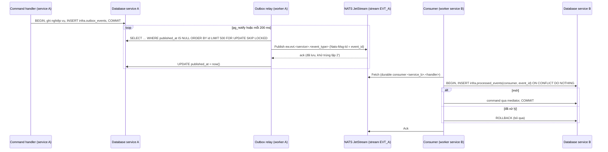

# Event Design

> Trạng thái: Draft · Phiên bản: 0.3 · Owner: Backend Architect + EdTech Specialist · Cập nhật: 2026-11-15
> Liên quan: [ADR-0042](../adr/ADR-0042-domain-event-qua-transactional-outbox-nats-jetstream-thay-tr.md) · [ADR-0036](../adr/ADR-0036-microservices-theo-he-thong-lon-thay-adr-0001.md) · [ADR-0019](../adr/ADR-0019-transactional-outbox-valkey-streams-cho-domain-events.md) · [VALKEY_DESIGN](VALKEY_DESIGN.md) · [DATABASE_DESIGN](DATABASE_DESIGN.md) · [LEARNING_ANALYTICS](../02-learning/LEARNING_ANALYTICS.md) · [JSON Schema learning event](../../specs/schemas/learning-event.schema.json) · [DATA_PRIVACY](../10-security/DATA_PRIVACY.md)

> **Thay đổi v0.3:** domain event giữa các service đi qua transactional outbox của từng service → NATS JetStream (stream `EVT_<SERVICE>`, subject `ew.evt.<service>.<event_type>`), thay Valkey Streams (ADR-0042). Cột "Producer" trong catalog ghi tên module; service sở hữu module theo [DOMAIN_MODEL §1](../06-architecture/DOMAIN_MODEL.md).

## 1. Hai loại event

| Loại | Mục đích | Lưu bền vững | Vận chuyển |
|---|---|---|---|
| **Domain event** | Tích hợp giữa service (cộng XP, cập nhật quest, projection `ref`, audit) | `infra.outbox_events` trong database của service phát (30 ngày) | Outbox relay → NATS JetStream `ew.evt.<service>.<event_type>` (stream `EVT_<SERVICE>`) |
| **Learning event** | Bằng chứng học tập (LRS nội bộ, xAPI-like) cho mastery, analytics, báo cáo | `learning.learning_events` trong `eduworld_learning` (partition tháng, giữ theo chính sách OQ-12) | Ghi trực tiếp trong transaction của use case **và** đồng thời phát domain event `learning.event_recorded` (tùy chọn, cho consumer realtime) |

Learning event là **dữ liệu**; domain event là **tín hiệu**. Không suy ra lịch sử học tập từ stream. Learning event phát sinh ở service khác (quest, trận đấu) được learning-service ghi khi tiêu thụ domain event tương ứng (`quest.completed`, `match.completed`).

## 2. Envelope chuẩn

Áp dụng cho cả hai loại (learning event có thêm trường bắt buộc §5.1).

```json
{
  "event_id": "0193a5f4-6c1e-7b2a-9d1f-3c4e5a6b7c8d",
  "event_type": "exercise.submitted",
  "schema_version": 1,
  "occurred_at": "2026-11-15T07:30:12.345Z",
  "recorded_at": "2026-11-15T07:30:12.360Z",
  "producer": "learning-service/exercise",
  "tenant_id": "0192f…",
  "actor": { "type": "student", "id": "0192e…" },
  "subject": { "type": "attempt", "id": "0193a…" },
  "session_id": "0193a…",
  "idempotency_key": "attempt:0193a…:submit",
  "trace_id": "4bf92f3577b34da6a3ce929d0e0e4736",
  "payload": { }
}
```

| Trường | Kiểu | Bắt buộc | Ghi chú |
|---|---|---|---|
| `event_id` | UUIDv7 | ✔ | Sinh tại producer; sắp xếp theo thời gian |
| `event_type` | string (≤ 64) | ✔ | `<entity>.<past_tense_verb>` |
| `schema_version` | int | ✔ | Tăng khi payload thay đổi không tương thích |
| `occurred_at` | timestamp UTC | ✔ | Thời điểm nghiệp vụ (server time) |
| `recorded_at` | timestamp UTC | ✔ | Thời điểm ghi |
| `producer` | string (≤ 64) | ✔ | `<service>/<module>` |
| `tenant_id` | UUID | ✔ (trừ event platform, khi đó `null`) | Tenant (ADR-0005); consumer phải dùng làm `TenantScope`. `school_id` (trường bên trong tenant) nếu cần nằm trong `payload` |
| `actor` | object | ✔ | `student`, `teacher`, `system`, `admin`… |
| `subject` | object | ✔ | Tài nguyên chính của event |
| `session_id` | UUID | — | `game_session_id` hoặc phiên CMS |
| `idempotency_key` | string (≤ 128) | ✔ | Khóa nghiệp vụ tất định — giống nhau khi sự việc lặp lại |
| `trace_id` | string (≤ 64) | — | W3C trace id |
| `payload` | object | ✔ | Theo catalog §4; **chỉ ID và giá trị cần thiết**, không PII |

## 3. Outbox → NATS JetStream (ADR-0042)



Bảng `infra.outbox_events` và `infra.processed_events` có trong **mỗi database**; DDL chuẩn ở [DATABASE_DESIGN §3.9](DATABASE_DESIGN.md#39-outbox--processed-events).

`pg_notify('ew_outbox')` sau commit để relay phản ứng nhanh; polling 200 ms làm dự phòng.

### 3.1. Stream, subject và consumer

| Stream | Subjects | Producer | Lưu | Ghi chú |
|---|---|---|---|---|
| `EVT_IDENTITY` | `ew.evt.identity.>` | identity-service | 7 ngày, file, 3 replicas | Tenant, user, SIS, membership, cleanup, settings |
| `EVT_LEARNING` | `ew.evt.learning.>` | learning-service | 7 ngày | Content, exercise, exam, mastery, LMS |
| `EVT_GAME` | `ew.evt.game.>` | game-service | 7 ngày | Game session, login, quest, XP, reward, Game Studio publish |
| `EVT_COMPETITION` | `ew.evt.competition.>` | competition-service | 7 ngày | Party, match, rating, tournament |
| `EVT_CHAT` | `ew.evt.chat.>` | chat-service | 7 ngày | Domain event chat/moderation (không chứa nội dung tin) |
| `CHAT_MESSAGES` | `ew.chat.*.msg.*`, `ew.chat.*.evt.*`, `ew.chat.*.cursor.*` | chat-service | 72 h | Đường ghi tin nhắn (ADR-0035, §4.10) |
| `DLQ_<SVC>` (`DLQ_IDENTITY`, `DLQ_LEARNING`, `DLQ_GAME`, `DLQ_COMPETITION`, `DLQ_CHAT`) | `ew.dlq.<svc>.<consumer>` | consumer của service | 30 ngày | Event xử lý lỗi quá số lần (theo service nhận) |
| `IDENTITY_SIS_JOBS` | `ew.job.identity.sis.>` | identity-service (api: upload CSV, webhook SIS, lịch) | Work-queue (retention `WorkQueue`) | Hàng đợi job SIS sync, thay `ew:sis:jobs` cũ |

Stream và durable consumer được tạo idempotent bởi worker của service sở hữu (`CreateOrUpdateStream`/`CreateOrUpdateConsumer`), cấu hình trong code + env. Consumer đặt tên `<service_nhận>.<handler>` (vd. `game.quest_on_exercise_submitted`) và dùng `FilterSubjects` chỉ lấy event cần.

### 3.2. Bản đồ consumer giữa service

| Event (producer) | identity | learning | game | competition | chat |
|---|---|---|---|---|---|
| `tenant.*`, `school.*`, `class.*`, `student.synced`, `enrollment.changed`, `teaching_assignment.changed` (identity) | — | projection `ref.*`, LMS | projection `ref.*` | projection `ref.*` | projection `ref.*`, channel lớp |
| `user_role.changed`, `role.updated`, `tenant_membership.changed` (identity) | Keycloak membership + realm role `tenant_staff`/`platform_staff` | invalidate Principal cache | invalidate | invalidate | invalidate |
| `user.access_revoked`, `student.cleaned_up`, `student.restored` (identity) | — | `ref.students` | đóng game session, `ref.students` | rời party, `ref.students` | rời channel, `ref.students` |
| `exercise.submitted`, `exam.graded`, `learning_objective.*` (learning) | — | mastery (nội bộ) | quest progress, XP/reward | — | — |
| `student.game_logged_in/out` (game) | `users.last_login_at` | `ref.login_activity` (dashboard) | — | — | — |
| `exercise.*`, `activity_attempt.*`, `exam.graded`, `assignment.*`, `learning_objective.*` (learning — nội bộ) | — | consumer `learning.rollup_dashboard`: upsert `progress_daily` và `rollup_class/school/tenant_daily` ([DASHBOARD_DATA §4](DASHBOARD_DATA.md#4-pipeline-gia-tăng)) | — | — | — |
| `game_profile.updated` (game) | — | — | — | `ref.player_profiles` | `ref.player_profiles` |
| `game_session.replaced` (game) | revoke Keycloak session (`sid`) | — | — | đánh dấu disconnect trong grace | — |
| `quest.completed`, `minigame.completed` (game) | — | learning event (evidence) | — | — | — |
| `match.started`, `match.completed`, `party.created/disbanded`, `party.member_*` (competition) | — | evidence `competition` (mastery trọng số thấp) | XP/reward thi đấu, co-op quest | — | mở/đóng channel `match`/`team`/`party`, `ref.parties` |
| `audit.recorded` (mọi service) | ghi `audit.audit_logs` | — | — | — | — |
| Sự kiện chơi: `game_session.*`, `world.*`, `story.*`, `avatar.created`, `quest.*`, `challenge.*`, `boss.*`, `xp.awarded`, `level.reached`, `currency.*`, `shop.item_purchased`, `achievement.unlocked`, `collection.completed`, `wellbeing.*` (game); `party.created`, `party.activity_started`, `match.completed`, `duel.*` (competition); `chat.daily_stats` (chat); `exercise.submitted` (learning, chỉ đếm) | — | — | **analytics consumer** (durable `analytics`, ghi `analytics.events_raw` — [GAME_ANALYTICS](../11-operations/GAME_ANALYTICS.md), ADR-0058) | — | — |
| `user.blocked` (chat) | — | — | — | chặn mời party/ghép | — |
| `item.published`, `reward_rule.published` (game, Game Studio) | — | — | — | — | — (sticker pack/GIF thuộc chat-service, không cần event chéo) |

Consumer rollup dashboard (`learning.rollup_dashboard`, `game.analytics`) gom lô ≤ 1 s/500 event, upsert idempotent theo `processed_events`, chạy trên primary; job chốt ngày và xử lý event đến muộn ≤ 48 giờ theo [DASHBOARD_DATA §4–5](DASHBOARD_DATA.md#4-pipeline-gia-tăng) (ADR-0062).

Realtime push tới client **không** là consumer JetStream: service xử lý event (hoặc command) tự `PUBLISH` Valkey `ew:rt:user:<id>` / `ew:rt:room:<id>` / `ew:chat:fanout:<channel>`; `realtime-gateway` subscribe và giao xuống WS ([REALTIME_ARCHITECTURE](../06-architecture/REALTIME_ARCHITECTURE.md)).

## 4. Catalog domain events

Producer/consumer ghi theo module; module → service: identity/tenancy/organization/sis/audit → **identity-service**; content/curriculum/exercise/exam/learning_record/learning_analytics/lms → **learning-service**; game_session/quest/minigame/gamification/reward → **game-service**; party/multiplayer/competition/ranking/leaderboard/tournament/season → **competition-service**; friend/chat/moderation/notification → **chat-service**; RT = đẩy realtime qua Valkey Pub/Sub tới `realtime-gateway`. Bản đồ consumer giữa service: §3.2.

Ký hiệu consumer: GAM = gamification, QST = quest, LR = learning_record, LA = learning_analytics, LMS, RT = realtime push, AUD = audit, NTF = notification, RNK = ranking, LDB = leaderboard, MOD = moderation, ANA = game analytics consumer (game-service, [GAME_ANALYTICS](../11-operations/GAME_ANALYTICS.md)). Mọi event chơi liệt kê ở §3.2 dòng "Sự kiện chơi" đều có ANA là consumer dù cột Consumers bên dưới không ghi lại.

### 4.1. Identity, Tenancy, Organization & SIS

| Event | Producer | Consumers | Payload chính |
|---|---|---|---|
| `user.provisioned` | identity | AUD, GAM (tạo GameProfile) | `user_id`, `user_type`, `source` (jit/sis/manual) |
| `user.activated` | identity | AUD, GAM | `user_id`, `external_identity_id` — lần đăng nhập đầu chuyển `pending → active` ([ACCOUNT_PROVISIONING](../09-identity/ACCOUNT_PROVISIONING.md)) |
| `user.access_revoked` | identity | RT (đóng WS, close code 4003), AUD | `user_id`, `reason` (locked/deactivated/transferred) |
| `user.access_restored` | identity | AUD, NTF | `user_id`, `reason` — mở khóa; Keycloak `enabled=true` |
| `user.status_changed` | identity | AUD, MOD | `user_id`, `from`, `to` |
| `user_role.changed` | identity | AUD, cache invalidation (Principal, menu portal), tenancy (đồng bộ membership Keycloak Organization và realm role `tenant_staff`/`platform_staff`, ADR-0066) | `user_role_id`, `user_id`, `role_id`, `role_code`, `tenant_id` (null nếu platform), `scope_type`, `scope_id`, `source` (`sis`/`manual`), `op` (granted/revoked/expired/updated), `actor_id` — thay `role_assignment.changed` |
| `role.updated` | identity | AUD, cache invalidation (Principal của mọi user có UserRole với role này) | `role_id`, `code`, `tenant_id` (null = dùng chung), `role_scope_kind`, `op` (created/updated/deleted), `permissions_added[]`, `permissions_removed[]`, `actor_id` (ADR-0066) |
| `tenant.created` / `tenant.updated` | tenancy | identity (cache alias, membership), Keycloak sync (tạo/cập nhật Organization), AUD | `tenant_id`, `tenant_type`, `status`, `changed_fields[]` |
| `tenant_data.assigned` / `tenant_data.unassigned` | tenancy | content/lms/game cache, AUD | `resource_type`, `resource_id`, `tenant_id`, `assignment_id` (ADR-0029) |
| `tenant_data.cloned` | tenancy (worker clone) | AUD (ghi cả tenant nguồn và đích), NTF (System Admin) | `job_id`, `source_tenant_id`, `target_tenant_id`, `resource_type`, `count`, `status` |
| `tenant_membership.changed` | tenancy | identity (cache, Keycloak Organization member add/remove, thu hồi session) | `user_id`, `tenant_id`, `op` (added/removed), `source` |
| `<entity>.deleted` / `<entity>.restored` | module sở hữu entity | AUD, cache invalidation, consumer liên quan (vd. `class.deleted` → chat ẩn channel lớp) | `<entity>_id`, `tenant_id`, `deleted_by`/`restored_by`, `reason` — soft-delete/khôi phục (ADR-0028) |
| `student.provisioning_requested` | sis | identity (worker tạo user Keycloak qua admin API) | `student_id`, `tenant_id`, `school_id`, `sis_connection_id` |
| `student.synced` | sis | AUD, cache invalidation | `student_id`, `school_id`, `action` (create/update/deactivate), `sync_run_id` |
| `school.synced` | sis | AUD, cache invalidation | `school_id`, `sync_run_id`, `changed_fields[]` |
| `enrollment.changed` | organization | identity (cache), LMS, chat (channel lớp), AUD | `student_id`, `class_id`, `op` (added/ended/transferred) |
| `teaching_assignment.changed` | organization | identity (scope cache), chat (member channel lớp), LMS | `teacher_id`, `class_id`, `subject_id`, `op` (added/ended) |
| `student.transferred` | organization | chat, party (rời party), LMS, tenancy (đổi membership nếu khác tenant), AUD | `student_id`, `from_tenant_id`, `to_tenant_id`, `from_school_id`, `to_school_id` |
| `class.created` / `class.updated` | organization | chat (tạo channel lớp), LMS | `class_id`, `grade_level` |
| `class.synced` | identity (đồng bộ SIS định kỳ hoặc khi học sinh đăng nhập — ADR-0060, ADR-0061) | chat (thành viên channel lớp), LMS, projection `ref.classes`, dashboard (sĩ số), cache Principal | `class_id`, `school_id`, `grade_level`, `name`, `academic_year`, `status`, `op` (`created`/`updated`/`closed`), `trigger` (`scheduled_sync`/`login_sync`/`manual_import`), `sis_connection_id`, `changed_fields[]` — không chứa danh sách học sinh |
| `province.updated` | identity (danh mục platform, ADR-0060; envelope `tenant_id = null`) | learning, game (projection `ref.provinces`), identity (`ref.schools` tên tỉnh phi chuẩn hóa) | `province_id`, `code`, `country_code`, `official_code`, `name {vi,en}`, `status`, `effective_to`, `successor_code`, `op` (`created`/`updated`/`deactivated`/`succession_recorded`) |
| `student.cleanup_scheduled` | worker `student-inactive-cleanup` | NTF (Tenant Admin/School Admin: danh sách sắp bị dọn), AUD | `tenant_id`, `student_ids[]` (lô), `scheduled_cleanup_at`, `cutoff_days` (ADR-0032) |
| `student.cleaned_up` | worker `student-inactive-cleanup` | identity (gỡ Keycloak Organization + disable user, thu hồi session), party (rời party), RT (đóng WS), LA, AUD | `student_id`, `tenant_id`, `last_login_at`, `cutoff_days`, `run_id` — soft-delete, không xóa dữ liệu |
| `student.restored` | identity (JIT khi học sinh đăng nhập lại) | identity (thêm lại membership), LA, AUD | `student_id`, `tenant_id`, `cleaned_up_at`, `restored_via` (`login`/`admin`) |
| `platform_settings.changed` | tenancy | API/worker (invalidate cache), AUD | `key` (`student_cleanup`/`chat_retention`), `scope` (`platform`/`tenant`), `tenant_id?`, `before`, `after`, `reason`, `actor_id` |
| `audit.recorded` | mọi service (outbox) | identity-service (ghi `audit.audit_logs`) | `actor_id`, `actor_type`, `action`, `target_type`, `target_id`, `result`, `reason?`, `metadata` — không PII/nội dung chat (§3.2) |
| `sis.sync_completed` | sis | AUD, NTF (admin) | `sync_run_id`, `stats`, `issues_count` |
| `student.sis_link_created` | identity (provisioning/JIT/reconciliation) | AUD, LA | `user_id`, `tenant_id`, `school_id`, `sis_connection_id`, `student_external_id`, `via` (`provisioning`/`jit_login_key`/`jit_lookup`/`transfer`) (ADR-0046) |
| `student.sis_link_superseded` | identity (reconciliation chuyển trường giữa hai SIS) | AUD, LA | `user_id`, `old_sis_connection_id`, `old_student_external_id`, `new_sis_connection_id`, `new_student_external_id`, `cross_tenant` (ADR-0046) |
| `sis.reconciliation_issue_raised` | sis | NTF (school admin) | `issue_id`, `kind` |

**Mở rộng sau (ADR-0063):** `login_credential.issued` / `login_credential.revoked` (đăng nhập nhanh PIN/thẻ QR/mật khẩu hình ảnh, ADR-0045) không phát trong Release 1.0. Payload JSON Schema của event identity mới: [`specs/events/payloads/identity/`](../../specs/events/payloads/identity/) (`user_role.changed`, `role.updated`, `province.updated`, `class.synced`).

### 4.2. Content & Curriculum

| Event | Producer | Consumers | Payload chính |
|---|---|---|---|
| `content.version_submitted` | content | NTF (reviewer) | `content_type`, `content_id`, `version_id` |
| `content.version_approved` / `content.version_rejected` | content | NTF, AUD | như trên + `reviewer_id` |
| `content.published` | learning / game / chat (service sở hữu item) | snapshot worker cập nhật con trỏ cache `ew:<svc>:current:*`, manifest builder (game), LMS (bài `follow_latest`), QB pool cache, AUD | `item_type`, `item_id`, `from_version_id`, `to_version_id`, `release_id`, `owner_scope`, `tenant_id?`, `scheduled` (ADR-0043) |
| `content.rolled_back` | như trên | như trên | như `content.published` + `reason` (bắt buộc) |
| `content.unpublished` | như trên | như trên (xóa con trỏ cache, gỡ khỏi manifest) | `item_type`, `item_id`, `from_version_id`, `release_id`, `reason` |
| `content.publish_scheduled` | như trên | worker hẹn giờ, AUD | `item_type`, `item_id`, `version_id`, `publish_at` |
| `content.manifest_updated` | game (manifest builder) | realtime-gateway → WS `content.manifest.updated` tới học sinh online của tenant (chỉ báo, áp dụng ở màn sau) | `tenant_id`, `manifest_version`, `etag`, `changed_items[]` (≤ 200) |
| `content.version_archived` | content | cache, LMS | như `content.published` (không đổi con trỏ) |
| `media.uploaded` | learning / game / chat | media worker | `asset_id`, `tenant_id?`, `kind`, `quarantine_key`, `size_bytes` (ADR-0044) |
| `media.processed` | media worker | service sở hữu (cập nhật `media_assets.status=ready`, `variants`), NTF (người upload) | `asset_id`, `sha256`, `variants[]` |
| `media.rejected` | media worker | service sở hữu, NTF | `asset_id`, `reason` (`virus`/`type_mismatch`/`too_large`/`transcode_failed`) |
| `curriculum.version_published` | curriculum | content, LA | `curriculum_version_id` |

### 4.3. Assessment (exercise / exam)

| Event | Producer | Consumers | Payload chính |
|---|---|---|---|
| `exercise.started` | exercise | LA | `attempt_id`, `mode`, `context_ref`, `source_version_id` |
| `exercise.submitted` | exercise | GAM, QST, LR, LMS, RT | `attempt_id`, `mode`, `score`, `max_score`, `correct_count`, `item_count`, `duration_ms`, `objective_ids[]` |
| `exam.started` | exam | LA, AUD | `attempt_id`, `exam_session_id`, `deadline_at` |
| `exercise.abandoned` | exercise | LA, LMS | `attempt_id`, `mode`, `reason` (expired/user/superseded) ([ACTIVITY_ENGINE](../02-learning/ACTIVITY_ENGINE.md)) |
| `exam.submitted` | exam | LMS, AUD | `attempt_id`, `exam_session_id`, `submit_reason` (manual/timeout) |
| `exam.graded` | exam | **LR** (evidence mastery lấy từ đây, không từ `exam.submitted`), LMS, NTF, GAM | `attempt_id`, `score`, `max_score`, `is_official` |
| `exam.regraded` | exam | LR (event bù trừ evidence, không xóa event cũ), LMS, NTF | `exam_session_id`, `regrade_request_id`, `question_version_id`, `affected_attempt_ids[]` ([EXAM_ENGINE §9](../02-learning/EXAM_ENGINE.md)) |
| `activity.submitted` | activity engine (ADR-0048) | GAM, QST, LR, LMS | `attempt_id`, `activity_id`, `activity_version_id`, `activity_type`, `mode`, `status` (graded/pending_review), `score?`, `objective_ids[]` — mọi activity_type ngoài quiz/exercise cũ ([ACTIVITY_ENGINE](../02-learning/ACTIVITY_ENGINE.md)) |
| `activity.graded` | activity engine | LR, LMS, NTF, GAM | `attempt_id`, `evaluation_id`, `source` (system/teacher), `score`, `max_score`, `passed`, `criteria_scores?` |
| `attempt.re_evaluated` | activity engine | LR (bút toán điều chỉnh), LMS, NTF | `attempt_id`, `old_evaluation_id`, `new_evaluation_id`, `reason` |
| `review_task.created` / `review_task.completed` | lms (review queue) | NTF, LMS read model | `review_task_id`, `attempt_id`, `assignee_teacher_id`, `due_at` ([WRITTEN_RESPONSE_RUBRIC](../02-learning/WRITTEN_RESPONSE_RUBRIC.md)) |
| `speaking.recording_submitted` | activity engine | LA, NTF | `recording_id`, `attempt_id` (không có nội dung âm thanh) |
| `simulation.run_verified` / `simulation.run_rejected` | activity engine | LR, AUD (rejected → integrity) | `run_id`, `attempt_id`, `template_code`, `goals_met` |
| `assignment.created` | lms | NTF, RT | `assignment_id`, `target`, `due_at` |
| `assignment.completed` | lms | GAM, NTF (giáo viên tùy chọn) | `assignment_id`, `student_id`, `attempt_id` |

### 4.4. Learning record

| Event | Producer | Consumers | Payload chính |
|---|---|---|---|
| `learning_objective.progressed` | learning_record | GAM (achievement), RT, LA | `objective_id`, `from`, `to` (value), `level` |
| `learning_objective.mastered` | learning_record | GAM, NTF, LMS | `objective_id`, `value`, `evidence_count` |
| `learning.recommendation_generated` | learning_analytics | RT, LMS | `student_id`, `objective_ids[]`, `content_refs[]` |

### 4.5. Game

| Event | Producer | Consumers | Payload chính |
|---|---|---|---|
| `game_session.started` / `game_session.ended` | game_session | LA (thời gian học), AUD | `game_session_id`, `platform`, `client_version`, `duration_ms`, `end_reason` (`logout`/`replaced_by_other_device`/`timeout`/`account_locked`/`cleanup`/`client_crash`) |
| `student.game_logged_in` | game_session | LA (hoạt động, lần đăng nhập cuối), AUD | `student_id`, `tenant_id`, `game_session_id`, `login_event_id`, `platform`, `login_at` — không có IP/device_id thô (ADR-0031) |
| `student.game_logged_out` | game_session | LA, AUD | `student_id`, `game_session_id`, `logout_at`, `end_reason` |
| `game_session.replaced` | game_session | RT (gửi `session.session.replaced` tới thiết bị cũ, close 4409), identity (revoke Keycloak session theo `sid`), multiplayer (đánh dấu disconnect, giữ chỗ trong grace), AUD | `old_game_session_id`, `new_game_session_id`, `student_id`, `new_platform` |
| `quest.accepted` | quest | LA | `quest_version_id`, `party_id?` |
| `quest.step_completed` | quest | RT | `quest_version_id`, `step_id` |
| `quest.completed` | quest | GAM, LR, RT, NTF, ANA | `quest_version_id`, `quest_type`, `party_id?`, `objective_ids[]` |
| `quest.abandoned` | quest (`:abandon` hoặc hết hạn/thất bại theo QUEST_SYSTEM) | ANA | `quest_version_id`, `quest_type`, `reason` (`player`/`expired`/`failed`), `step_id` |
| `world.area_entered` | world | ANA | `area_id`, `from_area_id`, `instance_kind` — gộp tối đa 1 event/area/phút/người chơi |
| `wellbeing.break_reminder_shown` | game_session | ANA | `minutes_played`, `reminder_no` (ngưỡng theo CHILD_SAFETY) |
| `minigame.completed` | minigame | QST, GAM (trigger reward rule) | `minigame_version_id`, `attempt_id`, `result` — phát cùng `exercise.submitted` của attempt mode `minigame` ([MINIGAME_ENGINE](../08-game-client/MINIGAME_ENGINE.md)) |
| `item.granted` | reward | RT, AUD | `item_id`, `grant_id` |
| `event.scheduled` / `event.started` / `event.suspended` / `event.resumed` / `event.ended` / `event.cancelled` | event (live-ops, [EVENT_SEASON_SYSTEM](../01-game-design/EVENT_SEASON_SYSTEM.md)) | content manifest, RT (Event Center), NTF (trong game), QST, ANA, AUD | `event_id`, `event_run_id`, `event_version_id`, `event_kind`, `audience` (scope + id), `starts_at`, `ends_at`, `reason?` (bắt buộc với suspended/cancelled) |
| `event.participation_started` | event | ANA, achievement | `event_run_id`, `student_id` |
| `event.milestone_claimed` | event | reward, ANA | `event_run_id`, `milestone_id`, `student_id` |
| `community_goal.milestone_reached` / `community_goal.completed` | event | reward (thưởng người có đóng góp), RT, world (đổi trang trí) | `goal_id`, `scope_id`, `milestone_pct`, `world_change_code?` |
| `season_track.tier_reached` | season_track | reward, RT, ANA | `season_id`, `student_id`, `tier` |
| `season_track.reward_claimed` | season_track | reward, ANA, AUD | `season_id`, `student_id`, `tier`, `auto_granted` (bool) |

### 4.6. Gamification

| Event | Producer | Consumers | Payload chính |
|---|---|---|---|
| `xp.awarded` | gamification | RT, LDB (xp leaderboard nếu bật) | `amount`, `source_type`, `source_code`, `source_id`, `rule_id`, `capped` (bool) |
| `level.reached` | gamification | RT, NTF, reward, achievement | `from_level`, `to_level`, `curve_version`, `title_code` ([PROGRESSION_SYSTEM](../01-game-design/PROGRESSION_SYSTEM.md)) |
| `achievement.progressed` | gamification | RT | `achievement_id`, `tier`, `progress` |
| `achievement.unlocked` | gamification | RT, NTF, reward | `achievement_id`, `tier` |
| `avatar.created` | game | achievement, LA (funnel) | `student_id`, `preset_code?` |
| `world.area_unlocked` | game | RT, NTF, QST | `area_id`, `rule_version` |
| `world.discovery_found` | game | QST, achievement, reward | `area_id`, `interactable_id`, `kind` (discovery/collectible) |
| `world.area_completed` | game | achievement, reward | `area_id`, `completion_pct` |
| `story.chapter_completed` | game | achievement, reward, RT, LA | `student_id`, `chapter_code`, `chapter_version_id`, `region_code` ([WORLD_DESIGN §2.2](../01-game-design/WORLD_DESIGN.md)) — phát một lần/chương/học sinh |
| `challenge.started` | game | LA | `challenge_attempt_id`, `challenge_version_id`, `difficulty`, `party_id?` |
| `challenge.completed` | game | reward, achievement, QST, LA | `challenge_attempt_id`, `status` (succeeded/failed/abandoned), `score`, `difficulty`, `objective_ids[]` ([CHALLENGE_BOSS_SYSTEM](../01-game-design/CHALLENGE_BOSS_SYSTEM.md)) |
| `boss.encounter_started` | game | RT, LA | `encounter_id`, `boss_version_id`, `member_ids[]` |
| `boss.phase_completed` | game | RT | `encounter_id`, `phase_id` |
| `boss.encounter_completed` | game | reward, achievement, QST, LA | `encounter_id`, `result` (defeated/ended), `contributions[]` (`student_id`, `eligible`) |
| `currency.credited` / `currency.debited` | gamification | RT, AUD | `currency_code`, `delta`, `balance_after`, `reason_code`, `source_id` ([INVENTORY_ECONOMY](../01-game-design/INVENTORY_ECONOMY.md), ADR-0049) |
| `shop.item_purchased` | gamification | RT, achievement, AUD | `shop_item_version_id`, `item_id`, `price` |
| `collection.item_added` / `collection.completed` | gamification | RT, reward, achievement | `collection_id`, `item_id` |
| `economy.adjusted` | gamification | AUD | `entry_ids[]`, `reason`, `approved_by` |
| `reward.granted` | reward | RT, AUD | `grant_id`, `items[]`, `xp`, `source_event_id` |

### 4.7. Multiplayer & Party

| Event | Producer | Consumers | Payload chính |
|---|---|---|---|
| `party.created` | party | AUD, chat (tạo channel party) | `party_id`, `party_type`, `leader_id`, `max_members` |
| `party.settings_updated` | party | RT, AUD | `party_id`, `changed_fields[]` |
| `party.invitation_sent` / `_accepted` / `_rejected` / `_expired` / `_cancelled` | party | RT, NTF, AUD | `invitation_id`, `inviter_id`, `invitee_id` |
| `party.member_joined` / `party.member_left` / `party.member_kicked` | party | RT, chat, AUD | `party_id`, `student_id`, `reason` |
| `party.leader_transferred` | party | RT, AUD | `party_id`, `from`, `to`, `reason` (manual/disconnect) |
| `party.activity_selected` | party | RT | `party_id`, `activity_type`, `activity_ref` |
| `party.activity_started` | party | RT, QST, AUD | `party_id`, `activity_ref`, `room_id`, `game_session_ref` |
| `party.activity_ended` | party | RT, AUD | `party_id`, `outcome` (completed/failed/abandoned/aborted) |
| `party.activity_completed` | party | GAM (trigger reward rule co-op), QST, LA | `party_activity_id`, `party_id`, `activity_type`, `activity_ref`, `member_ids[]` — phát **thêm** khi `party.activity_ended` có `outcome=completed`; kết quả học tập vẫn ghi riêng từng học sinh |
| `party.disbanded` | party | RT, chat (đóng channel), AUD | `party_id`, `reason` |

Ready/Not ready là trạng thái tạm thời của lobby (Valkey), **không** phải domain event: chỉ đẩy qua WS (`party.member.ready_changed`), không ghi outbox.

### 4.7.1. Quy tắc đặt tên: domain event ↔ WebSocket message

| Loại | Dạng | Ví dụ | Nơi định nghĩa |
|---|---|---|---|
| Domain event (outbox → NATS JetStream) | `<entity>.<past_verb>` — **2 phần**, động từ ghép dùng `_` | `party.member_joined`, `chat.message_held` | Tài liệu này |
| WS server → client | `<domain>.<entity>.<past_verb>` — **3 phần** | `party.member.joined`, `chat.message.created` | [AsyncAPI](../../specs/asyncapi/eduworld-realtime.v1.yaml) |
| WS client → server (lệnh) | `<domain>.<entity>.<verb>` — 3 phần, động từ hiện tại | `party.member.ready_set`, `chat.message.send` | AsyncAPI |

Service sở hữu dịch domain event/kết quả command thành WS message theo bảng ánh xạ (code `internal/presentation/realtime/eventmap.go` của từng service) rồi `PUBLISH` Valkey; `realtime-gateway` chỉ giao xuống client. Tài liệu domain khi nói về **message gửi tới client** dùng tên 3 phần; khi nói về **outbox/consumer** dùng tên 2 phần.

| Domain event | WS message (server → client) | Ghi chú |
|---|---|---|
| `party.member_joined` / `party.member_left` / `party.member_kicked` | `party.member.joined` / `party.member.left` (kèm `reason=kicked`) | |
| `party.leader_transferred` | `party.leader.transferred` | |
| `party.invitation_sent` | `party.invitation.received` (chỉ tới invitee) | |
| `party.invitation_accepted` / `_rejected` / `_expired` / `_cancelled` | `party.invitation.updated` (`status`) | |
| `party.settings_updated` | `party.state.snapshot` | Gửi lại snapshot đầy đủ |
| `party.activity_selected` | `party.activity.selected` | |
| `party.activity_started` / `party.activity_ended` | `party.session.started` / `party.session.ended` | |
| `party.disbanded` | `party.party.disbanded` | |
| `chat.message_created` (persister phát qua outbox **sau** khi commit PG; chỉ cho audit/analytics) | `chat.message.created` | Đường giao tin tới client **không** chờ domain event: chat-service publish NATS JetStream → ack → `PUBLISH ew:chat:fanout:<channel_id>` (ADR-0035, §4.10) |
| `chat.message_edited` / `chat.message_recalled` | `chat.message.edited` / `chat.message.recalled` | Như trên: fan-out ngay sau JetStream ack |
| `chat.message_pinned` / `chat.message_unpinned` | `chat.pin.updated` | |
| `chat.message_held` | `chat.message.held` (chỉ người gửi) | |
| `chat.message_removed` | `chat.message.removed` | |
| `sanction.applied` | `chat.sanction.applied` (chỉ người bị áp dụng) | |
| — (trạng thái Valkey của matchmaker) | `matchmaking.ticket.updated`, `matchmaking.proposal.created` / `.updated` / `.cancelled` | Matchmaking queue là dữ liệu tạm (ADR-0004), không qua outbox |
| `match.created` | `matchmaking.match.assigned` (tới từng participant) | |
| `match.completed` | `battle.match.ended` | Từ state machine của room; `match.completed` là bản ghi bền vững |

### 4.8. Competition

| Event | Producer | Consumers | Payload chính |
|---|---|---|---|
| `match.created` | competition | AUD | `match_id`, `mode`, `participants[]` |
| `match.started` | competition | LA | `match_id` |
| `match.completed` | competition | RNK, LDB, GAM, LR, NTF | `match_id`, `mode`, `subject_id`, `results[] {student_id, outcome, points}` |
| `match.aborted` | competition | AUD | `match_id`, `reason` |
| `rating.updated` | ranking | LDB, RT | `student_id`, `mode`, `subject_id`, `season_id`, `rating`, `rd` |
| `tournament.match_scheduled` / `tournament.completed` | tournament | NTF, RT, GAM | `tournament_id`, … |
| `season.started` | season | game-service (projection `ref.seasons`, mở season track), LDB | `season_id`, `starts_at`, `ends_at`, `theme_code` |
| `season.ended` | season | GAM (season reward theo tier), game-service (đóng season track, tự cấp thưởng chưa nhận — [EVENT_SEASON_SYSTEM §7](../01-game-design/EVENT_SEASON_SYSTEM.md)), LDB | `season_id` |
| `duel.sent` / `duel.accepted` / `duel.declined` / `duel.expired` | competition (friend duel) | RT, NTF (trong game), AUD | `duel_id`, `challenger_id`, `opponent_id`, `subject_id`, `match_id?` — unranked, không phát `rating.updated` ([MATCHMAKING §8](../03-social-multiplayer/MATCHMAKING.md)) |

### 4.9. Social & Chat

| Event | Producer | Consumers | Payload chính |
|---|---|---|---|
| `friend_request.sent` / `friend.added` / `friend.removed` | friend | RT, NTF | `requester_id`, `addressee_id` |
| `user.blocked` / `user.unblocked` | friend | chat, competition (party, matchmaking, duel), AUD | `blocker_id`, `blocked_id` |
| `user.muted` / `user.unmuted` | friend | chat (ẩn tin), RT | `muter_id`, `muted_id` |
| `club.created` / `club.approved` / `club.archived` | club ([SOCIAL_SYSTEM §6](../03-social-multiplayer/SOCIAL_SYSTEM.md)) | chat (tạo/khóa channel club), NTF, AUD | `club_id`, `club_type`, `owner_id`, `school_id` |
| `club.member_joined` / `club.member_left` | club | chat (membership channel), competition (party từ club), RT | `club_id`, `user_id`, `role` |
| `club.goal_completed` | club | reward (huy hiệu club), NTF | `club_id`, `goal_id`, `metric`, `target` |
| `chat.message_created` | chat-persister (sau khi commit PG; nguồn: NATS `ew.chat.*.msg.*`) | AUD/LA (đếm, không nội dung) | `message_id`, `channel_id`, `seq`, `sender_id`, `kind` — **không** chứa nội dung text. Các consumer cần nội dung (moderation async, notifier) đọc trực tiếp NATS JetStream (§4.10) |
| `chat.message_edited` / `chat.message_recalled` / `chat.message_forwarded` | chat-persister | AUD, MOD (sửa/forward → tín hiệu async) | `message_id`, `channel_id`, `revision?`, `actor_id`, `target_channel_ids?` — không nội dung |
| `chat.message_pinned` / `chat.message_unpinned` | chat-persister | AUD | `channel_id`, `message_id`, `actor_id` |
| `chat.daily_stats` | chat (job rollup ngày, cùng nguồn `gameplay_chat_daily_stats`) | ANA | `stat_date`, `tenant_id`, `school_id`, `grade_band`, theo `channel_type`: `messages`, `active_senders`, `blocked`, `masked` — **không** nội dung, không theo người |
| `chat.message_held` | chat | MOD | `message_id`, `channel_id`, `reasons[]` (`category_codes` của danh mục, `pii`, `bullying`), `catalog_version` |
| `chat.message_removed` | moderation | RT, AUD | `message_id`, `channel_id`, `by` |
| `report.created` | moderation | MOD queue, NTF (moderator) | `report_id`, `target_type`, `target_id`, `reason` |
| `sanction.applied` / `sanction.lifted` | moderation | chat, RT, AUD | `user_id`, `sanction_type`, `until` |
| `sensitive_term.created` / `sensitive_term.updated` / `sensitive_term.deleted` | moderation (danh mục) | AUD | `term_id`, `category_code`, `scope`, `tenant_id?`, `actor_id` — **không** chứa nội dung term |
| `sensitive_catalog.published` | moderation (danh mục) | worker (phát `ew:chat:sensitive:version`), AUD | `scope`, `tenant_id?`, `catalog_version`, `term_count`, `checksum` |
| `chat_policy.moderation_switch_changed` | moderation (công tắc) | RT/API (invalidate cache), AUD, MON (metric `policy_disabled`), NTF (thông báo Tenant Admin của tenant bị ảnh hưởng) | `scope`, `tenant_id?`, `before`, `after`, `reason`, `expires_at?`, `actor_id`, `source` (`manual`/`auto_expire`) |
| `chat.channel_opened` | chat | RT (auto-join thành viên) | `channel_id`, `channel_type` (`match`/`party`/`team`…), `scope_ref`, `member_ids[]` — channel gameplay tự tạo khi vào trận/tạo party (ADR-0020 §6) |
| `chat.channel_closed` | chat (trận kết thúc / party giải tán) | worker `chat-channel-closer` (role app; đặt `purge_after`, ghi `chat.gameplay_partition_channels`), RT | `channel_id`, `channel_type`, `tenant_id`, `closed_at`, `purge_after` (ADR-0033) |
| `chat.gameplay_purged` | worker `gameplay-chat-purge` | AUD (tổng hợp), MON | `run_id`, `tenant_id`, `kind` (`gameplay`/`ephemeral`), `channels`, `messages`, `partitions_dropped`, `deferred_open_case` — **không** nội dung |
| `chat_policy.tenant_category_toggled` | moderation | RT/API (invalidate), AUD | `tenant_id`, `category_code`, `enabled`, `reason`, `actor_id` |

### 4.10. Chat transport trên NATS JetStream (ADR-0035) — khác outbox

Tin nhắn chat **không** đi qua outbox vì cần độ trễ thấp: chat-service publish thẳng vào stream `CHAT_MESSAGES` làm đường ghi bền vững. Outbox (→ `EVT_*`, ADR-0042) dùng cho mọi domain event khác, kể cả `chat.message_*` dành cho audit/analytics.

| Subject | Nội dung | Publisher | Consumer (durable) |
|---|---|---|---|
| `ew.chat.<tenant_id>.msg.<channel_id>` | Tin mới (envelope đầy đủ, nội dung **đã kiểm duyệt** + bản gốc khi `mask`) | chat-service (handler `ew.cmd.chat.message.send` hoặc REST fallback) | `persister`, `notifier`, `moderation`, `stats` (worker chat-service) |
| `ew.chat.<tenant_id>.evt.<channel_id>` | `edit` (revision mới), `recall`, `reaction_set/unset`, `pin/unpin`, `forward` (tạo tin ở channel đích = msg riêng), `remove` (moderator) | chat-service | `persister`, `moderation`, `stats` |
| `ew.chat.<tenant_id>.cursor.<channel_id>` | Con trỏ gộp `{user_id, delivered_seq, read_seq}` | chat-service (nhận receipt từ gateway qua `ew.cmd.chat.receipt.*`) | `persister` |
| `CHAT_DLQ.<consumer>` | Message lỗi quá `max_deliver` | consumer | Vận hành (alert) |

Envelope chat:

```json
{
  "v": 1,
  "kind": "msg",
  "message_id": "0193a6b2-...",
  "tenant_id": "0192f0...",
  "channel_id": "0193a1...",
  "channel_type": "party",
  "seq": 1842,
  "revision": 1,
  "sender_id": "0192ab...",
  "client_msg_id": "6f1c...",
  "msg_kind": "text",
  "body_display": "Mình làm câu 3 rồi nè",
  "body_original_ref": null,
  "reply_to_message_id": null,
  "quote": null,
  "forwarded_from": null,
  "mentions": [],
  "sticker_id": null,
  "gif_id": null,
  "moderation": { "decision": "allow", "catalog_version": 57, "steps_skipped": [] },
  "created_at": "2026-11-15T08:30:12.345Z",
  "trace_id": "4bf92f..."
}
```

- Header NATS `Nats-Msg-Id = message_id` (khử trùng lặp trong `duplicate_window` 2'); persister `ON CONFLICT (message_id) DO NOTHING`.
- Sự kiện `evt` mang `revision` tăng dần; persister bỏ qua bản có `revision` ≤ revision hiện tại (đến muộn).
- Nội dung gốc khi `mask` không nằm trong `body_display`; nếu cần lưu (bằng chứng), chat-service gửi trong trường `body_original` chỉ đọc được bởi consumer `persister`/`moderation` (stream không mở cho consumer khác) [Proposed].
- Stream `CHAT_MESSAGES`: file storage, 3 replicas, `max_age` 72 h, `duplicate_window` 2'. Consumer `ack_wait` 30 s, `max_deliver` 5.
- Domain event `chat.message_*` ở §4.9 do persister phát **sau** khi commit PG (qua outbox), dành cho audit/analytics không cần nội dung.

## 5. Learning events (Master Prompt §16)

### 5.1. Trường bổ sung bắt buộc

| Trường | Ghi chú |
|---|---|
| `student_id` | = `actor.id` khi actor là học sinh |
| `tenant_id` | Tenant của học sinh tại thời điểm xảy ra (khóa cô lập) |
| `school_id` | Trường (bên trong tenant) của học sinh tại thời điểm xảy ra |
| `session_id` | `game_session_id` |
| `activity_id` | Learning activity / quest step / match / assignment ref |
| `content_id`, `content_version_id` | Nội dung cụ thể (question version, question set version, lesson version…) |
| `context` | `{ mode, assignment_id?, exam_session_id?, quest_version_id?, match_id?, party_id? }` |
| `objective_ids[]` | Learning objectives liên quan |

### 5.2. Catalog learning event

| `event_type` | Khi nào | Payload chính |
|---|---|---|
| `activity.started` | Bắt đầu learning activity bất kỳ | `activity_type` |
| `activity.completed` | Hoàn thành activity | `duration_ms`, `completion` |
| `video.progressed` | `watched_ratio` vượt mốc 25/50/75/100% (không phát mỗi heartbeat) | `attempt_id`, `watched_ratio`, `chapter_id?` ([VIDEO_LEARNING](../02-learning/VIDEO_LEARNING.md)) |
| `video.cue_answered` | Trả lời câu hỏi chèn trong video | `attempt_id`, `cue_id`, `question_version_id`, `is_correct` |
| `rubric.criterion_scored` | Giáo viên chấm một tiêu chí rubric có gắn LO | `attempt_id`, `criterion_id`, `points`, `max_points`, `objective_ids[]` |
| `simulation.goal_met` | Checker xác nhận đạt một mục tiêu mô phỏng | `attempt_id`, `goal_id`, `objective_ids[]` |
| `lesson.completed` | Hoàn thành bài học | `duration_ms`, `progress` (0..1) |
| `question.viewed` | Server gửi render payload câu hỏi cho học sinh | `attempt_id`, `position` |
| `question.answered` | Server chấm một câu trả lời | `attempt_id`, `is_correct`, `score`, `max_score`, `response_ms` (server), `attempt_no` |
| `question.correct` / `question.incorrect` | Dẫn xuất từ `question.answered` (để tương thích catalog §16; không ghi trùng bản ghi — xem §5.4) | — |
| `exercise.started` / `exercise.submitted` | Như domain event | `attempt_id`, `score`, `max_score`, `duration_ms` |
| `exam.started` / `exam.submitted` | Như domain event | `attempt_id`, `exam_session_id`, `is_official` |
| `quest.completed` | Hoàn thành quest có gắn LO | `quest_version_id` |
| `learning_objective.progressed` | Mastery thay đổi | `from`, `to`, `level`, `model_version` |
| `learning_objective.mastered` | Đạt ngưỡng mastered | `value`, `evidence_count`, `model_version` |

### 5.3. Ánh xạ xAPI (định hướng tương thích; full LRS endpoint chỉ làm khi có quyết định — Master Prompt §16 không bắt buộc)

| EduWorld `event_type` | xAPI verb | xAPI object type | Result |
|---|---|---|---|
| `activity.started` | `http://adlnet.gov/expapi/verbs/launched` | Activity (`learning_activity`) | — |
| `activity.completed` | `http://adlnet.gov/expapi/verbs/completed` | Activity | `completion: true`, `duration` |
| `lesson.completed` | `http://adlnet.gov/expapi/verbs/completed` | Activity (`lesson`) | `duration` |
| `question.viewed` | `http://id.tincanapi.com/verb/viewed` | `cmi.interaction` | — |
| `question.answered` | `http://adlnet.gov/expapi/verbs/answered` | `cmi.interaction` (`interactionType` theo loại câu: choice, true-false, fill-in, matching, sequencing, numeric, other) | `success`, `score.scaled`, `response` (đã ẩn danh hóa nếu xuất) |
| `exercise.submitted` / `exam.submitted` | `http://adlnet.gov/expapi/verbs/completed` | Assessment | `score.raw/max/scaled`, `duration` |
| `exam.started` | `http://adlnet.gov/expapi/verbs/attempted` | Assessment | — |
| `quest.completed` | `http://adlnet.gov/expapi/verbs/completed` | Activity (`quest`) | — |
| `learning_objective.mastered` | `http://adlnet.gov/expapi/verbs/mastered` | Activity (`learning_objective`) | `score.scaled` = mastery value |
| `learning_objective.progressed` | `http://adlnet.gov/expapi/verbs/progressed` | Activity (`learning_objective`) | `score.scaled` |

Actor xAPI dùng `account { homePage: "https://eduworld.vn", name: <pseudonymous student id> }` — **không** dùng email/tên. Context: `registration` = `attempt_id`; `contextActivities.parent` = assignment/quest/match; `extensions` chứa `tenant_id`, `school_id`, `content_version_id`. Export xAPI là chức năng tương lai (adapter trong `learning_analytics`).

### 5.4. Quy tắc ghi

1. Learning event ghi trong **cùng transaction** với thay đổi nghiệp vụ (attempt answer, submit).
2. `idempotency_key` tất định, unique trong bảng: vd. `qa:<attempt_id>:<position>:<answer_seq>`, `sub:<attempt_id>`, `lo:<student_id>:<objective_id>:<source_event_id>`. Ghi lặp → `ON CONFLICT DO NOTHING`.
3. `question.correct`/`question.incorrect` là **view** trên `question.answered` (`is_correct`), không phải bản ghi riêng — tránh trùng lặp số liệu.
4. Event từ client (vd. `lesson.completed` cho nội dung video) được **server xác nhận**: client gửi REST, server kiểm tra hợp lý (thời lượng tối thiểu, trạng thái lesson) rồi mới ghi; client không ghi trực tiếp learning event.
5. Learning event sinh trong match/competition có `context.mode = "competition"`; trọng số mastery thấp hơn (ADR-0017).

## 6. Versioning schema

- JSON Schema cho từng `event_type` × `schema_version` đặt trong `specs/schemas/` (learning event: [learning-event.schema.json](../../specs/schemas/learning-event.schema.json); domain event: `specs/schemas/events/<event_type>.v<n>.schema.json` — bổ sung dần theo module).
- **Thay đổi tương thích** (thêm trường optional): giữ `schema_version`.
- **Thay đổi không tương thích**: tăng `schema_version`; producer phát song song v cũ và v mới trong ≥ 1 release; consumer xử lý theo `schema_version`.
- CI: unit test producer validate envelope theo schema; contract test consumer với fixture.

## 7. Ordering, retry, DLQ

| Vấn đề | Quy tắc |
|---|---|
| Ordering | Chỉ bảo đảm **theo `partition_key`** khi consumer xử lý tuần tự trong một stream. Consumer cần thứ tự (vd. ranking theo student) dùng `occurred_at` + version check (optimistic) thay vì giả định thứ tự toàn cục |
| At-least-once | Consumer bắt buộc idempotent (`infra.processed_events` trong database của service nhận) |
| Retry | Lỗi tạm thời: `Nak` với delay theo `NumDelivered`: 1′, 5′, 30′ (`BackOff` của consumer); `ack_wait` 60 s |
| DLQ | `NumDelivered > 5` hoặc lỗi không phục hồi (schema invalid) → publish `ew.dlq.<svc>.<consumer>` (stream `DLQ_<SVC>`) + bản ghi `infra.dead_letters` (database service nhận) + `Term` message gốc; cảnh báo vận hành |
| Replay | Trong 7 ngày: tạo consumer tạm với `DeliverByStartTime`; xa hơn: `cmd/worker replay --from <time>` của service phát đọc `infra.outbox_events` (30 ngày) và publish lại (khử trùng nhờ `Nats-Msg-Id` + `processed_events`) |
| Poison message | Không chặn consumer; luôn chuyển DLQ |

## 8. Retention

| Dữ liệu | Thời gian | Nhãn |
|---|---|---|
| NATS JetStream `EVT_*` | 7 ngày (`max_age`), file storage, 3 replicas | [Proposed] |
| NATS JetStream `CHAT_MESSAGES` | 72 giờ | [Proposed] |
| NATS JetStream `DLQ_<SVC>` | 30 ngày | [Proposed] |
| `infra.outbox_events` | 30 ngày sau `published_at` hiển thị cho replay; dọn bằng gỡ partition theo quy trình vận hành (ứng dụng không `DELETE`, ADR-0028) | [Proposed] |
| `infra.processed_events` | 30 ngày | [Proposed] |
| `infra.dead_letters` | 90 ngày | [Proposed] |
| `learning.learning_events` | Suốt thời gian học tại trường + 1 năm; sau đó ẩn danh hóa/tổng hợp | [TBD] OQ-12 |
| Event chat (`chat.*`) | Theo retention chat (180 ngày) | [TBD] OQ-09/OQ-12 |
| Dữ liệu chat gameplay (channel `match`/`party`/`team` theo trận, tin ephemeral) | Purge vật lý sau `gameplay_chat_retention_days` (mặc định 7, tối thiểu 3) / 24 h — ngoại lệ ADR-0033; outbox event chỉ chứa ID nên không cần purge | [Proposed] |

Partition `learning.learning_events` theo tháng (`occurred_at`). Hết hạn: ứng dụng chỉ ẩn danh hóa; partition giữ lại; Release 1.0 không detach, archive hay gỡ partition (ADR-0028, ADR-0070).

## 9. Privacy

- Payload chỉ chứa ID nội bộ (UUIDv7), không tên, email, ngày sinh, nội dung chat, câu trả lời tự luận đầy đủ trong **domain event** (consumer cần chi tiết thì gọi internal API của service sở hữu với scope, ADR-0040).
- Learning event lưu `response` của câu trả lời trong `learning.learning_events.payload` chỉ khi cần cho phân tích lỗi sai; câu trả lời dạng văn bản tự do (short answer) được giới hạn 500 ký tự và chạy PII detector trước khi lưu [Proposed].
- Mọi consumer xử lý event với `TenantScope` = `tenant_id` của event; event platform (`tenant_id = null`) chỉ consumer platform xử lý.
- Analytics chỉ dùng event cho mục đích đã công bố (Master Prompt §16); dashboard tổng hợp vượt tenant (chỉ System Admin) áp dụng ngưỡng k-anonymity (MULTITENANCY §7).
- Yêu cầu xóa dữ liệu (DATA_PRIVACY) được thực thi bằng job ẩn danh hóa `actor.id`/`student_id` trong learning events (thay bằng pseudonym không đảo ngược), giữ số liệu tổng hợp.

## 10. Observability

| Metric | Ý nghĩa |
|---|---|
| `eduworld_outbox_unpublished_count{service}`, `eduworld_outbox_lag_seconds{service}` | Relay chậm/kẹt (cảnh báo > 60 s) |
| `eduworld_events_consumed_total{service,consumer,event_type,result}` | Thông lượng, lỗi |
| `eduworld_consumer_pending{stream,consumer}` | Số message chờ trên JetStream (từ `nats` exporter) |
| `eduworld_events_consumer_lag_seconds{consumer}` | `now - occurred_at` của event vừa xử lý |
| `eduworld_events_dlq_total{consumer,event_type}` | Cảnh báo > 0 |
| `eduworld_learning_events_written_total{event_type}` | Theo dõi Learning Completion / Exam Submission (MONITORING) |
