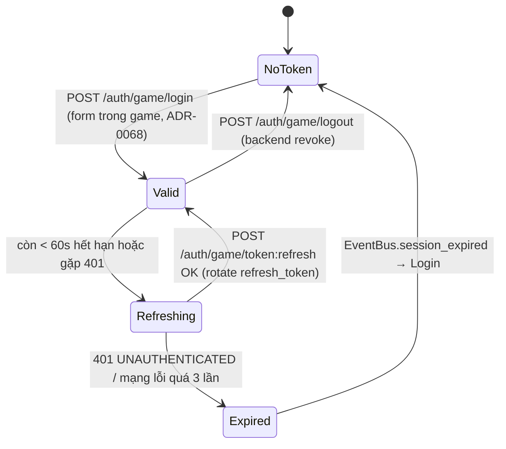
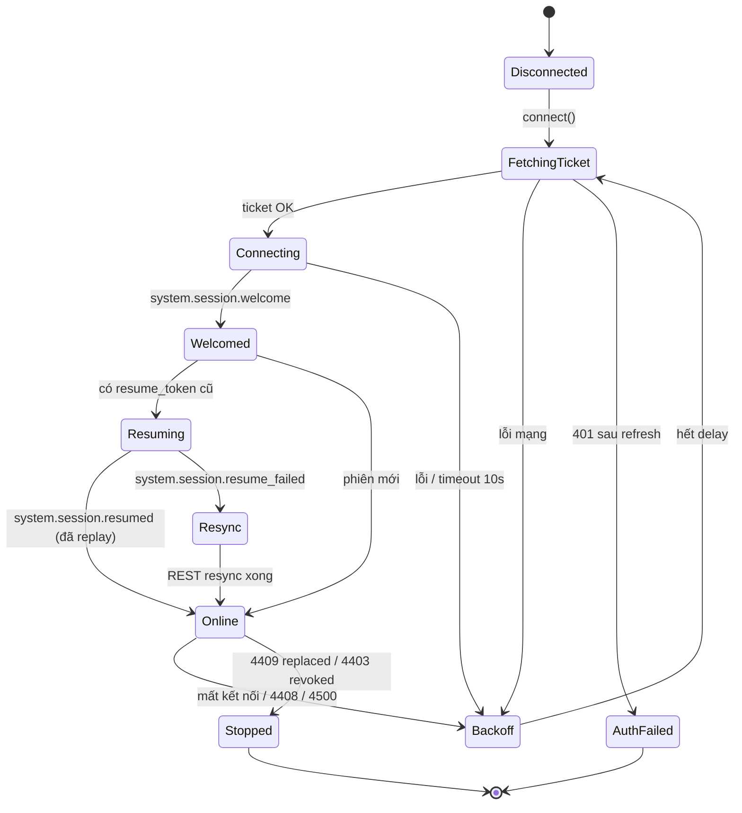
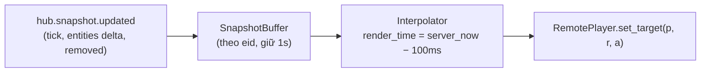
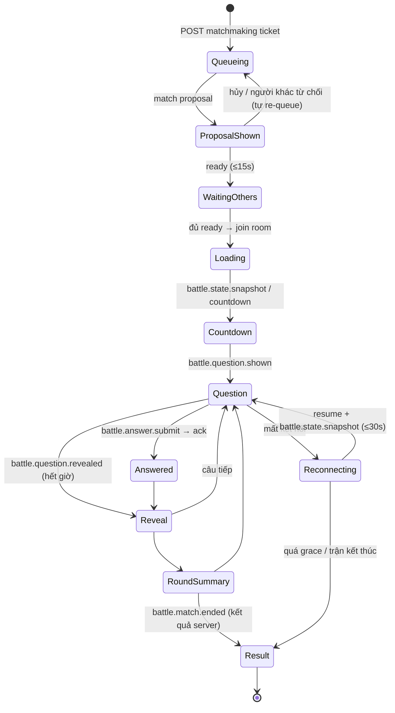

# Game Networking — phía Godot client

> Trạng thái: Draft · Phiên bản: 0.1 · Owner: Multiplayer Engineer + Senior Godot Developer · Cập nhật: 2026-11-15
> Liên quan: [REALTIME_ARCHITECTURE](../06-architecture/REALTIME_ARCHITECTURE.md) (giao thức, server) · [AsyncAPI realtime](../../specs/asyncapi/eduworld-realtime.v1.yaml) · [API_DESIGN](../07-backend/API_DESIGN.md) · [ADR-0008, ADR-0010, ADR-0011](../adr/README.md) · [GODOT_ARCHITECTURE](GODOT_ARCHITECTURE.md)

**Mục đích & phạm vi.** Phía client Godot: REST client, vòng đời token, RealtimeClient (kết nối, reconnect/resume, takeover), hub sync, đồng hồ server, client state machine cho battle/party/chat. Giao thức và hành vi server ở REALTIME_ARCHITECTURE và AsyncAPI.

Tài liệu này mô tả **cách client Godot hiện thực** kết nối mạng. Envelope, danh sách message, close codes, tham số server được định nghĩa ở REALTIME_ARCHITECTURE và AsyncAPI — **không lặp lại ở đây**; khi khác biệt, AsyncAPI là chuẩn.

## 1. Phân loại kênh

| Kênh | Dùng cho | Thành phần client |
|---|---|---|
| REST `/api/v1/*` (HTTPS) | Mọi thao tác nghiệp vụ: bootstrap, quest, bài tập, nộp bài, inventory, party CRUD, matchmaking ticket, leaderboard | `ApiClient` |
| WebSocket `/realtime/v1` (WSS) | Chat, notification, presence, party/lobby state, matchmaking events, hub sync, battle/co-op room | `RealtimeClient` |
| CDN (HTTPS) | Asset bundle PCK, media câu hỏi | `ContentCache` |

Quy tắc: thao tác cần lưu bền vững luôn đi REST (hoặc lệnh WS mà server xử lý bằng cùng use case, như `battle.answer.submit`). Không gửi chuyển động 3D qua REST [Confirmed] (§14).

## 2. REST client

### 2.1. Header chuẩn

| Header | Giá trị |
|---|---|
| `Authorization` | `Bearer <access_token>` (token Keycloak cấp qua `/auth/game/login`, ADR-0008, ADR-0068) |
| `X-Tenant-Id` | **Bắt buộc** (ADR-0065): `tenant_id` từ bootstrap của phiên, gửi mọi request REST trừ `GET /game/client-config`, `POST /auth/game/login`, `POST /auth/game/tenant:select`. Thiếu → `400 TENANT_HEADER_REQUIRED`; khác tenant của phiên → `403 TENANT_MISMATCH`. Không đổi trong phiên; WebSocket không gửi header (tenant cố định trong ticket) |
| `Accept` | `application/json, application/problem+json` |
| `Idempotency-Key` | UUIDv4/v7 do client sinh cho thao tác ghi quan trọng; **giữ nguyên khi retry** |
| `X-Client-Version` | SemVer client |
| `X-Client-Platform` | `windows` / `android` / `web` / `ios` |
| `X-Device-Id` | UUID của bản cài (sinh lần đầu, lưu `user://device_id`; Web: `localStorage`), gửi mọi request game; bắt buộc ở `POST /game/sessions` — quy tắc một thiết bị (ADR-0031). Không phải định danh phần cứng |
| `traceparent` | W3C trace context sinh mỗi request (liên kết log client ↔ server) |
| `Accept-Language` | `vi-VN` (theo Settings) |

### 2.2. Xử lý response

- 2xx → parse `data`; danh sách dùng cursor pagination (`page.next_cursor`, `page.has_more`) (ADR-0010).
- Lỗi → parse Problem Details (`type`, `title`, `status`, `code`, `trace_id`, `errors[]`); UI ánh xạ theo `code` (không theo `title`).
- Thời gian: response có header `Date`/trường `server_time` → `Clock.sync()` cập nhật offset (xem §6).

### 2.3. Retry & backoff

| Điều kiện | Retry? |
|---|---|
| Lỗi mạng/timeout, 502, 503, 504 | Có, nếu `GET` hoặc có `Idempotency-Key` |
| 429 | Có, sau `Retry-After` (tối đa 2 lần); riêng `429 LOGIN_QUEUE_BUSY` ở `/auth/game/login` thử lại không giới hạn số lần khi người dùng còn ở màn chờ (có nút Hủy) |
| 401 | Refresh token (trong RAM) 1 lần rồi lặp lại |
| 401 `INVALID_CREDENTIALS` (`/auth/game/login`) | Không retry tự động; hiển thị lỗi chung, xóa ô mật khẩu (ADR-0068) |
| 401 `LOGIN_TICKET_INVALID` | Không retry; về form đăng nhập |
| 426 `CLIENT_VERSION_UNSUPPORTED` | Không retry; màn cập nhật |
| 400 `TENANT_HEADER_REQUIRED` | Không retry; lỗi lập trình → telemetry `client_bug`, về form đăng nhập |
| 403 `TENANT_NOT_SELECTED` | Không retry; hiển thị `TenantChoice` từ `choices[]`, gọi `POST /auth/game/tenant:select` với `login_ticket` (không nhập lại mật khẩu) |
| 403 `ACCOUNT_NOT_PROVISIONED` | Không retry; xóa token trong RAM, hiển thị "chưa được kích hoạt", về màn đăng nhập ([GODOT_ARCHITECTURE §5.1](GODOT_ARCHITECTURE.md#51-đăng-nhập-và-xác-định-tenant-adr-0063-adr-0064-adr-0065-adr-0068)) |
| 403 `TENANT_MISMATCH` | Không retry; xóa token, về màn đăng nhập ([GODOT_ARCHITECTURE §5.1](GODOT_ARCHITECTURE.md#51-đăng-nhập-và-xác-định-tenant-adr-0063-adr-0064-adr-0065-adr-0068)) |
| 4xx khác, 500 | Không |

Backoff: `delay = min(15 s, 0.5 s × 2^(n−1)) × (1 ± 0.2 jitter)`, tối đa 3 lần cho REST. Request ghi không có `Idempotency-Key` **không bao giờ** tự retry.

### 2.4. Đồng thời & hàng đợi

- Pool tối đa 4 `HTTPRequest` song song [Proposed]; request ưu tiên (submit answer) đi trước request nền (prefetch catalog).
- Hàng đợi ghi bền trong bộ nhớ (`PendingWrites`) cho answers/report khi mất mạng; flush theo thứ tự khi có mạng lại. Không lưu xuống đĩa (tránh replay câu trả lời cũ; server-authoritative) [Proposed].

## 3. Token lifecycle

- `AuthService.get_access_token()` là async và **single-flight**: nhiều request cùng gặp hết hạn chỉ tạo một lần refresh.
- Refresh token rotation: thay refresh token mới **trong bộ nhớ** trước khi trả access token.
- **Token chỉ trong RAM (ADR-0064):** access token và refresh token không ghi xuống đĩa, `user://`, Keychain/Keystore hay localStorage; không ghi log, không gửi qua WS.
- **Không tự đăng nhập (ADR-0064):** mỗi lần mở game luôn bắt đầu ở `NoToken` → form đăng nhập trong game với ô mật khẩu trống, không có bước "refresh trước khi đăng nhập". SSO idle 30 phút / tối đa 10 giờ; trong lúc game mở, refresh token trong RAM gia hạn access token và dùng cho reconnect (REST + WS) mà không hỏi mật khẩu. Thoát game → `POST /auth/game/logout` (identity-service thu hồi refresh token + phiên Keycloak). Mobile ở nền quá 30 phút hoặc bị hệ điều hành đóng → đăng nhập lại. Thiết bị **chế độ dùng chung** (`device.cfg`) không nhớ username và đăng xuất sau 30 phút không hoạt động.
- **Hàng chờ đăng nhập:** khi `/api/v1/auth/game/login` trả `429 LOGIN_QUEUE_BUSY` (hoặc `RATE_LIMITED`), client đọc `Retry-After`, cộng jitter ngẫu nhiên 0–50% và hiển thị màn hình "Đang vào lớp… (khoảng N giây)" với animation thân thiện; tự thử lại, không cần học sinh bấm lại. Lỗi mạng/5xx dùng backoff 1 s, 2 s, 4 s… tối đa 30 s, có jitter. Không thử lại vô hạn khi gặp lỗi xác thực (401/403).
- **Phương thức đăng nhập (ADR-0063, ADR-0068):** Release 1.0 chỉ username + password nhập trong form của game, gửi qua HTTPS tới `POST /api/v1/auth/game/login` (identity-service xác thực với Keycloak bằng client confidential `eduworld-game-backend`); game không gọi Keycloak trực tiếp, không biết client secret. Body đăng nhập không được log/telemetry (`ApiClient` tắt debug log cho `/auth/game/*`); certificate pinning [Proposed]. QR lớp + PIN, thẻ QR, mật khẩu hình ảnh, IdP trường, Device Grant là mở rộng sau ([KEYCLOAK_SSO §8.1](../09-identity/KEYCLOAK_SSO.md#81-mở-rộng-sau--ngoài-release-10-adr-0063)).
- Mọi phiên gắn với **một tenant** (ADR-0026, ADR-0063): học sinh không chọn trường; tenant do backend xác định theo membership (1 tenant → dùng; nhiều → `TENANT_NOT_SELECTED` + `login_ticket`, chọn sau đăng nhập bằng `/auth/game/tenant:select`; không thuộc tenant chung lẫn tenant SIS → `ACCOUNT_NOT_PROVISIONED`) — trả về trong bootstrap. Sau đó client **phải** gửi `X-Tenant-Id` = tenant đó ở mọi request (ADR-0065); header không phải cách tự chọn tenant — backend luôn kiểm tra khớp membership và game session.

## 4. RealtimeClient (WebSocket)

### 4.1. Kết nối

1. `POST /api/v1/game/sessions/{game_session_id}/realtime-tickets` → `ticket` (60 s, dùng 1 lần).
2. `WebSocketPeer.connect_to_url(realtime_url + "?ticket=" + ticket)` — TLS bắt buộc (`wss`), kiểm tra chứng chỉ mặc định của Godot.
3. Nhận `system.session.welcome` → lưu `resume_token`, `heartbeat_s`, `server_time`.
4. Gửi đăng ký lại các subscription/room hiện tại (zone, party, channel) theo `AppState`.

`RealtimeClient` poll `WebSocketPeer` trong `_process` (không chặn main thread); tăng `inbound_buffer_size`/`outbound_buffer_size` lên 1 MB [Proposed].

### 4.2. Gửi / nhận

- `send_command(type, payload) -> Promise-like`: sinh `id` (UUIDv7), đặt timeout 10 s chờ `system.command.acked`/`system.command.failed` có `ref = id`; lệnh `hub.player.move` gửi fire-and-forget.
- Dispatcher theo tiền tố `type` → service đã đăng ký (`chat.*` → `ChatService`, `party.*` → `PartyService`, `hub.*` → `HubSync`, `battle.*` → `BattleClient`, `boss.*`/`challenge.*` → `ChallengeClient`, `progression.*` → `ProgressionService`, `matchmaking.*` → `MatchmakingService`, `notification.*`/`quest.*`/`reward.*` → `NotificationService`).
- Ghi nhận `seq` lớn nhất đã xử lý (`last_seq`) để resume; bỏ qua message `seq` trùng.
- Message không biết `type` → log debug, bỏ qua (tương thích tiến).

### 4.3. Heartbeat

Gửi `system.heartbeat.ping` theo `heartbeat_s` (15 s); không nhận gì trong 2 × heartbeat → coi như mất kết nối, đóng và reconnect. RTT từ `system.heartbeat.pong` dùng cho `Clock` và hiển thị chất lượng mạng (icon 3 vạch).

### 4.4. Reconnect / resume

| Close code (REALTIME_ARCHITECTURE §3.1) | Hành vi client |
|---|---|
| 4401 | Xin ticket mới (refresh token nếu cần), reconnect |
| 4403 | Dừng, `EventBus.session_expired`/màn hình tài khoản bị khóa (gồm trường hợp học sinh đã chuyển trường: membership trường cũ bị thu hồi) |
| 4408, 4500, đóng bất thường | Backoff 0.5 s → 15 s, jitter ±20%, resume |
| 4409 | Nhận `session.session.replaced` ngay trước đó (ADR-0031): dừng, **không reconnect**, xóa token cục bộ, hiển thị "Em đã được đăng xuất vì tài khoản vừa đăng nhập trên thiết bị khác", về màn hình đăng nhập. Nếu 4409 đến mà không có message (kết nối mới của chính thiết bị này thay thế) → im lặng |
| 4429 | Chờ ≥ 30 s rồi reconnect |

### 4.5. Takeover từ thiết bị mới (ADR-0031)

1. `POST /game/sessions` trả `409 ACTIVE_SESSION_ON_OTHER_DEVICE` → `SessionService` phát signal `takeover_required(other_device)`; UI hiện hộp thoại xác nhận.
2. Đồng ý → gọi lại với `{takeover: true}` và `Idempotency-Key` mới; từ chối → `AuthService.logout()`.
3. Sau khi tạo session, nếu bootstrap báo đang có trận/quest co-op/bài kiểm tra dở (`active_activity` trong `PlayerBootstrap` hoặc `GET /competition/matches/active`), client **rejoin** bằng REST resync + ticket mới (resume_token của thiết bị cũ không dùng được). Trong thời gian grace của mode, chỗ của học sinh được giữ; hết grace → xử lý như rời trận.
4. Thiết bị cũ không còn heartbeat quá 45 s (tắt máy, mất mạng) → server tự kết thúc session cũ; thiết bị mới vào thẳng, không hỏi.

**Resync qua REST** khi resume thất bại: `GET /api/v1/game/profile`, party hiện tại, unread chat, quest progress active, trạng thái match (nếu đang trong trận), rồi join lại room theo kết quả server.

Trong lúc Backoff: UI hiển thị banner, khóa lệnh ghi qua WS, avatar remote đóng băng ở vị trí cuối; chat input disabled.

## 5. Hub sync (client)

### 5.1. Gửi trạng thái người chơi

| Tham số | Giá trị (khớp server §6) |
|---|---|
| Tần suất gửi | ≤ 10 Hz khi thay đổi; 1 Hz keepalive khi đứng yên |
| Payload `hub.player.move` | `{ p: [x,y,z], r: yaw, a: anim_state, cs: client_seq, t: client_time }` (lượng tử 1 cm, yaw 1°) |
| Ngưỡng gửi | Bỏ qua nếu Δvị trí < 2 cm và Δyaw < 2° và anim không đổi |

Local player di chuyển ngay (client-side movement); vì hub không có tranh chấp công bằng, **không cần prediction/rollback**. Khi server clamp (vượt tốc độ/biên), client nhận vị trí hiệu chỉnh trong snapshot của chính mình và nội suy về trong 200 ms.

### 5.2. Nhận snapshot & interpolation

- `render_time = Clock.server_now() − interp_delay` với `interp_delay` = 100 ms (tăng tự động lên 150–200 ms khi jitter cao).
- Với mỗi `eid`: tìm 2 snapshot bao quanh `render_time`, lerp vị trí / slerp yaw; `a` (anim) lấy theo snapshot gần nhất.
- Thiếu snapshot mới (mất gói) → extrapolate tối đa 250 ms theo vận tốc cuối, sau đó đứng yên.
- Entity mới (`hub.player.joined`) → instance `RemotePlayer` (pool tái sử dụng, tối đa 40); `removed[]` → trả về pool sau fade-out 0.3 s.
- Remote player ngoài 30 m → giảm tần suất cập nhật animation (LOD logic).

## 6. Đồng hồ server

`Clock` duy trì `offset = server_time − local_time` ước lượng theo NTP đơn giản trên `system.heartbeat.ping/pong` (lấy median 5 mẫu RTT thấp nhất). Mọi đếm ngược (exam, timed challenge, battle) hiển thị theo `deadline_at` server: `remaining = deadline_at − Clock.server_now()`. Client **không** quyết định hết giờ; server từ chối câu trả lời muộn (`ANSWER_LATE`, `ATTEMPT_DEADLINE_PASSED`).

## 7. Battle client state machine

Ánh xạ trạng thái server (REALTIME_ARCHITECTURE §7.1) sang trạng thái hiển thị:

Quy tắc client:
- Câu hỏi hiển thị bằng cùng `QuestionRendererRegistry` với Exercise UI; payload không chứa đáp án.
- Sau khi gửi câu trả lời: khóa input, hiển thị "Đã trả lời"; không hiển thị đúng/sai trước `Reveal`.
- Điểm, thứ hạng, rating delta, XP hiển thị **chỉ từ message server** (`battle.match.ended`, `reward.granted`).
- Khi reconnect: dựng lại toàn bộ UI từ `battle.state.snapshot` (không dựa state cục bộ).
- Tên message chính xác theo AsyncAPI; bảng trên là ánh xạ hiển thị.

## 8. Party & lobby (client)

- Party CRUD/mời/chấp nhận qua REST (Idempotency-Key); trạng thái live (`party.member.status_changed`, ready, activity selected) qua WS.
- `PartyService` giữ `PartyModel` duy nhất trong `AppState`; mọi cập nhật WS có `party_version` tăng dần — bỏ qua message có version cũ hơn; phát hiện thiếu version → `GET` party qua REST.
- Khi leader bắt đầu session: client nhận thông tin room/instance từ server, chuyển zone qua `SceneRouter` (WORLD_RENDERING §3). Chi tiết nghiệp vụ: [PARTY_SYSTEM](../03-social-multiplayer/PARTY_SYSTEM.md).

## 8b. Chat (client) — ADR-0034/0035

- **Gửi:** tạo `client_msg_id` (UUID) → hiển thị tin *pending* → `chat.message.send` → chờ `chat.message.acked` (Sent). Không có ack sau 5 s hoặc nhận `CHAT_TEMPORARILY_UNAVAILABLE` → giữ trong hàng đợi gửi lại (backoff 1/2/4/8 s, tối đa 5 lần), cùng `client_msg_id` nên không trùng.
- **Nhận:** `chat.message.created` áp vào `ChatStore` theo `seq`; gửi `chat.receipt.delivered` (gộp ≤ 1 lần/2 s); khi channel đang mở trên màn hình gửi `chat.receipt.read`.
- **Seq gap:** khi `seq` nhận > `last_seq + 1` hoặc sau reconnect → `chat.sync {channel_id: last_seen_seq}`; phản hồi `chat.history.loaded` (≤ 200 tin), nhiều hơn → `GET /api/v1/chat/channels/{id}/messages?after_seq=`.
- **Sự kiện thay đổi:** `chat.message.edited` (chỉ áp nếu `revision` mới hơn), `chat.message.recalled` (thay bằng placeholder, bỏ ghim, cập nhật khung reply/quote), `chat.reaction.updated`, `chat.pin.updated`, `chat.typing.updated` (tự xóa sau 5 s), `chat.receipt.updated`, `chat.mention.created`, `chat.unread.updated`.
- **Lỗi:** `CHAT_EDIT_WINDOW_EXPIRED`, `CHAT_RECALL_WINDOW_EXPIRED`, `CHAT_FORWARD_NOT_ALLOWED`, `CHAT_PIN_LIMIT_REACHED`, `CHAT_MENTION_LIMIT`, `CHAT_FEATURE_DISABLED`, `CHAT_ASSET_NOT_AVAILABLE` → thông báo thân thiện, không retry; `CHAT_CONTENT_BLOCKED` → thông điệp theo SOCIAL_SYSTEM §8 (không lộ từ bị khớp).
- Giao thức chi tiết: [AsyncAPI](../../specs/asyncapi/eduworld-realtime.v1.yaml); kiến trúc server: [CHAT_SYSTEM §5](../03-social-multiplayer/CHAT_SYSTEM.md).

## 9. Bảo mật phía client

- Chỉ kết nối `https`/`wss`; không cho phép downgrade trong build release.
- Không log access token, ticket, nội dung chat vào file log cục bộ (log ring buffer đã lọc).
- Mọi giá trị nhận từ mạng được kiểm tra kiểu trước khi dùng (JSON → model typed; trường thiếu → bỏ message).
- Client không giả định server tin dữ liệu của nó: `t`, `client_elapsed_ms` chỉ để tham khảo.

## 10. Telemetry mạng

Gửi định kỳ (≤ 1 lần/5 phút, batch) tới `POST /api/v1/game/telemetry`: RTT p50/p95, số lần reconnect, resume thành công/thất bại, FPS p10 (`fps_p10`, GAME_ANALYTICS §3.2), platform, client_version. Không chứa PII, không chứa nội dung chat/câu trả lời [Proposed] (ADR-0023).

## 11. Kiểm thử

| Test | Cách |
|---|---|
| Backoff & retry chỉ áp cho GET/idempotent | Unit với `FakeHttp` |
| Single-flight refresh khi 5 request song song gặp 401 | Unit |
| Reconnect state machine với mọi close code | Unit với `FakeWebSocketPeer` |
| Interpolation: chuyển động mượt khi mất 20% snapshot, jitter 80 ms | Unit + scene test, đo sai số vị trí |
| Resume: replay không xử lý trùng `seq` | Unit |
| Battle UI dựng lại từ `battle.state.snapshot` giữa câu hỏi | Scene test với fixture từ AsyncAPI examples |
| Takeover: thiết bị B nhận 409 → hộp thoại → takeover; thiết bị A nhận `session.session.replaced` + 4409 → về login, không reconnect | Integration hai client headless với backend docker compose |
| Không phải học sinh: token giáo viên → `403 GAME_ACCESS_STUDENT_ONLY` → màn hình hướng dẫn | Unit `ApiClient` + scene test |
| Mạng xấu thật | Integration qua proxy giả lập (toxiproxy: latency 200 ms, loss 5%) với backend docker compose |
