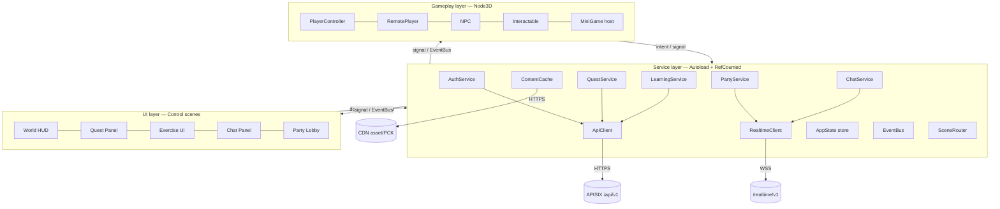
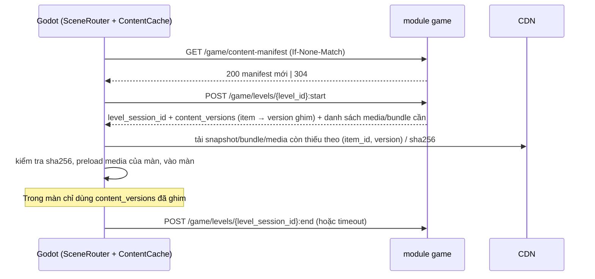
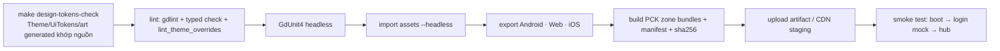

# Godot Client Architecture

> Trạng thái: Draft · Phiên bản: 0.5 · Owner: Senior Godot Developer · Cập nhật: 2026-11-24 (ADR-0101: bỏ Windows, client chỉ Web/Android/iOS) · 2026-11-17 (máy dùng chung, màn "Tiếp tục là…" khi Resume, giờ giới nghiêm ADR-0078, CI GitHub Actions, nền tảng từ pilot theo ADR-0013/ADR-0073) · 2026-11-16 (ADR-0083: tạo game session sau đăng nhập; gỡ dấu vết OIDC game theo ADR-0068; ADR-0086: lưu refresh token bằng SecureStorage, tự vào lại khi phiên còn hạn)
> Liên quan: [ADR-0007, ADR-0011, ADR-0013, ADR-0014, ADR-0016](../adr/README.md) · [ADR-0068](../adr/ADR-0068-dang-nhap-game-bang-form-trong-game-qua-backend.md) · [ADR-0083](../adr/ADR-0083-dang-nhap-game-va-tao-game-session-tach-biet.md) · [ADR-0086](../adr/ADR-0086-giu-phien-game-bang-refresh-token.md) · [GAME_NETWORKING](GAME_NETWORKING.md) · [WORLD_RENDERING](WORLD_RENDERING.md) · [QUEST_SYSTEM](../01-game-design/QUEST_SYSTEM.md) · [MINIGAME_ENGINE](MINIGAME_ENGINE.md) · [REALTIME_ARCHITECTURE](../06-architecture/REALTIME_ARCHITECTURE.md)

**Mục đích & phạm vi.** Điểm vào kiến trúc client Godot: cấu trúc dự án, autoload, vòng đời ứng dụng, tách UI/gameplay/service, renderer hoạt động học tập, nạp nội dung theo manifest, xử lý lỗi, build/export, kiểm thử. Mạng ở GAME_NETWORKING; thế giới 3D ở WORLD_RENDERING; mini-game ở MINIGAME_ENGINE.

## 1. Nguyên tắc

| # | Nguyên tắc | Nhãn |
|---|---|---|
| G-1 | Godot là **client hiển thị và xử lý tương tác**. Không quyết định điểm, kết quả trận, mastery, reward, quyền truy cập (Master Prompt §13.1, ADR-0016) | [Confirmed] |
| G-2 | Không hardcode nội dung học tập trong scene. Quest, mini-game, NPC dialogue, câu hỏi tải từ backend (data-driven) | [Confirmed] |
| G-3 | Godot 4.x (bản stable mới nhất tại thời điểm Phase 1, khóa phiên bản minor trong `project.godot` và CI), GDScript **static typing bắt buộc** | [Confirmed] ADR-0014 |
| G-4 | Tách 3 lớp: **Service** (logic thuần, `RefCounted`, test được) ← **Gameplay** (Node 3D, controller) ← **UI** (Control). UI và gameplay không gọi HTTP trực tiếp | [Confirmed] |
| G-5 | Scene không phụ thuộc chặt vào scene khác: giao tiếp qua signal, `EventBus`, hoặc dữ liệu inject khi khởi tạo | [Confirmed] (§21) |
| G-6 | Không giữ answer key, không tự tính XP/reward. Mọi số liệu nghiệp vụ hiển thị lấy từ response server | [Confirmed] |
| G-7 | Không hiển thị thông tin cá nhân nhạy cảm của người chơi khác: chỉ `nickname` + avatar (DOMAIN_MODEL §2) | [Confirmed] |

## 2. Kiến trúc tổng quan



Luồng dữ liệu một chiều: **UI/Gameplay phát intent → Service gọi backend → Service cập nhật `AppState` → phát signal → UI/Gameplay render lại.** Không có đường tắt UI → HTTP.

## 3. Cấu trúc thư mục `src/game/`

```text
src/game/
├── project.godot
├── export_presets.cfg              # không chứa keystore password (inject từ CI)
├── addons/
│   ├── gdUnit4/                    # test framework
│   └── eduworld_platform/          # plugin native: SecureStorage theo nền tảng (Android Keystore, iOS Keychain — ADR-0086, ADR-0101), certificate pinning, thông tin thiết bị; không còn deep link/Custom Tabs cho đăng nhập (ADR-0068)
├── scenes/
│   ├── bootstrap/   Boot.tscn, Splash.tscn, VersionCheck.tscn
│   ├── auth/        Login.tscn, LoginWaiting.tscn, TenantChoice.tscn, AccountNotProvisioned.tscn
│   ├── world/       zones/{main_hub,learning_zone_math,...}/Zone.tscn, WorldRoot.tscn, AreaPortal.tscn
│   ├── character/   Player.tscn, RemotePlayer.tscn, AvatarRig.tscn, CustomizationStudio.tscn
│   ├── npc/         NPC.tscn, DialogueBubble.tscn
│   ├── quest/       QuestTracker.tscn, QuestJournal.tscn, QuestMarker3D.tscn, AssignmentRow.tscn,
│   │                co-op: SharedClueBoard.tscn, ClueCard.tscn, RoleAssignDialog.tscn, PartyProgressStrip.tscn, InterdependentStepPanel.tscn
│   ├── progression/ JourneyScreen.tscn, LevelUpModal.tscn
│   ├── inventory/   InventoryShopScreen.tscn (tab Túi đồ/Cửa hàng/Lịch sử), VirtualItemGrid.tscn, ItemDetailBar.tscn, PurchaseConfirmDialog.tscn
│   ├── achievement/ màn thành tựu, sưu tầm
│   ├── challenge/   ChallengeBoard.tscn, ChallengeHud.tscn, ChallengeResult.tscn, DifficultySelector.tscn, boss/ (BossArena, BossHud)
│   ├── liveops/     EventCenter, SeasonTrack (sự kiện, community goal)
│   ├── learning/    LessonViewer.tscn, ExerciseHost.tscn, ActivityHost.tscn, questions/{SingleChoice,FillBlank,...}.tscn,
│   │                activity_renderers/{quiz,interactive_exercise,minigame,video_lesson,audio_lesson,simulation}/<Type>Renderer.tscn,
│   │                HintPanel.tscn (nút "Gợi ý" nhiều cấp), VoiceOverPlayer.tscn (lồng tiếng đề bài g1_3 + phụ đề/icon),
│   │                video/VideoLessonPlayer.tscn (VideoStreamPlayer Theora + SubtitleLayer + CueOverlay),
│   │                audio/AudioLessonPlayer.tscn,
│   │                simulation/SimulationHost.tscn (nạp template PCK đã ký), math/MathInline.tscn
│   ├── practice/    PracticeBoard.tscn
│   ├── exam/        ExamLobby.tscn, ExamRunner.tscn, ExamResult.tscn
│   ├── competition/ MatchmakingPanel.tscn, ReadyCheck.tscn, BattleArena.tscn, Leaderboard.tscn
│   ├── minigames/   MiniGameHost.tscn, types/{matching,ordering,drag_drop,...}/
│   ├── chat/        ChatPanel.tscn, MessageList.tscn, MessageBubble.tscn, MessageActionMenu.tscn,
│   │                Composer.tscn, EmojiStickerGifPicker.tscn, MentionAutocomplete.tscn,
│   │                PinnedBar.tscn, TypingIndicator.tscn, ReceiptBadge.tscn, ChatSearch.tscn, QuickMessageWheel.tscn
│   ├── social/      FriendList.tscn, FriendProfilePanel.tscn, FindFriendsTab.tscn, JoinFriendButton.tscn, ClubInvitePicker.tscn, ClubRequestsTab.tscn,
│   │                PartyLobby.tscn, PartyMemberCard.tscn, ActivitySelector.tscn, InviteFriendPicker.tscn, InvitationToast.tscn
│   └── ui/          components/{Button,Card,Dialog,Toast,ProgressBar,...}.tscn, hud/{MainHud,XpBar,CurrencyChip,PartyHud,NetworkBanner,BreakReminderDialog}.tscn,
│                    settings/, debug/UiGallery.tscn
├── scripts/
│   ├── core/            app_state.gd, event_bus.gd, scene_router.gd, service_locator.gd, config.gd, logger.gd, result.gd, play_time_service.gd,
│   │                    settings.gd, audio_director.gd, theme_service.gd, l10n.gd, locale_format.gd, models/{api_problem,client_config}.gd,
│   │                    version_check.gd, device_identity.gd, lifecycle_watcher.gd, game_state_machine.gd, uuid.gd (F061),
│   │                    ui_tokens.gd (class_name UiTokens — SINH TỪ design/game-tokens)
│   ├── networking/      api_client.gd, api_request.gd, api_result.gd, http_transport.gd, http_request_pool.gd, client_clock.gd, trace_context.gd,
│   │                    backoff.gd, realtime_client.gd, ws_envelope.gd
│   ├── authentication/  auth_service.gd, game_session_service.gd (game session, takeover, heartbeat — ADR-0083), login_form.gd,
│   │                    token_store.gd, session_store.gd (SecureStorage `eduworld.game.session`), password_buffer.gd
│   ├── services/        curfew_watcher.gd (cảnh báo giờ giới nghiêm từ bootstrap, ADR-0078)
│   ├── platform/        secure_storage.gd (interface), secure_storage_factory.gd, adapters/{file_cipher,android_keystore,ios_keychain,memory_only}_secure_storage.gd (ADR-0086; không có adapter DPAPI — ADR-0101)
│   ├── player/          player_controller.gd, camera_rig.gd, avatar_builder.gd, anim_driver.gd
│   ├── world/           zone_loader.gd, spawn_point.gd, interactable.gd, area_portal.gd, remote_player_sync.gd
│   ├── learning/        learning_service.gd, question_renderer_registry.gd, activity_renderer_registry.gd,
│   │                    answer_models/*.gd, video_progress_reporter.gd, vtt_parser.gd, audio_play_tracker.gd,
│   │                    simulation_action_log.gd, simulation_template_loader.gd, math_svg_cache.gd (không có ghi âm — ADR-0072)
│   ├── quest/           quest_service.gd (QuestService: quest.* từ REST và realtime), quest_tracker.gd, coop_quest_service.gd
│   ├── progression/     progression_service.gd, progression_store.gd, level_up_queue.gd
│   ├── achievement/     achievement_service.gd
│   ├── challenge/       challenge_client.gd, challenge_store.gd, boss_client.gd, boss_store.gd
│   ├── liveops/         live_event_service.gd, season_track_service.gd
│   ├── social/          social_service.gd (bạn bè, chặn, tắt tiếng — tạo ở F110, dùng lại ở chat/club), friends_store.gd, club_service.gd
│   ├── multiplayer/     party_service.gd, party_store.gd, presence_service.gd, hub_sync.gd, matchmaking_service.gd, battle_client.gd
│   ├── competition/     leaderboard_service.gd
│   ├── chat/            chat_service.gd, chat_store.gd (seq/gap/unread), chat_asset_cache.gd (sticker/GIF)
│   ├── inventory/       inventory_service.gd, wallet_store.gd
│   └── notifications/   notification_service.gd
├── resources/
│   ├── ui/theme/     eduworld_theme.tres + biến thể density g1_3/g4_5/g6_7/g8_9 — SINH TỪ design/game-tokens, không sửa tay
│   ├── art/generated/ preset ShaderMaterial toon/outline, Environment theo zone, Gradient VFX, màu độ hiếm — SINH TỪ design/game-tokens/art3d.json
│   ├── characters/   body_types/*.tres, CharacterCatalog.tres
│   ├── items/        ItemVisual.tres theo item_id (chỉ mô tả hiển thị, không giá trị nghiệp vụ)
│   ├── animations/   AnimationLibrary *.res
│   ├── materials/    toon/*.tres
│   ├── environments/ zone_env/*.tres (WorldEnvironment)
│   └── audio/        bus_layout.tres
├── assets/
│   ├── models/ textures/ audio/ fonts/ icons/
├── config/env/       local.json, dev.json, staging.json, production.json, mock.json (§4; không secret, không OIDC)
├── locale/           messages.pot (sinh), vi.po, en.po (gettext), xx_PS.po (pseudo-locale sinh, chỉ build debug)
├── tools/            lint_theme_overrides.gd, lint_layers.gd, lint_signals.gd, check_typed.gd, extract_pot.gd, pseudo_locale.gd,
│                     screenshot_gallery.gd, gen_fixtures.mjs, scan_artifact.sh, check_no_admin_ui.sh (`make godot-lint`, `make godot-test`)
└── tests/            unit/, scene/, contract/, integration/, fixtures/ (JSON response mẫu sinh bởi tools/gen_fixtures.mjs)
```

Quy tắc đặt tên: file/thư mục `snake_case`, scene `PascalCase.tscn`, class_name `PascalCase`, signal `snake_case` ở thì quá khứ (`quest_progress_updated`), hằng `UPPER_SNAKE`.

## 4. Autoload singletons

Thứ tự khai báo trong `project.godot` (phụ thuộc từ trên xuống):

| # | Autoload | Loại | Trách nhiệm | Không làm |
|---|---|---|---|---|
| 1 | `Config` | Node | Đọc cấu hình môi trường từ `res://config/env/<env>.json` (đường dẫn duy nhất, sinh lúc build) + override `user://` (debug build): `api_base_url`, `realtime_url`, `cdn_base_url`, feature flag mặc định (không có cấu hình OIDC/issuer/client id — game không gọi Keycloak, ADR-0068); **cấu hình thiết bị** `device.cfg` (`shared_device` cho máy phòng tin học: không lưu refresh token, không nhớ username, tự đăng xuất — xem §5.2) | Chứa secret (không có secret nào trong client) |
| 2 | `Log` | Node | Structured log, ring buffer 500 dòng gửi kèm crash report, lọc PII | Gửi log liên tục lên server |
| 3 | `EventBus` | Node | Signal toàn cục cho sự kiện cắt ngang (`session_expired`, `network_state_changed`, `notification_received`, `zone_changed`, `locale_changed`, `density_changed`, `ui_requested(screen_id, args)`, `ui_closed(screen_id)` — F062: đóng panel = quay lại Hub) | Truyền dữ liệu lớn, thay thế signal cục bộ |
| 4 | `AppState` | Node | Store trạng thái phiên: `player` (bootstrap), `school_policies`, `feature_flags`, `party`, `current_zone`, `connectivity` | Gọi mạng |
| 5 | `AuthService` | Node | Đăng nhập username/password bằng form trong game, gọi `POST /auth/game/login` của module identity (ADR-0068; không trình duyệt, không PKCE/loopback), không chọn trường (ADR-0063); chọn tenant bằng `login_ticket` khi thuộc nhiều tenant; refresh qua `/auth/game/token:refresh`, logout qua `/auth/game/logout`; lưu `tenant_id` của phiên cho `ApiClient` gắn `X-Tenant-Id` (ADR-0065); khi khởi động, nếu `SecureStorage` có refresh token thì tự vào lại bằng `token:refresh` `mode=resume` (ADR-0086); access token chỉ trong RAM, refresh token + `tenant_id` lưu qua `SecureStorage` (thiết bị cá nhân) hoặc chỉ RAM (Web, `shared_device`); refresh single-flight (rotation, ghi đè token đã lưu), reconnect, Đăng xuất + revoke; đọc token từ `GameLoginResponse.tokens` hoặc trực tiếp từ `GameTokenRefreshResponse` (cùng trường `GameTokenSet`, thêm `bootstrap` khi `resume`); cung cấp access token hợp lệ cho `ApiClient`. Game session do `GameSessionService` tạo sau đăng nhập (§5, ADR-0083) | Lưu mật khẩu hoặc access token xuống đĩa; lưu refresh token ngoài `SecureStorage` (file rõ, `user://`, localStorage); dùng embedded WebView, tạo game session, giữ mật khẩu sau lời gọi login |
| 6 | `ApiClient` | Node | HTTP REST: pool `HTTPRequest`, header chuẩn (`Authorization`, **`X-Tenant-Id`** — tenant của phiên từ bootstrap, gửi ở mọi request trừ `client-config` và `/auth/game/login`, `tenant:select` (ADR-0065), `Idempotency-Key`, `X-Client-Version`, `X-Device-Id` — UUID sinh lần đầu cài, lưu `user://device_id`, ADR-0031, `traceparent`), parse Problem Details, retry/backoff | Logic nghiệp vụ |
| 7 | `RealtimeClient` | Node | WebSocket `/realtime/v1`, ticket, heartbeat, reconnect/resume, phân phối message theo `type` | Quyết định kết quả trận |
| 8 | `ContentCache` | Node | Cache nội dung data-driven (quest/minigame/dialogue/catalog) theo `version`, tải asset PCK từ CDN, kiểm tra checksum | Cache câu hỏi chấm điểm hay answer key (không tồn tại phía client) |
| 9 | `SceneRouter` | Node | Chuyển scene/zone, màn hình loading, `ResourceLoader.load_threaded_request`, giải phóng zone cũ | Biết logic quest |
| 10 | `AudioDirector` | Node | Nhạc nền/zone, SFX, volume theo settings | — |
| 11 | `Settings` | Node | Settings người dùng (`user://settings.cfg`): âm lượng, chất lượng đồ họa, ngôn ngữ, cỡ chữ, chế độ màu | Lưu dữ liệu nghiệp vụ |
| 12 | `QualityManager` | Node | Chọn renderer và preset Thấp/Trung bình/Cao, benchmark tự phát hiện lần đầu, độ phân giải động, trần FPS, hạ cấp theo nhiệt/pin, tạm dừng render 3D khi mở activity player, phát signal `quality_changed` cho zone/hiệu ứng; mọi giá trị theo [PERFORMANCE_BUDGET](PERFORMANCE_BUDGET.md) §4–§6, §12 | Tự đổi preset giữa trận/bài; lưu lên server |
| 13 | `ActivityRendererRegistry` | Node | Ánh xạ `activity_type` → scene renderer (§6.2); kiểm `min_client_version` của nội dung với phiên bản client trước khi mở (F063) | Chấm điểm, giữ đáp án |

Service theo domain (`QuestService`, `LearningService`, `PartyService`, `ChatService`, `InventoryService`, `MatchmakingService`...) là `RefCounted` tạo bởi `ServiceLocator` trong `AppState` sau bootstrap, nhận `ApiClient`/`RealtimeClient` qua constructor → test bằng fake.

## 5. Vòng đời ứng dụng

```mermaid
stateDiagram-v2
  [*] --> Boot
  Boot --> VersionCheck: Config loaded
  VersionCheck --> ForceUpdate: client_version < min_supported
  VersionCheck --> Resume: có refresh token trong SecureStorage (thiết bị cá nhân, ADR-0086)
  VersionCheck --> Login: không có token / shared_device / Web
  Resume --> ResumeConfirm: token#58;refresh mode=resume OK (lưu token mới, bỏ qua form)
  ResumeConfirm --> Bootstrap: Tiếp tục là nickname? → Tiếp tục
  ResumeConfirm --> Login: Không phải tôi → logout, xóa SecureStorage
  Resume --> Curfew: 403 giờ giới nghiêm → giữ token, báo giờ mở lại
  Resume --> Login: 401 REFRESH_TOKEN_* hoặc 403 → xóa SecureStorage, thông báo phiên hết
  Resume --> Resume: lỗi mạng / 5xx / 429 → giữ token, thử lại có backoff
  Login --> Bootstrap: POST /auth/game/login thành công (form trong game, ADR-0068)
  Login --> Login: 401 INVALID_CREDENTIALS / 429 (hàng chờ, thử lại)
  Bootstrap --> TenantChoice: 403 TENANT_NOT_SELECTED + login_ticket (nhiều tenant)
  TenantChoice --> Bootstrap: POST /auth/game/tenant#58;select (không nhập lại mật khẩu)
  TenantChoice --> Login: 401 LOGIN_TICKET_INVALID (quá 2 phút)
  Bootstrap --> NotProvisioned: 403 ACCOUNT_NOT_PROVISIONED (không thuộc tenant chung lẫn tenant SIS)
  NotProvisioned --> Login: xóa token RAM + SecureStorage (phiên Keycloak đã bị thu hồi)
  Bootstrap --> Login: 403 TENANT_MISMATCH (header X-Tenant-Id không còn khớp membership) → đăng nhập lại
  Bootstrap --> AccountBlocked: 403 ACCOUNT_LOCKED / NO_ACTIVE_ENROLLMENT / TENANT_ACCESS_DISABLED
  Bootstrap --> NotStudent: 403 GAME_ACCESS_STUDENT_ONLY (nhân sự/vận hành)
  NotStudent --> Login: đăng xuất, hướng dẫn dùng trang quản trị
  Bootstrap --> FirstTimeSetup: chưa có game_profile (chọn nickname/avatar)
  Bootstrap --> SessionStart
  FirstTimeSetup --> SessionStart
  SessionStart --> ConfirmTakeover: 409 ACTIVE_SESSION_ON_OTHER_DEVICE
  ConfirmTakeover --> SessionStart: học sinh đồng ý → takeover=true
  ConfirmTakeover --> Login: học sinh từ chối → đăng xuất
  SessionStart --> InWorld: game_session + realtime ticket + zone
  InWorld --> ReplacedNotice: session.session.replaced / close 4409
  ReplacedNotice --> Login: xóa token RAM + SecureStorage, về màn hình đăng nhập
  InWorld --> InWorld: chuyển zone / mini-game / exam
  InWorld --> Curfew: tới giờ giới nghiêm (cảnh báo trước 10 phút, lưu tiến độ, #58;end)
  InWorld --> Login: session_expired (refresh lỗi) → xóa SecureStorage
  InWorld --> Login: Đăng xuất (#58;end, logout, xóa SecureStorage)
  InWorld --> [*]: thoát game (#58;end; thiết bị cá nhân giữ refresh token, shared_device đăng xuất)
```

Học sinh đăng nhập **username + password**, **không chọn trường** (ADR-0063). Trên thiết bị cá nhân, refresh token được lưu trong kho bảo mật của hệ điều hành; **mở lại game khi phiên còn hạn thì hiện màn "Tiếp tục là <nickname>?" rồi vào game, không hiện form** (trạng thái `Resume` → `ResumeConfirm`, [ADR-0086](../adr/ADR-0086-giu-phien-game-bang-refresh-token.md), thay ADR-0064 mục 1, 2, 4, 5); Web (gồm PC phòng máy — không có bản Windows, [ADR-0101](../adr/ADR-0101-bo-windows-khoi-nen-tang-client-release-1-0.md)) và máy dùng chung (`shared_device`) vẫn phải đăng nhập mỗi lần mở [Confirmed — Technical Architect 2026-11-17]. Backend xác định tenant sau khi xác thực; bước chọn tenant chỉ xuất hiện **sau** đăng nhập khi người dùng thuộc nhiều tenant. Đăng nhập (module identity) và tạo game session (module game) là **hai lời gọi riêng** ([ADR-0083](../adr/ADR-0083-dang-nhap-game-va-tao-game-session-tach-biet.md)): `/auth/game/login` không tạo game session, không trả `game_session_id`; client gọi `POST /game/sessions` ngay sau khi có token.



| Bước | API |
|---|---|
| VersionCheck | `GET /api/v1/game/client-config?platform=&version=` (public, cache được, không `X-Tenant-Id`) — trả `min_supported_version`, `content_manifest_version`, maintenance flag, URL API đăng nhập |
| Resume (ADR-0086) | Chỉ khi `SecureStorage` có bản ghi `eduworld.game.session`: `POST /api/v1/auth/game/token:refresh` `{refresh_token, device_id, client_version, mode: "resume"}` + `X-Tenant-Id` = `tenant_id` đã lưu → `GameTokenRefreshResponse` (token mới + `bootstrap`); ghi đè refresh token mới vào `SecureStorage` ngay, rồi hiện **ResumeConfirm** (S01b "Tiếp tục là <nickname>?", nickname từ `bootstrap`, `resume_confirm_screen`, [Confirmed — Technical Architect 2026-11-17]): "Tiếp tục" → Bootstrap/SessionStart, không hiện S01; "Không phải tôi" → `POST /auth/game/logout`, xóa `SecureStorage` + RAM, S01. Lỗi giờ giới nghiêm (`platform_curfew`, [CHILD_SAFETY §4.1](../10-security/CHILD_SAFETY.md#41-giờ-giới-nghiêm-cấp-platform-adr-0078)) → màn "giờ mở lại", giữ token. `401 REFRESH_TOKEN_INVALID`/`REFRESH_TOKEN_REUSED`/`REFRESH_TOKEN_DEVICE_MISMATCH` hoặc `403` tài khoản/tenant → xóa bản ghi, S01 kèm thông điệp; lỗi mạng/5xx/`429` → giữ token, màn "Đang kết nối…" thử lại; `426` → ForceUpdate |
| Login | Form Godot (S01) → `POST /api/v1/auth/game/login` `{username, password, device_id, client_version, locale}` ([KEYCLOAK_SSO §6](../09-identity/KEYCLOAK_SSO.md#6-luồng-đăng-nhập-game--form-trong-godot-qua-backend-adr-0068), ADR-0068); không trình duyệt, không PKCE; lỗi `401 INVALID_CREDENTIALS`, `426 CLIENT_VERSION_UNSUPPORTED`, `429 RATE_LIMITED`/`LOGIN_QUEUE_BUSY` |
| Bootstrap | Trả cùng response `/auth/game/login` (hoặc `/auth/game/tenant:select`) — `GameLoginResponse {tokens, bootstrap}`, không có `game_session_id`: `tokens.access_token`/`tokens.refresh_token`/`tokens.expires_in` + player bootstrap (`tenant_id`, `tenant_type`, `is_common_tenant`, profile, school, class, grade, policies, flags); `ApiClient` lưu `tenant_id` để gắn `X-Tenant-Id`. Lỗi `TENANT_NOT_SELECTED` kèm `choices[]` + `login_ticket`, `ACCOUNT_NOT_PROVISIONED` (phiên Keycloak đã bị backend thu hồi) |
| SessionStart | `GameSessionService.create()` → `POST /api/v1/game/sessions` (`createGameSession`; header `X-Device-Id`, `X-Tenant-Id`, `Idempotency-Key`) → `game_session_id`; 409 `ACTIVE_SESSION_ON_OTHER_DEVICE` → `ConfirmTakeover` → đồng ý thì gọi lại với `takeover: true` và `Idempotency-Key` mới, không nhập lại mật khẩu (ADR-0083); `POST /api/v1/game/sessions/{id}/realtime-tickets` → ticket |
| Đăng xuất / thoát | **Đăng xuất** (nút trong menu Cài đặt của hub, STUDENT_GAME_UX_CORE): `POST /game/sessions/{id}:end` (best effort, gọi trước) → `POST /auth/game/logout` (module identity chỉ thu hồi refresh token + phiên Keycloak, không đóng game session — ADR-0083) → xóa `SecureStorage` + RAM → S01. **Thoát game** (`NOTIFICATION_WM_CLOSE_REQUEST`) trên thiết bị cá nhân: chỉ `:end` game session (best effort), **giữ** refresh token đã lưu để lần sau tự vào (ADR-0086); máy `shared_device: true`: thoát = Đăng xuất. Không gọi được `:end` → module game đóng phiên theo heartbeat timeout. Mobile: app vào nền quá 5 phút → kết thúc game session (best effort); quay lại → refresh (`renew`) + tạo game session mới, không hỏi mật khẩu khi phiên Keycloak còn hạn; bị hệ điều hành đóng → mở lại đi đường Resume. Máy phòng tin học không nhớ username, 30 phút không hoạt động → đăng xuất (`shared_device_idle_logout`) |
| Thế giới | `GET /api/v1/game/world/areas`, `GET /api/v1/game/profile`, `GET /api/v1/game/quests?status=active` |

### 5.1. Đăng nhập và xác định tenant (ADR-0063, ADR-0064, ADR-0065, ADR-0068)

Màn đăng nhập (UX: [STUDENT_GAME_UX_CORE S01](../05-ux/STUDENT_GAME_UX_CORE.md#s01--đăng-nhập)) là **một form vẽ bằng Godot**: logo, chọn ngôn ngữ, ô username, ô password (`LineEdit.secret`, nút hiện/ẩn), nút "Đăng nhập", ô "Nhớ tên đăng nhập trên máy này", "Quên mật khẩu? Liên hệ nhà trường để đặt lại". `AuthService` gửi tới `POST /auth/game/login` (ADR-0068); **không** mở trình duyệt hệ thống, Custom Tabs, `ASWebAuthenticationSession`, WebView; không TCPServer loopback, không PKCE, không `prompt=login`/`login_hint`; game không biết client secret hay endpoint Keycloak. **Không có bước chọn trường, không có ô mã trường, không có cách đăng nhập nhanh** trong Release 1.0 (ADR-0063; thiết kế mở rộng ở [KEYCLOAK_SSO §8.1](../09-identity/KEYCLOAK_SSO.md#81-mở-rộng-sau--ngoài-release-10-adr-0063)).

Trong cùng lời gọi đăng nhập, module identity xác định tenant theo membership trong DB (ADR-0063 mục 3):

| Membership | Client |
|---|---|
| Đúng 1 tenant (tenant SIS hoặc tenant chung do platform tạo) | Bootstrap thành công, vào game (`is_common_tenant` cho biết tenant chung) |
| Nhiều tenant (hiếm) | `403 TENANT_NOT_SELECTED` kèm `choices[]` + `login_ticket` → `TenantChoice` **sau** đăng nhập → `AuthService.select_tenant(ticket, tenant_id)` gọi `POST /auth/game/tenant:select` (không nhập lại mật khẩu, ticket 2 phút) → Bootstrap |
| Không thuộc tenant chung và không thuộc tenant SIS nào | `403 ACCOUNT_NOT_PROVISIONED` → màn "chưa được kích hoạt", xóa token (RAM + `SecureStorage`); backend đã ghi audit và thu hồi phiên Keycloak |

Quy tắc token và phiên (ADR-0064 mục 3, 6, 7 còn hiệu lực; ADR-0086):

- **Máy dùng chung** (`shared_device_default`, [Confirmed — Technical Architect 2026-11-17], ADR-0078, ADR-0086, [ADR-0101](../adr/ADR-0101-bo-windows-khoi-nen-tang-client-release-1-0.md)): Android/iOS mặc định `false` (thiết bị cá nhân); `device.cfg` (đọc bởi `Config`) nếu có `shared_device: true` thì ghi đè, MDM của trường có thể đặt `true`. Web luôn `MemoryOnly` (PC phòng máy chơi bản Web nên mỗi lần mở phải đăng nhập). Hệ điều hành không phát hành (Windows, macOS, Linux khi chạy từ editor/bản debug) mặc định `true`. Không có bộ cài Windows (ADR-0101).
- Khởi động game: có refresh token trong `SecureStorage` → `Resume` (§5.2) → `ResumeConfirm`; không có (lần đầu, đã đăng xuất, phiên hết, Web, `shared_device`) → `Login` với ô mật khẩu trống.
- Access token **chỉ trong RAM** của `AuthService`. Refresh token: RAM + `SecureStorage` trên thiết bị cá nhân; chỉ RAM trên Web và `shared_device`. Không ghi token vào `user://` dạng rõ, file cấu hình, localStorage, log, telemetry hay crash report. Trong lúc game mở, refresh token gia hạn access token (5 phút) và reconnect, không hỏi mật khẩu.
- Mật khẩu chỉ nằm trong `LineEdit` và body request; xóa ô và biến ngay sau khi nhận phản hồi; không bao giờ lưu mật khẩu; không log, không telemetry, không crash report chứa body đăng nhập (ADR-0068). Certificate pinning cho tên miền API [Confirmed].
- Nhớ **username** (`user://settings.cfg` → `last_username`, tùy chọn, mặc định bật) để điền sẵn ô tên đăng nhập khi phải đăng nhập lại; máy `device.cfg` có `shared_device: true` thì ẩn tùy chọn và không lưu username.
- Thoát game trên thiết bị cá nhân → `:end` game session, giữ refresh token; Đăng xuất → `:end`, `POST /auth/game/logout`, xóa `SecureStorage`; tắt đột ngột → module game đóng game session theo heartbeat timeout, phiên Keycloak còn hiệu lực tới idle 7 ngày/tối đa 30 ngày (`game_session_sso`).
- **Header `X-Tenant-Id` bắt buộc** (ADR-0065): sau bootstrap, `ApiClient` gắn `X-Tenant-Id = bootstrap.tenant_id` vào mọi request REST (trừ `client-config`, `/auth/game/login`, `/auth/game/tenant:select`); backend kiểm tra header khớp membership và game session. `tenant_id` của phiên được lưu cùng refresh token trong `SecureStorage` (để gửi khi Resume), không còn `user://tenant.cfg`, không gợi ý tenant trước đăng nhập. Không đổi tenant giữa phiên (muốn đổi → đăng xuất, đăng nhập lại). Nhận `400 TENANT_HEADER_REQUIRED` là lỗi lập trình (báo telemetry, về `Login`).

### 5.2. Lưu phiên bằng SecureStorage (ADR-0086)

`SecureStorage` là interface (`scripts/platform/secure_storage.gd`: `is_available() -> bool`, `save(key, bytes) -> Error`, `load(key) -> PackedByteArray`, `erase(key) -> Error`) với adapter theo nền tảng, chọn một lần lúc khởi động bởi `SecureStorageFactory` (adapter native trong plugin `addons/eduworld_platform`):

| Nền tảng | Adapter | Cơ chế |
|---|---|---|
| Android | `AndroidKeystoreSecureStorage` | Khóa AES-GCM 256 sinh trong Android Keystore (không xuất được), ciphertext trong bộ nhớ riêng của app; file loại khỏi Auto Backup (`dataExtractionRules`/`allowBackup=false`, F133) |
| iOS | `IosKeychainSecureStorage` | Keychain `kSecClassGenericPassword`, `kSecAttrAccessibleAfterFirstUnlockThisDeviceOnly`, không đồng bộ iCloud |
| Web, `shared_device: true`, hệ điều hành không phát hành (Windows/macOS/Linux khi chạy từ editor/bản debug — ADR-0101), kho lỗi/không khả dụng | `MemoryOnlySecureStorage` | Chỉ RAM; mở lại game phải đăng nhập |

- Bản ghi khóa `eduworld.game.session` (JSON mã hóa bởi kho): `refresh_token`, `tenant_id`, `saved_at`. **Không** lưu access token, mật khẩu, bootstrap. `device_id` vẫn ở `user://device_id` (không phải credential).
- Ghi sau mỗi lần nhận token mới (login, tenant:select, refresh `resume`/`renew`) — ghi đè nguyên tử (ghi file tạm rồi đổi tên với adapter dùng file). Ghi thất bại → log `secure_storage_write_failed` (không kèm token), tiếp tục với RAM; lần mở sau phải đăng nhập.
- Xóa khi: Đăng xuất, `401 REFRESH_TOKEN_*`, `403` tài khoản/tenant khi Resume/refresh, close 4409 (takeover), `ACCOUNT_NOT_PROVISIONED`. Bản ghi không đọc được (hỏng, khóa Keystore bị xóa) → xóa và hiện S01.
- Refresh **single-flight** trong `AuthService` (một `Promise` dùng chung): hai lời gọi song song với cùng refresh token bị server coi là dùng lại và thu hồi cả phiên (`REFRESH_TOKEN_REUSED`).
- Thông điệp khi Resume thất bại do phiên hết/thu hồi: "Phiên đăng nhập đã hết, em đăng nhập lại nhé." (khóa dịch `auth.session_expired`); các mã `403` dùng thông điệp ở §9.

## 6. Phân tách UI / Gameplay / Service

Ví dụ "học sinh nói chuyện với NPC để nhận quest":

1. `Interactable` (gameplay) phát `interacted(npc_id)`.
2. `NPC` mở `DialogueRunner` với `NPCDialogue` lấy từ `ContentCache` (đã version).
3. Node action `give_quest` → gọi `QuestService.accept(quest_id)` (intent).
4. `QuestService` gọi `POST /api/v1/game/quests/{quest_id}:accept`, nhận `QuestProgress` từ server, cập nhật `AppState.quests`, phát `quest_progress_updated`.
5. `QuestTracker` (UI) render lại. NPC không biết UI, UI không biết NPC.

Quy tắc review code:
- Script trong `scenes/ui/**` chỉ được gọi method public của service và đọc `AppState`.
- Script gameplay không `preload` scene UI; mở UI qua `EventBus.ui_requested(screen_id, args)` hoặc `SceneRouter`.
- Logic có nhánh nghiệp vụ (điều kiện quest, chọn câu hỏi, tính thời gian còn lại) nằm ở server hoặc service thuần, không trong `_process` của scene.

### 6.1. Chat UI component (ADR-0034, ADR-0035)

| Thành phần | Trách nhiệm | Ghi chú |
|---|---|---|
| `ChatService` (autoload service) | Gửi lệnh WS (`chat.message.send/edit/recall/forward`, `chat.reaction.toggle`, `chat.pin.add/remove`, `chat.typing.start/stop`, `chat.receipt.delivered/read`, `chat.channel.sync`), REST fallback, xử lý `system.command.failed` theo mã lỗi | Không chứa logic kiểm duyệt; mọi quyết định ở server |
| `ChatStore` (`RefCounted`, test được) | Danh sách tin theo `channel_id` sắp theo `seq`; trạng thái tin của mình: *pending* (đồng hồ) → *sent* (`chat.message.acked`) → *delivered/read* (`chat.receipt.updated`); **phát hiện seq gap** (seq nhận > last_seq + 1) → gọi `chat.channel.sync`, nếu > 200 tin → REST lịch sử; unread + mention count | Gap do tin bị lỗi gửi được đánh dấu "đã kiểm tra" sau một lần sync để không lặp vô hạn |
| `MessageList` / `MessageBubble` | Render text, emoji, sticker, GIF (AnimatedTexture từ cache), quick message, khung reply/quote (bản đã che), nhãn "Đã chuyển tiếp", "đã chỉnh sửa", placeholder thu hồi, reaction | Virtualized list (chỉ instance bubble trong viewport) để giữ FPS |
| `MessageActionMenu` | Long-press (mobile) / chuột phải hoặc nút ⋯ (Web/PC): Trả lời, Trích dẫn, Chuyển tiếp, Sao chép, Ghim, Sửa, Thu hồi, Thả cảm xúc, Báo cáo — hiển thị theo `Channel.features` và quyền | Sao chép dùng `DisplayServer.clipboard_set(text_hien_thi)` (bản đã che) |
| `Composer` | Ô nhập + nút emoji/sticker/GIF + quick message; gửi `chat.typing.start` khi gõ (throttle 3 s), `stop` khi gửi/xóa; giữ `client_message_id` để gửi lại khi mất mạng | Giới hạn độ dài theo policy |
| `EmojiStickerGifPicker` | 3 tab; sticker theo pack (`GET /chat/stickers`, pack khóa có ổ khóa); GIF theo tag (`GET /chat/gifs?tag=`) | Asset tải từ CDN EduWorld, cache theo version |
| `MentionAutocomplete` | Gõ `@` → gợi ý nickname thành viên channel; trả `mentions[]` (user_id) | Không hiển thị username đăng nhập |
| `PinnedBar`, `TypingIndicator`, `ReceiptBadge`, `ChatSearch` | Thanh ghim (≤ 3), "An đang soạn tin…", ✓/✓✓/✓✓ xanh, tìm kiếm (`GET /chat/search`) | Ẩn theo `features` của channel (World/Area không có typing/receipts/pin) |

- Panel chat trong trận/party luôn có (ADR-0020 mục 6): chỉ thu gọn, không tắt.
- Badge unread trên HUD lấy từ `ChatStore`, đồng bộ đa màn hình bằng `chat.unread.updated`.
- Client **không** kết nối NATS/Valkey; chỉ WebSocket `/realtime/v1` và REST.

### 6.2. Activity renderers (ADR-0048)

`ActivityRendererRegistry` (autoload) ánh xạ `activity_type` → scene renderer trong `scenes/learning/activity_renderers/`. `ActivityHost` nhận render payload từ `LearningService`, chọn renderer, chuyển phản hồi/sự kiện tiến độ về service; renderer **không** chấm điểm, **không** giữ đáp án ([ACTIVITY_ENGINE](../02-learning/ACTIVITY_ENGINE.md)).

| Renderer | Điểm chính |
|---|---|
| `quiz` / `interactive_exercise` | Renderer theo 11 dạng câu hỏi (`scenes/learning/questions/`, chọn qua `question_renderer_registry.gd`), gửi câu trả lời thô, hiển thị phản hồi server ([QUESTION_BANK](../02-learning/QUESTION_BANK.md)) |
| `minigame` | Chọn scene theo `minigame_type` qua `MiniGameRegistry` ([MINIGAME_ENGINE](MINIGAME_ENGINE.md)) |
| `video_lesson` | `VideoStreamPlayer` (Ogg Theora), phụ đề WebVTT tự parse và vẽ theo Theme, dừng tại cue để hiện câu hỏi chèn, heartbeat tiến độ 10 s ([VIDEO_LEARNING](../02-learning/VIDEO_LEARNING.md)) |
| `audio_lesson` | `AudioStreamPlayer` (Ogg Vorbis), nghe hiểu với câu hỏi tự chấm; không ghi âm ([AUDIO_LANGUAGE_LEARNING](../02-learning/AUDIO_LANGUAGE_LEARNING.md)) |
| `simulation` | Nạp template PCK đã ký, áp tham số + seed từ server, ghi action log, gửi server kiểm chứng ([SIMULATION_ENGINE](../02-learning/SIMULATION_ENGINE.md)) |

Release 1.0 không có renderer cho loại activity ngoài version này (ADR-0082); client không xin quyền micro. Loại chưa có renderer (nếu server trả về do lỗi cấu hình) → màn "Cần cập nhật game", gửi telemetry, không crash.

**Thành phần dùng chung của mọi renderer câu hỏi** [Confirmed]:

| Thành phần | Hành vi |
|---|---|
| `HintPanel` — nút "Gợi ý" | Hiện khi câu có `hint_count > 0` trong render payload; mỗi lần bấm gọi `LearningService.request_next_hint(attempt_id, position)` → `POST /learning/activity-attempts/{attempt_id}/items/{position}/hints:next`, hiển thị gợi ý cấp tiếp theo; hết cấp thì nút mờ. Client không biết trước nội dung gợi ý, không tự đếm `hints_used` (server ghi) ([ACTIVITY_ENGINE](../02-learning/ACTIVITY_ENGINE.md)) |
| Phản hồi sau khi chấm | Hiển thị `ActivityResponseResult.feedback` (phản hồi theo phương án đã chọn) và liên kết `worked_example` nếu có; render payload không bao giờ chứa feedback hay đáp án |
| `VoiceOverPlayer` — lồng tiếng g1_3 | Với `grade_band = g1_3`, tự phát lồng tiếng đề bài/hướng dẫn quest (asset audio theo version nội dung), nút nghe lại; khi không có tai nghe hoặc tắt tiếng → phụ đề + icon minh họa ([CONTENT_MODEL](../02-learning/CONTENT_MODEL.md)) |
| Trả lời quá nhanh | Client không tự gắn cờ đoán bừa; server tính `rapid_guess` từ thời gian server ([LEARNING_ANALYTICS](../02-learning/LEARNING_ANALYTICS.md)) |

**Tab "Nhà trường giao"** trong `QuestJournal`: liệt kê bài/đề do `school_admin`/`academic_manager` giao (assignment `open`, hạn, trạng thái nộp) lấy từ API learning, mở thẳng activity host; không có nhận xét của giáo viên trong màn kết quả, kết quả/đáp án hiển thị theo `ResultRelease` của bài giao (ADR-0072, [SCHOOL_LMS](../04-admin-portal/SCHOOL_LMS.md)). UX chi tiết: [STUDENT_GAME_UX_CORE](../05-ux/STUDENT_GAME_UX_CORE.md).

### 6.3. Hiển thị công thức Toán, Lý, Hóa (ADR-0055)

- Game **chỉ hiển thị** công thức, **không nhập** (không có bàn phím toán).
- Render payload chứa khối `math` với `math_ref` (`math/<sha256>.svg`, SVG đã render bằng MathJax 4 trên portal và sanitize ở server) và `speech_text`.
- `MathInline` tải SVG qua CDN, cache bất biến `user://cache/math/<sha256>.svg` (`math_svg_cache.gd`), tạo texture bằng `Image.load_svg_from_string()` với **scale theo DPI màn hình và cỡ chữ** (density theo grade band), tô màu theo Theme game, chèn vào `RichTextLabel` bằng `add_image()` (inline) hoặc khối riêng (block). Texture được cache theo `(sha256, scale, màu)`.
- Trợ năng: `speech_text` dùng cho TTS và mô tả thay thế; khi SVG lỗi, hiển thị `speech_text` dạng chữ làm fallback (`MathAssetRef` không chứa `latex`).
- Lựa chọn đáp án, thẻ kéo thả, cặp ghép có thể chứa công thức (đều là SVG đã render).


## 7. Signal conventions

| Quy ước | Ví dụ |
|---|---|
| Signal là sự kiện đã xảy ra, thì quá khứ | `answer_submitted(attempt_id, item_id)`, `zone_loaded(area_id)` |
| Typed signal arguments | `signal party_updated(party: PartyModel)` |
| Kết nối trong code bằng `Callable` (`sig.connect(_on_x)`), không kết nối qua editor cho signal xuyên scene | |
| Child → parent: signal; parent → child: gọi method | |
| Signal toàn cục chỉ qua `EventBus`, có danh sách cố định trong `event_bus.gd` (review khi thêm) | `session_expired`, `network_state_changed(state)` |
| Ngắt kết nối khi node rời cây (`CONNECT_ONE_SHOT` hoặc connect với node owner để Godot tự dọn) | |

## 8. Data-driven loading & Content Cache

### 8.1. Loại dữ liệu tải từ backend

| Dữ liệu | Nguồn | Schema | Cache |
|---|---|---|---|
| Content manifest | `GET /api/v1/game/content-manifest` | OpenAPI `ContentManifest` | ETag; tải khi khởi động và khi vào màn mới (§8.2) |
| Level session (version ghim) | `POST /api/v1/game/levels/{level_id}:start` | OpenAPI `LevelSession` | Chỉ trong bộ nhớ trong màn |
| Quest definitions (version) | snapshot CDN trong manifest hoặc `GET /api/v1/game/quests/{quest_id}/versions/{version}` | [quest.schema.json](../../specs/schemas/quest.schema.json) | Theo `(item_id, version)` — bất biến (ADR-0015/0043), cache vô thời hạn |
| Mini-game config | `GET /api/v1/game/minigames/{config_id}/versions/{version}` | [minigame-config.schema.json](../../specs/schemas/minigame-config.schema.json) | Bất biến theo version |
| NPC dialogue | `GET /api/v1/game/world/npcs/{npc_id}/dialogue` | [npc-dialogue.schema.json](../../specs/schemas/npc-dialogue.schema.json) | Bất biến theo version |
| Item catalog, area list | `GET /api/v1/game/world/manifest` (gộp trong content manifest) | — | ETag + `manifest_version` |
| Media (ảnh, âm thanh, video .ogv) | CDN `media/<sha256>/<variant>.<ext>` (signed URL nếu private) | — | `user://cache/media/<sha256>/` bất biến (ADR-0044) |
| Câu hỏi (render payload) | `/api/v1/learning/activity-attempts/...` | OpenAPI | **Không cache bền**; chỉ giữ trong bộ nhớ trong attempt |
| Asset bundles (PCK) | CDN, URL trong manifest | manifest | `user://cache/pck/<sha256>.pck` |

### 8.2. Content manifest & versioning (ADR-0043)

Client tải **content manifest** của tenant `GET /api/v1/game/content-manifest` (header `If-None-Match: <etag>` → `304` nếu không đổi):

```json
{
  "manifest_version": 1287,
  "tenant_id": "01J...",
  "generated_at": "2026-11-15T08:00:00Z",
  "min_client_version": "0.4.0",
  "items": [
    { "item_type": "quest", "item_id": "01J...", "version_id": "01J...", "version_no": 5,
      "snapshot_url": "https://cdn.../content/quest/01J.../5/9f2c….json", "sha256": "9f2c…" },
    { "item_type": "minigame_config", "item_id": "01J...", "version_id": "01J...", "version_no": 3,
      "snapshot_url": "https://cdn.../content/minigame_config/01J.../3/1ab4….json", "sha256": "1ab4…" }
  ],
  "bundles": [
    { "bundle_id": "zone.learning_zone_math", "version": 7, "url": "https://cdn.../bundles/zone.learning_zone_math/7/<sha256>.pck",
      "sha256": "…", "size_bytes": 18452211, "platforms": ["android","ios","web"], "requires_client": ">=0.4.0" }
  ],
  "areas": [ { "area_id": "learning_zone.math", "scene_ref": "res://zones/learning_zone_math/Zone.tscn", "bundle_id": "zone.learning_zone_math" } ]
}
```

**Khi nào tải manifest:** lúc khởi động (sau bootstrap) và **mỗi khi vào màn/level mới**. Không tải lại giữa màn. Sự kiện realtime `content.manifest.updated` chỉ đặt cờ "có bản mới"; bản mới được áp dụng ở màn kế tiếp.

**Vào màn mới — ghim version:**



- **ContentCache** lưu theo khóa `(item_type, item_id, version_no)` tại `user://cache/content/<item_type>/<item_id>/<version_no>.json` (bất biến, kiểm tra `sha256`), bundle tại `user://cache/pck/<sha256>.pck`, media tại `user://cache/media/<sha256>/<variant>` (ADR-0044). Không bao giờ lẫn version vì khóa có version/hash.
- Học sinh đang ở màn với version cũ tiếp tục thấy nội dung cũ đến khi rời màn, kể cả khi CMS publish bản mới hoặc rollback.
- **Preload màn:** trước khi vào màn, tải đủ snapshot + bundle + media trong danh sách `:start` trả về (ưu tiên biến thể ảnh 1024 px trên mobile, 2048 px trên PC); hiển thị màn hình chờ có tiến trình. Thiếu mạng giữa chừng → thử lại có backoff; không vào màn khi thiếu tài nguyên bắt buộc.
- **Nội dung không cache bền:** câu hỏi đề kiểm tra, render payload của attempt, mọi dữ liệu tenant nhạy cảm — chỉ giữ trong bộ nhớ trong attempt. Answer key không bao giờ xuống client.
- Bundle chỉ chứa **asset và scene** (mesh, texture, audio, scene zone). **Không chứa script thực thi logic mới** [Confirmed] — giảm rủi ro an ninh và tương thích; logic mới đi theo bản build client.
- LRU dọn cache khi vượt ngân sách lưu trữ (Android mặc định 1.5 GB [Confirmed]); không xóa tài nguyên của màn đang chơi.
- Không cache dữ liệu tenant (danh sách lớp, kết quả bài) xuống đĩa trừ settings và bản sao profile tối thiểu để hiển thị offline screen.

## 9. Error handling & offline

| Tình huống | Hành vi client |
|---|---|
| Mất mạng ngắn (< 30s) | Banner "Đang kết nối lại…", RealtimeClient reconnect, chặn thao tác ghi; avatar đứng yên |
| Mất mạng dài | Màn hình chờ kết nối; không cho làm bài offline [Confirmed] (server-authoritative) |
| Đang làm bài khi mất mạng | Câu trả lời đã gửi được server lưu; câu chưa gửi giữ trong hàng đợi bộ nhớ, gửi lại cùng `Idempotency-Key` khi có mạng; attempt resume theo policy (§4.4 Master Prompt) qua `GET /api/v1/learning/activity-attempts/{id}` |
| 401 | `AuthService.refresh()` (single-flight) một lần, lặp lại request; thất bại → xóa token (RAM + `SecureStorage`), `EventBus.session_expired` → Login (nhập mật khẩu) |
| 401 `REFRESH_TOKEN_INVALID` (Resume hoặc refresh) | "Phiên đăng nhập đã hết, em đăng nhập lại nhé." → xóa `SecureStorage` + RAM, về `Login` (điền sẵn username nếu nhớ) (ADR-0086) |
| 401 `REFRESH_TOKEN_REUSED` | Như `REFRESH_TOKEN_INVALID` (server đã thu hồi cả phiên); thêm telemetry `auth_refresh_reused` (không kèm token) |
| 401 `REFRESH_TOKEN_DEVICE_MISMATCH` | Như `REFRESH_TOKEN_INVALID`; xảy ra khi bản ghi `SecureStorage` không thuộc `device_id` hiện tại (ví dụ `user://device_id` bị xóa) |
| 403 `ACCOUNT_NOT_PROVISIONED` | Không thuộc tenant chung và không thuộc tenant SIS nào (ADR-0063): "Tài khoản của em chưa được kích hoạt trong EduWorld. Em hãy nhờ nhà trường kiểm tra nhé."; xóa token (RAM + `SecureStorage`; backend đã thu hồi phiên Keycloak), về `Login` |
| 403 `ACCOUNT_LOCKED` | "Tài khoản đang tạm khóa. Em hãy liên hệ nhà trường." |
| 403 `ACCOUNT_DEACTIVATED` | "Tài khoản không còn hoạt động." |
| 403 `NO_ACTIVE_ENROLLMENT` | "Em chưa được xếp lớp trong năm học này." (không áp dụng tenant chung) |
| 403 `TENANT_ACCESS_DISABLED` | "Trường của em hiện chưa mở EduWorld." |
| 403 `ACCESS_OUTSIDE_ALLOWED_HOURS` | "Bây giờ chưa đến giờ chơi EduWorld." |
| 401 `INVALID_CREDENTIALS` | "Tên đăng nhập hoặc mật khẩu chưa đúng" (+ gợi ý đợi vài phút từ lần sai thứ 3); xóa ô mật khẩu (ADR-0068) |
| 401 `LOGIN_TICKET_INVALID` | "Phiên chọn trường đã hết, em đăng nhập lại nhé" → `Login` |
| 426 `CLIENT_VERSION_UNSUPPORTED` | Màn `ForceUpdate` với `store_url`; giữ refresh token đã lưu (Resume sau khi cập nhật) |
| Resume gặp lỗi mạng / 5xx / 429 | "Đang kết nối…", giữ token, thử lại theo backoff; nút "Đăng nhập bằng tài khoản khác" (= Đăng xuất best effort rồi S01) |
| 429 `LOGIN_QUEUE_BUSY` | "Đang vào lớp…", tự thử lại theo `Retry-After` + jitter |
| 400 `TENANT_HEADER_REQUIRED` | Lỗi lập trình (thiếu header): gửi telemetry `client_bug`, xóa token, về `Login` "Em hãy đăng nhập lại" |
| 403 `TENANT_NOT_SELECTED` | Hiển thị `TenantChoice` từ `choices[]` trong response; chọn xong gọi `/auth/game/tenant:select` với `login_ticket` (không nhập lại mật khẩu) |
| 403 `TENANT_MISMATCH` | Hiếm (tenant của phiên vừa bị gỡ membership, hoặc header sai): xóa token, về `Login` với thông điệp chung "Em hãy đăng nhập lại"; không tiết lộ tài khoản thuộc trường nào |
| 403 `GAME_ACCESS_STUDENT_ONLY` | Màn hình "Tài khoản này dùng cho cán bộ quản lý, không dùng để vào game. Vui lòng dùng trang quản trị EduWorld."; đăng xuất, xóa token |
| 409 `ACTIVE_SESSION_ON_OTHER_DEVICE` | Hộp thoại xác nhận (scene `ui/dialogs/TakeoverConfirm.tscn`): "Tài khoản của em đang được dùng trên {device_label} (hoạt động lúc {last_seen_at}). Nếu tiếp tục ở đây, thiết bị kia sẽ bị đăng xuất." — nút **Tiếp tục ở thiết bị này** / **Hủy**. Lớp 1–5: thêm biểu tượng và câu ngắn. Đồng ý → gọi lại `POST /game/sessions` với `takeover: true` và `Idempotency-Key` **mới** (body khác lần gọi bị 409; dùng lại key cũ → `409 IDEMPOTENCY_KEY_REUSED`); không hỏi lại mật khẩu (ADR-0083). Hủy → `AuthService.logout()` |
| `session.session.replaced` / close 4409 | Dừng gameplay, hộp thoại không tự đóng: "Em đã được đăng xuất vì tài khoản vừa đăng nhập trên thiết bị khác. Nếu không phải em, hãy báo nhà trường hoặc bố mẹ." → xóa token (RAM + `SecureStorage`), không tự reconnect, về `Login` |
| 409 `ATTEMPT_ALREADY_SUBMITTED` | Coi như thành công, tải kết quả |
| 429 | Tôn trọng `Retry-After`; UI làm mờ nút |
| 5xx | Retry theo [GAME_NETWORKING](GAME_NETWORKING.md) §2.3; thông báo chung không lộ chi tiết |
| `maintenance` trong client-config | Màn hình bảo trì, kiểm tra lại mỗi 60s |

Thông điệp lỗi cho lớp 1–5 dùng ngôn ngữ đơn giản + biểu tượng; mã lỗi `code` chỉ hiện trong màn hình "Chi tiết" để nhân sự nhà trường hỗ trợ.

## 10. Settings, i18n & accessibility

- Game **song ngữ** `vi-VN` (mặc định) + `en-US` [Confirmed — ADR-0056]; chi tiết §10.1.
- Nội dung học tập và nội dung game (câu hỏi, hội thoại NPC, quest) đã được bản địa hóa phía backend; client chỉ chọn bản theo ngôn ngữ, không dịch.
- **Theme và token (ADR-0047, [DESIGN_SYSTEM §5](../05-ux/DESIGN_SYSTEM.md#5-game-design-system-godot-3d)):** game dùng **game design system** riêng, không dùng UI admin. `Theme` (`resources/ui/theme/eduworld_theme.tres`), lớp hằng `UiTokens` và resource 3D (`resources/art/generated/`) được **sinh** từ `design/game-tokens/` bằng `make design-tokens`; không sửa tay. Mọi `Control` lấy style từ Theme; không override màu/font/cỡ chữ trong scene (lint `src/game/tools/lint_theme_overrides.gd` chặn trong CI, trừ allowlist). Kiểm tra trực quan bằng scene `UiGallery.tscn` (build debug).
- UI có hai lớp dùng chung Theme: **overlay 2D** (`CanvasLayer`: HUD, panel nhiệm vụ, câu hỏi, chat) và **UI trong không gian 3D** (`SubViewport` → `ViewportTexture` trên mesh/`Sprite3D`; `Label3D` cho nickname) cho bảng tên NPC, bảng câu hỏi gắn trong màn, biển chỉ dẫn.
- Font: font tiêu đề tròn thân thiện + font nội dung dễ đọc, hỗ trợ đầy đủ tiếng Việt có dấu, license OFL (vd. Baloo 2 + Be Vietnam Pro) [Confirmed, Game Director chọn], fallback font trong `Theme`.
- Theme theo grade band (density token): `g1_3` chữ cơ sở 24px, nút ≥ 64px; `g4_5` 22px/56px; `g6_7` 18px/48px; `g8_9` 18px/44px; icon kèm chữ ở lớp nhỏ. Biến thể chọn từ `AppState.player.grade_band`.
- Tùy chọn: cỡ chữ (3 mức), chế độ tương phản cao, giảm chuyển động (tắt camera shake/particle), phụ đề cho mọi audio có lời, âm lượng riêng nhạc/SFX/giọng.
- Nhắc nghỉ giải lao (`break_reminder`, CHILD_SAFETY): ngưỡng do server gửi trong `PlayerBootstrap.policies.play_time.break_reminder_minutes`; `PlayTimeService` chỉ đếm thời gian phiên liên tục để hiện hộp nhắc (`BreakReminderDialog`), không chặn chơi; chặn ngoài khung giờ do server (`403 ACCESS_OUTSIDE_ALLOWED_HOURS`).

### 10.1. Quốc tế hóa i18n

Theo [ADR-0056](../adr/ADR-0056-game-song-ngu-viet-anh.md). Quy tắc ngôn ngữ của dữ liệu nội dung: [CONTENT_MODEL §8](../02-learning/CONTENT_MODEL.md#8-ngôn-ngữ-nội-dung-và-bản-dịch-adr-0056).

**Hai nguồn chuỗi**

| Nguồn | Ví dụ | Cơ chế |
|---|---|---|
| **Chuỗi UI tĩnh** (đóng gói trong build) | Nút, menu, HUD, thông điệp lỗi, tutorial cố định, tên màn hình | Gettext: `src/game/locale/messages.pot` (sinh tự động) → `vi.po`, `en.po`; nạp bằng `TranslationServer`; trong code dùng `tr("ui.hud.quest_tracker.title")`, trong scene đặt `text` = khóa dịch (auto-translate của `Control` bật) |
| **Chuỗi dữ liệu** (từ backend, `localized_text`/`i18nText`) | Tên vùng, NPC, quest, item, đề bài | `ContentCache` giữ cả `vi` và `en` của snapshot game; helper `L10n.pick(text_dict)` chọn theo locale hiện tại, fallback theo CONTENT_MODEL §8 |

**Quy ước khóa dịch:** `ui.<screen>.<element>[.<state>]` (ví dụ `ui.login.school_code.placeholder`, `ui.quest_journal.empty`, `ui.error.ACCOUNT_LOCKED`). Mã lỗi API ánh xạ khóa `ui.error.<CODE>`; thiếu khóa thì dùng `ui.error.generic`. Khóa bất biến; sửa câu = sửa bản dịch, không đổi khóa.

**Số nhiều và tham số:** dùng `tr_n()` với `Plural-Forms` trong `.po` (tiếng Việt 1 dạng, tiếng Anh 2 dạng); tham số theo tên `{count}`, `{name}` thay bằng `String.format()`. Không ghép câu từ nhiều mảnh.

**Định dạng theo locale** (lớp `LocaleFormat`, không dùng định dạng của OS):

| Kiểu | `vi-VN` | `en-US` |
|---|---|---|
| Số | `1.234,5` | `1,234.5` |
| Ngày | `15/11/2026` | `Nov 15, 2026` |
| Giờ | `14:30` | `2:30 PM` |
| Thời lượng | `3 phút 20 giây` | `3 min 20 s` |
| Số trong đề toán | Theo `content_language` của câu hỏi; ô nhập chấp nhận `,` và `.` | Như cột trái |

**Đổi ngôn ngữ lúc chạy:** Cài đặt → Ngôn ngữ (mặc định theo tenant, lưu vào hồ sơ qua `PUT /game/profile` field `preferred_language`). Đổi ngay không khởi động lại: `TranslationServer.set_locale()` → `EventBus.locale_changed` → các màn đang mở tự cập nhật; NPC đang nói và câu hỏi đang hiển thị giữ ngôn ngữ cũ đến khi chuyển câu/hội thoại tiếp theo (tránh nhảy chữ giữa chừng). Tùy chọn "Hiện tên song ngữ" theo [WORLD_DESIGN §2.4](../01-game-design/WORLD_DESIGN.md#24-tên-song-ngữ-và-quy-tắc-hiển-thị-confirmed--adr-0056).

**Font và bố cục:** Theme có font chính hỗ trợ đầy đủ tiếng Việt có dấu và Latin mở rộng, fallback font cho ký hiệu; không dùng font chỉ có Latin. Mọi `Label`/`Button` thiết kế cho chuỗi dài hơn **35%** so với bản ngắn nhất (autowrap, `text_overrun_behavior = ellipsis` kèm tooltip, không cố định chiều rộng theo chữ). Chữ trong texture 3D (biển hiệu) dùng `Label3D`/`SubViewport` để dịch được, không vẽ chữ vào ảnh.

**Kiểm tra trong CI:**
- `src/game/tools/extract_pot.gd` sinh `.pot`; thiếu khóa trong `vi.po` hoặc `en.po` → lỗi build.
- **Pseudo-localization**: build debug có locale `xx-PS` (chuỗi kéo dài 40% và có dấu `[!! Ẩnh Ẹxẗ !!]`) để phát hiện chuỗi hardcode và tràn chữ; chạy chụp ảnh các màn chính ở `vi`, `en`, `xx-PS` (visual regression).
- Lint scene: `Label.text` không phải khóa dịch (trừ allowlist số/ký hiệu) → cảnh báo.
- Telemetry `i18n.missing_key` ở runtime (không hiển thị khóa thô cho học sinh).

## 11. Build & export pipeline

Release 1.0 chỉ export **Web, Android, iOS** ([ADR-0101](../adr/ADR-0101-bo-windows-khoi-nen-tang-client-release-1-0.md), [Confirmed — owner 2026-11-24]): không có export preset, bộ cài, ký Authenticode, auto-update hay adapter DPAPI cho Windows; PC phòng máy chơi bản Web.

| Nền tảng | Trạng thái | Template | Ghi chú |
|---|---|---|---|
| Android 9+ arm64-v8a | Pilot trở đi, phát triển từ Phase 1 (ADR-0013) | Mobile renderer (Vulkan), dự phòng Compatibility; ETC2/ASTC | Keystore ký app inject từ CI secret; plugin `AndroidKeystoreSecureStorage` (ADR-0086, không cần permission runtime); file phiên loại khỏi Auto Backup (`dataExtractionRules`/`allowBackup=false`); không có intent filter/deep link đăng nhập (đăng nhập bằng form trong game, ADR-0068); AAB cho store, APK cho MDM trường |
| Web | Pilot trở đi (ADR-0013, ADR-0079 Rejected); build CI từ Phase 2, phát hành cùng pilot | Compatibility renderer, single-threaded export, preset tối đa Trung bình | Kích thước tải đầu và bộ nhớ theo [PERFORMANCE_BUDGET](PERFORMANCE_BUDGET.md) §11, §14; zone tải lười; đăng nhập bằng form trong game qua `fetch` (không redirect OIDC, ADR-0068); refresh token chỉ trong RAM (`MemoryOnly`, ADR-0086) — tải lại tab phải đăng nhập lại; hosting qua CDN |
| iOS 15+ arm64 | Pilot trở đi (ADR-0013, ADR-0079 Rejected); pipeline ký + TestFlight trước pilot | Mobile renderer, ASTC | Đăng nhập bằng form trong game (ADR-0068, không `ASWebAuthenticationSession`); refresh token trong Keychain `AfterFirstUnlockThisDeviceOnly`, không iCloud Keychain sharing, không cần entitlement thêm (ADR-0086); ký + TestFlight từ CI (runner macOS); phát hành App Store |

Pipeline CI (GitHub Actions, workflow `godot.yml` lọc path `src/game/**`, `design/**` — [DEPLOYMENT §10](../11-operations/DEPLOYMENT.md)):



- Chạy Godot headless trong container có phiên bản Godot + export templates khóa cứng.
- `client_version` = SemVer, nhúng vào `Config` lúc build; build number = `github.run_number`.
- `export_presets.cfg` không chứa mật khẩu; CI ghi đè qua biến môi trường.
- Mỗi target export kiểm tra có adapter `SecureStorage` đúng nền tảng (Android/iOS native; Web `MemoryOnly`) — thiếu thì build fail (F133, ADR-0086).

## 12. Testing

| Loại | Công cụ | Phạm vi |
|---|---|---|
| Unit | GdUnit4 | `login_form.gd` (xóa mật khẩu sau gửi, map lỗi), `auth_service.gd` với `FakeSecureStorage` (Resume OK/401/lỗi mạng, ghi đè token sau rotation, xóa khi Đăng xuất, `shared_device` → `MemoryOnly`, refresh single-flight), `backoff.gd`, `ws_envelope.gd`, answer models, `QuestService` với `FakeApiClient`, interpolation buffer |
| Scene test | GdUnit4 scene runner | Question renderer nhận render payload → tạo response đúng định dạng; mini-game lifecycle |
| Contract | Fixture JSON sinh từ `specs/` | Parse mọi response mẫu OpenAPI/AsyncAPI không lỗi; validate quest/minigame example theo JSON Schema trong CI |
| Integration | Headless client + backend docker compose | Login qua `/auth/game/login` (Keycloak test realm, user test) → bootstrap → mọi request có `X-Tenant-Id` → vào hub → làm 1 quest; kiểm tra log client không chứa mật khẩu/token; thoát rồi mở lại → tự vào hub qua Resume (TC-AUTH-082) |
| Performance | Kiểm tra import asset + cảnh benchmark headless trong CI (frame time CPU, draw call, tam giác qua `RenderingServer`); thiết bị lab thật mỗi milestone | Không vượt ngân sách [PERFORMANCE_BUDGET](PERFORMANCE_BUDGET.md) §7–§8 quá 5%; AC-PERF-001…011 |
| Theme / UI | `UiGallery.tscn` chụp ảnh từng density + lint override | Không màu/font hardcode trong `.tscn`; ảnh UI Gallery so với baseline (DESIGN_SYSTEM §9) |
| Renderer parity | Chụp ảnh zone/nhân vật mẫu trên Mobile, Forward+, Compatibility | Sai khác vượt ngưỡng SSIM → cảnh báo cho Art/Game Director [Confirmed] |

Mục tiêu: service layer coverage ≥ 70% [Confirmed]; mọi bug liên quan dữ liệu nghiệp vụ phải có test tái hiện.

## 13. Mã mẫu

### 13.1. `ApiClient` (rút gọn)

```gdscript
# scripts/networking/api_client.gd
class_name ApiClientImpl
extends Node

signal request_failed(problem: Dictionary)

const MAX_RETRIES := 3
var _base_url: String
var _auth: AuthServiceImpl

func setup(base_url: String, auth: AuthServiceImpl) -> void:
	_base_url = base_url
	_auth = auth

## Trả về Dictionary { ok: bool, status: int, data: Variant, problem: Dictionary }
func request_json(method: HTTPClient.Method, path: String, body: Variant = null,
		idempotency_key: String = "") -> Dictionary:
	var attempt := 0
	var refreshed := false
	while true:
		var token: String = await _auth.get_access_token()
		var headers := PackedStringArray([
			"Authorization: Bearer %s" % token,
			"Content-Type: application/json",
			"Accept: application/json, application/problem+json",
			"X-Client-Version: %s" % Config.client_version,
			"X-Device-Id: %s" % Device.id,
		])
		if _auth.tenant_id != "":                       # ADR-0065: bắt buộc sau bootstrap
			headers.append("X-Tenant-Id: %s" % _auth.tenant_id)
		if idempotency_key != "":
			headers.append("Idempotency-Key: %s" % idempotency_key)
		var http := HTTPRequest.new()
		http.timeout = 15.0
		add_child(http)
		var payload := "" if body == null else JSON.stringify(body)
		http.request(_base_url + path, headers, method, payload)
		var res: Array = await http.request_completed
		http.queue_free()
		var status: int = res[1]
		var text := (res[3] as PackedByteArray).get_string_from_utf8()
		var parsed: Variant = JSON.parse_string(text) if text != "" else null
		if status >= 200 and status < 300:
			return { "ok": true, "status": status, "data": parsed, "problem": {} }
		if status == 401 and not refreshed:
			refreshed = true
			if await _auth.refresh():
				continue
			EventBus.session_expired.emit()
		var retryable := res[0] != HTTPRequest.RESULT_SUCCESS or status in [502, 503, 504]
		# Chỉ retry request an toàn hoặc có Idempotency-Key
		if retryable and attempt < MAX_RETRIES and (method == HTTPClient.METHOD_GET or idempotency_key != ""):
			attempt += 1
			await get_tree().create_timer(Backoff.delay(attempt)).timeout
			continue
		var problem: Dictionary = parsed if parsed is Dictionary else { "status": status, "code": "NETWORK_ERROR" }
		request_failed.emit(problem)
		return { "ok": false, "status": status, "data": null, "problem": problem }
	return {}
```

### 13.2. Đăng nhập bằng form trong game qua backend (ADR-0068)

```gdscript
# scripts/authentication/auth_service.gd (trích)
const SESSION_KEY := "eduworld.game.session"
var tenant_id := ""                                     # tenant của phiên (ADR-0065), lưu cùng refresh token
var _access_token := ""                                 # access token CHỈ trong RAM
var _refresh_token := ""                                # RAM + SecureStorage (thiết bị cá nhân) — ADR-0086
var _access_expires_at := 0.0
var _is_refreshing := false                             # single-flight
@onready var _store: SecureStorage = SecureStorageFactory.create(Config.shared_device)  # MemoryOnly khi shared_device/Web

## Khởi động: Resume bằng token đã lưu (ADR-0086). Trả { ok, code }; ok=false + code rỗng → không có token, hiện S01.
func resume() -> Dictionary:
	var saved: Dictionary = _load_saved()
	if saved.is_empty():
		return { "ok": false, "code": "" }
	var res: Dictionary = await Api.post_public("/api/v1/auth/game/token:refresh",
		{ "refresh_token": saved["refresh_token"], "device_id": Device.id,
		  "client_version": Config.client_version, "mode": "resume" },
		{ "X-Tenant-Id": saved["tenant_id"] })
	if res.ok:
		_apply_tokens(res.data, res.data["bootstrap"]["tenant_id"])
		AppState.apply_bootstrap(res.data["bootstrap"])
		return { "ok": true }
	var code: String = res.problem.get("code", "NETWORK_ERROR")
	if res.status in [401, 403]:
		_clear()                                          # REFRESH_TOKEN_* / tài khoản / tenant → xóa, hiện S01
	return { "ok": false, "code": code }              # lỗi mạng/5xx/429/426: giữ token

## Trả { ok, code, choices, login_ticket, retry_after }. Không tạo game session (ADR-0083) — gọi GameSessionService.create() sau khi ok.
func login(username: String, password: String) -> Dictionary:
	var body := {
		"username": username.strip_edges(),
		"password": password,                            # không log, không telemetry
		"device_id": Device.id,
		"client_version": Config.client_version,
		"locale": Settings.locale(),
	}
	var res: Dictionary = await Api.post_public("/api/v1/auth/game/login", body)  # không Authorization, không X-Tenant-Id
	body.clear()                                        # best effort xóa mật khẩu khỏi bộ nhớ
	return _handle_login_response(res)

func select_tenant(login_ticket: String, chosen_tenant_id: String) -> Dictionary:
	var res: Dictionary = await Api.post_public("/api/v1/auth/game/tenant:select",
		{ "login_ticket": login_ticket, "tenant_id": chosen_tenant_id })
	return _handle_login_response(res)

func _handle_login_response(res: Dictionary) -> Dictionary:
	if res.ok:
		var d: Dictionary = res.data
		# GameLoginResponse {tokens, bootstrap}, không có game_session_id
		_apply_tokens(d["tokens"], d["bootstrap"]["tenant_id"])  # ApiClient gắn X-Tenant-Id từ tenant_id
		AppState.apply_bootstrap(d["bootstrap"])
		return { "ok": true }
	var p: Dictionary = res.problem
	return { "ok": false, "code": p.get("code", "NETWORK_ERROR"), "choices": p.get("choices", []),
		"login_ticket": p.get("login_ticket", ""), "retry_after": res.get("retry_after", 0) }

signal _refresh_done(ok: bool)

func refresh() -> bool:                                 # single-flight; gọi qua backend vì client là confidential
	if _is_refreshing:
		return await _refresh_done                      # dùng chung kết quả, không gửi token cũ lần hai (tránh REFRESH_TOKEN_REUSED)
	_is_refreshing = true
	var res: Dictionary = await Api.post_public("/api/v1/auth/game/token:refresh",
		{ "refresh_token": _refresh_token, "device_id": Device.id, "mode": "renew" }, { "X-Tenant-Id": tenant_id })
	var ok: bool = res.ok
	if ok:
		_apply_tokens(res.data, tenant_id)              # rotation: token mới ghi đè SecureStorage
	elif res.status == 401:
		_clear()
	_is_refreshing = false
	_refresh_done.emit(ok)
	return ok

func logout() -> void:                                  # nút Đăng xuất; thoát game trên thiết bị cá nhân KHÔNG gọi hàm này
	await _session_service.end()                        # GameSessionService (RefCounted, §4): :end game session trước (best effort); logout không đóng game session
	await Api.post_public("/api/v1/auth/game/logout", { "refresh_token": _refresh_token })  # best effort
	_clear()

func _apply_tokens(t: Dictionary, tid: String) -> void:
	_access_token = t["access_token"]
	_refresh_token = t["refresh_token"]
	_access_expires_at = Time.get_unix_time_from_system() + float(t["expires_in"]) - 30.0
	tenant_id = tid
	var rec := JSON.stringify({ "refresh_token": _refresh_token, "tenant_id": tid,
		"saved_at": Time.get_datetime_string_from_system(true) })
	if _store.save(SESSION_KEY, rec.to_utf8_buffer()) != OK:
		Log.warn("secure_storage_write_failed")           # không kèm token; tiếp tục với RAM

func _load_saved() -> Dictionary:
	var raw: PackedByteArray = _store.load(SESSION_KEY)
	var v: Variant = JSON.parse_string(raw.get_string_from_utf8()) if raw.size() > 0 else null
	if v is Dictionary and v.has("refresh_token") and v.has("tenant_id"):
		return v
	if raw.size() > 0:
		_store.erase(SESSION_KEY)                         # bản ghi hỏng → xóa
	return {}

func _clear() -> void:
	_access_token = ""; _refresh_token = ""; tenant_id = ""
	_store.erase(SESSION_KEY)
```

```gdscript
# scripts/authentication/game_session_service.gd (trích) — POST /game/sessions sau đăng nhập (ADR-0031, ADR-0083)
signal takeover_required(other_device: Dictionary)
var game_session_id := ""

## Trả { ok, code }; code = ACTIVE_SESSION_ON_OTHER_DEVICE → UI hỏi rồi gọi start(true)
func start(takeover: bool = false) -> Dictionary:
	var body := { "client_platform": Device.platform, "client_version": Config.client_version, "takeover": takeover }
	# Idempotency-Key mới cho mỗi lần gọi: lần takeover có body khác lần bị 409
	var res: Dictionary = await Api.request_json(HTTPClient.METHOD_POST, "/api/v1/game/sessions", body, Uuid.v7())
	if res.ok:
		game_session_id = res.data["game_session_id"]
		return { "ok": true }
	if res.status == 409 and res.problem.get("code", "") == "ACTIVE_SESSION_ON_OTHER_DEVICE":
		takeover_required.emit(res.problem.get("other_device", {}))  # không hỏi lại mật khẩu
	return { "ok": false, "code": res.problem.get("code", "NETWORK_ERROR") }

func end() -> void:
	if game_session_id != "":
		await Api.request_json(HTTPClient.METHOD_POST, "/api/v1/game/sessions/%s:end" % game_session_id)
		game_session_id = ""
```

Ghi chú: game không xác thực chữ ký token; **xác thực có thẩm quyền do backend thực hiện** khi nhận access token (ADR-0008). `Api.post_public` dùng cùng pool `HTTPRequest`, tắt ghi body vào log debug cho mọi path `/auth/game/*`.

## 14. Quyết định chi tiết đã chốt (owner 2026-11-20)

- Certificate pinning trong Godot (Android/iOS — không có bản desktop, ADR-0101) cho tên miền API và realtime [Confirmed, ADR-0068]: dùng `TLSOptions.client(trusted_chain)` với `trusted_chain` chỉ gồm CA phát hành chứng chỉ của tên miền API (CA chính + một CA dự phòng), đóng gói trong build; xoay chứng chỉ lá không cần cập nhật client; đổi CA phải phát hành build mới chứa CA mới trước khi đổi và nâng `min_client_version`. Web không pin (HSTS, `certificate_pinning`) [Confirmed — owner 2026-11-20].
- Danh sách GPU/SoC cần ép Compatibility hoặc preset Thấp nằm trong `client-config.device_profiles` (dữ liệu cấu hình, không build lại client); khảo sát thiết bị trường pilot (OQ-04) và benchmark Phase 1 chỉ cập nhật danh sách [Confirmed — owner 2026-11-20].
- Device Authorization Grant cho máy dùng chung: ngoài Release 1.0 (ADR-0063).
- `SecureStorage` cho Windows/macOS/Linux: không làm (Release 1.0 không phát hành các nền tảng này, F133, ADR-0101); Web chỉ giữ refresh token trong RAM (ADR-0086 mục 1) [Confirmed].
