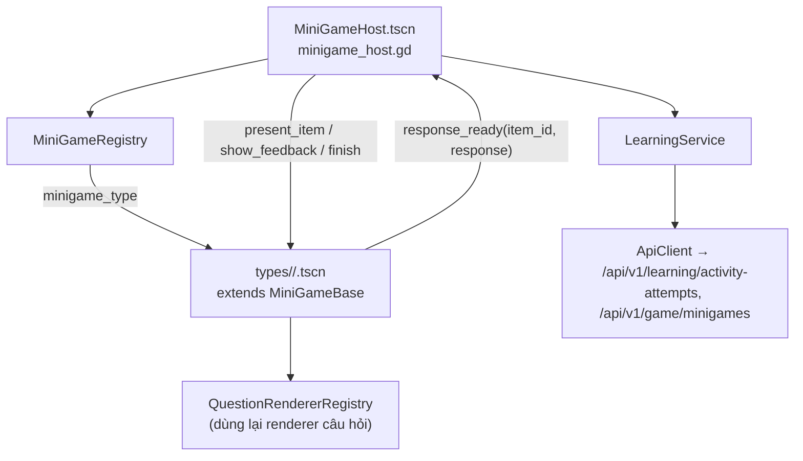
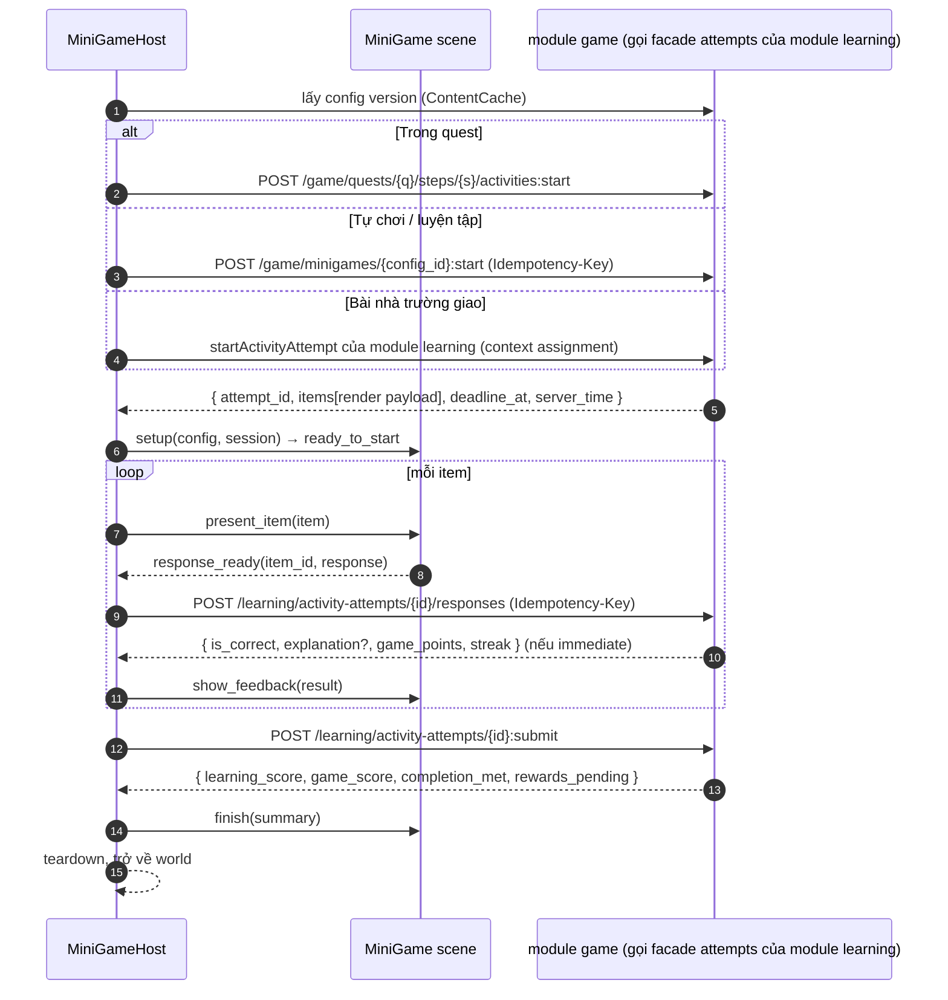

# Mini-game Engine (client Godot)

> Trạng thái: Draft · Phiên bản: 0.1 · Owner: Senior Godot Developer + EdTech Specialist · Cập nhật: 2026-11-15
> Liên quan: [ADR-0015, ADR-0016](../adr/README.md) · [QUEST_SYSTEM](../01-game-design/QUEST_SYSTEM.md) · [QUESTION_BANK](../02-learning/QUESTION_BANK.md) · [EXERCISE_ENGINE](../02-learning/ACTIVITY_ENGINE.md) · [minigame-config.schema.json](../../specs/schemas/minigame-config.schema.json) · [Ví dụ matching Toán lớp 3](../../specs/examples/minigame.math-g3-matching.json)

**Mục đích & phạm vi.** Kiến trúc phía Godot cho renderer `activity_type = minigame`: interface plugin, registry biến thể, vòng đời trên client. Định nghĩa activity, attempt, chấm điểm và evidence thuộc [ACTIVITY_ENGINE](../02-learning/ACTIVITY_ENGINE.md); renderer registry chung của client ở [GODOT_ARCHITECTURE §6.2](GODOT_ARCHITECTURE.md#62-activity-renderers-adr-0048). `MiniGameRegistry` dưới đây là registry con mà renderer `minigame` dùng để chọn scene theo `minigame_type`.

**Yêu cầu (mã PRD):** [PRODUCT_REQUIREMENTS](../00-overview/PRODUCT_REQUIREMENTS.md) FR-MG-001 (danh mục loại mini-game), FR-MG-002 (không có ngân hàng câu hỏi riêng), FR-MG-003 (cấu hình độ khó, thời gian, số câu, điểm, phản hồi, hoàn thành, reward), FR-MG-004 (scene Godot tái sử dụng nhận `MiniGameConfig` + render payload).

## 1. Nguyên tắc

| # | Nguyên tắc | Nhãn |
|---|---|---|
| M-1 | Mini-game **không có ngân hàng câu hỏi riêng**; câu hỏi lấy từ Question Bank qua `question_source` | [Confirmed] (§3.5) |
| M-2 | Mỗi lượt chơi là một **Attempt** (`mode = minigame`; ngữ cảnh quest/assignment/challenge ghi ở `context_ref`), chấm ở module learning | [Confirmed] (ADR-0016) |
| M-3 | Mini-game là **lớp trình bày** (presentation) trên câu hỏi: cùng một câu hỏi có thể hiện dạng thẻ, bóng bay, xe đua... Ưu tiên mini-game mà thao tác chơi chính là khái niệm học, theo [LEARNING_MECHANICS](../01-game-design/LEARNING_MECHANICS.md) | [Confirmed] |
| M-4 | Cấu hình hoàn toàn data-driven, phiên bản hóa (`MiniGameConfig` → `MiniGameConfigVersion`) | [Confirmed] |
| M-5 | Hai loại điểm tách biệt: **learning score** (attempt, theo scoring rule câu hỏi) và **game score** (điểm vui, thưởng tốc độ/chuỗi). Cả hai do server tính; game score không ảnh hưởng mastery | [Confirmed] (DOMAIN_MODEL §10) |
| M-6 | Mini-game là một `activity_type = minigame` trong [Activity Registry](../02-learning/ACTIVITY_ENGINE.md) (ADR-0048): quest/assignment/challenge tham chiếu activity, không gọi riêng mini-game engine; plugin `minigame` dùng Exercise Engine làm lõi chấm | [Confirmed] |

## 2. Loại mini-game và tương thích câu hỏi

| `minigame_type` | Mô tả trải nghiệm (gợi ý) | Question types chấp nhận | Phản hồi mặc định |
|---|---|---|---|
| `multiple_choice` | Chọn cổng/bóng bay/thẻ đúng | `single_choice`, `multiple_choice`, `image_based` | immediate |
| `true_false` | Chạy sang bên Đúng/Sai, giơ biển | `true_false` | immediate |
| `fill_in_blank` | Điền ô trống bằng bàn phím/khối chữ | `fill_in_blank`, `short_answer` | immediate |
| `drag_and_drop` | Kéo vật phẩm vào vùng đích | `drag_drop`, `image_based` | immediate |
| `matching` | Lật/ghép cặp thẻ | `matching` | per-pair hoặc end |
| `ordering` | Xếp toa tàu/bậc thang theo thứ tự | `ordering` | immediate |
| `calculation` | Bàn tính/máy tính vui, nhập số | `numeric` | immediate |
| `puzzle` | Mỗi câu đúng mở một mảnh ghép tranh | mọi loại có chấm tự động | immediate |
| `word_game` | Ô chữ, tìm từ, ghép chữ thành từ | `fill_in_blank`, `short_answer`, `ordering` (ký tự) | end_of_round |
| `science_simulation` | Mô phỏng (mạch điện, cân, gieo hạt) — học sinh thao tác rồi nộp trạng thái | `interactive` | immediate |
| `timed_challenge` | Trả lời nhiều nhất trong thời gian | `single_choice`, `true_false`, `numeric` | immediate (nhanh) |

Server từ chối publish config nếu `question_source` có thể trả về loại câu hỏi không tương thích (validate ở CMS + lúc chọn câu).

`science_simulation`: mô phỏng chạy trên client chỉ là **công cụ thao tác**; client nộp trạng thái cuối (vd. `{ "switch_a": true, "bulb_count": 2 }`) như response của câu `interactive`, server so với answer key/luật trong question version.

## 3. Cấu hình (`MiniGameConfigVersion`)

**Phát hành và ghim version (ADR-0043):** cấu hình mini-game có Draft/Publish/rollback trong Game Studio như mọi nội dung game. Khi học sinh bắt đầu mini-game, `attempts.source_version_id` ghim version cấu hình theo con trỏ; nếu `question_source` là question set, version question set cũng được ghim lúc start (theo con trỏ của question set, hoặc version cố định nếu cấu hình chỉ định `version`). Publish/rollback giữa lượt không đổi câu hỏi hay luật chơi của lượt đang chạy.

Schema chuẩn: [specs/schemas/minigame-config.schema.json](../../specs/schemas/minigame-config.schema.json).

| Nhóm (§3.5) | Trường | Ví dụ |
|---|---|---|
| Loại | `minigame_type` | `matching` |
| Nguồn câu hỏi | `question_source` | `{ kind: "question_set", question_set_id, version }` hoặc `{ kind: "selection_rule", rule: { grade_levels, subject_id, topic_ids, objective_ids, difficulty_min, difficulty_max, question_types } }` |
| Độ khó | `difficulty` | `1–5` hoặc `adaptive` [Confirmed — chọn theo mastery, Phase 3] |
| Thời gian | `time_limit_seconds`, `per_item_time_seconds` | 180 / null |
| Số câu hỏi | `question_count` | 6 |
| Điểm số | `scoring` | `points_per_correct`, `time_bonus`, `streak_bonus`, `wrong_penalty` (≥ 0, mặc định 0 cho lớp 1–5) |
| Cách tính kết quả | `result_calculation` | `learning_score: sum_question_scores`, `game_score: points_plus_bonus` |
| Phản hồi đúng/sai | `feedback` | `{ timing: immediate|after_submit|after_close|never, feedback_display: end_of_round|end_of_game, show_explanation, show_correct_answer }` — `timing` theo enum FeedbackTiming ([ACTIVITY_ENGINE §8.1](../02-learning/ACTIVITY_ENGINE.md)) |
| Cơ chế hoàn thành | `completion_rule` | `{ type: min_correct_ratio, threshold: 0.7 }` |
| Phần thưởng | `reward_rule_id` | tham chiếu [reward-rule](../../specs/schemas/reward-rule.schema.json) |
| Trình bày | `presentation` | `{ scene_variant, theme, background_music_id, mascot_npc_id }` |
| Giới hạn | `limits` | `max_plays_per_day`, `retry_policy` |

## 4. Kiến trúc client (Godot plugin)



### 4.1. Interface chung

```gdscript
# scripts/learning/minigame_base.gd
class_name MiniGameBase
extends Control  # hoặc Node3D cho mini-game 3D, cùng hợp đồng

signal ready_to_start
signal response_ready(item_id: String, response: Dictionary)   # response đúng format QuestionBank
signal hint_requested(item_id: String)
signal quit_requested

## Gọi một lần sau khi instance hóa.
func setup(config: MiniGameConfigModel, session: MiniGameSessionModel) -> void: pass
## Hiển thị một item (render payload, không có đáp án).
func present_item(item: AttemptItemModel) -> void: pass
## Kết quả server cho một câu (khi feedback immediate).
func show_feedback(result: AnswerResultModel) -> void: pass
## Cập nhật đồng hồ theo thời gian server (deadline_at đã quy đổi offset).
func update_timer(remaining_ms: int) -> void: pass
## Kết thúc: hiển thị tổng kết do server trả.
func finish(summary: MiniGameSummaryModel) -> void: pass
## Hủy dọn tài nguyên.
func teardown() -> void: pass
```

Hợp đồng:
- Scene mini-game **không gọi mạng**, không tự tính đúng/sai, không tự cộng điểm — chỉ phát `response_ready`.
- Response phải đúng định dạng của question type (vd. matching: `{ "pairs": [["l1","r3"], ...] }`) để dùng chung chấm điểm với Exercise Engine.
- Hiệu ứng "đúng/sai" chỉ chạy sau `show_feedback` (hoặc ở cuối với `end_of_game`).
- Hỗ trợ cả input chuột, cảm ứng, bàn phím; phần tử chạm ≥ 64px cho lớp 1–5.

### 4.2. Registry

```gdscript
# scripts/learning/minigame_registry.gd
const TYPES := {
	"matching":        { "scene": "res://scenes/minigames/types/matching/Matching.tscn",      "question_types": ["matching"] },
	"timed_challenge": { "scene": "res://scenes/minigames/types/timed/TimedChallenge.tscn", "question_types": ["single_choice", "true_false", "numeric"] },
	# ...
}
```

`scene_variant` trong `presentation` chọn biến thể hình ảnh của cùng loại (vd. `matching.card_flip`, `matching.fishing_pond`) — biến thể nằm trong client hoặc bundle PCK (không chứa script mới).

## 5. Vòng đời



| Tình huống | Xử lý |
|---|---|
| Hết giờ (`deadline_at` server) | Server tự đóng attempt (`expired`) và chấm phần đã trả lời; client nhận khi gọi lại hoặc qua notification |
| Thoát giữa chừng | Attempt `in_progress`, resume theo policy (§4.4 Master Prompt) trong `resume_window` [Confirmed 30 phút]; mini-game timed không resume |
| Mất mạng | Hàng đợi answers gửi lại cùng `Idempotency-Key`; đồng hồ hiển thị dựa server time, không "dừng giờ" trên client |
| Prefetch | `timed_challenge` nhận sẵn batch items (render payload) để không chờ mạng giữa các câu; kết quả chấm vẫn từ server |

## 6. Chấm điểm phía server

1. Exercise Engine chấm từng answer theo `scoring_rule` của `question_version` → `AttemptAnswer.is_correct/score`.
2. Minigame scorer (module `minigame`) tính **game score** từ chuỗi answers: `points_per_correct`, `time_bonus` dựa `answered_at` server − thời điểm item được phát, `streak_bonus`. Không dùng `client_elapsed_ms` để tính điểm.
3. `completion_rule` đánh giá trên learning score → báo cho quest (nếu có context quest).
4. module learning phát `activity.graded` (gồm phần `minigame`: `learning_score`, `game_score`, `completion_met`); module game tiêu thụ, ghi lượt chơi và phát `minigame.completed` đúng một lần → Reward Engine áp `reward_rule_id` với cap/diminishing returns. module learning **không** tiêu thụ `minigame.completed` (evidence học tập đã có từ `activity.*` của chính nó, tránh trùng).
5. Anti-cheat: thời gian trả lời nhỏ hơn ngưỡng tối thiểu hợp lý theo loại câu (vd. < 300 ms cho câu cần đọc) bị gắn cờ `suspicious_timing` để phân tích, không tự động phạt học sinh [Confirmed] (xem ANTI_CHEAT).

## 7. Thêm một mini-game mới — checklist

1. Đề xuất (Game Director + EdTech): mục tiêu học tập, question types tương thích, lứa tuổi.
2. Nếu cần question type mới → cập nhật Question Bank trước (schema, chấm điểm server, renderer) — **không** để mini-game tự chấm.
3. Thêm giá trị `minigame_type` vào [minigame-config.schema.json](../../specs/schemas/minigame-config.schema.json) và bảng tương thích ở backend.
4. Tạo `scenes/minigames/types/<type>/` kế thừa `MiniGameBase`, đăng ký trong `MiniGameRegistry`.
5. Viết test GdUnit4: nhận fixture render payload → phát response đúng format; xử lý feedback; teardown không rò node.
6. Kiểm tra accessibility (cỡ chạm, màu không là tín hiệu duy nhất, có âm thanh + biểu tượng).
7. Thêm template cấu hình trong **Game Operations Console** (workspace A của Admin Portal, `/api/v1/game-admin/minigame-configs` — platform-only, ADR-0027) + preview (Godot Web embed, Phase 3). Tenant chỉ chọn mini-game config đã publish và được gán để giao bài.
8. Cập nhật tài liệu này và CHANGELOG.

## 8. Kiểm thử bắt buộc

| ID | Kịch bản |
|---|---|
| AC-MG-001 | Render payload gửi tới client không chứa `answer_key`/`correct` (contract test) |
| AC-MG-002 | Client gửi `game_score` hoặc `is_correct` trong body → bị bỏ qua/422 |
| AC-MG-003 | `timed_challenge` hết `deadline_at` → câu trả lời đến muộn bị từ chối `ATTEMPT_DEADLINE_PASSED` |
| AC-MG-004 | Config với `question_source` trả về loại câu không tương thích → không publish được |
| AC-MG-005 | Chơi lại cùng config lần thứ N vượt `max_plays_per_day` → vẫn chơi được (luyện tập) nhưng XP = 0 theo reward rule |
| AC-MG-006 | Learning score và game score lưu riêng; mastery chỉ dùng answers, không dùng game score |
