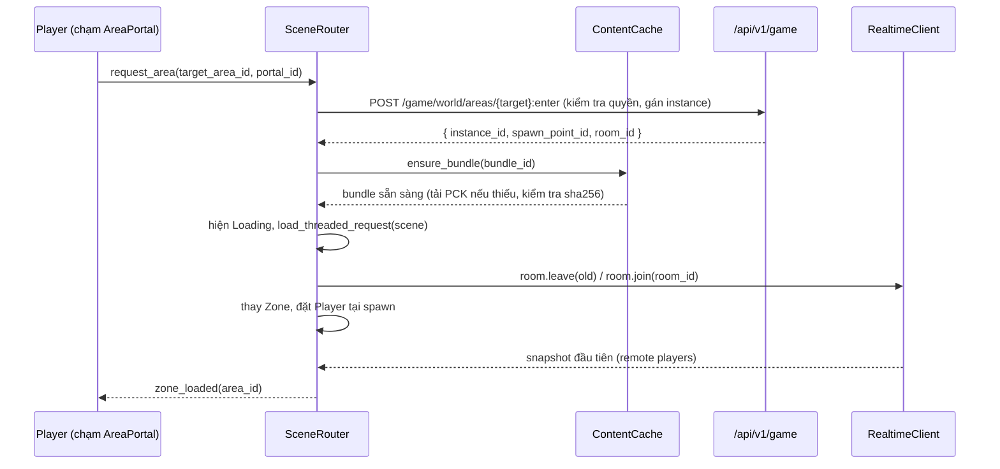
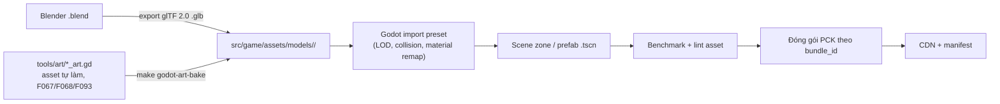

# World Rendering — Kỹ thuật dựng thế giới 3D (Godot)

> Trạng thái: Draft · Phiên bản: 0.2 · Owner: Senior Godot Developer + Technical Artist · Cập nhật: 2026-11-28 (F137: §8.1 âm thanh Ogg Vorbis + loudness theo loại, §8.4 nguồn/manifest/lint âm thanh — ADR-0106) · 2026-11-26 (F097: §5.1 ẩn marker gần camera) · 2026-11-25 (ADR-0103 / F068: mesh tròn mượt, cel shader, rig `kid_base`, blob shadow, Cây Tia Sáng theo cấp) · 2026-11-15
> Liên quan: [ADR-0012, ADR-0013](../adr/README.md) · [ADR-0057](../adr/ADR-0057-chay-tren-may-tam-trung-hang-thiet-bi-va-ngan-sach-hieu-nang.md) · [PERFORMANCE_BUDGET](PERFORMANCE_BUDGET.md) · [GODOT_ARCHITECTURE](GODOT_ARCHITECTURE.md) · [WORLD_DESIGN](../01-game-design/WORLD_DESIGN.md) · [CHARACTER_SYSTEM](../01-game-design/CHARACTER_SYSTEM.md) · [DESIGN_SYSTEM](../05-ux/DESIGN_SYSTEM.md)

## Mục đích và phạm vi

Tài liệu là nguồn duy nhất cho **kỹ thuật dựng** thế giới 3D trong Godot: cấu trúc scene, chuyển khu và streaming, spawn point, interactable, ngân sách hiệu năng, LOD/occlusion/batching, ánh sáng, asset pipeline, bundle PCK, thumbnail cho CMS, NPC phía client. Thiết kế thế giới (vùng đất, cốt truyện, NPC, mở khóa, khám phá, art direction) nằm ở [WORLD_DESIGN](../01-game-design/WORLD_DESIGN.md).

## 1. Ràng buộc kỹ thuật

| Hạng mục | Quyết định | Nhãn |
|---|---|---|
| Thiết bị, FPS, renderer, preset | Theo hạng thiết bị tầm trung: [PERFORMANCE_BUDGET](PERFORMANCE_BUDGET.md) §2–§5 (nơi sở hữu) | [Confirmed] yêu cầu ADR-0057 |
| Tổ chức thế giới | Hybrid: hub instance, private instance, match room — không có open world liền mạch; phong cách hình ảnh theo [WORLD_DESIGN](../01-game-design/WORLD_DESIGN.md) §11 | [Confirmed] ADR-0012 |
| Token 3D/art | Palette vật liệu theo khu vực, tham số toon/outline, Environment, gradient VFX, màu độ hiếm khai báo trong `design/game-tokens/art3d.json` và mã màu nghiệp vụ `design/shared-tokens/`; sinh ra `src/game/resources/art/generated/` (ADR-0047, [DESIGN_SYSTEM §5.3](../05-ux/DESIGN_SYSTEM.md#53-token-3dart-art3djson)). Material và Environment của zone tham chiếu preset sinh ra, không tự đặt màu | [Confirmed] ADR-0047 |
| Renderer parity | Hình ảnh tương đương giữa Mobile (mặc định PC/Android/iOS), Compatibility (Web, máy Tối thiểu, preview CMS) và Forward+ (chỉ preset Cao, thumbnail) — [PERFORMANCE_BUDGET](PERFORMANCE_BUDGET.md) §4; shader toon viết tương thích cả ba renderer; kiểm tra bằng ảnh so sánh trong CI | [Confirmed] |

## 2. Cấu trúc scene theo zone

Mỗi `world_area` ([WORLD_DESIGN](../01-game-design/WORLD_DESIGN.md) §5) là **một scene độc lập** được tải/giải phóng trọn gói:

| `area_id` | Scene | Loại room | Ghi chú |
|---|---|---|---|
| `main_hub` | `zones/main_hub/Zone.tscn` | `hub_instance` | Quảng trường Tia Sáng (Thị trấn Trung Tâm): bảng nhiệm vụ, cổng gió |
| `learning_zone.math` / `.vietnamese` / `.english` / `.science` / `.history` | `zones/learning_zone_<subject>/Zone.tscn` | `hub_instance` | Vương quốc Số, Rừng Ngôn Ngữ, Đảo Khoa Học, Vương quốc Lịch Sử; môn mới = bundle mới, không build lại client. Đồ họa (F093): prefab vùng chung `tools/art/zone_kit.gd` + công thức `zone_<môn>_art.gd` |
| `practice_zone` | `zones/practice_zone/Zone.tscn` | `hub_instance` | Thư viện Gió (Thị trấn Trung Tâm). Đồ họa sáu vùng còn lại (F094): bố cục tùy biến trên `zone_kit.gd` + công thức `zone_{practice,social,ocean,mountain,exam,arena}_art.gd` |
| `exam_zone` | `zones/exam_zone/Zone.tscn` | `hub_instance` | Tháp Thử Thách (Núi Thử Thách); phòng thi chuyển sang UI 2D toàn màn khi làm bài |
| `challenge_mountain` | `zones/challenge_mountain/Zone.tscn` | `hub_instance` + `private_instance` | Sườn Núi Thử Thách: challenge, boss |
| `arena` | `zones/arena/Zone.tscn` | `hub_instance` + `battle` | Đấu trường Nhà Vô Địch; trận chạy trong `BattleArena.tscn` |
| `social_zone` | `zones/social_zone/Zone.tscn` | `hub_instance` | Vườn Bạn Bè (Thị trấn Trung Tâm) |
| `quest_zone.*` | `zones/quest_<id>/Zone.tscn` | `hub_instance` + `private_instance` | Đại dương Khám Phá (`quest_zone.discovery_ocean`) và khu quest/party |

Cây node chuẩn của một zone:

```text
Zone (Node3D, script zone_root.gd)
├── Environment (WorldEnvironment + DirectionalLight3D)
├── Terrain        (StaticBody3D, mesh gộp, collision đơn giản hóa; F093: Ground gần có viền + Far cảnh xa không viền/bóng)
├── Static         (MeshInstance3D/MultiMeshInstance3D — props tĩnh, đã gộp)
├── Navigation     (NavigationRegion3D — cho NPC đi lại)
├── Occluders      (OccluderInstance3D)
├── SpawnPoints    (Marker3D, script spawn_point.gd)
├── Interactables  (NPC, bảng nhiệm vụ, cổng, vật thể quest — Area3D + script interactable.gd)
├── Portals        (AreaPortal — chuyển zone)
├── Players        (container cho Player + RemotePlayer, sinh lúc runtime)
└── Ambient        (AudioStreamPlayer3D, particle nhẹ)
```

`zone_root.gd` chỉ khai báo metadata (`area_id`, `default_spawn`, `music_id`) và đăng ký điểm neo với `SceneRouter`; không chứa logic học tập.

## 3. Area transition & streaming



- Chỉ một zone trong bộ nhớ tại một thời điểm (+ Main Hub giữ thumbnail). Zone cũ `queue_free()` sau khi zone mới sẵn sàng → tránh khựng.
- Preload nền zone kế tiếp có khả năng cao (vd. quest đang theo dõi trỏ tới) khi thiết bị có RAM > 4 GB [Confirmed].
- Server quyết định instance (ADR-0012): ưu tiên instance có bạn bè/party, giới hạn `capacity` (mặc định 40).
- Quyền vào khu (`access_policy`) do server kiểm tra; client chỉ ẩn cổng khi `AppState` báo chưa mở khóa.

## 4. Spawn points

| Thuộc tính `SpawnPoint` | Mô tả |
|---|---|
| `spawn_point_id` | Duy nhất trong zone, vd. `main_hub.default`, `main_hub.from_arena` |
| `radius` | Bán kính rải ngẫu nhiên để tránh chồng người chơi |
| `facing` | Hướng camera ban đầu |
| `tags` | `default`, `from_<area>`, `party_gather`, `respawn` |

Server trả `spawn_point_id`; nếu không tồn tại trong scene (sai lệch version) client dùng `default` và log cảnh báo.

## 5. Interactive objects

Mọi vật thể tương tác kế thừa `Interactable` (Area3D):

| Thuộc tính | Ví dụ |
|---|---|
| `interactable_id` | `npc.math_owl_sage`, `board.daily_quests`, `portal.to_arena` |
| `kind` | `npc`, `quest_board`, `portal`, `quest_object`, `discovery`, `collectible`, `info_sign`, `minigame_station`, `seat` |
| `prompt_key` | khóa i18n hiển thị "Nhấn E / chạm để nói chuyện" |
| `requires` | điều kiện hiển thị phía client (gợi ý UI) — **server vẫn kiểm tra lại** |
| `action` | phát signal `interacted(interactable_id)` → service tương ứng |

Quest object (vật cần thu thập, điểm cần đến) được đặt sẵn trong scene với `interactable_id` ổn định; dữ liệu quest tham chiếu ID đó (xem [QUEST_SYSTEM](../01-game-design/QUEST_SYSTEM.md) §3). Như vậy level designer đặt "điểm neo", nhà thiết kế nội dung gắn nhiệm vụ trong CMS mà không sửa scene.

### 5.1. Marker gần camera (F097, chốt F096-4)

Marker thế giới (đá Tia Sáng của `WorldAnchor`, `QuestMarker3D` — nhóm node `camera_fade`) không được đứng chắn giữa camera và nhân vật [Confirmed — owner "chốt hết", 2026-11-26]:

| Quy tắc | Giá trị |
|---|---|
| Ẩn khi | khoảng cách marker → camera < `marker_near_fade_m` **và** marker gần camera hơn nhân vật (đứng giữa camera và nhân vật) |
| `marker_near_fade_m` | 5 m (`ProjectSettings eduworld/world/marker_near_fade_m`, đăng ký ở [CONFIG_DEFAULTS](../00-overview/CONFIG_DEFAULTS.md) §2) |
| Hiện lại khi | xa camera hơn ngưỡng + 0,5 m (trễ chống nhấp nháy) hoặc xa hơn nhân vật |
| Tần suất kiểm | 10 lần/giây (`MarkerFader` do `ZoneRoot` thêm), không mỗi frame |
| Cách ẩn | tắt `visible` của mesh marker; không mờ dần bằng alpha (shader toon dùng chung không có alpha theo instance) |

Chỉ là hiển thị: seed và vị trí điểm neo không đổi, `Area3D` tương tác vẫn hoạt động, không báo service (AGENTS R1). Ví dụ: ở spawn Hub, đá Tia Sáng của `quest.hub.welcome_sign` (0, 0, 12) nằm giữa camera và nhân vật nên được ẩn; khi học sinh đi tới, đá ở phía trước nhân vật và hiện lại. Test: `tests/unit/world/test_marker_fader.gd`.

## 6. Hiệu năng

Mọi con số (ngân sách theo cảnh, asset, ánh sáng, physics, dung lượng gói vùng, preset) do [PERFORMANCE_BUDGET](PERFORMANCE_BUDGET.md) sở hữu (§5, §7, §8, §11, §13). Mục này mô tả **cách áp dụng** trong pipeline dựng thế giới.

### 6.1. Kỹ thuật tối ưu

| Kỹ thuật | Áp dụng |
|---|---|
| LOD | Godot automatic mesh LOD khi import + `visibility_range_end` cho props nhỏ; nhân vật 3 mức (full / giảm / impostor billboard > 30 m) |
| Occlusion | `OccluderInstance3D` bake cho tòa nhà, tường; bật occlusion culling ở zone có nhiều khối |
| Batching | Gộp props tĩnh cùng material; cây/cỏ/đá dùng `MultiMeshInstance3D`; một material toon cho cả zone, màu là slot của bảng màu token `art.palette.*` (mảng uniform của preset `mat_toon.tres`, không texture) |
| Texture | Palette (mảng uniform) thay texture cho mesh tự làm; ETC2/ASTC trên Android, BPTC/S3TC trên PC; mipmaps bật |
| Shader | Một shader cel chung `src/game/resources/art/shaders/toon.gdshader` (dải sáng phân bậc rõ, cạnh dải `toon.band_softness`, rim, không specular — ADR-0103) và viền mực inverted hull `toon_outline.gdshader` làm `next_pass`; preset `resources/art/generated/mat_toon.tres` (có viền, mesh tĩnh) / `mat_toon_skinned.tres` (nhân vật có xương: viền theo NORMAL đã skin) / `mat_toon_no_outline.tres` (cỏ, hoa, lúa, mặt nhân vật) sinh từ token; zone không tự tạo material; precompile qua màn hình warm-up |
| Hiệu ứng | Particle GPU số lượng thấp; tắt SSAO/SSR/volumetric fog trên Mobile renderer |
| Giới hạn theo thiết bị | Preset Thấp/Trung bình/Cao, tự phát hiện và độ phân giải động theo [PERFORMANCE_BUDGET](PERFORMANCE_BUDGET.md) §5–§6; zone đọc thiết lập từ `QualityManager` (mật độ cỏ, visibility range, outline), không tự đặt giá trị |
| Streaming vùng | Mỗi vùng là một gói PCK + scene gốc; vào vùng mới thì tải nền gói, giải phóng scene/texture vùng cũ sau khi chuyển xong; giữ tối đa 2 vùng trong RAM |
| Bake | Lightmap, occluder và navmesh bake trong pipeline asset (§8), không bake lúc chạy |

Mọi zone phải qua **benchmark scene** tự động trong CI và trên thiết bị thật theo quy trình [PERFORMANCE_BUDGET](PERFORMANCE_BUDGET.md) §15 trước khi publish bundle.

## 7. Lighting

- **Baked lighting**: `LightmapGI` cho zone tĩnh (độ phân giải texel vừa phải), kết hợp 1 directional light thời gian thực cho bóng nhân vật.
- **Blob shadow** (F068, quyết định F067-3): mỗi nhân vật (người chơi, người chơi khác, NPC, xem trước avatar) có `BlobShadow` — vệt tròn mờ dưới chân, màu/độ mờ từ token `light.blob_shadow_*` — **chỉ hiện khi mặt trời không có bóng thời gian thực**: renderer Compatibility (Web) hoặc bóng nắng tắt (preset Thấp hay học sinh tắt bóng trong cài đặt) (`QualityPolicy.blob_shadow_visible`, `ZoneArtQuality` cập nhật khi đổi preset). Người chơi cục bộ dò mặt đất để vệt bóng nằm trên sàn khi nhảy và nhỏ lại theo độ cao.
- Ambient là màu phẳng ấm (`light.ambient_color`, `light.ambient_energy`), tonemap linear, sương `light.fog_density` — cùng kết quả trên Mobile và Compatibility. Trên **Compatibility (Web)** mặt trời không bật bóng thời gian thực (`QualityPolicy.shadows_supported`): renderer này vẽ ánh sáng có bóng thêm một pass cộng mà shader toon `light()` không phân biệt được (F067).
- Không dùng chu kỳ ngày/đêm động (chi phí hiệu năng trên máy tầm trung, ADR-0057) [Confirmed]; mỗi zone có `Environment` riêng, sinh từ token `env.<zone>.*` trong `design/game-tokens/art3d.json` vào `resources/art/generated/` (ADR-0047); không đặt màu trời/sương/ánh sáng trực tiếp trong scene. Sự kiện mùa (World Event) đổi environment preset qua manifest.

## 8. Asset pipeline



### 8.1. Quy chuẩn

| Hạng mục | Quy chuẩn |
|---|---|
| Định dạng | glTF 2.0 binary (`.glb`); không commit `.fbx` |
| Đơn vị | 1 unit = 1 mét; nhân vật học sinh cao 1,1–1,4 m, đầu 1/3–1/2 chiều cao ([CHARACTER_SYSTEM §4.1](../01-game-design/CHARACTER_SYSTEM.md#41-rig-kid_base-clip-và-biểu-cảm)) |
| Trục | Y-up, nhân vật nhìn hướng -Z (chuẩn Godot) |
| Pivot | Gốc tại đáy giữa vật thể |
| Đặt tên file | `<category>_<name>_<variant>.glb` — `prop_bench_wood_a.glb`, `bld_library_main.glb`, `chr_body_kid_a.glb` |
| Đặt tên node trong file | Hậu tố import Godot: `-col` (collision), `-colonly`, `-navmesh`; LOD thủ công `_LOD0/_LOD1` |
| Ngân sách tam giác/texture/xương | Theo [PERFORMANCE_BUDGET](PERFORMANCE_BUDGET.md) §8; CI chặn khi vượt |
| Texture | Lũy thừa của 2; tên `<asset>_<map>.png` (`_albedo`, `_orm`, `_normal` — hạn chế normal map) |
| Audio | Mọi file **Ogg Vorbis** (`.ogg`; không commit `.wav`/`.mp3`): SFX/UI mono, nhạc/ambience stereo; loudness chuẩn hóa theo `audio_loudness_targets` (theo loại); nguồn, manifest, lint ở §8.4 (ADR-0106) |
| License | Mỗi file asset đồ họa có một dòng (glob đường dẫn, URL nguồn, tác giả, license, ngày) trong `src/game/assets/LICENSES.md` (= `res://assets/LICENSES.md`); chỉ MIT, CC0-1.0, public domain (font: OFL-1.1); asset tự làm phát hành MIT ([ADR-0102](../adr/ADR-0102-nguon-asset-do-hoa-theo-license-mit-hoac-de-dai-hon.md)); `src/game/tools/lint_art.gd` chặn file thiếu dòng hoặc license khác |
| Asset tự làm bằng code | Công thức trong `src/game/tools/art/` (`*_art.gd`, builder `lowpoly_mesh.gd`) bake bằng `make godot-art-bake` ra `src/game/assets/models/<category>/<category>_<name>_<variant>.res`; mỗi mặt chỉ lưu **slot** của bảng màu token `art.palette.*` (UV.x = slot + 0,5; UV.y > 1 = `albedo` theo avatar), pháp tuyến mượt hàn hoàn toàn cho viền trong COLOR; `bake_art.gd --check` (CI) chặn mesh/clip lệch công thức. Vật thể lặp lưu `ScatterSet` (mesh + transform), vẽ bằng `ScatterInstance` (MultiMesh). **Hình khối "Stylized 3D Cartoon"** (ADR-0103, F068): builder làm mượt pháp tuyến trong góc 62° (trọng số diện tích), vát cạnh khối dày ≥ 0,035 m (Hub: ≥ 0,15 m) 20 % cạnh nhỏ nhất tối đa 0,09 m, bo vành trụ có nắp, tối thiểu 8 cạnh cho trụ/tiện, thêm một bậc chia cho khối cầu; vật thể lặp, xa và NPC giữ bậc chia gốc để đúng ngân sách. **Nhân vật**: thân và trang phục skinned theo `KidSkeleton` (BONES/WEIGHTS), mặt theo biểu cảm `chr_face_<biểu cảm>_a.res`, clip `anim_kid_<clip>_a.res` (công thức `character_anim.gd`); **Cây Tia Sáng** 5 cấp `veg_banyan_spark_s<0–4>_a.res` (`SparkTree` chỉ đổi mesh). **Vùng môn học** (F093): prefab vùng chung `zone_kit.gd` (bố cục điểm neo của seed, mặt đất gần, cảnh xa, rào biên, luật rải cây) + `zone_<môn>_art.gd` (`meshes()`, `SCATTER`, `placements()`, đăng ký `ArtCatalog.ZONES`) → `env_<môn>_{terrain,far}_a`, `bld_<môn>_*`, `prop_<môn>_*`, `env_<môn>_scatter_<loại>_a`; set piece là mesh riêng đặt cạnh điểm neo bằng transform của node; cảnh xa vẽ bằng `mat_toon_no_outline`, không đổ bóng; tấm mỏng (mái, lá) luôn là khối kín vì viền inverted hull tô đen mặt phẳng dày 0. **Sáu vùng còn lại** (F094): bố cục tùy biến của từng vùng (`LAYOUT`: quảng trường, lối đi, bệ dưới điểm neo; `clear_of()`/`scatter_in()`), đồ dùng chung `signpost()` (biển chỉ đường có biểu tượng hình tới mọi điểm neo và cổng gió về), `glow_ring()` (vòng sáng quanh bệ điểm neo), `pennant()`, `bunting()`, `balloons()`, `cairn()`, `crystal()`, `cone()`, cây thông `veg_pine_a`; marker `WorldAnchor` là viên đá Tia Sáng lớn có vòng hào quang. Mesh có viền **không** được chứa cặp tam giác trùng đỉnh ngược chiều (mặt hai mặt dày 0 — F093-3, test `test_outlined_meshes_have_no_two_sided_planes`): lá cau, cánh sen, thuyền thúng của Hub là khối kín |

### 8.2. Asset bundles (PCK)

- `bundle_id` theo zone hoặc nhóm cosmetic (`zone.main_hub`, `cosmetics.season_1`).
- Client build chứa: core scripts, UI, Main Hub tối thiểu, nhân vật cơ bản. Các zone khác tải từ CDN khi cần → bản cài nhỏ và thêm khu không cần phát hành client mới.
- Bundle chỉ chứa resource (scene, mesh, texture, audio); **không chứa script mới** [Confirmed] (GODOT_ARCHITECTURE §8.2). Scene trong bundle chỉ được dùng script có sẵn trong client (`interactable.gd`, `spawn_point.gd`...).
- Manifest ký/được phục vụ qua HTTPS từ API; client kiểm tra `sha256` trước khi mount.
- **Level package có version (ADR-0043/0044):** mỗi level/zone là một item nội dung game có Draft/Publish/rollback trong Game Studio. Bundle lưu ở bucket `ew-game-bundles`, đường dẫn CDN `bundles/<bundle_id>/<version>/<sha256>.pck` (`Cache-Control: immutable`). Content manifest của tenant trỏ version hiện hành; học sinh đang ở trong màn giữ bundle version cũ đến khi rời màn (`level_sessions.content_versions`). Rollback level = trỏ manifest về bundle version cũ, không build lại.
- Media dùng trong cấu hình level (ảnh bảng tin, âm thanh NPC) tham chiếu `media_assets` qua `sha256`, không nhúng vào bundle.

### 8.3. Thumbnail và turntable cho CMS

- Khi một version của nhân vật, item, NPC, zone hoặc quest marker được publish (ADR-0043), job **render headless Godot** chạy cùng model, material và Environment của game để tạo: ảnh tĩnh 512×512 (WebP) và turntable 24 khung (WebP động hoặc sprite sheet); zone có ảnh toàn cảnh 1280×720.
- Kết quả lưu object storage (ADR-0044) theo khóa `media/<sha256>/...`, đăng ký `media_assets` với `kind = render_thumbnail | render_turntable`, gắn vào version tương ứng. Version cũ giữ thumbnail cũ.
- CMS dùng các ảnh này như **dữ liệu nhận diện** trong danh sách, form chọn item/phần thưởng và thư viện (DESIGN_SYSTEM §7); giao diện CMS vẫn theo Admin/Ops UI.
- Job chạy trong worker của module game (container có Godot headless + export template khóa phiên bản) và trong CI cho asset mới; render dùng renderer Forward+ với preset chất lượng cao cố định để ảnh nhất quán.

### 8.4. Âm thanh: nguồn, manifest, lint (F137)

Quyết định: [ADR-0106](../adr/ADR-0106-am-thanh-game-phu-hop-giao-duc-va-nguon-cc0-mit.md); triển khai [F137](../../specs/137-game-audio/spec.md); dùng trong game theo [GODOT_ARCHITECTURE §10.3](GODOT_ARCHITECTURE.md#103-âm-thanh-audiodirector-f137).

| Hạng mục | Quy chuẩn |
|---|---|
| License | Chỉ `CC0-1.0` hoặc `MIT` (âm thanh tự làm/tổng hợp: `MIT`); không nhận `Public-Domain` không ghi CC0, CC-BY, `-SA`, `-NC`, `-ND`, GPL, pack trả phí |
| Nguồn | Agent không tải asset (ADR-0102 mục 6): kế hoạch nguồn ([F137 research](../../specs/137-game-audio/research.md)) chỉ liệt kê ứng viên; người được owner giao tải, đọc trang license của **từng file**, lưu văn bản license gốc khi pack kèm theo (`src/game/assets/audio/licenses/<pack>.txt`) |
| Thư mục | `src/game/assets/audio/{music,ambience,sfx,ui}/<category>_<name>_<variant>.ogg` (ví dụ `music_zone_math_a.ogg`, `sfx_correct_a.ogg`, `ui_tap_a.ogg`); nhạc/ambience của vùng đóng gói theo `bundle_id` của vùng (§8.2), âm thanh lõi trong client build |
| Manifest | `src/game/assets/audio/audio_manifest.json`: mỗi file một bản ghi `path`, `source_url` (URL chính xác của file hoặc trang pack), `author`, `license`, `sha256` (của file `.ogg` đã chuẩn hóa trong repo), `source_sha256` (file gốc đã tải), `retrieved` (ngày), `kind` (`music`/`ambience`/`sfx`/`ui`/`stinger`), `loudness_lufs`, `true_peak_dbtp`, `duration_s`, `channels`. `src/game/assets/LICENSES.md` có một dòng glob `assets/audio/**` trỏ tới manifest để `lint_art.gd` (đã quét `.ogg`) vẫn đạt |
| Chuẩn hóa | Script tái lập `src/game/tools/audio/normalize.sh` (ffmpeg trong image CI ghim phiên bản): `loudnorm` hai lượt theo `audio_loudness_targets` của `kind`, true peak ≤ −1 dBTP, mã hóa `libvorbis` (nhạc/ambience `audio_music_bitrate`, SFX/UI mono), cắt im lặng đầu/cuối SFX, điểm lặp nhạc không có tiếng "bụp"; ghi lại số đo vào manifest |
| Lint (CI) | `src/game/tools/audio/lint_audio.mjs` (Node, chạy trong job `godot.yml`): mọi file âm thanh dưới `src/game/` (trừ `tests/`, `addons/`) có bản ghi manifest; license thuộc danh sách; `sha256` khớp; định dạng Ogg Vorbis (không `.wav`/`.mp3`); đo lại bằng ffmpeg `ebur128` lệch mục tiêu ≤ ±1 LU, true peak ≤ −1 dBTP; SFX ≤ 1 s (stinger ≤ 3 s); tổng dung lượng âm thanh lõi ≤ `audio_core_budget`, mỗi gói vùng ≤ `audio_zone_budget`. Vi phạm → exit 1 chỉ rõ file |
| Catalog | `src/game/resources/audio/audio_catalog.json` ánh xạ id ngữ cảnh/sự kiện → file + `visual_cue` bắt buộc; lint kiểm mọi file catalog có trong manifest và mọi id dùng trong zone scene (`music_id`, `ambience_id`) có trong catalog |
| Trang Giấy phép trong game | Mục "Âm thanh" liệt kê tác giả/pack/license từ manifest (sinh khi build, không gõ tay) cạnh mục đồ họa của F096 |


## 9. NPC

- NPC là scene `NPC.tscn` (mesh + AnimationTree + `Interactable`), thuộc tính `npc_id` gắn với `NPCDialogue` trong CMS.
- Di chuyển bằng `NavigationAgent3D` theo waypoint đơn giản, chỉ chạy logic khi trong bán kính 25 m của người chơi.
- NPC là cục bộ trên mỗi client (không đồng bộ vị trí qua mạng) — chỉ hành động nghiệp vụ (giao quest) đi qua server.

## 10. Kiểm thử & nghiệm thu một zone

1. Benchmark scene đạt ngân sách §6 trên thiết bị chuẩn Android + PC.
2. Mọi `SpawnPoint`, `Interactable`, `AreaPortal` có ID duy nhất; script lint kiểm tra trùng ID và tham chiếu tới `area_id` hợp lệ. Hiện thực: [`src/game/tools/zone_lint.gd`](../../src/game/tools/zone_lint.gd) (luật ở [`tools/lib/zone_rules.gd`](../../src/game/tools/lib/zone_rules.gd): ID, `area_id`/cổng hợp lệ, material chỉ từ preset token, từ khóa an toàn nội dung) và GdUnit [`test_zone_lint.gd`](../../src/game/tests/scene/world/test_zone_lint.gd); zone greybox M2 sinh từ seed thế giới bằng [`tools/gen_greybox_zones.mjs`](../../src/game/tools/gen_greybox_zones.mjs) (F071); scene đã có art (Hub, năm vùng môn học F093, sáu vùng F094) giữ phần làm tay phía trên marker `BEGIN F071 generated anchors`, generator chỉ sinh lại khối điểm neo; [`test_subject_zone_art.gd`](../../src/game/tests/scene/world/test_subject_zone_art.gd) kiểm điểm neo = seed và collision mới không chắn spawn, điểm neo, lối đi ([`test_zone_art_pass_4.gd`](../../src/game/tests/scene/world/test_zone_art_pass_4.gd) cho sáu vùng F094); `gen_greybox_zones.mjs --check` sạch cho cả 12 vùng (Hub có đủ vật thể quest F072 từ F094).
3. NavMesh bao phủ khu NPC; không có kẹt người chơi (test bot đi ngẫu nhiên 10 phút).
4. Bundle mount/unmount không rò bộ nhớ (đo sau 20 lần chuyển zone).
5. Review an toàn nội dung hình ảnh (không biểu tượng/ngôn từ không phù hợp).
