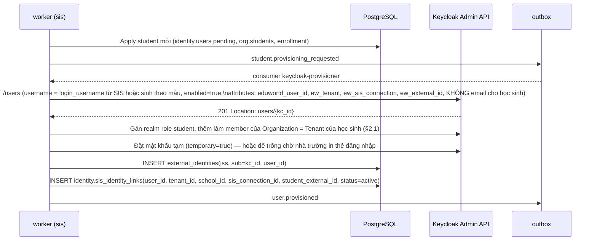
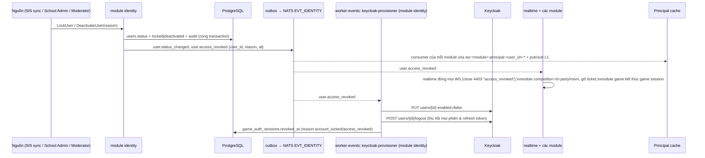

# Account Provisioning

> Trạng thái: Draft · Phiên bản: 0.5 · Owner: Identity & Security Engineer · Cập nhật: 2026-11-17 (ADR-0074: saga gọi facade platform của module trong tiến trình thay internal HTTP; job chạy trong binary `worker`) · 2026-11-16 (§6: thu hồi phiên game giữ bằng refresh token — ADR-0086; §6b: dọn học sinh giữ user Keycloak enabled — quyết định Technical Architect)
> Liên quan: [KEYCLOAK_SSO](KEYCLOAK_SSO.md) · [IDENTITY_MAPPING](IDENTITY_MAPPING.md) · [SIS_INTEGRATION](SIS_INTEGRATION.md) · [EVENT_DESIGN](../07-backend/EVENT_DESIGN.md) · [MULTITENANCY §8](../06-architecture/MULTITENANCY.md) · ADR-0026 · OQ-01, OQ-02

**Mục đích & phạm vi.** Nguồn chuẩn cho vòng đời tài khoản: tạo tài khoản (tự động từ SIS, tài khoản tenant chung do platform tạo; JIT là mở rộng sau — ADR-0063), đồng bộ membership Keycloak, chuyển trường ở phía tài khoản, khóa/vô hiệu hóa, dọn học sinh không đăng nhập và khôi phục, credential đăng nhập nhanh, saga platform.

## 1. Các con đường tạo tài khoản

| Con đường | Khi nào | Tạo Keycloak user? | Tạo EduWorld user? | Nhãn |
|---|---|---|---|---|
| **Automatic provisioning từ SIS** | SIS sync có học sinh mới (SIS không đồng bộ nhân sự, ADR-0072) | Có — nếu trường **không** có IdP (local user) | Có (`status=pending`) | [Proposed] mặc định |
| **Pre-link với IdP** | Trường có IdP (Google/Microsoft/SIS SSO) | Không tạo trước; Keycloak tạo user khi first broker login và chỉ link nếu khớp | Có (`pending`) từ SIS | [Proposed] |
| **JIT provisioning** | Đăng nhập lần đầu qua IdP trường, chưa có ExternalIdentity | Đã có (Keycloak) | Tạo/link nếu khớp bản ghi SIS và policy cho phép | **Ngoài Release 1.0** (ADR-0063), mở rộng sau |
| **Platform tạo tài khoản tenant chung** | System Admin tạo/import học sinh vào tenant `common` có chủ đích (§3.4) | Có (local user) | Có, kèm khối + lớp ảo theo khối, có audit | [Confirmed] ADR-0063 |
| **Thủ công** | Mọi nhân sự: nhà trường (School Admin, Academic Manager, Tenant Admin, Tenant Content Editor/Reviewer), đội platform (content team, Safety Team…) | Có — qua Admin Portal (`POST /tenant/users`, `/admin/user-roles`), module identity gọi Admin API; **email bắt buộc**, username/email kiểm tra trùng trên SSO và trong tenant (`409 USERNAME_TAKEN`/`EMAIL_TAKEN`, ADR-0069); kèm ít nhất một UserRole (`source = manual`) | Có, có audit | [Proposed] |

Không có self-registration [Confirmed].

**Định danh đăng nhập duy nhất (ADR-0067, [ADR-0069](../adr/ADR-0069-username-email-duy-nhat-theo-tenant-va-dang-nhap-khong-chon-tenant.md)) [Confirmed]:** một người một tài khoản SSO; mọi con đường trên đều kiểm tra `lower(username)` và `lower(email)` (nếu có) trên **SSO và `identity.users`** trước khi tạo/sửa (DB unique index + Keycloak `duplicateEmailsAllowed=false`). Dữ liệu theo tenant có `tenant_id NOT NULL` và mỗi `(tenant_id, user_id)` đúng một membership, nên username/email **không bao giờ trùng trong cùng tenant**. Chuẩn hóa: trim, Unicode NFC, chữ thường. Nhân sự bắt buộc có email; học sinh không bắt buộc (provisioning không gửi email học sinh lên Keycloak). **Một người, một tài khoản:** nhân sự làm việc ở nhiều trường/tenant dùng một User với nhiều membership và UserRole — SIS/import gặp người đã có tài khoản (khớp liên kết định danh SIS, email, hoặc mã nhân sự + xác nhận của Tenant Admin) thì thêm membership (enrollment hoặc UserRole) vào tài khoản sẵn có, không tạo tài khoản thứ hai. Soft-delete không giải phóng username/email đến khi ẩn danh hóa [Proposed].

**Kết quả sau đăng nhập theo membership (ADR-0063)** — Release 1.0 học sinh chỉ đăng nhập username + password; tài khoản chỉ đến từ tenant SIS hoặc tenant chung do platform tạo:

| Membership của user (DB) | Kết quả |
|---|---|
| Đúng 1 tenant (tenant SIS hoặc tenant chung) | Vào thẳng tenant đó |
| Nhiều tenant (hiếm) | `403 TENANT_NOT_SELECTED` kèm danh sách; game chọn **sau** đăng nhập bằng `login_ticket` (`POST /auth/game/tenant:select`, ADR-0068); portal chọn sau đăng nhập và gửi `X-Tenant-Id` (membership kiểm tra ở backend, không token mới — ADR-0091). Không nhập lại mật khẩu |
| Không thuộc tenant chung và không thuộc tenant SIS nào | **Không cho đăng nhập**: `403 ACCOUNT_NOT_PROVISIONED`, ghi audit, `keycloak-provisioner` thu hồi phiên Keycloak vừa tạo (theo `sid`); không tạo user/membership, **không** tự đưa vào tenant chung |

Thuật toán đầy đủ: [IDENTITY_MAPPING §3](IDENTITY_MAPPING.md#3-thuật-toán-resolve).

## 2. Automatic provisioning (trường không có IdP)

- **Liên kết SIS nguồn (ADR-0046):** provisioning luôn ghi `identity.sis_identity_links` với khóa nguồn `(sis_connection_id, student_external_id)` — `student_external_id` chỉ duy nhất trong một SIS. Thuộc tính Keycloak `ew_tenant`, `ew_sis_connection`, `ew_external_id` chỉ là **gợi ý tra cứu nhanh**; database của module identity là nguồn quyết định, khi lệch thì DB thắng và job reconciliation ghi đè thuộc tính Keycloak.
- Username mẫu [Proposed]: `hs.<school_code>.<student_code>` (chữ thường, không dấu); nhân sự nhà trường tạo thủ công theo quy ước `<vai trò>.<school_code>` hoặc email công việc (ví dụ demo: `ad.truong.a` School Admin, `qlcm.truong.a` Academic Manager — [LOCAL_DEVELOPMENT](../11-operations/LOCAL_DEVELOPMENT.md)).
- Mật khẩu ban đầu: sinh ngẫu nhiên, hiển thị **một lần** cho School Admin trong Admin Portal để in "thẻ đăng nhập" (lớp 1–5) hoặc gửi theo kênh của trường. EduWorld **không lưu** mật khẩu (Master Prompt §10.1). Bắt buộc đổi mật khẩu lần đầu với lớp 6–9 và mọi nhân sự; lớp 1–3 tùy trường [Proposed].
- Idempotent: nếu `POST /users` trả 409 (username đã tồn tại) → tìm user theo attribute `eduworld_user_id`; khớp thì link, không khớp → `reconciliation_issue: duplicate_identifier` (thay `keycloak_username_conflict`).
- **Trùng định danh khi đồng bộ SIS/import (ADR-0067, [ADR-0069](../adr/ADR-0069-username-email-duy-nhat-theo-tenant-va-dang-nhap-khong-chon-tenant.md)):** username hoặc email của bản ghi mới trùng (không phân biệt hoa thường) với tài khoản khác — kể cả ở tenant khác hoặc đã soft-delete chưa ẩn danh hóa → **không tạo, không ghi đè**, bản ghi ở trạng thái `pending_identifier`, tạo `reconciliation_issue` loại `duplicate_identifier` (`field = username|email`, `conflicting_user_id` chỉ hiển thị cho System Admin; Tenant Admin chỉ thấy "định danh đã được dùng"). Xử lý: nếu xác định là **cùng một người** (liên kết định danh SIS hoặc Tenant Admin xác nhận) → thêm membership vào tài khoản sẵn có (hoặc gộp tài khoản bằng `POST /admin/users:merge` nếu đã lỡ tạo hai tài khoản); nếu là **người khác** → trường đổi username theo mẫu có mã trường.
- Service account `eduworld-sis-sync` chỉ có quyền tối thiểu (fine-grained admin permissions: manage users và manage organization members).

### 2.1. Đồng bộ membership Keycloak Organization (ADR-0026)

Mỗi **Tenant** (trường độc lập, đơn vị nhiều trường, hoặc tenant chung) là một Keycloak Organization; membership là điều kiện để đăng nhập khi chọn tenant đó, nên **chỉ dữ liệu EduWorld (SIS + UserRole, qua worker) quyết định membership**. Consumer `keycloak-membership` trong worker xử lý các event:

| Event | Hành động trên Keycloak | Ghi chú |
|---|---|---|
| `tenant.created` / `tenant.updated` (System Admin tạo/bật/tắt tenant) | Tạo/cập nhật Organization (alias = `keycloak_org_alias`, attribute `tenant_id`, `tenant_type`, `display_name`, `logo_url`, `login_code`); lưu `keycloak_org_id` | Tenant tắt → Organization `enabled=false`. Trường mới đồng bộ vào tenant `unit` không tạo Organization |
| `user.provisioned` / `student.synced` (học sinh mới hoặc có enrollment active) | Thêm member vào Organization của `students.tenant_id` | Học sinh chỉ là member **đúng một** tenant |
| `user_role.changed` (nhân sự) | Thêm vào mọi tenant-Organization nơi có UserRole còn hiệu lực; gỡ khỏi tenant không còn; gán/gỡ realm role `tenant_staff` (có UserRole portal hiệu lực) và `platform_staff` (có UserRole platform) | Một nhân sự có thể là member nhiều tenant (một tài khoản, ADR-0067) |
| `tenant_membership.changed` (chuyển sang trường thuộc tenant khác) | Gỡ khỏi org cũ → thêm vào org mới → `POST users/{id}/logout` (thu hồi phiên, refresh token đang gắn org cũ) → phát `user.access_revoked` cho realtime | Thứ tự bắt buộc: gỡ trước, thêm sau |
| `user.status_changed` → `deactivated` | Gỡ khỏi mọi org + `enabled=false` | |
| Chuyển trường **trong cùng tenant `unit`** | Không thay đổi membership | Chỉ cập nhật attribute `school_code` |
| Platform tạo/import học sinh tenant chung (§3.4) | Thêm member Organization `common` | Khi sau này khớp SIS của một tenant → gỡ `common`, thêm tenant đó |

Job reconciliation (§4) so sánh membership Keycloak với DB hằng đêm: member thừa → gỡ + issue `unexpected_org_member` (cảnh báo bảo mật vì có thể bị thêm tay); member thiếu → thêm. Mọi thay đổi membership ghi audit.

## 3. JIT provisioning

> **Ngoài Release 1.0 (ADR-0063):** Release 1.0 không JIT — tài khoản học sinh chỉ đến từ SIS provisioning (§2) hoặc do platform tạo trong tenant chung (§3.4); Keycloak user không có ExternalIdentity → `403 ACCOUNT_NOT_PROVISIONED`. §3.1–§3.3 giữ làm thiết kế mở rộng cho nhánh IdP trường (ADR-0046), bật bằng ADR mới.

### 3.1. Điều kiện cho phép

JIT chỉ chạy khi **tất cả** điều kiện đúng:

1. Token hợp lệ (IDENTITY_MAPPING §3) và `(iss, sub)` chưa có ExternalIdentity.
2. `iss` thuộc allowlist; client `azp` ∈ {`eduworld-game-backend`, `eduworld-portal`}. Với `azp = eduworld-game-backend`, bản ghi SIS khớp phải là **học sinh**; nhân sự qua client game → `403 GAME_ACCESS_STUDENT_ONLY`, không JIT (ADR-0031). Nếu token có claim `organization` thì JIT **chỉ** được tạo/link user vào tenant đó; nếu không có claim thì tìm bản ghi SIS khớp trong mọi tenant (khớp đúng một tenant → tenant đó; không khớp → `ACCOUNT_NOT_PROVISIONED`, không vào tenant chung) (ADR-0026, ADR-0063).
3. Policy `jit_enabled = true` ở cấp tenant/school tương ứng [Proposed: mặc định bật cho trường có IdP, tắt cho trường local-only vì local user đã được tạo kèm link].
4. Tìm được **đúng một** bản ghi SIS khớp, xác định SIS nguồn theo [IDENTITY_MAPPING §3.2](IDENTITY_MAPPING.md) (ADR-0046):
   - Phạm vi tìm = các `sis_connection` của các trường thuộc tenant (tenant trong claim, hoặc tenant của Organization gắn IdP); không có tenant nào xác định được → tìm trên mọi connection.
   - Khóa theo thứ tự: `(idp_alias, idp_subject)` trong `sis.student_login_keys` (Keycloak IdP mapper giữ `idp_subject`, [KEYCLOAK_SSO §2.2](KEYCLOAK_SSO.md)) → `username` (`login_type = username`) → on-demand lookup `GET /schools/{id}/students/lookup` của **đúng các SIS** có capability `student_lookup`, song song, timeout 3 s mỗi connection; kết quả qua contract validator + reconciliation.
   - **Không bao giờ** đoán SIS từ định dạng username/email/mã.
5. Bản ghi SIS ở trạng thái `active`, có enrollment active (học sinh); nhân sự không đi qua JIT (tạo thủ công kèm UserRole, ADR-0072).
6. User EduWorld tìm được chưa liên kết với ExternalIdentity khác **cùng issuer** (tránh chiếm tài khoản).

### 3.2. Từ chối khi

| Tình huống | Kết quả | Ghi nhận |
|---|---|---|
| Token có claim tenant nhưng không có bản ghi SIS của tenant đó | 403 `ACCOUNT_NOT_PROVISIONED` | `audit` + metric `eduworld_auth_jit_rejected_total{reason="no_sis_record"}` |
| Nhiều bản ghi khớp (cùng khóa đăng nhập ở nhiều bản ghi/SIS) | 409 `IDENTITY_CONFLICT`, không tự liên kết (ADR-0046) | `reconciliation_issue: ambiguous_login` cho School Admin/System Admin + audit |
| Người dùng **đã chọn tenant** nhưng không có bản ghi SIS khớp trong tenant đó (kể cả sau lookup) | 403 `ACCOUNT_NOT_PROVISIONED` — **không** âm thầm đẩy sang tenant chung (ADR-0046 mục 5) | audit + metric `eduworld_auth_jit_rejected_total{reason="no_sis_record"}` |
| Lookup SIS timeout/lỗi ở mọi connection | 503 `UNAVAILABLE` (client thử lại sau), không tạo user | metric `eduworld_sis_lookup_total{result}` |
| Bản ghi SIS inactive/graduated | 403 `ACCOUNT_DEACTIVATED` | audit |
| Bản ghi suspended | 403 `ACCOUNT_LOCKED` | audit |
| Không có enrollment active (thiếu lớp) sau login sync nhánh B (ADR-0060, ADR-0061) | 403 `NO_ACTIVE_ENROLLMENT`; không tạo Student "trống", không tự gán lớp | audit + `reconciliation_issue: missing_class` cho School Admin |
| User đã link với subject khác cùng issuer | 409 `IDENTITY_CONFLICT` | `reconciliation_issue: identity_conflict` + cảnh báo bảo mật |
| Tenant không bật EduWorld | 403 `TENANT_ACCESS_DISABLED` | — |
| Bản ghi SIS khớp nhưng thuộc **tenant khác** với tenant trong token | 403 `TENANT_MISMATCH` (không tạo user, không link) | audit + security event `tenant_mismatch` |

JIT vào tenant thường không bao giờ tạo Student "trống" không có trường/lớp: mọi học sinh có đúng một enrollment active (một trường, một lớp — ADR-0060). Dữ liệu trường/lớp/thông tin học sinh được đảm bảo có trong database EduWorld ngay ở lần đăng nhập nhờ **login sync** ([SIS_INTEGRATION §4.5](SIS_INTEGRATION.md), ADR-0061); các lần đăng nhập sau làm mới nền khi dữ liệu cũ hơn 24 giờ. Không có claim và không khớp SIS tenant nào → `403 ACCOUNT_NOT_PROVISIONED` (ADR-0063), không vào tenant chung.

### 3.4. Tài khoản tenant chung do platform tạo (ADR-0063)

Thay cho "JIT vào tenant chung" của ADR-0026 mục 4 (đã bỏ): **không** có cơ chế tự đưa người dùng không khớp tenant nào vào tenant chung.

| Bước | Hành động | Nhãn |
|---|---|---|
| 1 | System Admin tạo/import học sinh vào tenant `common` có chủ đích (form hoặc CSV trong Admin Portal), bắt buộc khai báo **khối** (1–9) | [Confirmed] ADR-0063 |
| 2 | Tạo Keycloak local user (username + mật khẩu ban đầu), `identity.users` (`user_type=student`, `primary_tenant_id = common`), `org.students` (`tenant_id = common`, School ảo), ExternalIdentity; thêm member Organization `common` | [Confirmed] |
| 3 | Enrollment vào lớp ảo `common-g<n>` ("Khối n – chung", `is_virtual = true`) theo khối đã khai báo — mọi học sinh có một trường và một lớp (ADR-0060); không có màn chọn khối trong game | [Proposed] |
| 4 | Ghi audit `user.provisioned{source=platform_common}`; metric `eduworld_auth_common_tenant_total` | [Proposed] |
| 5 | Khi SIS của một tenant sau này đồng bộ bản ghi khớp user (qua reconciliation) → chuyển `tenant_id`, đổi membership, lịch sử ở `common` giữ `tenant_id = common` | [Proposed] |

### 3.3. Thực thi

Trong một transaction: insert `external_identities`, **`sis_identity_links`** (khóa nguồn `(sis_connection_id, student_external_id)`, ADR-0046), `users.status: pending → active`, ghi `audit`, outbox `user.activated`; sau commit, cập nhật thuộc tính Keycloak `ew_tenant`/`ew_sis_connection`/`ew_external_id` (gợi ý). Concurrency: unique `(issuer, subject)` + `SELECT ... FOR UPDATE` trên user → hai request đồng thời chỉ một tạo được, request kia đọc lại.

## 4. Account reconciliation

Job định kỳ (hằng ngày, worker) đối soát 3 nguồn:

| Kiểm tra | Phát hiện | Hành động |
|---|---|---|
| Keycloak user có attribute `eduworld_user_id` nhưng không có ExternalIdentity | Link thiếu | Tạo link (auto) |
| ExternalIdentity trỏ Keycloak user đã bị xóa | Orphan | Đánh dấu, issue |
| EduWorld user `deactivated` nhưng Keycloak `enabled=true` | Lệch trạng thái | Disable trong Keycloak (auto) |
| EduWorld user `active` nhưng Keycloak `enabled=false` không do EduWorld | Lệch | Issue cho admin (có thể IdP/ops chủ động khóa) |
| User `pending` > 60 ngày | Chưa kích hoạt | Báo cáo cho School Admin |
| Trùng lặp nghi ngờ (cùng trường, tên + ngày sinh) | Duplicate | Issue `possible_duplicate` |
| Username/email trùng (không phân biệt hoa thường) giữa DB và Keycloak hoặc giữa hai user (ADR-0067, [ADR-0069](../adr/ADR-0069-username-email-duy-nhat-theo-tenant-va-dang-nhap-khong-chon-tenant.md)) | Định danh trùng | Issue `duplicate_identifier`; không tự gộp; cùng người → thêm membership sau khi xác nhận |
| Nhân sự không có email | Thiếu định danh bắt buộc | Issue `missing_email`; tài khoản không đăng nhập portal được đến khi bổ sung [Proposed] |

## 5. Chuyển lớp / chuyển trường

Chi tiết nghiệp vụ: [IDENTITY_MAPPING §6](IDENTITY_MAPPING.md). Phần provisioning:

- Chuyển lớp: không đụng Keycloak.
- Chuyển trường trong cùng tenant `unit`: không đổi membership, phiên giữ nguyên; cập nhật `school_id` và attribute `school_code`.
- Chuyển sang trường thuộc tenant khác: Keycloak user giữ nguyên nếu tenant mới cũng dùng local user; **membership chuyển từ Organization của tenant cũ sang tenant mới** theo §2.1, phiên cũ bị thu hồi; cập nhật attribute `school_code`; username **không đổi** (tránh gãy đăng nhập; username không dùng để suy ra tenant) [Proposed].
- Trường mới dùng IdP khác: thêm ExternalIdentity mới cho IdP mới (user mới trong Keycloak nếu cần), giữ cùng `user_id` sau khi reconciliation xác nhận; ExternalIdentity cũ bị đánh dấu `superseded`.
- Trong khoảng giữa "rời trường cũ" và "vào trường mới", học sinh không còn membership tenant nào: đăng nhập nhận `403 ACCOUNT_NOT_PROVISIONED` ("Em đang được chuyển trường, hãy hỏi nhà trường"), phiên Keycloak bị thu hồi; **không** tự vào tenant chung (ADR-0063). Token còn mang tenant cũ → `TENANT_MISMATCH`. Ngay khi SIS của trường mới đồng bộ (sync định kỳ hoặc login sync nhánh B, ADR-0061), membership và enrollment ở trường mới được mở; lần đăng nhập sau vào thẳng tenant mới.

## 6. Khóa / vô hiệu hóa và lan truyền

**Thu hồi phiên game giữ bằng refresh token (ADR-0086):** vì refresh token game được lưu trên thiết bị cá nhân tới 30 ngày, module identity đánh dấu `identity.game_auth_sessions.revoked_at` (kèm `revoke_reason`) và thu hồi phiên Keycloak theo `sid` khi: khóa/vô hiệu hóa hoặc xử phạt cấm vào game, thu hồi quyền truy cập (rời tenant, chuyển trường sang tenant khác, tenant tắt — `user.access_revoked`), **đổi hoặc đặt lại mật khẩu** (School Admin reset qua portal — `password_changed`), dọn học sinh (`student.cleaned_up`, §6b), takeover sang thiết bị khác (`game_session.replaced`) và đăng xuất chủ động. Lần mở game kế tiếp, `POST /auth/game/token:refresh` (`mode=resume`) trả `401 REFRESH_TOKEN_INVALID` và game hiện form đăng nhập. Cơ chế refresh, rotation, gắn thiết bị: [KEYCLOAK_SSO](KEYCLOAK_SSO.md).

| Thời điểm | Hiệu lực |
|---|---|
| Ngay sau commit | Request REST mới bị 403 sau khi cache invalidated (thường < 1s, tối đa 60s) |
| < 5s | Realtime ngắt kết nối |
| < 1 phút | Keycloak disable + logout (retry với backoff nếu Keycloak lỗi; job reconciliation đảm bảo hội tụ) |

**Khóa nhiều nguồn:** mỗi lần khóa là một dòng `identity.account_locks` có `source` ∈ `school_admin`, `platform_admin`, `sis`, `moderation_sanction` (tham chiếu `sanction_id`/`case_id` khi do Safety Team xử phạt — [MODERATION §7](../03-social-multiplayer/MODERATION.md)); `users.status = locked` khi và chỉ khi còn ít nhất một khóa chưa giải phóng. Khóa từ xử phạt được tạo/giải phóng khi module identity tiêu thụ `sanction.applied`/`sanction.lifted` (`sanction_type = account_lock`, idempotent). Mở khóa chỉ giải phóng khóa thuộc nguồn của người mở: nhà trường hay System Admin mở khóa khi còn khóa `moderation_sanction` thì tài khoản vẫn `locked` và nhận `409 ACCOUNT_LOCK_HELD_BY_SAFETY`; khóa kiểm duyệt chỉ gỡ khi sanction bị thu hồi hoặc hết hạn.

Mở khóa: khi không còn khóa nào (`user.access_restored`), Keycloak `enabled=true`; người dùng đăng nhập lại.

Lý do khóa hiển thị cho học sinh ở dạng trung tính (`403 ACCOUNT_LOCKED`), không mang tính bêu riếu; School Admin/Tenant Admin trong phạm vi xem được nguồn khóa, riêng khóa `moderation_sanction` không thấy `case_id`, lý do nội bộ hay nội dung case.

## 6b. Dọn học sinh không đăng nhập game (ADR-0032)

| Bước | Thực hiện |
|---|---|
| Cấu hình | `inactive_student_cleanup_days`: platform (`platform.platform_settings.student_cleanup.default_days`, mặc định 180 [Proposed]) và tenant (`platform.tenants.settings`, khi `allow_tenant_override`); `null`/`0` = tắt. Portal cảnh báo khi đặt dưới `inactive_student_cleanup_low_days_warning` = 60 ngày (dễ dọn nhầm qua kỳ nghỉ hè) [Confirmed — Technical Architect 2026-11-16] |
| Báo trước | Worker `student-inactive-cleanup` chạy hằng ngày 02:00 ICT; học sinh có `COALESCE(last_login_at, provisioned_at) + cleanup_days − notice_days < now()` → `student.cleanup_scheduled`, hiện trong CMS "Học sinh sắp bị dọn" (`GET /tenant/student-cleanup/preview`) |
| Loại trừ | Tenant Admin/School Admin loại trừ hoặc gia hạn (`platform.cleanup_exclusions`) |
| Điều kiện dọn | `COALESCE(last_login_at, provisioned_at) + cleanup_days < now()`, không bị loại trừ, không có game session active, không đang trong bài kiểm tra/giải đấu chưa kết thúc, không có moderation case mở |
| Ngưỡng an toàn | Một lần chạy dọn > 10% học sinh của tenant → dừng, `awaiting_approval`, System Admin xác nhận (`POST /admin/student-cleanup/runs/{id}:approve`) [Proposed] |
| Hành động | **Soft-delete** (ADR-0028) theo **saga** của module identity (job `student-inactive-cleanup` trong profile `worker-jobs`, ADR-0074), các module tham gia chạy **trước** identity vì identity không đọc được database của module khác: (1) gọi facade `platform/students/{id}:cleanup` (§7b, trong tiến trình qua `pkg/modcall`, `Idempotency-Key = <run_id>:<student_id>`) của module game (GameProfile, game session), module learning (ẩn khỏi danh sách lớp/báo cáo đang mở, bài kiểm tra đang mở), module competition (rời party, gỡ ticket, trận/giải chưa kết thúc), module chat (rời channel, case moderation mở) — chỉ các module có trong cấu hình saga; module trả `blocked` kèm `blocked_reason` (`active_game_session`, `active_match`, `open_exam_attempt`, `open_moderation_case`) → saga bù các bước đã `done` bằng `:restore`, giữ học sinh nguyên trạng và tính vào `skipped_active`; (2) khi mọi bước `done`/`nothing_to_do`: identity đặt `deleted_at`, `delete_reason = 'inactive_cleanup'` cho User, Student, membership; (3) phát `student.cleaned_up` → `keycloak-provisioner` gỡ Organization membership + logout mọi session Keycloak (thu hồi refresh token, đánh dấu `game_auth_sessions` thu hồi với `cleanup` — ADR-0086); **giữ user Keycloak `enabled`** để học sinh đăng nhập lại được và module identity khôi phục theo §6b.1 (FR-AUTH-024; quyết định Technical Architect 2026-11-16); realtime đóng kết nối. Token cũ không dùng được: phiên đã bị thu hồi và Principal resolver từ chối User đã soft-delete. Bước lỗi được thử lại; saga kẹt quá 30 phút → alert `SagaStuck` |
| Không làm | Không xóa vật lý, không xóa learning records/attempt (giữ, ẩn khỏi truy vấn thường); không ẩn danh hóa ngay (ẩn danh hóa theo retention DATA_PRIVACY; không xóa vật lý, ADR-0070) |
| Quay lại | Đăng nhập lại và vẫn hợp lệ trong SIS → khôi phục (§6b.1); SIS sync **không** tự khôi phục ([SIS_INTEGRATION §6.3](SIS_INTEGRATION.md)) |
| Quan sát | Metric `eduworld_student_cleanup_total{tenant,result}`, `student_cleanup_runs`, audit từng học sinh (`actor = system:student-cleanup`) |

### 6b.1. Học sinh bị dọn quay lại

Khi `(iss, sub)` trỏ tới User đã soft-delete với `delete_reason = 'inactive_cleanup'`:
1. Resolver **không** coi là `ACCOUNT_NOT_PROVISIONED`; kiểm tra học sinh vẫn hợp lệ trong SIS của tenant (bản ghi `active` + enrollment active; tenant chung không cần SIS).
2. Hợp lệ → khôi phục bằng **saga** của module identity: bỏ `deleted_at` của User, Student, membership trong `eduworld_identity`; thêm lại Keycloak Organization membership (user Keycloak vẫn `enabled` từ lúc dọn); gọi facade `platform/students/{id}:restore` của module game (GameProfile), module learning, module competition, module chat (idempotent); phát `student.restored`; ghi audit. Dữ liệu học tập/game cũ dùng lại nguyên vẹn. Nếu một bước lỗi (vd. database của module đó tạm không sẵn sàng), saga thử lại; đăng nhập vẫn thành công và module đó tự khôi phục khi nhận event `student.restored`.
3. Không hợp lệ → `403 ACCOUNT_DEACTIVATED`.
4. Vì dọn **không** disable user Keycloak, học sinh tài khoản local và học sinh đăng nhập qua IdP của trường (brokering) đều tự đăng nhập lại được và đi vào bước 1–3. Tenant Admin vẫn có thể khôi phục chủ động ở Thùng rác tenant (`/tenant/trash`, [ADMIN_PORTAL](../04-admin-portal/ADMIN_PORTAL.md)) bằng cùng saga khôi phục. Khóa/vô hiệu hóa tài khoản (§6) mới là thao tác đặt `enabled=false`; dọn học sinh không đăng nhập không phải khóa.

## 6c. Credential đăng nhập nhanh (ADR-0045) [Proposed]

> **Ngoài Release 1.0 (ADR-0063):** không triển khai bảng `identity.login_credentials`, mã QR lớp, thẻ QR, PIN, mật khẩu hình ảnh và endpoint liên quan trong Release 1.0; giữ thiết kế làm điểm mở rộng. Riêng ghi chú rehash mật khẩu ở cuối mục vẫn áp dụng.

module identity quản lý các credential phụ trợ cho học sinh, tách khỏi mật khẩu Keycloak:

| Credential | Lưu ở | Cấp / đặt lại | Thu hồi |
|---|---|---|---|
| Mã QR lớp (một lần, TTL 60 s, xoay vòng) | Valkey `ew:identity:class_login_code:<code_hash>` → `{tenant_id, class_id, expires_at}` | Nhân sự nhà trường mở trong portal (`POST /api/v1/lms/classes/{class_id}/login-codes`), tự đóng sau 15 phút hoặc khi đóng tay (cơ chế mở rộng sau; người mở xác định khi bật lại — ADR-0072) | Đóng mã / hết hạn |
| PIN 4 số cá nhân (dùng kèm mã QR lớp) | `identity.login_credentials` (băm argon2id) | Lần đầu do School Admin đặt, in phiếu cho học sinh | Đặt lại trong CMS |
| Thẻ QR cá nhân (bí mật 32 byte ngẫu nhiên) | `identity.login_credentials` (băm SHA-256 + pepper) | In từ CMS (`POST /api/v1/tenant/students/{id}/login-card`) | Cấp lại thẻ (thẻ cũ vô hiệu), khóa tài khoản, dọn học sinh |
| Mật khẩu hình ảnh (lớp 1–3) | `identity.login_credentials` (băm chuỗi chỉ số hình + salt) | Đặt trong CMS | Đặt lại |

- **(Mở rộng sau, ngoài Release 1.0 — ADR-0063)** Authenticator Keycloak (`ew-class-qr`, `ew-card-qr`, `ew-picture-password`) gọi `POST /internal/v1/login-credentials:verify` bằng client `svc-keycloak-authn`; module identity trả `user_id` khi hợp lệ, đếm thử sai **theo tài khoản** và đồng bộ với brute-force của Keycloak.
- Mọi lần cấp/đặt lại/thu hồi ghi audit. Credential bị thu hồi cùng lúc khi tài khoản bị khóa, bị dọn (ADR-0032) hoặc chuyển sang tenant khác.
- Rehash mật khẩu: khi đổi thuật toán/tham số băm, Keycloak băm lại mật khẩu ở lần đăng nhập thành công tiếp theo (rehash on login); không cần chiến dịch đổi mật khẩu hàng loạt.

## 7. Deprovisioning & retention

- Học sinh ra trường/nghỉ học → `deactivated`; Keycloak user disabled.
- Hết thời gian retention ([DATA_PRIVACY](../10-security/DATA_PRIVACY.md)) → saga anonymize của module identity: vô hiệu hóa (`enabled=false`) và ẩn danh hóa thuộc tính user Keycloak (không xóa vật lý, ADR-0070; ExternalIdentity giữ dòng, chỉ chứa UUID), username `anon.<user_id>`, ẩn danh PII trong `org.students`/`identity.users`, gọi facade `platform/users/{id}:anonymize` của các module còn lại để ẩn danh projection `ref_*` và dữ liệu cá nhân của họ (nickname, tin nhắn theo chính sách), giữ learning record ẩn danh (`user_id` giữ nguyên nhưng không còn liên kết người thật), audit.

## 7b. Facade platform mà mỗi module phải cung cấp (saga, ADR-0074)

Module identity là bên điều phối duy nhất các thao tác vòng đời tài khoản và dữ liệu liên module. Mỗi module có dữ liệu liên quan (learning, game, competition, chat) **bắt buộc** khai báo nhóm operation chuẩn dưới đây trong spec internal của mình (`specs/openapi/modules/<module>.internal.v1.yaml`); `make gen` sinh interface facade vào `modules/<module>/api/`, module identity gọi trong tiến trình qua `pkg/modcall` (không HTTP, không token service). `x-allowed-callers`: chỉ `identity`. Cột Path là định danh operation trong spec internal.

| Method | Path | Ý nghĩa | Idempotency |
|---|---|---|---|
| POST | `/internal/v1/platform/students/{student_id}:cleanup` | Soft-delete dữ liệu của học sinh trong module (ADR-0032) | `Idempotency-Key` = `<run_id>:<student_id>` |
| POST | `/internal/v1/platform/students/{student_id}:restore` | Khôi phục sau khi học sinh quay lại hoặc khôi phục từ Thùng rác | `Idempotency-Key` |
| POST | `/internal/v1/platform/users/{user_id}:merge-into` | Chuyển dữ liệu sang user đích khi hợp nhất tài khoản | `merge_id` |
| POST | `/internal/v1/platform/users/{user_id}:anonymize` | Ẩn danh hóa theo retention/yêu cầu xóa | `request_id` |
| POST | `/internal/v1/platform/tenant-clones/{job_id}/steps` | Thực hiện phần clone thuộc module (ADR-0029), trả ánh xạ ID nguồn → đích | `job_id` + `step` |
| POST | `/internal/v1/platform/trash/{resource_type}/{resource_id}:restore` | Khôi phục tài nguyên đã soft-delete của module | `Idempotency-Key` |
| GET | `/internal/v1/platform/trash?resource_type=&tenant_ids=` | Liệt kê tài nguyên đã xóa để module identity gộp màn hình Thùng rác | — |

Mỗi operation trả trạng thái `done | blocked | nothing_to_do` kèm lý do (`blocked_reason` khi bị chặn; lỗi kỹ thuật trả lỗi Problem để saga thử lại); saga lưu tiến độ trong `platform.saga_runs`/`saga_steps` của `eduworld_identity`. Bước thất bại được thử lại với backoff; quá số lần → `SagaStuck` và xử lý thủ công. Không có bước nào xóa vật lý (ADR-0028).

## 8. Test cases bắt buộc (Master Prompt §22 — Authentication)

| ID | Kịch bản | Tiền điều kiện | Kỳ vọng |
|---|---|---|---|
| AC-AUTH-101 | Học sinh đăng nhập lần đầu bằng form trong game (`/auth/game/login`, local user) | SIS đã provisioning | 200 bootstrap, `users.status=active`, ExternalIdentity tồn tại |
| AC-AUTH-170 | SIS gửi học sinh mới có username trùng (khác hoa thường) với học sinh **khác** ở tenant khác | — | Không tạo tài khoản; issue `duplicate_identifier`; tài khoản cũ không đổi |
| AC-AUTH-171 | Tenant Admin tạo nhân sự với email đã dùng ở tenant khác | — | `409 EMAIL_TAKEN`; không tạo tài khoản thứ hai; gán role cho tài khoản sẵn có qua `/tenant/user-roles` |
| AC-AUTH-172 | Tạo nhân sự không có email | — | `422 VALIDATION_FAILED` (`email` REQUIRED) |
| AC-AUTH-173 | Tài khoản soft-delete (chưa ẩn danh hóa), tạo tài khoản mới cùng username | — | `409 USERNAME_TAKEN` |
| AC-AUTH-174 | SIS gửi bản ghi trùng username/email với tài khoản ở tenant khác và liên kết định danh SIS (hoặc Tenant Admin) xác nhận là cùng một người (ADR-0069) | — | Không tạo tài khoản thứ hai; thêm membership tenant mới vào tài khoản sẵn có; audit |
| AC-AUTH-102 | (Mở rộng sau) Học sinh đăng nhập lần đầu qua IdP trường (JIT) | Bản ghi SIS khớp `sis_external_id` | Link thành công; lần 2 không tạo bản ghi mới |
| AC-AUTH-103 | Token hết hạn | access token quá `exp` | 401 `TOKEN_EXPIRED`; client refresh rồi retry thành công |
| AC-AUTH-104 | Refresh token | refresh hợp lệ | Token mới; refresh cũ không dùng lại được |
| AC-AUTH-140 | Học sinh không đăng nhập quá `cleanup_days` | Tenant cấu hình 90 ngày, học sinh `last_login_at` 91 ngày trước, không loại trừ | Bị soft-delete, gỡ Keycloak Organization membership + thu hồi session (user Keycloak vẫn enabled), `student.cleaned_up`; không xuất hiện trong danh sách lớp |
| AC-AUTH-141 | Học sinh chưa từng đăng nhập | `last_login_at` NULL, `provisioned_at` quá hạn | Bị dọn như trên (dùng `provisioned_at`) |
| AC-AUTH-142 | Học sinh bị dọn đăng nhập lại bằng username/password, vẫn active trong SIS | — | Khôi phục cùng dữ liệu cũ, `student.restored` |
| AC-AUTH-143 | SIS full sync gửi lại học sinh đã bị dọn | Học sinh chưa đăng nhập lại | Không tự khôi phục; ghi issue `cleaned_up_student_in_sis` |
| AC-AUTH-144 | Nhân sự nhà trường (School Admin) đăng nhập game (username/password; IdP là mở rộng sau) | Có tài khoản nhân sự + UserRole | `403 GAME_ACCESS_STUDENT_ONLY`, không JIT |
| AC-AUTH-105 | Logout | đang chơi | Refresh bị revoke, WS đóng, game session `ended_at` set; token cũ dùng lại để refresh thất bại |
| AC-AUTH-106 | User không tồn tại trong SIS | Keycloak user hợp lệ, không có ExternalIdentity/bản ghi SIS | 403 `ACCOUNT_NOT_PROVISIONED`, không tạo user, có audit |
| AC-AUTH-107 | Student bị khóa | `status=locked` | 403 `ACCOUNT_LOCKED` ở REST; WS đang mở bị đóng < 5s; Keycloak disabled < 1 phút |
| AC-AUTH-108 | Student chuyển lớp | Enrollment đổi qua sync | Principal mới có `ClassIDs` mới ≤ 60s; mất quyền Class Chat cũ; lịch sử attempt giữ `class_id` cũ |
| AC-AUTH-109 | Student chuyển trường (cùng tenant `unit` / khác tenant) | Reconciliation khớp | Cùng `user_id`; cùng tenant: membership không đổi, phiên tiếp tục; khác tenant: membership chuyển, tenant cũ không thấy dữ liệu mới |
| AC-AUTH-110 | Student chuyển trường (khác org, không khớp) | — | Issue `transfer_confirmation`; không tự hợp nhất |
| AC-AUTH-111 | (Mở rộng sau) Hai request JIT đồng thời cùng `(iss, sub)` | — | Chỉ một ExternalIdentity |
| AC-AUTH-112 | Bản ghi SIS khớp mơ hồ (2 bản ghi) | — | 403 + issue `ambiguous_login` |
| AC-AUTH-113 | Học sinh deactivated cố đăng nhập | — | Keycloak từ chối (disabled); nếu token còn hạn → backend 403 |
| AC-AUTH-114 | Provisioning lặp (409 từ Keycloak) | Username tồn tại có `eduworld_user_id` đúng | Link, không lỗi |
| AC-AUTH-115 | Token của học sinh gọi `/api/v1/cms/*` | — | 403 |
| AC-AUTH-116 | (Mở rộng sau) Học sinh tenant A đăng nhập JIT với tenant B (bản ghi SIS chỉ có ở A) | — | 403 `TENANT_MISMATCH`, không tạo user/link |
| AC-AUTH-117 | SIS sync học sinh mới | — | Keycloak user là member đúng 1 Organization (tenant của học sinh) |
| AC-AUTH-118 | Ai đó thêm tay học sinh vào Organization tenant khác | — | Đăng nhập tenant đó vẫn bị backend chặn `TENANT_MISMATCH`; reconciliation gỡ member thừa + issue `unexpected_org_member` |
| AC-AUTH-125 | Đăng nhập không chọn tenant, không thuộc tenant chung và không thuộc tenant SIS nào | Keycloak user hợp lệ | `403 ACCOUNT_NOT_PROVISIONED`; không tạo user/membership trong `common`; phiên Keycloak (`sid`) bị thu hồi; audit `account_not_provisioned` (ADR-0063) |
| AC-AUTH-145 | Học sinh do System Admin tạo trong tenant chung đăng nhập | Tài khoản `common`, khối 4 | Vào thẳng `common`, lớp ảo `common-g4`, bootstrap `is_common_tenant = true` |

Tất cả có integration test với Keycloak container (realm import test) và được chạy trong CI ([TEST_STRATEGY](../12-project/TEST_STRATEGY.md)).
